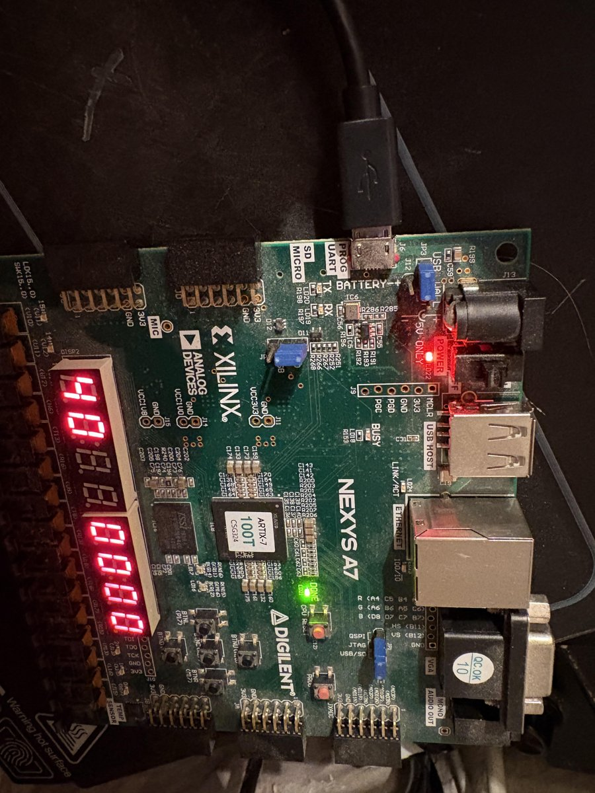

# FPGA_Design_Agent

**An agentic FPGA design environment: from a plain-English request to a bitstream proven on the board.**
Site: **[fpga-design-agent.vercel.app](https://fpga-design-agent.vercel.app)** (built from [site/](site)).

**What it does.** Describe a block in plain English. Language-model agents interview you about what you left out, write
the spec, a model of it, the tests and the SystemVerilog, then drive the simulators and Vivado 2026.1 through synthesis
and place and route to a bitstream, stage by stage in the order of AMD's UltraFast design methodology, and test it on a
Digilent Nexys A7-100T (Artix-7). Every stage ends in a gate run by code, not by a model; inside the loop the gates run
the agent's own tests. On benchmark tasks a run is scored only by hidden tests written against an independent model of
the spec and checked by mutation testing, never by the agent's own tests. A controller in code picks the next stage. The
run always stops for a person before anything touches the board; review of each stage's result is opt-in (`--review on`,
off in every recorded run), and otherwise the spec counts as signed off once no question is left open.

**What has been measured.** On 11 development tasks, 13 of 21 runs with Anthropic's Claude Sonnet (`claude-sonnet-5-5`,
through Claude Code) passed every hidden test. In 6 more the agent's own checks passed and the hidden tests failed (an
"escape"), each time because it read the spec differently from the test author; the fixes made since are not yet
measured ([results](https://fpga-design-agent.vercel.app/results), from `results/course/*/run_*.json`). A hand-written
reference design passes all its tests on the board ([bring-up on hardware](#bring-up-on-hardware)). One agent-built
design, from a short trial run of the Deep Agents harness on the small LED-dimmer design, has been programmed onto the
board: its serial-link tests passed (3 of 3) and its logic-analyser captures failed
([record](results/f2/agent_luna_05c2_run7_bringup.json)), so no design the agent built has yet passed every test on the
board.

**What is not yet shown.** There is no held-out score. Development tasks are the ones used to find and fix faults,
so their results are a record of the work, not a measure of how the agent does on new tasks. The first held-out
evaluation (`eval-1`) was stopped on 2026-11-09 before any result was analysed and reports nothing; a baseline
evaluation on a larger benchmark comes next.

**Who designed what.** Designed by Brendan Lynskey: the staged flow and its gates, the split between the agents that
write the design and those that write the tests, the hidden-test benchmark checked by mutation testing, the knowledge
bank, the board shell and bench, and the pre-registered evaluation method. The models write the specs, tests and RTL
inside it.

The flow itself was proven first, by hand on one small design, with machine-checked gates, before any model touched
it (the first two milestones, F0A for the build and F0B for the board). Everything the agent produces has the same
shape as `designs/t1_dimmer_counter/`.

How the agent was built, evaluated and improved (a timeline, an experiment card for each test including the nulls and the stopped
evaluation, the method and the improvement loop): the site's "How it was built" page, source `site/story/story.yaml`, with the
measured lessons in [docs/agent_lessons.md](docs/agent_lessons.md).

How the designs are verified (simulation, hidden tests, coverage, mutation testing, protocol checkers, formal proofs, clock-crossing checks, static checks, the board and traceability, each with what it cannot find and its measured evidence): the site's "Verification" page, source `site/verification/verification.yaml`.

More boards (brief 95): the agent has a board file for 20 boards, each with a trust label (`documented`, `built` or `hardware`) computed from the evidence on
disk, a smoke design generated from the board's own pins, and a request that names a board (`python -m agent run <spec> --board "the PYNQ-Z2"`) picks its file:
[docs/board_catalogue.md](docs/board_catalogue.md) (the table), [boards/SCHEMA.md](boards/SCHEMA.md) (the file format and how to add a board),
[docs/demo_intake.md](docs/demo_intake.md) (what to ask someone who wants a demo), [results/95_boards](results/95_boards/README.md).

Showcase pages for projects built with the agent follow one template: [docs/showcase_pages.md](docs/showcase_pages.md).
Every design, `ip_lib` entry and results folder is documented for the next engineer to
[docs/documentation_standard.md](docs/documentation_standard.md) (brief 68): each design has one `handover.yaml` (the facts,
numbers filled from the records by code) rendered as `README.md` for people and a compact `AGENT.md` for the agent;
`flow/doccheck.py --check` enforces it in CI. The agent writes the same handover for its own work at the end of every run
and can pick older work up again from one (`python -m agent resume <design> "<change>"`): [docs/agent.md](docs/agent.md),
with three recorded runs documented by the agent in [results/68_agent_docs](results/68_agent_docs/README.md).
Design review mode (`python -m agent review <design-dir>`, read-only; findings with severity, place, evidence, rule, fix and confidence; improvement-request plans): [docs/review.md](docs/review.md), with the pre-registered benchmark results in [results/84_review/README.md](results/84_review/README.md).
Managed projects (brief 102, stage 1): a design may carry a `project.yaml` that marks each component `owned`, `frozen` or `excluded` and
lists the level it arrives at (RTL or an externally made netlist) and its interface contract. Ownership and the request's scope are enforced in the agent's tools,
not in a prompt; excluded parts are hidden from the agent and still built and signed off; an imported netlist is checked (interface, licence, simulation, `eqy`
against the supplier's RTL, boundary CDC and timing budgets) and given a trust label computed from evidence: [docs/managed_projects.md](docs/managed_projects.md),
the demonstration [designs/b102_managed_fcs](designs/b102_managed_fcs/README.md) and [results/102_managed](results/102_managed/README.md).
Stage 2 adds a block that arrives already placed, routed and locked (`level: placed_routed`): a keep-out region its owners' constraints and the RapidWright tools must respect,
an import check of the lock and the footprint, and placement evidence (the block relocated by RapidWright and re-placed around, its internal interconnect delays compared, in picoseconds,
with Vivado as the referee): the demonstration [designs/b102_managed_pr](designs/b102_managed_pr/README.md) and [results/102_managed_pr](results/102_managed_pr/README.md).
Stage 3 integrates one real third-party RTL block (Alex Forencich's parallel CRC/LFSR from verilog-ethernet, MIT) as a frozen component vendored unmodified, with its licence, upstream commit and a hash per file checked against the source and a provenance report of what is theirs and what is ours: the demonstration [designs/b102_managed_ext](designs/b102_managed_ext/README.md) and [results/102_stage3](results/102_stage3/README.md).
Brief 102F closes the stage 1-3 gaps: the waiver files (`lint/`, `waivers.yaml`, in-source waivers) are the owner's, writes to frozen files are prevented while a tool runs design code (and mounted read-only in the container runner), the scope is in `config.json`/`summary.json` and re-checked by `resume`, and evidence signing is proposed: [docs/managed_projects.md](docs/managed_projects.md) and [results/102f_managed_gaps](results/102f_managed_gaps/README.md).
A portfolio pack (title, facts with their sources, stills and a short animation) is in [site/portfolio/](site/portfolio/README.md).

## The flow

```
  spec.md (natural language)
     |
     v
  [1] clarify ......... spec.yaml: ports, pins, clocks, reset, latency, assumptions + reasons,
     |                  open questions; a human signs it off
     v
  [2] architecture .... block diagram, clocking plan, every clock-domain crossing
     |
     +-------------------------------+
     v                               v
  [3] golden model               [4] RTL + XDC
      model.py, from spec.yaml       SystemVerilog, pins from the board XDC,
      alone (never sees the RTL)     false paths for asynchronous inputs
     |                               |
     +---------------+---------------+
                     v
  [5] verify ........ cocotb + Icarus: RTL against the model, directed + random;
                     |  Verilator lint; deliberate mutants must fail the tests
                     v
  [6] implement ..... flow/run_vivado.sh: non-project Vivado Tcl in UltraFast stages (UG949): RTL DRCs,
                     |  synth + QoR assessment, place, route, closure reports, bitstream
                     |  (memory-guarded: one job, 1 thread, 6 GB cap; optional ILA from probes.yaml)
                     v
  [7] gates ......... flow/gates.py, stage by stage: RTL methodology; post-synthesis coverage, DRC,
                     |  methodology, QoR score (absent on the 2026.1 Basic tier); post-place hold; post-route slack, CDC, junction
                     |  temperature; bitstream present. Names the first stage that failed
                     v
  [8] bring-up ...... BRINGUP.md for a tester who did not design it, plus the test shell:
                     |  every design answers over the USB-UART, so a script can test the board
                     v
  [9] on the board .. flow/bringup.py: discover, program SRAM by cable serial, UART tests against
                        the model, ILA captures against the model, one JSON result       (F0B)
```

Steps 1-8 were done by hand for F0A. Since F2 the agent does steps 1-8 itself, and only the passes of the
**independent** checks (the hidden tests, the formal checks, the gates, the hardware) count; its own testbench never does.

## What F0A proves

| Piece | Where | Checked by |
|---|---|---|
| Memory-safe Vivado runner (refuses to start beside another Vivado or below 7 GB free; 6 GB cap; records time and peak memory) | [flow/run_vivado.sh](flow/run_vivado.sh) | local builds, [results/f0a_2026_1](results/f0a_2026_1) |
| Non-project Tcl flow with the reports the gates need | [flow/build.tcl](flow/build.tcl) | local builds |
| Gates over the reports, one JSON per build | [flow/gates.py](flow/gates.py) | CI: parser tests against real passing **and** deliberately failing Vivado reports |
| ILA insertion from a probe list, built both ways, cost recorded | [flow/debug.tcl](flow/debug.tcl) | local builds |
| A reusable on-board test shell (UART register protocol, host driver, model) | [shell/](shell/), [PROTOCOL.md](shell/PROTOCOL.md) | CI: cocotb against the model, including 115200-baud bit timing |
| One hand-written T1 design from spec to bitstream | [designs/t1_dimmer_counter](designs/t1_dimmer_counter) | CI: cocotb against the model + mutants; local: gates |
| Board files | [boards/nexys_a7_100t](boards/nexys_a7_100t); the catalogue of 20 boards in [boards/catalogue.yaml](boards/catalogue.yaml) | Digilent master XDCs (MIT, listed in [THIRD_PARTY_NOTICES.md](THIRD_PARTY_NOTICES.md)) at a pinned commit; trust labels computed from evidence by [test_95_boards.py](flow/tests/test_95_boards.py) |

The T1 build numbers on Vivado 2026.1 (timing, utilisation, ILA cost, run time and memory) are in
[results/f0a_2026_1/t1_dimmer_counter.md](results/f0a_2026_1/t1_dimmer_counter.md); every one comes from the JSON next to it
([results/f0a_2026_1/README.md](results/f0a_2026_1/README.md) lists the files).
Programming the board and testing on hardware is milestone F0B (below).

## Bring-up on hardware
```bash
python3 flow/bringup.py designs/t1_dimmer_counter
```

One command, no human in the loop: it checks the power gate (`power_ok`: on USB power, as in F0B, a bitstream is
programmed only if `report_power` says at most 0.5 W; see "Board onboarding" below for wall power), finds the one attached board by its JTAG cable serial and
its UART, programs the base build into SRAM (never flash), runs 8 UART tests that compare every response byte with
the shell and T1 models (identity and build stamp, 1,004 scratch loopbacks, error responses, timeouts, framing
errors, the T1 registers), programs the ILA build, arms the ILA by Tcl in step with UART writes, and checks four
captures cycle by cycle against the model (a COUNT write; the PWM at three dimmer levels). It writes
`results/<milestone>/t1_dimmer_counter_bringup.json`.

Measured on Vivado 2026.1 builds ([results/f0b_2026_1](results/f0b_2026_1/README.md), wall power): the passing run's steps took
123.5 s: 8 of 8 UART tests, 4 of 4 ILA captures, LED on-time exactly as the model predicts at DUTY 0x08, 0x40 and 0xA0
(the ILA build uses one ILA IP with packed probe ports, the route the free Basic licence tier allows). An earlier run
failed at the ILA step on a probe-file fault the flow now repairs (`flow/ltx_fix.py`). The tests that need the board are marked `hw` and skipped in CI; CI re-checks
the committed captures instead.

Manual checks by the owner, made on the bitstreams of an earlier Vivado release and not repeated on 2026.1 (buttons count as specified, three visibly different dimmer levels):
[results/f0b/manual_checks.md](results/f0b/manual_checks.md).



## Board onboarding
Before an agent designs for a board it must know what is on it. For the Nexys A7-100T:

- [boards/nexys_a7_100t/inventory.yaml](boards/nexys_a7_100t/inventory.yaml): every peripheral a design can reach
  (temperature sensor, accelerometer, PDM microphone, PWM audio, Ethernet PHY, USB HID host, USB-UART, QSPI flash,
  DDR2, microSD, XADC) with part, interface, pins, I/O standard, IDs, reset, pull-ups, clocking, a self-check,
  current and whether it is safe on USB power, and a source for every field (reference manual, schematic Rev D.0
  and D.3, data sheets). [tools/inventory_check.py](tools/inventory_check.py) checks every pin against the master
  XDC in CI. Digilent's own demo projects are listed by name only, so later benchmarks can avoid them.
- [boards/nexys_a7_100t/power_budget.md](boards/nexys_a7_100t/power_budget.md): regulators, shared rails, the
  FPGA's thermal limit in still air (thetaJA 18.2 C/W, so about 2.5 W reaches 85 C in a 40 C room). The power gate
  (`flow/hw.py` `power_ok`) now depends on how the board is powered (0.5 W on USB, 2.0 W on wall power, junction
  temperature and rail currents too), and `report_power` is run for the board's real thermal environment.
- Four read-only self-check designs, each with its pass rule pre-registered and a device model in simulation,
  proven on the board 3 times each with `flow/board_check.py` (board outcomes in [results/board_v2](results/board_v2/README.md);
their bitstreams were built on an earlier Vivado release; all four rebuild on 2026.1 with every gate passing, not yet
programmed: [results/vivado_2026_1_remeasure/b2_builds.json](results/vivado_2026_1_remeasure/b2_builds.json)):
  [b2_tmp_adt7420](designs/b2_tmp_adt7420), [b2_acl_adxl362](designs/b2_acl_adxl362),
  [b2_qspi_jedec](designs/b2_qspi_jedec) (flash ID only: no write or erase opcode exists in its RTL, which a test
  checks) and [b2_mic_pdm](designs/b2_mic_pdm).

## The UltraFast methodology as the backbone
The flow and the agent's stage machine follow AMD's UltraFast Design Methodology (UG949 v2026.1) stage by stage:
board and device planning, RTL, constraints, synthesis, implementation, timing closure, power closure, DRC
closure, configuration and debug. [docs/methodology.md](docs/methodology.md) maps UG949's chapters to the plan's
flow steps, the reports `flow/build.tcl` writes and the gates `flow/gates.py` applies (with every threshold cited
to UG949), says where the flow deviates from UG949 and why, and defines the agent's stage machine for F2. The
per-stage procedures the agent reads (exact Tcl, thresholds, common failures) are nine skills in the private
knowledge bank. T1 built through the staged flow on Vivado 2026.1 passes every stage
([results/f0a_2026_1](results/f0a_2026_1/t1_dimmer_counter.md)); the post-route QoR-assessment gate is absent on the free
Basic licence tier, not passed.

## Knowledge packs
The agent's know-how is a set of frozen, hashed knowledge layers in Agent Skills format: generic RTL skills, an AMD
vendor layer built from AMD's open Ross skills (as shipped, and distilled for this batch flow), an Artix-7 device
layer, a Nexys A7 board layer, and an offline searchable library. Since F1A2 the generic layer is a pinned tag of a
separate private generic RTL pack. They summarise AMD and Digilent documents, so they live in a
private repository; [knowledge/PACKS.md](knowledge/PACKS.md) lists each layer's size and hash, which every scored
run will record. [docs/debug_playbook.md](docs/debug_playbook.md) is the human companion to the gates.

Since brief 31 the bank also holds a device-family matrix (where AMD advice differs between 7-series, UltraScale+
and the two Zynq processing systems). The agent reads the target `part` from `build.yaml` and the bank loads only that
family's layer ([agent/tests/test_31_family_selection.py](agent/tests/test_31_family_selection.py)); each area on the
expertise page lists its family differences from [site/data/family_diffs.json](site/data/family_diffs.json).

Brief 36 adds skill routing behind a flag (`--skill-routing router`, off by default): a router node before each stage puts a
ranked shortlist of skill names and one-line descriptions into the role's prompt, and the roles load bodies on demand
(`load_skill(name=...)`, `skill_excerpt`, `skill_index`), over a hybrid BM25 plus embeddings index that also runs as a small
container. Measured on 12 labelled development tasks it did not beat today's section-filtered `load_skill` on recall, but it
cuts what a role reads from the knowledge tools ([docs/skill_routing.md](docs/skill_routing.md),
[results/36_skill_routing](results/36_skill_routing/retrieval.md)).

Brief 42 (harness engineering) adds three flags (`--harness-arm H1`, `H2` and `H9`). H1 is the default for development runs (owner decision,
2026-11-12, made after the data and not pre-registered); the baseline is `--harness-arm A0`, and H2 and H9 stay off unless
named. H1 manages the role agents' context: large tool results go to a file with a head-and-tail preview, and the
conversation is summarised from 40,000 tokens instead of 170,000. H2 protects against hangs: a static check refuses a cocotb
bench with an unbounded wait loop, `simulate` runs under a wall-clock watchdog derived from the bench's own simulation-time
budget, and a hang comes back as a structured result naming the test and the simulation time. H9 replaces large build, gates,
simulate and lint results with a deterministic typed digest (new tool `report_digest`). Measured on 4 tasks and 3 repeats with one
low-cost model: H1 used 33 % less cost (interval excludes 0), but its token and wall-time savings were not separated from the
baseline, and the pre-registered rule can be read either way, so the default is a decision rather than a pre-registered result;
scored benchmark and eval runs record their arm (`config.json`, `summary.json` key `harness_arm`) and frozen configurations pin A0; H9 saved 16 % of cost (below the 30 % bar); H2 did not separate from the
baseline; and two of the four tasks are never passed by any arm
([results/42_workflows/README.md](results/42_workflows/README.md), [analysis](results/42_workflows/analysis.md),
[runs](results/42_workflows/runs.md), [pre-registration](results/42_workflows/prereg.md)); the audit script is
[agent/tools/harness_audit.py](agent/tools/harness_audit.py).

## The agent core
The flow's tools as a harness-neutral core: typed functions with JSON schemas, the same tools as an MCP server
(`python -m agent.mcp_server`), a security layer enforced in code (path jail, no free-form Tcl or shell, hardware
policy, redaction, audit log), and one trace format with replayed-trace CI. No language model is called.
[docs/agent_core.md](docs/agent_core.md) has the tool list, the security rules with their tests, the known gaps
and the trace format; results of the real-tools smoke run are in [results/f2](results/f2).

## The agent
A LangGraph + Deep Agents agent over the stage machine: gates decide every stage exit; the Clarifier, the Modeller, the Verifier
and the Designer are separate sub-agents whose inputs are enforced in code; a "grill me" spec interview
(human, or a spec oracle that answers only from a hidden full spec); a review page at every stage end with approve /
edit / rewind (files and Vivado checkpoints restored and hash-checked); agent-written benches run in a no-network
container. `python -m agent run|resume`; details in [docs/agent.md](docs/agent.md).

### The Claude Code arm (05c, F2 part 3)

The same graph with each sub-agent turn run by headless `claude -p` on a Claude subscription, configured to
approximate a plain API call: our system prompt replaces the default, built-in tools off, only our MCP server, an empty
home and config. `python -m agent run ... --harness claude_code --cc-model claude-haiku-5-5`; details in
[docs/claude_code_arm.md](docs/claude_code_arm.md). The same release has four agent fixes from the 05b diagnosis (spec
schema, model API contract, integer cycle-count timing parameters, superseded files).

## Closure loop and design-time plan

When a design passes simulation but misses timing, area or power, the closure loop edits the RTL, re-checks simulation
on an independent bench, rebuilds, and keeps a change only if it helped and broke nothing. It stops when every goal
holds or with a report of what it tried. Before the first build, a design-time plan maps each arithmetic chain to DSP
slices, block RAM or logic and picks the pipeline depth from a measured delay model.

On Vivado 2026.1, one run per case:
- the c13_hough_lines reference, which misses 100 MHz, closed in one iteration with and without the plan;
- seeded timing misses closed in 1 of 3 cases (c16_montgomery_mult at 200 MHz);
- the Designer working from the plan failed the hidden bench in all 6 attempts.

The second phase made it one joint loop. Every build's timing, power, DRC and methodology are diagnosed together, and
one planner picks fixes that do not conflict, preferring DSP slices, block RAM and shift registers. Each change is
checked after synthesis before any implementation run. A fix the spec or the architecture owns goes back to that
stage. Closure is claimed only after a sign-off: the bench again and every flow gate on the accepted files. Each
attempt is logged as data for choosing fixes. Seeded on the c13 reference, a block RAM budget of 1 and a power budget
of 0.145 W were both closed and signed off, in 3 and 4 iterations, one run each.

How it works, terms and commands: [docs/closure_loop.md](docs/closure_loop.md). Results and caveats:
[results/62a_closure](results/62a_closure/README.md), [results/62b_closure](results/62b_closure/README.md). Both steps are off by default (`--design-plan`, `--closure on`).

## The benchmark
Benchmark v1 for scoring the agent: 24 natural-language tasks for the Nexys A7 (12 T1 blocks, 12 T2 peripherals),
each with a hidden full spec, an independent golden model, cocotb acceptance tests, deliberate mutants, a trap test
where a textbook or demo twin exists, an on-board check and a reference design built through every flow gate. A
third of each tier is held out by a seeded draw and lives in the private repository; a 40-spec training pool for
P1 and an 18-task contamination probe sit beside it. Frozen and hashed: [benchmark/README.md](benchmark/README.md),
[benchmark/FROZEN.md](benchmark/FROZEN.md), the owner's checklist [benchmark/OWNER_REVIEW.md](benchmark/OWNER_REVIEW.md).

A separate course tier (07a1) ports the course projects of Parts 9-16 to the same layout, with its own split and freeze:
[benchmark/course/README.md](benchmark/course/README.md), [benchmark/course/FROZEN.md](benchmark/course/FROZEN.md).

Each course run is recorded in `results/course/<task>/run_N.json` with the escape-rate fields (internal pass, hidden
pass, outcome, escape level, tool runs, tokens, cost; 08a): [tools/run_record.py](tools/run_record.py) derives and
back-fills them, [results/course/summarise.py](results/course/summarise.py) prints per-task pass counts, pass@1/pass@k
and escapes by level.

## From one run to a design environment
[docs/design_environment.md](docs/design_environment.md) proposes how the single-spec run becomes the inner loop of a
project of many modules: a `design.yaml` module graph with an interface contract per module, an interface-first spec
session, parallel module loops under the machine's Vivado limits, a top generated from the contracts, natural-language
changes that re-enter at the earliest stage whose inputs changed (worked out from input hashes, not by the model), and
ownership marks so that the engineer's own edits are never overwritten.

Stage P0 of the pilot is built ([docs/project_layer.md](docs/project_layer.md)): the `design.yaml` and `contract.yaml`
schemas and checkers, stage keys from input hashes, `python -m project status` with a static dashboard, and a generator
that turns a contract into a cocotb contract test (proved on fixture RTL with ten deliberate violations). The worked
example is pilot 1, a 720p test pattern through a 3x3 median filter ([project/examples/video_median](project/examples/video_median)),
described with hand-written evidence; nothing in it is measured yet.

Stage P1 adds phase 0, the spec session (`python -m project spec`, [docs/project_layer.md](docs/project_layer.md#phase-0-the-spec-session-stage-p1)):
from the user's `system/spec.md` it writes the requirements, `design.yaml` and the contracts, all checked; the harness
asks one question per contract field the spec does not state, and every unanswered question is written down as an
assumption. Measured on two development-split specs with the spec oracle: [results/27b_p1](results/27b_p1/results.md).

## Assurance and traceability

For every requirement of a design, which test or proof shows it is met, did that evidence pass, and what did it cover:
[docs/traceability.md](docs/traceability.md). The output is DO-254-style evidence (DO-254 is the design-assurance
guidance for airborne hardware), a record of what was verified and how; it is not a claim of compliance with any
standard.

- **The matrix.** [flow/traceability.py](flow/traceability.py) builds requirement to design element to test or proof to
  result to coverage, from `spec.yaml`, requirement tags in the source (above a cocotb test: `@req("REQ-03")` from
  [flow/req.py](flow/req.py) or a `# req: REQ-03` comment; `// req:` on an assertion; `# req:` in a formal job) and the
  run records. Its gates name any requirement, test or coverage hole left without evidence (the gate table is in
  docs/traceability.md). [flow/trace_tag.py](flow/trace_tag.py) migrates an existing design from its testplan.
- **Requirement quality.** The clarify stage rejects compound and vague requirements; T1's three compound ones were split.
- **Change record.** [flow/change_record.py](flow/change_record.py): input hashes, tool versions, knowledge-bank pin
  and flow commit (from the build manifest when present), and what changed since a baseline.
- **Check suite (brief 71).** One agent tool, `check`, over a registry of every design check (lint, standards, resets,
  CDC, methodology, DRC, exceptions, I/O, clocking, DSP/RAM mapping, control sets, FSM coverage, AMD IP notes, link plan,
  DOC gate, AXI4-Lite interface profiles), returning a short digest; the sign-off gates call the same registry: [docs/check_suite.md](docs/check_suite.md),
  [flow/checks](flow/checks), results in [results/71_check_suite](results/71_check_suite/README.md).
- **Reset conventions (brief 70).** Measured costs of reset polarity and style on Artix-7 and UltraScale+, a survey of how AMD's own IP
  and generated block designs use resets, an audit of our RTL, and the `resets` check's cost notes: [results/70_resets](results/70_resets/README.md).
- **HDL coding standard FDA-HDL v1.2.** [docs/hdl_coding_standard.md](docs/hdl_coding_standard.md),
  [flow/hdl_rules.yaml](flow/hdl_rules.yaml), checked by [flow/lint_ruleset.py](flow/lint_ruleset.py) (Verilator lint,
  Vivado methodology, DRC and CDC, the design-standards checker), with waivers recorded.
- **Lean 4 (brief 124).** [docs/lean_assessment.md](docs/lean_assessment.md): where a proof assistant would and would not help beside SymbiYosys, a dated survey of
  hardware proofs in ITPs and of LLM-plus-Lean work on RTL; the experiment is [formal/lean](formal/lean/README.md)
  (the checksum equations of brief 119's TCP fast path proved for all inputs by a model, checked by Lean's kernel; records in [results/124_lean](results/124_lean/README.md)).
- **Lean as a "proved for all widths" evidence tier (brief 125).** The `formal_lean` method of [the schema v1 matrix](docs/traceability_v1.md#lean-proofs-formal_lean-brief-125)
  ([flow/lean_tier.py](flow/lean_tier.py)): a theorem statement is the specification and a human approves it (`verif/lean_approvals.yaml`; until then the matrix says "statement not approved"
  and does not count the proof); since brief 135 the planner's acceptance on the owner's delegation is a second, separately shown and separately counted kind (`agent_delegated`, never a human approval), an approved statement that changes fails the gate, the axiom tier (kernel only, or with a compiled decision procedure) and the RTL link (a proof of a transcription,
  transcription tested, is shown as different from a proof about the RTL) are always printed, and the build status comes from `lake build` where Lean is installed and from a committed hash-pinned record
  (shown as "recorded build") in CI. Also a `proof` purpose in the [model table](docs/model_config.md) and a [proof driver](formal/lean/tools/prove.py); the gray-code lemma for every width
  ([formal/lean/Gray](formal/lean/Gray/Spec.lean), proved by a model in two rounds, statements for the owner's approval; records in [results/125_lean](results/125_lean/README.md)).
  hardware proofs in ITPs and of LLM-plus-Lean work on RTL, and a proposed `formal_lean` evidence method; the experiment is [formal/lean](formal/lean/README.md)
- **Tool-assessment notes** for Vivado 2026.1, Icarus, Verilator, SymbiYosys, cocotb and our gates:
  [docs/tool_assessment/](docs/tool_assessment/README.md).
- **Specification to evidence, schema v1 (brief 116).** The human specifies the requirements (functional, performance, interface, safety) and checks that
  the verification is thorough enough; the agent holds the knowledge to implement and verify; you can open any of it and do not have to.
  [flow/trace_v1.py](flow/trace_v1.py) reads each `designs/*/verif/testplan.yaml` and the evidence files it names, computes pass, fail, not run, stale or
  bounded per item (never typed), rolls them up per requirement (a performance requirement is verified only by a measured value inside its bound), and
  writes a matrix per design and [a project roll-up](docs/traceability_matrix.md). Hardware verification on the board, by instrument, is its own method, and a
  requirement that depends on an external element shows plainly whether hardware has closed it. The CI gate fails on an orphan check or an untraced requirement
  and reports staleness. Showcase: [designs/b96_kr260_10g/verif/matrix.md](designs/b96_kr260_10g/verif/matrix.md); schema and rules:
  [docs/traceability_v1.md](docs/traceability_v1.md); also on the site's Traceability page and the navigator's Traceability page.
- **Fresh evidence (brief 143d).** CI reads committed evidence records; it did not regenerate them. The nightly workflow
  [.github/workflows/fresh-evidence.yml](.github/workflows/fresh-evidence.yml) re-runs the cheap evidence from the current tree and opens an issue when a committed record differs;
  [flow/fresh_evidence.py](flow/fresh_evidence.py) does the runs and the comparison, [tools/fresh_evidence_local.sh](tools/fresh_evidence_local.sh) the expensive set on the local PC
  (timer proposed in [tools/systemd/](tools/systemd/), not enabled), and `python -m flow.trace_v1 show --fresh DIR` marks an item "committed record differs from fresh run";
  see [docs/traceability_v1.md](docs/traceability_v1.md#fresh-evidence-brief-143d).
- **Results:** the matrices of T1 and two agent-built development designs, and three deliberately broken runs that
  each fail the right gate: [results/53_traceability](results/53_traceability/README.md).

## Reproduce

Simulation, lint and the Python tests (what CI runs):

```bash
python3 -m venv .venv && .venv/bin/pip install pyyaml pyserial pytest cocotb==2.0.1   # plus iverilog (apt)
.venv/bin/python -m pytest -q                                   # models, gates parser, host driver, cocotb
designs/t1_dimmer_counter/tests/run_mutants.sh                  # every deliberate bug must be caught
flow/lint.sh                                                    # needs Verilator
```

The bitstream (local only: **Vivado 2026.1** at `/opt/Xilinx/2026.1`, at least 7 GB of available memory (the runner checks), Linux
with `systemd-run --user`):

```bash
flow/run_vivado.sh designs/t1_dimmer_counter both     # base, then the ILA build; gates run after each
python3 flow/summarise.py designs/t1_dimmer_counter --out results/<new folder>   # never over a committed record
```

Vivado does not run in GitHub Actions (the install is about 100 GB); its results are committed under `results/`.

Faster Vivado (brief 33): the runner reuses an earlier build of the same inputs (a cache hit runs no Vivado; an earlier
stage reached resumes from its checkpoint), takes its thread count from `FDA_VIVADO_THREADS`, and can hash a build's
placement and routing. Measured on Vivado 2026.1 in [results/33_vivado_speed_2026_1](results/33_vivado_speed_2026_1/results.md).
For batches too big for the build PC, [cloud/](cloud/README.md) has a design and scripts for an AWS EC2 burst runner
(owner-run; not yet run against AWS).

## Layout

```
flow/        runner, Tcl flow, ILA insertion, gates, summaries, lint, cocotb helper; board discovery,
             programming, ILA capture and bringup.py (F0B); board_check.py (04c)
flow/ipgen/  external design tools driving AMD IP configuration (brief 19): the xsim file-I/O harness, FIR and CIC adapters
             (scipy design -> .coe/CONFIG.* -> create_ip read-back -> bit-exact xsim check -> OOC synthesis), the signal-chain
             model and diagram; worked examples in results/19_ipgen_2026_1/
flow/net/    packet-processing evidence (brief 40): scapy traffic, Python golden models, the bench runner (Icarus; xsim
             optional), seeded-fault runner, line-rate measurement, ip.yaml checker and README generator
arith/       the arithmetic library (brief 139b; [arith/README.md](arith/README.md)): divider, rounding, square root, leading-zero count, each with spec, model, variants, proofs and a rerunnable harness
ip_lib/      the project's own IP library ([ip_lib/README.md](ip_lib/README.md)); first entries: the brief-40 networking
             blocks (RMII MAC, parser, exact/LPM/ternary tables, rewrite, queues and schedulers, L2 switch); entries can hold
             several implementations, each with a measured cost ([docs/ip_variants.md](docs/ip_variants.md),
             flow/ipvariants.py, flow/ipchar.py) and a FIR entry with four variants; the
             tri-mode RGMII MAC ([ip_lib/eth_mac_rgmii](ip_lib/eth_mac_rgmii/README.md)) with its 0.2 filter, VLAN,
             pause, statistics and jumbo frames, and the network blocks (MDIO, ARP, ICMP echo, IPv4/UDP
             receive and transmit, IGMPv2), run together in [designs/b63d_nexys_net](designs/b63d_nexys_net/README.md)
arith/       the arithmetic library (brief 139a, [arith/README.md](arith/README.md)): integer adders/subtractors, multipliers and
             multiply-accumulate, each with a specification, a bit-exact model, 3 RTL variants, simulation against the model with seeded faults,
             SymbiYosys equivalence, Lean statements, a traced testplan and prepared (not run) out-of-context Vivado builds for Artix-7 and K26
             and (brief 139d) the elementary functions exp2, log2, sincos and atan2/magnitude: table-plus-polynomial and CORDIC variants with measured error bounds
             (briefs 139a, 139e, 148 and 161 add adders, multipliers, floating point and the frequency-domain suite: an FFT with AXI4-Stream wrappers and helpers, block floating point, a 2-parallel FFT and AXI fast convolution: [docs/fft_suite_plan.md](docs/fft_suite_plan.md))
flow/blockdesign/  block designs (brief 65A, [docs/blockdesign.md](docs/blockdesign.md)): the YAML format and its schema, the
             validator, connection/clock/reset automation, the address editor (C header), the generator, the viewer and the
             check of the viewer's graph against the synthesised hierarchy; worked example designs/b65a_axil_soc
debug_core/  debug on the board from a plain-English request (brief 50A, [docs/debug.md](docs/debug.md)): the request parser,
             the RTL-name resolver, the plan, debug builds per probe set, the instrument drivers (vendor ILA, mock),
             the common capture format with VCD, the answer and queries, the static viewer; demo_t1.py (the board demo)
flow/handover.py, flow/doccheck.py  documentation (brief 68): handover.yaml to README.md and AGENT.md, and the checker;
             agent/graph/document.py (the agent's DOC step and gate) and agent/graph/pickup.py (resume from a handover)
shell/       the test shell: RTL, protocol, host driver, model, tests
boards/      board files (Nexys A7-100T: board.yaml, master XDC, inventory.yaml, power_budget.md; KR260: board.yaml, kr260-pins.xdc; the catalogue's other boards)
             and the board catalogue (brief 95: catalogue.yaml, SCHEMA.md, 18 more board directories with their smoke designs)
tools/       inventory_check.py (board inventory against the master XDC); git_guard.py (the tests must not move the checkout they run from; checked at the end of every pytest session by conftest.py)
agent/       core/ (tools, security, trace, replay, smoke) and mcp_server/ (05a); tests/ with the replay fixture
project/     the project layer (brief 27 P0): design.yaml and contract.yaml checkers, stage keys, status and dashboard,
             the contract-test generator; examples/video_median (pilot 1, described); tests/ with fixture RTL;
             phase0.py (brief 27 P1: the spec session) and phase0_format/ (the drafter's format example)
designs/     one directory per design: spec.md, spec.yaml, model.py, rtl/, design.xdc, probes.yaml,
             build.yaml, tests/, BRINGUP.md
benchmark/   benchmark v1: tasks (development split), training pool, bench library and tools, manifest, owner review;
             benchmark/course/: the course-tier tasks (Parts 9-16), splits, manifest
showcase/    showcase projects that are not yet designs (brief 78: codec_audio, the spec, model, register file and measurement scripts; brief 79: pdm_decimator, the PDM microphone to 48 kHz audio path: spec, model, measurement scripts)
results/     committed build and bring-up results, per milestone
cloud/       the AWS EC2 burst runner for Vivado batches (brief 33): fda_cloud.py (start, status, sync, run-batch,
             fetch-results, stop; budget, auto-stop), instance/ scripts, BUILD_AMI.md; tests against mocked EC2
axi_tx/      the on-chip AXI transactor: rtl/ (sequencer, AXI4-Lite master, stream source and sink, rule monitors,
             counters, scoreboard, demo targets), host/ (program format, model, host, board runner), programs/, tests/,
             formal/ (rule proofs and checker mutants), vivado/ (AMD IP probe, resource table); board design designs/b59a_axi_tx
amd_ip_probe/ black-box probes of AMD's AXI4-Lite IP in simulation (brief 69): run_probe.py, tb/ (one bench per IP and the shared
             transactor/checker harness), summary_spec.py and summarise.py (the summary table), tests/; results in
             results/69_amd_ip_conventions; the agent's note is flow/amd_ip_notes.py
hwsw/        the HW/SW interface (brief 64A, [docs/hwsw.md](docs/hwsw.md)): regmap.py (one YAML -> AXI4-Lite register block,
             C header, Python driver, markdown, and the check that they agree), partition.py (the cost model: software,
             custom instruction, accelerator; break-even, Amdahl, decision), cfu.py (an ip_lib entry with a function-unit
             contract -> a CPU custom-instruction unit, EX-stall or MEM-completion style), cfu_core/ (a pinned copy of
             the BRV32P RV32 core, the patches that wire a unit in, the benchmark), regmap_ooc.py, examples/, tests/
hil/         hardware-in-the-loop ([hil/README.md](hil/README.md)): cdc_soak/ (the CDC soak rig, brief 11b: RTL, simulation, Vivado builds, run plan);
             instruments/ (drivers: board lock, shell instruments, audio, sysmon, M2K, Pluto analyser, Red Pitaya, decode, models), ip tests
site/        the showcase site (static, Vercel): export.py (results -> data), build.py (pages, number check),
             leak_guard.py, src/, data/, public/, tests/; the preview link is in the pull request;
             problem catalogue: catalogue.yaml + catalogue_parts/ (domains, descriptions), catalogue_pages.py,
             traces/ (one adapter per task that runs its hidden/model.py for the page animation)
             agent page ("The agent"): agent_arch.py (the LangGraph and role agents read from agent/graph -> data/agent_graph.json),
             agent_page.py (its SVG figures); a site test fails if the drawn graph differs from the compiled one;
             its harness section reads the role agent's middleware, tools and limits from the code (agent_arch.harness)
             home page's feedback loop (brief 47): [loop.py](site/loop.py) (stations, labels from run records, the replayed
             tour -> data/loop.json), [loop_page.py](site/loop_page.py) (the SVG), [data/loop_legs.yaml](site/data/loop_legs.yaml)
             (each leg of the loop: automated, being built, or needs a person, with evidence; "legs automated: N of M")
             story pages (brief 117): the home page leads with who specifies, who implements and who judges, a flow figure with
             hardware verification as its own layer, and an evidence matrix; [worked.py](site/worked.py) reads
             [worked/worked.yaml](site/worked/worked.yaml) and the committed records (each fact is a JSON locator or a quote that
             must occur in the record) -> data/kr260.json; pages "Worked example" (the KR260 10G path) and "Inspect it"
knowledge/   PACKS.md: names, sizes and hashes of the private knowledge packs (no pack content)
docs/        methodology.md (UG949 -> flow stages, gates, deviations, the agent's stage machine);
             verification.md (V-stages, proof methods, the simulator-portable stack, gates, mutation);
             design_standards.md (v1.0: the rule table and how each rule is checked);
             traceability.md (the requirements matrix, tags, gates, change record); hdl_coding_standard.md (FDA-HDL v1.2); check_suite.md (the check tool and its registry); oss_synth_eqy.md (Yosys + ABC into Vivado, and the eqy equivalence gate); eye scan: [flow/eyescan/README.md](flow/eyescan/README.md);
             tool_assessment/ (one page per tool: used for, independent checks, limits);
             agent_core.md (tools, MCP server, security rules, traces); agent.md (the 05b agent graph; benchmark tasks as agent runs, 07a2-prep); claude_code_arm.md (the 05c Claude Code arm); role_models.md (the 05f per-role model routing); doc_crossread.md (brief 114: the blind document cross-read); model_config.md (brief 108: one table of endpoint, model and options for every model call, `python -m agent models show`); deterministic_mode.md (brief 107: the model-call tape, `--deterministic`, levels 1 to 3); test_writer.md (the 05g Verifier diagnosis, turn trace, formal re-plan, QoR gate);
             project_mode_parity.md (what project mode and the wizards give that non-project mode does not, measured; cross-probing);
             ipgen.md (the ipgen pipeline, the adapter interface, candidate IPs); ipgen_tradeoffs.md (design only: the drop-down trade-off view);
             design_environment.md (design only, brief 27: projects of many modules, contracts, re-entry by input hash, the engineer's own edits);
             fsm.md (brief 24: the reference controller, the FSM coverage check, the drills);
             vhdl.md (VHDL-2008 designs: how to ask for one, the language boundary with the SystemVerilog shell, what runs where);
             project_layer.md (brief 27 P0 and P1: the design.yaml and contract.yaml formats, status, the contract test, phase 0);
             hwsw.md (brief 64A: the register-map single source, the partitioning cost model, IP library entries as custom instructions);
             debug_playbook.md (for humans: what each gate rule ID means); debug.md (brief 50A: plain-English debug requests on the board); img/ photos (metadata stripped);
             eval/eval1_preregistration.md (the eval-1 held-out evaluation, fixed before any scored run)
```

## Status

| Milestone | What | Status |
|---|---|---|
| F0A | Repo, CI, runner, flow, gates, ILA, test shell, T1 by hand | done |
| F0B | Automated bring-up on the Nexys A7: program by cable serial, UART tests, ILA capture | done |
| F1A | Knowledge packs (generic, AMD vendor from Ross, Artix-7 family) and a search library, in a private repo; names and hashes in [knowledge/PACKS.md](knowledge/PACKS.md); human [debug playbook](docs/debug_playbook.md) | done |
| F1B | Model screen on CVDP's 86 problems ([results/f1b/REPORT.md](results/f1b/REPORT.md)): no cheap candidate eligible (DeepSeek V4.1 Flash −12.4 points; GLM-5.3-Flash −4.1, not detectable, but 48.5 reliability failures per 86); pick luna | done |
| 04c | Board onboarding: Nexys A7 inventory, power budget and source-aware power gate, four read-only peripheral self-checks on the board | done |
| 04e | UltraFast (UG949) backbone: stage-grouped gates and reports in the flow ([docs/methodology.md](docs/methodology.md)), nine stage procedures in the knowledge bank, T1 rebuilt through the stages ([results/f0a_2026_1](results/f0a_2026_1/t1_dimmer_counter.md)) | done |
| 04f | Verification backbone: OpenTitan-style V0-V3 plus V-HW on a simulator-portable stack (cocotb bench, bound assertion checkers, SymbiYosys, Verilator coverage, mutation score); T1 reaches V3 ([docs/verification.md](docs/verification.md), [results/04f](results/04f/README.md)) | done |
| 05a | F2 part 1: the harness-neutral core, MCP server, security layer and replayed-trace CI ([docs/agent_core.md](docs/agent_core.md)) | merged |
| 05d | F2 part 4: proof method per requirement, architecture-first gate, design standards v1.0 and checker, resource sanity gate, upgraded review pages, owner-edit ledger ([docs/methodology.md](docs/methodology.md), [docs/design_standards.md](docs/design_standards.md), [results/f2](results/f2/README.md)); live luna runs null at stage 2 | merged |
| 05f | F2 part 6: per-role model routing (profiles `single`, `cvdp`; `role@stage` overrides), per-role and per-stage accounting, knowledge-tool use log ([docs/role_models.md](docs/role_models.md)) | merged |
| 05g | F2 part 7: Verifier diagnosis and fixes (turn reserve, repair no longer deletes, shell fixtures, checklist, formal re-plan), per-role turn trace, knowledge-use log, QoR gate moved to after routing ([docs/test_writer.md](docs/test_writer.md)) | merged |
| 08f | `eval-2` build: independent spec-only test role and gate after V2/V3 (`--spec-tests`, off by default), golden request test against `eval-1`, offline replay on saved designs ([docs/verification.md](docs/verification.md), [results/08f](results/08f/), [agent/graph/spectest.py](agent/graph/spectest.py), [tools/spectest_replay.py](tools/spectest_replay.py)) | merged |
| 11b | CDC soak rig, phase 2a: the 13 correct variants and 11 mutant types (28 codes) on three clock domains, checkers, UART readout, Tj stop; simulated with metastability injection and reset storms, built in Vivado; no board run yet ([hil/cdc_soak](hil/cdc_soak/README.md)) | merged |
| 16 | Stronger CDC gate: structural check of every asynchronous path in the netlist ([flow/cdc_structure.py](flow/cdc_structure.py), [flow/cdc_paths.tcl](flow/cdc_paths.tcl)) and the design's own tests with synchroniser-delay injection ([flow/cdc_inject.py](flow/cdc_inject.py), [flow/cdc_inject_run.py](flow/cdc_inject_run.py)), proved against the rig's mutants ([flow/tests/fixtures/cdc_mutants](flow/tests/fixtures/cdc_mutants), [results/16_cdc_gate_2026_1](results/16_cdc_gate_2026_1/mutant_table.md)) | merged |
| 27 P0 | Project layer: `design.yaml` and `contract.yaml` checkers, stage keys from input hashes, `project status` and a static dashboard, a contract-test generator proved on fixture RTL; pilot 1 described with hand-written evidence ([docs/project_layer.md](docs/project_layer.md), [project/](project/)) | merged (#98) |
| 27 P1 | Phase 0, the spec session: requirements, `design.yaml` and contracts written and checked, one harness-made question per unstated contract field, unanswered questions kept as assumptions, a question log per pass; measured on pilot 1 and `c12_nexys_pwm_audio` ([project/phase0.py](project/phase0.py), [results/27b_p1](results/27b_p1/results.md)) | PR open |
| 18 | Project-mode parity: inventory of what project mode and each wizard give, measured in batch (Clocking Wizard against the hand M/D/O search, MIG through implementation, FIFO/XADC/GT/PS7/block automation); machine-readable cross-probing (`xprobe.json`, SVG device map, evidence for the repair visit) ([docs/project_mode_parity.md](docs/project_mode_parity.md), [flow/xprobe.py](flow/xprobe.py), [results/project_parity_2026_1](results/project_parity_2026_1)) | merged (#89) |
| 19 | External design tools driving AMD IP: xsim file-I/O harness, FIR and CIC adapters (spec to .coe to IP to bit-exact check), PDM-microphone signal chain with SINAD/ENOB per node ([docs/ipgen.md](docs/ipgen.md), [results/19_ipgen_2026_1](results/19_ipgen_2026_1)) | merged (#92) |
| 20 | Timing exceptions proved, part A: 15 one-fault Vivado fixtures (multicycle, false path, max delay, clock groups, the slow-FSM clock-enable pattern), an exception gate after synthesis and routing (`report_exceptions -ignored/-coverage`, XDC messages, TIMING-24/29/47, XDCH-1, and our own clock-enable check because Vivado raised no TIMING-46 on tied CE), FDA-CON-5/-10, and a dev drill with a constraint grader ([flow/exceptions_check.py](flow/exceptions_check.py), [flow/tests/fixtures/timing_exceptions](flow/tests/fixtures/timing_exceptions), [results/20_timing_exceptions_2026_1](results/20_timing_exceptions_2026_1/exceptions_table.md), [benchmark/drills](benchmark/drills/README.md)) | PR open |
| 58A | A mock low-latency trading path at 1 Gb/s on the KR260 ([designs/b58a_trigger](designs/b58a_trigger/README.md), [results/b58a](results/b58a/README.md)): our own Ethernet MAC ([ip_lib/eth_mac_rgmii](ip_lib/eth_mac_rgmii/README.md)), message format, run-time rules and hardware safety checks, on a bench loop with no real market. Simulation, formal checks and a Vivado 2026.1 build only; not yet run on a board | in review |
| 40 | Networking and packet processing, simulation phase: RMII MAC with FCS, streaming parser, exact/LPM/ternary match-action with AXI4-Lite updates under traffic, RFC 1624 rewrite, queues with RR/SP/DRR, a learning VLAN-aware 4-port switch; bit-exact against Python models with scapy traffic, 28 seeded faults, line rate and latency in simulation ([ip_lib/README.md](ip_lib/README.md), [results/b40](results/b40/README.md)); OOC cost tables, xsim cross-check and HIL to do | PR open |
| 30 | Hardware-in-the-loop verification: sensing paths measured on the Nexys A7-100T (ILA in batch, XADC against JTAG, in-FPGA frame CRC, audio at the jack, library instruments read over the shell), five library instruments ([ip_lib](ip_lib/README.md)), the HIL stage ([flow/hil.py](flow/hil.py), `hil.yaml`), a seeded pin fault that passes simulation and fails at the jack; M2K, Pluto, Red Pitaya, video capture not connected, so those drivers are tested on synthetic data only ([hil/README.md](hil/README.md), [results/b30](results/b30/README.md)) | PR open |
| 24 | FSMs as an area of expertise: a reference burst controller measured in variants (separated and 23-state monolithic, output and input registering, reset styles and a reset inside an enable, encodings, the one-in-N enable, an input from another clock) in Vivado, Icarus and SymbiYosys; an FSM state and transition coverage check from a trace of the state register (off by default, `--fsm-coverage` on the V2 gate) with test-removal mutants; two drills; a course lesson and two knowledge-bank skills ([docs/fsm.md](docs/fsm.md), [results/24_fsm_2026_1](results/24_fsm_2026_1/README.md)) | PRs open |
| 36 | Skill routing and retrieval behind a flag: router node with a names-and-descriptions shortlist, `skill_index` / `skill_excerpt` / `load_skill(name=)`, hybrid BM25 plus embeddings index (in process, or the container in [agent/skill_service](agent/skill_service)), cited notes instead of bodies in the state; recall, context and a small end-to-end run on dev tasks; golden requests regenerated ([docs/skill_routing.md](docs/skill_routing.md), [results/36_skill_routing](results/36_skill_routing/retrieval.md)) | PR open |
| 42 | Harness engineering arms H1 (context management), H2 (hang protection) and H9 (typed report digests) behind flags; pre-registered, 3 repeats of 4 tasks x 4 arms (51 runs, 48 valid); no arm adopted, H1 the best candidate on cost and wall time ([results/42_workflows](results/42_workflows/README.md), [agent/tools/harness_audit.py](agent/tools/harness_audit.py)) | merged; repeats 2-3: PR open |
| 20B | Timing constraints proved, part B: I/O delays, virtual clocks and clock uncertainty measured on one-fault Vivado tops (system- and source-synchronous, DDR, forwarded clock, virtual clocks, MMCM jitter, corners), an I/O gate after synthesis and routing (invented delays on slow ports, data-sheet values, -min/-max, reference clock, IOB), an implementation-only timing margin (`timing_margin_ns`) kept out of sign-off, FDA-CON-11/-12/-13, and an ADC drill with an I/O grader ([flow/io_check.py](flow/io_check.py), [flow/tests/fixtures/io_timing](flow/tests/fixtures/io_timing), [results/20_timing_exceptions_2026_1/io_table.md](results/20_timing_exceptions_2026_1/io_table.md), [uncertainty](results/20_timing_exceptions_2026_1/uncertainty.md), [benchmark/drills](benchmark/drills/README.md)) | PR open |
| 129 | I/O-block register packing check: a registers-marked-`IOB TRUE` gate with the cell and Vivado's reason, measured on the RMII network design (Artix-7: packed 7/7, forced out 0/7, a gate before the input flops, a gate before an output pad) and a K26 probe; setup slack +1.569 ns packed against +0.801 unpacked and output clock-to-pad 4.069 against 6.953 ns ([results/129_iob_packing](results/129_iob_packing/README.md)). |
| 54 | Reproducible builds: every build writes a manifest (input hashes, settings, tool, commit), and a build ID derived from it is written into the bitstream (USR_ACCESS register) and checked over JTAG and over the UART shell (protocol 1.1) before board tests; release bundles with a standalone checker. Measured on Vivado 2026.1: clean builds in different directories have identical configuration data (only the header's time bytes differ); the thread count does not change placement, routing or reports ([docs/reproducibility.md](docs/reproducibility.md), [results/54_reproducible](results/54_reproducible/README.md)) | PR open |
| 55 | VHDL designs: set `--hdl vhdl` or `language: vhdl` and the flow lints the VHDL with GHDL, simulates it with the SystemVerilog test shell, builds it in Vivado, mutates it and checks it formally. A model's first VHDL translations failed all five board tasks on one naming clash; with that mistake written into its guidance (an exploratory, post-hoc arm), all five passed the same hidden tests and Vivado 2026.1 gates as the SystemVerilog references, and one ran on the board. Three block designs were checked by their own tests and out-of-context synthesis only (one fails as translated). The end-to-end agent passed 0 of 4 VHDL runs ([docs/vhdl.md](docs/vhdl.md), [results/55_vhdl](results/55_vhdl/README.md)) | PR open |
| 59A | On-chip AXI transactor and protocol checker: a block that drives AXI4-Lite and AXI4-Stream traffic from a program loaded at run time (no rebuild) and checks 10 + 5 protocol rules and the data in hardware. Measured on a Nexys A7: every planned board run gave its expected verdict, the board matched simulation cycle for cycle, the rules are checked formally to depth 20 (bounded), and AMD's AXI Protocol Checker on the same AXI4-Lite bus agreed. Full AXI4 is not covered. Try it: `python -m pytest -q axi_tx/tests/test_59a_rtl.py && python axi_tx/formal/run_formal.py` ([docs/axi_tx.md](docs/axi_tx.md), [results/59a_axi_tx](results/59a_axi_tx/README.md)) | PR open |
| 50A | Debug from a plain-English request: a request becomes a checked plan (signals found by RTL name, a per-bit trigger, a window, packing into the Basic tier's 5 ILA probe ports, or what would fit when it cannot), a debug build, a capture on the board with supply and temperature readings, and an answer that quotes only the capture. Measured on a Nexys A7-100T with Vivado 2026.1: 5 plain-English requests on one design, all 5 answers matched the known answer and the shell's readback; the parser and name resolver were not tested on other designs or a held-out set. Agent tools `debug_plan`, `debug_capture`, `debug_query` exist but no agent role is offered them yet ([docs/debug.md](docs/debug.md), [results/50a_nl_debug](results/50a_nl_debug/README.md)) | PR open |
| 62A | Closure loop and design-time plan: goals G1-G5 from spec.yaml, a controller that keeps a change only if it improves an unmet goal and worsens none (simulation re-checked after every change, synthesis guard against designs that simulate but do not build as simulated), a timing playbook driven by report digests, and a plan that maps datapaths to DSP/BRAM/logic and pipelines them from a measured 7-series delay model. c13_hough_lines closed in one iteration with and without the plan; seeded misses closed 1 of 3; the Designer working from the plan failed 6 of 6 ([docs/closure_loop.md](docs/closure_loop.md), [results/62a_closure](results/62a_closure/README.md)) | PR open |
| 62B | Joint closure loop: area (G3), power (G4) and DRC/methodology (CHK) playbooks; one planner across every violation of a routed build, picking fixes that do not conflict and preferring hard resources; an early check after synthesis; loop-back to the spec or architecture; a sign-off on the accepted files before closure is claimed; an action log for learning fix choice. c13_hough_lines with a BRAM budget of 1 and with a power budget of 0.145 W: both closed and signed off, one run each ([docs/closure_loop.md](docs/closure_loop.md), [results/62b_closure](results/62b_closure/README.md)) | PR open |
| 63A | IP library variants: an entry can hold several implementations of one block (same ports, same bit-exact result), each measured out of context with Vivado 2026.1 on an Artix-7, so the planning stage can pick one ([docs/ip_variants.md](docs/ip_variants.md)). New FIR entry with four variants, checked against one model: at 16 taps the folded variant uses 4 DSP slices and 2 block RAM tiles, about 267 MHz (estimated, Artix-7 only, not on a board), and takes a new sample every 7 clocks; the fully parallel variant takes a sample every clock but uses 5377 LUTs, about 117 MHz (estimated). dds_awg and adc_histogram gained block RAM and LUT variants. Simulated and built only: no board run, power is vectorless ([ip_lib/README.md](ip_lib/README.md)) | PR open |
| 63D | Network blocks for FPGA designs: a gigabit Ethernet MAC with an address filter, VLAN, pause flow control (IEEE 802.3x) and statistics, plus ARP, ping (ICMP echo), UDP over IPv4, IGMPv2 and a PHY management (MDIO) master. Each is checked against a Python model written from the RFCs, with every seeded bug caught, an independent adversarial bench, and formal jobs passing (one a proof, the rest bounded). Measured out of context on an Artix-7 with Vivado 2026.1: the MAC reaches about 139-141 MHz at a 125 MHz target; ICMP, UDP receive/transmit and IGMP reached only 71-116 MHz in 0.1.0; brief 88 pipelined them (0.2.0, 1 to 4 clocks more latency) and they now meet 125 MHz out of context on the Artix-7 except the 16 KB LUT RAM ICMP buffer (see [results/b88_net125](results/b88_net125/README.md)). Simulated and built on a Nexys A7; not run on a board. Try it: `python3 -m pytest flow/net/tests/test_63d_*_rtl.py` ([ip_lib/README.md](ip_lib/README.md), [results/b63d](results/b63d/README.md), [designs/b63d_nexys_net](designs/b63d_nexys_net/README.md)) | PR open |
| 65A | Block designs, text first: a YAML top level of `ip_lib` blocks that the flow validates (unconnected ports, interface and width mismatches with parameter propagation, address overlaps and holes, clock and reset crossings with no synchroniser, multiple drivers; each rule has its own code and an adversarial test), completes (a generated AXI4-Lite crossbar, `ip_lib/axil_xbar`, verified with brief 59's checker on every link and 10 of 10 seeded faults caught; reset synchronisers; the address map and C header) and turns into the top-level RTL. The sample, three `ip_lib` blocks behind the crossbar under the test shell, passes its end-to-end simulation and builds on Vivado 2026.1 for the Nexys A7 with every gate passing. The viewer's graph is checked against the build: all 14 RTL instances it names are in the synthesised netlist with those modules, 6 of its 7 links between blocks are nets in the direction drawn in a synthesis that keeps the hierarchy (the 7th goes through an inverter and is not compared), and its address map equals the built RTL's. AXI4-Lite only, one clock domain; not run on the board ([docs/blockdesign.md](docs/blockdesign.md), [results/65a_blockdesign](results/65a_blockdesign/README.md)) | PR open |
| F2 | Agent v1: interview, plan, RTL, tests and the full Vivado flow (05a-05g above); 21 development runs on 11 course-tier tasks ([results/course](results/course), [site results](https://fpga-design-agent.vercel.app/results)) | built; development runs recorded |
| 06a | F3 part 1: benchmark v1 (T1-T2) authored and frozen, held-out split, training pool, contamination probe ([benchmark/](benchmark/README.md)) | merged |
| 64A | HW/SW interface. One YAML register map generates four outputs, and CI checks that they agree: the AXI4-Lite register block, a C header, a Python driver and the document. The generated block is driven in simulation through its own Python driver and a C driver under random back-pressure, with the brief 59A protocol checker watching. The seeded faults are all caught (10 of 10 after 64A2), and the handshake is checked formally (bounded). A cost model compares software, a custom instruction and an accelerator over a range of sizes. An IP library entry (`crc32_step`) becomes a custom instruction in a pinned copy of an RV32 5-stage core. In simulation it runs zlib's CRC-32 at 1.54 cycles per byte, against 11.0 for table-driven C and 2.54 with the Zbkc carry-less multiply. Out of context on Vivado 2026.1 it adds 371 LUTs to the core with no measured Fmax loss (one run each). Simulation and out-of-context builds only, no board run ([docs/hwsw.md](docs/hwsw.md), with commands to try in its first section; [results/64a_hwsw](results/64a_hwsw/README.md)) | PR open |
| 64A2 | Follow-ups (decisions of 2026-11-13). Register blocks: unmapped addresses inside a block answered OKAY and read 0 (replaced by the split response of 64A3; SLVERR an option; 1 LUT and 2 flip-flops apart, one build each), reads never have side effects (the generator refuses them), values wider than 32 bits are read through a snapshot group, and every register block has a generated datasheet that states each behaviour a driver writer could guess wrong (the `ip_lib` READMEs gain a Registers section). Custom instruction: a second integration style that completes in MEM like the core's multiplier runs the CRC at 1.29 cycles per byte against 1.54 for the EX-stall style; a directed test found that the pinned core loses an EX-stalled instruction predicted taken by a stale BTB entry, fixed in our copy. Simulation and out-of-context builds only ([docs/hwsw.md](docs/hwsw.md), [results/64a_hwsw](results/64a_hwsw/README.md)) | PR open |
| 64A3 | Register-map unmapped default `split` (owner, 2026-11-13): a read of an unmapped address inside a block answers SLVERR with data 0, a write answers OKAY and changes nothing; `okay` and `slverr` remain options. Every register block gets two generated error-capture registers (address of the first unmapped access since the last clear, read or write, a saturating count, a sticky flag cleared by a W1C bit, an optional interrupt; the same-clock race is tested) and a datasheet that says so; the Arm behaviour is stated as expected, to be measured in 64B. Simulated for all three settings with 20 seeded faults caught; built alone with Vivado 2026.1: the split response costs 3 LUTs and 1 flip-flop over okay, the capture 65 LUTs and 20 flip-flops (one build each) ([docs/hwsw.md](docs/hwsw.md), [results/64a_hwsw](results/64a_hwsw/README.md)) | PR open |
| 56A | Transceivers, first phase (no board run). One GTH lane at 10.3125 Gb/s on the KR260's SFP+ cage ([designs/b56a_gth_serdes](designs/b56a_gth_serdes/README.md)): PRBS generator and checker with exact bit-error counting, a documented register block, built to a bitstream on Vivado 2026.1 Basic with every flow gate passing (973 LUTs, 3106 registers, WNS 2.156 ns). New GT gates (reference pin and quad, lane pins, rate window, user-clock limit, reset sequence, timed clocks), a link planner and a `link:` spec section ([docs/gt_links.md](docs/gt_links.md)). Licence probe: the GT Wizard builds to a bitstream; 10G/25G Ethernet is refused at synthesis; the Vivado Simulator refuses the Wizard model (54716 instances against a limit of 50000), so the fabric is simulated against a stand-in ([results/56a_serdes](results/56a_serdes/README.md), [licences](results/56a_serdes/licences.md)) | PR open |
| 69 | AMD IP register and bus-response conventions, measured. Nine AMD AXI4-Lite IP blocks (GPIO, UART Lite, Timer, Interrupt Controller, IIC, Quad SPI, the DMA register port, SmartConnect and the AXI Interconnect) were probed black-box in the Vivado 2026.1 simulator through our transactor and protocol checker, and compared with the product guides and with our house conventions: holes answer OKAY with 0 rather than SLVERR, three windows alias, byte strobes are ignored, the UART Lite pops its FIFO on a read, the DMA register port returns one response for two accepted writes, and the two interconnects answer DECERR with different read data. Simulation only, no board. Try it: `python -m pytest -q amd_ip_probe/tests && python3 flow/amd_ip_notes.py --all` ([amd_ip_probe](amd_ip_probe/README.md), [results/69_amd_ip_conventions](results/69_amd_ip_conventions/README.md), [flow/amd_ip_notes.py](flow/amd_ip_notes.py)) | PR open |
| 73 | Interface profiles for AXI4-Lite register blocks (owner, 2026-11-13): a named bundle of settings, chosen once per design in `spec.yaml` (`interfaces: {axi_lite_profile: house \| amd_compatible \| strict}`) and overridable per block and per setting. `house` is the default; `amd_compatible` copies only the driver-visible behaviour measured in brief 69 (a hole answers OKAY and reads 0, no error-capture registers) and none of AMD's defects; `strict` answers SLVERR to a hole, an unaligned address, a partial write over part of a multi-byte field and a 1 written to a reserved bit (the whole write is rejected), turns the capture interrupt on and requires snapshot groups for LO/HI pairs. The generated datasheet names the profile and lists every setting that differs; a new `axi_profile` check regenerates each block under its design's profile and compares it with the file. Brief 71's missing-response monitor is now on the register-block and b65a benches. Out of context on Vivado 2026.1 the same map costs 180 LUTs (`amd_compatible`), 248 (`house`) and 286 (`strict`), one build each; eleven seeded faults in the strict RTL are caught in simulation ([docs/hwsw.md](docs/hwsw.md#interface-profiles-brief-73), [results/73_profiles](results/73_profiles/README.md)) | PR open |
| 80 | Cleanup bundle (planner, 2026-11-14): Claude Code CLI 2.1.321 accepted after the tool-text check; a synchronous-reset patch for the pinned BRV32P copy's 37 asynchronous-reset blocks (benches and faults unchanged); the reset check now reports combinational-loop latches and a decoy flop inside a declared synchroniser; the cause of `strict`'s 2.6 ns slack read from the timing reports; SymbiYosys properties for the strict rejections and the 63d formal tests run locally; the documentation step states automatic approval, scaled simulation parameters, the coverage re-run command, an earlier-release build's unmet timing without numbers, and a mirrored seven-segment table; stale `results/f0b` pointers and withdrawn earlier-release figures ([results/80_cleanup](results/80_cleanup/README.md)) | PR open |
| 82 | UDP command and telemetry endpoint on the Nexys A7 (ladder project 3), phase 1: the plain-English request and formal spec, a generated packet-format datasheet, a bit-exact Python model (parser, sequence rules, registers, replies, telemetry pacer), a Python client and a fuzzer that run against the model with no hardware, and six derived benchmark tasks in domain E, drawn by task family (five development tasks, one family held out; re-drawn in brief 82R under the hardened leak guard). The agent has not been run on it and no board has been used. Try it: `python3 -m pytest -q showcase/udp_endpoint/tests` ([showcase/udp_endpoint](showcase/udp_endpoint/README.md), [benchmark/v2/tasks](benchmark/v2/tasks), [network bench helpers](benchmark/lib/net_bench.py)) | PR open |
| 78 | Codec audio path on the ZedBoard (ladder project 2), phase 1: the plain-English request and formal spec, a bit-exact Python reference model of the gain, mute and metering, the AXI4-Lite register file with its generated datasheet, and PC-side measurement scripts (frequency response, THD+N, noise floor, crosstalk, latency, click energy) with a dry-run mode and no audio device needed. The agent has not been run on it and the board has not been used; six derived benchmark tasks (four development, two held out) are frozen in benchmark/v2. Try it: `python3 -m pytest -q showcase/codec_audio/tests` ([benchmark/v2/tasks](benchmark/v2/tasks), [showcase/codec_audio](showcase/codec_audio/README.md), [audio bench helpers](benchmark/lib/audio_bench.py)) | PR open |
| 87 | Decision models in the trading path, phase 1 ([designs/b87_ml_trading](designs/b87_ml_trading/README.md), [results/b87](results/b87/README.md)): boosted trees, an MLP by hand and through hls4ml with Vitis HLS 2026.1, and a LUT network, trained on synthetic order flow, bit-exact against their integer models over the test split, built out of context and routed on the K26, and the trees behind the 58A rule table in simulation. No board run | in review |
| 89 | Our own LUT-network generator ([designs/b89_lutnet_gen](designs/b89_lutnet_gen/README.md), [results/b89](results/b89/README.md), [how we built it](designs/b89_lutnet_gen/docs/how_we_built_it.md)): diagnosis of the 87 LUT network, three design rounds, sparse quantised networks enumerated into truth tables with a bit-exact twin and pipelining options; pre-registered test scores beat the trivial rule and equal the 87 trees; out of context on the K26 and Artix-7 100T beside TreeLUT. No board run | in review |
| 97 | Latency as an agent skill, phase 1, on the measured 10G path ([docs/latency_reduction.md](docs/latency_reduction.md), [phase 2 plan](docs/latency_phase2_plan.md), [results/b97](results/b97/README.md)): `latency_path` and `latency_budget` tools (every register and clock crossing of the wire-to-wire chain with clocks, ns, why it exists, what removing it risks, post-route slack and the board's share, reconciled with the benches), a loop in which the agent proposes one change and the flow keeps it only if the independent bench and the model twin pass and the measured clocks fall, and an agent before-and-after with and without the tools | PR open |
| 101 | Open synthesis into Vivado and formal equivalence for every non-standard flow: Yosys with ABC (`abc9`, `abc9_dff`, a delay-targeted `abc`) maps four blocks for the xc7a100t and the K26, the EDIF is placed and routed in Vivado 2026.1 against Vivado's own synthesis (Default, PerformanceOptimized, with retiming: identical on these blocks), and Vivado's timing is the referee. Vivado was faster on three of four blocks (the CRC network by 2.7 to 3.2x), Yosys on the eight-input adder tree by 20% on both parts. `eqy` proves RTL against the Yosys netlists (24 of 24) but proved only 1 of 8 Vivado post-synthesis netlists within its time limit; 25 of 26 plantable faults caught, the 26th proved equivalent. A sign-off gate refuses a netlist from outside Vivado's synthesis without a bound `eqy` PASS; two agent tools, not offered to any role by default ([docs/oss_synth_eqy.md](docs/oss_synth_eqy.md), [flow/oss_synth.py](flow/oss_synth.py), [flow/eqy_gate.py](flow/eqy_gate.py), [results/b101](results/b101/README.md)) | PR open |
| 97C | Order sequence resync and a hardware order-content check on the 10G design ([results/b97c](results/b97c/README.md)): a counter clear or a restart of either side left the receive side's order number and the transmit side's order count out of step, so every later order was stale, late and poisoned (97 rerun, `safety_ok` false); both now restart together and re-synchronise after a flagged order, and every returned order is compared with the decision (`order_ok`, `order_bad`) | PR open |
| 126 | The 97C latency cuts and the GT buffer bypass together ([results/b126](results/b126/README.md), [pre-registration](results/b126/preregistration.md), [latency definitions](docs/latency_definitions.md)): build `lat_all3_bypass` of the 10G design (the default receive path, which needs no rate matcher for the bypass, with 97C's three logic cuts and both GT elastic buffers bypassed, 96F1b's reset supervision), simulated in xsim with the real XPM macros (same digital tick-to-trade as `lat_all3`, 8 of 8 orders, safety counters 0, retry and give-up as 96F1b), built for the KR260 with timing met (WNS +0.066 ns), 0 critical CDC and 0 critical methodology; the board test is pre-registered from the two measured runs (E 16.0, L 38.0, D 6.0 clocks, tick-to-trade L - E 22 clocks, about 135.7 ns, against `lat_all3`'s 26 and `rm_gp_bypass`'s 29) and its script written; nothing ran on a board. |
| 136 | What if a human had disagreed? Six counterfactual decisions, measured ([docs/what_if_decisions.md](docs/what_if_decisions.md), [results/b136](results/b136/README.md), [what_if.json](results/b136/what_if.json)): the +-100 ppm test set against twelve seeded rate-matcher bugs (it misses one that +-300 catches), cut-through against STRICT with brief 127's window numbers, the TCP checksum theorem at 32 words (builds; the RTL equations fail at 33), E <= 16 and tick-to-trade <= 20 clocks as targets (no recorded board run meets either), a stronger bit-wise gray-code statement proved in Lean, and a 0.75 UI eye target (LPM 0.71875 fails, DFE 0.75 meets it at the grid's resolution); simulation, Lean and records only | PR open |
| 96 | A 10 Gb/s Ethernet link on the KR260's SFP+ cage, written from scratch ([designs/b96_kr260_10g](designs/b96_kr260_10g/README.md), [results/b96](results/b96/README.md), [what we found](designs/b96_kr260_10g/docs/what_we_found.md), [board plan](designs/b96_kr260_10g/docs/board_run_plan.md)): our own 10GBASE-R PCS (64B/66B, scrambler, gearbox, block lock) and a 64-bit MAC, because the AMD core is refused on the free licence, with a one-rule 64-bit version of the 58A mock trading path behind it. Checked clock for clock against an independent bit-serial Python model; transmit 2 to 3 clocks and receive 2 clocks of 6.2 ns, price to order 11 clocks (68 ns) in simulation; two builds on Vivado 2026.1 with every gate passing (5,954 LUTs, WNS +0.115 ns). Not run on a board: the plan and its owner script are written; the reference clock and pin polarity are unconfirmed | PR open |
| 96D | On-chip RX eye scan of the 10G link ([flow/eyescan](flow/eyescan/README.md), [designs/b96_kr260_10g/eyescan](designs/b96_kr260_10g/build.yaml), [results/b96d](results/b96d/README.md)): the GTH receiver's own eye-scan counters, driven over the DRP by a small sequencer in our RTL (`rtl/es_ctrl.sv`) and a host (`python -m flow.eyescan run\|plot\|page\|compare\|api\|serve`); every point's raw counts go to a capture file, and width, height, bathtub and a 3-D surface are computed from them at a stated BER depth (a point with no errors reports a 3/bits bound, never 0). The eye is the statistical eye after the equaliser, not the eye at the pins. Built to a bitstream and checked in simulation and against a synthetic board; **not yet run on the KR260** (the owner's script is written); the examples under `results/b96d/offline` are synthetic. New agent tool `eye_scan` (reads a capture; never runs the board) | PR open |
| 113 | The ML decision stage in the 10G trading path ([designs/b96_kr260_10g/rm_gp_ml](designs/b96_kr260_10g/rm_gp_ml/docs/ml_stage.md), [registers](designs/b96_kr260_10g/rm_gp_ml/docs/ml_registers.md), [results/b113](results/b113/README.md)): build `rm_gp_ml` puts brief 87's 30-tree classifier, its order-flow features and a one-instrument book behind the rule on the KR260 (chosen over the other decision blocks by accuracy per clock at the 6.2 ns core clock); its class is ready before the price word, so the whole core in xsim shows 0.00 clocks added to the tick-to-trade (12.93 with and without, four receive-clock phases) and a bit-exact match to the Python twin on a mixed synthetic feed; all 29 gates, setup +0.220 ns, 0 critical in `report_cdc`, every path of the stage met in context (worst +0.556 ns). Simulation and build only: **not run on a board** (the owner's script and a pre-registered test are written) | PR open |
| 91 | Low-bit weight formats ([designs/b91_lowbit](designs/b91_lowbit/README.md), [results/b91](results/b91/README.md), [what we found](designs/b91_lowbit/docs/what_we_found.md), [stage 2 plan](designs/b91_lowbit/docs/stage2_plan.md)): binary, ternary, INT4, an MXFP4-style format and our power-of-two formats trained with the quantiser in the loop on the 87 data, bit-exact against a twin, and built out of context on the K26 and Artix-7 100T; the 4-bit-weight formats match the 89 LUT network on accuracy at about four times the LUTs, so none is on the area or latency front. No board run | in review |
| 93 | Deciding before the last byte ([designs/b93_precompute](designs/b93_precompute/README.md), [what we found](designs/b93_precompute/docs/what_we_found.md), [results/b93](results/b93/summary.json)): the 87 decision model's inputs are all known before the price field, so computing the features early removes the clock the model added to the 58A path at no LUT cost; a table of the model's classes per interval of its deepest feature (partial evaluation) saves no clocks here and costs about three times the LUTs. Simulation and out-of-context builds on the K26 and Artix-7 100T; no board run | in review |
| 92 | Order-flow history and tiny attention ([designs/b92_history_attention](designs/b92_history_attention/README.md), [results/b92](results/b92/README.md), [what we found](designs/b92_history_attention/docs/what_we_found.md)): a self-exciting synthetic order-flow generator, a gated test of whether history helps, and decaying sums, a fixed window and two softmax-free tiny attentions on one integer head, bit-exact against a twin and built out of context on the K26 and Artix-7 100T; decaying sums win, attention does not earn its place. No board run | in review |
| 79 | PDM microphone to 48.828 kHz audio on the Nexys A7-100T (ladder project 1), phase 1: the plain-English request and formal spec with product-style numbers (flat within 1 dB from 200 Hz to 15 kHz, at least 35 dB alias rejection, at least 70 dB SNR), a bit-exact Python reference model of the CIC, half-band, FIR and DC-blocker chain with those numbers measured on it, and PC-side measurement scripts (microphone noise, loudspeaker tone levels, operating conditions) with a dry-run mode that needs no board or audio device. The agent has not been run on it and the board has not been used; the benchmark tasks derived from it are written but not yet frozen. Try it: `python3 -m pytest -q showcase/pdm_decimator/tests` ([showcase/pdm_decimator](showcase/pdm_decimator/README.md)) | PR open |
| 103 | The navigator: a local web front end over the agent's command line ([navigator](navigator/README.md), [results/103_navigator](results/103_navigator/README.md)): the managed-project tree with ownership, level and trust, a scope picker that builds the CLI command, the latency chain and build timing, run history with prompt names and hashes, a Measurements view (the 96D eye and 3-D bathtub with slices and a difference map, board sessions, frequency-offset sweeps) and a health panel; binds to 127.0.0.1 with the access key and a session token; read-only, nothing is started without a click and no click runs a scan | PR open |
| 103S2 | The navigator, stage 2 ([navigator](navigator/README.md), [results/103s2_navigator](results/103s2_navigator/README.md)): start and stop agent runs from the page with the CLI's guards (access gate, usage stop at 90 %, heavy slot, one run at a time, own process group only), live progress of any run directory (stage, visit, cost against budget, gates, audit tail), and locked read-only board actions (JTAG targets, build ID and FEATURES, SYSMON against the recommended operating conditions, link status; `board.lock` plus a heavy slot, never programs or writes, tested); stage-1 display fixes (which build the latency chain is, 96D3 captures, 96F1 bypass build) | PR open |
| 107 | deterministic mode: every model call recorded to a private tape and replayed exactly (level 2, proved on the whole stage graph), `--deterministic` (replay when a tape exists, else temperature 0 and record, else fail before the first call), a measured level-1 finding, and a level-3 vLLM plan ([docs/deterministic_mode.md](docs/deterministic_mode.md), [results/107_deterministic](results/107_deterministic/README.md)) | PR open |
| 108 | one model configuration for every model call: a purpose -> endpoint, model and options table (user file, project file, command line), five endpoint kinds, guardrails in code, a gate test that no call bypasses the resolver ([docs/model_config.md](docs/model_config.md), `python -m agent models show`) | PR open |
| 109 | Our measured 10G latencies in industry terms ([docs/latency_definitions.md](docs/latency_definitions.md)): E, L, D and tick-to-trade defined from the stamps, STAC-T0's actionable, FIFO and LIFO metrics and the 13.9 ns result, a component-by-component mapping with a derived like-for-like figure and the gap, and interview wording; paper only | PR open |
| 185 | DSP slices as an area of expertise (Expertise page, drawer "DSP slices: registers, cascades and speed against latency"): 116 out-of-context Vivado 2026.1 runs on `xc7a100tcsg324-1` and `xck26-sfvc784-2LV-c` (registers around one multiply and which the tool packs into MREG and PREG, wide multiplies three ways, an eight-term and other dot products as cascade or adder tree, pre-adder, SIMD, pattern detect), with the slice's own minimum period, latency and per-level delay ([results/185_dsp_slices](results/185_dsp_slices/README.md)); three plots drawn from them; advisory check `dsp_regs` ([flow/dsp_regs_check.py](flow/dsp_regs_check.py), rule HDL-DSP-01, limits generated from the measurements). Not done: the Alveo UL3524 part (VU2P) is refused by the installed licence; one run per point | PR open |
| 161 | Phase 1 of the frequency-domain suite before Vivado ([arith/README.md](arith/README.md), [plan and results](docs/fft_suite_plan.md), section 9): `fft_bfp` (block floating point: the unscaled transform, one exponent per frame on a side channel, W-bit output words; `sdf` and `burst`), `fft_mdc2` (two samples per clock: two N/2-point pipelines and a combining stage; the decimation-in-time split, not a delay-commutator network), `fft_real_axis` (AXI4-Stream wrapper of the real-input FFT that enforces the measured N/8 frame gap by back-pressure) and `fft_fastconv` (overlap-save fast convolution: AXI4-Stream samples in and out, the filter spectrum loaded over AXI4-Lite, a 4N-word output FIFO behind a credit counter). Each has a specification, a bit-exact model, simulation against it, seeded faults, a v1 testplan, prepared Vivado builds (queued, not run) and a packaged harness (model, bench, simulation checkers, coverage targets); the register file of `fft_fastconv` also has SymbiYosys checks. The BFP error is measured against NumPy beside the scaled and unscaled modes, the fast convolution against `numpy.convolve`. Not done: per-stage BFP, a commutator-network MDC, overlap-add, `flow.verified` records (#271 not on main), any Vivado run | PR open |
| 110 | A trading path in the formats an exchange speaks, phase 1 ([designs/b110_itch_ouch](designs/b110_itch_ouch/README.md), [datasheet](designs/b110_itch_ouch/docs/itch_ouch.md), [spec notes](designs/b110_itch_ouch/docs/spec_notes.md), [TCP plan](designs/b110_itch_ouch/docs/tcp_plan.md), [phase 2 plan](designs/b110_itch_ouch/docs/phase2_integration.md), [results/b110](results/b110/README.md)): MoldUDP64 and Nasdaq TotalView-ITCH 5.0 in, a small top-of-book for a few instruments, pre-trade risk with a kill switch, and an OUCH 5.0 Enter Order in SoupBinTCP 3.00 framing out, optionally started before the risk verdict and cancelled if it fails. Equal bit for bit to a Python reference model on seeded synthetic streams, all 58 seeded faults caught; book update 7 clocks after an ITCH message's last byte, first order word 8 clocks (3 when started speculatively); 6,621 LUTs and no block RAM, WNS +0.109 ns at the 10G core clock out of context on the K26 (Vivado 2026.1). Simulation and out-of-context builds only: no TCP (a plan recommends one), no Ethernet handling, no board | in review |
| 112 | The project's first UVM 1.2 environment, for the 10G PCS and MAC of brief 96 ([designs/b96_kr260_10g/verif/uvm](designs/b96_kr260_10g/verif/uvm/README.md), [results/112_uvm_pcs_mac](results/112_uvm_pcs_mac/README.md)): driver, monitor and sequencer agents for the user side, the XGMII words, the 66-bit line side (loopback with fault injection, or its own raw block stream) and the receive outputs; SystemVerilog reference models independent of the RTL's package; a five-check scoreboard (clock for clock on both PCS halves, frame for frame on both MACs, end to end on a clean channel); directed and constrained-random sequences with recorded seeds; covergroups with a merge across seeds (the Basic tier refuses `xcrg`, so the bins are mirrored); SVAs bound into the RTL; seeded bugs the bench must catch. Runs in Vivado 2026.1 xsim without the GT model; not run in CI (CI has no Vivado) | PR open |
| 123 | The same 10G PCS and MAC verification as brief 112, done with **pyuvm on cocotb and Icarus** ([designs/b96_kr260_10g/verif/pyuvm](designs/b96_kr260_10g/verif/pyuvm/README.md), [results/123_pyuvm_pcs_mac](results/123_pyuvm_pcs_mac/README.md)): same agents, five-check scoreboard, thirteen tests, 213 coverage bins (cocotb-coverage, merged across seeds with its own `merge_coverage`) and the same 17 seeded bugs, with Python reference models reusing `model/pcs.py`. The same result as the SystemVerilog bench (42 runs pass; 16 of 17 bugs killed, 14 of 17 before the two hindsight patterns; the same test kills each), a 0.1 s build against 58 s, and a marginal cost of 2.7 ms a clock against 0.29 ms; [COMPARISON.md](designs/b96_kr260_10g/verif/pyuvm/COMPARISON.md) has the measured table, what pyuvm lacks (solver, bound SVAs, part of UVM) and where each fits, with a section for the verification course. In CI: smoke test and one mutant | PR open |
| 137 | Verified, measured Pareto surface for an arithmetic function on a given FPGA fabric, phase 0 ([docs/arithmetic_pareto_plan.md](docs/arithmetic_pareto_plan.md), [results/137_arith_pareto](results/137_arith_pareto/README.md)): 13 CORDIC sin/cos points verified against a bit-exact model, implemented out of context on Vivado 2026.1 (Artix-7; four also on the K26), the HW_Design_Space_Agent cost models checked against every point; the plan covers an IP-library entry format, retrieval, a structural end point and a meta-project calling this agent | PR open |
| 119 | A TCP fast path for OUCH orders, option A of 110's TCP plan ([designs/b119_tcp_fast](designs/b119_tcp_fast/README.md), [datasheet](designs/b119_tcp_fast/docs/tcp_fast.md), [software side](designs/b119_tcp_fast/docs/software_side.md), [phase 2 notes](designs/b119_tcp_fast/docs/phase2_integration.md), [results/b119](results/b119/README.md)): software owns the connection and the block, given its state, sends each order as one complete Ethernet/IPv4/TCP frame with checksums finished incrementally from template partial sums, supports 110's speculative start and abort (an aborted frame is poisoned and consumes no sequence space), refuses when not armed, stale, window-closed or MSS-short, and hands every sent segment back for retransmission; a Python TCP owner and a software OUCH exchange test it end to end. Segments equal a reference byte for byte (450 random, an abort at every edge, every refusal path), all 73 seeded faults caught, and a full session with the software exchange passes, including a dropped segment retransmitted by software; the first byte of the frame leaves 1 clock after go, the TCP checksum field 7 clocks after it, and behind 110's risk logic 3 clocks (8 at the verdict) after the last ITCH byte; 1,546 LUTs and no block RAM, WNS +1.77 ns at the 10G core clock out of context on the K26 (Vivado 2026.1). Simulation and out-of-context builds only: no board, no MAC, one connection, no TCP options | in review |
| 115 | Formal proofs of the 10G design's gray-pointer rate matcher, written as worked examples for a model-checking course ([docs/formal_study_notes.md](docs/formal_study_notes.md), [designs/b96_kr260_10g/verif/formal](designs/b96_kr260_10g/verif/formal/run_formal.py), [results/b115](results/b115/README.md)): properties bound to `rate_match_gp.sv` with the RTL untouched; safety (no overflow or underflow, pointer views never ahead, one-bit gray steps, idles inserted and deleted only between frames, data integrity and order of a symbolic entry) proved by k-induction on two free clocks within 3:1; progress as a bounded model check (not an unbounded proof); ten seeded bugs each caught by a named assertion; each property tied to its LTL or CTL form. The free SystemVerilog front end reads only Boolean assertions, so each property is written as SVA text and as a hand-compiled Boolean form; the SVA text was not run. The ITCH parser of brief 110 was not covered (not merged when this started). Try it: `python3 designs/b96_kr260_10g/verif/formal/run_formal.py --set ci` | PR open |
| 118 | Inspect any implementation ([results/118_inspect](results/118_inspect/README.md)): `python -m flow inspect designs/<name>` turns a build's checkpoints into an openable Vivado 2026.1 project plus `open_<stage>.tcl` scripts (a checkpoint cannot be attached as a run result: tested), records the build stamp and git commit and warns when the tree has changed, writes INSPECT.md, and writes static browser views (hierarchy and utilisation, worst paths with cells and RTL links, module schematics). Optional `FDA_INSPECT_CKPTS=1` adds `post_opt.dcp` and `post_place.dcp`. Tried on the 10G design and `b2_mic_pdm`; proved in Vivado batch | PR open |
| 114 | A blind document cross-read: a reader model that sees only a vendor-document excerpt writes the facts code depends on (with page and quotation), code checks the quotations, reads the numbers out of the code (Python, SystemVerilog, C) and compares them; an optional read-only agent tool and a CLI ([docs/doc_crossread.md](docs/doc_crossread.md), [flow/doc_crossread.py](flow/doc_crossread.py), [results/114_doc_crossread](results/114_doc_crossread/README.md)). Pre-registered on 11 cases, 2 readers, 3 runs each: the 96D five-word driver was flagged (addresses 6 of 6 runs, word count 5 of 6), the ten-word driver agreed in the Sonnet runs, the clock-phase condition was read in 6 of 6 and found absent from the code, 4 of 4 planted mistakes detected; every false positive on correct files was a limit of the comparison, not a finding | PR open |
| 139a | The first functions of an arithmetic library, taken as far as they go before Vivado ([arith](arith/README.md)): integer adder/subtractor (`ripple`, `carry_select`, `pipelined`), multiplier (`dsp`, `lut_array`, `booth_r4`) and multiply-accumulate (`dsp`, `dsp_cascade`, `fabric`). Each has a specification, a bit-exact Python model, simulation against the model (exhaustive at small widths, edge-value and random at large ones) with seeded faults, SymbiYosys equivalence between the variants where it fits, Lean statements for all widths (not approved by a human) in [formal/lean/Arith](formal/lean/Arith), a v1 testplan under the 116 gate and a prepared Vivado out-of-context build per variant for xc7a100t and xck26. Nothing has been run through Vivado: no LUT, DSP, Fmax or power number exists yet, and the primitive use in the RTL headers is an expectation | PR open |
| 139b | Arithmetic library, everything before Vivado: four functions (divider, fixed-point rounding and saturation, integer square root, leading-zero count and normaliser) with 3 to 4 variants each, bit-exact models, Icarus and Verilator checks, seeded mutants, SymbiYosys proofs against independent references and between variants, Lean statements proved for all widths (statements not approved), a packaged harness to rerun against one's own instance, and prepared out-of-context build descriptions for Artix-7 and K26. **No Vivado run: no Fmax, area or power figure exists yet** ([arith/README.md](arith/README.md), [results/139b_arith](results/139b_arith/README.md)) | PR open |
| 139d | The elementary functions of the arithmetic library, before Vivado ([arith/README.md](arith/README.md#elementary-functions-brief-139d-exp2-log2-sincos-atan2_mag)): base-2 exponential of a fraction (`exp2`: direct ROM, segment table with linear interpolation, with a quadratic, hyperbolic CORDIC), log2 of a mantissa (`log2`: the same four), sine and cosine of a phase (`sincos`: quarter-wave table with linear interpolation or a quadratic, CORDIC rotation; the table-based alternatives to brief 137), and atan2 with vector magnitude (`atan2_mag`: CORDIC vectoring, a register per iteration or per GRP iterations). The functions are not exact, so each variant is bit-exact against its own model and carries a stated, measured error bound per listed point (exhaustive over every input of the point); the error bound is also proved by SymbiYosys k-induction against a reference ROM written from the maths library, at 8 input bits; seeded faults, a packaged harness with a real-number SystemVerilog accuracy checker, v1 testplans, three more Lean statement files (interpolation stays between segment ends, the quadrant split, the CORDIC step's constant gain; not approved by a human) and prepared out-of-context Vivado builds for xc7a100t and xck26. Nothing has been run through Vivado | PR open |
| 148 | A configurable FFT and its helper blocks before Vivado, phase 0 of a frequency-domain suite ([arith/README.md](arith/README.md), [plan and study](docs/fft_suite_plan.md)): `fft` (`sdf`: radix-2^2 streaming, one sample per clock; `burst`: one butterfly, one frame at a time) for N = 8 to 4096, forward or inverse per frame, scaled or growing, natural or bit-reversed output; `fft_cmul` (four or three multipliers), `fft_twiddle`, `fft_reorder`, `fft_window`, `fft_real` (real-input transform through an N/2-point complex FFT), `fft_axis` (AMBA AXI4-Stream wrappers: no back-pressure on `sdf`, full on `burst`, with protocol checkers). Each has a specification, a bit-exact model, simulation against the model, seeded faults, SymbiYosys properties and a v1 testplan; the FFT is checked against NumPy (accuracy per scaling mode recorded). Fast convolution is a Python model and a plan; nothing has been run through Vivado (runs queued) | PR open |
| 110 | A trading path in the formats an exchange speaks, phase 1 ([designs/b110_itch_ouch](designs/b110_itch_ouch/README.md), [datasheet](designs/b110_itch_ouch/docs/itch_ouch.md), [spec notes](designs/b110_itch_ouch/docs/spec_notes.md), [TCP plan](designs/b110_itch_ouch/docs/tcp_plan.md), [phase 2 plan](designs/b110_itch_ouch/docs/phase2_integration.md), [results/b110](results/b110/README.md)): MoldUDP64 and Nasdaq TotalView-ITCH 5.0 in, a small top-of-book for a few instruments, pre-trade risk with a kill switch, and an OUCH 5.0 Enter Order in SoupBinTCP 3.00 framing out, optionally started before the risk verdict and cancelled if it fails. Equal bit for bit to a Python reference model on seeded synthetic streams, all 58 seeded faults caught; book update 7 clocks after an ITCH message's last byte, first order word 8 clocks (3 when started speculatively); 6,621 LUTs and no block RAM, WNS +0.109 ns at the 10G core clock out of context on the K26 (Vivado 2026.1). Simulation and out-of-context builds only: no TCP (a plan recommends one), no Ethernet handling, no board | in review |
| 127 | The standard-protocol trading path inside the KR260 10G design, phase 2 ([designs/b96_kr260_10g/rm_gp_itch](designs/b96_kr260_10g/rm_gp_itch/build.yaml), [integration note](designs/b96_kr260_10g/rm_gp_itch/docs/itch_integration.md), [register map](designs/b96_kr260_10g/rm_gp_itch/docs/register_map.md), [board test plan](designs/b96_kr260_10g/rm_gp_itch/docs/board_test_plan.md), [results/b127](results/b127/README.md)): brief 110's MoldUDP64, ITCH 5.0, book, risk and OUCH path behind our own PCS and MAC in the transmit clock, with an adapter from the MAC's words (header checks, 42-byte strip, FCS as a late verdict that poisons an order built on a bad frame), a replay memory and a capture ring for a fibre-loopback test, and a stand-in for brief 119's TCP fast path with a hook for it. Equal to brief 110's model on seeded synthetic sessions (every counter, every book update, every order frame byte for byte); tick-to-trade, GT port to GT port, 16.8 clocks with the speculative start and 21.6 started at the risk verdict (means over four clock phases), in xsim; Vivado 2026.1 build stamp 1d8ac802: timing met (setup +0.153 ns, hold +0.010 ns), all 29 flow gates true, no critical CDC, no waivers, 17,258 LUTs and 46,116 flip-flops. Nothing ran on a board: the test is pre-registered and the script written, not run |
| 141 | An application-optimised DDR2 command scheduler for the Nexys A7's MT47H64M16, phase 0 ([plan and study: docs/memory_controller_plan.md](docs/memory_controller_plan.md), [designs/m141_ddr2_sched](designs/m141_ddr2_sched/README.md), [results/b141](results/b141/README.md)): the part's JEDEC rules, AMD MIG for the 7 series (what the PHY fixes, user-controlled refresh, the PHY-only interface) and LiteDRAM (BSD 2-Clause), a scheduler RTL with two policies (latency-first with eager precharge, read priority and postponed refresh; bandwidth-first with open page, first-ready first-come first-served and direction runs), the timing rules proved on its command stream with SymbiYosys (k-induction with helper invariants, refresh debt, request order, bounded response), 14 proof mutants and 16 simulation faults caught, measured against a behavioural DDR2 model written from the data sheet, a Vivado build plan with MIG and a pre-registered board test (not run), and the library entry form of owner decision 24 | phase 0 done in simulation and formal; no build, no board |
| F3 | Scored runs | `eval-1` stopped 2026-11-09 before analysis, no score ([pre-registration](docs/eval/eval1_preregistration.md)); baseline evaluation on a larger benchmark next |

## Licence

All rights reserved (see [LICENSE](LICENSE)): the source is visible for review, and nobody may use, copy, modify, run or
distribute it without written permission. Until 2026-11-16 the repository was MIT-licensed; earlier commits remain
under the licence they were published with. Files from other people keep their own licences and are listed in
[THIRD_PARTY_NOTICES.md](THIRD_PARTY_NOTICES.md) (for example `boards/nexys_a7_100t/Nexys-A7-100T-Master.xdc`, Digilent's, MIT,
with its licence alongside). The notice is plain words, not legal advice.

### Access key

While the agent is developed it refuses to start without an access key (see [agent/access/README.md](agent/access/README.md)).
The key keeps casual users of a checkout from running the agent; it does not stop anyone who edits the code, and the
licence is what forbids that. The gate is **off until the owner commits `agent/access/keys.json`**. To set up your own
key: copy [.env.example](.env.example) to `.env` (git-ignored) and put the key you were given after `FDA_ACCESS_KEY=`.

### Private prompts (brief 99)

The agent's prompt text lives in the private knowledge repository and is read through
`agent.core.prompts.load(name)` ([agent/core/prompts.py](agent/core/prompts.py)). This repository holds only the pin (the
private commit and the SHA-256 of its prompt manifest, [agent/core/prompts_pin.json](agent/core/prompts_pin.json)). A prompt
that cannot be read stops the run; there is no committed copy to fall back on. CI fetches the pinned prompts with a
read-only token; a fork pull request has no token, so the tests that need prompts skip there with a notice and every
other pull request fails if the token is missing. Status and order: [docs/private_parts_plan.md](docs/private_parts_plan.md).
The prompts, the model contract and the closure playbook texts have moved; run records keep hashes, not prompt text; a CI test fails if a tracked file, or a member of a tracked archive (.tar.gz, .gz, .zip), holds 12 consecutive words of a private prompt; benchmark run archives live in the private repository and leave a pointer with their SHA-256. Earlier versions remain in git history.
