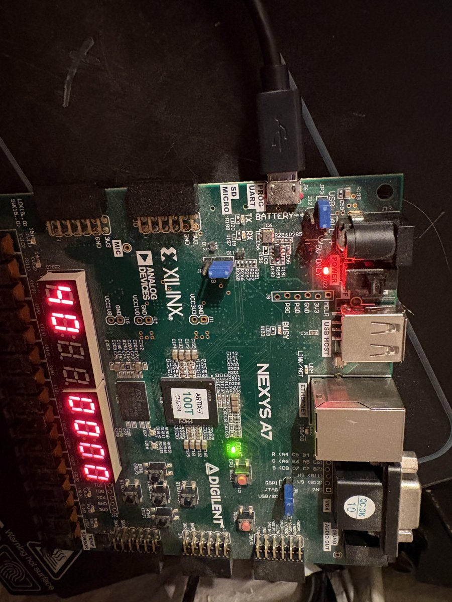

# FPGA_Design_Agent

An agent that turns a natural-language spec into a verified, bring-up-ready AMD FPGA bitstream, measured.

The agent is **coming**. What exists today (milestones **F0A** and **F0B**) is the ground it will stand on: every tool step of
the flow, proven by hand on one small design, with machine-checked gates, before any model touches it. Everything
the agent produces later will have the same shape as `designs/t1_dimmer_counter/`.

## The flow

```
  spec.md (natural language)
     |
     v
  [1] clarify ......... spec.yaml: ports, pins, clocks, reset, latency, assumptions + reasons,
     |                  open questions; a human signs it off                          (agent: coming)
     v
  [2] architecture .... block diagram, clocking plan, every clock-domain crossing      (agent: coming)
     |
     +-------------------------------+
     v                               v
  [3] golden model               [4] RTL + XDC
      model.py, from spec.yaml       SystemVerilog, pins from the board XDC,
      alone (never sees the RTL)     false paths for asynchronous inputs
     |                               |
     +---------------+---------------+
                     v
  [5] verify ........ cocotb + Icarus: RTL against the model, directed + random;
                     |  Verilator lint; deliberate mutants must fail the tests
                     v
  [6] implement ..... flow/run_vivado.sh: non-project Vivado Tcl, synth -> place -> route -> bitstream
                     |  (memory-guarded: one job, 1 thread, 6 GB cap; optional ILA from probes.yaml)
                     v
  [7] gates ......... flow/gates.py: setup/hold/pulse-width slack, no unconstrained endpoints,
                     |  no DRC errors, no critical methodology or CDC violations, bitstream present
                     v
  [8] bring-up ...... BRINGUP.md for a tester who did not design it, plus the test shell:
                     |  every design answers over the USB-UART, so a script can test the board
                     v
  [9] on the board .. flow/bringup.py: discover, program SRAM by cable serial, UART tests against
                        the model, ILA captures against the model, one JSON result       (F0B)
```

Steps 1-8 were done by hand for F0A. In F2 the agent does steps 1-8 itself, and only the passes of the
**independent** checks (the blind model's tests, the gates, the hardware) count; its own testbench never does.

## What F0A proves

| Piece | Where | Checked by |
|---|---|---|
| Memory-safe Vivado runner (refuses to start beside another Vivado or below 7 GB free; 6 GB cap; records time and peak memory) | [flow/run_vivado.sh](flow/run_vivado.sh) | local builds, [results/f0a](results/f0a) |
| Non-project Tcl flow with the reports the gates need | [flow/build.tcl](flow/build.tcl) | local builds |
| Gates over the reports, one JSON per build | [flow/gates.py](flow/gates.py) | CI: parser tests against real passing **and** deliberately failing Vivado reports |
| ILA insertion from a probe list, built both ways, cost recorded | [flow/debug.tcl](flow/debug.tcl) | local builds |
| A reusable on-board test shell (UART register protocol, host driver, model) | [shell/](shell/), [PROTOCOL.md](shell/PROTOCOL.md) | CI: cocotb against the model, including 115200-baud bit timing |
| One hand-written T1 design from spec to bitstream | [designs/t1_dimmer_counter](designs/t1_dimmer_counter) | CI: cocotb against the model + mutants; local: gates |
| Board files | [boards/nexys_a7_100t](boards/nexys_a7_100t) | Digilent master XDC (MIT) at a pinned commit |

The T1 build numbers (timing, utilisation, ILA cost, run time and memory) are in
[results/f0a/t1_dimmer_counter.md](results/f0a/t1_dimmer_counter.md); every one comes from the JSON next to it
([results/f0a/README.md](results/f0a/README.md) lists the files).
Programming the board and testing on hardware is milestone F0B (below).

## Bring-up on hardware (F0B)

```bash
python3 flow/bringup.py designs/t1_dimmer_counter
```

One command, no human in the loop: it checks the power gate (`power_ok`: on USB power, as in F0B, a bitstream is
programmed only if `report_power` says at most 0.5 W; see "Board onboarding" below for wall power), finds the one attached board by its JTAG cable serial and
its UART, programs the base build into SRAM (never flash), runs 8 UART tests that compare every response byte with
the shell and T1 models (identity and build stamp, 1,004 scratch loopbacks, error responses, timeouts, framing
errors, the T1 registers), programs the ILA build, arms the ILA by Tcl in step with UART writes, and checks four
captures cycle by cycle against the model (a COUNT write; the PWM at three dimmer levels). It writes
[results/f0b/t1_dimmer_counter_bringup.json](results/f0b/t1_dimmer_counter_bringup.json).

Measured ([results/f0b](results/f0b/README.md)): three runs in a row all PASS in 110.7-114.6 s, with identical
results: 8 of 8 UART tests, 4 of 4 ILA captures, LED on-time 32, 256 and 640 of 1024 clocks at DUTY 0x08, 0x40 and
0xA0, exactly as the model predicts. The tests that need the board are marked `hw` and skipped in CI; CI re-checks
the committed captures instead.

Manual checks by the owner (buttons count as specified, three visibly different dimmer levels):
[results/f0b/manual_checks.md](results/f0b/manual_checks.md).



## Board onboarding (04c)

Before an agent designs for a board it must know what is on it. For the Nexys A7-100T:

- [boards/nexys_a7_100t/inventory.yaml](boards/nexys_a7_100t/inventory.yaml): every peripheral a design can reach
  (temperature sensor, accelerometer, PDM microphone, PWM audio, Ethernet PHY, USB HID host, USB-UART, QSPI flash,
  DDR2, microSD, XADC) with part, interface, pins, I/O standard, IDs, reset, pull-ups, clocking, a self-check,
  current and whether it is safe on USB power, and a source for every field (reference manual, schematic Rev D.0
  and D.3, data sheets). [tools/inventory_check.py](tools/inventory_check.py) checks every pin against the master
  XDC in CI. Digilent's own demo projects are listed by name only, so later benchmarks can avoid them.
- [boards/nexys_a7_100t/power_budget.md](boards/nexys_a7_100t/power_budget.md): regulators, shared rails, the
  FPGA's thermal limit in still air (thetaJA 18.2 C/W, so about 2.5 W reaches 85 C in a 40 C room). The power gate
  (`flow/hw.py` `power_ok`) now depends on how the board is powered (0.5 W on USB, 2.0 W on wall power, junction
  temperature and rail currents too), and `report_power` is run for the board's real thermal environment.
- Four read-only self-check designs, each with its pass rule pre-registered and a device model in simulation,
  proven on the board 3 times each with `flow/board_check.py` ([results/board_v2](results/board_v2/README.md)):
  [b2_tmp_adt7420](designs/b2_tmp_adt7420), [b2_acl_adxl362](designs/b2_acl_adxl362),
  [b2_qspi_jedec](designs/b2_qspi_jedec) (flash ID only: no write or erase opcode exists in its RTL, which a test
  checks) and [b2_mic_pdm](designs/b2_mic_pdm).

## Knowledge packs (F1A)

The agent's know-how is a set of frozen, hashed knowledge layers in Agent Skills format: generic RTL skills, an AMD
vendor layer built from AMD's open Ross skills (as shipped, and distilled for this batch flow), an Artix-7 device
layer, a Nexys A7 board layer, and an offline searchable library. Since F1A2 the generic layer is a pinned tag of a
separate private generic RTL pack. They summarise AMD and Digilent documents, so they live in a
private repository; [knowledge/PACKS.md](knowledge/PACKS.md) lists each layer's size and hash, which every scored
run will record. [docs/debug_playbook.md](docs/debug_playbook.md) is the human companion to the gates.

## Reproduce

Simulation, lint and the Python tests (what CI runs):

```bash
python3 -m venv .venv && .venv/bin/pip install pyyaml pyserial pytest cocotb==2.0.1   # plus iverilog (apt)
.venv/bin/python -m pytest -q                                   # models, gates parser, host driver, cocotb
designs/t1_dimmer_counter/tests/run_mutants.sh                  # every deliberate bug must be caught
flow/lint.sh                                                    # needs Verilator
```

The bitstream (local only: **Vivado 2025.2** at `/opt/Xilinx/2025.2`, at least 7 GB of available memory (the runner checks), Linux
with `systemd-run --user`):

```bash
flow/run_vivado.sh designs/t1_dimmer_counter both     # base, then the ILA build; gates run after each
python3 flow/summarise.py designs/t1_dimmer_counter --out results/f0a
```

Vivado does not run in GitHub Actions (the install is about 100 GB); its results are committed under `results/`.

## Layout

```
flow/        runner, Tcl flow, ILA insertion, gates, summaries, lint, cocotb helper; board discovery,
             programming, ILA capture and bringup.py (F0B); board_check.py (04c)
shell/       the test shell: RTL, protocol, host driver, model, tests
boards/      board files (Nexys A7-100T): board.yaml, master XDC, inventory.yaml, power_budget.md
tools/       inventory_check.py (board inventory against the master XDC)
designs/     one directory per design: spec.md, spec.yaml, model.py, rtl/, design.xdc, probes.yaml,
             build.yaml, tests/, BRINGUP.md
results/     committed build and bring-up results, per milestone
knowledge/   PACKS.md: names, sizes and hashes of the private knowledge packs (no pack content)
docs/        debug_playbook.md (for humans: what each gate rule ID means); img/ photos (metadata stripped)
```

## Status

| Milestone | What | Status |
|---|---|---|
| F0A | Repo, CI, runner, flow, gates, ILA, test shell, T1 by hand | done |
| F0B | Automated bring-up on the Nexys A7: program by cable serial, UART tests, ILA capture | done |
| F1A | Knowledge packs (generic, AMD vendor from Ross, Artix-7 family) and a search library, in a private repo; names and hashes in [knowledge/PACKS.md](knowledge/PACKS.md); human [debug playbook](docs/debug_playbook.md) | done |
| F1B | Model screen on CVDP's 86 problems ([results/f1b/REPORT.md](results/f1b/REPORT.md)): no cheap candidate eligible (DeepSeek V4.1 Flash −12.4 points; GLM-5.3-Flash −4.1, not detectable, but 48.5 reliability failures per 86); pick luna | done |
| 04c | Board onboarding: Nexys A7 inventory, power budget and source-aware power gate, four read-only peripheral self-checks on the board | done |
| F2 | Agent v1 (T1-T2 designs) | coming |
| F3 | Frozen benchmark, scored runs | coming |

## Licence

MIT (see [LICENSE](LICENSE)). `boards/nexys_a7_100t/Nexys-A7-100T-Master.xdc` is Digilent's, MIT, with its licence
alongside.
