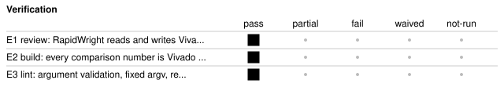

# b100_rapidwright: RapidWright in the agent: relocatable blocks, latency-aware placement and routing control, judged by Vivado 2026.1

<!-- Generated from handover.yaml by flow/handover.py (brief 68). Edit handover.yaml, or the text between the prose markers, then run: python -m flow.handover write designs/b100_rapidwright -->

Three RapidWright capabilities built as tested agent tools and compared with Vivado alone on the K26 (xck26-sfvc784-2LV-c). They are a pre-implemented block stamped at other sites with its internal timing kept, an annealing placer for the transmit latency chain of brief 96, and RWRoute routing of the whole design or of the worst-path nets. Vivado 2026.1 times every result; RapidWright's own estimates are never used. The block capability works and is the only one that beats Vivado alone (on repeatability); placement and routing lose to Vivado on timing; the agent given the tools did no better than the agent without them.

Not in scope:

- a board run; no bitstream of the chain was made or loaded, and the chain's GT is a bare primitive without a reference clock or reset sequence
- a claim that RapidWright's placer or router is better or worse than Vivado's in general; this is one chain, one part, our first-cut placer and a handful of period perturbations
- the full brief 96 design; the chain is brief 96's own MAC and PCS RTL with a bare GT, not the GT Wizard design

Kind: showcase; written by hand. State: built. For an agent: [AGENT.md](AGENT.md).

<!-- prose:what -->
**Purpose:** make RapidWright a first-class, tested capability of the agent and find out, with Vivado as the referee, where it helps.

**Start here:**

- [docs/what_we_found.md](docs/what_we_found.md): the results, with every table rendered from `results/b100/summary.json`;
- [docs/design.md](docs/design.md): what RapidWright is, how it fits the Vivado flow, the choices and what changed once the code met the device;
- [docs/tools.md](docs/tools.md): datasheet of the five agent tools and what a user could guess wrong;
- [docs/licences.md](docs/licences.md): licences and what is committed (no vendor binary or device data).

**Headline** (plainly): the pre-implemented relocatable block works and keeps most of its internal delays at other sites, where Vivado
implementing the same logic again does not; our annealing placer and RWRoute lost to Vivado on timing in every paired run (RWRoute was several times faster);
the agent with the tools did no better than the agent without them.
<!-- /prose:what -->

## Technical parameters

| Item | Value |
|---|---|
| Part | `xck26-sfvc784-2LV-c` |
| Board | Kria KR260 |
| Top | `chain_top (the chain); reloc_top (the block runs); s0_top (stage 0, also xc7a100tcsg324-1)` |
| Tool | Vivado 2026.1 |
| Note | RapidWright 2026.1.2 with the JRE inside Vivado 2026.1; no board is touched |

Clocks:

- `clk`: 312.5 MHz (from `designs/b100_rapidwright/agent_run/arm_a/design.xdc`); the stage 2 agent runs' constraint (3.2 ns); the other runs set their period per run (3.40 ns and perturbations) through the scripts, so no fixed XDC clock exists for them

Resets:

- `rst`, active high: synchronous, from a register in the source shift register; the RTL is brief 96's and is not changed here

Interfaces:

- `agent tools (rw_status, rw_relocate_block, rw_place_chain, rw_route, rw_referee)` (agent/core/rapidwright_tools.py; offered to a role only with FDA_RAPIDWRIGHT=1 and RapidWright installed) ([datasheet](docs/tools.md)): every argument is validated, inputs are checkpoint file names inside build/<variant>/, outputs go to build/<variant>/rw/, and only rw_referee returns timing, from Vivado
- `RapidWright scripts` (flow/rw/*.py run with the pinned venv python (flow/rapidwright_pin.py)) ([datasheet](docs/design.md)): relocate.py, place_chain.py, route.py, roundtrip.py print one JSON line; they need RapidWright and Vivado 2026.1 on PATH

| Parameter | Value | Legal range | Note |
|---|---|---|---|
| `clock period` | set per run by the scripts, 3.40 ns for the first chain run, plus 0.01 ns per perturbation (3.2 ns in the agent runs) | any period the scripts are given | there is no fixed clock in an XDC; impl.tcl and stamp.tcl add create_clock on port clk from the run's period |
| `RapidWright` | 2026.1.2 | the release whose year and minor match the Vivado release (2026.1.x) | pinned with hashes in flow/rapidwright_pin.py; tools/rapidwright_env/setup.sh installs it |
| `block relocation targets` | SLICE_X35Y57, SLICE_X41Y117, SLICE_X41Y177 (original block at SLICE_X35Y87) | only the anchor sites RapidWright lists as valid for the block's footprint | for the 128-slice block three columns were valid (X35, X38, X41) |
| `chain placer` | simulated annealing on whole slices, 200000 moves, window of 60 columns by 40 rows around GTHE4_CHANNEL_X0Y6 | any slice site of the same type inside the window that is free; slices with carry chains or LUT RAM stay | weighted half-perimeter wire length in tile units; its estimate is logged, never reported as a result |

| Quantity | Value | Source |
|---|---|---|
| Resources | JVM scope peak memory on a first checkpoint read for the K26: 2.6 GiB; baseline chain LUTs: 1768 LUT; baseline chain flip-flops: 414 FF | M3, M6, M7 |
| Timing | K26 checkpoint WNS after RapidWright read and write, Vivado route_design: 0.218 ns; Artix-7 100T checkpoint WNS after RapidWright read and write, Vivado route_design: -5.36 ns; baseline chain, achieved period at a 3.40 ns target, Vivado alone, perturbation s0: 3.776 ns; mean achieved period, Vivado alone, over the perturbations: 3.95 ns; mean achieved period, our annealing placement then Vivado routing: 4.429 ns; mean achieved period, RWRoute routing of Vivado's placement: 5.877 ns; mean achieved period, RWRoute on the worst-path nets inside Vivado's routing: 4.611 ns | M1, M2, M4, M8, M9, M10, M11 |
| Power | not measured | [Known gaps](#known-gaps-and-limits) |
| Latency | baseline chain, two-clock chain latency at that period: 7.552 ns | M5 |
| Throughput | not measured | [Known gaps](#known-gaps-and-limits) |

<!-- prose:parameters -->
<!-- /prose:parameters -->

## How to build, run and reproduce

| Step | Command | Heavy slot | Time |
|---|---|---|---|
| install RapidWright into a git-ignored venv (no root; downloads the jar from AMD's GitHub release); needs Python 3.12, network | `tools/rapidwright_env/setup.sh` | no | about 5 min |
| capability 1 (block, relocation, stamp, Vivado alone), three site targets, two period perturbations (the stamp arm ran at 3.40 ns in both because of a clock override, see what_we_found.md); needs Vivado 2026.1, RapidWright, a heavy slot declared as Vivado impl peak 4G | `PERIODS="3.40 3.41" designs/b100_rapidwright/scripts/run_c1.sh` | yes | about 90 min |
| capabilities 2 and 3 on the chain, per period perturbation; needs Vivado 2026.1, RapidWright, a heavy slot declared as Vivado impl peak 4G | `BASE=3.40 STEPS="0 1" designs/b100_rapidwright/scripts/run_c23.sh` | yes | about 120 min |
| the stage 2 agent runs (access key in .env; Claude Code token file); needs Vivado 2026.1, RapidWright, the Claude Code arm of brief 05c, a heavy slot | `python3 designs/b100_rapidwright/agent_run/run_arm.py a --max-turns 30 --minutes 75` | yes | about 75 min |
| tests that need neither tool; needs pytest | `python3 -m pytest -q designs/b100_rapidwright/tests agent/tests/test_100_rapidwright.py` | no | about 1 min |

Tool: Vivado 2026.1. Build ID of the inputs at handover: none (no Vivado build of this directory). Knowledge-bank pin: `93d158c`.

| File | What |
|---|---|
| [`designs/b100_rapidwright/docs/design.md`](docs/design.md) | the design note written before the code, and what changed after it (section 6) |
| [`designs/b100_rapidwright/docs/what_we_found.md`](docs/what_we_found.md) | the results with their tables, rendered from the summary record |
| [`designs/b100_rapidwright/docs/licences.md`](docs/licences.md) | licences of RapidWright, its device files and the Java runtime, and what is committed |
| [`designs/b100_rapidwright/docs/tools.md`](docs/tools.md) | datasheet for the five agent tools and the scripts behind them |
| [`designs/b100_rapidwright/rtl/pcs_unit.sv`](rtl/pcs_unit.sv) | the relocatable block (brief 96's pcs_tx with its own source and sink, three input pins) |
| [`designs/b100_rapidwright/rtl/chain_top.sv`](rtl/chain_top.sv) | the transmit chain with a bare GT |
| [`designs/b100_rapidwright/scripts/run_c1.sh`](scripts/run_c1.sh) | capability 1 end to end |
| [`designs/b100_rapidwright/scripts/run_c23.sh`](scripts/run_c23.sh) | capabilities 2 and 3 end to end |
| [`designs/b100_rapidwright/agent_run/run_arm.py`](agent_run/run_arm.py) | the stage 2 agent runs, with and without the tools |
| [`flow/rw/place_chain.py`](../../flow/rw/place_chain.py) | the annealing placer |
| [`flow/rw/route.py`](../../flow/rw/route.py) | RWRoute full and net-list routing |
| [`flow/rw/relocate.py`](../../flow/rw/relocate.py) | block relocation |
| [`flow/rapidwright_pin.py`](../../flow/rapidwright_pin.py) | versions, hashes and paths of the RapidWright install |

<!-- prose:build -->
<!-- /prose:build -->

## Verified

| ID | Activity | Result | What | Evidence | Conditions |
|---|---|---|---|---|---|
| E1 | review | pass | RapidWright reads and writes Vivado 2026.1 checkpoints for both parts and Vivado accepts them (route, DRC, bitstream) | [`results/b100/summary.json`](../../results/b100/summary.json) | - |
| E2 | build | pass | every comparison number is Vivado 2026.1 timing on a routed checkpoint (relocation, placement, routing runs) | [`results/b100/summary.json`](../../results/b100/summary.json) | - |
| E3 | lint | pass | argument validation, fixed argv, refusals and the skip-without-RapidWright behaviour of the agent tools; the block-path analysis | [`agent/tests/test_100_rapidwright.py`](../../agent/tests/test_100_rapidwright.py) (run in CI) | - |

Gates at handover: `rapidwright_roundtrip` pass, `comparison_vivado_2026_1` pass.

<!-- prose:verified -->
<!-- /prose:verified -->

## Measured

Every value is read from the record by `python -m flow.handover fill`, not typed.

| ID | What | Value | Runs | Source | Conditions |
|---|---|---|---|---|---|
| M1 | K26 checkpoint WNS after RapidWright read and write, Vivado route_design | 0.218 ns | 1 | [`results/b100/summary.json`](../../results/b100/summary.json) `stage0.xck26.after_rapidwright_wns_ns` | s0_top at a 4 ns target, Vivado 2026.1, one thread; the value before the round trip is in the same record |
| M2 | Artix-7 100T checkpoint WNS after RapidWright read and write, Vivado route_design | -5.36 ns | 1 | [`results/b100/summary.json`](../../results/b100/summary.json) `stage0.xc7a100t.after_rapidwright_wns_ns` | as M1; the 4 ns target is missed on this part before and after |
| M3 | JVM scope peak memory on a first checkpoint read for the K26 | 2.6 GiB | 1 | [`results/b100/summary.json`](../../results/b100/summary.json) `stage0.jvm_peak_gib_first_read` | cgroup peak of the whole scope including the Vivado RapidWright starts; under 1 GiB when the EDIF is cached |
| M4 | baseline chain, achieved period at a 3.40 ns target, Vivado alone, perturbation s0 | 3.776 ns | 1 | [`results/b100/summary.json`](../../results/b100/summary.json) `capabilities23.rows[0].achieved_period_ns` | target minus whole-design WNS; chain_top on the K26, one thread, Vivado 2026.1 |
| M5 | baseline chain, two-clock chain latency at that period | 7.552 ns | 1 | [`results/b100/summary.json`](../../results/b100/summary.json) `capabilities23.rows[0].chain_latency_ns_2clk` | two registers on the wire-to-wire path (MAC output, PCS output) times the achieved period; the GT's own latency is not included |
| M6 | baseline chain LUTs | 1768 LUT | 1 | [`results/b100/summary.json`](../../results/b100/summary.json) `capabilities23.rows[0].lut` | as M4; the same count in every arm (RapidWright moves, it does not resynthesise) |
| M7 | baseline chain flip-flops | 414 FF | 1 | [`results/b100/summary.json`](../../results/b100/summary.json) `capabilities23.rows[0].ff` | as M4 |
| M8 | mean achieved period, Vivado alone, over the perturbations | 3.95 ns | 1 | [`results/b100/summary.json`](../../results/b100/summary.json) `capabilities23.by_arm.base.achieved_period_ns_mean` | N runs in the record; perturbation is the target period (+0.01 ns each) |
| M9 | mean achieved period, our annealing placement then Vivado routing | 4.429 ns | 1 | [`results/b100/summary.json`](../../results/b100/summary.json) `capabilities23.by_arm.place.achieved_period_ns_mean` | as M8, the same placed checkpoints as M8 are the starting point |
| M10 | mean achieved period, RWRoute routing of Vivado's placement | 5.877 ns | 1 | [`results/b100/summary.json`](../../results/b100/summary.json) `capabilities23.by_arm.rwr.achieved_period_ns_mean` | as M8; Vivado checks and times, does not route |
| M11 | mean achieved period, RWRoute on the worst-path nets inside Vivado's routing | 4.611 ns | 1 | [`results/b100/summary.json`](../../results/b100/summary.json) `capabilities23.by_arm.fixed.achieved_period_ns_mean` | as M8 |
| M12 | stamped blocks, copy 3 endpoints with the same delay as copy 0 | 351 endpoints | 1 | [`results/b100/summary.json`](../../results/b100/summary.json) `capability1.blocks.stamp_p3_40.copies.3.endpoints_identical` | of the endpoints common to both copies, period perturbation 3.40 ns, Vivado data-path delay |
| M13 | Vivado alone, the same four-copy design, copy 3 endpoints with the same delay as copy 0 | 6 endpoints | 1 | [`results/b100/summary.json`](../../results/b100/summary.json) `capability1.blocks.alone_p3_40.copies.3.endpoints_identical` | as M12 |
| M14 | stage 2, tool calls of the arm with the RapidWright tools | 12 calls | 1 | [`results/b100/summary.json`](../../results/b100/summary.json) `stage2.a.tool_calls` | Claude Sonnet 5.5, 30 turn cap, 75 minute cap, one run |
| M15 | stage 2, tool calls of the arm without the RapidWright tools | 15 calls | 1 | [`results/b100/summary.json`](../../results/b100/summary.json) `stage2.b.tool_calls` | as M14 |

<!-- prose:measured -->
<!-- /prose:measured -->

## Known gaps and limits

- **power**: Not measured; no power report was made for any run, and no bitstream of the chain exists.
- **throughput**: Not applicable to this work; the chain moves one 64-bit word a clock by construction and no throughput figure is claimed.
- **board_run**: No board was touched, so no claim is made that a faster chain survives the transceiver's own latency; that is a question for an owner session.
- **seeds**: Vivado's placer has no seed parameter, so a seed is a 0.01 ns step of the target period; two or three of them per capability, which shows scatter but is not a distribution.
- **placer**: The annealer is a first cut that minimises wire length with fixed weights; the comparison says nothing about what a timing-driven RapidWright placer would do.
- **single_chain**: One chain, one part (the K26 for all three capabilities; the Artix-7 only in stage 0), and the chain's GT is a bare primitive without the real clocking.
- **block_interface**: A pre-implemented block with a wide input bus could not be stamped in Vivado 2026.1 (input pins unreachable past locked routes); the block used has three input pins.
- **stage2**: Stage 2 is one run per arm; the arms differ in tools only, but the without arm's pblock build outlasted the tool call timeout, so its second attempt was never seen by the agent.
- **review**: One Sonnet review and one fix round per the check-once rule; the fixes are not re-reviewed.

<!-- prose:gaps -->
<!-- /prose:gaps -->

## Next steps

1. Merge brief 97's latency path tool when it lands and give the placer its chain instead of the fixed cell patterns.
2. A timing-driven placer that takes criticality from Vivado's report each round, and RWRoute with Vivado's delay model, then repeat the comparison on the full brief 96 design.
3. Hand the stamped-block flow a wider interface by routing the block's input pins in context before locking its routes, or by reserving pin access in the out-of-context run.

Open questions:

- Does the relocatable block keep its delays on the Artix-7, where the column structure differs?

<!-- prose:next -->
<!-- /prose:next -->

## History

| Date | Brief | PR | What |
|---|---|---|---|
| 2026-11-17 | 100 | - | stage 0, three capabilities, tools and the with-and-without agent runs |

<!-- prose:history -->
<!-- /prose:history -->
