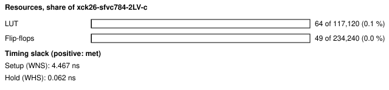
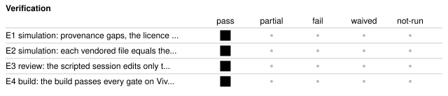

# b102_managed_ext: Managed-project stage 3 - an FCS self-test around a frozen third-party LFSR block

<!-- Generated from handover.yaml by flow/handover.py (brief 68). Edit handover.yaml, or the text between the prose markers, then run: python -m flow.handover write designs/b102_managed_ext -->

**Verification: not assessed: no requirements recorded (no verif/testplan.yaml), so nothing here is traced to a requirement.** [VERIFIED.md](VERIFIED.md) is the generated, hash-pinned record; [what the label means](../../docs/verified.md).

A KR260 self-test of an Ethernet FCS stage that integrates one real third-party block under a managed project (brief 102, stage 3). Alex Forencich's parallel CRC/LFSR (verilog-ethernet, MIT, commit 77320a9471d1) is vendored unmodified and frozen; our adapter (owned) adds the register, the restart and the enable around it; an owned sequencer sends a fixed sixteen-word frame and shows the verdict on an LED. project.yaml records the licence, the commit and the hash of every file of theirs, and the agent's tools refuse every route to edit them.

Not in scope:

- a 10G Ethernet FCS check; the block is instantiated at 16 data bits a clock, not the 64-bit word of the 96 design
- a board design; it was not programmed, and the 161 MHz clock constraint is on the 25 MHz oscillator pin for a timing study

Kind: demonstration; written by a Claude Code session. State: built. For an agent: [AGENT.md](AGENT.md).

<!-- prose:what -->
<!-- /prose:what -->

## Technical parameters

| Item | Value |
|---|---|
| Part | `xck26-sfvc784-2LV-c` |
| Board | Kria KR260 |
| Top | `fcs_top` |
| Tool | Vivado 2026.1 |

Clocks:

- `clk_25`: 161.13 MHz (from `designs/b102_managed_fcs/design.xdc`); the oscillator pin is 25 MHz on the board; the constraint is the 10G datapath rate to ask the real question of the CRC block

Resets:

- `power-on counter`, active high: a four-clock shift register in fcs_top holds every block in synchronous reset after configuration; there is no reset input

Interfaces:

- `lfsr block` (third-party combinational RTL module (data_in, state_in, data_out, state_out) at LFSR_WIDTH 32, DATA_WIDTH 16) ([datasheet](project.yaml)): the contract is in project.yaml; behaviour a user could guess wrong is in the header of rtl/crc32_d16.sv (register not complement, little-endian words, hold on en low, reset wins) and in the block's own header (CRC32 = Galois, bit-reverse, polynomial 04C11DB7, initial FFFFFFFF)

| Parameter | Value | Legal range | Note |
|---|---|---|---|
| `N_WORDS` | 16 | at least 1; the sequencer counter is sized from it and the word function takes an eight-bit index | words per frame, two bytes each |
| `EXPECT` | 0x79D3D43A | the CRC register value of the frame, from flow/managed_import.crc32_model | checked against zlib in designs/b102_managed_fcs/tests/test_b102_fcs.py |

| Quantity | Value | Source |
|---|---|---|
| Resources | LUTs, whole design including the third-party block: 64 LUT; flip-flops, whole design: 49 FF | M1, M2 |
| Timing | worst setup slack at the 6.206 ns clock: 4.467 ns; worst hold slack: 0.062 ns | M3, M4 |
| Power | total on-chip power estimate: 0.336 W | M5 |
| Latency | not measured | [Known gaps](#known-gaps-and-limits) |
| Throughput | not measured | [Known gaps](#known-gaps-and-limits) |

<!-- prose:parameters -->
<!-- /prose:parameters -->

## How to build, run and reproduce

| Step | Command | Heavy slot | Time |
|---|---|---|---|
| import checks (provenance, upstream comparison, interface, simulation, planted fault, optional eqy); needs the OSS CAD Suite and a clone of the upstream; needs Icarus Verilog and git; eqy needs the OSS CAD Suite (FDA_OSS_CAD) | `python3 flow/managed_rtl_import.py check designs/b102_managed_ext --upstream <clone of verilog-ethernet>` | no | about 1 min |
| the scripted agent session on a scratch copy (run under pytest: the in-process access-gate bypass applies); needs Python with PyYAML and jsonschema; Icarus Verilog | `FDA_102_RECORD=1 python3 -m pytest -q flow/tests/test_102_stage3.py -k scripted` | no | about 1 min |
| build and run the gates; needs local Vivado 2026.1 and a heavy slot (take_heavy_slot.sh) | `flow/run_vivado.sh designs/b102_managed_ext base` | yes | about 5 min |

Tool: Vivado 2026.1. Build ID of the inputs at handover: `eaccdf6d` (`python flow/manifest.py show designs/b102_managed_ext`: what a rebuild of today's sources and flow would carry; it changes when any build input or the flow changes, so it can differ from the build ID in an older evidence record). Knowledge-bank pin: `6185830`.

| File | What |
|---|---|
| [`designs/b102_managed_ext/project.yaml`](project.yaml) | the managed-project manifest: ownership, contracts and the third-party provenance of the four components |
| [`designs/b102_managed_ext/rtl/fcs_top.sv`](rtl/fcs_top.sv) | top level, power-on reset and the LEDs (ours) |
| [`designs/b102_managed_ext/rtl/fcs_ctrl.sv`](rtl/fcs_ctrl.sv) | the owned sequencer and FCS verdict (ours) |
| [`designs/b102_managed_ext/rtl/crc32_d16.sv`](rtl/crc32_d16.sv) | the CRC adapter around the third-party block (ours) |
| [`designs/b102_managed_ext/third_party/verilog-ethernet/lfsr.v`](third_party/verilog-ethernet/lfsr.v) | the third-party block, unmodified (theirs, MIT) |
| [`designs/b102_managed_ext/third_party/verilog-ethernet/COPYING`](third_party/verilog-ethernet/COPYING) | its licence text (theirs) |
| [`designs/b102_managed_ext/reference/crc32_d16.sv`](reference/crc32_d16.sv) | our own specification of the adapter, written without the block (not in the build) |
| [`designs/b102_managed_ext/build.yaml`](build.yaml) | how flow/run_vivado.sh builds the design |

<!-- prose:build -->
<!-- /prose:build -->

## Verified

| ID | Activity | Result | What | Evidence | Conditions |
|---|---|---|---|---|---|
| E1 | simulation | pass | provenance gaps, the licence rule, the tools refusing every route to the vendored block, the import checks and the scripted session | [`flow/tests/test_102_stage3.py`](../../flow/tests/test_102_stage3.py) (run in CI) | - |
| E2 | simulation | pass | each vendored file equals the recorded hash and the bytes at the upstream commit; the block matches a CRC-32 step model on 2,000 random vectors at each of 8, 16, 32 and 64 data bits; the adapter plus the block matches the register model; a planted fault in a copy of the block fails both | [`results/102_stage3/import_check.json`](../../results/102_stage3/import_check.json) | - |
| E3 | review | pass | the scripted session edits only the owned controller; its attempts on the vendored files, an out-of-scope file, the manifest and a build.yaml that drops the block are refused | [`results/102_stage3/demo_session.json`](../../results/102_stage3/demo_session.json) | - |
| E4 | build | pass | the build passes every gate on Vivado 2026.1 with the third-party block compiled in; the boundary CDC check finds no row on the adapter | [`results/102_stage3/boundary.json`](../../results/102_stage3/boundary.json) | - |

Gates at handover: `import_checks` pass, `build_2026_1` pass, `boundary_checks` pass.

<!-- prose:verified -->
<!-- /prose:verified -->

## Measured

Every value is read from the record by `python -m flow.handover fill`, not typed.

| ID | What | Value | Runs | Source | Conditions |
|---|---|---|---|---|---|
| M1 | LUTs, whole design including the third-party block | 64 LUT | 1 | [`results/102_stage3/builds.json`](../../results/102_stage3/builds.json) `build.lut` | routed build, Vivado 2026.1, xck26-sfvc784-2LV-c |
| M2 | flip-flops, whole design | 49 FF | 1 | [`results/102_stage3/builds.json`](../../results/102_stage3/builds.json) `build.ff` | routed build, Vivado 2026.1 |
| M3 | worst setup slack at the 6.206 ns clock | 4.467 ns | 1 | [`results/102_stage3/builds.json`](../../results/102_stage3/builds.json) `build.wns_ns` | routed, 161.13 MHz constraint on the 25 MHz pin |
| M4 | worst hold slack | 0.062 ns | 1 | [`results/102_stage3/builds.json`](../../results/102_stage3/builds.json) `build.whs_ns` | routed, 6.206 ns clock |
| M5 | total on-chip power estimate | 0.336 W | 1 | [`results/102_stage3/builds.json`](../../results/102_stage3/builds.json) `build.power_w` | report_power after routing, vectorless, never run on a board |

<!-- prose:measured -->
<!-- /prose:measured -->

## Known gaps and limits

- **power**: The estimate is vectorless at default toggle rates; this is a timing study that was never run on a board, so no power measurement is claimed.
- **throughput**: Not applicable beyond the clock; the block takes two bytes a clock by construction and no throughput measurement was made.
- **width**: The block is instantiated at sixteen data bits; the 10G design uses sixty-four. The block alone is simulated at 8, 16, 32 and 64 bits against a model, but only the 16-bit instance is built.
- **board**: Never programmed; no hardware evidence and no operating conditions exist.
- **behaviour**: The design has no reset input and one fixed frame; the verdict LED is sticky until the next configuration.
- **upstream tests**: The block's upstream tests (MyHDL co-simulations of the Ethernet modules that use it) were not run: they need MyHDL's Icarus plug-in built from source, which was not approved here.
- **latency**: Not measured on this design; the stage 1 demonstration measured the verdict latency, and the scripted session records only that the controller edit saves one clock in simulation (results/102_stage3/demo_session.json).

<!-- prose:gaps -->
<!-- /prose:gaps -->

## Next steps

1. A model-driven run on this managed project (the scripted session tests the rules, not a model).
2. The recorded-demo intake (docs/demo_intake.md) can use the same provenance fields for a requester's block.

<!-- prose:next -->
<!-- /prose:next -->

## History

| Date | Brief | PR | What |
|---|---|---|---|
| 2026-11-19 | 102 | - | written for stage 3 of the managed-project brief |

<!-- prose:history -->
<!-- /prose:history -->
