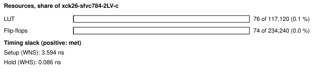
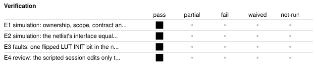

# b102_managed_fcs: Managed-project demonstration - an FCS self-test around a frozen CRC netlist

<!-- Generated from handover.yaml by flow/handover.py (brief 68). Edit handover.yaml, or the text between the prose markers, then run: python -m flow.handover write designs/b102_managed_fcs -->

A KR260 self-test of an Ethernet FCS stage that exists to demonstrate a managed project (brief 102). An owned sequencer sends a fixed sixteen-word frame through a CRC-32 block that was made outside the project as an EDIF netlist and is frozen, and shows the verdict on an LED; a heartbeat divider is excluded from the agent's view but built with the rest. project.yaml marks each part, and the agent's tools enforce it.

Not in scope:

- a 10G Ethernet FCS check; the CRC block takes sixteen bits a clock, not the 64-bit word of the 96 design, because the open equivalence engines could not prove 64 bits
- a board design; it was not programmed, and the 161 MHz clock constraint is on the 25 MHz oscillator pin for a timing study

Kind: demonstration; written by hand. State: built. For an agent: [AGENT.md](AGENT.md).

<!-- prose:what -->
<!-- /prose:what -->

## Technical parameters

| Item | Value |
|---|---|
| Part | `xck26-sfvc784-2LV-c` |
| Board | Kria KR260 |
| Top | `fcs_top` |
| Tool | Vivado 2026.1 |

Clocks:

- `clk_25`: 161.13 MHz (from `designs/b102_managed_fcs/design.xdc`); the oscillator pin is 25 MHz on the board; the constraint is the 10G datapath rate to ask the real question of the CRC block

Resets:

- `power-on counter`, active high: a four-clock shift register in fcs_top holds every block in synchronous reset after configuration; there is no reset input

Interfaces:

- `crc32_d16 slot` (black-box module filled by an EDIF netlist (build.yaml netlists)) ([datasheet](project.yaml)): the contract is in project.yaml (ports, clock, reset, boundary timing budgets); behaviour a user could guess wrong is in the header of ext/reference/crc32_d16.sv (register not complement, little-endian words, hold on en low, reset wins)

| Parameter | Value | Legal range | Note |
|---|---|---|---|
| `N_WORDS` | 16 | 1 to 254 (the counter is eight bits wide in the word function) | words per frame, two bytes each |
| `EXPECT` | 0x79D3D43A | the CRC register value of the frame, from flow/managed_import.crc32_model | checked against zlib in designs/b102_managed_fcs/tests/test_b102_fcs.py |

| Quantity | Value | Source |
|---|---|---|
| Resources | LUTs, whole design including the frozen CRC netlist: 76 LUT; flip-flops, whole design: 74 FF | M2, M3 |
| Timing | worst setup slack at the 6.206 ns clock: 3.594 ns; worst hold slack: 0.086 ns; worst setup slack after the agent session's edit: 3.894 ns | M4, M5, M7 |
| Power | total on-chip power estimate: 0.337 W | M6 |
| Latency | clocks saved by the agent session's edit (first cycle in which pass_o rises, baseline minus edited): 1 clocks | M1 |
| Throughput | not measured | [Known gaps](#known-gaps-and-limits) |

<!-- prose:parameters -->
<!-- /prose:parameters -->

## How to build, run and reproduce

| Step | Command | Heavy slot | Time |
|---|---|---|---|
| import checks (interface, licence, simulation, eqy); needs the OSS CAD Suite (FDA_OSS_CAD) and Icarus Verilog | `python3 flow/managed_import.py check designs/b102_managed_fcs --sim --eqy` | no | about 1 min |
| the scripted agent session on a scratch copy; needs Python with PyYAML and jsonschema | `python3 designs/b102_managed_fcs/scripts/demo_managed_session.py` | no | about 1 min |
| build and run the gates; needs local Vivado 2026.1 and a heavy slot (take_heavy_slot.sh) | `flow/run_vivado.sh designs/b102_managed_fcs base` | yes | about 12 min |

Tool: Vivado 2026.1. Build ID of the inputs at handover: `d2f6ac31` (`python flow/manifest.py show designs/b102_managed_fcs`: what a rebuild of today's sources and flow would carry; it changes when any build input or the flow changes, so it can differ from the build ID in an older evidence record). Knowledge-bank pin: `93d158c`.

| File | What |
|---|---|
| [`designs/b102_managed_fcs/project.yaml`](project.yaml) | the managed-project manifest, ownership and contracts of the four components |
| [`designs/b102_managed_fcs/rtl/fcs_top.sv`](rtl/fcs_top.sv) | top level, power-on reset and the LEDs |
| [`designs/b102_managed_fcs/rtl/fcs_ctrl.sv`](rtl/fcs_ctrl.sv) | the owned sequencer and FCS verdict |
| [`designs/b102_managed_fcs/ext/crc32_d16.edf`](ext/crc32_d16.edf) | the frozen CRC-32 block as an EDIF netlist made by Yosys outside the project |
| [`designs/b102_managed_fcs/ext/reference/crc32_d16.sv`](ext/reference/crc32_d16.sv) | the supplier's RTL, the reference for the equivalence proof (not in the build) |
| [`designs/b102_managed_fcs/build.yaml`](build.yaml) | how flow/run_vivado.sh builds the design, with the netlist |

<!-- prose:build -->
<!-- /prose:build -->

## Verified

| ID | Activity | Result | What | Evidence | Conditions |
|---|---|---|---|---|---|
| E1 | simulation | pass | ownership, scope, contract and path-trick tests of the agent's tools; the import checks, the boundary parsers and the build plumbing | [`agent/tests/test_102_managed.py`](../../agent/tests/test_102_managed.py) (run in CI) | - |
| E2 | simulation | pass | the netlist's interface equals the contract, the licence and hash are recorded, 400 simulated vectors match the model, and eqy proves the supplier's RTL equivalent to the netlist | [`results/102_managed/import_check.json`](../../results/102_managed/import_check.json) | - |
| E3 | faults | pass | one flipped LUT INIT bit in the netlist fails both the simulation and the eqy proof | [`results/102_managed/eqy_fault.json`](../../results/102_managed/eqy_fault.json) | - |
| E4 | review | pass | the scripted session edits only the owned controller; its attempts on the frozen netlist, the excluded block, the out-of-scope top, a port change, a dropped build source and the manifest are all refused | [`results/102_managed/demo_session.json`](../../results/102_managed/demo_session.json) | - |
| E5 | build | pass | both builds (before and after the edit) pass every gate on Vivado 2026.1, with the CRC block read from its EDIF netlist; the boundary check finds no CDC row on the slot and both boundary timing budgets are met | [`results/102_managed/boundary.json`](../../results/102_managed/boundary.json) | - |

Gates at handover: `import_checks` pass, `build_2026_1` pass, `boundary_checks` pass.

<!-- prose:verified -->
<!-- /prose:verified -->

## Measured

Every value is read from the record by `python -m flow.handover fill`, not typed.

| ID | What | Value | Runs | Source | Conditions |
|---|---|---|---|---|---|
| M1 | clocks saved by the agent session's edit (first cycle in which pass_o rises, baseline minus edited) | 1 clocks | 1 | [`results/102_managed/latency.json`](../../results/102_managed/latency.json) `clocks_saved` | Icarus simulation, CRC block from its functional netlist, counted from power-up |
| M2 | LUTs, whole design including the frozen CRC netlist | 76 LUT | 1 | [`results/102_managed/builds.json`](../../results/102_managed/builds.json) `builds.baseline.lut` | routed build, Vivado 2026.1, xck26-sfvc784-2LV-c |
| M3 | flip-flops, whole design | 74 FF | 1 | [`results/102_managed/builds.json`](../../results/102_managed/builds.json) `builds.baseline.ff` | routed build, Vivado 2026.1 |
| M4 | worst setup slack at the 6.206 ns clock | 3.594 ns | 1 | [`results/102_managed/builds.json`](../../results/102_managed/builds.json) `builds.baseline.wns_ns` | routed, 161.13 MHz constraint on the 25 MHz pin |
| M5 | worst hold slack | 0.086 ns | 1 | [`results/102_managed/builds.json`](../../results/102_managed/builds.json) `builds.baseline.whs_ns` | routed, 6.206 ns clock |
| M6 | total on-chip power estimate | 0.337 W | 1 | [`results/102_managed/builds.json`](../../results/102_managed/builds.json) `builds.baseline.power_w` | report_power after routing, vectorless, never run on a board |
| M7 | worst setup slack after the agent session's edit | 3.894 ns | 1 | [`results/102_managed/builds.json`](../../results/102_managed/builds.json) `builds.edited.wns_ns` | routed, 6.206 ns clock, controller with the registered compare stage removed |

<!-- prose:measured -->
<!-- /prose:measured -->

## Known gaps and limits

- **power**: The estimate is vectorless at default toggle rates; this is a timing study that was never run on a board, so no power measurement is claimed.
- **throughput**: Not applicable beyond the clock; the block takes two bytes a clock by construction and no throughput measurement was made.
- **width**: The CRC block is sixteen bits wide; the 10G design uses sixty-four. The open engines of eqy proved 8 and 16 bits within two minutes and not 32 or 64 (results/102_managed/eqy_width_scaling.json).
- **board**: Never programmed; no hardware evidence and no operating conditions exist.
- **behaviour**: The design has no reset input and one fixed frame; the verdict LED is sticky until the next configuration, a corrupted word in a later frame does not clear it.

<!-- prose:gaps -->
<!-- /prose:gaps -->

## Next steps

1. Record the two Vivado builds, the gates and the boundary checks, and replace the resources and timing gaps with their measurements.
2. Stage 2 of brief 102 imports a placed-and-routed block and relocates it with RapidWright.

Open questions:

- Which owner-approved block should be the first real external import (stage 3 of brief 102)?

<!-- prose:next -->
<!-- /prose:next -->

## History

| Date | Brief | PR | What |
|---|---|---|---|
| 2026-11-17 | 102 | - | written for stage 1 of the managed-project brief |

<!-- prose:history -->
<!-- /prose:history -->
