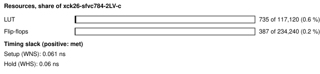
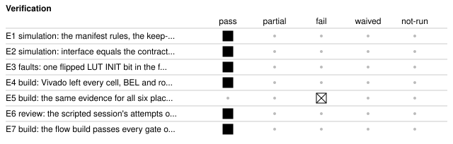

# b102_managed_pr: Managed-project demonstration - a placed-and-routed block, relocated, with a keep-out

<!-- Generated from handover.yaml by flow/handover.py (brief 68). Edit handover.yaml, or the text between the prose markers, then run: python -m flow.handover write designs/b102_managed_pr -->

A KR260 timing study that exists to demonstrate stage 2 of a managed project (brief 102). The block pcs_unit, brief 96's 64b/66b transmit path, arrives as a placed, routed and locked checkpoint made outside the project and is frozen; an owned stimulus and sink around it are placed and routed by Vivado. project.yaml records the block's keep-out region, the agent's tools refuse to place or constrain anything inside it, and the block's internal timing is measured at six placements, relocated by RapidWright and not.

Not in scope:

- a 10G Ethernet design; the block is the 64b/66b encoder and scrambler between a shift register and an XOR sink, with three input pins
- a board design; it was not programmed, and the 250 MHz constraint is on the 25 MHz oscillator pin for a timing study
- a claim that relocation preserves a block's timing everywhere; the results say where it does and where it does not

Kind: demonstration; written by hand. State: built. For an agent: [AGENT.md](AGENT.md).

<!-- prose:what -->
<!-- /prose:what -->

## Technical parameters

| Item | Value |
|---|---|
| Part | `xck26-sfvc784-2LV-c` |
| Board | Kria KR260 |
| Top | `pr_top` |
| Tool | Vivado 2026.1 |

Clocks:

- `clk_25`: 250 MHz (from `designs/b102_managed_pr/design.xdc`); the oscillator pin is 25 MHz on the board; the constraint is 4.0 ns, the period the supplier implemented the block for

Resets:

- `power-on counter`, active high: a four-clock shift register in pr_top holds the owned logic and the block in synchronous reset after configuration; there is no reset input

Interfaces:

- `pcs_unit slot` (black-box module filled by a locked placed-and-routed checkpoint (build.yaml netlists, format checkpoint)) ([datasheet](project.yaml)): the contract is in project.yaml (ports, clock, reset, boundary timing budgets, keep-out region); the block's input shift register has no reset, so its first 72 outputs after configuration depend on what shifted in, and the reset must be held for 80 clocks while data shifts in before the output is comparable with the supplier's RTL (the import simulation does this)

| Parameter | Value | Legal range | Note |
|---|---|---|---|
| `placement.region` | SLICE_X26Y70:SLICE_X37Y91 | a slice range that contains the block's footprint (slices X27..34, Y72..90) | the keep-out; it is the supplier's pblock rectangle and is larger than the footprint |
| `placement.timing_tolerance_ps` | 0 | a whole number of picoseconds, 0 or more | the largest change of an interconnect delay inside the block across placements that the evidence accepts |

| Quantity | Value | Source |
|---|---|---|
| Resources | LUTs, whole design including the frozen block: 735 LUT; flip-flops, whole design: 387 FF | M1, M2 |
| Timing | worst setup slack at the 4.0 ns clock: 0.061 ns; worst hold slack: 0.06 ns; interconnect delays inside the block that are identical (to the picosecond) when it is relocated by one clock region (60 slice rows), of the pin delays compared: 5197 pins; largest change of an interconnect delay inside the block when it is relocated by half a clock region (30 slice rows): 161 ps; largest change of an interconnect delay inside the block when it is relocated to another slice column: 275 ps | M3, M4, M6, M7, M8 |
| Power | total on-chip power estimate: 0.369 W | M5 |
| Latency | not measured | [Known gaps](#known-gaps-and-limits) |
| Throughput | not measured | [Known gaps](#known-gaps-and-limits) |

<!-- prose:parameters -->
<!-- /prose:parameters -->

## How to build, run and reproduce

| Step | Command | Heavy slot | Time |
|---|---|---|---|
| import check (interface, licence, lock, footprint, simulation); needs Vivado 2026.1, the OSS CAD Suite (FDA_OSS_CAD), Icarus Verilog and a heavy slot (take_heavy_slot.sh) | `python3 flow/managed_placed.py check designs/b102_managed_pr --sim` | yes | about 3 min |
| the placement runs and the evidence; needs Vivado 2026.1, RapidWright (tools/rapidwright_env/setup.sh) and a heavy slot | `designs/b102_managed_pr/scripts/run_placements.sh && designs/b102_managed_pr/scripts/run_dumps.sh` | yes | about 45 min |
| the scripted agent session; needs Python with PyYAML and jsonschema (the argument checks only; --rapidwright adds the real tools) | `python3 designs/b102_managed_pr/scripts/demo_managed_session.py` | no | about 1 min |
| build and run the gates; needs local Vivado 2026.1 and a heavy slot (take_heavy_slot.sh) | `flow/run_vivado.sh designs/b102_managed_pr base` | yes | about 15 min |

Tool: Vivado 2026.1. Build ID of the inputs at handover: `e9289768` (`python flow/manifest.py show designs/b102_managed_pr`: what a rebuild of today's sources and flow would carry; it changes when any build input or the flow changes, so it can differ from the build ID in an older evidence record). Knowledge-bank pin: `93d158c`.

| File | What |
|---|---|
| [`designs/b102_managed_pr/project.yaml`](project.yaml) | the managed-project manifest, ownership, contracts and the block's placement keep-out |
| [`designs/b102_managed_pr/rtl/pr_top.sv`](rtl/pr_top.sv) | top level, power-on reset and the LEDs |
| [`designs/b102_managed_pr/rtl/pr_src.sv`](rtl/pr_src.sv) | the owned LFSR that feeds the block's serial input |
| [`designs/b102_managed_pr/rtl/pr_sink.sv`](rtl/pr_sink.sv) | the owned consumer of the block's output and the LED drivers |
| [`designs/b102_managed_pr/ext/pcs_unit_p0.dcp`](ext/pcs_unit_p0.dcp) | the frozen block as a placed, routed and locked checkpoint made by Vivado outside the project |
| [`designs/b102_managed_pr/ext/reference/pcs_unit.sv`](ext/reference/pcs_unit.sv) | the supplier's RTL, the reference for the import simulation (not in the build) |
| [`designs/b102_managed_pr/build.yaml`](build.yaml) | how flow/run_vivado.sh builds the design, with the checkpoint |
| [`designs/b102_managed_pr/design.xdc`](design.xdc) | the pins and the 4.0 ns clock; the agent's file, kept out of the block's keep-out region |

<!-- prose:build -->
<!-- /prose:build -->

## Verified

| ID | Activity | Result | What | Evidence | Conditions |
|---|---|---|---|---|---|
| E1 | simulation | pass | the manifest rules, the keep-out on constraints and on the RapidWright tools' arguments, the trust label's need for placement evidence, the import check's reading of a checkpoint's facts and the placement comparison | [`agent/tests/test_102_stage2.py`](../../agent/tests/test_102_stage2.py) (run in CI) | - |
| E2 | simulation | pass | interface equals the contract, the licence and hash are recorded, every placeable cell has a fixed location and BEL and every routed net has fixed routing, the footprint is inside the keep-out region, and the functional netlist matches the supplier's RTL | [`results/102_managed_pr/import_check.json`](../../results/102_managed_pr/import_check.json) | - |
| E3 | faults | pass | one flipped LUT INIT bit in the functional netlist fails the simulation | [`results/102_managed_pr/import_fault.json`](../../results/102_managed_pr/import_fault.json) | - |
| E4 | build | pass | Vivado left every cell, BEL and route of the block alone at the four adopted placements (the delivered one, two re-placements of the owned logic around it, and a relocation by one clock region), the interconnect delays inside it are identical at all four, its netlist fingerprint is the same, and the boundary budgets are met | [`results/102_managed_pr/placements/placement_evidence.json`](../../results/102_managed_pr/placements/placement_evidence.json) | - |
| E5 | build | fail | the same evidence for all six placements fails at tolerance 0 ps for two of them, because relocation by half a clock region (largest change 161 ps) and to another column (275 ps) changes interconnect delays | [`results/102_managed_pr/placements/placement_evidence_all.json`](../../results/102_managed_pr/placements/placement_evidence_all.json) | - |
| E6 | review | pass | the scripted session's attempts on the checkpoint, a pblock and a LOC inside the keep-out, a placement property on the block, the RapidWright tools aimed at the block, and an out-of-scope file are all refused; the real placement tool places owned cells around the block and the written checkpoint holds the block unchanged | [`results/102_managed_pr/demo_session.json`](../../results/102_managed_pr/demo_session.json) | - |
| E7 | build | pass | the flow build passes every gate on Vivado 2026.1 with the block read from its checkpoint; the boundary budgets are met on the routed build | [`results/102_managed_pr/boundary.json`](../../results/102_managed_pr/boundary.json) | - |

Gates at handover: `import_checks` pass, `build_2026_1` pass, `boundary_checks` pass.

<!-- prose:verified -->
<!-- /prose:verified -->

## Measured

Every value is read from the record by `python -m flow.handover fill`, not typed.

| ID | What | Value | Runs | Source | Conditions |
|---|---|---|---|---|---|
| M1 | LUTs, whole design including the frozen block | 735 LUT | 1 | [`results/102_managed_pr/builds.json`](../../results/102_managed_pr/builds.json) `builds.baseline.lut` | routed build, Vivado 2026.1, xck26-sfvc784-2LV-c |
| M2 | flip-flops, whole design | 387 FF | 1 | [`results/102_managed_pr/builds.json`](../../results/102_managed_pr/builds.json) `builds.baseline.ff` | routed build, Vivado 2026.1 |
| M3 | worst setup slack at the 4.0 ns clock | 0.061 ns | 1 | [`results/102_managed_pr/builds.json`](../../results/102_managed_pr/builds.json) `builds.baseline.wns_ns` | routed, 250 MHz constraint on the 25 MHz pin |
| M4 | worst hold slack | 0.06 ns | 1 | [`results/102_managed_pr/builds.json`](../../results/102_managed_pr/builds.json) `builds.baseline.whs_ns` | routed, 4.0 ns clock |
| M5 | total on-chip power estimate | 0.369 W | 1 | [`results/102_managed_pr/builds.json`](../../results/102_managed_pr/builds.json) `builds.baseline.power_w` | report_power after routing, vectorless, never run on a board |
| M6 | interconnect delays inside the block that are identical (to the picosecond) when it is relocated by one clock region (60 slice rows), of the pin delays compared | 5197 pins | 1 | [`results/102_managed_pr/placements/placement_evidence_all.json`](../../results/102_managed_pr/placements/placement_evidence_all.json) `placements.p1.net_delays.identical_pins` | Vivado 2026.1 get_net_delays on the written checkpoint, block relocated by RapidWright, other logic placed and routed around it |
| M7 | largest change of an interconnect delay inside the block when it is relocated by half a clock region (30 slice rows) | 161 ps | 1 | [`results/102_managed_pr/placements/placement_evidence_all.json`](../../results/102_managed_pr/placements/placement_evidence_all.json) `placements.p2.net_delays.max_abs_diff_ps` | same as M6, placement p2 |
| M8 | largest change of an interconnect delay inside the block when it is relocated to another slice column | 275 ps | 1 | [`results/102_managed_pr/placements/placement_evidence_all.json`](../../results/102_managed_pr/placements/placement_evidence_all.json) `placements.p3.net_delays.max_abs_diff_ps` | same as M6, placement p3 |

<!-- prose:measured -->
<!-- /prose:measured -->

## Known gaps and limits

- **E5**: The evidence for all six placements fails by design of the demonstration; the project adopts the four placements of E4 and the other two are recorded as not adoptable at tolerance 0 ps.
- **power**: The estimate is vectorless at default toggle rates; this is a timing study that was never run on a board, so no power measurement is claimed.
- **latency**: Not measured; the design is a timing and placement study, and the block's latency in clocks is the supplier's, from its RTL.
- **throughput**: Not applicable beyond the clock; the block takes one bit a clock by construction and no throughput measurement was made.
- **board**: Never programmed; no hardware evidence and no operating conditions exist.
- **placement evidence**: Six placements of one block on one device, one run each (Vivado's placer has no seed). Relocation by a clock region leaves every interconnect delay unchanged; half a region or another column does not (see the placement table in results/102_managed_pr/README.md).
- **keep-out**: The keep-out binds the agent's tools and constraints; Vivado's own placer fills free slices inside the supplier's pblock rectangle with owned logic.

<!-- prose:gaps -->
<!-- /prose:gaps -->

## Next steps

1. A model-driven run on this project (the session here is a script).
2. Stage 3 of brief 102 integrates a real external open-licence block.

Open questions:

- Which tolerance should a project accept for relocated blocks? Zero passes only whole-clock-region moves.

<!-- prose:next -->
<!-- /prose:next -->

## History

| Date | Brief | PR | What |
|---|---|---|---|
| 2026-11-19 | 102 | - | written for stage 2 of the managed-project brief |

<!-- prose:history -->
<!-- /prose:history -->
