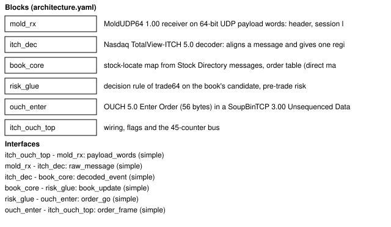
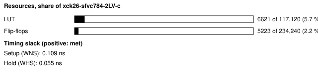
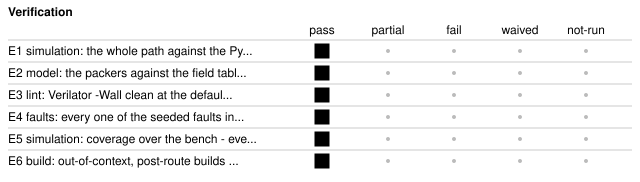

# b110_itch_ouch: ITCH 5.0 over MoldUDP64 in, OUCH 5.0 out, phase 1 (simulation)

<!-- Generated from handover.yaml by flow/handover.py (brief 68). Edit handover.yaml, or the text between the prose markers, then run: python -m flow.handover write designs/b110_itch_ouch -->

A trading path in the formats a real venue speaks, in simulation. UDP payload words carrying MoldUDP64 and Nasdaq TotalView-ITCH 5.0 are decoded, a small top-of-book is kept for a few instruments, a pre-trade risk check with a kill switch decides, and an OUCH 5.0 Enter Order is built in a SoupBinTCP 3.00 packet and handed to a stub port, optionally started before the risk verdict and cancelled if it fails. A Python reference model and a seeded synthetic generator check the RTL bit for bit, seeded faults in the RTL are all caught, and the block is built out of context for the KR260's part at the 10G core clock.

Not in scope:

- real market data or a real exchange; every message comes from our own seeded generator and no order is ever sent anywhere
- TCP, SoupBinTCP login, heartbeats or order responses; the frame goes to a stub port (docs/tcp_plan.md is a plan)
- Ethernet, IP or UDP handling and the FCS check; the path starts at the UDP payload (docs/phase2_integration.md is a plan)
- a full-depth book or every instrument; a few instruments with a bounded number of price levels, and a stated way to fail
- a board run, power, or timing inside the 10G core; the numbers are simulation and an out-of-context Vivado 2026.1 build

Kind: showcase; written by hand. State: built. For an agent: [AGENT.md](AGENT.md).



<!-- prose:what -->
**Purpose:** the trading demo of the 96 design speaks our own Bench Feed format. This design speaks the formats an exchange does, end to end and in
simulation: MoldUDP64 packets of Nasdaq TotalView-ITCH 5.0 messages in, an OUCH 5.0 Enter Order in a SoupBinTCP 3.00 packet out. Every field layout is
cited to the public document and section it comes from ([spec notes](docs/spec_notes.md)); the interfaces, every counter and everything a user could
guess wrong are in the [datasheet](docs/itch_ouch.md).

```
UDP payload words -> mold_rx -> itch_dec -> book_core -> risk_glue -> ouch_enter -> order frame words
 (64 bit, one clock)   MoldUDP64   ITCH 5.0    order table,    rule, risk,     OUCH 5.0 Enter Order
                       gap checks  decoder     price ladders,  kill switch,    in SoupBinTCP framing,
                                               top of book     order queue     speculative start, abort
```

What it is not: not a full-depth book (a side holds a bounded number of price levels, a table index one live order, and exceeding either marks the
instrument inexact and stops orders on it); not every instrument; not TCP (the frame goes to a stub port: [TCP plan](docs/tcp_plan.md)); not Ethernet, IP
or UDP handling ([phase 2 integration plan](docs/phase2_integration.md)). The decision rule is the one of `trade64` in the 96 design, applied to the book
instead of to a Bench Feed frame.

**Speculative start.** The order frame can begin while the risk verdict is still being formed (it needs the book after the triggering message). If the
verdict refuses it, or the Add turns out a duplicate, `o_abort` cancels the frame in flight; the orders that leave are the same with or without it.
<!-- /prose:what -->

## Technical parameters

| Item | Value |
|---|---|
| Part | `xck26-sfvc784-2LV-c` |
| Board | Kria KR260 (K26 SOM) |
| Top | `itch_ouch_top (wrapped with input registers in ooc_wrap for the out-of-context build)` |
| Tool | Vivado 2026.1 |
| Note | no board top of its own; phase 2 puts it behind the 10G MAC of designs/b96_kr260_10g |

Clocks:

- `clk`: 161.132 MHz (from `results/b110/ooc/itch_ouch_top.json`); the 10G core user clock (nominally 161.1328125 MHz); the out-of-context build constrains the period 6.2061 ns, the 4-decimal rounding of the nominal

Resets:

- `rst`, active high: synchronous; resets every register including the counters and starts the table sweep; one clock domain, no asynchronous input

Interfaces:

- `payload input` (s_v, s_d[63:0], s_sof, s_eof, s_keep[7:0], s_err (UDP payload words)) ([datasheet](docs/itch_ouch.md)): byte 0 in bits 7:0; keep is low-contiguous on the last word; the messages of a packet are delivered before its frame check is known
- `order frame output` (o_v, o_d[63:0], o_sof, o_eof, o_keep[7:0], o_abort (stub port)) ([datasheet](docs/itch_ouch.md)): eight words, never paused; o_abort cancels the frame in flight (speculative start only)
- `configuration and clears` (cfg_* static inputs and one-clock clr_* pulses) ([datasheet](docs/itch_ouch.md)): configuration is static while traffic runs; clr_book starts a table sweep during which events are dropped and counted
- `observation` (flags, cnt (45 counters of 32 bits), tu_* top-of-book update record, tob_* registers) ([datasheet](docs/itch_ouch.md)): counters wrap, never saturate; every counter is defined in the datasheet

| Parameter | Value | Legal range | Note |
|---|---|---|---|
| `N_INST` | 4 | 2 to 8 | instruments watched, found through Stock Directory messages |
| `LEVELS` | 8 | 4 or 8 | price levels per side and instrument; more distinct prices makes the instrument inexact |
| `ORD_AW` | 8 | 4 to 16 (tested at 5, 6, 8 and 10) | order table index bits, so 2^ORD_AW live orders; two live orders with one index make the instrument inexact |

| Quantity | Value | Source |
|---|---|---|
| Resources | LUTs of itch_ouch_top at the required clock (including the LUTs used as memory): 6621 LUT; registers of itch_ouch_top at the required clock: 5223 FF; of those LUTs, the ones used as distributed memory (the order table and the price ladders): 1728 LUT; block RAM tiles used: 0 tiles | M6, M7, M13, M14 |
| Timing | worst setup slack at the required clock: 0.109 ns; worst hold slack at the required clock: 0.055 ns; fastest clock period tried that closed: 5 ns | M8, M9, M10 |
| Power | not measured | [Known gaps](#known-gaps-and-limits) |
| Latency | clocks from the last byte of a message to its top-of-book update (Add Order): 7 clocks; clocks from the last byte of the triggering message to the first word of the order frame, frame started at the risk verdict: 8 clocks; the same with the frame started speculatively, before the verdict: 3 clocks; the order frame's first word after the decision (the verdict, or the candidate when speculative) is known: 1 clocks; the 96 design's bench-feed path, simulated, from the price word in the MAC register to the order's preamble in the MAC register (default build with the clock crossing): 7 clocks | M1, M2, M3, M4, M15 |
| Throughput | clocks per message with payloads back to back and no idle clock, mixed Add, Delete and Replace; nothing dropped: 3.838 clocks | M5 |



<!-- prose:parameters -->
The three parameters change the size of the order table and the ladders; the datasheet says what each limit does when it is exceeded. Resources per block,
from the hierarchical utilisation of the out-of-context build at the required clock, are under Measured.
<!-- /prose:parameters -->

## How to build, run and reproduce

| Step | Command | Heavy slot | Time |
|---|---|---|---|
| the whole bench (cocotb on Icarus), the model tests and the lint; needs Icarus Verilog 12, cocotb 2.0.1, Verilator (lint test is skipped without it) | `python3 -m pytest -q designs/b110_itch_ouch/tests/test_b110_model.py designs/b110_itch_ouch/tests/test_b110_rtl.py designs/b110_itch_ouch/tests/test_b110_lint.py` | no | about 2 min |
| the same with the measurement records written (latency, throughput, coverage, idle gap); needs as above | `B110_RECORD=$PWD/results/b110 python3 -m pytest -q designs/b110_itch_ouch/tests/test_b110_rtl.py::test_all_benches` | no | about 1 min |
| the seeded faults (every mutant of verif/mutants.yaml against the bench); needs as above; each run uses its own build root, two at a time | `python3 designs/b110_itch_ouch/tests/run_mutants.py --jobs 2 --json results/b110/mutation.json` | no | about 25 min |
| the out-of-context builds (three clocks); needs Vivado 2026.1 and a heavy slot (take_heavy_slot.sh) | `python3 -m designs.b110_itch_ouch.ooc.ooc --clocks 6.2061 5.0 4.4` | yes | about 30 min |

Tool: Vivado 2026.1. Build ID of the inputs at handover: none (no Vivado build of this directory). Knowledge-bank pin: `93d158c`.

| File | What |
|---|---|
| [`designs/b110_itch_ouch/rtl/mold_rx.sv`](rtl/mold_rx.sv) | MoldUDP64 receiver |
| [`designs/b110_itch_ouch/rtl/itch_dec.sv`](rtl/itch_dec.sv) | ITCH 5.0 decoder |
| [`designs/b110_itch_ouch/rtl/book_core.sv`](rtl/book_core.sv) | order table, ladders, top of book |
| [`designs/b110_itch_ouch/rtl/risk_glue.sv`](rtl/risk_glue.sv) | decision, risk checks, kill switch, order queue |
| [`designs/b110_itch_ouch/rtl/ouch_enter.sv`](rtl/ouch_enter.sv) | OUCH 5.0 Enter Order in SoupBinTCP framing |
| [`designs/b110_itch_ouch/rtl/itch_ouch_top.sv`](rtl/itch_ouch_top.sv) | top level |
| [`designs/b110_itch_ouch/model/proto.py`](model/proto.py) | packers for the four protocols, from the specifications |
| [`designs/b110_itch_ouch/model/ref.py`](model/ref.py) | reference model (untimed, exact) |
| [`designs/b110_itch_ouch/model/gen.py`](model/gen.py) | seeded synthetic ITCH over MoldUDP64 generator |
| [`designs/b110_itch_ouch/tests/b110_cocotb.py`](tests/b110_cocotb.py) | cocotb bench |
| [`designs/b110_itch_ouch/tests/run_mutants.py`](tests/run_mutants.py) | seeded-fault runner |
| [`designs/b110_itch_ouch/ooc/ooc.py`](ooc/ooc.py) | out-of-context build driver |
| [`designs/b110_itch_ouch/docs/itch_ouch.md`](docs/itch_ouch.md) | datasheet |
| [`designs/b110_itch_ouch/docs/spec_notes.md`](docs/spec_notes.md) | field layouts and where each comes from |
| [`designs/b110_itch_ouch/docs/tcp_plan.md`](docs/tcp_plan.md) | TCP options and the phase 2 recommendation |
| [`designs/b110_itch_ouch/docs/phase2_integration.md`](docs/phase2_integration.md) | integration plan for the KR260 design, the host bench and the board test |

<!-- prose:build -->
Simulation needs Icarus Verilog 12 and cocotb 2.0.1 (nothing else); `python3 designs/b110_itch_ouch/scripts/gen_pkg.py --check` confirms the counter package
matches the model's list. The out-of-context build takes a heavy slot and several minutes a clock under one thread.
<!-- /prose:build -->

## Verified



| ID | Activity | Result | What | Evidence | Conditions |
|---|---|---|---|---|---|
| E1 | simulation | pass | the whole path against the Python reference over seeded sessions, hand-built corner cases, impairments, a stress run and other parameters - events, every top-of-book update, every order frame bit for bit, every counter and flag | [`designs/b110_itch_ouch/tests/test_b110_rtl.py`](tests/test_b110_rtl.py) (run in CI) | - |
| E2 | model | pass | the packers against the field tables of the specifications and the reference model against hand-computed behaviour of the protocol layer, the book and the risk checks | [`designs/b110_itch_ouch/tests/test_b110_model.py`](tests/test_b110_model.py) (run in CI) | - |
| E3 | lint | pass | Verilator -Wall clean at the default parameters and at three others | [`designs/b110_itch_ouch/tests/test_b110_lint.py`](tests/test_b110_lint.py) (run in CI) | - |
| E4 | faults | pass | every one of the seeded faults in the RTL (operators, constants and conditions across the five blocks) fails the bench | [`results/b110/mutation.json`](../../results/b110/mutation.json) | - |
| E5 | simulation | pass | coverage over the bench - every message type decoded, every byte offset where a message starts and ends in a word, every last-word keep mask, every counter | [`results/b110/coverage_sim.json`](../../results/b110/coverage_sim.json) | - |
| E6 | build | pass | out-of-context, post-route builds on the K26 at the required 10G core clock and two faster ones; the required clock closed (setup, hold and pulse width) | [`results/b110/ooc/itch_ouch_top.json`](../../results/b110/ooc/itch_ouch_top.json) | - |

Gates at handover: `rtl_equals_model` pass, `lint` pass, `seeded_faults` pass, `ooc_build_2026_1` pass, `board_run` not-run.

<!-- prose:verified -->
- **Against the model.** `tests/b110_cocotb.py` drives the whole path with seeded sessions (a trading day's opening, a realistic message mix, back-to-back packets,
  packets with bubbles in the valid signal), hand-built corner cases (duplicate adds, index collisions, over-execution, every form of Replace, ladder
  overflow, a bad frame, every prefix of a packet, a message beginning and ending at every byte of a word), impairments (gap, duplicate, overlap, a second
  session, heartbeats, end of session), every risk check on its own, the kill switch, speculation (aborts included) and the order queue. Events, every
  top-of-book update, every order frame byte for byte, every counter and every flag are compared with `model/ref.py`. `tests/b110_book_cocotb.py` offers events
  to the book alone on consecutive clocks to reach the paths a real wire cannot.
- **The model itself** is checked against the field tables of the specifications and against hand-computed behaviour (`tests/test_b110_model.py`).
- **Seeded faults.** `verif/mutants.yaml` holds operator, constant and condition changes across the five blocks; each is run against the whole bench
  (`tests/run_mutants.py`). The first run left five alive; each one showed a missing test (a Replace in the queue, the band edge, no bid with a huge band, a
  high price, non-default frame fields); the tests were added and every fault is now caught.
- **Coverage.** Every message type is decoded; a message starts and ends at each of the eight byte offsets of a word; every last-word byte mask occurs; every
  counter becomes non-zero except `late_abort`, which the pipeline cannot reach (`results/b110/coverage_sim.json`).
- **Lint.** Verilator `-Wall` clean at the default parameters and at three others.
<!-- /prose:verified -->

## Measured

Every value is read from the record by `python -m flow.handover fill`, not typed.

| ID | What | Value | Runs | Source | Conditions |
|---|---|---|---|---|---|
| M1 | clocks from the last byte of a message to its top-of-book update (Add Order) | 7 clocks | 1 | [`results/b110/latency_sim.json`](../../results/b110/latency_sim.json) `non_speculative.book_update_add` | simulation, one clock |
| M2 | clocks from the last byte of the triggering message to the first word of the order frame, frame started at the risk verdict | 8 clocks | 1 | [`results/b110/latency_sim.json`](../../results/b110/latency_sim.json) `non_speculative.first_order_word` | simulation, one clock |
| M3 | the same with the frame started speculatively, before the verdict | 3 clocks | 1 | [`results/b110/latency_sim.json`](../../results/b110/latency_sim.json) `speculative.first_order_word` | simulation, one clock; only when the frame is idle and no earlier candidate is in flight |
| M4 | the order frame's first word after the decision (the verdict, or the candidate when speculative) is known | 1 clocks | 1 | [`results/b110/latency_sim.json`](../../results/b110/latency_sim.json) `non_speculative.decision_to_first_order_word` | simulation, one clock; the same figure the 96 design has from its decision register to its order logic |
| M5 | clocks per message with payloads back to back and no idle clock, mixed Add, Delete and Replace; nothing dropped | 3.838 clocks | 1 | [`results/b110/throughput_sim.json`](../../results/b110/throughput_sim.json) `clocks_per_message` | simulation; one 64-bit word a clock is accepted, so the figure is the input's own rate for these message sizes |
| M6 | LUTs of itch_ouch_top at the required clock (including the LUTs used as memory) | 6621 LUT | 1 | [`results/b110/ooc/itch_ouch_top.json`](../../results/b110/ooc/itch_ouch_top.json) `at_required.core_lut` | out of context, Vivado 2026.1, one thread, default parameters; the wrapper's input registers are not counted |
| M7 | registers of itch_ouch_top at the required clock | 5223 FF | 1 | [`results/b110/ooc/itch_ouch_top.json`](../../results/b110/ooc/itch_ouch_top.json) `at_required.core_ff` | as M6 |
| M8 | worst setup slack at the required clock | 0.109 ns | 1 | [`results/b110/ooc/itch_ouch_top.json`](../../results/b110/ooc/itch_ouch_top.json) `at_required.wns_ns` | out of context, post-route, period 6.2061 ns, no clock buffer or jitter |
| M9 | worst hold slack at the required clock | 0.055 ns | 1 | [`results/b110/ooc/itch_ouch_top.json`](../../results/b110/ooc/itch_ouch_top.json) `at_required.whs_ns` | as M8 |
| M10 | fastest clock period tried that closed | 5 ns | 1 | [`results/b110/ooc/itch_ouch_top.json`](../../results/b110/ooc/itch_ouch_top.json) `closed_at_ns` | a closed point out of the three tried, not a bound; as M8 |
| M11 | seeded faults killed by the bench | 58 faults | 1 | [`results/b110/mutation.json`](../../results/b110/mutation.json) `killed` | simulation, the whole bench per fault |
| M12 | seeded faults that build and were tried | 58 faults | 1 | [`results/b110/mutation.json`](../../results/b110/mutation.json) `valid` | as M11 |
| M13 | of those LUTs, the ones used as distributed memory (the order table and the price ladders) | 1728 LUT | 1 | [`results/b110/ooc/itch_ouch_top.json`](../../results/b110/ooc/itch_ouch_top.json) `at_required.core_lutram` | as M6 |
| M14 | block RAM tiles used | 0 tiles | 1 | [`results/b110/ooc/itch_ouch_top.json`](../../results/b110/ooc/itch_ouch_top.json) `at_required.bram_tiles` | as M6 |
| M15 | the 96 design's bench-feed path, simulated, from the price word in the MAC register to the order's preamble in the MAC register (default build with the clock crossing) | 7 clocks | 1 | [`results/b96c/core_sim_default.json`](../../results/b96c/core_sim_default.json) `tick_to_trade_digital_sim.mac_register_of_price_word_to_order_preamble_clocks` | simulation of the whole 96 core; a different quantity from M2 and M3 (see the datasheet's comparison) |

<!-- prose:measured -->
Latency in clocks from the last byte of the message (simulation, `results/b110/latency_sim.json`): the decoded event at 2, the top-of-book update at 7 (the
second change of a Replace at 8), the first word of the order frame at 8 when it starts at the verdict and at 3 when it starts speculatively. One clock is
6.2061 ns. The existing bench-feed path measures 7 clocks from its price word in the MAC register to the order preamble in the MAC register, a different
quantity (see the datasheet's comparison): the book-dependent verdict costs here what the speculative start gives back.

Out of context, post-route, Vivado 2026.1, one thread (`results/b110/ooc/itch_ouch_top.json`):

| Clock period | Setup slack | Hold slack | Closed | Critical path |
|---|---|---|---|---|
| 6.2061 ns (required) | +0.109 ns | +0.055 ns | yes | the risk verdict into the position register |
| 5.0 ns | +0.022 ns | +0.055 ns | yes | the price-ladder update (B3) |
| 4.4 ns | -1.246 ns | +0.055 ns | no | the price-ladder update (B3) |

Resources at the required clock, by block (LUTs include the memory LUTs; the order table and ladders are distributed RAM, there is no block RAM and no DSP):

| Block | LUT | of which memory | FF |
|---|---|---|---|
| `book_core` (order table, ladders, top of book) | 4397 | 1728 | 1703 |
| `mold_rx` | 1394 | 0 | 1683 |
| `risk_glue` | 490 | 0 | 973 |
| `ouch_enter` | 199 | 0 | 235 |
| `itch_dec` | 140 | 0 | 629 |
| `itch_ouch_top` (all) | 6621 | 1728 | 5223 |

Throughput: the input is accepted at one 64-bit word a clock with nothing dropped, so the rate is the input's own; for the mix in the throughput test it is
3.838 clocks a message (`results/b110/throughput_sim.json`).
<!-- /prose:measured -->

## Known gaps and limits

- **board_run**: Not run on a board; phase 2 would bring it behind the 10G MAC of the KR260 design (docs/phase2_integration.md).
- **power**: Not measured; an out-of-context build has no realistic activity and nothing ran on a board.
- **E6**: Out of context the clock has no buffer or jitter and the inputs are registered in the wrapper; inside the 10G core the clock and placement can differ. Only the default parameters were built.
- **throughput**: Measured in simulation only, and the figure is the rate of the input stream for these message sizes, not a limit of the path; no figure on a board.
- **tcp**: No TCP, SoupBinTCP login, client heartbeat or response handling; the frame goes to a stub port. docs/tcp_plan.md compares the options and recommends one for phase 2; it was not built or timed.
- **ethernet**: The path starts at the UDP payload. Header handling, the frame check and the late frame verdict of the 10G MAC are phase 2 (docs/phase2_integration.md); until then a bad frame cannot recall messages already applied or an order already triggered.
- **spec**: Field layouts were read from the public Nasdaq documents; the items that were recalled or assumed are marked UNCONFIRMED in docs/spec_notes.md, among them whether older OUCH 5.0 ports expect a 4 byte price and whether a TagValue length counts its tag byte. No order was ever accepted by anything but our own model.
- **book**: Not a full-depth book. Behaviour a user could guess wrong - more distinct prices than LEVELS or two live orders with one table index make the instrument inexact and orders on it are refused until clr_book; the position counts the quantity sent, not filled; a Replace never triggers an order; the candidate's verdict uses the book after the triggering message.
- **simulators**: Simulated with Icarus Verilog and cocotb only; no Verilator simulation and no formal proof of the protocol layer.
- **cdc**: One clock domain and no asynchronous input, so no clock-domain-crossing check applies; the crossing into the 10G core's clock is phase 2.
- **data**: Synthetic data from one generator with its own message mix; the figures say how the block behaves on that mix, nothing about a market.

<!-- prose:gaps -->
<!-- /prose:gaps -->

## Next steps

1. Write the phase 2 brief from docs/phase2_integration.md - the adapter from the MAC's words, the late frame verdict, registers, and in-context timing on the KR260.
2. Build the TCP fast path of docs/tcp_plan.md option A and test it against a software exchange on the host PC.
3. Decide with the board latency whether the book-dependent risk verdict should be replaced by a faster partial check.

Open questions:

- Is the speculative start worth its abort path once the TCP headers and the 10G chain are in front of the frame?
- Should a Replace trigger an order, given that its side is known one clock after an Add's?

<!-- prose:next -->
<!-- /prose:next -->

## History

| Date | Brief | PR | What |
|---|---|---|---|
| 2026-11-20 | 110 | - | RTL, reference model, generator, bench, seeded faults, out-of-context builds, TCP and phase 2 plans |

<!-- prose:history -->
<!-- /prose:history -->
