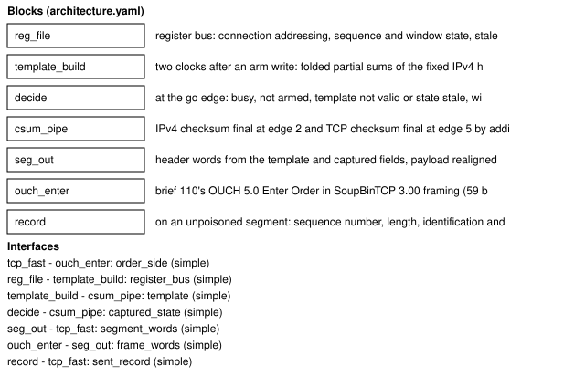
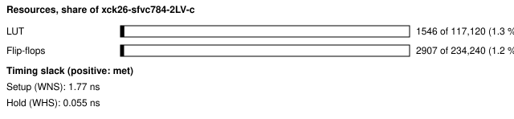
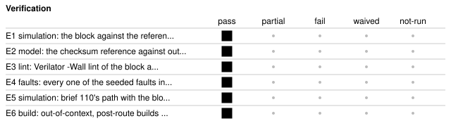

# b119_tcp_fast: TCP fast path for OUCH orders (software owns the connection, hardware sends pre-built segments)

<!-- Generated from handover.yaml by flow/handover.py (brief 68). Edit handover.yaml, or the text between the prose markers, then run: python -m flow.handover write designs/b119_tcp_fast -->

**Verification: verified except: 24 of 27 requirements without passing evidence; 27 of 27 requirements not agreed; required method mix not yet measured; mutation floor not yet measured; 21 stale or differing evidence items.** [VERIFIED.md](VERIFIED.md) is the generated, hash-pinned record; [what the label means](../../docs/verified.md).

A block that holds the TCP connection state which software hands it and sends each OUCH 5.0 order of brief 110 as one complete Ethernet, IPv4 and TCP frame, with sequence number, identification and both checksums finished incrementally from partial sums of a template. It supports the speculative start and abort of brief 110, where an aborted frame is poisoned and consumes no sequence space, refuses to send when it is not armed, its state is stale, the window is closed or the MSS is too small, and hands every sent segment back to software. A Python TCP owner and a software OUCH exchange test it end to end in simulation, seeded faults in the RTL are caught, and the block is built out of context for the KR260's part at the 10G core clock.

Not in scope:

- real market data, a real exchange or a real network; every order comes from our own generator and no frame is ever sent anywhere
- a board run, power, or timing inside the 10G core; the numbers are simulation and an out-of-context Vivado 2026.1 build
- receiving, parsing or acknowledging anything; software owns the receive side and writes the acknowledgement state into the block
- TCP options, selective acknowledgement, window scaling, several connections or a hardware retransmission
- the MAC, the frame check sequence and the transmit multiplexer; the block's words go to a MAC that does not exist here (docs/phase2_integration.md is a plan)

Kind: showcase; written by a Claude Code session. State: built. For an agent: [AGENT.md](AGENT.md).



<!-- prose:what -->
**Purpose:** brief 110 stops at the 59-byte order packet. A real order needs a TCP connection around it. This block is option A of the 110 TCP plan: software keeps the
connection (handshake, acknowledgements, retransmission, login, heartbeats), and the fabric sends each order as one complete Ethernet frame built from a template,
in the same clock the stub port of brief 110 shows its first word. The interfaces, every register and everything a user could guess wrong are in the
[datasheet](docs/tcp_fast.md); the Python TCP owner and the software exchange are described in [software side](docs/software_side.md).

```
order (go, fields, verdict) --> tcp_fast --> Ethernet/IPv4/TCP frame words --> MAC (adds the FCS; o_poison makes it wrong)
                                  ^   |
        register bus (software) --+   +--> record of every sent segment --> software (retransmission from it)
```

**Speculative start and abort.** The frame may start before the risk verdict. An abort ends it with a poisoned frame check sequence and consumes no sequence
number and no IP identification; the next segment reuses both. A speculative frame with no verdict by its last word is poisoned too.

**What software must do.** Hand the connection over and arm it, keep the acknowledgement and window registers current, record every sent segment, retransmit from the
records, and take the sequence space back (disarm, wait for idle) before sending anything of its own. Section 3 of the datasheet has the list.
<!-- /prose:what -->

## Technical parameters

| Item | Value |
|---|---|
| Part | `xck26-sfvc784-2LV-c` |
| Board | Kria KR260 (K26 SOM) |
| Top | `tcp_fast (wrapped with input registers in ooc_wrap for the out-of-context build)` |
| Tool | Vivado 2026.1 |
| Note | no board top of its own; it replaces ouch_enter of designs/b110_itch_ouch and feeds the 10G MAC of designs/b96_kr260_10g in phase 2 |

Clocks:

- `clk`: 161.132 MHz (from `results/b119/ooc/tcp_fast.json`); the 10G core user clock (nominally 161.1328125 MHz); the out-of-context build constrains the period 6.2061 ns, the 4-decimal rounding of the nominal

Resets:

- `rst`, active high: synchronous; resets every register including the counters; the block is not armed after reset; one clock domain, no asynchronous input

Interfaces:

- `order side` (go, go_spec, f_sym, f_px, f_qty, f_ref, commit, abort, cfg_*, busy, late, refuse_v, refuse_code (the ports of ouch_enter of brief 110 and three more)) ([datasheet](docs/tcp_fast.md)): a go while busy is dropped; a refused order is lost; abort in the go clock cancels the go; cfg_* must stay static while a segment is in flight
- `segment output` (o_v, o_d[63:0], o_sof, o_eof, o_keep[7:0], o_poison (to the MAC)) ([datasheet](docs/tcp_fast.md)): 113 bytes without the frame check sequence in fifteen words, never paused; o_poison with the last word asks the MAC to corrupt the check sequence
- `sent-segment record` (rec_v, rec_seq, rec_len, rec_id, rec_pay[511:0]) ([datasheet](docs/tcp_fast.md)): one clock for each unpoisoned segment and not buffered; a poisoned segment produces none
- `software register bus` (sw_we, sw_waddr[4:0], sw_wdata[31:0], sw_raddr[4:0], sw_rdata[31:0]) ([datasheet](docs/tcp_fast.md)): static writes while busy are ignored and counted; live registers restart the staleness age; reads show the registers as they were before the next edge

| Parameter | Value | Legal range | Note |
|---|---|---|---|
| `PAYLEN` | 59 | fixed | the payload is always one SoupBinTCP Unsequenced Data packet carrying an Enter Order (brief 110); there are no module parameters |
| `segment bytes` | 113 | fixed | Ethernet 14, IPv4 20, TCP 20 without options, payload 59; fifteen 64-bit words |

| Quantity | Value | Source |
|---|---|---|
| Resources | LUTs of tcp_fast at the required clock, including the frame builder inside it: 1546 LUT; registers of tcp_fast at the required clock: 2907 FF; block RAM tiles used: 0 tiles | M7, M8, M12 |
| Timing | worst setup slack at the required clock: 1.77 ns; worst hold slack at the required clock: 0.055 ns; fastest clock period tried that closed: 5 ns | M9, M10, M11 |
| Power | not measured | [Known gaps](#known-gaps-and-limits) |
| Latency | clocks from the clock go is presented to the first byte of the frame: 1 clocks; clocks from go to the last byte of the TCP checksum field: 7 clocks; clocks from go to the last byte of the segment: 15 clocks; clocks from the last byte of a triggering ITCH message to the first byte of the Ethernet frame, speculative start: 3 clocks; the same with the frame started at the risk verdict: 8 clocks | M1, M2, M3, M4, M5 |
| Throughput | clocks between the starts of two segments sent back to back: 15 clocks | M6 |



<!-- prose:parameters -->
<!-- /prose:parameters -->

## How to build, run and reproduce

| Step | Command | Heavy slot | Time |
|---|---|---|---|
| the whole bench (cocotb on Icarus), the Python-side tests and the lint; needs Icarus Verilog 12, cocotb 2.0.1, Verilator (the lint test is skipped without it) | `python3 -m pytest -q designs/b119_tcp_fast/tests/test_b119_model.py designs/b119_tcp_fast/tests/test_b119_rtl.py designs/b119_tcp_fast/tests/test_b119_lint.py` | no | about 1 min |
| the same with the measurement records written (latency in clocks, outcomes, end-to-end figures); needs as above | `B119_RECORD=$PWD/results/b119 python3 -m pytest -q designs/b119_tcp_fast/tests/test_b119_rtl.py` | no | about 1 min |
| the seeded faults (every mutant of verif/mutants.yaml against the bench); needs as above; each run uses its own build root, two at a time | `python3 designs/b119_tcp_fast/tests/run_mutants.py --jobs 2 --json results/b119/mutation.json` | no | about 20 min |
| the out-of-context builds (two clocks); needs Vivado 2026.1 and a heavy slot (take_heavy_slot.sh) | `python3 -m designs.b119_tcp_fast.ooc.ooc --clocks 6.2061 5.0` | yes | about 30 min |

Tool: Vivado 2026.1. Build ID of the inputs at handover: none (no Vivado build of this directory). Knowledge-bank pin: `eaf6794`.

| File | What |
|---|---|
| [`designs/b119_tcp_fast/rtl/tcp_fast.sv`](rtl/tcp_fast.sv) | the TCP fast path |
| [`designs/b119_tcp_fast/rtl/itch_ouch_tcp_top.sv`](rtl/itch_ouch_tcp_top.sv) | brief 110's trading path with tcp_fast in place of its stub port (simulation) |
| [`designs/b119_tcp_fast/model/tcpref.py`](model/tcpref.py) | segment, checksum and decision reference |
| [`designs/b119_tcp_fast/model/softtcp.py`](model/softtcp.py) | TCP endpoint, owner and software exchange |
| [`designs/b119_tcp_fast/model/soup.py`](model/soup.py) | SoupBinTCP and OUCH response packers and parsers |
| [`designs/b119_tcp_fast/model/hwmodel.py`](model/hwmodel.py) | untimed stand-in for the block's register file |
| [`designs/b119_tcp_fast/model/orders.py`](model/orders.py) | order payload builder from brief 110's packers |
| [`designs/b119_tcp_fast/tests/b119_cocotb.py`](tests/b119_cocotb.py) | cocotb bench of the block |
| [`designs/b119_tcp_fast/tests/b119_top_cocotb.py`](tests/b119_top_cocotb.py) | cocotb bench behind brief 110's risk logic |
| [`designs/b119_tcp_fast/tests/netsim.py`](tests/netsim.py) | the pure-Python network of owner, exchange and stand-in |
| [`designs/b119_tcp_fast/tests/run_mutants.py`](tests/run_mutants.py) | seeded-fault runner |
| [`designs/b119_tcp_fast/ooc/ooc.py`](ooc/ooc.py) | out-of-context build driver |
| [`designs/b119_tcp_fast/docs/tcp_fast.md`](docs/tcp_fast.md) | datasheet |
| [`designs/b119_tcp_fast/docs/software_side.md`](docs/software_side.md) | the Python TCP owner and exchange |
| [`designs/b119_tcp_fast/docs/phase2_integration.md`](docs/phase2_integration.md) | integration notes for the 10G MAC and open points |

<!-- prose:build -->
<!-- /prose:build -->

## Verified



| ID | Activity | Result | What | Evidence | Conditions |
|---|---|---|---|---|---|
| E1 | simulation | pass | the block against the reference in cocotb - random connections and orders byte exact, checksum corner cases, an abort at every offset, speculative verdicts, every refusal path, register semantics, continuity of the sequence space with software, a long random mix, and the software owner and exchange end to end | [`designs/b119_tcp_fast/tests/test_b119_rtl.py`](tests/test_b119_rtl.py) (run in CI) | - |
| E2 | model | pass | the checksum reference against outside vectors, the TCP endpoint, the owner and the exchange against the untimed stand-in, including a dropped segment and heartbeats | [`designs/b119_tcp_fast/tests/test_b119_model.py`](tests/test_b119_model.py) (run in CI) | - |
| E3 | lint | pass | Verilator -Wall lint of the block and the frame builder inside it, no warnings | [`designs/b119_tcp_fast/tests/test_b119_lint.py`](tests/test_b119_lint.py) (run in CI) | - |
| E4 | faults | pass | every one of the seeded faults in the block (constants, operators and conditions across the checksum, the segment, the verdict, the refusals and the registers) fails the bench | [`results/b119/mutation.json`](../../results/b119/mutation.json) | - |
| E5 | simulation | pass | brief 110's path with the block in place of its stub port against brief 110's reference model - the same orders leave, with the same payload bytes, valid checksums and gapless sequence numbers, speculative orders that are refused are poisoned | [`results/b119/top_sim.json`](../../results/b119/top_sim.json) | - |
| E6 | build | pass | out-of-context, post-route builds on the K26 at the required 10G core clock and a faster one; the required clock closed (setup, hold and pulse width) | [`results/b119/ooc/tcp_fast.json`](../../results/b119/ooc/tcp_fast.json) | - |

Gates at handover: `rtl_equals_model` pass, `lint` pass, `seeded_faults` pass, `ooc_build_2026_1` pass, `board_run` not-run.

<!-- prose:verified -->
Every segment is compared byte for byte with a reference whose checksums are checked against outside vectors; the bench covers an abort at every edge, every refusal
path, the register semantics, a dropped segment retransmitted by software, heartbeats that take and give back the sequence space, and a full session against the
software exchange. Seeded faults in the block are all caught. The block also runs behind brief 110's risk logic against its reference model.

**Specification to evidence.** Every requirement of this design against the checks that cover it, with each status computed from the evidence files, the gaps and the stale evidence: [verif/matrix.md](verif/matrix.md) ([html](verif/matrix.html)), generated from [verif/testplan.yaml](verif/testplan.yaml) by `python -m flow.trace_v1 write`; schema and rules in [docs/traceability_v1.md](../../docs/traceability_v1.md). Requirements here are drafts written from the design documents; the matrix shows which are closed by simulation, post-route timing or formal proof, and which depend on an element that does not exist here yet (the 96 design's MAC in simulation, a real TCP peer). The three Lean checksum requirements (`B119-F-CKSUM-IP`, `-TCP`, `-MODEL`, first filed under the b96 testplan and moved here) are proved for all inputs but their statements are not approved by a human, so the matrix does not count them as verification.
<!-- /prose:verified -->

## Measured

Every value is read from the record by `python -m flow.handover fill`, not typed.

| ID | What | Value | Runs | Source | Conditions |
|---|---|---|---|---|---|
| M1 | clocks from the clock go is presented to the first byte of the frame | 1 clocks | 1 | [`results/b119/bench_sim.json`](../../results/b119/bench_sim.json) `timing.first_byte_clocks_after_go` | simulation, one clock; the same clock in which brief 110's stub port shows its first word |
| M2 | clocks from go to the last byte of the TCP checksum field | 7 clocks | 1 | [`results/b119/bench_sim.json`](../../results/b119/bench_sim.json) `timing.tcp_checksum_field_clocks_after_go` | simulation, one clock |
| M3 | clocks from go to the last byte of the segment | 15 clocks | 1 | [`results/b119/bench_sim.json`](../../results/b119/bench_sim.json) `timing.last_byte_clocks_after_go` | simulation, one clock |
| M4 | clocks from the last byte of a triggering ITCH message to the first byte of the Ethernet frame, speculative start | 3 clocks | 1 | [`results/b119/top_sim.json`](../../results/b119/top_sim.json) `behind_risk_logic.speculative.first_ethernet_byte_clocks_after_last_itch_byte` | simulation of brief 110's path with the block behind it, one clock; only when the frame is idle and no earlier candidate is in flight |
| M5 | the same with the frame started at the risk verdict | 8 clocks | 1 | [`results/b119/top_sim.json`](../../results/b119/top_sim.json) `behind_risk_logic.non_speculative.first_ethernet_byte_clocks_after_last_itch_byte` | as M4 |
| M6 | clocks between the starts of two segments sent back to back | 15 clocks | 1 | [`results/b119/bench_sim.json`](../../results/b119/bench_sim.json) `timing.back_to_back_clocks_between_segment_starts` | simulation; the block is busy for the whole segment and drops a go meanwhile |
| M7 | LUTs of tcp_fast at the required clock, including the frame builder inside it | 1546 LUT | 1 | [`results/b119/ooc/tcp_fast.json`](../../results/b119/ooc/tcp_fast.json) `at_required.core_lut` | out of context, Vivado 2026.1, one thread; the wrapper's input registers are not counted |
| M8 | registers of tcp_fast at the required clock | 2907 FF | 1 | [`results/b119/ooc/tcp_fast.json`](../../results/b119/ooc/tcp_fast.json) `at_required.core_ff` | as M7 |
| M9 | worst setup slack at the required clock | 1.77 ns | 1 | [`results/b119/ooc/tcp_fast.json`](../../results/b119/ooc/tcp_fast.json) `at_required.wns_ns` | out of context, post-route, period 6.2061 ns, no clock buffer or jitter |
| M10 | worst hold slack at the required clock | 0.055 ns | 1 | [`results/b119/ooc/tcp_fast.json`](../../results/b119/ooc/tcp_fast.json) `at_required.whs_ns` | as M9 |
| M11 | fastest clock period tried that closed | 5 ns | 1 | [`results/b119/ooc/tcp_fast.json`](../../results/b119/ooc/tcp_fast.json) `closed_at_ns` | a closed point out of the two tried, not a bound; as M9 |
| M12 | block RAM tiles used | 0 tiles | 1 | [`results/b119/ooc/tcp_fast.json`](../../results/b119/ooc/tcp_fast.json) `at_required.bram_tiles` | as M7 |
| M13 | seeded faults killed by the bench | 73 faults | 1 | [`results/b119/mutation.json`](../../results/b119/mutation.json) `killed` | simulation, the whole bench per fault |
| M14 | seeded faults that build and were tried | 73 faults | 1 | [`results/b119/mutation.json`](../../results/b119/mutation.json) `valid` | as M13 |
| M15 | random segments compared byte for byte with the reference | 450 segments | 1 | [`results/b119/bench_sim.json`](../../results/b119/bench_sim.json) `random_segments` | simulation, random connections, orders and states including sequence numbers at the wrap |

<!-- prose:measured -->
<!-- /prose:measured -->

## Known gaps and limits

- **board_run**: Not run on a board; phase 2 would put the block behind the 10G MAC of the KR260 design (docs/phase2_integration.md).
- **power**: Not measured; an out-of-context build has no realistic activity and nothing ran on a board.
- **E6**: Out of context the clock has no buffer or jitter and the inputs are registered in the wrapper; inside the 10G core the clock and placement can differ.
- **mac**: The pair of this block and the 10G MAC's transmit path was not simulated; whether a MAC accepts a word every clock, pads a short poisoned frame and corrupts the frame check sequence on request is the 96 design's behaviour, not shown here.
- **refusals**: A refused order is lost and the risk logic of brief 110 is not told, so its order number and position count have already moved; the feedback is not built.
- **tcp**: No TCP options (timestamps must be off on the connection), no selective acknowledgement, no window scaling inside the block (software scales the values it writes), one connection, no hardware retransmission and no parsing of received segments.
- **software**: The TCP endpoint is a minimal user-space model with no congestion control, delayed acknowledgements, orderly close or zero-window probes; the exchange follows the Nasdaq documents for the fields it fills but is our own model and no real port was involved.
- **spec**: SoupBinTCP 3.00 and OUCH 5.0 layouts of the exchange's replies were read from the public documents; the padding of the Login Request's sequence number field is assumed, and brief 110's UNCONFIRMED items about the Enter Order stay open.
- **busy**: The block is busy for fifteen clocks per segment, so brief 110's order queue sees a longer busy time than with the stub port; the effect on rejected candidates at a real feed rate was not measured.
- **data**: Synthetic orders from our own generators; the figures say how the block behaves on them and nothing about a market.

<!-- prose:gaps -->
<!-- /prose:gaps -->

## Next steps

1. Build the transmit multiplexer and the register bridge of docs/phase2_integration.md, and simulate the block with the 96 design's MAC.
2. Add the refusal feedback from the block to the risk logic (release the order number and the position).
3. Run the owner against a real TCP peer on the host (a second machine or a namespace) and compare captures with the bench's frames.

Open questions:

- Is the fifteen-clock busy time acceptable at the feed rates of interest, or should a second segment buffer let the next order start while the last words go out?
- Should the owner's pure acknowledgements go through the block so that its sequence number is always current?

<!-- prose:next -->
<!-- /prose:next -->

## History

| Date | Brief | PR | What |
|---|---|---|---|
| 2026-11-20 | 119 | - | RTL, software TCP owner and exchange, bench, seeded faults, out-of-context builds, datasheet and integration notes |

<!-- prose:history -->
<!-- /prose:history -->
