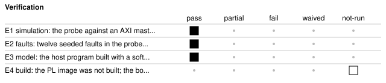

# b191_ps_axi_lat: Cortex-A53 to programmable-logic AXI latency probe (KR260, board row B-R8, prepared)

<!-- Generated from handover.yaml by flow/handover.py (brief 68). Edit handover.yaml, or the text between the prose markers, then run: python -m flow.handover write designs/b191_ps_axi_lat -->

**Verification: not assessed: no requirements recorded (no verif/testplan.yaml), so nothing here is traced to a requirement.** [VERIFIED.md](VERIFIED.md) is the generated, hash-pinned record; [what the label means](../../docs/verified.md).

A register block with a free-running counter that timestamps every AXI read request and every write it accepts, one on each of the Zynq UltraScale+ processor system's two AXI masters towards the fabric (M_AXI_HPM0_FPD and M_AXI_HPM0_LPD), and a host program that times 32-bit reads and writes of it from the Arm Cortex-A53 with the processor's own timer and with the fabric's counter. The probe is simulated against an edge-counting AXI master and seeded faults are caught; the host program and its judging script are tested without a board against a software stand-in. The board row (B-R8) is pre-registered; the programmable-logic image's build recipe is written and was not built, and nothing has run on a board.

Not in scope:

- a measured result; no latency figure for the processor-to-fabric path exists yet, only the means of measuring it
- a built bitstream; the image's recipe (build.yaml, the processor-system IP script) is untested, so its clock constraint, address assignment and the flow's gates are unchecked
- the latency of the ACP or HP ports, DMA, cached accesses, wider accesses or a faster fabric clock than 100 MHz
- a design that does anything else; the image has no I/O pins and no function besides the two probes

Kind: demonstration; written by a Claude Code session. State: simulated. For an agent: [AGENT.md](AGENT.md).

<!-- prose:what -->
<!-- /prose:what -->

## Technical parameters

| Item | Value |
|---|---|
| Part | `xck26-sfvc784-2LV-c` |
| Board | Kria KR260 (K26 SOM) |
| Top | `ps_axi_lat_top (the PL image); axi_lat_probe (simulated alone)` |
| Tool | Vivado 2026.1 |
| Note | the image was not built; the probe is simulated with Icarus Verilog and cocotb |

Clocks:

- `pl_clk0`: 100 MHz (from `designs/b191_ps_axi_lat/design.xdc`); the processor system's PL clock 0 (the IP script sets 100 MHz); the XDC constraint on the PS clock pin is untested because the image was not built; a fabric clock of 10 ns, so fabric-side figures have a resolution of 10 ns

Resets:

- `aresetn`, active low: the processor system's pl_resetn0 through a 4-flop reset synchroniser (asynchronous assert, synchronous release); clears the counter, the registers and the counts, not the log memory

Interfaces:

- `AXI4 slave (one per processor master)` (awid, awaddr, awlen, awsize, awvalid/awready, wdata, wstrb, wlast, wvalid/wready, bid, bresp, bvalid/bready, arid, araddr, arlen, arsize, arvalid/arready, rid, rdata, rresp, rlast, rvalid/rready (32-bit data, 16-bit ids)) ([datasheet](docs/ps_axi_lat.md)): single-beat 32-bit accesses only; anything else is answered SLVERR and counted; unmapped reads return 0 with SLVERR; partial write strobes are refused
- `register window` (4 KiB at the PS addresses 0xA0000000 (FPD) and 0x80000000 (LPD); ID, BUILD, CLK_HZ, SCRATCH, CNT, WR_TS, WR_N, LOG_N, TRIG, CTRL, BAD and the write-clock log) ([datasheet](docs/ps_axi_lat.md)): the counter is 32 bits and wraps in 42.9 s at 100 MHz; software uses differences modulo 2^32

| Parameter | Value | Legal range | Note |
|---|---|---|---|
| `LOG_DEPTH` | 256 | a power of two, at most 256 | entries of the write-clock log (window 0x400 to 0x7FC) |
| `CLK_HZ` | 100,000,000 | the fabric clock in Hz | only reported in the CLK_HZ register; the clock itself is set in the IP script |
| `BUILD_STAMP` | 0xB1910F01 | any 32-bit stamp (the flow sets it from the sources' hash) | read from the BUILD register; the host program refuses to run if it differs from the one it is told to expect |

| Quantity | Value | Source |
|---|---|---|
| Resources | not measured | [Known gaps](#known-gaps-and-limits) |
| Timing | not measured | [Known gaps](#known-gaps-and-limits) |
| Power | not measured | [Known gaps](#known-gaps-and-limits) |
| Latency | the smallest interval between two read requests at the probe's port from a master that takes each response in one clock: 2 clocks | M1 |
| Throughput | not measured | [Known gaps](#known-gaps-and-limits) |

<!-- prose:parameters -->
<!-- /prose:parameters -->

## How to build, run and reproduce

| Step | Command | Heavy slot | Time |
|---|---|---|---|
| the probe bench and the host tests (no board); needs Icarus Verilog, cocotb, gcc, and for the last test aarch64-linux-gnu-gcc | `python3 -m pytest -q designs/b191_ps_axi_lat/tests` | no | about 1 min |
| the seeded faults in the probe; needs as above | `python3 designs/b191_ps_axi_lat/tests/run_mutants.py --json results/191_trading_variants/mutation_probe.json` | no | about 1 min |
| the board session (planner gives it at the board; not run); needs a built bitstream, bootgen, dtc, the board lock and the owner's board visit | `designs/b191_ps_axi_lat/board/ps_axi_lat_session.sh <board ssh target> <results dir> <built .bit> <build stamp>` | no | about 60 min |

Tool: Vivado 2026.1. Build ID of the inputs at handover: `ce79cfb9` (`python flow/manifest.py show designs/b191_ps_axi_lat`: what a rebuild of today's sources and flow would carry; it changes when any build input or the flow changes, so it can differ from the build ID in an older evidence record). Knowledge-bank pin: `6185830`.

| File | What |
|---|---|
| [`designs/b191_ps_axi_lat/rtl/axi_lat_probe.sv`](rtl/axi_lat_probe.sv) | the AXI4 slave register block with the counter, the timestamps and the log |
| [`designs/b191_ps_axi_lat/rtl/ps_axi_lat_top.sv`](rtl/ps_axi_lat_top.sv) | the PL image's top, the processor system with both masters and one probe each |
| [`designs/b191_ps_axi_lat/ip/amd_ip_lat.tcl`](ip/amd_ip_lat.tcl) | the Zynq UltraScale+ processor system IP of the image |
| [`designs/b191_ps_axi_lat/host/ps_axi_lat.c`](host/ps_axi_lat.c) | the host program (aarch64, static) that measures, with a software stand-in for the registers under -DMOCK |
| [`designs/b191_ps_axi_lat/scripts/ps_axi_lat_verdict.py`](scripts/ps_axi_lat_verdict.py) | judges a board session's files against the pre-registration |
| [`designs/b191_ps_axi_lat/board/ps_axi_lat_session.sh`](board/ps_axi_lat_session.sh) | the board session script (written, not run) |
| [`designs/b191_ps_axi_lat/board/pl-ps-axi-lat.dtsi`](board/pl-ps-axi-lat.dtsi) | the device-tree overlay source for the generic-uio route |
| [`designs/b191_ps_axi_lat/tests/b191_cocotb.py`](tests/b191_cocotb.py) | cocotb bench of the probe with an edge-counting AXI master |
| [`designs/b191_ps_axi_lat/tests/test_b191_host.py`](tests/test_b191_host.py) | the host program and verdict script without a board |
| [`designs/b191_ps_axi_lat/tests/run_mutants.py`](tests/run_mutants.py) | seeded-fault runner for the probe |
| [`designs/b191_ps_axi_lat/docs/ps_axi_lat.md`](docs/ps_axi_lat.md) | datasheet, register map and the pre-registration of board row B-R8 |

<!-- prose:build -->
<!-- /prose:build -->

## Verified

| ID | Activity | Result | What | Evidence | Conditions |
|---|---|---|---|---|---|
| E1 | simulation | pass | the probe against an AXI master that counts clock edges, so every timestamp is checked against the edge in which the access was accepted - identity, scratch, read and write timestamps with AW and W in either order, the log and its saturation, bad accesses, back pressure and a random mix against a model | [`results/191_trading_variants/pytest_junit.xml`](../../results/191_trading_variants/pytest_junit.xml) | - |
| E2 | faults | pass | twelve seeded faults in the probe (stamps one clock late, the log, strobes, ids, the clear, unmapped writes) all fail the bench | [`results/191_trading_variants/mutation_probe.json`](../../results/191_trading_variants/mutation_probe.json) | - |
| E3 | model | pass | the host program built with a software stand-in for the registers, its JSON judged by the verdict script (valid and invalid sets), and the aarch64 static build | [`results/191_trading_variants/pytest_junit.xml`](../../results/191_trading_variants/pytest_junit.xml) | - |
| E4 | build | not-run | the PL image was not built; the board row waits for it | [`designs/b191_ps_axi_lat/build.yaml`](build.yaml) | - |

Gates at handover: `rtl_equals_model` pass, `lint` pass, `seeded_faults` pass, `build` not-run, `board_run` not-run.

<!-- prose:verified -->
<!-- /prose:verified -->

## Measured

Every value is read from the record by `python -m flow.handover fill`, not typed.

| ID | What | Value | Runs | Source | Conditions |
|---|---|---|---|---|---|
| M1 | the smallest interval between two read requests at the probe's port from a master that takes each response in one clock | 2 clocks | 1 | [`results/191_trading_variants/sim/probe_sim.json`](../../results/191_trading_variants/sim/probe_sim.json) `min_read_to_read_clocks` | simulation, one clock; a property of the probe (request, response, next request), not of the processor |

<!-- prose:measured -->
<!-- /prose:measured -->

## Known gaps and limits

- **E4**: The PL image was not built, so there is no build record; the board row waits for it.
- **resources**: Not measured; the image was not built, so there is no utilisation. The probe is a few hundred LUTs and one block of memory by construction, not by measurement.
- **timing**: Not measured; no implementation was run. The probe is one clock domain of 10 ns with a counter, so closure is expected, not shown.
- **power**: Not measured; nothing was built or run on a board.
- **throughput**: Not applicable to a probe; the figures it measures are latencies, and the board has not run.
- **build**: The PL image was not built. The recipe is written, and the properties it sets exist in the IP definition of Vivado 2026.1, but the PS clock constraint, the address assignment and the flow's gates are unchecked.
- **board_run**: Not run on a board. Whether /dev/mem accepts the mapping on the board's Ubuntu kernel, the PS base addresses and the timer frequency are unconfirmed (docs/ps_axi_lat.md lists them).
- **values**: No latency value is measured; the pre-registration judges the validity of the measurement and records three hypotheses.
- **clock**: Only a 100 MHz fabric clock is prepared; the processor-to-fabric crossing's cost depends on that clock.

<!-- prose:gaps -->
<!-- /prose:gaps -->

## Next steps

1. Build the image (about 15 minutes, small), fix whatever the flow's gates report, and record the build ID.
2. Run board row B-R8 in the next board visit and use the figures to fix what a fast and slow loop split may ask of software.
3. A 250 MHz row (a one-line change in the IP script) to see how much of the latency is the fabric clock.

Open questions:

- Does the board's Ubuntu kernel allow /dev/mem for the PS-PL windows, or does the generic-uio overlay have to be used?

<!-- prose:next -->
<!-- /prose:next -->

## History

| Date | Brief | PR | What |
|---|---|---|---|
| 2026-11-23 | 191 | - | Probe, host program, verdict script and pre-registration written and tested without a board; the image's recipe written, not built. |

<!-- prose:history -->
<!-- /prose:history -->
