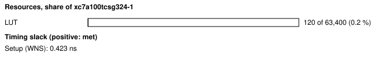
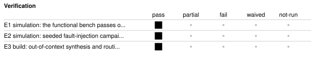

# b194_assurance: Development design for the assurance switch (burst sequencer, FIFO with ECC, TMR, safe FSM, watchdog)

<!-- Generated from handover.yaml by flow/handover.py (brief 68). Edit handover.yaml, or the text between the prose markers, then run: python -m flow.handover write designs/b194_assurance -->

**Verification: not assessed: no requirements recorded (no verif/testplan.yaml), so nothing here is traced to a requirement.** [VERIFIED.md](VERIFIED.md) is the generated, hash-pinned record; [what the label means](../../docs/verified.md).

A burst sequencer in front of a 512 x 64 FIFO with an accumulating checksum, AXI4-Stream handshakes. Each reliability structure is a parameter (ECC 0/1/2, parity, safe-state FSM, TMR on the remaining-words counter, watchdog) so that its area, Fmax, latency and what it catches in a seeded single-event-upset simulation are measured against the plain design. It is the demonstration design of the verification profiles and is not a held-out benchmark task.

Not in scope:

- a held-out or benchmark task; it was written for the measurements of docs/assurance.md
- a board design; it has no pins, no constraints and was only built out of context
- a failure-rate figure; the fault injection is seeded single bit flips in simulation

Kind: demonstration; written by a Claude Code session. State: simulated. For an agent: [AGENT.md](AGENT.md).

<!-- prose:what -->
<!-- /prose:what -->

## Technical parameters

| Item | Value |
|---|---|
| Part | `xc7a100tcsg324-1` |
| Board | none (out of context) |
| Top | `a194_core` |
| Tool | Vivado 2026.1 |

Clocks:

- `aclk`: 200 MHz (from `designs/b194_assurance/ooc.xdc`); the only clock; there is no board clock; a fixed 5.0 ns constraint, which the plain design meets and the structured variants do not

Resets:

- `aresetn`, active low: AXI reset polarity at the stream ports; inverted once inside and used synchronously everywhere

Interfaces:

- `slave stream` (AXI4-Stream, 64-bit tdata, tvalid, tready) ([datasheet](rtl/a194_core.sv)): tready is low unless the sequencer is running a burst and the FIFO is not full; valid never waits for ready
- `master stream` (AXI4-Stream, 64-bit tdata, tvalid, tready) ([datasheet](rtl/a194_core.sv)): one word at most every second clock (the FIFO read takes two clocks); the payload is stable while valid is high and ready low
- `control and status` (start, len[15:0] in; busy, done (one clock), checksum[63:0], err_corr, err_det, fsm_fault, wd_fault, tmr_fault out) ([datasheet](rtl/a194_core.sv)): len is sampled with start while idle; a start while busy is ignored; len 0 completes without words; the error flags are sticky until reset

| Parameter | Value | Legal range | Note |
|---|---|---|---|
| `ECC` | 0 | 0 none, 1 fabric SECDED code over 64 data bits, 2 RAMB36E1 built-in ECC (simulation needs xsim and UNISIM) | with 2 the dbg_inj_s and dbg_inj_d inputs inject a single or double bit error at a write (UG473) |
| `PAR` | 0 | 0 or 1 | even parity bit across the output register |
| `SAFE` | 0 | 0 or 1 | fsm_safe_state auto_safe_state on the state register; no effect on RTL simulation |
| `TMR` | 0 | 0 or 1 | three DONT_TOUCH copies of the remaining-words counter with a majority voter |
| `WD` | 0 | 0 or 1 | watchdog, 256 clocks without progress while busy forces the sequencer to idle and sets wd_fault; it does not see a stall in idle |

| Quantity | Value | Source |
|---|---|---|
| Resources | LUTs of the plain design: 120 LUT | M1 |
| Timing | worst setup slack of the plain design at 5.0 ns: 0.423 ns | M2 |
| Power | not measured | [Known gaps](#known-gaps-and-limits) |
| Latency | latency, slave accept to first master valid: 3 clocks | M3 |
| Throughput | not measured | [Known gaps](#known-gaps-and-limits) |

<!-- prose:parameters -->
<!-- /prose:parameters -->

## How to build, run and reproduce

| Step | Command | Heavy slot | Time |
|---|---|---|---|
| functional bench, fault campaign and mutant checks under Icarus; needs Icarus Verilog 12 | `python3 -m pytest -q designs/b194_assurance/tests/test_b194_rtl.py` | no | about 1 min |
| the full seeded fault campaign (xsim for the ECC primitive variants); needs Icarus Verilog 12 and Vivado 2026.1 xsim | `python3 designs/b194_assurance/tests/run_faults.py --trials 300 --seed 1` | no | about 12 min |
| out-of-context cost runs and netlist checks; needs Vivado 2026.1, the OSS CAD Suite for eqy, a heavy slot (take_heavy_slot.sh) | `python3 -m flow.assurance cost --ctrl; python3 -m flow.assurance costs; python3 -m flow.assurance_profiles netlist` | yes | about 30 min |

Tool: Vivado 2026.1. Build ID of the inputs at handover: `none` (`python flow/manifest.py show designs/b194_assurance`: what a rebuild of today's sources and flow would carry; it changes when any build input or the flow changes, so it can differ from the build ID in an older evidence record). Knowledge-bank pin: `6185830`.

| File | What |
|---|---|
| [`designs/b194_assurance/rtl/a194_ctrl.sv`](rtl/a194_ctrl.sv) | the sequencer, the counter (optionally TMR), the watchdog, the safe-state attribute |
| [`designs/b194_assurance/rtl/a194_fifo.sv`](rtl/a194_fifo.sv) | the FIFO with the three ECC variants |
| [`designs/b194_assurance/rtl/a194_core.sv`](rtl/a194_core.sv) | the top: output register, parity, checksum, error flags |
| [`designs/b194_assurance/rtl/a194_secded.sv`](rtl/a194_secded.sv) | the SECDED functions (64 data bits, 8 check bits) of the fabric ECC variant |
| [`designs/b194_assurance/tb/tb_func.sv`](tb/tb_func.sv) | ports-only functional bench (runs on RTL and on Vivado netlists) |
| [`designs/b194_assurance/tb/tb_fault.sv`](tb/tb_fault.sv) | the seeded single-event-upset campaign (RTL, fault hooks compiled in with A194_FI) |
| [`designs/b194_assurance/tests/mutants.py`](tests/mutants.py) | seven RTL bugs used to measure what each verification method catches |
| [`designs/b194_assurance/tests/test_b194_rtl.py`](tests/test_b194_rtl.py) | Icarus tests of the variants, a mutant and a small fault campaign |

<!-- prose:build -->
<!-- /prose:build -->

## Verified

| ID | Activity | Result | What | Evidence | Conditions |
|---|---|---|---|---|---|
| E1 | simulation | pass | the functional bench passes on every variant that needs no block RAM primitive; a planted bug is caught; the fault campaign classes follow from what each structure does | [`designs/b194_assurance/tests/test_b194_rtl.py`](tests/test_b194_rtl.py) | - |
| E2 | simulation | pass | seeded fault-injection campaign, 300 trials per cell, eight variants, six fault targets | [`results/b194/faults.json`](../../results/b194/faults.json) | - |
| E3 | build | pass | out-of-context synthesis and routing of the eight variants on Vivado 2026.1, area and slack at a 5.0 ns constraint | [`results/b194/costs.json`](../../results/b194/costs.json) | - |

<!-- prose:verified -->
<!-- /prose:verified -->

## Measured

Every value is read from the record by `python -m flow.handover fill`, not typed.

| ID | What | Value | Runs | Source | Conditions |
|---|---|---|---|---|---|
| M1 | LUTs of the plain design | 120 LUT | 1 | [`results/b194/costs.json`](../../results/b194/costs.json) `variants.u.lut` | routed, out of context, Vivado 2026.1, xc7a100tcsg324-1 |
| M2 | worst setup slack of the plain design at 5.0 ns | 0.423 ns | 1 | [`results/b194/costs.json`](../../results/b194/costs.json) `variants.u.wns_route_ns` | routed, out of context, a 5.0 ns constraint on aclk |
| M3 | latency, slave accept to first master valid | 3 clocks | 1 | [`results/b194/costs.json`](../../results/b194/costs.json) `variants.u.latency_clocks` | tb/tb_lat.sv, output always ready, one one-word burst; the same for every variant |
| M4 | silent corruptions of a stored word in the plain design (of 300 trials) | 300 trials | 1 | [`results/b194/faults.json`](../../results/b194/faults.json) `variants.u.targets.ram.silent` | one bit flipped in the word stored by one write, seed 1 |
| M5 | the same fault with the built-in block RAM ECC, corrected and flagged (of 300 trials) | 300 trials | 1 | [`results/b194/faults.json`](../../results/b194/faults.json) `variants.ecc_prim.targets.ram.corrected` | INJECTSBITERR on one write, xsim with UNISIM, seed 1 |

<!-- prose:measured -->
<!-- /prose:measured -->

## Known gaps and limits

- **power**: Not measured; no power report was taken for any variant.
- **throughput**: Not measured; one master word at most every second clock by construction.
- **board**: Never programmed; no hardware measurement.
- **UltraScale+**: Every cost and effect was measured on the 7-series part only.
- **fsm_safe_state**: The safe-state effect is a netlist property; the RTL fault injection cannot show it and no netlist-level injection was run.
- **latency**: Measured in simulation only, one burst; throughput was not measured.
- **structure**: The cost figures come from one small design and one run per variant; the spread between runs is unknown.
- **behaviour**: A start while busy is ignored; len is taken at start; the watchdog does not watch an idle sequencer; after a flagged ECC error the stored word stays wrong until rewritten.

<!-- prose:gaps -->
<!-- /prose:gaps -->

## Next steps

1. Run the safe-state and TMR variants through netlist-level fault injection.
2. Repeat the cost runs on UltraScale+ and on a larger design.

Open questions:

- Which of the structures should the interview propose by default for a block the spec does not mention?

<!-- prose:next -->
<!-- /prose:next -->

## History

| Date | Brief | PR | What |
|---|---|---|---|
| 2026-11-23 | 194 | - | written with the assurance switch measurements |

<!-- prose:history -->
<!-- /prose:history -->
