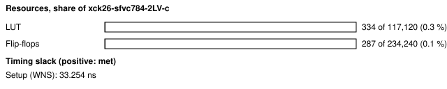
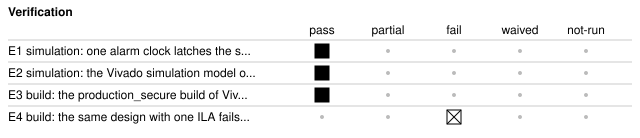

# b196_secure_demo: Demonstration of the production_secure switch on the KR260 part (a stream core, a system-monitor safe shutdown, no debug core)

<!-- Generated from handover.yaml by flow/handover.py (brief 68). Edit handover.yaml, or the text between the prose markers, then run: python -m flow.handover write designs/b196_secure_demo -->

A 25 MHz design for the Kria KR260 part that runs the brief-194 stream core and drives two LEDs, with a SYSMONE4 whose alarm thresholds come from the board's operating limits and feed a latched safe shutdown. It is built with the production_secure switch on, and the same design with one ILA added is built to show the check failing. Built only; never programmed and never on a board.

Not in scope:

- a held-out or benchmark task; it was written to demonstrate and measure the production_secure check
- a statement that the part is secure against an attacker; nothing was measured against one and no certification or side-channel claim is made
- a board design; it was never programmed and no hardware measurement exists
- bitstream encryption or authentication, which on a Zynq MPSoC are boot-image steps that belong to the owner

Kind: demonstration; written by a Claude Code session. State: built. For an agent: [AGENT.md](AGENT.md).

<!-- prose:what -->
<!-- /prose:what -->

## Technical parameters

| Item | Value |
|---|---|
| Part | `xck26-sfvc784-2LV-c` |
| Board | kr260 |
| Top | `b196_top` |
| Tool | Vivado 2026.1 |

Clocks:

- `clk_25`: 25 MHz (from `designs/b196_secure_demo/design.xdc`); the board's 25 MHz clock input; the frequency is an open-source reference design's figure, unconfirmed on the board

Resets:

- `por`, active low: a 32-clock power-on counter from the configuration's register values; there is no reset pin; used synchronously everywhere

Interfaces:

- `led` (two user LEDs, LVCMOS18) ([datasheet](rtl/b196_top.sv)): led 0 follows the parity of the core's running checksum, led 1 lights on any core fault flag; both are driven low in the safe state

| Parameter | Value | Legal range | Note |
|---|---|---|---|
| `ECC` | 1 | 0 to 2 in the brief-194 core | fabric SECDED code on the core's FIFO, fixed in b196_top |
| `SAFE` | 1 | 0 or 1 | fsm_safe_state on the core's state register, fixed in b196_top |

| Quantity | Value | Source |
|---|---|---|
| Resources | LUTs of the production_secure build: 334 LUT; flip-flops of the production_secure build: 287 FF | M1, M2 |
| Timing | worst setup slack of the production_secure build: 33.254 ns | M3 |
| Power | not measured | [Known gaps](#known-gaps-and-limits) |
| Latency | not measured | [Known gaps](#known-gaps-and-limits) |
| Throughput | not measured | [Known gaps](#known-gaps-and-limits) |

<!-- prose:parameters -->
<!-- /prose:parameters -->

## How to build, run and reproduce

| Step | Command | Heavy slot | Time |
|---|---|---|---|
| the safe-shutdown bench and the generated-package check under Icarus; needs Icarus Verilog 12, Vivado 2026.1 xsim for the model test | `python3 -m pytest -q designs/b196_secure_demo/tests/test_b196_rtl.py` | no | about 1 min |
| sixteen readings through the SYSMONE4 simulation model; needs Vivado 2026.1 xsim | `python3 designs/b196_secure_demo/tests/run_sysmon_sim.py --out results/b196/sysmon_sim.json` | no | about 5 min |
| the production build and the debug build; needs Vivado 2026.1 and a heavy slot (take_heavy_slot.sh); the debug build needs about 8 GB | `FDA_SECURITY='{"production_secure": true}' flow/run_vivado.sh designs/b196_secure_demo base; FDA_SECURITY='{"production_secure": true}' flow/run_vivado.sh designs/b196_secure_demo/dbg base` | yes | about 15 min |

Tool: Vivado 2026.1. Build ID of the inputs at handover: `32f26e59` (`python flow/manifest.py show designs/b196_secure_demo`: what a rebuild of today's sources and flow would carry; it changes when any build input or the flow changes, so it can differ from the build ID in an older evidence record). Knowledge-bank pin: `5e2eab8`.

| File | What |
|---|---|
| [`designs/b196_secure_demo/rtl/b196_top.sv`](rtl/b196_top.sv) | the top, the stream source, the core and the LEDs |
| [`designs/b196_secure_demo/rtl/b196_sysmon_guard.sv`](rtl/b196_sysmon_guard.sv) | SYSMONE4 with its INIT attributes and the latched shutdown behind it |
| [`designs/b196_secure_demo/rtl/b196_shutdown.sv`](rtl/b196_shutdown.sv) | the latch that holds the design in reset after any alarm |
| [`designs/b196_secure_demo/rtl/b196_sysmon_pkg.sv`](rtl/b196_sysmon_pkg.sv) | the SYSMONE4 INIT values, generated from the board file by flow.security |
| [`designs/b196_secure_demo/design.xdc`](design.xdc) | pins, clock and LED output delays |
| [`designs/b196_secure_demo/build.yaml`](build.yaml) | the production build (the security request comes from the run's pin) |
| [`designs/b196_secure_demo/dbg/build.yaml`](dbg/build.yaml) | the debug build, the same design plus one ILA |
| [`designs/b196_secure_demo/tb/tb_shutdown.sv`](tb/tb_shutdown.sv) | bench of the safe shutdown in the top |
| [`designs/b196_secure_demo/tests/run_sysmon_sim.py`](tests/run_sysmon_sim.py) | the SYSMONE4 simulation model driven with readings inside and outside the limits |

<!-- prose:build -->
<!-- /prose:build -->

## Verified

| ID | Activity | Result | What | Evidence | Conditions |
|---|---|---|---|---|---|
| E1 | simulation | pass | one alarm clock latches the shutdown, holds the core in reset, drives the LEDs low and stays latched | [`designs/b196_secure_demo/tests/test_b196_rtl.py`](tests/test_b196_rtl.py) | - |
| E2 | simulation | pass | the Vivado simulation model of the system monitor, configured by the generated INIT values, raises the right alarm for each of sixteen readings | [`results/b196/sysmon_sim.json`](../../results/b196/sysmon_sim.json) | - |
| E3 | build | pass | the production_secure build of Vivado 2026.1 reads back the readback and JTAG settings, finds no debug core and the system monitor wired to the latch | [`results/b196/demo_builds.json`](../../results/b196/demo_builds.json) | - |
| E4 | build | fail | the same design with one ILA fails the strip_debug gate, as it must | [`results/b196/demo_builds.json`](../../results/b196/demo_builds.json) | - |

Gates at handover: `security_profile_met` pass.

<!-- prose:verified -->
<!-- /prose:verified -->

## Measured

Every value is read from the record by `python -m flow.handover fill`, not typed.

| ID | What | Value | Runs | Source | Conditions |
|---|---|---|---|---|---|
| M1 | LUTs of the production_secure build | 334 LUT | 1 | [`results/b196/demo_builds.json`](../../results/b196/demo_builds.json) `builds.secure.utilization.lut` | routed, Vivado 2026.1, xck26-sfvc784-2LV-c, 25 MHz clock, one run |
| M2 | flip-flops of the production_secure build | 287 FF | 1 | [`results/b196/demo_builds.json`](../../results/b196/demo_builds.json) `builds.secure.utilization.ff` | routed, Vivado 2026.1, xck26-sfvc784-2LV-c, 25 MHz clock, one run |
| M3 | worst setup slack of the production_secure build | 33.254 ns | 1 | [`results/b196/demo_builds.json`](../../results/b196/demo_builds.json) `builds.secure.wns_ns` | routed, clk_25 at a 40 ns period |
| M4 | LUTs of the debug build (the production design plus one ILA and its debug hub) | 1357 LUT | 1 | [`results/b196/demo_builds.json`](../../results/b196/demo_builds.json) `builds.debug.utilization.lut` | routed, Vivado 2026.1, one run, one thread |
| M5 | wall time of the production_secure build | 263.4 s | 1 | [`results/b196/demo_builds.json`](../../results/b196/demo_builds.json) `builds.secure.wall_s` | one run, two threads, this PC; the plain build of the same design took the same to the tenth of a second, so the switch costs no build time that this run could see |

<!-- prose:measured -->
<!-- /prose:measured -->

## Security

Production-secure build: yes.

Enabled, and what shows it:

- **readback security Level1, JTAG access to the system monitor disabled, BSCAN access after configuration disabled**: the three BITSTREAM properties are set before write_bitstream and read back from the design after it (gate security_readback_off), and the write_bitstream verbose log prints them ([record](../../results/b196/secure_security_design.txt))
- **no debug core, hub, bridge, BSCAN primitive, marked debug net, debug-class port or probe file**: the inventory of the implemented design lists none of them (gate security_strip_debug); the debug build of the same design lists two cores, a BSCAN primitive and sixteen marked nets and fails it ([record](../../results/b196/debug_security_design.txt))
- **system-monitor alarm thresholds from the board's operating limits, wired to a latched safe shutdown**: the SYSMONE4 attributes in the implemented design equal the values recomputed from boards/kr260/board.yaml, and each alarm output reaches the shutdown register (gate security_sysmon_shutdown) ([record](../../results/b196/secure_security_design.txt))

Not enabled:

- **bitstream encryption and authentication**: on a Zynq MPSoC they are boot-image steps; Vivado 2026.1 makes the encryption and authentication properties read-only for this part, so the record lists them as handed to the owner
- **the user over-temperature limit and the automatic device shutdown**: setting the limit also enables the automatic shutdown that de-configures the part, so the device keeps its default limit and the shutdown is a latch in the fabric
- **a JTAG disable by eFUSE and any key programming**: irreversible and the owner's; this design never programs anything

What a user could get wrong:

- a passed gate shows that Vivado's output carries the setting, not that the part resists an attacker
- the alarm thresholds were checked in the vendor simulation model, not on silicon, and the model uses another temperature transfer function than the data sheet
- the limits are the 0.72 volt rows of the data sheet, because the K26 grade is not named there
- with JTAG access to the system monitor disabled a reconfiguration over JTAG needs a power cycle first
- the latch holds until power or a new configuration clears it, by design

Keys: the flow never makes, reads, stores or programs a key; there is no key in this design; key files are git-ignored and never recorded; eFUSE and BBRAM are the owner's.

<!-- prose:security -->
<!-- /prose:security -->

## Known gaps and limits

- **power**: Not measured here; no power report was recorded for the production build.
- **throughput**: Not applicable beyond the brief-194 core; the design moves 16 words every 65536 clocks.
- **latency**: Not measured; the design has no latency requirement.
- **board**: Never programmed and never on a board; every statement about behaviour on the part is from Vivado's reports or its simulation model.
- **E4**: Evidence E4 is a build that fails its gate on purpose; the failure is the expected result.
- **threshold**: The temperature thresholds follow the data-sheet transfer function that this repository read back on the owner's board; the vendor model uses another one, about one degree apart at 85 degrees.
- **bitstream**: The bitstreams of the plain and the production build differ; the differing configuration words were not decoded for this family.
- **spread**: Resources and times are one run each; the spread between runs is unknown.

<!-- prose:gaps -->
<!-- /prose:gaps -->

## Next steps

1. Run the debug build and the production build on a fresh Vivado release when the pin changes.
2. Decode the configuration-register difference between the plain and the production bitstream.
3. Give the owner the boot-image steps for encryption and authentication when a board run is planned.

Open questions:

- Whether the K26 grade has its own limits table that replaces the 0.72 volt rows.

<!-- prose:next -->
<!-- /prose:next -->

## History

| Date | Brief | PR | What |
|---|---|---|---|
| 2026-11-23 | 196 | - | written with the production_secure measurements |

<!-- prose:history -->
<!-- /prose:history -->
