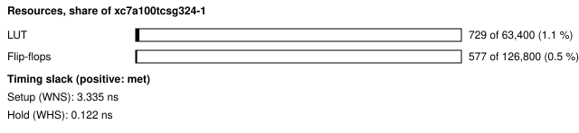
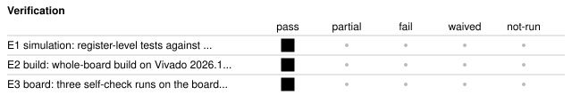

# b2_acl_adxl362: ADXL362 accelerometer board self-check

<!-- Generated from handover.yaml by flow/handover.py (brief 68). Edit handover.yaml, or the text between the prose markers, then run: python -m flow.handover write designs/b2_acl_adxl362 -->

Drives the Nexys A7's ADXL362 accelerometer over SPI mode 0 at 1 MHz from a small register block in the test shell. The host reads the three ID registers, switches the part to measurement mode, reads one X/Y/Z sample at rest, returns it to standby and reads POWER_CTL back. `selfcheck.py` holds the on-board pass rule, written before any board run.

Not in scope:

- an accelerometer application: it takes one sample per check, so it says nothing about noise, offsets, other ranges or interrupts
- an agent benchmark task; it was written by hand to prove the board inventory on hardware

Kind: board-selfcheck; written by hand. State: board-verified. For an agent: [AGENT.md](AGENT.md).

<!-- prose:what -->
A board self-check, not an agent benchmark task: it was written by hand to prove the board inventory (`boards/nexys_a7_100t/inventory.yaml`) on hardware. The test shell (`shell/`) carries its registers; the register map is in the header of `rtl/acl_regs.sv`.

### How the host uses it

The host loads TX0 and TX1 with the bytes to send, writes CTRL with GO and the byte count, polls STATUS until done, then reads RX0 and RX1. The self-check sends ADXL362 commands this way: 0x0B (read) at register 0x00 for the ID bytes, 0x0A (write) of 0x02 to POWER_CTL (0x2D) for measurement mode, 0x0B at 0x0E for the X, Y and Z samples (16-bit, little endian, 1000 LSB per g), then 0x0A of 0x00 to POWER_CTL for standby. POWER_CTL is the only sensor register written; the part has no non-volatile memory.
<!-- /prose:what -->

## Technical parameters

| Item | Value |
|---|---|
| Part | `xc7a100tcsg324-1` |
| Board | Nexys A7-100T |
| Top | `b2_acl_adxl362_top` |
| Tool | Vivado 2026.1 |

Clocks:

- `CLK100MHZ`: 100 MHz (from `designs/b2_acl_adxl362/design.xdc`); the only clock; SCLK is divided from it (HALF clocks low, HALF high) and ACL_MISO is synchronised into it

Resets:

- `CPU_RESETN`, active low: the board's reset button, synchronised by the test shell's reset synchroniser (assert asynchronous, release synchronous)

Interfaces:

- `UART register window` (test shell, 8N1 UART at 115200 baud) ([datasheet](../../shell/PROTOCOL.md)): seven registers at shell addresses 0x80 to 0x86 (CTRL, STATUS, TX0, TX1, RX0, RX1, INFO); the map is in the header of rtl/acl_regs.sv; other window addresses read 0, and writes to STATUS, RX0, RX1, INFO or undefined addresses are ignored
- `ADXL362 SPI` (ACL_SCLK, ACL_MOSI, ACL_CSN out and ACL_MISO in, mode 0 (CPOL 0, CPHA 0), MSB first, LVCMOS33) ([datasheet](../../boards/nexys_a7_100t/inventory.yaml)): one transfer is chip select low, 1 to 8 bytes out from TX0 and TX1 (byte 0 first) with the same number of bytes captured into RX0 and RX1, then chip select high; MISO is sampled at the end of each SCLK high half; INT1 and INT2 are not connected

| Parameter | Value | Legal range | Note |
|---|---|---|---|
| `HALF` | 50 | 1 to 65535 (16-bit divider); the board value is 50 | SCLK half period in 100 MHz clocks; 50 gives 1 MHz |
| `CLKS_PER_BIT` | 868 | set by the shell's UART; the board value is 868 | UART bit period in clocks (115200 baud at 100 MHz) |

| Quantity | Value | Source |
|---|---|---|
| Resources | LUTs, whole board design: 729 LUT; flip-flops, whole board design: 577 FF | M1, M2 |
| Timing | worst setup slack: 3.335 ns; worst hold slack: 0.122 ns | M3, M4 |
| Power | total on-chip power estimate: 0.116 W | M5 |
| Latency | not measured | [Known gaps](#known-gaps-and-limits) |
| Throughput | not measured | [Known gaps](#known-gaps-and-limits) |

<!-- prose:parameters -->
<!-- /prose:parameters -->

## How to build, run and reproduce

| Step | Command | Heavy slot | Time |
|---|---|---|---|
| simulate against the ADXL362 model; needs Icarus Verilog 12 and cocotb 2.0.1 | `python3 -m pytest -q designs/b2_acl_adxl362/tests/test_acl_rtl.py` | no | about 1 min |
| build and run the gates; needs local Vivado 2026.1 and a heavy slot (take_heavy_slot.sh) | `flow/run_vivado.sh designs/b2_acl_adxl362 base` | yes | about 4 min |
| power gate, program SRAM, self-check, three times; needs the Nexys A7 on wall power and the board lock | `python3 flow/board_check.py designs/b2_acl_adxl362 --runs 3` | no | about 2 min |

Tool: Vivado 2026.1. Build ID of the inputs at handover: `97949768` (`python flow/manifest.py show designs/b2_acl_adxl362`: what a rebuild of today's sources and flow would carry; it changes when any build input or the flow changes, so it can differ from the build ID in an older evidence record). Knowledge-bank pin: `1fc7ed8`.

| File | What |
|---|---|
| [`designs/b2_acl_adxl362/rtl/spi_burst.sv`](rtl/spi_burst.sv) | SPI mode-0 master, 1 to 8 bytes per transfer |
| [`designs/b2_acl_adxl362/rtl/acl_regs.sv`](rtl/acl_regs.sv) | the registers in the shell window, with the register map in its header |
| [`designs/b2_acl_adxl362/rtl/b2_acl_adxl362_top.sv`](rtl/b2_acl_adxl362_top.sv) | board top (test shell, MISO synchroniser and the register block) |
| [`designs/b2_acl_adxl362/design.xdc`](design.xdc) | pins, the 100 MHz clock and the false paths on the asynchronous inputs and slow outputs |
| [`designs/b2_acl_adxl362/build.yaml`](build.yaml) | how flow/run_vivado.sh builds the design |
| [`designs/b2_acl_adxl362/selfcheck.py`](selfcheck.py) | the on-board check and its pass rule (docstring), pre-registered before any board run |
| [`designs/b2_acl_adxl362/tests/acl_cocotb.py`](tests/acl_cocotb.py) | cocotb tests against an ADXL362 model (commands 0x0A and 0x0B, address auto-increment, transfer lengths 1 to 8, a mode-0 check) |
| [`designs/b2_acl_adxl362/tests/test_acl_rtl.py`](tests/test_acl_rtl.py) | pytest entry that runs the cocotb tests with Icarus Verilog at HALF 4 |

<!-- prose:build -->
Results of the board runs are in `results/board_v2/b2_acl_adxl362.json`, with one file per run in `results/board_v2/runs/`.
<!-- /prose:build -->

## Verified

| ID | Activity | Result | What | Evidence | Conditions |
|---|---|---|---|---|---|
| E1 | simulation | pass | register-level tests against an ADXL362 model, including the ID, measurement and standby sequence and transfer lengths 1 to 8 | [`designs/b2_acl_adxl362/tests/test_acl_rtl.py`](tests/test_acl_rtl.py) (run in CI) | - |
| E2 | build | pass | whole-board build on Vivado 2026.1; every gate passes (built, not programmed) | [`results/vivado_2026_1_remeasure/b2_builds.json`](../../results/vivado_2026_1_remeasure/b2_builds.json) | - |
| E3 | board | pass (3 runs) | three self-check runs on the board, from a clean committed tree; each passes the pre-registered rule (IDs AD 1D F2, magnitude inside the range, POWER_CTL back to 0) | [`results/board_v2/b2_acl_adxl362.json`](../../results/board_v2/b2_acl_adxl362.json) | wall power; the power gate (report_power total and junction temperature against the 2.0 W and 85 C limits) passed before programming; XADC rails and die temperature were not read during these runs; the board's orientation was not recorded |

Gates at handover: `build_2026_1` pass, `board_selfcheck` pass.

<!-- prose:verified -->
The cocotb test (`tests/acl_cocotb.py`) runs the register block against an ADXL362 model with a mode-0 check, address auto-increment and transfer lengths of 1 to 8 bytes; CI runs it.
<!-- /prose:verified -->

## Measured

Every value is read from the record by `python -m flow.handover fill`, not typed.

| ID | What | Value | Runs | Source | Conditions |
|---|---|---|---|---|---|
| M1 | LUTs, whole board design | 729 LUT | 1 | [`results/vivado_2026_1_remeasure/b2_builds.json`](../../results/vivado_2026_1_remeasure/b2_builds.json) `builds.b2_acl_adxl362.lut` | routed whole-board build, Vivado 2026.1, xc7a100tcsg324-1, including the test shell |
| M2 | flip-flops, whole board design | 577 FF | 1 | [`results/vivado_2026_1_remeasure/b2_builds.json`](../../results/vivado_2026_1_remeasure/b2_builds.json) `builds.b2_acl_adxl362.ff` | routed whole-board build, Vivado 2026.1, including the test shell |
| M3 | worst setup slack | 3.335 ns | 1 | [`results/vivado_2026_1_remeasure/b2_builds.json`](../../results/vivado_2026_1_remeasure/b2_builds.json) `builds.b2_acl_adxl362.wns_ns` | routed, at the 100 MHz board clock |
| M4 | worst hold slack | 0.122 ns | 1 | [`results/vivado_2026_1_remeasure/b2_builds.json`](../../results/vivado_2026_1_remeasure/b2_builds.json) `builds.b2_acl_adxl362.whs_ns` | routed, at the 100 MHz board clock |
| M5 | total on-chip power estimate | 0.116 W | 1 | [`results/vivado_2026_1_remeasure/b2_builds.json`](../../results/vivado_2026_1_remeasure/b2_builds.json) `builds.b2_acl_adxl362.power_w` | report_power after routing, vectorless (default toggle rates), the board's thermal environment |
| M6 | acceleration magnitude at rest, first recorded run | 1.018 g | 1 | [`results/board_v2/b2_acl_adxl362.json`](../../results/board_v2/b2_acl_adxl362.json) `results[0].steps.selfcheck.magnitude_g` | default range and 100 Hz output rate, 100 ms after the mode write; board orientation not recorded; pass range 0.57 to 1.43 g |
| M7 | REVID register, first recorded run | 0x02 | 1 | [`results/board_v2/b2_acl_adxl362.json`](../../results/board_v2/b2_acl_adxl362.json) `results[0].steps.selfcheck.revid` | recorded, not judged by the pass rule |

<!-- prose:measured -->
<!-- /prose:measured -->

## Known gaps and limits

- **latency**: Not measured. A transfer takes eight SCLK periods per byte plus set-up and hold half periods at 1 MHz by construction; no record times it.
- **throughput**: Not applicable; the block moves at most 8 bytes per host request and the check takes one sample per run.
- **E3**: The board runs used bitstreams built on the earlier Vivado release; the 2026.1 build (E2) was not programmed. Re-run the board check on a 2026.1 bitstream to close this.
- **operating conditions**: The board runs predate the house rule of 2026-11-11 that every board run records its operating conditions from the XADC; die temperature and the VCCINT, VCCAUX and VCCBRAM rails were not read from the XADC, so the runs cannot be shown to be inside the recommended operating conditions.
- **accuracy**: The pass range for the magnitude is wide (0.57 to 1.43 g) because it must hold at any board tilt with worst-case offsets; the check does not calibrate or test offsets, noise, other ranges, the FIFO or the interrupt pins.
- **REVID**: The data sheet value quoted in selfcheck.py is 0x01 but the board returned a different value in all three runs (M7); the rule does not judge it, and no record explains the difference.
- **behaviour**: GO written while a transfer runs is ignored (spi_burst.sv takes GO only when idle), but no test covers it; a CTRL write changes the byte count register at once, though the running transfer keeps the count it started with; TX0 and TX1 writes during a transfer do not change that transfer; RX0 and RX1 hold the previous transfer's bytes until the transfer ends and are not cleared by a new one until then; a byte count of 0 is sent as 1 and above 8 as 8; bytes beyond the count read as 0; reads of undefined addresses return 0 with no error.
- **reset**: Reset clears the transmit data, sets the byte count to 1, and clears busy and done; the received bytes are cleared too. This design drives no reset signal to the sensor, so a reset between the measurement-mode write and the standby write leaves the part in measurement mode.

<!-- prose:gaps -->
<!-- /prose:gaps -->

## Next steps

1. Re-run the board check on a Vivado 2026.1 bitstream with the XADC read at the start and end of each run.
2. Add a test for GO written while busy and state in the register map header that it is ignored.
3. Record the board orientation with each run so the magnitude can be compared with the expected 1 g more tightly.

Open questions:

- Should REVID be judged once the revision on the board is confirmed against the data sheet?

<!-- prose:next -->
<!-- /prose:next -->

## History

| Date | Brief | PR | What |
|---|---|---|---|
| 2026-10-31 | 04c | - | written with the board inventory, power budget and power gate; 3 of 3 board runs pass |
| 2026-11-11 | 49 | - | rebuilt on Vivado 2026.1; every gate passes (not programmed) |
| 2026-11-13 | 68 | - | handover written to the documentation standard |

<!-- prose:history -->
<!-- /prose:history -->
