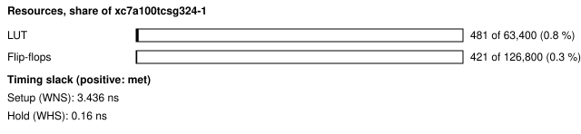
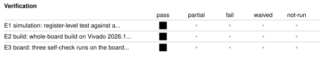

# b2_mic_pdm: PDM microphone board self-check

<!-- Generated from handover.yaml by flow/handover.py (brief 68). Edit handover.yaml, or the text between the prose markers, then run: python -m flow.handover write designs/b2_mic_pdm -->

Clocks the Nexys A7's PDM microphone at 2.381 MHz and counts, over a window of PDM bits, how many bits were 1 and how many times the bit changed. The counts tell a live microphone (about half ones, frequent changes) from a dead one, a stuck data line or a missing clock. The test shell carries the registers, and `selfcheck.py` holds the on-board pass rule, written before any board run.

Not in scope:

- an audio path: nothing decimates or filters the PDM stream, so it says nothing about audio quality
- an agent benchmark task; it was written by hand to prove the board inventory on hardware

Kind: board-selfcheck; written by hand. State: board-verified. For an agent: [AGENT.md](AGENT.md).

<!-- prose:what -->
<!-- /prose:what -->

## Technical parameters

| Item | Value |
|---|---|
| Part | `xc7a100tcsg324-1` |
| Board | Nexys A7-100T |
| Top | `b2_mic_pdm_top` |
| Tool | Vivado 2026.1 |

Clocks:

- `CLK100MHZ`: 100 MHz (from `designs/b2_mic_pdm/design.xdc`); the only clock; M_CLK to the microphone is divided from it (HALF clocks low, HALF high)

Resets:

- `CPU_RESETN`, active low: the board's reset button, synchronised by the test shell's reset synchroniser (assert asynchronous, release synchronous)

Interfaces:

- `UART register window` (test shell, 8N1 UART at 115200 baud) ([datasheet](../../shell/PROTOCOL.md)): the design's six registers sit at shell addresses 0x80 to 0x85 (CTRL, STATUS, NBITS, ONES, CHANGES, INFO); the map is in the header of rtl/mic_regs.sv; other window addresses read 0
- `PDM microphone` (M_CLK out, M_DATA in, M_LRSEL out (LVCMOS33)) ([datasheet](../../boards/nexys_a7_100t/inventory.yaml)): M_LRSEL is held low, so the microphone drives M_DATA after each falling edge of M_CLK; M_DATA is synchronised and sampled in the middle of the high half

| Parameter | Value | Legal range | Note |
|---|---|---|---|
| `HALF` | 21 | 1 to 65535 (16-bit divider); the board value is 21 | M_CLK half period in 100 MHz clocks; 21 gives 2.381 MHz |

| Quantity | Value | Source |
|---|---|---|
| Resources | LUTs, whole board design: 481 LUT; flip-flops, whole board design: 421 FF | M1, M2 |
| Timing | worst setup slack: 3.436 ns; worst hold slack: 0.16 ns | M3, M4 |
| Power | total on-chip power estimate: 0.117 W | M5 |
| Latency | not measured | [Known gaps](#known-gaps-and-limits) |
| Throughput | not measured | [Known gaps](#known-gaps-and-limits) |

<!-- prose:parameters -->
<!-- /prose:parameters -->

## How to build, run and reproduce

| Step | Command | Heavy slot | Time |
|---|---|---|---|
| simulate against the microphone model; needs Icarus Verilog 12 and cocotb 2.0.1 | `python3 -m pytest -q designs/b2_mic_pdm/tests/test_mic_rtl.py` | no | about 1 min |
| build and run the gates; needs local Vivado 2026.1 and a heavy slot (take_heavy_slot.sh) | `flow/run_vivado.sh designs/b2_mic_pdm base` | yes | about 4 min |
| power gate, program SRAM, self-check, three times; needs the Nexys A7 on wall power and the board lock | `python3 flow/board_check.py designs/b2_mic_pdm --runs 3` | no | about 2 min |

Tool: Vivado 2026.1. Build ID of the inputs at handover: `6b2ffe2b` (`python flow/manifest.py show designs/b2_mic_pdm`: what a rebuild of today's sources and flow would carry; it changes when any build input or the flow changes, so it can differ from the build ID in an older evidence record). Knowledge-bank pin: `1fc7ed8`.

| File | What |
|---|---|
| [`designs/b2_mic_pdm/rtl/pdm_stats.sv`](rtl/pdm_stats.sv) | clock divider, sample point, ones and change counters |
| [`designs/b2_mic_pdm/rtl/mic_regs.sv`](rtl/mic_regs.sv) | the registers in the shell window, with the register map in its header |
| [`designs/b2_mic_pdm/rtl/b2_mic_pdm_top.sv`](rtl/b2_mic_pdm_top.sv) | board top (test shell plus the microphone block) |
| [`designs/b2_mic_pdm/design.xdc`](design.xdc) | pins, the 100 MHz clock and the false paths on the asynchronous inputs |
| [`designs/b2_mic_pdm/build.yaml`](build.yaml) | how flow/run_vivado.sh builds the design |
| [`designs/b2_mic_pdm/selfcheck.py`](selfcheck.py) | the on-board check and its pass rule (docstring), pre-registered before any board run |
| [`designs/b2_mic_pdm/tests/test_mic_rtl.py`](tests/test_mic_rtl.py) | cocotb with Icarus Verilog against a microphone model (counts equal the bits sent; a stuck line) |

<!-- prose:build -->
<!-- /prose:build -->

## Verified

| ID | Activity | Result | What | Evidence | Conditions |
|---|---|---|---|---|---|
| E1 | simulation | pass | register-level test against a microphone model; the ones and change counts equal the bits sent, and a stuck line counts as stuck | [`designs/b2_mic_pdm/tests/test_mic_rtl.py`](tests/test_mic_rtl.py) (run in CI) | - |
| E2 | build | pass | whole-board build on Vivado 2026.1; every gate passes (built, not programmed) | [`results/vivado_2026_1_remeasure/b2_builds.json`](../../results/vivado_2026_1_remeasure/b2_builds.json) | - |
| E3 | board | pass (3 runs) | three self-check runs on the board, from a clean committed tree; each passes the pre-registered rule in all three windows | [`results/board_v2/b2_mic_pdm.json`](../../results/board_v2/b2_mic_pdm.json) | wall power; the power gate (report_power total and junction temperature against the 2.0 W and 85 C limits) passed before programming; XADC rails and die temperature were not read during these runs |

Gates at handover: `build_2026_1` pass, `board_selfcheck` pass.

<!-- prose:verified -->
<!-- /prose:verified -->

## Measured

Every value is read from the record by `python -m flow.handover fill`, not typed.

| ID | What | Value | Runs | Source | Conditions |
|---|---|---|---|---|---|
| M1 | LUTs, whole board design | 481 LUT | 1 | [`results/vivado_2026_1_remeasure/b2_builds.json`](../../results/vivado_2026_1_remeasure/b2_builds.json) `builds.b2_mic_pdm.lut` | routed whole-board build, Vivado 2026.1, xc7a100tcsg324-1, including the test shell |
| M2 | flip-flops, whole board design | 421 FF | 1 | [`results/vivado_2026_1_remeasure/b2_builds.json`](../../results/vivado_2026_1_remeasure/b2_builds.json) `builds.b2_mic_pdm.ff` | routed whole-board build, Vivado 2026.1, including the test shell |
| M3 | worst setup slack | 3.436 ns | 1 | [`results/vivado_2026_1_remeasure/b2_builds.json`](../../results/vivado_2026_1_remeasure/b2_builds.json) `builds.b2_mic_pdm.wns_ns` | routed, at the 100 MHz board clock |
| M4 | worst hold slack | 0.16 ns | 1 | [`results/vivado_2026_1_remeasure/b2_builds.json`](../../results/vivado_2026_1_remeasure/b2_builds.json) `builds.b2_mic_pdm.whs_ns` | routed, at the 100 MHz board clock |
| M5 | total on-chip power estimate | 0.117 W | 1 | [`results/vivado_2026_1_remeasure/b2_builds.json`](../../results/vivado_2026_1_remeasure/b2_builds.json) `builds.b2_mic_pdm.power_w` | report_power after routing, vectorless (default toggle rates), the board's thermal environment |
| M6 | fraction of ones, first window of the first recorded run | 0.5167 | 1 | [`results/board_v2/b2_mic_pdm.json`](../../results/board_v2/b2_mic_pdm.json) `results[0].steps.selfcheck.windows[0].ones_fraction` | room sound neither controlled nor recorded; M_LRSEL low, window of 1,048,576 bits; pass range 0.40 to 0.60 |
| M7 | fraction of bit-to-bit changes, first window of the first recorded run | 0.7377 | 1 | [`results/board_v2/b2_mic_pdm.json`](../../results/board_v2/b2_mic_pdm.json) `results[0].steps.selfcheck.windows[0].change_fraction` | as M6; pass threshold 0.10 |

<!-- prose:measured -->
<!-- /prose:measured -->

## Known gaps and limits

- **latency**: Not measured. A window takes its length in M_CLK periods (1,048,576 bits is about 0.44 s at 2.381 MHz) by design; no record times it.
- **throughput**: Not applicable as a data path; the block reports two counts per window and has no streaming output.
- **E3**: The board runs used bitstreams built on the earlier Vivado release; the 2026.1 build (E2) has the same build stamp but was not programmed. Re-run the board check on a 2026.1 bitstream to close this.
- **operating conditions**: The board runs predate the 2026-11-11 rule; die temperature and the VCCINT, VCCAUX and VCCBRAM rails were not read from the XADC, so the runs cannot be shown to be inside the recommended operating conditions.
- **behaviour**: GO written while a window runs is ignored (pdm_stats.sv starts a window only when idle), but no test covers it; NBITS of 0 is taken as 1; reset clears the counts and DONE; reads of undefined window addresses return 0 with no error.
- **audio**: No decimation or audio measurement; the check proves the microphone and its pins are alive, not sound quality.

<!-- prose:gaps -->
<!-- /prose:gaps -->

## Next steps

1. Re-run the board check on a Vivado 2026.1 bitstream with the XADC read at the start and end of each run.
2. Add a test for GO written while busy, and state that it is ignored in the register map header.
3. If an audio path is wanted, add a CIC decimator from ip_lib behind the counters rather than changing them.

Open questions:

- Should the self-check also record M_CLK's measured frequency from the board, rather than the design value?

<!-- prose:next -->
<!-- /prose:next -->

## History

| Date | Brief | PR | What |
|---|---|---|---|
| 2026-10-31 | 04c | - | written with the board inventory, power budget and power gate; 3 of 3 board runs pass |
| 2026-11-11 | 49 | - | rebuilt on Vivado 2026.1; every gate passes (not programmed) |
| 2026-11-13 | 68 | - | handover written to the documentation standard |

<!-- prose:history -->
<!-- /prose:history -->
