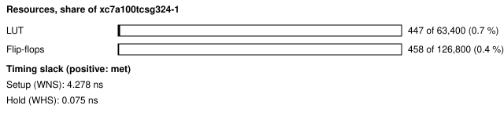
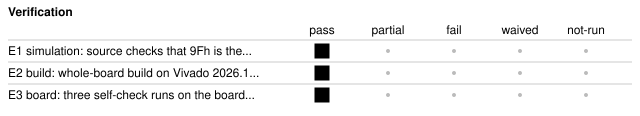

# b2_qspi_jedec: Configuration flash JEDEC ID board self-check

<!-- Generated from handover.yaml by flow/handover.py (brief 68). Edit handover.yaml, or the text between the prose markers, then run: python -m flow.handover write designs/b2_qspi_jedec -->

Reads the JEDEC ID of the Nexys A7's configuration flash (S25FL128S or S25FL127S) with the RDID command (9Fh) over single-bit SPI at 1 MHz, with SCK leaving through STARTUPE2. The 8-byte ID is read twice and compared with the data sheets' values. The opcode is a constant in the RTL, so the design cannot send a write, erase or register-write command. `selfcheck.py` holds the on-board pass rule, written before any board run.

Not in scope:

- a flash memory test: it reads only the ID, so it says nothing about the flash contents, erase, program or quad-mode operation
- an agent benchmark task; it was written by hand to prove the board inventory on hardware

Kind: board-selfcheck; written by hand. State: board-verified. For an agent: [AGENT.md](AGENT.md).

<!-- prose:what -->
A board self-check, not an agent benchmark task: it was written by hand to prove the board inventory (`boards/nexys_a7_100t/inventory.yaml`) on hardware. The test shell (`shell/`) carries its registers; the register map is in the header of `rtl/qspi_regs.sv`.

### How the host uses it

The host writes CTRL bit 0 (GO), polls STATUS until done, then reads ID0 and ID1: byte 0, the manufacturer, is in bits 7 to 0 of ID0. The ID is expected to start 01 20 18 (manufacturer, 128 Mb), with byte 5 equal to 80 (FL-S family); byte 3 (the ID-CFI length), byte 4 (sector architecture) and bytes 6 and 7 (model number, ASCII) are recorded only.
<!-- /prose:what -->

## Technical parameters

| Item | Value |
|---|---|
| Part | `xc7a100tcsg324-1` |
| Board | Nexys A7-100T |
| Top | `b2_qspi_jedec_top` |
| Tool | Vivado 2026.1 |

Clocks:

- `CLK100MHZ`: 100 MHz (from `designs/b2_qspi_jedec/design.xdc`); the only clock; SCK is divided from it (HALF clocks low, HALF high) and reaches the flash through STARTUPE2's USRCCLKO, and QSPI_DQ1 is synchronised into it

Resets:

- `CPU_RESETN`, active low: the board's reset button, synchronised by the test shell's reset synchroniser (assert asynchronous, release synchronous)

Interfaces:

- `UART register window` (test shell, 8N1 UART at 115200 baud) ([datasheet](../../shell/PROTOCOL.md)): five registers at shell addresses 0x80 to 0x84 (CTRL, STATUS, ID0, ID1, INFO); the map is in the header of rtl/qspi_regs.sv; other window addresses read 0, and a write to any address but CTRL, or to CTRL without bit 0, starts nothing
- `Configuration flash (single-bit SPI)` (QSPI_CSN, QSPI_DQ0 (to the flash) out, QSPI_DQ1 (from the flash) in, SCK through STARTUPE2, LVCMOS33) ([datasheet](../../boards/nexys_a7_100t/inventory.yaml)): one transfer is chip select low, opcode 9Fh, eight ID bytes read, chip select high; QSPI_DQ2 (WP#) is held low and QSPI_DQ3 (HOLD#) high; the first transfer after reset is preceded by PREAMBLE clock pulses with chip select high because STARTUPE2 swallows the first edges after configuration

| Parameter | Value | Legal range | Note |
|---|---|---|---|
| `HALF` | 50 | 1 to 65535 (16-bit divider); the board value is 50 | SCK half period in 100 MHz clocks; 50 gives 1 MHz |
| `PREAMBLE` | 8 | 0 to 255 clock pulses; the board value is 8 | clock pulses sent with chip select high before the first transfer after reset |
| `CLKS_PER_BIT` | 868 | set by the shell's UART; the board value is 868 | UART bit period in clocks (115200 baud at 100 MHz) |

| Quantity | Value | Source |
|---|---|---|
| Resources | LUTs, whole board design: 447 LUT; flip-flops, whole board design: 458 FF | M1, M2 |
| Timing | worst setup slack: 4.278 ns; worst hold slack: 0.075 ns | M3, M4 |
| Power | total on-chip power estimate: 0.117 W | M5 |
| Latency | not measured | [Known gaps](#known-gaps-and-limits) |
| Throughput | not measured | [Known gaps](#known-gaps-and-limits) |

<!-- prose:parameters -->
<!-- /prose:parameters -->

## How to build, run and reproduce

| Step | Command | Heavy slot | Time |
|---|---|---|---|
| source checks and simulation against the flash model; needs Icarus Verilog 12 and cocotb 2.0.1 | `python3 -m pytest -q designs/b2_qspi_jedec/tests/test_qspi_rtl.py` | no | about 1 min |
| build and run the gates; needs local Vivado 2026.1 and a heavy slot (take_heavy_slot.sh) | `flow/run_vivado.sh designs/b2_qspi_jedec base` | yes | about 4 min |
| power gate, program SRAM, self-check, three times; needs the Nexys A7 on wall power and the board lock | `python3 flow/board_check.py designs/b2_qspi_jedec --runs 3` | no | about 2 min |

Tool: Vivado 2026.1. Build ID of the inputs at handover: `ac857e6b` (`python flow/manifest.py show designs/b2_qspi_jedec`: what a rebuild of today's sources and flow would carry; it changes when any build input or the flow changes, so it can differ from the build ID in an older evidence record). Knowledge-bank pin: `1fc7ed8`.

| File | What |
|---|---|
| [`designs/b2_qspi_jedec/rtl/qspi_rdid.sv`](rtl/qspi_rdid.sv) | the RDID-only reader with a constant opcode 9Fh, eight ID bytes, the clock preamble for STARTUPE2 |
| [`designs/b2_qspi_jedec/rtl/qspi_regs.sv`](rtl/qspi_regs.sv) | the registers in the shell window, with the register map in its header |
| [`designs/b2_qspi_jedec/rtl/b2_qspi_jedec_top.sv`](rtl/b2_qspi_jedec_top.sv) | board top (test shell, STARTUPE2, WP# and HOLD# levels, input synchroniser and the register block) |
| [`designs/b2_qspi_jedec/lint/STARTUPE2.sv`](lint/STARTUPE2.sv) | lint-only stand-in for the primitive; synthesis never reads it |
| [`designs/b2_qspi_jedec/design.xdc`](design.xdc) | pins, the 100 MHz clock and the false paths on the asynchronous inputs and slow outputs |
| [`designs/b2_qspi_jedec/build.yaml`](build.yaml) | how flow/run_vivado.sh builds the design |
| [`designs/b2_qspi_jedec/selfcheck.py`](selfcheck.py) | the on-board check and its pass rule (docstring), pre-registered before any board run |
| [`designs/b2_qspi_jedec/verif/fsm.yaml`](verif/fsm.yaml) | the state table of the reader, read by the FSM coverage check |
| [`designs/b2_qspi_jedec/tests/test_qspi_rtl.py`](tests/test_qspi_rtl.py) | source checks (9Fh is the only opcode; no write, erase or register-write opcode literal; no multi-bit input to the reader) and the pytest entry for the simulation |
| [`designs/b2_qspi_jedec/tests/qspi_cocotb.py`](tests/qspi_cocotb.py) | cocotb tests against a flash model that decodes every command it receives |

<!-- prose:build -->
Results of the board runs are in `results/board_v2/b2_qspi_jedec.json`, with one file per run in `results/board_v2/runs/`. `lint/STARTUPE2.sv` stands in for the primitive for the lint step only.
<!-- /prose:build -->

## Verified

| ID | Activity | Result | What | Evidence | Conditions |
|---|---|---|---|---|---|
| E1 | simulation | pass | source checks that 9Fh is the only opcode and that no write, erase or register-write opcode literal exists, and a flash model that records every command, which must be only RDID, even after writes of every bit pattern to every window offset | [`designs/b2_qspi_jedec/tests/test_qspi_rtl.py`](tests/test_qspi_rtl.py) (run in CI) | - |
| E2 | build | pass | whole-board build on Vivado 2026.1; every gate passes (built, not programmed) | [`results/vivado_2026_1_remeasure/b2_builds.json`](../../results/vivado_2026_1_remeasure/b2_builds.json) | - |
| E3 | board | pass (3 runs) | three self-check runs on the board, from a clean committed tree; each reads the same 8 ID bytes twice and passes the pre-registered rule (bytes 0 to 2 and byte 5 as expected) | [`results/board_v2/b2_qspi_jedec.json`](../../results/board_v2/b2_qspi_jedec.json) | wall power; the power gate (report_power total and junction temperature against the 2.0 W and 85 C limits) passed before programming; XADC rails and die temperature were not read during these runs |

Gates at handover: `build_2026_1` pass, `board_selfcheck` pass.

<!-- prose:verified -->
The source checks in `tests/test_qspi_rtl.py` read the RTL for the opcode literals; the cocotb tests in `tests/qspi_cocotb.py` run against a flash model that records every command it sees. CI runs both. `verif/fsm.yaml` lists the reader's state transitions for the FSM coverage check.
<!-- /prose:verified -->

## Measured

Every value is read from the record by `python -m flow.handover fill`, not typed.

| ID | What | Value | Runs | Source | Conditions |
|---|---|---|---|---|---|
| M1 | LUTs, whole board design | 447 LUT | 1 | [`results/vivado_2026_1_remeasure/b2_builds.json`](../../results/vivado_2026_1_remeasure/b2_builds.json) `builds.b2_qspi_jedec.lut` | routed whole-board build, Vivado 2026.1, xc7a100tcsg324-1, including the test shell |
| M2 | flip-flops, whole board design | 458 FF | 1 | [`results/vivado_2026_1_remeasure/b2_builds.json`](../../results/vivado_2026_1_remeasure/b2_builds.json) `builds.b2_qspi_jedec.ff` | routed whole-board build, Vivado 2026.1, including the test shell |
| M3 | worst setup slack | 4.278 ns | 1 | [`results/vivado_2026_1_remeasure/b2_builds.json`](../../results/vivado_2026_1_remeasure/b2_builds.json) `builds.b2_qspi_jedec.wns_ns` | routed, at the 100 MHz board clock |
| M4 | worst hold slack | 0.075 ns | 1 | [`results/vivado_2026_1_remeasure/b2_builds.json`](../../results/vivado_2026_1_remeasure/b2_builds.json) `builds.b2_qspi_jedec.whs_ns` | routed, at the 100 MHz board clock |
| M5 | total on-chip power estimate | 0.117 W | 1 | [`results/vivado_2026_1_remeasure/b2_builds.json`](../../results/vivado_2026_1_remeasure/b2_builds.json) `builds.b2_qspi_jedec.power_w` | report_power after routing, vectorless (default toggle rates), the board's thermal environment |
| M6 | the 8 ID bytes read from the flash, first recorded run | 01 20 18 4d 01 80 30 30 | 1 | [`results/board_v2/b2_qspi_jedec.json`](../../results/board_v2/b2_qspi_jedec.json) `results[0].steps.selfcheck.id` | RDID at 1 MHz SCK; bytes 3, 4, 6 and 7 are recorded, not judged; the pass rule judges bytes 0 to 2 and byte 5 |

<!-- prose:measured -->
<!-- /prose:measured -->

## Known gaps and limits

- **latency**: Not measured. A transfer is 72 SCK periods at 1 MHz by construction, plus the one-time preamble after reset; no record times it.
- **throughput**: Not applicable; the block reads one 8-byte ID per host request.
- **E3**: The board runs used bitstreams built on the earlier Vivado release; the 2026.1 build (E2) was not programmed. Re-run the board check on a 2026.1 bitstream to close this.
- **operating conditions**: The board runs predate the house rule of 2026-11-11 that every board run records its operating conditions from the XADC; die temperature and the VCCINT, VCCAUX and VCCBRAM rails were not read from the XADC, so the runs cannot be shown to be inside the recommended operating conditions.
- **part identity**: The pass rule accepts both flash parts the board may carry. The record shows the bytes read but not which of the two parts is fitted, because the model-number bytes are recorded, not judged.
- **behaviour**: GO written while a transfer runs is ignored (qspi_rdid.sv takes GO only when idle), but no test covers it. The ID registers keep the previous transfer's bytes until a new transfer ends, and are cleared only by reset. CTRL reads 0. Only bit 0 of CTRL means anything. The first transfer after reset takes longer because of the preamble, and a reset repeats it. Reads of undefined addresses return 0 with no error.
- **flash safety**: Nothing was run that tries to make the flash accept a write; the claim that it cannot rests on the source checks and the flash model in E1, not on a board test, and WP# is held low as a second guard.

<!-- prose:gaps -->
<!-- /prose:gaps -->

## Next steps

1. Re-run the board check on a Vivado 2026.1 bitstream with the XADC read at the start and end of each run.
2. Add a test for GO written while busy and state in the register map header that it is ignored.
3. Judge the model-number bytes once the part fitted to the board is known, to tell the two parts apart.

Open questions:

- Should the self-check read the JEDEC ID again at a faster SCK, to find the fastest clock the board's layout supports?

<!-- prose:next -->
<!-- /prose:next -->

## History

| Date | Brief | PR | What |
|---|---|---|---|
| 2026-10-31 | 04c | - | written with the board inventory, power budget and power gate; 3 of 3 board runs pass |
| 2026-11-11 | 49 | - | rebuilt on Vivado 2026.1; every gate passes (not programmed) |
| 2026-11-13 | 68 | - | handover written to the documentation standard |

<!-- prose:history -->
<!-- /prose:history -->
