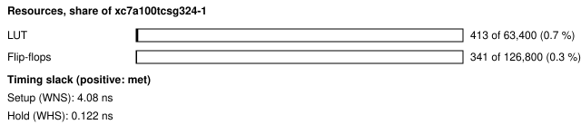
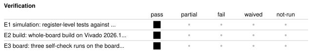

# b2_tmp_adt7420: ADT7420 temperature sensor board self-check

<!-- Generated from handover.yaml by flow/handover.py (brief 68). Edit handover.yaml, or the text between the prose markers, then run: python -m flow.handover write designs/b2_tmp_adt7420 -->

Reads the Nexys A7's ADT7420 temperature sensor over I2C (address 0x4B, 100 kHz) from a small register block in the test shell. The host reads the ID register and the temperature, and the pass rule checks the ID, that no byte was not acknowledged and that the temperature is plausible. The design only sets the register pointer and reads, so it cannot change the sensor's configuration. `selfcheck.py` holds the on-board pass rule, written before any board run.

Not in scope:

- a temperature measurement: the pass range (10 to 40 C) only shows the sensor answers with a plausible value, not that it is accurate
- an agent benchmark task; it was written by hand to prove the board inventory on hardware

Kind: board-selfcheck; written by hand. State: board-verified. For an agent: [AGENT.md](AGENT.md).

<!-- prose:what -->
A board self-check, not an agent benchmark task: it was written by hand to prove the board inventory (`boards/nexys_a7_100t/inventory.yaml`) on hardware. The test shell (`shell/`) carries its registers; the register map is in the header of `rtl/tmp_regs.sv`.

### How the host uses it

The host writes CTRL with GO, the register pointer and the byte count, polls STATUS until done, then reads RDATA. The self-check reads the ID register (0x0B, one byte, expected 0xCB) and the temperature (registers 0x00 and 0x01, two bytes). In the sensor's power-on 13-bit mode the code is shifted right by 3 and one step is 0.0625 C, two's complement.
<!-- /prose:what -->

## Technical parameters

| Item | Value |
|---|---|
| Part | `xc7a100tcsg324-1` |
| Board | Nexys A7-100T |
| Top | `b2_tmp_adt7420_top` |
| Tool | Vivado 2026.1 |

Clocks:

- `CLK100MHZ`: 100 MHz (from `designs/b2_tmp_adt7420/design.xdc`); the only clock; SCL is made from it (four quarters of QUARTER clocks a bit) and both I2C lines are synchronised into it

Resets:

- `CPU_RESETN`, active low: the board's reset button, synchronised by the test shell's reset synchroniser (assert asynchronous, release synchronous)

Interfaces:

- `UART register window` (test shell, 8N1 UART at 115200 baud) ([datasheet](../../shell/PROTOCOL.md)): four registers at shell addresses 0x80 to 0x83 (CTRL, STATUS, RDATA, INFO); the map is in the header of rtl/tmp_regs.sv; other window addresses read 0, and writes to any address but CTRL are ignored
- `ADT7420 I2C` (TMP_SCL and TMP_SDA, open drain with the board's pull-ups, LVCMOS33) ([datasheet](../../boards/nexys_a7_100t/inventory.yaml)): START, address and write, pointer byte, repeated START, address and read, one or two bytes, STOP; the master waits while the device stretches SCL; a byte that is not acknowledged sets nack and the transfer ends with a STOP

| Parameter | Value | Legal range | Note |
|---|---|---|---|
| `QUARTER` | 250 | 1 to 65535 (16-bit divider); the board value is 250 | a quarter of an I2C bit in 100 MHz clocks; 250 gives a 100 kHz SCL |
| `DEV_ADDR` | 75 | 7-bit address; the board value is 0x4B (75) | the sensor's address with both address pins high on this board |
| `CLKS_PER_BIT` | 868 | set by the shell's UART; the board value is 868 | UART bit period in clocks (115200 baud at 100 MHz) |

| Quantity | Value | Source |
|---|---|---|
| Resources | LUTs, whole board design: 413 LUT; flip-flops, whole board design: 341 FF | M1, M2 |
| Timing | worst setup slack: 4.08 ns; worst hold slack: 0.122 ns | M3, M4 |
| Power | total on-chip power estimate: 0.116 W | M5 |
| Latency | not measured | [Known gaps](#known-gaps-and-limits) |
| Throughput | not measured | [Known gaps](#known-gaps-and-limits) |

<!-- prose:parameters -->
<!-- /prose:parameters -->

## How to build, run and reproduce

| Step | Command | Heavy slot | Time |
|---|---|---|---|
| simulate against the ADT7420 model; needs Icarus Verilog 12 and cocotb 2.0.1 | `python3 -m pytest -q designs/b2_tmp_adt7420/tests/test_tmp_rtl.py` | no | about 1 min |
| build and run the gates; needs local Vivado 2026.1 and a heavy slot (take_heavy_slot.sh) | `flow/run_vivado.sh designs/b2_tmp_adt7420 base` | yes | about 4 min |
| power gate, program SRAM, self-check, three times; needs the Nexys A7 on wall power and the board lock | `python3 flow/board_check.py designs/b2_tmp_adt7420 --runs 3` | no | about 2 min |

Tool: Vivado 2026.1. Build ID of the inputs at handover: `75af5be3` (`python flow/manifest.py show designs/b2_tmp_adt7420`: what a rebuild of today's sources and flow would carry; it changes when any build input or the flow changes, so it can differ from the build ID in an older evidence record). Knowledge-bank pin: `1fc7ed8`.

| File | What |
|---|---|
| [`designs/b2_tmp_adt7420/rtl/i2c_ptr_read.sv`](rtl/i2c_ptr_read.sv) | I2C master that sets a register pointer then reads one or two bytes; it never writes a data byte |
| [`designs/b2_tmp_adt7420/rtl/tmp_regs.sv`](rtl/tmp_regs.sv) | the registers in the shell window, with the register map in its header |
| [`designs/b2_tmp_adt7420/rtl/b2_tmp_adt7420_top.sv`](rtl/b2_tmp_adt7420_top.sv) | board top (test shell, open-drain pins, line synchroniser and the register block) |
| [`designs/b2_tmp_adt7420/design.xdc`](design.xdc) | pins, the 100 MHz clock and the false paths on the asynchronous inputs and slow outputs |
| [`designs/b2_tmp_adt7420/build.yaml`](build.yaml) | how flow/run_vivado.sh builds the design |
| [`designs/b2_tmp_adt7420/selfcheck.py`](selfcheck.py) | the on-board check and its pass rule (docstring), pre-registered before any board run |
| [`designs/b2_tmp_adt7420/verif/fsm.yaml`](verif/fsm.yaml) | the state table of the I2C engine, read by the FSM coverage check |
| [`designs/b2_tmp_adt7420/tests/tmp_cocotb.py`](tests/tmp_cocotb.py) | cocotb tests against an ADT7420 model that loses its pointer on a STOP, NACKs a wrong address and stretches SCL |
| [`designs/b2_tmp_adt7420/tests/test_tmp_rtl.py`](tests/test_tmp_rtl.py) | pytest entry that runs the cocotb tests with Icarus Verilog |

<!-- prose:build -->
Results of the board runs are in `results/board_v2/b2_tmp_adt7420.json`, with one file per run in `results/board_v2/runs/`.
<!-- /prose:build -->

## Verified

| ID | Activity | Result | What | Evidence | Conditions |
|---|---|---|---|---|---|
| E1 | simulation | pass | register-level tests against an ADT7420 model; ID and temperature reads, a wrong address is not acknowledged and the bus is released, clock stretching, repeated one and two byte reads, and no data byte is ever written to the sensor | [`designs/b2_tmp_adt7420/tests/test_tmp_rtl.py`](tests/test_tmp_rtl.py) (run in CI) | - |
| E2 | build | pass | whole-board build on Vivado 2026.1; every gate passes (built, not programmed) | [`results/vivado_2026_1_remeasure/b2_builds.json`](../../results/vivado_2026_1_remeasure/b2_builds.json) | - |
| E3 | board | pass (3 runs) | three self-check runs on the board, from a clean committed tree; each passes the pre-registered rule (ID 0xCB with no NACK, temperature inside the range) | [`results/board_v2/b2_tmp_adt7420.json`](../../results/board_v2/b2_tmp_adt7420.json) | wall power; the power gate (report_power total and junction temperature against the 2.0 W and 85 C limits) passed before programming; XADC rails and die temperature were not read during these runs; no reference thermometer was used |

Gates at handover: `build_2026_1` pass, `board_selfcheck` pass.

<!-- prose:verified -->
The cocotb tests (`tests/tmp_cocotb.py`) model the sensor following its data sheet, including losing the register pointer if a STOP follows the pointer write; CI runs them. `verif/fsm.yaml` lists the I2C engine's state transitions for the FSM coverage check.
<!-- /prose:verified -->

## Measured

Every value is read from the record by `python -m flow.handover fill`, not typed.

| ID | What | Value | Runs | Source | Conditions |
|---|---|---|---|---|---|
| M1 | LUTs, whole board design | 413 LUT | 1 | [`results/vivado_2026_1_remeasure/b2_builds.json`](../../results/vivado_2026_1_remeasure/b2_builds.json) `builds.b2_tmp_adt7420.lut` | routed whole-board build, Vivado 2026.1, xc7a100tcsg324-1, including the test shell |
| M2 | flip-flops, whole board design | 341 FF | 1 | [`results/vivado_2026_1_remeasure/b2_builds.json`](../../results/vivado_2026_1_remeasure/b2_builds.json) `builds.b2_tmp_adt7420.ff` | routed whole-board build, Vivado 2026.1, including the test shell |
| M3 | worst setup slack | 4.08 ns | 1 | [`results/vivado_2026_1_remeasure/b2_builds.json`](../../results/vivado_2026_1_remeasure/b2_builds.json) `builds.b2_tmp_adt7420.wns_ns` | routed, at the 100 MHz board clock |
| M4 | worst hold slack | 0.122 ns | 1 | [`results/vivado_2026_1_remeasure/b2_builds.json`](../../results/vivado_2026_1_remeasure/b2_builds.json) `builds.b2_tmp_adt7420.whs_ns` | routed, at the 100 MHz board clock |
| M5 | total on-chip power estimate | 0.116 W | 1 | [`results/vivado_2026_1_remeasure/b2_builds.json`](../../results/vivado_2026_1_remeasure/b2_builds.json) `builds.b2_tmp_adt7420.power_w` | report_power after routing, vectorless (default toggle rates), the board's thermal environment |
| M6 | temperature read from the sensor, first recorded run | 18.875 C | 1 | [`results/board_v2/b2_tmp_adt7420.json`](../../results/board_v2/b2_tmp_adt7420.json) `results[0].steps.selfcheck.temperature_c` | 13-bit power-on mode, 0.0625 C a step; room temperature not recorded; pass range 10 to 40 C |
| M7 | ID register value, first recorded run | 0xCB | 1 | [`results/board_v2/b2_tmp_adt7420.json`](../../results/board_v2/b2_tmp_adt7420.json) `results[0].steps.selfcheck.id` | register 0x0B read with no NACK; the pass rule requires 0xCB |

<!-- prose:measured -->
<!-- /prose:measured -->

## Known gaps and limits

- **latency**: Not measured. A read takes nine bit periods for each of the address, pointer and address-read bytes plus nine for each data byte at 100 kHz by construction; no record times it.
- **throughput**: Not applicable; the block moves one or two bytes per host request.
- **E3**: The board runs used bitstreams built on the earlier Vivado release; the 2026.1 build (E2) was not programmed. Re-run the board check on a 2026.1 bitstream to close this.
- **operating conditions**: The board runs predate the house rule of 2026-11-11 that every board run records its operating conditions from the XADC; die temperature and the VCCINT, VCCAUX and VCCBRAM rails were not read from the XADC, so the runs cannot be shown to be inside the recommended operating conditions.
- **accuracy**: The temperature was not compared with a reference, and the room temperature was not recorded; the range check shows the sensor answers plausibly, not that the reading is accurate. Only the 13-bit power-on mode is decoded.
- **behaviour**: GO written while a transfer runs is ignored (i2c_ptr_read.sv takes GO only when idle), but no test covers it. A CTRL write while a transfer runs still changes the pointer and byte-count registers; the engine loads the pointer byte after the address is acknowledged, so a write before that point changes the pointer sent, while the byte count is taken at GO. A byte count other than 2 reads one byte. After a NACK the transfer ends with a STOP, nack stays set until the next GO and RDATA is 0. A 2-byte read puts the first byte in bits 15 to 8. STATUS and RDATA reads of undefined addresses return 0 with no error.
- **reset**: Reset clears the registers, DONE, NACK and the pointer, and releases both I2C lines. A reset in the middle of a transfer releases the lines at once without a STOP, which can leave a device mid-byte.

<!-- prose:gaps -->
<!-- /prose:gaps -->

## Next steps

1. Re-run the board check on a Vivado 2026.1 bitstream with the XADC read at the start and end of each run.
2. Add tests for GO written while busy and for a CTRL write during a transfer, and state the behaviour in the register map header.
3. Compare the temperature with a reference thermometer once, and record the room temperature.

Open questions:

- Should the 16-bit (high resolution) configuration be supported, which would need a configuration write that this design deliberately cannot do?

<!-- prose:next -->
<!-- /prose:next -->

## History

| Date | Brief | PR | What |
|---|---|---|---|
| 2026-10-31 | 04c | - | written with the board inventory, power budget and power gate; 3 of 3 board runs pass |
| 2026-11-11 | 49 | - | rebuilt on Vivado 2026.1; every gate passes (not programmed) |
| 2026-11-13 | 68 | - | handover written to the documentation standard |

<!-- prose:history -->
<!-- /prose:history -->
