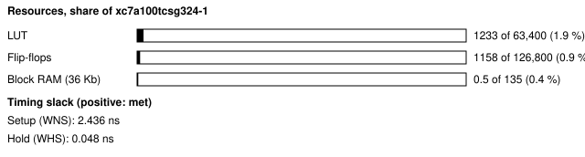
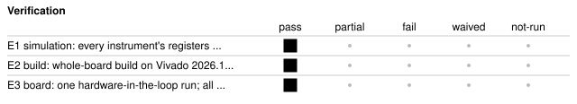

# b30_hil_audio: Hardware-in-the-loop demonstration design (audio tone and instruments)

<!-- Generated from handover.yaml by flow/handover.py (brief 68). Edit handover.yaml, or the text between the prose markers, then run: python -m flow.handover write designs/b30_hil_audio -->

One design on the Nexys A7 that carries four library instruments (a tone generator, a frequency and duty counter, a logic analyser and a frame CRC) and an XADC readout behind the test shell, so that every sensing path of the brief 30 hardware-in-the-loop stage has something to read. The tone leaves the board as PWM audio, and `hil.yaml` lists eight checks that compare the board with Python golden models, including a measurement of the tone at the audio jack.

Not in scope:

- a product design; its job is to give the hardware-in-the-loop checks a known answer on every path
- a test of the instruments' own correctness; the library blocks are tested in ip_lib and hil/tests
- the video, analogue-input, M2K, Pluto, RTL-SDR and Red Pitaya paths, which no run covered

Kind: demonstration; written by hand with agent runs. State: board-verified. For an agent: [AGENT.md](AGENT.md).

<!-- prose:what -->
### How it is built

The tone is a DDS sine (`dds_awg`) clocked by a sample tick, turned into a 10-bit PWM and sent to `AUD_PWM`, so it reaches the board's low-pass filter and audio jack. The same samples feed three in-FPGA instruments: `freq_duty_counter` measures the tone on the sample sign bit, `logic_analyser` captures the 16-bit samples, and `frame_crc` takes the CRC of a synthetic 128-pixel frame from a 24-bit LFSR generated every 4096 clocks. The XADC is polled for die temperature, VCCINT, VCCAUX and VCCBRAM into registers. All are read through the test shell's register window.

### The hardware-in-the-loop checks

`hil.yaml` lists eight checks, each with a path (shell, logic analyser, XADC or audio), a stimulus and a tolerance; the expected answers come from the same Python golden models the simulation uses (`hil/instruments/models.py`): the design ID `H30A`; the frame CRC against the model; a seeded pixel fault (CTRL bit 1) that must be seen; the tone frequency inside the FPGA; the logic analyser samples against the DDS model; the pre-trigger position; the XADC against JTAG sysmon; and the tone at the jack, measured by an audio interface (frequency, level, THD and SINAD).

Its twin [b30_hil_audio_pinfault](../b30_hil_audio_pinfault/README.md) has the same RTL with the audio pin moved, to show a fault that only the check at the jack can see. Board results and what was not connected are in [results/b30/README.md](../../results/b30/README.md); the brief's report covers the instrument library.
<!-- /prose:what -->

## Technical parameters

| Item | Value |
|---|---|
| Part | `xc7a100tcsg324-1` |
| Board | Nexys A7-100T |
| Top | `b30_hil_audio_top` |
| Tool | Vivado 2026.1 |
| Note | brief 30 built it from the library entries dds_awg, freq_duty_counter, logic_analyser and frame_crc plus the test shell |

Clocks:

- `CLK100MHZ`: 100 MHz (from `designs/b30_hil_audio/design.xdc`); the only clock; the 48.008 kHz sample tick, the PWM carrier and the frame timing are enables or counters derived from it

Resets:

- `CPU_RESETN`, active low: the board's reset button, synchronised by the test shell's reset synchroniser (assert asynchronous, release synchronous); reset turns the tone on, clears the pixel-fault switch and sets the DDS step back to its 1 kHz value

Interfaces:

- `UART register window` (test shell, 8N1 UART at 115200 baud) ([datasheet](../../shell/PROTOCOL.md)): 32-bit registers at shell addresses 0x80 plus the offset in the header of rtl/b30_hil_audio_top.sv (CTRL 0x00, STEP 0x01, WAVE 0x02, SAMPLE 0x03, frequency counter 0x10 to 0x13, logic analyser 0x20 to 0x28, XADC 0x40 to 0x43, frame CRC 0x50 to 0x55); read data is valid the clock after the read strobe; offsets with no register read 0
- `Audio output` (AUD_PWM (PWM, 10-bit duty, offset binary) and AUD_SD (held high), LVCMOS33) ([datasheet](../../boards/nexys_a7_100t/inventory.yaml)): the line is driven low for the low part of each PWM period and released for the high part, because the board's audio stage pulls it up; the board's low-pass filter and 3.5 mm jack follow
- `LEDs` (LED[0] is the tone-on bit and LED[1] is a slow heartbeat, LVCMOS33): indicators only; no check reads them

| Parameter | Value | Legal range | Note |
|---|---|---|---|
| `CLKS_PER_BIT` | 868 | set by the shell's UART; the board value is 868 | UART bit period in clocks (115200 baud at 100 MHz); the simulation uses 8 |
| `FD_GATE_CLKS` | 50,000,000 | 1 or more; the board value is 50,000,000 | gate length of the frequency and duty counter in clocks (0.5 s at 100 MHz); the simulation shrinks it to 40,000 |
| `STEP (reset value)` | 89,463,225 | a 32-bit DDS phase step, writable at offset 0x01 | gives a 1 kHz tone at the 48.008 kHz sample rate |

| Quantity | Value | Source |
|---|---|---|
| Resources | LUTs, whole board design: 1233 LUT; flip-flops, whole board design: 1158 FF; block RAM tiles (36 kb equivalents): 0.5 tile | M1, M2, M3 |
| Timing | worst setup slack: 2.436 ns; worst hold slack: 0.048 ns | M4, M5 |
| Power | total on-chip power estimate: 0.128 W | M6 |
| Latency | not measured | [Known gaps](#known-gaps-and-limits) |
| Throughput | not measured | [Known gaps](#known-gaps-and-limits) |

<!-- prose:parameters -->
<!-- /prose:parameters -->

## How to build, run and reproduce

| Step | Command | Heavy slot | Time |
|---|---|---|---|
| simulate every instrument against the golden models; needs Icarus Verilog 12 and cocotb 2.0.1 | `python3 -m pytest -q designs/b30_hil_audio/tests/test_hil_audio_rtl.py` | no | about 2 min |
| build and run the gates; needs local Vivado 2026.1 and a heavy slot (take_heavy_slot.sh) | `flow/run_vivado.sh designs/b30_hil_audio base` | yes | about 4 min |
| program the SRAM and run the hardware-in-the-loop checks; needs the Nexys A7 on wall power, the board lock, and an audio interface cabled from the Nexys audio jack for the audio check (the check is skipped, not passed, if it is missing) | `python3 flow/hil.py designs/b30_hil_audio` | no | about 1 min |

Tool: Vivado 2026.1. Build ID of the inputs at handover: `efa287bc` (`python flow/manifest.py show designs/b30_hil_audio`: what a rebuild of today's sources and flow would carry; it changes when any build input or the flow changes, so it can differ from the build ID in an older evidence record). Knowledge-bank pin: `1fc7ed8`.

| File | What |
|---|---|
| [`designs/b30_hil_audio/rtl/b30_hil_audio_top.sv`](rtl/b30_hil_audio_top.sv) | the top, with the register map in its header (tone, instruments, XADC, frame generator and the read mux) |
| [`designs/b30_hil_audio/design.xdc`](design.xdc) | pins (AUD_PWM on A11), the 100 MHz clock and the false paths on the asynchronous inputs and slow outputs |
| [`designs/b30_hil_audio/build.yaml`](build.yaml) | how flow/run_vivado.sh builds the design, with the library sources it pulls in |
| [`designs/b30_hil_audio/hil.yaml`](hil.yaml) | the eight hardware-in-the-loop checks, their stimulus, expected results and tolerances |
| [`designs/b30_hil_audio/tests/hil_audio_cocotb.py`](tests/hil_audio_cocotb.py) | cocotb test of every instrument's registers against the Python golden models |
| [`designs/b30_hil_audio/tests/test_hil_audio_rtl.py`](tests/test_hil_audio_rtl.py) | pytest entry that runs the cocotb test with Icarus Verilog (8-clock UART bit, a 40,000-clock gate) |

<!-- prose:build -->
<!-- /prose:build -->

## Verified

| ID | Activity | Result | What | Evidence | Conditions |
|---|---|---|---|---|---|
| E1 | simulation | pass | every instrument's registers read through the shell in simulation and compared with the Python golden models | [`designs/b30_hil_audio/tests/test_hil_audio_rtl.py`](tests/test_hil_audio_rtl.py) (run in CI) | - |
| E2 | build | pass | whole-board build on Vivado 2026.1; every gate passes (built, not programmed) | [`results/vivado_2026_1_remeasure/b30_hil_audio.json`](../../results/vivado_2026_1_remeasure/b30_hil_audio.json) | - |
| E3 | board | pass (1 runs) | one hardware-in-the-loop run; all eight checks pass (design ID, frame CRC known answer, seeded pixel fault seen, tone frequency in the FPGA, logic analyser against the DDS model, pre-trigger, XADC against JTAG sysmon, tone at the audio jack) | [`results/b30/hil_runs/b30_hil_audio.hil.json`](../../results/b30/hil_runs/b30_hil_audio.hil.json) | wall power; power gate passed before programming; die temperature and rails read by the XADC and by JTAG sysmon agreed within tolerance (M11, M12); audio captured by a USB interface at gain about 50 percent, uncalibrated; ambient not recorded |

Gates at handover: `build_2026_1` pass, `hil_board` pass.

<!-- prose:verified -->
The board run and its caveats (one run, earlier-release bitstream) are in the gaps below. The cocotb test reads every instrument through the shell in simulation; CI runs it.
<!-- /prose:verified -->

## Measured

Every value is read from the record by `python -m flow.handover fill`, not typed.

| ID | What | Value | Runs | Source | Conditions |
|---|---|---|---|---|---|
| M1 | LUTs, whole board design | 1233 LUT | 1 | [`results/vivado_2026_1_remeasure/b30_hil_audio.json`](../../results/vivado_2026_1_remeasure/b30_hil_audio.json) `lut` | routed whole-board build, Vivado 2026.1, xc7a100tcsg324-1, including the test shell |
| M2 | flip-flops, whole board design | 1158 FF | 1 | [`results/vivado_2026_1_remeasure/b30_hil_audio.json`](../../results/vivado_2026_1_remeasure/b30_hil_audio.json) `ff` | routed whole-board build, Vivado 2026.1, including the test shell |
| M3 | block RAM tiles (36 kb equivalents) | 0.5 tile | 1 | [`results/vivado_2026_1_remeasure/b30_hil_audio.json`](../../results/vivado_2026_1_remeasure/b30_hil_audio.json) `bram36` | routed whole-board build, Vivado 2026.1; the DDS wave table uses one 18 kb block RAM |
| M4 | worst setup slack | 2.436 ns | 1 | [`results/vivado_2026_1_remeasure/b30_hil_audio.json`](../../results/vivado_2026_1_remeasure/b30_hil_audio.json) `wns_ns` | routed, at the 100 MHz board clock |
| M5 | worst hold slack | 0.048 ns | 1 | [`results/vivado_2026_1_remeasure/b30_hil_audio.json`](../../results/vivado_2026_1_remeasure/b30_hil_audio.json) `whs_ns` | routed, at the 100 MHz board clock |
| M6 | total on-chip power estimate | 0.128 W | 1 | [`results/vivado_2026_1_remeasure/b30_hil_audio.json`](../../results/vivado_2026_1_remeasure/b30_hil_audio.json) `power_w` | report_power after routing, vectorless (default toggle rates), the board's thermal environment |
| M7 | CRC-32 of the generated 128-pixel frame, read from the board | 93c30c48 | 1 | [`results/b30/hil_runs/b30_hil_audio.hil.json`](../../results/b30/hil_runs/b30_hil_audio.hil.json) `checks.frame_crc_known_answer.measured.crc` | equals the golden model's CRC; the pass rule is exact equality with no new mismatches |
| M8 | tone frequency measured inside the FPGA | 1000 Hz | 1 | [`results/b30/hil_runs/b30_hil_audio.hil.json`](../../results/b30/hil_runs/b30_hil_audio.hil.json) `checks.tone_frequency_in_fpga.measured` | 0.5 s gate on the sample sign bit, resolution 2 Hz; pass range 1000 Hz plus or minus 4 Hz |
| M9 | tone level at the audio jack, relative to full scale of the capture interface | -29.27 dBFS | 1 | [`results/b30/hil_runs/b30_hil_audio.hil.json`](../../results/b30/hil_runs/b30_hil_audio.hil.json) `checks.tone_at_the_jack.measured.level_dbfs_rms` | USB audio capture of the right channel; gain about 50 percent, not calibrated; pass threshold at least -75 dBFS |
| M10 | total harmonic distortion of the tone at the audio jack | 1.32 % | 1 | [`results/b30/hil_runs/b30_hil_audio.hil.json`](../../results/b30/hil_runs/b30_hil_audio.hil.json) `checks.tone_at_the_jack.measured.thd_percent` | same capture as M11, through the board's PWM filter and the interface; pass threshold at most 5 percent |
| M11 | die temperature read by the in-design XADC | 25.716 C | 1 | [`results/b30/hil_runs/b30_hil_audio.hil.json`](../../results/b30/hil_runs/b30_hil_audio.hil.json) `checks.xadc_vs_jtag.measured.tj_c` | fabric DRP readout; the JTAG sysmon read 25.6 C in the same run; pass tolerance 2 C and at most 85 C |
| M12 | VCCINT read by the in-design XADC | 1.0063 V | 1 | [`results/b30/hil_runs/b30_hil_audio.hil.json`](../../results/b30/hil_runs/b30_hil_audio.hil.json) `checks.xadc_vs_jtag.measured.vccint_v` | fabric DRP readout against JTAG sysmon, tolerance 0.02 V |

<!-- prose:measured -->
<!-- /prose:measured -->

## Known gaps and limits

- **latency**: Not measured; no record times a window read or the tone path.
- **throughput**: Not applicable; the design is an instrument carrier, and the logic analyser captures one 256-sample buffer at the 48.008 kHz sample rate per arm.
- **E3**: The board run used a bitstream built on the earlier Vivado release; the 2026.1 build (E2) was not programmed. It was one run, so there is no spread.
- **audio calibration**: The audio level is relative to the capture interface's full scale at an uncalibrated gain, not a voltage at the jack; the THD includes the board's filter and the interface, which no run measured alone.
- **paths not run**: No run used the M2K, Pluto, RTL-SDR, Red Pitaya, HDMI capture, I2S audio or an XADC analogue input; their host drivers are tested only on synthetic data or a fake server (results/b30/README.md).
- **agent loop**: The hardware-in-the-loop stage (flow/hil.py) is not wired into the agent's repair loop or gates.
- **behaviour**: Writes to read-only offsets are ignored and offsets with no register read 0. Offsets 0x20 to 0x2F all go to the logic analyser, beyond the nine registers its header lists. After reset the frame CRC expected value (0x54) is 0, so every frame counts as a mismatch until the host writes the model's CRC. CTRL bit 1 flips one pixel bit of every frame until cleared.
- **instrument limits**: The frequency counter gates 0.5 s, so a tone change takes up to a gate to show; the logic analyser samples at the tone tick, not at 100 MHz.

<!-- prose:gaps -->
<!-- /prose:gaps -->

## Next steps

1. Re-run flow/hil.py on a Vivado 2026.1 bitstream, with the XADC and JTAG sysmon read at the start and end, and repeat it several times for a spread.
2. Calibrate the audio path once (interface alone, then the board) so the level and THD can be quoted in volts and in the board's own contribution.
3. Run the paths that were not connected (M2K, Pluto, RTL-SDR, Red Pitaya, HDMI capture) when the hardware is attached, as results/b30/README.md lists.

Open questions:

- Should the hardware-in-the-loop stage be wired into the agent's gates, and what should it do when the audio interface is absent (skip and report, as now)?

<!-- prose:next -->
<!-- /prose:next -->

## History

| Date | Brief | PR | What |
|---|---|---|---|
| 2026-11-11 | 30 | - | written with the HIL instruments and stage; one board run, all eight checks pass; its seeded-fault twin fails the audio check |
| 2026-11-11 | 49 | - | rebuilt on Vivado 2026.1; every gate passes (not programmed) |
| 2026-11-13 | 68 | - | handover written to the documentation standard |

<!-- prose:history -->
<!-- /prose:history -->
