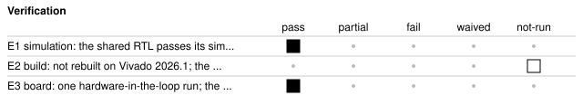

# b30_hil_audio_pinfault: Hardware-in-the-loop seeded pin fault (audio on the wrong pin)

<!-- Generated from handover.yaml by flow/handover.py (brief 68). Edit handover.yaml, or the text between the prose markers, then run: python -m flow.handover write designs/b30_hil_audio_pinfault -->

The seeded-fault twin of b30_hil_audio. It builds from the same RTL, but its constraint file puts the audio output AUD_PWM on the pin of LED 0, so the tone never reaches the audio jack. It passes simulation and every check made inside the FPGA, and only the measurement at the jack fails, which is the point of the demonstration. The hardware-in-the-loop run of this design therefore reports a failure by intent.

Not in scope:

- a working design; the audio output is deliberately miswired and the design is not meant to pass the check at the jack
- a general fault library; it seeds one fault, a wrong pin, to show the class of defect that simulation and in-FPGA self-checks cannot see

Kind: demonstration; written by hand. State: built. For an agent: [AGENT.md](AGENT.md).

<!-- prose:what -->
### What the fault is

Only `design.xdc` differs from [b30_hil_audio](../b30_hil_audio/README.md): `AUD_PWM` is constrained to the pin of LED 0 instead of the audio amplifier's input pin. The RTL is identical, so simulation passes, and every check made inside the FPGA (design ID, frame CRC, seeded pixel fault, tone frequency, logic analyser, pre-trigger, XADC) passes too. The tone is generated and measured correctly inside the FPGA; it just does not reach the jack. Only the audio check, which measures the jack with an audio interface, fails. A flow that relies on simulation or on the design's own self-checks would ship this design.

Board results, and what was not connected, are in [results/b30/README.md](../../results/b30/README.md).
<!-- /prose:what -->

## Technical parameters

| Item | Value |
|---|---|
| Part | `xc7a100tcsg324-1` |
| Board | Nexys A7-100T |
| Top | `b30_hil_audio_top` |
| Tool | Vivado 2026.1 |
| Note | the RTL is designs/b30_hil_audio/rtl/b30_hil_audio_top.sv; only design.xdc differs from b30_hil_audio |

Clocks:

- `CLK100MHZ`: 100 MHz (from `designs/b30_hil_audio_pinfault/design.xdc`); the only clock, as in b30_hil_audio

Resets:

- `CPU_RESETN`, active low: the board's reset button, synchronised by the test shell's reset synchroniser; reset behaviour is as in b30_hil_audio

Interfaces:

- `UART register window` (test shell, 8N1 UART at 115200 baud) ([datasheet](../../shell/PROTOCOL.md)): the same register map as b30_hil_audio (header of designs/b30_hil_audio/rtl/b30_hil_audio_top.sv)
- `Audio output (miswired)` (AUD_PWM on pin H17, the pin b30_hil_audio uses for LED 0; AUD_SD stays on its audio-amplifier pin) ([datasheet](../../boards/nexys_a7_100t/inventory.yaml)): the PWM tone is generated as in b30_hil_audio but leaves on the wrong pin, so the audio stage gets no tone; LED[0] is moved to pin J13 so the two ports do not share a pin

| Parameter | Value | Legal range | Note |
|---|---|---|---|
| `CLKS_PER_BIT` | 868 | set by the shell's UART; the board value is 868 | as in b30_hil_audio |
| `FD_GATE_CLKS` | 50,000,000 | 1 or more; the board value is 50,000,000 | as in b30_hil_audio (0.5 s at 100 MHz) |

| Quantity | Value | Source |
|---|---|---|
| Resources | not measured | [Known gaps](#known-gaps-and-limits) |
| Timing | not measured | [Known gaps](#known-gaps-and-limits) |
| Power | not measured | [Known gaps](#known-gaps-and-limits) |
| Latency | not measured | [Known gaps](#known-gaps-and-limits) |
| Throughput | not measured | [Known gaps](#known-gaps-and-limits) |

<!-- prose:parameters -->
<!-- /prose:parameters -->

## How to build, run and reproduce

| Step | Command | Heavy slot | Time |
|---|---|---|---|
| simulate the shared RTL (the simulation cannot see the constraint file); needs Icarus Verilog 12 and cocotb 2.0.1 | `python3 -m pytest -q designs/b30_hil_audio/tests/test_hil_audio_rtl.py` | no | about 2 min |
| build and run the gates; needs local Vivado 2026.1 and a heavy slot (take_heavy_slot.sh) | `flow/run_vivado.sh designs/b30_hil_audio_pinfault base` | yes | about 4 min |
| program the SRAM and run the hardware-in-the-loop checks (expected overall result fail, from the audio check); needs the Nexys A7 on wall power, the board lock, and an audio interface cabled from the Nexys audio jack | `python3 flow/hil.py designs/b30_hil_audio_pinfault` | no | about 1 min |

Tool: Vivado 2026.1. Build ID of the inputs at handover: `d2f00de4` (`python flow/manifest.py show designs/b30_hil_audio_pinfault`: what a rebuild of today's sources and flow would carry; it changes when any build input or the flow changes, so it can differ from the build ID in an older evidence record). Knowledge-bank pin: `1fc7ed8`.

| File | What |
|---|---|
| [`designs/b30_hil_audio/rtl/b30_hil_audio_top.sv`](../b30_hil_audio/rtl/b30_hil_audio_top.sv) | the top, shared with b30_hil_audio (this design has no RTL of its own) |
| [`designs/b30_hil_audio_pinfault/design.xdc`](design.xdc) | the constraint file with the seeded fault (AUD_PWM on H17, LED[0] on J13); its first line says so |
| [`designs/b30_hil_audio_pinfault/build.yaml`](build.yaml) | how flow/run_vivado.sh builds the design; sources are those of b30_hil_audio with this constraint file |
| [`designs/b30_hil_audio_pinfault/hil.yaml`](hil.yaml) | the same eight checks as b30_hil_audio; the tone_at_the_jack check must fail here |
| [`designs/b30_hil_audio_pinfault/lint/xadc_stub.sv`](lint/xadc_stub.sv) | lint-only stand-in for the XADC primitive |

<!-- prose:build -->
<!-- /prose:build -->

## Verified

| ID | Activity | Result | What | Evidence | Conditions |
|---|---|---|---|---|---|
| E1 | simulation | pass | the shared RTL passes its simulation against the golden models; the seeded fault is in the constraint file, which simulation does not read | [`designs/b30_hil_audio/tests/test_hil_audio_rtl.py`](../b30_hil_audio/tests/test_hil_audio_rtl.py) (run in CI) | - |
| E2 | build | not-run | not rebuilt on Vivado 2026.1 (an earlier-release build is not cited); the build inputs are listed here | [`designs/b30_hil_audio_pinfault/build.yaml`](build.yaml) | - |
| E3 | board | pass (1 run) | one hardware-in-the-loop run; the seeded fault is caught, since the audio check fails on level, distortion and SINAD while the other seven checks pass; the run's overall result is fail by design | [`results/b30/hil_runs/b30_hil_audio_pinfault.hil.json`](../../results/b30/hil_runs/b30_hil_audio_pinfault.hil.json) | wall power; power gate passed before programming; die temperature and rails read by the XADC and by JTAG sysmon agreed within tolerance; audio captured by a USB interface at gain about 50 percent, uncalibrated; ambient not recorded |

Gates at handover: `build_2026_1` not-run, `hil_fault_caught` pass.

<!-- prose:verified -->
Simulation is the shared RTL's test and cannot see the fault. The board run shows the audio check failing and the others passing; see the gaps below for the build and the single run.
<!-- /prose:verified -->

## Measured

Every value is read from the record by `python -m flow.handover fill`, not typed.

| ID | What | Value | Runs | Source | Conditions |
|---|---|---|---|---|---|
| M1 | tone level at the audio jack, relative to full scale of the capture interface | -90.5 dBFS | 1 | [`results/b30/hil_runs/b30_hil_audio_pinfault.hil.json`](../../results/b30/hil_runs/b30_hil_audio_pinfault.hil.json) `checks.tone_at_the_jack.measured.level_dbfs_rms` | USB audio capture of the right channel; gain about 50 percent, not calibrated; pass threshold at least -75 dBFS, so this fails |
| M2 | total harmonic distortion measured at the audio jack | 72.36 % | 1 | [`results/b30/hil_runs/b30_hil_audio_pinfault.hil.json`](../../results/b30/hil_runs/b30_hil_audio_pinfault.hil.json) `checks.tone_at_the_jack.measured.thd_percent` | same capture as M1; with no tone this is distortion of the noise; pass threshold at most 5 percent, so this fails |
| M3 | signal to noise and distortion ratio at the audio jack | -2.89 dB | 1 | [`results/b30/hil_runs/b30_hil_audio_pinfault.hil.json`](../../results/b30/hil_runs/b30_hil_audio_pinfault.hil.json) `checks.tone_at_the_jack.measured.sinad_db` | same capture as M1; pass threshold at least 15 dB, so this fails |
| M4 | tone frequency measured inside the FPGA | 1000 Hz | 1 | [`results/b30/hil_runs/b30_hil_audio_pinfault.hil.json`](../../results/b30/hil_runs/b30_hil_audio_pinfault.hil.json) `checks.tone_frequency_in_fpga.measured` | 0.5 s gate on the sample sign bit; passes although the tone never reaches the jack, which is why the in-FPGA check cannot see this fault |

<!-- prose:measured -->
<!-- /prose:measured -->

## Known gaps and limits

- **resources**: Not measured on Vivado 2026.1; only the earlier release built this design, and brief 49 withdrew those numbers. The RTL is the same as b30_hil_audio, whose 2026.1 numbers are in that design's handover, but the placed design was not measured.
- **timing**: Not measured on Vivado 2026.1 (see resources). The pin constraint differs from b30_hil_audio, so its slack is not assumed equal.
- **power**: Not measured on Vivado 2026.1 (see resources).
- **latency**: Not measured; no record times a window read or the tone path.
- **throughput**: Not applicable; the design is an instrument carrier with a deliberate fault.
- **E2**: The earlier-release build passed its gates, but the design was not rebuilt on 2026.1.
- **build_2026_1**: The 2026.1 build gate was never run for this design; re-run flow/run_vivado.sh designs/b30_hil_audio_pinfault base.
- **E3**: The board run used a bitstream built on the earlier Vivado release and was one run, so there is no spread. The run's overall result is fail by intent; the evidence shows the fault is caught, not that the design works.
- **audio calibration**: The audio level is relative to the capture interface's full scale at an uncalibrated gain; the noise floor of the interface alone was not recorded, and the pass thresholds were not tuned on a no-tone capture.
- **fault coverage**: One fault in one class (a wrong pin) was seeded. No record shows what the audio stage does with the signal on the LED pin beyond the capture at the jack, and no other pin or constraint fault was tried.
- **behaviour**: Everything the design does on the register window is as in b30_hil_audio, including its gaps; the LED[0] indicator is on a different pin from that design's, and nothing reads it.

<!-- prose:gaps -->
<!-- /prose:gaps -->

## Next steps

1. Rebuild on Vivado 2026.1 and re-run flow/hil.py on that bitstream.
2. Capture the audio interface with no tone, so the check's thresholds can be shown to separate a working design from a silent one with margin.
3. Seed further faults of the same class (a swapped or floating pin) if the repair loop is to be tested on them.

Open questions:

- Should the hardware-in-the-loop stage feed this failure back to the agent's repair loop, and what constraint change should it suggest?

<!-- prose:next -->
<!-- /prose:next -->

## History

| Date | Brief | PR | What |
|---|---|---|---|
| 2026-11-11 | 30 | - | created as the seeded-fault twin of b30_hil_audio; one board run caught the fault at the audio jack |
| 2026-11-13 | 68 | - | handover written to the documentation standard |

<!-- prose:history -->
<!-- /prose:history -->
