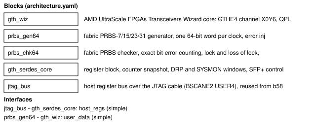
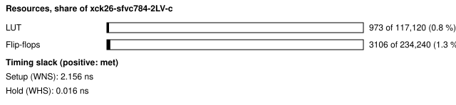
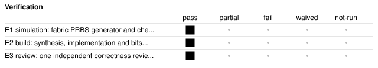

# b56a_gth_serdes: One GTH transceiver at 10.3125 Gb/s with PRBS testing on the KR260 SFP+ cage

<!-- Generated from handover.yaml by flow/handover.py (brief 68). Edit handover.yaml, or the text between the prose markers, then run: python -m flow.handover write designs/b56a_gth_serdes -->

A Kria KR260 design that drives one UltraScale+ GTH transceiver (quad 224, channel 2, the SFP+ cage J24) at 10.3125 Gb/s with PRBS test patterns, checks them in fabric (exact bit errors) and in the transceiver (error cycles), and reports everything over the JTAG cable through a documented register block. It is the base for the board work of brief 56. Built with Vivado 2026.1 on the free Basic licence; not yet run on a board.

Not in scope:

- a protocol or a link layer (RAW data, PRBS only); no Aurora or Ethernet core (10G/25G Ethernet is refused by the Basic licence)
- multi-lane work, meaning channel bonding, lane deskew, PCIe x4 and 40G are simulation-only on this one-lane board

Kind: example; written by hand. State: built. For an agent: [AGENT.md](AGENT.md).

<!-- prose:what -->
One GT Wizard core carries the link; around it sit a fabric PRBS-7/15/23/31 generator and checker on the 64-bit user data (the checker free-runs after locking, so one line error is one counted bit), the transceiver's own PRBS tools, a register block (link control, resets, status, sticky events, a coherent counter snapshot, SFP+ control pins and I2C bit-bang, a DRP window onto the channel for the eye scan and PLL work of brief 56C, and a SYSMON window for the operating-conditions record). The laser starts disabled. The register map is in [docs/register_map.md](docs/register_map.md); the board plan in [docs/board_run_plan.md](docs/board_run_plan.md); the planner and gates that go with it in [docs/gt_links.md](../../docs/gt_links.md).
<!-- /prose:what -->

## Technical parameters

| Item | Value |
|---|---|
| Part | `xck26-sfvc784-2LV-c` |
| Board | Kria KR260 |
| Top | `kr260_gth_top` |
| Tool | Vivado 2026.1 |
| Note | GTHE4_CHANNEL_X0Y6 of quad 224; the SFP+ lane RX T2/T1, TX R4/R3; reference MGTREFCLK0 (Y6/Y5) |

Clocks:

- `clk_25`: 25 MHz (from `designs/b56a_gth_serdes/design.xdc`); input C3, an open-source example's figure, unconfirmed against the schematic; an MMCM makes the 100 MHz free-running clock
- `sfp_mgt_refclk`: 156.25 MHz (from `designs/b56a_gth_serdes/design.xdc`); MGTREFCLK0 of quad 224, source and frequency unconfirmed (open-source example)

Resets:

- `reset helper`, active high: the register block is reset while the MMCM is unlocked; the GT Wizard's reset-all is held with it and its sequence starts when it is released

Interfaces:

- `Host register block` (32-bit register bus over JTAG (BSCANE2 USER4, jtag_bus)) ([datasheet](docs/register_map.md)): generated from regmap.py; unmapped reads return 0, no read side effects, counters read from a snapshot
- `SFP+ lane and control pins` (one GTH lane at 10.3125 Gb/s; tx_disable, mod_abs, rx_los, tx_fault, I2C) ([datasheet](docs/board_run_plan.md)): the laser is disabled at reset (tx_disable = 1; polarity unconfirmed until the first board run)

| Parameter | Value | Legal range | Note |
|---|---|---|---|
| `line rate` | 10.3125 Gb/s | 0.5 to 12.5 Gb/s on this part (-2LV), subject to the PLL windows in flow/gt_data.py | QPLL0, divider 1 |
| `user data width` | 64 bits on a 32-bit internal path | 32/64 pairs allowed by DS925 table 104 | user clocks 161.133 MHz |

| Quantity | Value | Source |
|---|---|---|
| Resources | LUTs: 973 LUT; registers: 3113 FF | M1, M2 |
| Timing | worst setup slack: 2.246 ns; worst hold slack: 0.016 ns | M3, M4 |
| Power | total on-chip power estimate: 0.764 W | M5 |
| Latency | not measured | [Known gaps](#known-gaps-and-limits) |
| Throughput | not measured | [Known gaps](#known-gaps-and-limits) |

<!-- prose:parameters -->
<!-- /prose:parameters -->

## How to build, run and reproduce

| Step | Command | Heavy slot | Time |
|---|---|---|---|
| simulate the PRBS blocks and the core against the Wizard stand-in; needs Icarus Verilog and cocotb 2.0.1 | `python -m pytest -q designs/b56a_gth_serdes/tests` | no | about 1 min |
| build the design and run all gates; needs local Vivado 2026.1 (Basic tier) and a heavy slot (take_heavy_slot.sh), MEM_MAX=8G | `flow/run_vivado.sh designs/b56a_gth_serdes base` | yes | about 7 min |

Tool: Vivado 2026.1. Build ID of the inputs at handover: `d61c218c` (`python flow/manifest.py show designs/b56a_gth_serdes`: what a rebuild of today's sources and flow would carry; it changes when any build input or the flow changes, so it can differ from the build ID in an older evidence record). Knowledge-bank pin: `20d73e8`.

| File | What |
|---|---|
| [`designs/b56a_gth_serdes/rtl/gth_serdes_core.sv`](rtl/gth_serdes_core.sv) | GT Wizard wrapper, registers, snapshot, DRP and SYSMON windows |
| [`designs/b56a_gth_serdes/rtl/prbs64.sv`](rtl/prbs64.sv) | fabric PRBS generator and checker |
| [`designs/b56a_gth_serdes/rtl/kr260_gth_top.sv`](rtl/kr260_gth_top.sv) | board top (MMCM, SYSMON, pins) |
| [`designs/b56a_gth_serdes/design.xdc`](design.xdc) | pins, clocks, slow-pin constraints |
| [`designs/b56a_gth_serdes/ip/amd_ip.tcl`](ip/amd_ip.tcl) | creates the GT Wizard core (hash-listed in flow/ip_tcl_allow.yaml) |
| [`designs/b56a_gth_serdes/regmap.py`](regmap.py) | the register map as data; generates docs/register_map.md |
| [`designs/b56a_gth_serdes/docs/register_map.md`](docs/register_map.md) | interface datasheet |
| [`designs/b56a_gth_serdes/docs/board_run_plan.md`](docs/board_run_plan.md) | the board plan for brief 56B |

<!-- prose:build -->
<!-- /prose:build -->

## Verified

| ID | Activity | Result | What | Evidence | Conditions |
|---|---|---|---|---|---|
| E1 | simulation | pass | fabric PRBS generator and checker against an independent model (exact error counting, lock, loss of lock); register block, bring-up, counting, injection, snapshots, I2C, SYSMON and DRP windows against a behavioural stand-in of the Wizard | [`designs/b56a_gth_serdes/tests/test_b56a_core_sim_rtl.py`](tests/test_b56a_core_sim_rtl.py) (run in CI) | - |
| E2 | build | pass | synthesis, implementation and bitstream on the Basic tier; every flow gate and every GT gate passes | [`results/56a_serdes/gt_build/gates.json`](../../results/56a_serdes/gt_build/gates.json) | - |
| E3 | review | pass | one independent correctness review (Sonnet) and one fix round | [`results/56a_serdes/README.md`](../../results/56a_serdes/README.md) | - |

Gates at handover: `build_2026_1` pass.

<!-- prose:verified -->
<!-- /prose:verified -->

## Measured

Every value is read from the record by `python -m flow.handover fill`, not typed.

| ID | What | Value | Runs | Source | Conditions |
|---|---|---|---|---|---|
| M1 | LUTs | 973 LUT | 1 | [`results/56a_serdes/gt_build/gates.json`](../../results/56a_serdes/gt_build/gates.json) `utilization.lut` | routed, Vivado 2026.1 |
| M2 | registers | 3113 FF | 1 | [`results/56a_serdes/gt_build/gates.json`](../../results/56a_serdes/gt_build/gates.json) `utilization.ff` | as M1 |
| M3 | worst setup slack | 2.246 ns | 1 | [`results/56a_serdes/gt_build/gates.json`](../../results/56a_serdes/gt_build/gates.json) `timing.wns_ns` | routed, user clocks 161.133 MHz and 100 MHz |
| M4 | worst hold slack | 0.016 ns | 1 | [`results/56a_serdes/gt_build/gates.json`](../../results/56a_serdes/gt_build/gates.json) `timing.whs_ns` | as M3 |
| M5 | total on-chip power estimate | 0.764 W | 1 | [`results/56a_serdes/gt_build/gates.json`](../../results/56a_serdes/gt_build/gates.json) `power.total_w` | report_power after routing, vectorless, confidence Medium |
| M6 | Vivado peak resident memory of the GT build (rebuilt 2026-11-14 for brief 70, resets from registers) | 4289 MiB | 1 | [`results/56a_serdes/gt_build/run.json`](../../results/56a_serdes/gt_build/run.json) `vivado_peak_rss_mib` | 2 threads, MemoryMax=8G, alone on the machine, one run |

<!-- prose:measured -->
<!-- /prose:measured -->

## Known gaps and limits

- **latency**: Not measured; the design has no data path latency requirement and the stand-in has no transceiver latency. Board work (56B) is the first chance.
- **throughput**: The line rate is 10.3125 Gb/s by configuration; no throughput or error-rate measurement exists because nothing ran on a board.
- **hardware**: Nothing has run on a board. The reference clock source and frequency, the 25 MHz input, the SFP+ control pin functions and the TX_DISABLE polarity are unconfirmed (open-source example, not the schematic).
- **simulation**: AMD's Wizard simulation model is refused by the free Vivado Simulator (54716 instances against 50000); the register-level bench uses a behavioural stand-in, so the transceiver itself is untested.
- **counters**: The hard PRBS checker counts cycles with an error, not bits; TXPRBSFORCEERR may inject two errors per pulse with these clock ratios (UG576); the DRP window hangs if used while the transceiver is in reset (no timeout).
- **behaviour**: Guessable wrongly (docs/register_map.md): unmapped reads return 0 and writes are ignored; PULSE bits are strobes and read 0; counters change only on a snapshot; DRP_DATA reads the last read, not the last write; reads have no side effects.
- **review**: One review round; STATUS bits 6 and 7 are reserved; the planner does not check that a rate is reachable from the reference by an integer divider; SYSMON conversion to physical units is not implemented.

<!-- prose:gaps -->
<!-- /prose:gaps -->

## Next steps

1. Run docs/board_run_plan.md on the KR260 (laser polarity first, then near-end loopback BER, then the optical loop).
2. Confirm the reference clock and the control pins against the carrier schematic.
3. Build an I2C master for the module's SFF-8472 diagnostics.

Open questions:

- Does the PL load over JTAG with the PS idle on the new SD card state? (board_run_plan.md section 1)

<!-- prose:next -->
<!-- /prose:next -->

## History

| Date | Brief | PR | What |
|---|---|---|---|
| 2026-11-13 | 56A | - | design, gates, probe and knowledge written; one independent review round |

<!-- prose:history -->
<!-- /prose:history -->
