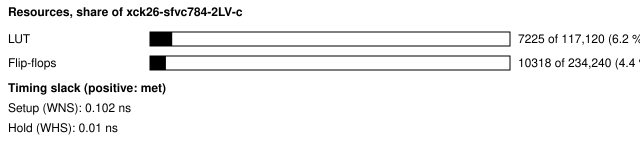
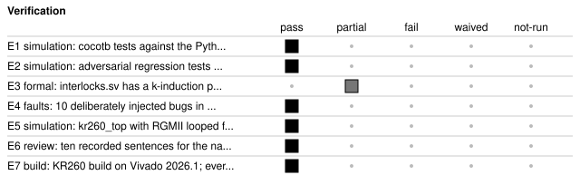

# b58a_trigger: Mock low-latency trading path on the Kria KR260

<!-- Generated from handover.yaml by flow/handover.py (brief 68). Edit handover.yaml, or the text between the prose markers, then run: python -m flow.handover write designs/b58a_trigger -->

A bench model of a low-latency trading path. A packet arrives on a PL Ethernet port, its fields are parsed while it is still arriving, a rule loaded at run time decides, hardware interlocks check the order, and in speculative mode the response leaves before the incoming frame has finished (undone by a poisoned frame check sequence if the frame was bad). Simulated, formally checked in part, and built with Vivado 2026.1; never run on a board.

Not in scope:

- a real market path: a mock. The message format is our own (docs/bench_feed_v1.md), the traffic sources are our own, and there is no exchange, broker or market data
- a board result; no latency figure here was measured on hardware, and the PHYs, the cable and the real RGMII timing are outside every number
- a proof of the whole design; only interlocks.sv has a k-induction proof, and the order slot and the MAC state machines have bounded checks

Kind: showcase; written by hand with agent runs. State: built. For an agent: [AGENT.md](AGENT.md).

<!-- prose:what -->
A packet arrives on a PL Ethernet port of the Kria KR260; its fields are parsed while it is still arriving; a rule
loaded at run time fires; hardware interlocks check the order; a response packet leaves.

**Purpose:** show that an FPGA can parse a packet as it arrives, apply a rule that can be changed while running, and
start a response within tens of nanoseconds of the deciding field, with every order passing hardware safety checks. It
is a bench loop: our own message format ([docs/bench_feed_v1.md](docs/bench_feed_v1.md)), our own traffic sources,
no market, broker or exchange, no market data.

**Status: simulation, formal checks and a Vivado 2026.1 build only. Nothing here has run on a board yet**
([docs/board_run_plan.md](docs/board_run_plan.md)). Every latency number below is from simulation. One clock is 8 ns (125 MHz,
one byte time at 1 Gb/s).

### Glossary

| Term | Meaning |
|---|---|
| RGMII | the 4-bit, double-data-rate link between the MAC (here, in the FPGA) and the PHY chip |
| SFD | start-of-frame delimiter: the byte that ends the preamble; the frame's first byte follows it |
| FCS | frame check sequence: the 32-bit CRC at the end of an Ethernet frame |
| IFG | inter-frame gap: the idle time between frames (at least 12 byte times) |
| cut-through | passing bytes on as they arrive, before the whole frame (and its FCS) is in |
| top-of-book | the best bid and best ask of an instrument |
| tick-to-trade | a market-data message (a "tick") arrives, an order leaves |
| tick-to-config | a tick arrives, software changes a rule and the change is in force |
| speculative / safe | speculative: act before the FCS is known and undo the order if the frame turns out bad; safe: wait for a good FCS |
| poison | invert an outgoing frame's FCS so that the far end discards it (the undo for an order already on the wire) |
| hold-off | the minimum number of clocks before the same rule may fire again |
| token bucket | a rate limit: each order takes a token; tokens come back at a fixed rate up to a maximum |
| k-induction | a formal proof that a property holds in every reachable state, not only up to a fixed depth |
| bounded check | a formal check of every behaviour up to a fixed number of clocks; it finds bugs but is not a proof |
| OOC | out-of-context synthesis: a block built on its own to measure its cost |
| luna | `openai/gpt-6-luna`, the hosted language model the project uses (through OpenRouter, provider data collection disabled) |

### The path

```
 RGMII (PHY2, J10B) -> rgmii_rx -> gmii_cdc (RX_CLK -> 125 MHz) -> mac_rx (cut-through)      ip_lib/eth_mac_rgmii
   -> feed_rx: Ethernet, IPv4 (checksum), UDP port, Bench Feed header, messages field by field  (ARP for us)
   -> book: best bid/ask per instrument in block RAM (read at the instrument field, updated at the message end)
   -> rules: 8 run-time rules, all checked at once when the price field completes
   -> interlocks: kill, halt on sequence gap, size, price band, position, token-bucket rate      (k-induction proof)
   -> order_ctl: each order bound to its own frame's verdict; speculative send, drop / poison / cancel on a bad FCS
   -> mac_tx -> rgmii_tx -> RGMII (PHY2)
 Port B (PHY3, J10A): feed_gen -> mac_tx -> RGMII; RGMII -> mac_rx -> loop timer (histogram B)
 Host: registers over the JTAG cable (rtl/jtag_bus.sv, host/jtag_regs.tcl, not yet run on a board), docs/register_map.md
```

The Ethernet blocks are the library entry [ip_lib/eth_mac_rgmii](../../ip_lib/eth_mac_rgmii/README.md) (tri-mode,
cut-through or store-and-forward). The KR260 top uses them at 1000 Mb/s only; the 10 and 100 Mb/s paths are simulated
in the library's own tests.

The project's showcase entry is `showcase/trading_path.yaml`; it is marked in progress and has no page on the site yet (`site/data/showcase.json` lists no page for it), because the page waits for a board result.
<!-- /prose:what -->

## Technical parameters

| Item | Value |
|---|---|
| Part | `xck26-sfvc784-2LV-c` |
| Board | Kria KR260 |
| Top | `kr260_top` |
| Tool | Vivado 2026.1 |
| Note | the PS is unused; the host reaches the registers over the JTAG cable |

Clocks:

- `clk_25`: 25 MHz (from `designs/b58a_trigger/design.xdc`); board oscillator; an MMCM makes the 125 MHz core clock (one byte time at 1 Gb/s, 8 ns)
- `a_rxc`: 125 MHz (from `designs/b58a_trigger/design.xdc`); port A receive clock from the PHY; crossed into the core clock by gmii_cdc
- `b_rxc`: 125 MHz (from `designs/b58a_trigger/design.xdc`); port B receive clock from the PHY

Resets:

- `core reset`, active high: held until the MMCM locks and the receive delay lines are calibrated (IDELAYCTRL ready), through reset synchronisers; the PHYs have a register bit that holds them in reset

Interfaces:

- `RGMII ports A and B` (RGMII at 1000 Mb/s, LVCMOS18; port A (PHY2, J10B) is the trading port, port B (PHY3, J10A) the generator and loop timer) ([datasheet](../../ip_lib/eth_mac_rgmii/README.md)): receive is centre-aligned with the PHY's RX delay on and a 1000 ps IDELAY on each input; transmit is edge-aligned with the PHY's TX delay on. Constraints come from the PHY datasheet and are in design.xdc
- `host register bus` (32-bit registers over the JTAG cable (BSCANE2), word addresses 0x000 to 0xFFF) ([datasheet](docs/register_map.md)): control, addresses, interlock limits, rule table, counters, order log, book and two latency histograms; a read returns data two clocks after the address. The JTAG script has not run on a board
- `message format` (Bench Feed v1 over UDP, Ethernet and IPv4) ([datasheet](docs/bench_feed_v1.md)): our own format; UDP checksums are not checked or generated, and IPv4 options, VLAN tags and fragments are rejected

| Parameter | Value | Legal range | Note |
|---|---|---|---|
| `BUILD_MODE` | 0 | 0, 1 or 2 | 0 computes the response's IPv4 checksum before the decision, 1 after it, 2 stores and assembles the frame before sending |
| `RX_IDELAY_PS` | 1000 | from the timing analysis | receive data delay on each RGMII input |
| `NINST` | 256 | instrument count | number of instruments the book holds |

| Quantity | Value | Source |
|---|---|---|
| Resources | LUTs: 7225 LUT; flip-flops: 10318 FF; block RAM tiles: 6.5 tile | M1, M2, M3 |
| Timing | worst setup slack: 0.102 ns; worst hold slack: 0.01 ns | M4, M5 |
| Power | total on-chip power estimate: 0.501 W | M6 |
| Latency | decision latency, speculative, price field complete to first response byte: 8 clocks; decision latency, safe mode, one-message frame: 18 clocks; frame-start latency, speculative, SFD in to first response byte: 65 clocks; decision latency when the whole frame is stored and assembled after the decision (BUILD_MODE 2): 75 clocks; histogram A, minimum, port B loop in simulation: 65 clocks | M7, M8, M9, M10, M11 |
| Throughput | not measured | [Known gaps](#known-gaps-and-limits) |



<!-- prose:parameters -->
<!-- /prose:parameters -->

## How to build, run and reproduce

| Step | Command | Heavy slot | Time |
|---|---|---|---|
| simulation tests against the reference model; needs Icarus Verilog 12 and cocotb 2.0.1 | `python3 -m pytest -q designs/b58a_trigger/tests/test_b58a_model.py designs/b58a_trigger/tests/test_b58a_records.py designs/b58a_trigger/tests/test_b58a_rtl.py` | no | about 10 min |
| regenerate the simulation records; needs as above | `B58A_RECORD=results/b58a python3 -m pytest -q designs/b58a_trigger/tests/test_b58a_rtl.py` | no | about 10 min |
| formal checks; needs SymbiYosys, yosys and z3 | `python3 -m pytest -q designs/b58a_trigger/tests/test_b58a_formal.py` | no | about 30 min |
| build the KR260 bitstream; needs local Vivado 2026.1 and a heavy slot (take_heavy_slot.sh) | `flow/run_vivado.sh designs/b58a_trigger` | yes | about 23 min |

Tool: Vivado 2026.1. Build ID of the inputs at handover: `a4aa23de` (`python flow/manifest.py show designs/b58a_trigger`: what a rebuild of today's sources and flow would carry; it changes when any build input or the flow changes, so it can differ from the build ID in an older evidence record). Knowledge-bank pin: `1fc7ed8`.

| File | What |
|---|---|
| [`designs/b58a_trigger/rtl/kr260_top.sv`](rtl/kr260_top.sv) | board top (RGMII ports, clocks, JTAG bus, port B generator and loop timer) |
| [`designs/b58a_trigger/rtl/trigger_core.sv`](rtl/trigger_core.sv) | the path from frame parser to order control |
| [`designs/b58a_trigger/rtl/feed_rx.sv`](rtl/feed_rx.sv) | Ethernet, IPv4, UDP and Bench Feed parser, field by field |
| [`designs/b58a_trigger/rtl/book.sv`](rtl/book.sv) | best bid and ask per instrument in block RAM |
| [`designs/b58a_trigger/rtl/rules.sv`](rtl/rules.sv) | 8 run-time rules checked at once |
| [`designs/b58a_trigger/rtl/interlocks.sv`](rtl/interlocks.sv) | kill, halt, size, price band, position and rate checks |
| [`designs/b58a_trigger/rtl/order_ctl.sv`](rtl/order_ctl.sv) | binds each order to its frame's verdict; drop, poison or cancel |
| [`designs/b58a_trigger/rtl/jtag_bus.sv`](rtl/jtag_bus.sv) | register bus over the JTAG cable |
| [`designs/b58a_trigger/design.xdc`](design.xdc) | pins, clocks and the RGMII timing constraints |
| [`designs/b58a_trigger/build.yaml`](build.yaml) | build recipe, including the RGMII timing data from the PHY datasheet |
| [`designs/b58a_trigger/model/ref_model.py`](model/ref_model.py) | Python reference model written from the docs, not the RTL |
| [`designs/b58a_trigger/tests/test_b58a_rtl.py`](tests/test_b58a_rtl.py) | cocotb tests against the model, with hostile frames |
| [`designs/b58a_trigger/tests/test_rev_adv_rtl.py`](tests/test_rev_adv_rtl.py) | adversarial regression tests from the independent review |
| [`designs/b58a_trigger/tests/test_b58a_formal.py`](tests/test_b58a_formal.py) | runs the SymbiYosys jobs |
| [`designs/b58a_trigger/host/nl_rule.py`](host/nl_rule.py) | turns a sentence into a rule through a hosted language model, validated by model/rules.py |
| [`designs/b58a_trigger/docs/board_run_plan.md`](docs/board_run_plan.md) | the board run plan; no step has been run |
| [`designs/b58a_trigger/showcase/trading_path.yaml`](showcase/trading_path.yaml) | the showcase entry, in progress, no numbers until a board result |

<!-- prose:build -->
### Build notes (Vivado 2026.1, xck26-sfvc784-2LV-c)

Routed and written to a bitstream (`results/b58a/build/`, `summary.json`): the sizes and power are in the Measured section. **Every gate passes** (`summary.json`, generated from
`gates.json`): worst setup slack +0.102 ns, worst hold slack +0.010 ns.

| RGMII worst slack (ns) | Port A setup | Port A hold | Port B setup | Port B hold |
|---|---|---|---|---|
| Receive (centre-aligned, PHY RX delay on, 1000 ps IDELAY on each input) | +0.360 | +0.697 | +0.642 | +0.238 |
| Transmit (TXC edge-aligned, PHY TX delay on, the PHY's own window less 0.1 ns assumed board skew) | +0.102 | +0.533 | +0.137 | +0.516 |

The constraints and their derivation are in `design.xdc`: no false paths or other exceptions on the RGMII ports, and
no methodology warning about them. Both directions use the PHY's own timing from its datasheet (Marvell 88E1111,
MV-S100649-00 Rev. M, section 4.12.2), with its internal delays on (register 20 bits 7 and 1). On transmit that
window lets a data change come up to 0.9 ns after its TXC edge and no earlier than 1.3 ns before the next; RGMII
v2.0's generic window was used by an earlier build; the record of that build is not kept. The KR260's TXC-to-TXD trace skew is not
in our notes: the constraints take an **assumed** 0.1 ns off both sides of the window. A centred TXC from a 90-degree
MMCM output (PHY TX delay off) was also built and did not close, with a worst setup slack of -0.433 ns (`results/b58a/build_tx_centred_trial/summary.json`).

Build with `flow/run_vivado.sh designs/b58a_trigger` under a heavy slot, then `python3 results/b58a/build_summary.py`. The simulation records are made by `B58A_RECORD=results/b58a pytest designs/b58a_trigger/tests/test_b58a_rtl.py`; see [results/b58a/README.md](../../results/b58a/README.md).
<!-- /prose:build -->

## Verified



| ID | Activity | Result | What | Evidence | Conditions |
|---|---|---|---|---|---|
| E1 | simulation | pass | cocotb tests against the Python reference model, random streams with hostile frames in speculative and safe mode | [`designs/b58a_trigger/tests/test_b58a_rtl.py`](tests/test_b58a_rtl.py) (run in CI) | - |
| E2 | simulation | pass | adversarial regression tests from the independent review; every order from a bad frame is dropped, poisoned or cancelled | [`designs/b58a_trigger/tests/test_rev_adv_rtl.py`](tests/test_rev_adv_rtl.py) (run in CI) | - |
| E3 | formal | partial | interlocks.sv has a k-induction proof; the order slot and the MAC receive and transmit state machines have bounded checks, not proofs | [`results/b58a/formal.json`](../../results/b58a/formal.json) | - |
| E4 | faults | pass | 10 deliberately injected bugs in the Ethernet MAC library block, each detected by its test suite | [`results/b58a/mac_rgmii_faults.json`](../../results/b58a/mac_rgmii_faults.json) | - |
| E5 | simulation | pass | kr260_top with RGMII looped from port B to port A in simulation; all frames arrive intact (the clock-crossing FIFO is its simulation model) | [`results/b58a/pins_sim.json`](../../results/b58a/pins_sim.json) | - |
| E6 | review | pass | ten recorded sentences for the natural-language rule step, checked offline against meanings written by hand; one expectation was changed after the model's reply was seen (recorded in the file) | [`results/b58a/nl_rules.json`](../../results/b58a/nl_rules.json) | - |
| E7 | build | pass | KR260 build on Vivado 2026.1; every gate passes through bitstream (built, not programmed) | [`results/b58a/build/summary.json`](../../results/b58a/build/summary.json) | - |

Gates at handover: `build_2026_1` pass, `board_run` not-run.

<!-- prose:verified -->
### How it is checked

- **cocotb against a Python reference model** ([model/ref_model.py](model/ref_model.py), written from the docs, not
  the RTL): random streams from the mock venue with hostile frames (wrong MAC, IPv6, VLAN, IPv4 options and
  fragments, TCP, wrong IP or port, bad IP checksum, bad magic, version and counts, ARP for us and not, runts, giants,
  bad FCS, RX_ER, truncated frames), in speculative and safe mode; every order, undo, cancel, ARP reply, counter, log
  entry and book entry must match. Also: minimum gaps with clock-crossing bubbles; 1518-byte frames; the interlocks
  under attack; a rate burst; kill while an order waits; the port B loop; MDIO against a model PHY; the RGMII pin loop
  of kr260_top.
- **Adversarial regression tests** from the independent review (`tests/rev_adv_cocotb.py`): frames cut 0 to 9 bytes
  after the price field with a wrong FCS, 74 to 76-byte frames with a wrong FCS whose second message triggers, and
  orders waiting behind an ARP reply. Each order from a bad frame must be dropped, poisoned or cancelled, and the order
  slot must drain. A second round (`tests/rev2_cocotb.py`): a soft reset while a speculative order from a bad frame
  is on the wire (it must still be poisoned or cancelled), and a trigger 253 to 256 frames after the last request (it
  must fire whatever the frame counter's value).
- **Formal** (SymbiYosys, `verif/formal`, `results/b58a/formal.json`):
  - `interlocks.sv`: **k-induction proof** that no order is granted while killed or halted, above the size limit,
    outside the price band or without a band reference, beyond the position limit, or beyond a bucketful of tokens
    between refills. Assumptions: the limits do not change after reset; bucket at most 4 and refill 3 to 6 clocks
    (small values keep the proof short; the logic does not depend on them); the bucket-refill write is not exercised.
    The proof covers `interlocks.sv` alone. If the host lowers the position limit at run time, the position can sit
    above the new limit; orders that would reduce it are then refused too. The position counts every order granted
    since reset (a cancelled or poisoned order still counts).
  - `order_ctl.sv`: **bounded check (30 clocks), not a proof**, with every input free (soft resets included), an
    abstract MAC (3-clock frames), a watchdog of 8 clocks and a 2-bit frame counter (so its wrap is within reach): an
    order whose frame turns out bad is never started once that is known, and if it left with a good FCS a cancel for
    it follows within 12 clocks, across soft resets too; a cancel only follows a bad frame (or the watchdog); safe mode
    never sends before a good verdict; one request per frame, and a trigger in a frame that has not asked always makes
    one when the slot is free; the order slot is never busy for more than 24 clocks. Outside the bound: backlogs of
    several orders, and the 16-bit age counter's saturation.
  - mac_rx and mac_tx frame state machines: **bounded checks (20 and 40 clocks), not proofs**, with reachability covers.
- **The price band** is checked against the book **before** the triggering message (a buy against the best ask, a
  sell against the best bid, else the last trade), never against the message itself; with no price in the book the
  order is refused.
- **Natural language to rules**: `host/nl_rule.py` asks luna for a rule from a sentence; `model/rules.py` validates
  it; ten recorded sentences in `rules/fixtures`, checked offline in CI against meanings written by hand.
- **Mock venue**: `host/mock_venue.py` makes the stimulus in simulation and is the PC side of the bench run.
<!-- /prose:verified -->

## Measured

Every value is read from the record by `python -m flow.handover fill`, not typed.

| ID | What | Value | Runs | Source | Conditions |
|---|---|---|---|---|---|
| M1 | LUTs | 7225 LUT | 1 | [`results/b58a/build/summary.json`](../../results/b58a/build/summary.json) `utilisation.CLB LUTs.used` | routed build, Vivado 2026.1, xck26-sfvc784-2LV-c, whole design |
| M2 | flip-flops | 10318 FF | 1 | [`results/b58a/build/summary.json`](../../results/b58a/build/summary.json) `utilisation.CLB Registers.used` | as M1 |
| M3 | block RAM tiles | 6.5 tile | 1 | [`results/b58a/build/summary.json`](../../results/b58a/build/summary.json) `utilisation.Block RAM Tile.used` | as M1 |
| M4 | worst setup slack | 0.102 ns | 1 | [`results/b58a/build/summary.json`](../../results/b58a/build/summary.json) `timing_post_route.wns_ns` | routed, all clocks including the RGMII source-synchronous paths; the transmit window assumes 0.1 ns of board skew |
| M5 | worst hold slack | 0.01 ns | 1 | [`results/b58a/build/summary.json`](../../results/b58a/build/summary.json) `timing_post_route.whs_ns` | as M4 |
| M6 | total on-chip power estimate | 0.501 W | 1 | [`results/b58a/build/summary.json`](../../results/b58a/build/summary.json) `power.total_on_chip_w` | report_power after routing, vectorless, still air with no heat sink at 40 C ambient (the pessimistic bound); not a measurement |
| M7 | decision latency, speculative, price field complete to first response byte | 8 clocks | 1 | [`results/b58a/latency_sim.json`](../../results/b58a/latency_sim.json) `modes.speculative_1msg.decision_to_first_byte` | simulation, core side at 125 MHz (8 ns a clock), checksum computed before the decision; before the RGMII registers and the pins |
| M8 | decision latency, safe mode, one-message frame | 18 clocks | 1 | [`results/b58a/latency_sim.json`](../../results/b58a/latency_sim.json) `modes.safe_1msg.decision_to_first_byte` | as M7; safe mode waits for the good frame check sequence |
| M9 | frame-start latency, speculative, SFD in to first response byte | 65 clocks | 1 | [`results/b58a/latency_sim.json`](../../results/b58a/latency_sim.json) `modes.speculative_1msg.tick_to_trade_sfd_to_first_byte` | as M7; 57 of these clocks are the header bytes before the price field |
| M10 | decision latency when the whole frame is stored and assembled after the decision (BUILD_MODE 2) | 75 clocks | 1 | [`results/b58a/latency_sim_assemble.json`](../../results/b58a/latency_sim_assemble.json) `modes.speculative_1msg.decision_to_first_byte` | as M7 |
| M11 | histogram A, minimum, port B loop in simulation | 65 clocks | 1 | [`results/b58a/loop_sim.json`](../../results/b58a/loop_sim.json) `hist_a.min` | simulation of the generator, trading port and back, with bad-FCS and gap injection; not a board measurement |

<!-- prose:measured -->
### Latency in simulation

Measurement points, all on the core side (the 125 MHz byte interface after the receive clock crossing and before the
transmit pins): **SFD in** is the clock mac_rx takes the SFD (the board's histogram A starts at the same point); **price
in** is the clock the last byte of the price field enters mac_rx; **first byte out** is the clock mac_tx's first
preamble byte is on its registered output. Resolution one clock (8 ns). The receive clock crossing, the RGMII registers,
the pins, the PHY chips and the cable are outside these numbers.

| What (`results/b58a/latency_sim*.json`) | Clocks | ns |
|---|---|---|
| Decision latency, speculative: price in to first byte out | 8 | 64 |
| The same, safe mode, one-message frame (waits for the 12 bytes after the price field: the rest of the message and the FCS) | 18 | 144 |
| Frame-start latency, speculative: SFD in to first byte out (57 of these clocks are the header bytes before the price field) | 65 | 520 |

Per stage (speculative, clocks): mac_rx and parser 2, rules 1, interlocks 1, order control 2, mac_tx 2.
At the pins add 2 clocks on transmit and about 7 on receive (17 clocks around a simulated pin loop, less the 8 of the
preamble and SFD and the 2 of transmit: the RGMII registers and the clock-crossing FIFO, whose simulation model stands
in for the Xilinx XPM macro, so its real latency is unmeasured; `results/b58a/pins_sim.json`).

**What pre-building the response headers saves.** The response's IPv4 header checksum can be computed before any
decision (BUILD_MODE 0) or after it, one word a clock while the preamble goes out (BUILD_MODE 1). Both give 8 clocks:
at 1 Gb/s the MAC needs no header byte for 8 clocks (the preamble) and the checksum for 32, so computing headers after
the decision costs nothing when the frame is streamed as the MAC asks for it. Building the whole frame in a buffer after
the decision and only then sending it (BUILD_MODE 2, store and assemble) costs 75 clocks. Pre-building matters at
higher line rates, where the header leaves in a few clocks.

**Tick-to-config** (`results/b58a/stale_parameters_sim.json`): a toy strategy loop (`host/strategy.py`) reads the book
after a market-data packet and commits a new rule threshold. A trigger that arrives before the commit is judged on the
old table and does not fire; the next one fires on the new. The 2,125-clock figure in the file is 2,000 clocks (16 us)
of software time that is **assumed**, plus 125 simulated clocks of register traffic: it is the mechanism, not a
measurement.
<!-- /prose:measured -->

## Known gaps and limits

- **board_run**: No board run has happened and no KR260 programming path exists in the flow yet. The JTAG register script has not run on a board. docs/board_run_plan.md lists the steps.
- **throughput**: Not measured. Only latency was recorded; no record states a sustained order or frame rate.
- **E3**: Only interlocks.sv is proved (k-induction). order_ctl.sv (30 clocks) and the MAC receive and transmit state machines (20 and 40 clocks) are bounded checks; order backlogs and the saturation of its 16-bit age counter are outside the bound.
- **latency**: Every latency figure is simulation. The receive clock crossing, the RGMII registers, the pins, the PHY chips and the cable are outside it, and the crossing FIFO is a simulation model of the Xilinx XPM macro, so its real latency is unmeasured.
- **operating conditions**: No SYSMON temperature or rail readings exist because nothing ran on a board; the board run plan reads them.
- **build**: The transmit window assumes 0.1 ns of TXC-to-TXD skew on the KR260, which is not in our notes; the schematic or the layout report would confirm it. Worst transmit setup slack is the smallest margin in the build.
- **behaviour**: One order slot, at most one request per frame. A bad frame's book updates are not rolled back. No UDP checksum checks. The kill is a register only because the KR260 has no PL push button.
- **tick-to-config**: The 2,125-clock tick-to-config figure includes 2,000 clocks of software time that is assumed, not measured; it shows the mechanism.

<!-- prose:gaps -->
### Limits

- No board run; the JTAG register script has not run on a board; no KR260 programming path in the flow yet.
- The transmit constraints assume at most 0.1 ns of TXC-to-TXD skew on the KR260 (not in our notes; the schematic or
  the board's layout report would confirm it).
- One order slot: at most one order request per received frame, none while the slot is busy. A soft reset (PULSE
  bit 7) forgets which frame last made a request, so that frame may make one more; it never removes an undo.
- A bad frame's book updates are not rolled back: a bad frame becomes a sequence gap at the next packet, and with
  halt-on-gap set trading stops until the host clears it.
- Rule hold-off counters restart when a rule table is committed; interlock limits are separate registers, not part of
  the atomic rule commit.
- The kill is a register only: the KR260 has no PL push button.
- UDP checksums are not checked or generated; no IPv4 options, VLAN tags or fragments.
<!-- /prose:gaps -->

## Next steps

1. Run the board run plan, starting with the bench loop between the two PL ports, and read SYSMON during each run.
2. Add a KR260 programming path to the flow.
3. Confirm the TXC-to-TXD skew from the schematic or the layout report and re-derive the transmit constraints.

Open questions:

- Should the order slot be widened so that several orders can be outstanding?

<!-- prose:next -->
<!-- /prose:next -->

## History

| Date | Brief | PR | What |
|---|---|---|---|
| 2026-11-12 | 58a | - | built, simulated and formally checked; Vivado 2026.1 build closes with all gates passing; not run on a board |
| 2026-11-13 | 68 | - | handover written to the documentation standard |

<!-- prose:history -->
<!-- /prose:history -->
