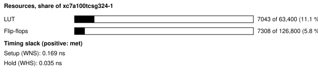
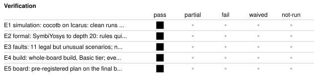

# b59a_axi_tx: AXI transactor, protocol checker and scoreboard on the Nexys A7

<!-- Generated from handover.yaml by flow/handover.py (brief 68). Edit handover.yaml, or the text between the prose markers, then run: python -m flow.handover write designs/b59a_axi_tx -->

Board demonstration of an on-chip AXI4-Lite and AXI4-Stream traffic generator, protocol checker and scoreboard. A program loaded over the UART shell drives a vendor block-RAM controller or our own peripheral and stream FIFO, which carry run-time seeded bugs. Ten AXI4-Lite and five AXI4-Stream rules are watched and counted, a capture records the bus around the first violation, and AMD's AXI Protocol Checker watches the same AXI4-Lite bus as a cross-check.

Not in scope:

- full AXI4 (bursts, IDs, several transactions in flight), a slave side, a DMA target or a soak mode
- a hunt for bugs in a third-party core; the peripheral, the FIFO and their bugs are ours and deliberately simple

Kind: showcase; produced by the agent. State: board-verified. For an agent: [AGENT.md](AGENT.md).

<!-- prose:what -->
### How to read this folder

The transactor, the checkers, the scoreboard, the program format and the host are in `axi_tx/` and described in [docs/axi_tx.md](../../docs/axi_tx.md), the interface datasheet. This folder is the Nexys A7 board top around them: the UART test shell, the vendor block-RAM controller as target 0, our peripheral as target 1, the XADC readout and AMD's protocol checker. The showcase page that tells the story with the captured waveform is defined in [site/showcase/axi_transactor.yaml](../../site/showcase/axi_transactor.yaml). The records are in [results/59a_axi_tx](../../results/59a_axi_tx/README.md).
<!-- /prose:what -->

## Technical parameters

| Item | Value |
|---|---|
| Part | `xc7a100tcsg324-1` |
| Board | Nexys A7-100T |
| Top | `b59a_axi_tx_top` |
| Tool | Vivado 2026.1 |
| Note | core RTL is in axi_tx/rtl; this folder holds the board top, constraints and AMD IP Tcl |

Clocks:

- `CLK100MHZ`: 100 MHz (from `designs/b59a_axi_tx/design.xdc`); the only clock

Resets:

- `CPU_RESETN`, active low: the reset button, synchronised; the host can hold the targets' ARESETn low through SYS_CTRL bit 12

Interfaces:

- `UART register window` (test shell, 8N1 UART at 115200 baud) ([datasheet](../../shell/PROTOCOL.md)): shell addresses 0x80-0xFF; offsets 0x00-0x3F transactor (axi_tx/host/regs.py), 0x40-0x4C XADC, 0x50-0x55 AMD checker status; other offsets read 0
- `Transactor, checker and scoreboard` (AXI4-Lite master with monitors; AXI4-Stream source and sink) ([datasheet](../../docs/axi_tx.md)): program format, rules, counters, capture; one AXI4-Lite transaction outstanding, 32-bit stream data
- `Target 0 (board)` (AMD AXI BRAM Controller 4.1 with Block Memory Generator 8.4, AXI4-Lite) ([datasheet](../../docs/axi_tx.md)): 8 KB; only address bits 12:0 reach it, so a higher address wraps rather than errors
- `Target 1 (board)` (axil_demo_periph, AXI4-Lite) ([datasheet](../../docs/axi_tx.md)): ID, R0-R3, COUNT, WCOUNT, BUG; write to a read-only register answers SLVERR; address 0x20 up answers DECERR (reads 0); AxPROT ignored

| Parameter | Value | Legal range | Note |
|---|---|---|---|
| `CLKS_PER_BIT` | 868 | positive integer; 868 gives 115200 baud | UART bit period in clocks |
| `SDATA_W` | 32 | 32 only | core refuses other widths at elaboration |
| `program RAM` | 256 instructions of four 32-bit words | loops nest 4 deep | loaded over the UART |

| Quantity | Value | Source |
|---|---|---|
| Resources | LUTs, whole board design: 7043 LUT; flip-flops, whole board design: 7308 FF | M1, M2 |
| Timing | worst setup slack: 0.169 ns; worst hold slack: 0.035 ns | M3, M4 |
| Power | total on-chip power estimate: 0.185 W | M5 |
| Latency | minimum AXI4-Lite write latency to the block-RAM target: 2 clocks; maximum AXI4-Lite write latency to the block-RAM target: 12 clocks; minimum AXI4-Lite read latency to the block-RAM target: 1 clocks; maximum AXI4-Lite read latency to the block-RAM target: 8 clocks | M6, M7, M8, M9 |
| Throughput | not measured | [Known gaps](#known-gaps-and-limits) |

<!-- prose:parameters -->
<!-- /prose:parameters -->

## How to build, run and reproduce

| Step | Command | Heavy slot | Time |
|---|---|---|---|
| simulate every program, seeded bug and memory fault; needs Icarus Verilog 12 and cocotb 2.0.1 | `python -m pytest -q axi_tx/tests/test_59a_rtl.py` | no | about 1 min |
| formal proofs and checker mutants to depth 20; needs Yosys, z3 and SymbiYosys | `python axi_tx/formal/run_formal.py --depth 20` | no | about 19 min |
| build the board design; needs local Vivado 2026.1 (Basic tier) and a heavy slot (take_heavy_slot.sh) | `flow/run_vivado.sh designs/b59a_axi_tx base` | yes | about 12 min |
| run the board plan; needs the Nexys A7 on wall power and the board lock | `python3 axi_tx/host/run_board.py --plan axi_tx/programs/board_plan.yaml --json results/59a_axi_tx/board_run.json` | no | about 8 min |

Tool: Vivado 2026.1. Build ID of the inputs at handover: `84dd185a` (`python flow/manifest.py show designs/b59a_axi_tx`: what a rebuild of today's sources and flow would carry; it changes when any build input or the flow changes, so it can differ from the build ID in an older evidence record). Knowledge-bank pin: `1fc7ed8`.

| File | What |
|---|---|
| [`designs/b59a_axi_tx/rtl/b59a_axi_tx_top.sv`](rtl/b59a_axi_tx_top.sv) | board top |
| [`designs/b59a_axi_tx/design.xdc`](design.xdc) | pins and clock |
| [`designs/b59a_axi_tx/ip/amd_ip.tcl`](ip/amd_ip.tcl) | creates the AMD IP (hash-listed in flow/ip_tcl_allow.yaml) |
| [`docs/axi_tx.md`](../../docs/axi_tx.md) | interface datasheet |
| [`axi_tx/tests/test_59a_rtl.py`](../../axi_tx/tests/test_59a_rtl.py) | cocotb tests |
| [`axi_tx/programs/board_plan.yaml`](../../axi_tx/programs/board_plan.yaml) | pre-registered board plan |

<!-- prose:build -->
<!-- /prose:build -->

## Verified

| ID | Activity | Result | What | Evidence | Conditions |
|---|---|---|---|---|---|
| E1 | simulation | pass | cocotb on Icarus: clean runs fire no rule, each seeded bug fires its rule, a WSTRB-ignoring memory is caught by the scoreboard | [`axi_tx/tests/test_59a_rtl.py`](../../axi_tx/tests/test_59a_rtl.py) (run in CI) | - |
| E2 | formal | pass | SymbiYosys to depth 20: rules quiet on legal traffic, fire alone on their violation; every checker mutant fails a proof | [`results/59a_axi_tx/formal.json`](../../results/59a_axi_tx/formal.json) | - |
| E3 | faults | pass | 11 legal but unusual scenarios; no rule fired | [`results/59a_axi_tx/false_fire.json`](../../results/59a_axi_tx/false_fire.json) | - |
| E4 | build | pass | whole-board build, Basic tier; every gate passes | [`results/59a_axi_tx/board_build.json`](../../results/59a_axi_tx/board_build.json) | - |
| E5 | board | pass (17 runs) | pre-registered plan on the final bitstream, clean commit; each verdict as planned | [`results/59a_axi_tx/board_run.json`](../../results/59a_axi_tx/board_run.json) | wall power; power gate before programming; JTAG XADC before and after, fabric XADC after every run, inside the operating conditions; JTAG build ID matched; fast supply droop not seen |

Gates at handover: `build_2026_1` pass, `board_plan` pass.

<!-- prose:verified -->
<!-- /prose:verified -->

## Measured

Every value is read from the record by `python -m flow.handover fill`, not typed.

| ID | What | Value | Runs | Source | Conditions |
|---|---|---|---|---|---|
| M1 | LUTs, whole board design | 7043 LUT | 1 | [`results/59a_axi_tx/board_build.json`](../../results/59a_axi_tx/board_build.json) `utilization.lut` | routed whole-board build, Vivado 2026.1 |
| M2 | flip-flops, whole board design | 7308 FF | 1 | [`results/59a_axi_tx/board_build.json`](../../results/59a_axi_tx/board_build.json) `utilization.ff` | as M1 |
| M3 | worst setup slack | 0.169 ns | 1 | [`results/59a_axi_tx/board_build.json`](../../results/59a_axi_tx/board_build.json) `timing.wns_ns` | routed, 100 MHz clock |
| M4 | worst hold slack | 0.035 ns | 1 | [`results/59a_axi_tx/board_build.json`](../../results/59a_axi_tx/board_build.json) `timing.whs_ns` | routed, 100 MHz clock |
| M5 | total on-chip power estimate | 0.185 W | 1 | [`results/59a_axi_tx/board_build.json`](../../results/59a_axi_tx/board_build.json) `power.total_w` | report_power after routing, vectorless, confidence Medium |
| M6 | minimum AXI4-Lite write latency to the block-RAM target | 2 clocks | 1 | [`results/59a_axi_tx/summary.json`](../../results/59a_axi_tx/summary.json) `bram_write_latency_min` | one run (bram_random_rw) on the board; clocks as counted by axil_mon |
| M7 | maximum AXI4-Lite write latency to the block-RAM target | 12 clocks | 1 | [`results/59a_axi_tx/summary.json`](../../results/59a_axi_tx/summary.json) `bram_write_latency_max` | as M6; includes injected back-pressure |
| M8 | minimum AXI4-Lite read latency to the block-RAM target | 1 clocks | 1 | [`results/59a_axi_tx/summary.json`](../../results/59a_axi_tx/summary.json) `bram_read_latency_min` | as M6 |
| M9 | maximum AXI4-Lite read latency to the block-RAM target | 8 clocks | 1 | [`results/59a_axi_tx/summary.json`](../../results/59a_axi_tx/summary.json) `bram_read_latency_max` | as M7 |
| M10 | board runs that passed | 17 runs | 1 | [`results/59a_axi_tx/summary.json`](../../results/59a_axi_tx/summary.json) `runs_pass` | of 17 planned runs, one bitstream (44b780c9) |
| M11 | runs against our own peripheral and FIFO whose digest and cycle count equal the simulation's | 13 runs | 1 | [`results/59a_axi_tx/summary.json`](../../results/59a_axi_tx/summary.json) `parity_digest_equal` | of 13 such runs; 0 differences in logged transactions |
| M12 | runs on which AMD's checker asserted, all of them runs on which ours flagged an AXI4-Lite rule | 5 runs | 1 | [`results/59a_axi_tx/summary.json`](../../results/59a_axi_tx/summary.json) `amd_asserted` | AXI4-Lite only; its status bits not decoded to rule names |
| M13 | formal proofs passed | 32 proofs | 1 | [`results/59a_axi_tx/summary.json`](../../results/59a_axi_tx/summary.json) `formal_proofs_pass` | of 32, depth 20, Yosys 0.33 |
| M14 | checker mutants killed by at least one proof | 53 mutants | 1 | [`results/59a_axi_tx/summary.json`](../../results/59a_axi_tx/summary.json) `formal_mutants_killed` | of 53 (17 semantic), depth 12 |
| M15 | false-alarm scenarios that fired a rule | 0 scenarios | 1 | [`results/59a_axi_tx/false_fire.json`](../../results/59a_axi_tx/false_fire.json) `matched text` | of 11 scenarios, simulation |

<!-- prose:measured -->
<!-- /prose:measured -->

## Known gaps and limits

- **throughput**: Not measured as a data rate; the records give transaction counts and latencies, not bytes per second on either bus.
- **latency**: Latency is from one run (bram_random_rw) with random back-pressure; none for the peripheral target or without back-pressure.
- **E3**: The 11 scenarios were chosen by the checker's author; they show those legal cases are quiet, not that no legal traffic can fire a rule.
- **amd_ip**: The AMD IP build test (amd_ip_probe.json) shows the five cores build on Vivado 2026.1 without a licence; the AMD traffic generator and stream checker were not used on the board.
- **verification**: Proofs are bounded to 20 cycles and the properties were written by the checker's author; AMD's checker agreeing on hardware is the independent evidence. The clean Verilator lint run has no record in results/.
- **board**: BRAM-target runs are compared with a transaction-level model, not with simulation cycle for cycle (Icarus cannot run the AMD core); block RAM keeps contents across runs, so unwritten words are unknown to the model.
- **build identity**: Board evidence is tied to commit e562dd3 (build ID 44b780c9); later commits changed build inputs, not logic, so the current tree has another build ID and no rebuild or board re-run was made.
- **operating conditions**: The XADC samples about 1 MSPS with alarms latched between reads, so a shorter supply droop is not seen.
- **behaviour**: Guessable wrongly (RTL and docs/axi_tx.md): the target select is a static mux, change it only while no program runs; rules 0-8 are not evaluated while ARESETn is low; a READY-to-VALID path shows only as a VALID that drops or changes; outstanding counts saturate at 255; a read of an unwritten word counts as unchecked, not matched; whether a write to an unlisted window offset is ignored was not checked.
- **scope**: One AXI4-Lite transaction in flight, no IDs, bursts, slave side or soak mode; stream data 32-bit only; AMD's checker does not watch the stream.
- **readout speed**: A board run reads every counter and the log over 115200-baud UART, taking 7 to 33 seconds; no faster readout is built.

<!-- prose:gaps -->
<!-- /prose:gaps -->

## Next steps

1. Decode the AMD checker's pc_status bits to rule names using the AMD protocol-checker guide's table, and add them to the run record.
2. Add the full AXI4 transactor, the slave side and a soak mode that steers random traffic toward untested combinations.
3. Root-cause the 64-bit stream synthesis trim, or keep the core 32-bit only and say so at every interface.
4. Run the board plan again on a bitstream built from the current tree, so the evidence and the build ID agree.

Open questions:

- Is a faster readout (JTAG-AXI or a higher baud rate) worth building before the next board plan?

<!-- prose:next -->
<!-- /prose:next -->

## History

| Date | Brief | PR | What |
|---|---|---|---|
| 2026-11-12 | 59A | - | transactor, checker, scoreboard, formal proofs, board demonstration and showcase page (site/showcase/axi_transactor.yaml); review rounds added rule 9 and re-ran the whole plan; 17 of 17 board runs pass |
| 2026-11-13 | 68 | - | handover written to the documentation standard |

<!-- prose:history -->
<!-- /prose:history -->
