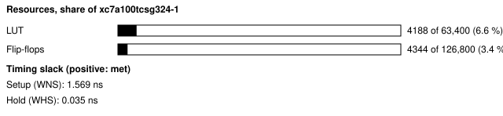
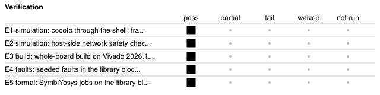

# b63d_nexys_net: Small network stack on the Nexys A7-100T

<!-- Generated from handover.yaml by flow/handover.py (brief 68). Edit handover.yaml, or the text between the prose markers, then run: python -m flow.handover write designs/b63d_nexys_net -->

Answers ARP and ping, receives and sends UDP, joins IGMP multicast groups and counts frames on the Nexys A7's 10/100 Ethernet PHY (LAN8720A, RMII). A UDP service on port 5000 replies with the tag N63D and 21 statistics counters. A frame injector and capture let the host check the stack through the PHY's loopback with no cable. Built and simulated; it has not been run on a board.

Not in scope:

- a gigabit design; the RGMII MAC in ip_lib cannot run on this board, whose PHY is RMII
- a board-verified design; no board run exists

Kind: demonstration; produced by the agent. State: built. For an agent: [AGENT.md](AGENT.md).

<!-- prose:what -->
### What is in it

An FPGA design that answers ping and ARP, receives and sends UDP, joins an IGMP multicast group and counts frames, all
on the board's 10/100 Ethernet PHY (a LAN8720A on an RMII interface). Simulated and built with Vivado 2026.1;
**not yet run on a board**.

The register map is in the header of [rtl/b63d_nexys_net_top.sv](rtl/b63d_nexys_net_top.sv).

- the 10/100 MAC `eth_mac_rmii`, and the address filter and statistics counters of `eth_mac_rgmii`;
- `arp_responder` (address resolution), `icmp_echo` (ping), `ipv4_udp_rx` and `ipv4_udp_tx` (UDP), `igmp_join`
  (multicast membership) and `mdio_master` (PHY registers), all from [ip_lib](../../ip_lib/README.md);
- a UDP service on port 5000 that answers any datagram with "N63D" and the 21 counters;
- a frame injector and a frame capture, so the host can check the stack with the PHY looping frames back, no cable;
- the XADC's temperature and supply readings, with alarms latched between the host's polls.

The host side is [host/board_run.py](host/board_run.py), described in [host/README.md](host/README.md); the board-run
plan, including the isolated-cable check that must be confirmed first, is [host/PLAN.md](host/PLAN.md).
<!-- /prose:what -->

## Technical parameters

| Item | Value |
|---|---|
| Part | `xc7a100tcsg324-1` |
| Board | Nexys A7-100T |
| Top | `b63d_nexys_net_top` |
| Tool | Vivado 2026.1 |
| Note | the blocks come from ip_lib; this folder holds the top, constraints, tests and the host script |

Clocks:

- `CLK100MHZ`: 100 MHz (from `designs/b63d_nexys_net/design.xdc`); board oscillator; an MMCM makes the 50 MHz logic clock (generated clocks c0 and eth_refclk, 20 ns) and a second 50 MHz output at 335.25 degrees that is forwarded to the PHY as ETH_REFCLK

Resets:

- `CPU_RESETN`, active low: the reset button; the PHY has its own reset (ETH_RSTN), held low by CTRL bit 3

Interfaces:

- `UART register window` (test shell, 8N1 UART at 115200 baud (CLKS_PER_BIT 434 at 50 MHz)) ([datasheet](../../shell/PROTOCOL.md)): control, own MAC and IP, MDIO, IGMP groups, 21 statistics counters, event counters, XADC codes and latched alarms, frame injector and capture; the map is in the header of rtl/b63d_nexys_net_top.sv; unlisted offsets read 0
- `RMII PHY` (LAN8720A on ETH_CRSDV, ETH_RXERR, ETH_RXD[1:0], ETH_TXEN, ETH_TXD[1:0], ETH_REFCLK, MDC and MDIO (LVCMOS33)) ([datasheet](host/PLAN.md)): REF_CLK-in mode, 10/100 only; pin timing is constrained against the forwarded eth_refclk with the RMII rev 1.2 figures
- `UDP statistics service` (UDP, port 5000 (UDP_PORT register, reset 5000)) ([datasheet](rtl/b63d_nexys_net_top.sv)): any good datagram is answered with N63D and the counters, big-endian, to the sender's address and port; on an ARP cache miss it sends an ARP request and drops the datagram, so the sender must retry
- `LEDs` (LED[3:0] (LVCMOS33)): LED0 heartbeat, LED1 receive activity, LED2 transmit activity, LED3 on once any echo reply has been sent

| Parameter | Value | Legal range | Note |
|---|---|---|---|
| `own MAC` | 02:00:00:00:00:63 | any; registers MAC_HI and MAC_LO | reset value, locally administered |
| `own IPv4` | 192.168.63.2 | any; register IP | reset value |
| `IGMP groups` | 239.63.0.1 and 239.63.0.2 | registers GROUP0, GROUP1; enabled by GROUP_EN, reset 0 | the filter's exact multicast table is fed from them |
| `CLKS_PER_BIT` | 434 | positive integer | UART bit period at the 50 MHz logic clock |

| Quantity | Value | Source |
|---|---|---|
| Resources | LUTs, whole board design: 4188 LUT; flip-flops, whole board design: 4344 FF; block RAM tiles, whole board design: 2 tiles | M1, M2, M3 |
| Timing | worst setup slack: 1.569 ns; worst hold slack: 0.035 ns; worst RMII setup slack at the pins: 1.569 ns | M4, M5, M6 |
| Power | total on-chip power estimate: 0.251 W | M7 |
| Latency | not measured | [Known gaps](#known-gaps-and-limits) |
| Throughput | not measured | [Known gaps](#known-gaps-and-limits) |

<!-- prose:parameters -->
<!-- /prose:parameters -->

## How to build, run and reproduce

| Step | Command | Heavy slot | Time |
|---|---|---|---|
| simulate through the shell, check the I/O constraints and the host safety checks; needs Icarus Verilog and cocotb 2.0.1 | `python3 -m pytest -q designs/b63d_nexys_net/tests` | no | about 3 min |
| build the design; needs local Vivado 2026.1 and a heavy slot (take_heavy_slot.sh) | `flow/run_vivado.sh designs/b63d_nexys_net base` | yes | about 5 min |
| board run phase 1, PHY loopback, no cable; needs the board programmed with flow/run_vivado.sh designs/b63d_nexys_net program, and no cable in J4; not yet run | `python3 designs/b63d_nexys_net/host/board_run.py --port <shell UART> --phase loopback --out board_loopback.json` | no | - |

Tool: Vivado 2026.1. Build ID of the inputs at handover: `5d855695` (`python flow/manifest.py show designs/b63d_nexys_net`: what a rebuild of today's sources and flow would carry; it changes when any build input or the flow changes, so it can differ from the build ID in an older evidence record). Knowledge-bank pin: `1fc7ed8`.

| File | What |
|---|---|
| [`designs/b63d_nexys_net/rtl/b63d_nexys_net_top.sv`](rtl/b63d_nexys_net_top.sv) | top; register map in its header |
| [`designs/b63d_nexys_net/design.xdc`](design.xdc) | pins, clocks and the RMII timing constraints |
| [`designs/b63d_nexys_net/build.yaml`](build.yaml) | sources, and the RMII io_interfaces checked by the flow |
| [`designs/b63d_nexys_net/tests/test_b63d_nexys_net_rtl.py`](tests/test_b63d_nexys_net_rtl.py) | simulation through the shell against the library models |
| [`designs/b63d_nexys_net/host/board_run.py`](host/board_run.py) | board run script (loopback and link phases) with the isolation checks |
| [`designs/b63d_nexys_net/host/PLAN.md`](host/PLAN.md) | board-run plan and expected results |

<!-- prose:build -->
### Build notes

The build ([results/b63d](../../results/b63d/README.md)) passes every flow gate at 50 MHz, with the RMII receive and
transmit constraints timed against the 50 MHz clock the FPGA sends to the PHY.
<!-- /prose:build -->

## Verified

| ID | Activity | Result | What | Evidence | Conditions |
|---|---|---|---|---|---|
| E1 | simulation | pass | cocotb through the shell; frames sent by the design equal the library models, counters read back | [`designs/b63d_nexys_net/tests/test_b63d_nexys_net_rtl.py`](tests/test_b63d_nexys_net_rtl.py) (run in CI) | - |
| E2 | simulation | pass | host-side network safety checks against stand-in command outputs; no traffic is sent | [`designs/b63d_nexys_net/tests/test_b63d_host_safety.py`](tests/test_b63d_host_safety.py) (run in CI) | - |
| E3 | build | pass | whole-board build on Vivado 2026.1; every gate passes at 50 MHz, including the I/O timing against the forwarded clock | [`results/b63d/nexys_build/b63d_nexys_net_base.json`](../../results/b63d/nexys_build/b63d_nexys_net_base.json) | - |
| E4 | faults | pass | seeded faults in the library blocks and the MAC this design uses, each caught by its bench | [`results/b63d/faults.json`](../../results/b63d/faults.json) | - |
| E5 | formal | pass | SymbiYosys jobs on the library blocks (one k-induction proof, the rest bounded) | [`results/b63d/formal.json`](../../results/b63d/formal.json) | - |

Gates at handover: `build_2026_1` pass, `board_run` not-run.

<!-- prose:verified -->
<!-- /prose:verified -->

## Measured

Every value is read from the record by `python -m flow.handover fill`, not typed.

| ID | What | Value | Runs | Source | Conditions |
|---|---|---|---|---|---|
| M1 | LUTs, whole board design | 4188 LUT | 1 | [`results/b63d/nexys_build/b63d_nexys_net_base.json`](../../results/b63d/nexys_build/b63d_nexys_net_base.json) `gates.utilization.lut` | routed whole-board build, Vivado 2026.1, including the test shell |
| M2 | flip-flops, whole board design | 4344 FF | 1 | [`results/b63d/nexys_build/b63d_nexys_net_base.json`](../../results/b63d/nexys_build/b63d_nexys_net_base.json) `gates.utilization.ff` | as M1 |
| M3 | block RAM tiles, whole board design | 2 tiles | 1 | [`results/b63d/nexys_build/b63d_nexys_net_base.json`](../../results/b63d/nexys_build/b63d_nexys_net_base.json) `gates.utilization.bram_tile` | as M1 |
| M4 | worst setup slack | 1.569 ns | 1 | [`results/b63d/nexys_build/b63d_nexys_net_base.json`](../../results/b63d/nexys_build/b63d_nexys_net_base.json) `gates.timing.wns_ns` | routed, 50 MHz logic clock |
| M5 | worst hold slack | 0.035 ns | 1 | [`results/b63d/nexys_build/b63d_nexys_net_base.json`](../../results/b63d/nexys_build/b63d_nexys_net_base.json) `gates.timing.whs_ns` | routed, 50 MHz logic clock; an internal path in arp_responder |
| M6 | worst RMII setup slack at the pins | 1.569 ns | 1 | [`results/b63d/nexys_build/b63d_nexys_net_base.json`](../../results/b63d/nexys_build/b63d_nexys_net_base.json) `gates.stages.post_route.io_timing.worst.setup.slack` | ETH_RXERR into the logic clock, measured from the forwarded eth_refclk with the RMII rev 1.2 figures, slow corner |
| M7 | total on-chip power estimate | 0.251 W | 1 | [`results/b63d/nexys_build/b63d_nexys_net_base.json`](../../results/b63d/nexys_build/b63d_nexys_net_base.json) `gates.power.total_w` | report_power after routing, vectorless, confidence Low |
| M8 | seeded faults caught | 56 faults | 1 | [`results/b63d/faults.json`](../../results/b63d/faults.json) `caught` | of 56, in the library blocks and MAC |

<!-- prose:measured -->
<!-- /prose:measured -->

## Known gaps and limits

- **board_run**: No board run exists. The PHY loopback phase needs no cable but must not start with a cable in J4. The link phase needs one cable from J4 to an isolated PC interface at 192.168.63.1/24, and the owner's confirmation of the cabling (host/PLAN.md). Everything about the PHY, the pin timing in practice and the stack against a real host is unobserved.
- **latency**: Not measured on the design. The block benches declare latencies (ARP 3, ICMP 4, UDP transmit 4 clocks) but no record times the design end to end.
- **throughput**: Not measured; the design counts frames, and no record gives a frame rate or a bit rate.
- **timing**: The pin timing uses RMII rev 1.2 figures (output change 2 to 14 ns after the clock, input setup 4 ns and hold 2 ns), not the LAN8720A data sheet's REF_CLK-in table, which is not in the knowledge bank and must be checked before the board run. Board traces are ignored. The forwarded clock phase (335.25 degrees) was chosen from the tool's timing, not from a measurement.
- **power**: Power is vectorless with confidence Low, and the junction temperature in the build record is a prediction; no XADC reading exists.
- **E2**: The host safety checks use stand-in command outputs; the script cannot see past the cable, so a quiet network on the far side is not detected and the cabling still needs confirming by a person.
- **E4**: The faults and formal records cover the library blocks the design uses, not this top. Only the MDIO frame is proved (k-induction); the other jobs are bounded model checks to 12 to 64 clocks, and the ICMP property checks one copied byte, not every byte.
- **library**: No half duplex, no PFC, one VLAN tag, ARP entries do not age, one ICMP or UDP-transmit frame held at a time, IGMPv3 reports not implemented, UDP receive has no reassembly. The 125 MHz target of the RGMII MAC is not met by several blocks, but this design runs at 50 MHz.
- **behaviour**: A UDP datagram to the service on an ARP cache miss is dropped and an ARP request goes out, so the first datagram after boot is unanswered; IGMP reports start only after GROUP_EN is set (reset 0); the idle board sends nothing unsolicited; event counters are 16 bits and wrap; offsets of the register window not in the map read 0.

<!-- prose:gaps -->
<!-- /prose:gaps -->

## Next steps

1. Check the LAN8720A REF_CLK-in input timing against its data sheet, and cite it in build.yaml and design.xdc.
2. With the owner's cabling confirmation, run phase 1 (loopback) and then phase 2 (isolated link) and add the records under results/.
3. Pipeline ipv4_udp_rx, ipv4_udp_tx, igmp_join and icmp_echo toward 125 MHz before they sit behind an RGMII MAC on another board.

Open questions:

- Does the LAN8720A accept the REF_CLK phase chosen from tool timing, with real board traces?

<!-- prose:next -->
<!-- /prose:next -->

## History

| Date | Brief | PR | What |
|---|---|---|---|
| 2026-11-12 | 63D | - | library network blocks and the Nexys A7 design simulated through the shell and built on Vivado 2026.1; not run on a board |
| 2026-11-13 | 63D | - | review rounds fixed the RMII timing reference, the host isolation checks and the seeded-fault coverage |
| 2026-11-13 | 68 | - | handover written to the documentation standard |

<!-- prose:history -->
<!-- /prose:history -->
