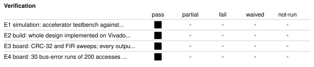

# b64b_zedboard: HW/SW partitioning demo on the ZedBoard (Zynq-7000), bare metal

<!-- Generated from handover.yaml by flow/handover.py (brief 68). Edit handover.yaml, or the text between the prose markers, then run: python -m flow.handover write designs/b64b_zedboard -->

Measures what a Cortex-A9 and the fabric of a Zynq-7000 cost each other, bare metal, on the ZedBoard. A PS7 with GP0, HP0 and ACP ports drives two AXI DMA to accelerator chains (CRC-32 or a 16-tap FIR) and a register plane with a latency probe and three bus-error blocks. Software against the HP path with cache maintenance against the coherent ACP path is swept over buffer sizes, and the A9's reaction to AXI SLVERR and DECERR responses is recorded for each memory mapping.

Not in scope:

- Linux, UIO, device-tree or kernel-driver measurements; bare metal only
- the KR260 and the Cortex-A53; this folder is Zynq-7000 only
- a power or energy measurement; the only power figure is the tool's estimate

Kind: demonstration; written by hand. State: board-verified. For an agent: [AGENT.md](AGENT.md).

<!-- prose:what -->
<!-- /prose:what -->

## Technical parameters

| Item | Value |
|---|---|
| Part | `xc7z020clg484-1` |
| Board | ZedBoard |
| Top | `zb_hwsw_wrapper` |
| Tool | Vivado 2026.1 |
| Note | the block design is built by vivado/build_full.tcl with the PS7 settings in vivado/ps7_zedboard.tcl (DDR3 from the board guide, no board file); the register blocks are generated from regmaps/ |

Clocks:

- `clk_fpga_0`: 100 MHz (from `results/64b_zedboard/builds/full/timing.rpt`); PS FCLK_CLK0; every fabric block, the DMAs, the HP0 and ACP ports and the GP0 master run on it

Resets:

- `FCLK_RESET0_N`, active low: from the PS, through a processor system reset block to every fabric block as aresetn (synchronous, active low)

Interfaces:

- `GP0 register plane` (AXI3 from the PS through a protocol converter to AXI4-Lite, our axil_xbar, generated register blocks) ([datasheet](gen/regs/zb_lat_regs.md)): latency probe, error blocks and the accelerator control registers at the window base 0x40000000; accesses outside every block get DECERR from the crossbar, holes inside a block follow its unmapped setting
- `Bus-error blocks` (three generated register blocks, one per unmapped setting (okay, slverr, split)) ([datasheet](gen/regs/zb_hole_split_regs.md)): each has an error-capture register pair at offsets 0xFF8 and 0xFFC; the other two blocks have the same layout
- `DMA and accelerator chains` (AXI DMA simple mode, 32-bit AXI4-Stream into zb_accel, chain 0 on HP0 and chain 1 on the ACP) ([datasheet](gen/regs/zb_accel_regs.md)): the ACP chain drives AxUSER 1 and AxCACHE 0011 so its accesses are coherent; the HP chain needs software cache maintenance
- `Console and logs` (PS UART1 at 115200 baud, 8N1 on the board's USB-UART; a copy of the console text is kept in DDR and read over JTAG): the DDR copy is the record because the UART has one reader at a time

| Parameter | Value | Legal range | Note |
|---|---|---|---|
| `accelerator mode` | CRC-32 or 16-tap FIR | register ACC_CTRL 0 or 1 (designs/b64b_zedboard/gen/regs/zb_accel_regs.md) | the FIR uses the library fir block in its lut_mult variant |
| `stream width` | 32 bit | fixed | the DMA streams are 32 bits wide, which caps the transfer rate near 400 MB/s at 100 MHz |

| Quantity | Value | Source |
|---|---|---|
| Resources | LUTs: 17,335 LUT; flip-flops: 15,935 FF; block RAM tiles: 6 tiles; DSP slices: 0 DSP | M1, M2, M3, M4 |
| Timing | worst setup slack: 0.856 ns; worst hold slack: 0.012 ns | M5, M6 |
| Power | total on-chip power estimate: 1.765 W | M7 |
| Latency | uncached GP-port read of a PL register, median per timed pair: 207 ns; PL interrupt to bare-metal handler, median: 250 ns; PL interrupt to handler with MMU and caches off, median: 1670 ns | M8, M9, M10 |
| Throughput | CRC-32 of 64 KB, software slice-by-8, median: 350943 ns; CRC-32 of 64 KB, HP path with cache maintenance, median: 351588 ns; CRC-32 of 64 KB, coherent ACP path, median: 166791 ns; 16-tap FIR of 64 KB, software, median: 1.78393e+06 ns; 16-tap FIR of 64 KB, HP path with cache maintenance, median: 681765 ns; 16-tap FIR of 64 KB, coherent ACP path, median: 294456 ns | M11, M12, M13, M14, M15, M16 |

<!-- prose:parameters -->
<!-- /prose:parameters -->

## How to build, run and reproduce

| Step | Command | Heavy slot | Time |
|---|---|---|---|
| build the bitstream and the XSA; needs Vivado 2026.1 and a heavy slot (take_heavy_slot.sh) | `vivado -mode batch -source designs/b64b_zedboard/vivado/build_full.tcl -tclargs <out dir> <repo root>` | yes | about 16 min |
| build the bare-metal programs; needs the arm-none-eabi GCC from the Vitis 2026.1 install | `make -C designs/b64b_zedboard/sw t_crc.elf t_fir.elf hello.elf && bash designs/b64b_zedboard/sw/build_err.sh` | no | about 1 min |
| run one program on the board (first load after a power cycle, then ZB_LIGHT=1); needs the ZedBoard on its own supply with the JTAG boot straps, hw_server running, the board lock; read the board rules in the house rules first | `ZB_SERIAL=<cable serial> XSA_DIR=<unzipped XSA> ZB_FIRST=1 designs/b64b_zedboard/run_elf.sh designs/b64b_zedboard/sw/hello.elf out.log 60` | no | about 1 min |
| rebuild the summary record and the sweep tables | `python3 designs/b64b_zedboard/make_summary.py && python3 designs/b64b_zedboard/summarise_sweeps.py results/64b_zedboard/sweeps/crc32_sweep.log results/64b_zedboard/sweeps/fir16_sweep.log` | no | about 1 min |

Tool: Vivado 2026.1. Build ID of the inputs at handover: none (no Vivado build of this directory). Knowledge-bank pin: `0959c27`.

| File | What |
|---|---|
| [`designs/b64b_zedboard/vivado/build_full.tcl`](vivado/build_full.tcl) | block design and implementation script |
| [`designs/b64b_zedboard/vivado/ps7_zedboard.tcl`](vivado/ps7_zedboard.tcl) | PS7 configuration for the ZedBoard |
| [`designs/b64b_zedboard/rtl/zb_ctrl.sv`](rtl/zb_ctrl.sv) | register plane |
| [`designs/b64b_zedboard/rtl/zb_accel.sv`](rtl/zb_accel.sv) | CRC-32 or FIR accelerator on a stream |
| [`designs/b64b_zedboard/sw/rt.c`](sw/rt.c) | bare-metal runtime (MMU, caches, UART, interrupts, abort handlers) |
| [`designs/b64b_zedboard/sw/t_err.c`](sw/t_err.c) | bus-error experiment |
| [`designs/b64b_zedboard/sw/acc_bench.h`](sw/acc_bench.h) | shared CRC and FIR offload benchmark |
| [`designs/b64b_zedboard/tcl/zb.tcl`](tcl/zb.tcl) | xsdb helpers (first load, light reload, DDR log read) |
| [`designs/b64b_zedboard/make_summary.py`](make_summary.py) | reads the committed reports and logs into results/64b_zedboard/summary.json |

<!-- prose:build -->
<!-- /prose:build -->

## Verified

| ID | Activity | Result | What | Evidence | Conditions |
|---|---|---|---|---|---|
| E1 | simulation | pass | accelerator testbench against independent references for the CRC and the FIR; run once by the first executor, not in CI | [`designs/b64b_zedboard/tb/zb_accel_tb.sv`](tb/zb_accel_tb.sv) | - |
| E2 | build | pass | whole design implemented on Vivado 2026.1; setup and hold slack positive at the PS clock | [`results/64b_zedboard/builds/full/timing.rpt`](../../results/64b_zedboard/builds/full/timing.rpt) | - |
| E3 | board | pass | CRC-32 and FIR sweeps; every output checked against the software result on every repetition, no mismatch in any size | [`results/64b_zedboard/sweeps/crc32_sweep.log`](../../results/64b_zedboard/sweeps/crc32_sweep.log) | ZedBoard on its 12 V supply, junction temperature in the high thirties C, VCCINT 0.99 V, VCCAUX 1.80 V, VCCBRAM 0.99 V, no latched alarm (printed in the log) |
| E4 | board | pass | 30 bus-error runs of 200 accesses each, five targets, read and write, three memory mappings; the board stayed healthy | [`results/64b_zedboard/bus_errors/README.md`](../../results/64b_zedboard/bus_errors/README.md) | as E3, the readings are in each run's log |

Gates at handover: `build_2026_1` pass, `board_run` pass.

<!-- prose:verified -->
<!-- /prose:verified -->

## Measured

Every value is read from the record by `python -m flow.handover fill`, not typed.

| ID | What | Value | Runs | Source | Conditions |
|---|---|---|---|---|---|
| M1 | LUTs | 17,335 LUT | 1 | [`results/64b_zedboard/summary.json`](../../results/64b_zedboard/summary.json) `build.lut` | routed, Vivado 2026.1, xc7z020clg484-1, includes the DMA, interconnect and both accelerators |
| M2 | flip-flops | 15,935 FF | 1 | [`results/64b_zedboard/summary.json`](../../results/64b_zedboard/summary.json) `build.ff` | as M1 |
| M3 | block RAM tiles | 6 tiles | 1 | [`results/64b_zedboard/summary.json`](../../results/64b_zedboard/summary.json) `build.bram_tile` | as M1 |
| M4 | DSP slices | 0 DSP | 1 | [`results/64b_zedboard/summary.json`](../../results/64b_zedboard/summary.json) `build.dsp` | as M1; the FIR is built from LUTs |
| M5 | worst setup slack | 0.856 ns | 1 | [`results/64b_zedboard/summary.json`](../../results/64b_zedboard/summary.json) `build.wns_ns` | routed, 100 MHz PS clock |
| M6 | worst hold slack | 0.012 ns | 1 | [`results/64b_zedboard/summary.json`](../../results/64b_zedboard/summary.json) `build.whs_ns` | as M5 |
| M7 | total on-chip power estimate | 1.765 W | 1 | [`results/64b_zedboard/summary.json`](../../results/64b_zedboard/summary.json) `build.power_w` | report_power after routing, confidence Medium; the PS is included |
| M8 | uncached GP-port read of a PL register, median per timed pair | 207 ns | 1 | [`results/64b_zedboard/summary.json`](../../results/64b_zedboard/summary.json) `gp.gp_read_id.p50_ns` | strongly ordered mapping, 4096 reads, includes a timer overhead of 39 ns, A9 global timer ticks of 3 ns |
| M9 | PL interrupt to bare-metal handler, median | 250 ns | 1 | [`results/64b_zedboard/summary.json`](../../results/64b_zedboard/summary.json) `irq.caches_on_busy_loop.p50_ns` | MMU and caches on, busy loop, 2000 events timed by a PL counter on the 100 MHz clock |
| M10 | PL interrupt to handler with MMU and caches off, median | 1670 ns | 1 | [`results/64b_zedboard/summary.json`](../../results/64b_zedboard/summary.json) `irq.caches_off.p50_ns` | as M9 but MMU and caches off |
| M11 | CRC-32 of 64 KB, software slice-by-8, median | 350943 ns | 1 | [`results/64b_zedboard/summary.json`](../../results/64b_zedboard/summary.json) `crc32.sw_crc_slice8.65536.p50_ns` | 96 repetitions, input left dirty in the caches before each call |
| M12 | CRC-32 of 64 KB, HP path with cache maintenance, median | 351588 ns | 1 | [`results/64b_zedboard/summary.json`](../../results/64b_zedboard/summary.json) `crc32.hp_crc.65536.p50_ns` | as M11; clean of the input and the DMA job and the result read are in the timed region |
| M13 | CRC-32 of 64 KB, coherent ACP path, median | 166791 ns | 1 | [`results/64b_zedboard/summary.json`](../../results/64b_zedboard/summary.json) `crc32.acp_crc.65536.p50_ns` | as M12 without cache maintenance |
| M14 | 16-tap FIR of 64 KB, software, median | 1.78393e+06 ns | 1 | [`results/64b_zedboard/summary.json`](../../results/64b_zedboard/summary.json) `fir16.sw_fir16.65536.p50_ns` | 96 repetitions, input left dirty in the caches before each call |
| M15 | 16-tap FIR of 64 KB, HP path with cache maintenance, median | 681765 ns | 1 | [`results/64b_zedboard/summary.json`](../../results/64b_zedboard/summary.json) `fir16.hp_fir16.65536.p50_ns` | as M14; the whole output is read back |
| M16 | 16-tap FIR of 64 KB, coherent ACP path, median | 294456 ns | 1 | [`results/64b_zedboard/summary.json`](../../results/64b_zedboard/summary.json) `fir16.acp_fir16.65536.p50_ns` | as M15 without cache maintenance |

<!-- prose:measured -->
<!-- /prose:measured -->

## Known gaps and limits

- **board_run**: Linux was not run. UIO interrupt-to-user latency, access through devmem or UIO mmap and a kernel driver reacting to an error response are unmeasured, and SD-card writes need the owner's yes.
- **E1**: The accelerator testbench is not run by CI, and its result is the first executor's report, not a committed log.
- **power**: Power is the tool's estimate (confidence Medium) and no board power measurement was made; energy per result is not given.
- **behaviour**: With the normal non-cacheable mapping the error-capture count read 255 (it saturates) for 200 accesses, so more accesses reached the slave than the core issued; the cause is not known. DFAR is not reliable for an imprecise abort (stale in six of eight read runs). A write error with a device or non-cacheable mapping produced no abort in any run, so its only trace is the slave's capture register.
- **statistics**: Each timing is a median with min, 95th percentile and max over the repetitions in the log (hundreds at small sizes, a dozen at 1 MB); no confidence interval is computed, and one board, one bitstream and one power-up were used.
- **wedges**: The PS wedged three times on 2026-11-14 on full reloads. None occurred on 2026-11-15 with one full load after the power cycle and light reloads only, but the cause is not proven, so the first load and light-reload procedure in tcl/zb.tcl is a precaution.

<!-- prose:gaps -->
<!-- /prose:gaps -->

## Next steps

1. Run the same three-way comparison on Linux (UIO latency, devmem and driver behaviour on an error response).
2. Find why the normal non-cacheable mapping shows more accesses at the slave than the core issued.
3. Put the same bus-error test on the KR260 Cortex-A53 and compare SError against the A9's abort.

Open questions:

- Is the posted-write error lost in the PS interconnect for every non-strongly-ordered mapping, or only for these buffering settings?

<!-- prose:next -->
<!-- /prose:next -->

## History

| Date | Brief | PR | What |
|---|---|---|---|
| 2026-11-13 | 64B | - | design, first bring-up and latency measurements |
| 2026-11-14 | 64B | - | PS wedges during full reloads; abort-path bugs fixed in the runtime |
| 2026-11-15 | 64B | - | bus-error matrix, CRC and FIR sweeps, cost-model update and handover |

<!-- prose:history -->
<!-- /prose:history -->
