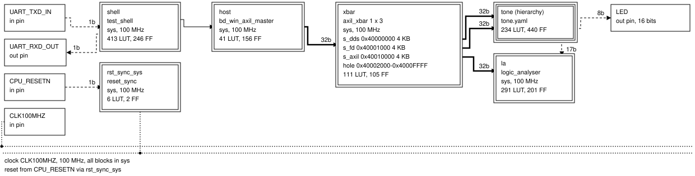
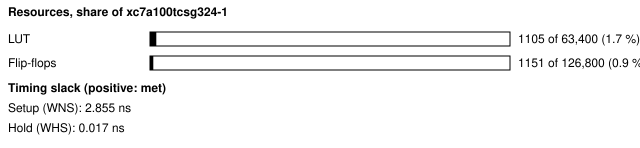
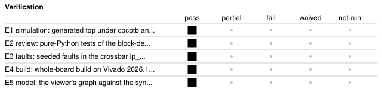

# b65a_axil_soc: Generated block-design sample, a tone generator on an AXI4-Lite crossbar

<!-- Generated from handover.yaml by flow/handover.py (brief 68). Edit handover.yaml, or the text between the prose markers, then run: python -m flow.handover write designs/b65a_axil_soc -->

The brief 65A sample block design. A DDS tone generator and a frequency and duty counter (grouped as the tone hierarchy) and a logic analyser, all from ip_lib, sit behind a generated AXI4-Lite crossbar that the host reaches through the UART test shell. blockdesign.yaml and tone.yaml are the source; everything under gen/ (top, wrappers, address map, graph) is generated from them. It shows the block-design format, its checks and the generator, and was built; it has not been run on a board.

Not in scope:

- a showcase or a board-verified design; the bitstream was built, not programmed
- a general interconnect; generation covers AXI4-Lite only, 32-bit data and one clock domain

Kind: example; written by hand. State: built. For an agent: [AGENT.md](AGENT.md).

<!-- prose:what -->
### Where to read more

The user guide to the block-design format, its checks and the generator is [docs/blockdesign.md](../../docs/blockdesign.md). The register map is [gen/address_map.md](gen/address_map.md). The records are in [results/65a_blockdesign](../../results/65a_blockdesign/README.md). Edit `blockdesign.yaml` or `tone.yaml`, then regenerate `gen/`; do not edit `gen/` by hand.
<!-- /prose:what -->

## Technical parameters

| Item | Value |
|---|---|
| Part | `xc7a100tcsg324-1` |
| Board | Nexys A7-100T |
| Top | `b65a_axil_soc_top` |
| Tool | Vivado 2026.1 |
| Note | the block diagram is drawn from gen/graph.json by the 65A viewer; docs/blockdesign.md is the user guide to the format |

Clocks:

- `CLK100MHZ`: 100 MHz (from `designs/b65a_axil_soc/design.xdc`); the only clock domain (sys); one reset synchroniser per domain is generated

Resets:

- `CPU_RESETN`, active low: the reset button; synchronised into the sys domain, where the generated blocks see a synchronous active-high rst

Interfaces:

- `UART register window` (test shell, 8N1 UART at 115200 baud) ([datasheet](../../shell/PROTOCOL.md)): the window is an AXI4-Lite master (bd_win_axil_master); window registers ADDR, WDATA, CTRL, STATUS, RDATA at offsets 0x00-0x04; one transfer at a time, ignored while busy
- `Address map` (AXI4-Lite slaves behind axil_xbar) ([datasheet](gen/address_map.md)): tone.s_dds 0x40000000, tone.s_fd 0x40001000, la.s_axil 0x40010000, 4 KB each; the register layout of each block is in that file
- `LEDs` (LED[15:0] (LVCMOS33)): LED[15:8] show the high byte of the DDS sample; LED[7:0] are tied to 0

| Parameter | Value | Legal range | Note |
|---|---|---|---|
| `CLKS_PER_BIT` | 868 | derived from the clock; raised to a top-module parameter | UART bit period in clocks, so the simulation can shorten it |
| `tone.fd.GATE_CLKS` | 1,000,000 | a positive integer; raised to a top-module parameter | the frequency counter's gate length in clocks, 10 ms at 100 MHz |
| `la ADDR_W` | 8 | per ip_lib/logic_analyser | 256 samples; the window exposes 128 words |
| `dds` | PHASE_W 32, LUT_W 8, OUT_W 16, variant bram | per ip_lib/dds_awg | block RAM sine table |

| Quantity | Value | Source |
|---|---|---|
| Resources | LUTs, whole board design: 1093 LUT; flip-flops, whole board design: 1150 FF; block RAM tiles, whole board design: 0.5 tiles | M1, M2, M3 |
| Timing | worst setup slack: 2.933 ns; worst hold slack: 0.076 ns | M4, M5 |
| Power | total on-chip power estimate: 0.13 W | M6 |
| Latency | not measured | [Known gaps](#known-gaps-and-limits) |
| Throughput | not measured | [Known gaps](#known-gaps-and-limits) |

<!-- prose:parameters -->
<!-- /prose:parameters -->

## How to build, run and reproduce

| Step | Command | Heavy slot | Time |
|---|---|---|---|
| validate the block design | `python3 -m flow.blockdesign validate designs/b65a_axil_soc` | no | - |
| regenerate gen/ from the two YAML files; needs do not edit gen/ by hand | `python3 -m flow.blockdesign generate designs/b65a_axil_soc` | no | - |
| check gen/ against the sources | `python3 -m flow.blockdesign check designs/b65a_axil_soc` | no | - |
| simulate end to end; needs Icarus Verilog 12 and cocotb 2.0.1 | `python -m pytest -q designs/b65a_axil_soc/tests/test_b65a_rtl.py` | no | about 1 min |
| build; needs local Vivado 2026.1 and a heavy slot (take_heavy_slot.sh) | `flow/run_vivado.sh designs/b65a_axil_soc` | yes | about 4 min |

Tool: Vivado 2026.1. Build ID of the inputs at handover: `de292461` (`python flow/manifest.py show designs/b65a_axil_soc`: what a rebuild of today's sources and flow would carry; it changes when any build input or the flow changes, so it can differ from the build ID in an older evidence record). Knowledge-bank pin: `1fc7ed8`.

| File | What |
|---|---|
| [`designs/b65a_axil_soc/blockdesign.yaml`](blockdesign.yaml) | the source; instances, connections, interconnect, address map |
| [`designs/b65a_axil_soc/tone.yaml`](tone.yaml) | the tone hierarchy; DDS and frequency counter with their register definitions |
| [`designs/b65a_axil_soc/gen/address_map.md`](gen/address_map.md) | generated address map and register tables |
| [`designs/b65a_axil_soc/gen/graph.json`](gen/graph.json) | generated graph that the viewer draws |
| [`designs/b65a_axil_soc/gen/manifest.json`](gen/manifest.json) | generated; input and output hashes, components, diagnostics |
| [`designs/b65a_axil_soc/design.xdc`](design.xdc) | pins and the 100 MHz clock |
| [`designs/b65a_axil_soc/tests/test_b65a_rtl.py`](tests/test_b65a_rtl.py) | generated design simulated end to end through the UART shell |
| [`docs/blockdesign.md`](../../docs/blockdesign.md) | user guide to the format, validation and generator |

<!-- prose:build -->
<!-- /prose:build -->

## Verified

| ID | Activity | Result | What | Evidence | Conditions |
|---|---|---|---|---|---|
| E1 | simulation | pass | generated top under cocotb and Icarus through the UART shell, with the AXI4-Lite protocol checker on every top-level link; reset values, strobes, error responses, the tone counted and the analyser samples checked | [`designs/b65a_axil_soc/tests/test_b65a_rtl.py`](tests/test_b65a_rtl.py) (run in CI) | - |
| E2 | review | pass | pure-Python tests of the block-design validator and generator, an adversarial case per rule, including the generated files matching their sources | [`flow/blockdesign/tests/test_65a_blockdesign.py`](../../flow/blockdesign/tests/test_65a_blockdesign.py) (run in CI) | - |
| E3 | faults | pass | seeded faults in the crossbar ip_lib/axil_xbar, each caught by its bench | [`results/65a_blockdesign/faults.json`](../../results/65a_blockdesign/faults.json) | - |
| E4 | build | pass | whole-board build on Vivado 2026.1; every gate passes | [`results/65a_blockdesign/vivado_build/gates.json`](../../results/65a_blockdesign/vivado_build/gates.json) | - |
| E5 | model | pass | the viewer's graph against the synthesised netlist; all 14 expected instances found, the crossbar's address ranges equal the built RTL's | [`results/blockdesign/b65a_axil_soc/build.json`](../../results/blockdesign/b65a_axil_soc/build.json) | - |

Gates at handover: `build_2026_1` pass, `board_run` not-run.

<!-- prose:verified -->
<!-- /prose:verified -->

## Measured

Every value is read from the record by `python -m flow.handover fill`, not typed.

| ID | What | Value | Runs | Source | Conditions |
|---|---|---|---|---|---|
| M1 | LUTs, whole board design | 1093 LUT | 1 | [`results/65a_blockdesign/vivado_build/gates.json`](../../results/65a_blockdesign/vivado_build/gates.json) `utilization.lut` | routed whole-board build, Vivado 2026.1, including the test shell |
| M2 | flip-flops, whole board design | 1150 FF | 1 | [`results/65a_blockdesign/vivado_build/gates.json`](../../results/65a_blockdesign/vivado_build/gates.json) `utilization.ff` | as M1 |
| M3 | block RAM tiles, whole board design | 0.5 tiles | 1 | [`results/65a_blockdesign/vivado_build/gates.json`](../../results/65a_blockdesign/vivado_build/gates.json) `utilization.bram_tile` | as M1 |
| M4 | worst setup slack | 2.933 ns | 1 | [`results/65a_blockdesign/vivado_build/gates.json`](../../results/65a_blockdesign/vivado_build/gates.json) `timing.wns_ns` | routed, 100 MHz clock |
| M5 | worst hold slack | 0.076 ns | 1 | [`results/65a_blockdesign/vivado_build/gates.json`](../../results/65a_blockdesign/vivado_build/gates.json) `timing.whs_ns` | routed, 100 MHz clock |
| M6 | total on-chip power estimate | 0.13 W | 1 | [`results/65a_blockdesign/vivado_build/gates.json`](../../results/65a_blockdesign/vivado_build/gates.json) `power.total_w` | report_power after routing, vectorless, confidence Medium |
| M7 | AXI4-Lite transfers in the end-to-end simulation | 86 transfers | 1 | [`results/65a_blockdesign/sim_end_to_end.json`](../../results/65a_blockdesign/sim_end_to_end.json) `axi_transfers` | simulation, with no protocol rule broken on the four top-level links |
| M8 | rising edges the frequency counter read in the gate | 62 edges | 1 | [`results/65a_blockdesign/sim_end_to_end.json`](../../results/65a_blockdesign/sim_end_to_end.json) `edges` | simulation, a 4000-clock gate for a 64-clock tone, so 62.5 expected |
| M9 | crossbar seeded faults caught | 10 faults | 1 | [`results/65a_blockdesign/faults.json`](../../results/65a_blockdesign/faults.json) `caught` | of 10, the crossbar alone |

<!-- prose:measured -->
<!-- /prose:measured -->

## Known gaps and limits

- **board_run**: No board run was attempted. A smoke run reading the three blocks over the UART would put it on hardware; nothing in the records shows the UART, the DDS output or the LEDs working on the device.
- **latency**: Not measured. The records count transfers, not clocks per transfer through the shell master and crossbar.
- **throughput**: Not measured. The shell master does one transfer at a time over a 115200-baud link, so the rate is set by the UART; no record times it.
- **power**: Vectorless estimate only; the tone generator's real switching activity is not in it.
- **E1**: The end-to-end bench exercises the generated design in simulation only, with a shortened UART bit time and a shortened gate; the full-length parameters were built but not simulated.
- **E2**: There is no seeded-fault run against the generator's own output or the support RTL (the shell master, the window adapter and the register bank); the end-to-end test covers them functionally only.
- **E3**: Faults cover the crossbar alone. The parameter guards of the crossbar and the support RTL run in simulation only; Vivado ignores them.
- **E5**: The graph check compares 6 of the 7 links; the inverted sample bit that feeds the frequency counter goes through logic and is not compared.
- **build identity**: The recorded build was made from a tree with uncommitted changes (git_dirty is true in run.json), at 2 threads; the build ID covers the thread count and the inputs, so it changes when either does.
- **scope**: Generation covers AXI4-Lite with 32-bit data and a single clock domain; AXI4 and AXI4-Stream links are checked and wired point to point only; no interrupt concatenation and no debug-core automation.
- **behaviour**: From the generated gen/address_map.md: addresses between the blocks' ranges (0x40002000 to 0x4000FFFF) get DECERR from the crossbar; inside the register-bank blocks an offset with no register, and a write to a read-only register, answer SLVERR with read data 0, which that file says differs from the house convention (OKAY, read 0); la.s_axil answers SLVERR from offset 0x200. Byte strobes are honoured on control registers. fd offset 0x000 is a SCRATCH register with no block input. The master keeps one write and one read in flight.

<!-- prose:gaps -->
<!-- /prose:gaps -->

## Next steps

1. Add a board smoke run over the UART that reads the three blocks and checks the reset values, and record it with its operating conditions.
2. Decide the response for an unmapped offset inside a generated register bank, then regenerate gen/ and the docs.
3. Use the viewer as the how-it-works diagram on other showcase pages, and add the remaining items in docs/blockdesign.md under Not yet.

Open questions:

- Should an unmapped offset inside a block answer SLVERR as the generated bank does now, or OKAY with read 0 as the house convention does? The owner has not decided; gen/address_map.md states the current generated behaviour only.
- The register-map format is 65A's own; should brief 64A's single source consume or replace it?

<!-- prose:next -->
<!-- /prose:next -->

## History

| Date | Brief | PR | What |
|---|---|---|---|
| 2026-11-13 | 65A | - | block-design format, validator, generator, crossbar ip_lib/axil_xbar and viewer built; this sample validated, generated, simulated and built on Vivado 2026.1 |
| 2026-11-13 | 68 | - | handover written to the documentation standard |

<!-- prose:history -->
<!-- /prose:history -->
