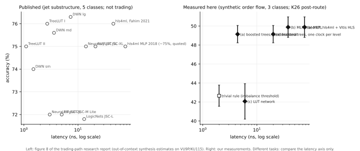
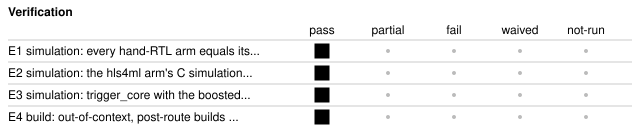

# b87_ml_trading: Decision models in the trading path on the K26

<!-- Generated from handover.yaml by flow/handover.py (brief 68). Edit handover.yaml, or the text between the prose markers, then run: python -m flow.handover write designs/b87_ml_trading -->

**Verification: not assessed: no requirements recorded (no verif/testplan.yaml), so nothing here is traced to a requirement.** [VERIFIED.md](VERIFIED.md) is the generated, hash-pinned record; [what the label means](../../docs/verified.md).

Small decision models for the 58A trading path, trained on synthetic order flow and built in the fabric of the K26 (Kria KR260). Boosted trees, an MLP built by hand and through hls4ml with Vitis HLS, and a LUT network are each checked bit for bit against their integer models over the whole test split, built out of context and routed, and the boosted trees sit behind the 58A rule table in simulation, switched by a register.

Not in scope:

- real market data or a real exchange; the order flow comes from our own seeded generator with a planted signal
- a board run; every number here is from simulation or an out-of-context Vivado 2026.1 build
- a trading result; the back-test's fill model is an assumption and its differences are within noise

Kind: showcase; written by a Claude Code session. State: built. For an agent: [AGENT.md](AGENT.md).

<!-- prose:what -->
**Purpose:** measure, on one part and one data set, what a small learned model costs inside a nanosecond trading path:
accuracy against a trivial rule, latency in clocks and nanoseconds, resources, and whether the latency is fixed. The
data are synthetic ([docs/data_model.md](docs/data_model.md)); the comparisons were pre-registered
([docs/preregistration.md](docs/preregistration.md)); the arms' ports and the model control registers are in
[docs/arms.md](docs/arms.md). Phase 2 (a JEPA-pretrained student) is a plan only: [docs/jepa_student_plan.md](docs/jepa_student_plan.md).

<!-- /prose:what -->

## Technical parameters

| Item | Value |
|---|---|
| Part | `xck26-sfvc784-2LV-c` |
| Board | Kria KR260 (K26 SOM) |
| Top | `ooc_wrap (one arm with an input register), out of context; trigger_core with ML_ARM = 1 in simulation` |
| Tool | Vivado 2026.1 |
| Note | no board top of its own; the 58A board top would carry the model with ML_ARM set |

Clocks:

- `clk`: 125 MHz (from `results/b87/integration/integration_latency_sim.json`); the 58A core clock in the integration; each arm's out-of-context clock is in results/b87/ooc/<arm>.json

Resets:

- `rst`, active high: synchronous; resets only the valid pipeline of an arm and the feature unit's state, not the datapath

Interfaces:

- `arm ports` (clk, rst, in_v, in_f[37:0] (packed features), out_v, out_cls[1:0]) ([datasheet](docs/arms.md)): out_v follows in_v by exactly LATENCY clocks for every input; one input a clock; ties go to the lower class
- `model control in trigger_core` (registers 0x02A ML_CTRL (enable, tracked instrument), 0x02B ML_LAST_CLASS, 0x02C ML_VETOES) ([datasheet](docs/arms.md)): with ML_ARM = 0 (the default) the 58A path is unchanged and the registers read 0, 1 and 0

| Parameter | Value | Legal range | Note |
|---|---|---|---|
| `ML_ARM` | 0 in 58A, 1 in the integration test | 0 none, 1 gbt_comb, 2 lutnet; 3 (mlp_hand, 13 clocks) is refused because an arm's LATENCY must be at most 8 clocks | trigger_core parameter; elaboration fails above 8 clocks (the order slot binds an order to its frame) |
| `label horizon` | 40 events | any positive integer (model/lobsim.py Params.horizon) | the sign of the mid-price change 40 events later; changing it needs retraining |
| `training seed built` | seed 0 of three | 0, 1 or 2 (the evaluation trains all three) | the RTL is generated from results/b87/models/*.json |

| Quantity | Value | Source |
|---|---|---|
| Resources | boosted trees (combinational), LUTs: 640 LUT; MLP (hand RTL), LUTs: 6018 LUT | M5, M8 |
| Timing | boosted trees (combinational), clock period closed post-route: 4.4 ns; MLP (hls4ml + Vitis HLS), clock period closed post-route: 2.3 ns | M4, M9 |
| Power | not measured | [Known gaps](#known-gaps-and-limits) |
| Latency | added clocks from the rule's decision to the gated decision in the 58A path, model on: 1 clocks; last price byte in to first preamble byte out, model on: 9 clocks; MLP (hls4ml), latency at the quoted clock: 75.9 ns; MLP (hand RTL), latency at the quoted clock: 37.7 ns | M6, M7, M10, M11 |
| Throughput | not measured | [Known gaps](#known-gaps-and-limits) |

<!-- prose:parameters -->
<!-- /prose:parameters -->

## How to build, run and reproduce

| Step | Command | Heavy slot | Time |
|---|---|---|---|
| train and score every arm; needs numpy, scikit-learn, torch (CPU); run under a 5 GB memory scope | `python3 -m designs.b87_ml_trading.model.evaluate --out results/b87` | no | about 17 min |
| regenerate the RTL and check it against the models over the test split; needs Icarus Verilog 12 | `python3 -m designs.b87_ml_trading.model.gen_rtl && B87_RECORD=results/b87 python3 -m pytest -q designs/b87_ml_trading/tests/test_b87_rtl.py` | no | about 3 min |
| the 58A integration in simulation; needs Icarus Verilog 12 and cocotb 2.0.1 | `B87_RECORD=$PWD/results/b87/integration python3 -m pytest -q designs/b87_ml_trading/tests/test_b87_integ_rtl.py` | no | about 1 min |
| hls4ml conversion, C simulation and Vitis HLS; needs hls4ml 1.3.0 and Vitis 2026.1 (vitis-run on PATH), a heavy slot | `python3 -m designs.b87_ml_trading.model.hls4ml_arm --synth --clock 2.0` | yes | about 3 min |
| out-of-context builds and the clock search; needs Vivado 2026.1 and a heavy slot | `python3 -m designs.b87_ml_trading.ooc.ooc` | yes | about 60 min |

Tool: Vivado 2026.1. Build ID of the inputs at handover: none (no Vivado build of this directory). Knowledge-bank pin: `6185830`.

| File | What |
|---|---|
| [`designs/b87_ml_trading/model/lobsim.py`](model/lobsim.py) | order-flow generator, features, label, splits |
| [`designs/b87_ml_trading/model/arms.py`](model/arms.py) | the arms and their integer models |
| [`designs/b87_ml_trading/model/evaluate.py`](model/evaluate.py) | training and scoring |
| [`designs/b87_ml_trading/model/gen_rtl.py`](model/gen_rtl.py) | RTL generator |
| [`designs/b87_ml_trading/rtl/ml_feat.sv`](rtl/ml_feat.sv) | feature unit for the 58A book |
| [`designs/b87_ml_trading/rtl/ml_gate.sv`](rtl/ml_gate.sv) | model gate behind the rules |
| [`designs/b87_ml_trading/ooc/ooc.py`](ooc/ooc.py) | out-of-context clock search |
| [`designs/b87_ml_trading/docs/preregistration.md`](docs/preregistration.md) | pre-registration |

<!-- prose:build -->
<!-- /prose:build -->

## Verified

| ID | Activity | Result | What | Evidence | Conditions |
|---|---|---|---|---|---|
| E1 | simulation | pass | every hand-RTL arm equals its integer model on all test-split samples, with one fixed latency | [`designs/b87_ml_trading/tests/test_b87_rtl.py`](tests/test_b87_rtl.py) (run in CI) | - |
| E2 | simulation | pass | the hls4ml arm's C simulation equals the integer model's logits bit for bit, and its Verilog equals it in Icarus with a fixed latency | [`results/b87/hls4ml_csim.json`](../../results/b87/hls4ml_csim.json) | - |
| E3 | simulation | pass | trigger_core with the boosted trees (and again with the LUT network); the fabric's features and classes equal the Python twin on a generator stream and on 300 edge-case messages, and a disagreeing order is vetoed and counted | [`designs/b87_ml_trading/tests/test_b87_integ_rtl.py`](tests/test_b87_integ_rtl.py) (run in CI) | - |
| E4 | build | pass | out-of-context, post-route builds of every arm on the K26 with a clock search; each recorded clock closed (setup, hold and pulse width) | [`results/b87/summary.json`](../../results/b87/summary.json) | - |

Gates at handover: `rtl_equals_model` pass, `ooc_build_2026_1` pass, `board_run` not-run.

<!-- prose:verified -->
<!-- /prose:verified -->

## Measured

Every value is read from the record by `python -m flow.handover fill`, not typed.

| ID | What | Value | Runs | Source | Conditions |
|---|---|---|---|---|---|
| M1 | boosted trees (combinational), test accuracy, seed 0 | 0.4914 fraction | 1 | [`results/b87/accuracy.json`](../../results/b87/accuracy.json) `arms.gbt.runs[0].test_quantised.mean` | 99,100 test samples in 10 sessions; synthetic order flow |
| M2 | MLP, test accuracy, seed 0 | 0.4988 fraction | 1 | [`results/b87/accuracy.json`](../../results/b87/accuracy.json) `arms.mlp.runs[0].test_quantised.mean` | as M1 |
| M3 | trivial rule (imbalance threshold), test accuracy | 0.4266 fraction | 1 | [`results/b87/accuracy.json`](../../results/b87/accuracy.json) `arms.imbalance_rule.test.mean` | as M1 |
| M4 | boosted trees (combinational), clock period closed post-route | 4.4 ns | 1 | [`results/b87/ooc/gbt_comb.json`](../../results/b87/ooc/gbt_comb.json) `closed_at_ns` | out of context, Vivado 2026.1, one thread |
| M5 | boosted trees (combinational), LUTs | 640 LUT | 1 | [`results/b87/ooc/gbt_comb.json`](../../results/b87/ooc/gbt_comb.json) `at_closed_clock.lut` | as M4 |
| M6 | added clocks from the rule's decision to the gated decision in the 58A path, model on | 1 clocks | 1 | [`results/b87/integration/integration_latency_sim.json`](../../results/b87/integration/integration_latency_sim.json) `modes.speculative_model_on.stages_cycles.model gate (rule fire -> decision)` | simulation, 8 ns clock, speculative mode |
| M7 | last price byte in to first preamble byte out, model on | 9 clocks | 1 | [`results/b87/integration/integration_latency_sim.json`](../../results/b87/integration/integration_latency_sim.json) `modes.speculative_model_on.decision_to_first_byte` | as M6 |
| M8 | MLP (hand RTL), LUTs | 6018 LUT | 1 | [`results/b87/ooc/mlp_hand.json`](../../results/b87/ooc/mlp_hand.json) `at_closed_clock.lut` | as M4 |
| M9 | MLP (hls4ml + Vitis HLS), clock period closed post-route | 2.3 ns | 1 | [`results/b87/ooc/mlp_hls4ml.json`](../../results/b87/ooc/mlp_hls4ml.json) `closed_at_ns` | as M4 |
| M10 | MLP (hls4ml), latency at the quoted clock | 75.9 ns | 1 | [`results/b87/summary.json`](../../results/b87/summary.json) `rows[4].latency_ns` | 33 clocks x 2.3 ns, out of context |
| M11 | MLP (hand RTL), latency at the quoted clock | 37.7 ns | 1 | [`results/b87/summary.json`](../../results/b87/summary.json) `rows[3].latency_ns` | 13 clocks x 2.9 ns, out of context |

<!-- prose:measured -->
From `results/b87/summary.json` (test accuracy of the seed-0 quantised model; latency = clocks x the closed period,
quoted at no faster than 2.0 ns; out of context, post-route, Vivado 2026.1):

| Arm | Test accuracy | Clocks | Closed at (ns) | Latency (ns) | LUT | FF | DSP |
|---|---|---|---|---|---|---|---|
| trivial rule (imbalance threshold) | 0.4266 | 1 | 0.55 | 2.0 | 2 | 7 | 0 |
| (a) boosted trees, combinational | 0.4914 | 1 | 4.4 | 4.4 | 640 | 42 | 0 |
| (a) boosted trees, one clock per level | 0.4914 | 10 | 1.55 | 20.0 | 897 | 1066 | 0 |
| (b) MLP, hand RTL | 0.4988 | 13 | 2.9 | 37.7 | 6018 | 4295 | 0 |
| (b) MLP, hls4ml + Vitis HLS | 0.4988 | 33 | 2.3 | 75.9 | 5299 | 7508 | 0 |
| (c) LUT network | 0.4207 | 3 | 1.95 | 6.0 | 76 | 79 | 0 |

The boosted trees and the MLP beat the trivial rule on the test split (paired intervals in `results/b87/accuracy.json`);
the LUT network does not. In the 58A path at 8 ns the boosted trees add one clock to the decision
(`results/b87/integration/integration_latency_sim.json`). The market-making back-test shows no difference between
any forecast and the no-ML rule beyond noise.
<!-- /prose:measured -->

## Known gaps and limits

- **board_run**: Not run on a board; the KR260 build with the model in the 58A top is a next step.
- **timing**: The feature unit and the gate (ml_feat, ml_gate) have no Vivado run; only the arms were built. Out of context the clock has no buffer or jitter, so every latency is quoted at no faster than 2.0 ns.
- **power**: Not measured; the out-of-context builds have no power report and nothing ran on a board.
- **throughput**: Every arm accepts one input a clock (the RTL test streams the first half of the test split back to back), but no throughput figure beyond that is recorded.
- **data**: Synthetic order flow from one generator with a planted signal; the accuracies say how well each arm recovers it, nothing about a market.
- **E4**: Out-of-context builds; inside a full design the clock and placement can differ. Only seed 0 is built.
- **lutnet**: The LUT network (seed 0) does not beat the trivial rule on the test split; it is reported as not useful.
- **behaviour**: Guessable wrongly: the feature history follows one tracked instrument only; a decision for another instrument passes unchanged; a vetoed decision still performs the rule's pin and log actions; ML_LAST_CLASS updates even with the model off; the hls4ml core must run every clock (its ap_vld input stalls the pipeline).

<!-- prose:gaps -->
<!-- /prose:gaps -->

## Next steps

1. Phase 2 (docs/jepa_student_plan.md) - a JEPA-pretrained teacher distilled into a student within the MLP's cost.
2. Build the 58A board top with ML_ARM = 1 and take the board run with stage timestamps.
3. A richer generator (several instruments, regimes) so that the arms are separated by more than one feature set.

Open questions:

- Should the model veto, or skew the price and size of the order instead?

<!-- prose:next -->
<!-- /prose:next -->

## History

| Date | Brief | PR | What |
|---|---|---|---|
| 2026-11-15 | 87 | - | generator, arms, RTL, hls4ml, out-of-context builds and the 58A integration in simulation |

<!-- prose:history -->
<!-- /prose:history -->
