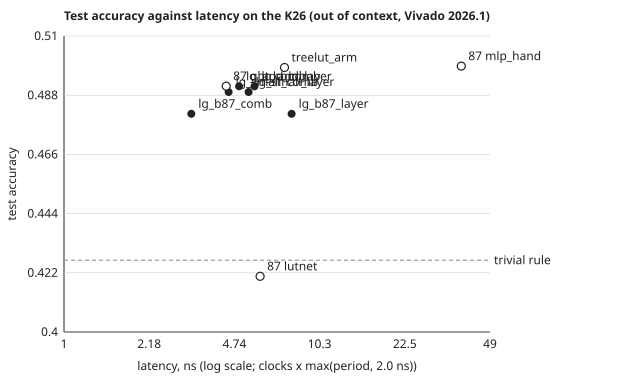
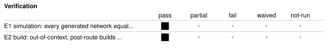

# b89_lutnet_gen: A LUT-network generator, built and measured against the brief 87 arms and TreeLUT

<!-- Generated from handover.yaml by flow/handover.py (brief 68). Edit handover.yaml, or the text between the prose markers, then run: python -m flow.handover write designs/b89_lutnet_gen -->

**Verification: not assessed: no requirements recorded (no verif/testplan.yaml), so nothing here is traced to a requirement.** [VERIFIED.md](VERIFIED.md) is the generated, hash-pinned record; [what the label means](../../docs/verified.md).

Our own generator of LUT networks for nanosecond inference. It trains a sparse network with its quantisers in the loop, enumerates every neuron into a truth table, and emits SystemVerilog plus a bit-exact Python twin, with a choice of pipelining. On the brief 87 synthetic order-flow data its best network beats the trivial rule and equals the 87 boosted trees on the test split; it is built out of context on the K26 and the Artix-7 100T beside TreeLUT, the published tree-to-LUT tool, as the reference.

Not in scope:

- real market data; the data are brief 87's seeded synthetic order flow with a planted signal
- a board run or a full-design build; every hardware number is an out-of-context, post-route Vivado 2026.1 build
- a general-purpose tool; the argmax is written for three classes, and the generator has been measured on one data set

Kind: showcase; written by hand. State: built. For an agent: [AGENT.md](AGENT.md).

<!-- prose:what -->
**Purpose:** build our own LUT-network generator properly, measure it honestly against the brief 87 arms and TreeLUT,
and write up how it was built, dead ends included.

**Start here:**

- [docs/how_we_built_it.md](docs/how_we_built_it.md): the process, with every number;
- [docs/design.md](docs/design.md): the diagnosis, the literature and each design decision;
- [docs/generator.md](docs/generator.md): every option and behaviour (a datasheet);
- [docs/preregistration.md](docs/preregistration.md): the comparisons, committed before the test split was scored;
- [docs/treelut.md](docs/treelut.md): the TreeLUT reference, pinned.

**Headline** (`results/b89/accuracy.json`, `results/b89/summary.json`). The pre-registered network `lg_add` scores
0.4913 on test:

- against the trivial rule: +0.0646 [0.0545, 0.0747];
- against the 87 boosted trees: equal, -0.0002 [-0.0077, 0.0074];
- against the 87 MLP and TreeLUT: about 0.007 lower, with intervals excluding zero.

On the K26 it is one clock at 4.95 ns with 882 LUTs. `lg_small` gives up little accuracy (0.4892) and needs 325
LUTs at 4.5 ns. The main fix was a learned scale between the integer scores and the training loss.

<!-- /prose:what -->

## Technical parameters

| Item | Value |
|---|---|
| Part | `xck26-sfvc784-2LV-c` |
| Board | Kria KR260 (K26 SOM); also xc7a100tcsg324-1 (Nexys A7) out of context |
| Top | `ooc_wrap (one generated network with an input register), out of context` |
| Tool | Vivado 2026.1 |
| Note | no board top; the networks have the brief 87 arm ports, so they drop into the 58A decision stage the same way |

Clocks:

- `clk`: 202 MHz (from `results/b89/ooc/k26/lg_add_comb.json`); lg_add_comb's closed clock on the K26; every module's closed clock is in results/b89/ooc/<part>/<module>.json

Resets:

- `rst`, active high: synchronous; clears only the valid pipeline, never the datapath (out_cls is undefined until the first out_v)

Interfaces:

- `network ports` (clk, rst, in_v, in_f[37:0] (packed 87 features, feature 0 in the low bits), out_v, out_cls[1:0]) ([datasheet](docs/generator.md)): out_v follows in_v by exactly LATENCY clocks for every input; one input a clock; ties go to the lower class
- `generator API and options` (Python (lutgen.model.Config, train, twin_predict; lutgen.rtl.emit)) ([datasheet](docs/generator.md)): every option with its default and the behaviours a user could guess wrong (table address order, pass-through codes, best-validation epoch, pipelining definition)

| Parameter | Value | Legal range | Note |
|---|---|---|---|
| `pipe` | comb and layer (both built) | comb, layer, or a positive integer N (a register after every N-th LUT layer) | LATENCY is 1 for comb and LUT layers + 1 for layer; reg_encoder adds one |
| `arm` | lg_add, lg_small, lg_b87 (results/b89/frozen.json) | any configuration of lutgen.model.Config; tables of at most 2^12 entries | lg_add is the pre-registered main result; the built seed is the best of three on validation |

| Quantity | Value | Source |
|---|---|---|
| Resources | lg_add_comb, K26 LUTs: 882 LUT; lg_small_comb, K26 LUTs: 325 LUT; TreeLUT, K26 LUTs: 869 LUT | M6, M8, M10 |
| Timing | not measured | [Known gaps](#known-gaps-and-limits) |
| Power | not measured | [Known gaps](#known-gaps-and-limits) |
| Latency | lg_add_comb, K26 latency: 4.95 ns; lg_small_comb, K26 latency: 4.5 ns; TreeLUT (pipeline [0,1,1] + output register), K26 latency: 7.5 ns; lg_add_comb, Artix-7 100T latency: 13.85 ns | M5, M7, M9, M11 |
| Throughput | not measured | [Known gaps](#known-gaps-and-limits) |

<!-- prose:parameters -->
<!-- /prose:parameters -->

## How to build, run and reproduce

| Step | Command | Heavy slot | Time |
|---|---|---|---|
| diagnosis of the 87 network (train and validation only); needs numpy, scikit-learn, torch (CPU); a 5 GB memory scope | `python3 -m designs.b89_lutnet_gen.diag.diagnose` | no | about 45 min |
| a design round on validation (r1, r2, r3, fanin); needs torch (CPU); a 5 GB memory scope | `python3 -m designs.b89_lutnet_gen.lutgen.explore r3` | no | about 15 min |
| train the frozen arms, emit the RTL, score the test split; needs torch (CPU); results/b89/treelut/test_predictions.npz from the TreeLUT step | `python3 -m designs.b89_lutnet_gen.lutgen.cli train && python3 -m designs.b89_lutnet_gen.lutgen.cli rtl && python3 -m designs.b89_lutnet_gen.lutgen.evaluate` | no | about 10 min |
| TreeLUT reference (its own venv); needs TreeLUT at commit ad9e70a9, xgboost-cpu 3.1.3 (docs/treelut.md); then build, score, random | `~/Claude_sandbox/_worktrees/89-treelut/venv/bin/python -m designs.b89_lutnet_gen.treelut_ref.run_treelut tune` | no | about 5 min |
| RTL against the twins, lint; needs Icarus Verilog 12, Verilator 5 (lint test skips without it) | `B89_RECORD=results/b89 python3 -m pytest -q designs/b89_lutnet_gen/tests/test_b89_rtl.py` | no | about 2 min |
| out-of-context builds and clock search on both parts; needs Vivado 2026.1 and a heavy slot; repeat with --part xc7a100tcsg324-1 | `python3 -m designs.b89_lutnet_gen.ooc.ooc --part xck26-sfvc784-2LV-c --arms lg_add_comb lg_add_layer lg_small_comb lg_small_layer lg_b87_comb lg_b87_layer treelut_arm` | yes | about 90 min |

Tool: Vivado 2026.1. Build ID of the inputs at handover: none (no Vivado build of this directory). Knowledge-bank pin: `2338b83`.

| File | What |
|---|---|
| [`designs/b89_lutnet_gen/lutgen/model.py`](lutgen/model.py) | training, encoder, wiring, enumeration, twin |
| [`designs/b89_lutnet_gen/lutgen/rtl.py`](lutgen/rtl.py) | SystemVerilog emitter |
| [`designs/b89_lutnet_gen/lutgen/cli.py`](lutgen/cli.py) | trains the frozen arms, emits rtl/gen |
| [`designs/b89_lutnet_gen/lutgen/evaluate.py`](lutgen/evaluate.py) | test-split scoring |
| [`designs/b89_lutnet_gen/diag/diagnose.py`](diag/diagnose.py) | the diagnosis of the 87 network |
| [`designs/b89_lutnet_gen/treelut_ref/run_treelut.py`](treelut_ref/run_treelut.py) | TreeLUT reference (pinned) |
| [`designs/b89_lutnet_gen/ooc/ooc.py`](ooc/ooc.py) | out-of-context clock search on both parts |
| [`designs/b89_lutnet_gen/docs/preregistration.md`](docs/preregistration.md) | pre-registration |

<!-- prose:build -->
<!-- /prose:build -->

## Verified

| ID | Activity | Result | What | Evidence | Conditions |
|---|---|---|---|---|---|
| E1 | simulation | pass | every generated network equals its twin on all 99,100 test samples and 20,000 random packed inputs with one fixed latency; every table cell in the RTL equals the model; Verilator -Wall clean; TreeLUT's Verilog equals TreeLUT | [`designs/b89_lutnet_gen/tests/test_b89_rtl.py`](tests/test_b89_rtl.py) (run in CI) | - |
| E2 | build | pass | out-of-context, post-route builds on the K26 and the Artix-7 100T with a clock search; every recorded clock closed setup, hold and pulse width | [`results/b89/summary.json`](../../results/b89/summary.json) | - |

Gates at handover: `rtl_equals_twin` pass, `ooc_build_2026_1` pass, `board_run` not-run.

<!-- prose:verified -->
<!-- /prose:verified -->

## Measured

Every value is read from the record by `python -m flow.handover fill`, not typed.

| ID | What | Value | Runs | Source | Conditions |
|---|---|---|---|---|---|
| M1 | lg_add (built seed), test accuracy | 0.4913 fraction | 1 | [`results/b89/accuracy.json`](../../results/b89/accuracy.json) `arms.lg_add.runs[0].test.mean` | 99,100 test samples in 10 sessions; synthetic order flow |
| M2 | lg_add minus the 87 trivial rule, paired test difference | 0.0646 fraction | 1 | [`results/b89/accuracy.json`](../../results/b89/accuracy.json) `arms.lg_add.paired_vs.trivial_rule_87.difference_mean` | as M1; 95% interval in the record |
| M3 | lg_add minus the 87 boosted trees, paired test difference | -0.0002 fraction | 1 | [`results/b89/accuracy.json`](../../results/b89/accuracy.json) `arms.lg_add.paired_vs.trees_87.difference_mean` | as M1 |
| M4 | TreeLUT seed 0, test accuracy | 0.4983 fraction | 1 | [`results/b89/accuracy.json`](../../results/b89/accuracy.json) `treelut.seed0.mean` | as M1 |
| M5 | lg_add_comb, K26 latency | 4.95 ns | 1 | [`results/b89/summary.json`](../../results/b89/summary.json) `rows[0].k26.latency_ns` | 1 clock at the closed period, out of context, Vivado 2026.1, one thread |
| M6 | lg_add_comb, K26 LUTs | 882 LUT | 1 | [`results/b89/summary.json`](../../results/b89/summary.json) `rows[0].k26.lut` | as M5 |
| M7 | lg_small_comb, K26 latency | 4.5 ns | 1 | [`results/b89/summary.json`](../../results/b89/summary.json) `rows[2].k26.latency_ns` | as M5 |
| M8 | lg_small_comb, K26 LUTs | 325 LUT | 1 | [`results/b89/summary.json`](../../results/b89/summary.json) `rows[2].k26.lut` | as M5 |
| M9 | TreeLUT (pipeline [0,1,1] + output register), K26 latency | 7.5 ns | 1 | [`results/b89/summary.json`](../../results/b89/summary.json) `rows[6].k26.latency_ns` | 3 clocks at the closed period, as M5 |
| M10 | TreeLUT, K26 LUTs | 869 LUT | 1 | [`results/b89/summary.json`](../../results/b89/summary.json) `rows[6].k26.lut` | as M5 |
| M11 | lg_add_comb, Artix-7 100T latency | 13.85 ns | 1 | [`results/b89/summary.json`](../../results/b89/summary.json) `rows[0].a7.latency_ns` | xc7a100tcsg324-1, as M5 |

<!-- prose:measured -->
<!-- /prose:measured -->

## Known gaps and limits

- **board_run**: Not run on a board and not built inside the 58A top; out of context only.
- **timing**: Out of context the clock has no buffer or jitter, so every latency is quoted at no faster than 2.0 ns.
- **power**: Not measured; the out-of-context builds have no power report.
- **throughput**: Every network accepts one input a clock (the RTL test streams half the inputs back to back); no separate throughput figure is recorded.
- **data**: One synthetic data set; the generator's ranking against trees and MLPs may not hold elsewhere.
- **treelut**: TreeLUT is tuned for accuracy on a small grid with 8-bit inputs; a cost-tuned point could be smaller, and only its seed 0 is built while our built seed is chosen on validation.
- **behaviour**: Guessable wrongly: the model returned by training is the best validation epoch, not the last; narrow features pass through exactly and use fewer code bits than asked; class-score ties go to the lower class (their share of test rows is tie_share_test_built_seed in results/b89/accuracy.json).

<!-- prose:gaps -->
<!-- /prose:gaps -->

## Next steps

1. Learned wiring (pruning and regrowth) in place of random triples.
2. Put lg_small behind the 58A rule table in place of the 87 LUT network and build the KR260 top.
3. A cost-tuned TreeLUT point for an area comparison at equal accuracy.

Open questions:

- Is the remaining 0.007 to the MLP and TreeLUT worth more tables, or is the label noise the limit?

<!-- prose:next -->
<!-- /prose:next -->

## History

| Date | Brief | PR | What |
|---|---|---|---|
| 2026-11-16 | 89 | - | diagnosis, generator, three design rounds, pre-registered test scoring, TreeLUT reference, out-of-context builds |

<!-- prose:history -->
<!-- /prose:history -->
