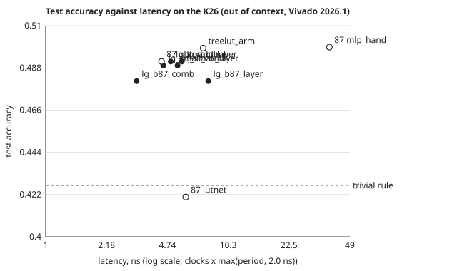
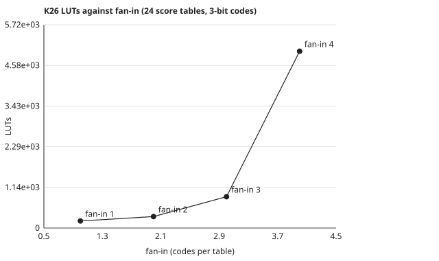

# How we built a LUT-network generator (brief 89)

An engineer's account of the process, dead ends included. Every number below is from a committed file under
`results/b89/` (named in brackets) or `results/b87/`. "val" means validation accuracy and "test" means test accuracy.
All of them are on the brief 87 synthetic order-flow data: 3 classes, and the label is the sign of the mid move 40
events ahead.

## 1. The problem and the first failure

Brief 87 needed a LUT network as one of its decision arms and wrote a quick generator for it. It sent seven integer
features through 2-bit quantile codes into three sparse layers (16 neurons x fan-in 3, then 8 x 3, then 3 score
neurons x 4). Each neuron was a small float network, trained with straight-through rounding and then enumerated into
a truth table. In hardware it was very cheap: 76 LUTs and 6.0 ns on the K26. But its test accuracy was 0.4207, below
the trivial imbalance rule's 0.4266, so it was reported as not useful. Its other two seeds reached 0.459 and 0.450.
The boosted trees reached 0.4914 and the MLP 0.4988.

That left two possibilities: the idea did not fit this data, or the generator was wrong. We did not know which.

## 2. Diagnosis before design

Before changing anything we ran five short experiments on the training and validation splits only
(`diag/diagnose.py`, recorded in [diagnosis.json]):

- **How much is there to learn?** A large boosted ensemble tops out at val 0.480 and training accuracy 0.52-0.56. That
  is the ceiling: the label is mostly noise. The whole useful range is about three points wide, from the rule
  (0.449 on validation, where it was tuned) to 0.48.
- **Input codes.** The 87 tree configuration lost only 0.007 when given 2-bit codes instead of raw features. 1-bit
  and 3-bit codes lost nothing. The codes were not the cause.
- **Fan-in.** The best 3-feature subsets alone reach 0.465. Three inputs per neuron see enough.
- **The 87 network retrained with its own code** reproduced its recorded val 0.4004 exactly. Its training accuracy
  (0.43-0.47) was barely above validation, so it under-fits. One to three neurons per layer were constant.
- **The training method.** We re-implemented the same sparse structure in a vectorised trainer. Keeping the hidden
  values in floating point (no quantisation) gave val 0.470-0.480, at the ceiling. With the 87 quantisation it gave
  0.41-0.45, and one seed in three collapsed. Adding BatchNorm alone did not help.

**Conclusion:** the structure was fine, and the loss was in training with the quantisers in the loop. We recorded
this before designing ([design.md](design.md) section 2).

## 3. Reading

LogicNets (fixed random sparsity, a truth table per neuron), PolyLUT and NeuraLUT (a richer function hidden inside
each table), PolyLUT-Add (add several tables to widen the effective fan-in), TreeLUT (boosted trees with quantised
leaves summed by adders) and SparseLUT (learned wiring). Each is summarised in our own words in design.md section 3.
No code was taken from any of them. TreeLUT itself was installed at a pinned commit, in its own environment, as the
yardstick ([treelut.md](treelut.md)).

## 4. The design rounds (validation only)

Each round is three seeds per configuration, recorded in `results/b89/rounds/`.

**Round 1: fix the obvious training problems** ([rounds/r1.json]). We added BatchNorm before each quantiser, a cosine
learning-rate decay, and the rule "keep the epoch whose *tables* score best on validation". The 87 shape went from
val 0.400-0.439 (87's three seeds) to a mean of 0.450. 3-bit hidden codes gave 0.458. That is still at the rule.

Looking at the curves showed what was wrong. Validation accuracy jumped by about 0.02 from one epoch to the next,
even at the end of the decay when the weights hardly moved. The tables were fragile, but it was not yet clear why.

**Round 2: borrow structure from the literature** ([rounds/r2.json]). We tried additive score layers, where each class
score is the sum of 4 or 8 small tables as in PolyLUT-Add and TreeLUT, with no hidden layer or one hidden layer, and
cut-points taken from a small tree ensemble. Every configuration scored val 0.448-0.453. That is a clean null: the
structure was not the bottleneck either.

**The insight.** One test had stayed puzzling. The additive network with no hidden layer was essentially a sum of
three-feature lookup tables, the same family as a shallow boosted ensemble, yet it under-fit (training accuracy about
0.46). The reason: the score tables output small integers, and those integers went straight into the cross-entropy as
logits. With a noisy three-class label, the best predictions are only mildly confident, so the right logit
differences are a fraction of one. Integer scores cannot express that, so the loss is pushed into large, coarse
steps. A positive scale between the integer scores and the loss fixes it, and it costs nothing in hardware because the
argmax ignores a positive scale. Brief 87's generator had the same flaw.

**Round 3: learn that scale, and freeze BatchNorm for the last four epochs** ([rounds/r3.json]). Every shape moved
up:

| Configuration | Round 2 or 1 val | Round 3 val (mean of 3) |
|---|---|---|
| 87 shape | 0.4501 (r1) | **0.4704** |
| one hidden layer | 0.4543 (r1) | 0.4713 |
| additive, 8 tables per class, fan-in 3, 2-bit | 0.4484 (r2) | 0.4789 |
| additive, 8 per class, fan-in 3, 3-bit tree cuts | 0.4513 (r2) | **0.4821** |
| the same, fan-in 2 | | 0.4807 |

The validation curves also settled (see [iteration_history.svg](../../../results/b89/iteration_history.svg)). We
stopped here: the best round 3 configuration sits at the D2 ceiling (0.480), so there is nothing left to find on
validation.

## 5. Freezing and scoring

The arms and every comparison were pre-registered ([preregistration.md](preregistration.md), commit 72a745c6) before
the test split was scored (commit 8adcffae). There are three arms:

- `lg_add`, the best round 3 configuration;
- `lg_small`, the smallest configuration within 0.002 of `lg_add` on validation (fan-in 2);
- `lg_b87`, the 87 shape with the new training.

Each arm was retrained deterministically: the validation accuracies equal round 3's to four decimals. The built seed
is the one with the best validation accuracy.

Test results (built seed, paired over 10 sessions, 95% t-interval) [accuracy.json]:

| Arm | Test | vs trivial rule | vs 87 trees | vs 87 MLP | vs TreeLUT seed 0 |
|---|---|---|---|---|---|
| `lg_add` (seed 0) | 0.4913 | +0.0646 [0.0545, 0.0747] | -0.0002 [-0.0077, 0.0074] | -0.0075 [-0.0123, -0.0027] | -0.0070 [-0.0130, -0.0010] |
| `lg_small` (seed 2) | 0.4892 | +0.0626 [0.0518, 0.0733] | -0.0022 [-0.0096, 0.0051] | -0.0096 [-0.0157, -0.0035] | -0.0091 [-0.0158, -0.0023] |
| `lg_b87` (seed 2) | 0.4811 | +0.0544 [0.0447, 0.0642] | -0.0103 [-0.0160, -0.0047] | -0.0177 [-0.0234, -0.0120] | -0.0172 [-0.0241, -0.0102] |

`lg_b87` beats the 87 LUT network by +0.0604 [0.0405, 0.0804]: same shape, same size, new training. Mean over the
three seeds: `lg_add` 0.4873, `lg_small` 0.4856, `lg_b87` 0.4783, TreeLUT 0.4981.

What this says:

- The generator now beats the trivial rule clearly. That is the pre-registered floor.
- It equals the 87 boosted trees.
- It is a little below the MLP and TreeLUT, by about 0.007 with intervals that exclude zero.

Our built seed was chosen on validation while the references are seed 0. That favours us slightly, and we still
trail TreeLUT. Class-score ties are frequent (lg_add 8.9% of test rows); they go to the lower class in both the twin
and the RTL.

## 6. Hardware

The generated RTL equals the twin:

- on all 99,100 test samples and on 20,000 random packed inputs, back to back and with gaps, at one fixed latency;
- in every table cell, checked exhaustively by parsing the RTL back;
- it is Verilator `-Wall` clean.

TreeLUT's Verilog equals TreeLUT's own predictions on the same inputs (`tests/test_b89_rtl.py`, [determinism.json]).

Post-route, out of context, Vivado 2026.1 ([summary.json], `ooc/`):

| Module | Test acc. | Clocks | K26 closed (ns) | K26 latency (ns) | K26 LUT / FF | A7 closed (ns) | A7 latency (ns) | A7 LUT / FF |
|---|---|---|---|---|---|---|---|---|
| `lg_add_comb` | 0.4913 | 1 | 4.95 | 4.95 | 882 / 48 | 13.85 | 13.85 | 866 / 49 |
| `lg_add_layer` | 0.4913 | 2 | 2.85 | 5.7 | 804 / 143 | 8.0 | 16.0 | 767 / 143 |
| `lg_small_comb` | 0.4892 | 1 | 4.5 | 4.5 | 325 / 42 | 12.05 | 12.05 | 259 / 42 |
| `lg_small_layer` | 0.4892 | 2 | 2.7 | 5.4 | 251 / 135 | 8.6 | 17.2 | 210 / 135 |
| `lg_b87_comb` | 0.4811 | 1 | 3.2 | 3.2 | 129 / 41 | 9.0 | 9.0 | 129 / 41 |
| `lg_b87_layer` | 0.4811 | 4 | 1.3 | 8.0 | 115 / 104 | 3.15 | 12.6 | 117 / 104 |
| `treelut_arm` | 0.4983 | 3 | 2.5 | 7.5 | 869 / 323 | 7.75 | 23.25 | 854 / 323 |

For comparison, the brief 87 K26 rows (`results/b87/summary.json`): trees, combinational, 4.4 ns, 640 LUTs, test 0.4914; hand MLP 37.7 ns, 6,018 LUTs, 0.4988; 87 LUT network 6.0 ns, 76 LUTs, 0.4207. No DSP or BRAM in any brief 89 module. `lg_b87_layer` closed at 1.3 ns on the K26; it is quoted at the 2.0 ns floor (8.0 ns), with the area of its 2.0 ns build. Clocks are the fastest closed point the search reached in at most four passes on the Artix-7 and three on the K26 (the fourth K26 pass was stopped to free a heavy slot for another brief), so a closed clock is a closed point, not the bound.

Fan-in sweep (lg_add's configuration, seed 0, validation only; `results/b89/rounds/fanin.json`; K26):

| Fan-in | Val | Table bits | K26 LUTs | K26 closed (ns) |
|---|---|---|---|---|
| 1 | 0.4725 | 704 | 200 | 3.7 |
| 2 | 0.477 | 5,248 | 322 | 4.45 |
| 3 | 0.4846 | 37,888 | 882 | 4.95 |
| 4 | 0.4847 | 278,528 | 4977 | 6.45 |

Fan-in 4 buys nothing on validation (0.4847 against 0.4846) for 5.6 times the LUTs; on the Artix-7 it did not close within four passes (best attempt 15.25 ns, WNS -0.161 ns).

## 7. What worked, what did not, and what next

**Worked:**

- diagnosing before designing;
- comparing float and quantised versions of the same structure, which located the loss in one experiment;
- choosing epochs and seeds by the tables rather than by the float network;
- the learned score scale;
- additive score tables once the training was right.

**Did not work:**

- BatchNorm alone;
- additive structure alone (round 2);
- 3-bit hidden codes as a fix (round 1).

Each looked reasonable from the literature, but none addressed the actual defect.

**Lesson:** when a quantised model under-fits, check the scale at which its integer outputs meet the loss before
changing the architecture.

**Next:**

- learned wiring (SparseLUT-style) to replace random triples;
- a fan-in-2 network with a hidden layer, to trade depth against table size;
- a TreeLUT point tuned for cost rather than accuracy, for a fairer area comparison;
- putting `lg_small` behind the 58A rule table (in place of the 87 network) and building it in the KR260 top.
