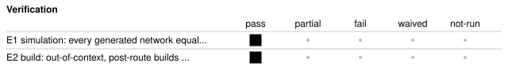

# b91_lowbit: Low-bit weight formats (binary, ternary, INT4, MXFP4-style, our power-of-two formats) for nanosecond inference, measured

<!-- Generated from handover.yaml by flow/handover.py (brief 68). Edit handover.yaml, or the text between the prose markers, then run: python -m flow.handover write designs/b91_lowbit -->

A generator and a measurement of eight weight formats for tiny integer networks: binary, ternary, INT4, an MXFP4-style E2M1 format with a power-of-two scale, our power-of-two format log4 (with and without a zero) and a two-term log4+1. Each is trained with its quantiser in the loop, exported to integers, checked against a bit-exact Python twin and generated RTL, and built out of context on the K26 and the Artix-7 100T. On the brief 87 synthetic order flow the 4-bit-weight formats match the 89 LUT network and the 87 trees on accuracy but need about four times the LUTs, so no format is on the accuracy-against-area or accuracy-against-latency front.

Not in scope:

- real market data; the data are brief 87's seeded synthetic order flow with a planted signal
- a board run or a full-design build; every hardware number is an out-of-context, post-route Vivado 2026.1 build
- weights held in block RAM (the phase-2 student): phase 1 weights are constants; docs/stage2_plan.md is a plan only
- a general-purpose tool; the argmax is written for three classes and the networks have at most two hidden layers

Kind: showcase; written by hand. State: built. For an agent: [AGENT.md](AGENT.md).

<!-- prose:what -->
<!-- /prose:what -->

## Technical parameters

| Item | Value |
|---|---|
| Part | `xck26-sfvc784-2LV-c` |
| Board | Kria KR260 (K26 SOM); also xc7a100tcsg324-1 (Nexys A7) out of context |
| Top | `ooc_wrap (one generated network with an input register), out of context` |
| Tool | Vivado 2026.1 |
| Note | no board top; the networks have the brief 87 arm ports, so they drop into the 58A decision stage the same way |

Clocks:

- `clk`: 98 MHz (from `results/b91/ooc/k26/lb_log4_h16x8_a4_comb.json`); closed clocks differ per module; every module's closed clock is in results/b91/ooc/<part>/<module>.json

Resets:

- `rst`, active high: synchronous; clears only the valid pipeline, never the datapath (out_cls is undefined until the first out_v)

Interfaces:

- `network ports` (clk, rst, in_v, in_f[37:0] (packed 87 features, feature 0 in the low bits), out_v, out_cls[1:0]) ([datasheet](docs/generator.md)): out_v follows in_v by exactly LATENCY clocks for every input; one input a clock; ties go to the lower class
- `generator API and options` (Python (lowbit.model.Config, train, twin_predict; lowbit.rtl.emit) and flow/lowbit.py) ([datasheet](docs/generator.md)): every option with its default and the behaviours a user could guess wrong (rounding, zero, scale as a shift, floor, tie to lowest class)

| Parameter | Value | Legal range | Note |
|---|---|---|---|
| `format` | binary_t3, binary_t7, ternary, int4, mxfp4, log4, log4_nz, log4p1 | the same | element tables in docs/design.md section 3 |
| `pipe` | comb and layer (A = 4 networks); comb only for the A = 2 and 8 sweep | comb, layer | LATENCY is 1 for comb and layers + 1 for layer |
| `act_bits` | 4 (binary: 1); 2 and 8 for log4 and mxfp4 | any positive width up to the 8-bit feature width | also the input code width |

| Quantity | Value | Source |
|---|---|---|
| Resources | log4 comb, K26 LUTs: 1591 LUT; int4 comb, K26 LUTs: 2068 LUT; mxfp4 comb, K26 LUTs: 2056 LUT; log4_nz comb, K26 LUTs: 1406 LUT; binary_t3 comb, K26 LUTs: 209 LUT | M8, M10, M12, M14, M16 |
| Timing | not measured | [Known gaps](#known-gaps-and-limits) |
| Power | not measured | [Known gaps](#known-gaps-and-limits) |
| Latency | log4 comb, K26 latency: 10.2 ns; int4 comb, K26 latency: 10.05 ns; mxfp4 comb, K26 latency: 11.25 ns; log4_nz comb, K26 latency: 11 ns; binary_t3 comb, K26 latency: 3.3 ns; log4_nz comb, Artix-7 100T latency: 29.5 ns | M9, M11, M13, M15, M17, M18 |
| Throughput | not measured | [Known gaps](#known-gaps-and-limits) |

<!-- prose:parameters -->
<!-- /prose:parameters -->

## How to build, run and reproduce

| Step | Command | Heavy slot | Time |
|---|---|---|---|
| train all stage 1 networks, select, sweep, freeze, emit RTL; needs torch (CPU); a 5 GB memory scope; two workers | `python3 -m designs.b91_lowbit.lowbit.cli stage1 && python3 -m designs.b91_lowbit.lowbit.cli select && python3 -m designs.b91_lowbit.lowbit.cli stage2 && python3 -m designs.b91_lowbit.lowbit.cli freeze && python3 -m designs.b91_lowbit.lowbit.cli rtl` | no | about 75 min |
| score the test split (after frozen.json is committed); needs torch not needed | `python3 -m designs.b91_lowbit.lowbit.evaluate && python3 -m designs.b91_lowbit.lowbit.seedmean` | no | about 2 min |
| RTL against the twins, lint; needs Icarus Verilog 12, Verilator 5 (the lint test skips without it) | `B91_RECORD=results/b91 python3 -m pytest -q designs/b91_lowbit/tests flow/tests/test_91_lowbit.py` | no | about 6 min |
| out-of-context builds and clock search on both parts; needs Vivado 2026.1 and a heavy slot; repeat with --part xc7a100tcsg324-1 --start 12.0 --passes 3 | `python3 -m designs.b91_lowbit.ooc.ooc --part xck26-sfvc784-2LV-c --arms <modules> --start 3.0` | yes | about 480 min |
| summary, figures and tables; needs python 3.12 | `python3 results/b91/summary.py && python3 results/b91/tables.py` | no | about 1 min |

Tool: Vivado 2026.1. Build ID of the inputs at handover: none (no Vivado build of this directory). Knowledge-bank pin: `2338b83`.

| File | What |
|---|---|
| [`designs/b91_lowbit/lowbit/formats.py`](lowbit/formats.py) | the formats: element grids, rounding, CSD |
| [`designs/b91_lowbit/lowbit/model.py`](lowbit/model.py) | trainer, exporter, integer twin, accumulator bounds |
| [`designs/b91_lowbit/lowbit/rtl.py`](lowbit/rtl.py) | SystemVerilog emitter |
| [`designs/b91_lowbit/lowbit/cli.py`](lowbit/cli.py) | stage 1, selection, stage 2, freeze, RTL |
| [`designs/b91_lowbit/lowbit/evaluate.py`](lowbit/evaluate.py) | test-split scoring (pre-registered) |
| [`designs/b91_lowbit/lowbit/seedmean.py`](lowbit/seedmean.py) | post-hoc seed-mean comparison |
| [`designs/b91_lowbit/ooc/ooc.py`](ooc/ooc.py) | out-of-context clock search |
| [`designs/b91_lowbit/docs/design.md`](docs/design.md) | design note |
| [`designs/b91_lowbit/docs/preregistration.md`](docs/preregistration.md) | pre-registration |
| [`designs/b91_lowbit/docs/what_we_found.md`](docs/what_we_found.md) | the write-up |
| [`designs/b91_lowbit/docs/stage2_plan.md`](docs/stage2_plan.md) | plan: FP4 hardware for the phase-2 student |
| [`flow/lowbit.py`](../../flow/lowbit.py) | flow tool: train, emit, predict |

<!-- prose:build -->
<!-- /prose:build -->

## Verified

| ID | Activity | Result | What | Evidence | Conditions |
|---|---|---|---|---|---|
| E1 | simulation | pass | every generated network equals its twin on all 99,100 test samples and 20,000 random packed inputs with one fixed latency; accumulators stay inside their computed bounds; binary XNOR form equals the integer form; Verilator -Wall clean | [`designs/b91_lowbit/tests/test_b91_rtl.py`](tests/test_b91_rtl.py) (run in CI) | - |
| E2 | build | pass | out-of-context, post-route builds on the K26 and the Artix-7 100T with a clock search; every recorded clock closed setup, hold and pulse width | [`results/b91/summary.json`](../../results/b91/summary.json) | - |

Gates at handover: `rtl_equals_twin` pass, `ooc_build_2026_1` pass, `board_run` not-run.

<!-- prose:verified -->
<!-- /prose:verified -->

## Measured

Every value is read from the record by `python -m flow.handover fill`, not typed.

| ID | What | Value | Runs | Source | Conditions |
|---|---|---|---|---|---|
| M1 | log4 test accuracy | 0.4884 fraction | 1 | [`results/b91/accuracy.json`](../../results/b91/accuracy.json) `networks.log4_h16x8_a4.runs[0].test.mean` | 99,100 test samples in 10 sessions; synthetic order flow; built seed |
| M2 | log4_nz test accuracy | 0.4919 fraction | 1 | [`results/b91/accuracy.json`](../../results/b91/accuracy.json) `networks.log4_nz_h16x8_a4.runs[0].test.mean` | 99,100 test samples in 10 sessions; synthetic order flow; built seed |
| M3 | int4 test accuracy | 0.489 fraction | 1 | [`results/b91/accuracy.json`](../../results/b91/accuracy.json) `networks.int4_h16x8_a4.runs[1].test.mean` | 99,100 test samples in 10 sessions; synthetic order flow; built seed |
| M4 | mxfp4 test accuracy | 0.4878 fraction | 1 | [`results/b91/accuracy.json`](../../results/b91/accuracy.json) `networks.mxfp4_h16x8_a4.runs[0].test.mean` | 99,100 test samples in 10 sessions; synthetic order flow; built seed |
| M5 | binary_t3 test accuracy | 0.4733 fraction | 1 | [`results/b91/accuracy.json`](../../results/b91/accuracy.json) `networks.binary_t3_h8_a4.runs[0].test.mean` | 99,100 test samples in 10 sessions; synthetic order flow; built seed |
| M6 | log4 minus the 87 trivial rule, paired | 0.0618 fraction | 1 | [`results/b91/accuracy.json`](../../results/b91/accuracy.json) `networks.log4_h16x8_a4.paired_vs.trivial_rule_87.difference_mean` | 99,100 test samples in 10 sessions; synthetic order flow; built seed; 95% interval in the record |
| M7 | log4 seed-mean minus lg_small, paired (post hoc) | -0.0015 fraction | 1 | [`results/b91/accuracy_seedmean.json`](../../results/b91/accuracy_seedmean.json) `networks.log4_h16x8_a4.paired_vs.lg_small.difference_mean` | mean of 3 seeds per session; 95% interval in the record |
| M8 | log4 comb, K26 LUTs | 1591 LUT | 1 | [`results/b91/summary.json`](../../results/b91/summary.json) `rows[13].k26.lut` | out of context, post-route, Vivado 2026.1, one thread |
| M9 | log4 comb, K26 latency | 10.2 ns | 1 | [`results/b91/summary.json`](../../results/b91/summary.json) `rows[13].k26.latency_ns` | clocks x max(closed period, 2.0 ns); out of context, Vivado 2026.1 |
| M10 | int4 comb, K26 LUTs | 2068 LUT | 1 | [`results/b91/summary.json`](../../results/b91/summary.json) `rows[6].k26.lut` | out of context, post-route, Vivado 2026.1, one thread |
| M11 | int4 comb, K26 latency | 10.05 ns | 1 | [`results/b91/summary.json`](../../results/b91/summary.json) `rows[6].k26.latency_ns` | clocks x max(closed period, 2.0 ns); out of context, Vivado 2026.1 |
| M12 | mxfp4 comb, K26 LUTs | 2056 LUT | 1 | [`results/b91/summary.json`](../../results/b91/summary.json) `rows[9].k26.lut` | out of context, post-route, Vivado 2026.1, one thread |
| M13 | mxfp4 comb, K26 latency | 11.25 ns | 1 | [`results/b91/summary.json`](../../results/b91/summary.json) `rows[9].k26.latency_ns` | clocks x max(closed period, 2.0 ns); out of context, Vivado 2026.1 |
| M14 | log4_nz comb, K26 LUTs | 1406 LUT | 1 | [`results/b91/summary.json`](../../results/b91/summary.json) `rows[16].k26.lut` | out of context, post-route, Vivado 2026.1, one thread |
| M15 | log4_nz comb, K26 latency | 11 ns | 1 | [`results/b91/summary.json`](../../results/b91/summary.json) `rows[16].k26.latency_ns` | clocks x max(closed period, 2.0 ns); out of context, Vivado 2026.1 |
| M16 | binary_t3 comb, K26 LUTs | 209 LUT | 1 | [`results/b91/summary.json`](../../results/b91/summary.json) `rows[0].k26.lut` | out of context, post-route, Vivado 2026.1, one thread |
| M17 | binary_t3 comb, K26 latency | 3.3 ns | 1 | [`results/b91/summary.json`](../../results/b91/summary.json) `rows[0].k26.latency_ns` | clocks x max(closed period, 2.0 ns); out of context, Vivado 2026.1 |
| M18 | log4_nz comb, Artix-7 100T latency | 29.5 ns | 1 | [`results/b91/summary.json`](../../results/b91/summary.json) `rows[16].a7.latency_ns` | xc7a100tcsg324-1, as the K26 rows |

<!-- prose:measured -->
<!-- /prose:measured -->

## Known gaps and limits

- **board_run**: Not run on a board and not built inside the 58A top; out of context only.
- **timing**: Out of context the clock has no buffer or jitter, so every latency is quoted at no faster than 2.0 ns.
- **power**: Not measured; the out-of-context builds have no power report.
- **data**: One synthetic data set and one planted signal; the ranking of formats may not hold elsewhere.
- **scale**: Scales are powers of two; a real-valued per-neuron scale was not tried, so the accuracy price of the restriction is unknown.
- **comparison**: The formats use two shapes and the rule chose different shapes per format, so cross-format area compares format and size together; the networks are not tuned per format.
- **phase2**: Weights here are constants. Where weights live in block RAM the cost of each format changes; docs/stage2_plan.md is a plan, not a measurement.
- **throughput**: Every network accepts one input a clock (the RTL test streams half the inputs back to back); no separate throughput figure is recorded.
- **behaviour**: Guessable wrongly: rounding is linear nearest with ties to the even code index; the scale is a right shift that floors; class-score ties go to the lowest class; binary and log4_nz have no zero weight.

<!-- prose:gaps -->
<!-- /prose:gaps -->

## Next steps

1. A LUT-network hybrid: enumerate quantised neurons into tables.
2. Trained sparsity and narrower accumulators for ternary and log4.
3. A real-valued per-neuron scale as an ablation.
4. The stage 2 plan for weights in block RAM.

Open questions:

- Is the gap to the 89 LUT networks the adder trees alone, or also the missing table-level nonlinearity?

<!-- prose:next -->
<!-- /prose:next -->

## History

| Date | Brief | PR | What |
|---|---|---|---|
| 2026-11-16 | 91 | - | design, generator, pre-registered scoring, out-of-context builds on both parts, write-up |

<!-- prose:history -->
<!-- /prose:history -->
