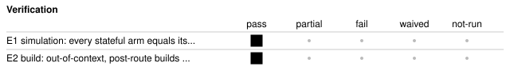

# b92_history_attention: Order-flow history and tiny attention for nanosecond inference, measured

<!-- Generated from handover.yaml by flow/handover.py (brief 68). Edit handover.yaml, or the text between the prose markers, then run: python -m flow.handover write designs/b92_history_attention -->

**Verification: not assessed: no requirements recorded (no verif/testplan.yaml), so nothing here is traced to a requirement.** [VERIFIED.md](VERIFIED.md) is the generated, hash-pinned record; [what the label means](../../docs/verified.md).

A gated study of whether order-flow history helps small integer classifiers on synthetic limit-order-book data, and what it costs in the fabric. A self-exciting generator (Hawkes-type arrivals, sign persistence, informed bursts) makes history matter; lagged features help the 87 trees (gate passed). On one common head, exponentially decaying sums and a learned fixed window each add about 0.015 test accuracy over the history-free head, while two softmax-free tiny attentions end about 0.012 below the decaying sums, so no attention block was built in Vivado. The stateful arms are bit-exact against a twin and built out of context on the K26 and the Artix-7 100T.

Not in scope:

- real market data; both generators are seeded synthetic order flow with planted structure
- a board run or a full-design build; every hardware number is an out-of-context, post-route Vivado 2026.1 build
- an attention block in the fabric: it lost at the stage 2 test, so its RTL was simulated against its twin but never built
- a model of a real market; the clustering is exponential and short-memory (docs/what_we_found.md section 2)

Kind: showcase; written by hand. State: built. For an agent: [AGENT.md](AGENT.md).

<!-- prose:what -->
<!-- /prose:what -->

## Technical parameters

| Item | Value |
|---|---|
| Part | `xck26-sfvc784-2LV-c` |
| Board | Kria KR260 (K26 SOM); also xc7a100tcsg324-1 (Nexys A7) out of context |
| Top | `b92_<arm> (a stateful front end and a head), out of context, behind an input register` |
| Tool | Vivado 2026.1 |
| Note | no board top; the arms take the 87 features plus three event terms (docs/generator.md) |

Clocks:

- `clk`: 80.6 MHz (from `results/b92/ooc/k26/b92_a1_decay.json`); closed clocks differ per module; every module's closed clock is in results/b92/ooc/<part>/<module>.json

Resets:

- `rst`, active high: synchronous; clears the valid pipeline and the front end's state (sums, window); never the datapath or out_cls

Interfaces:

- `arm ports` (clk, rst, in_v, in_f[50:0] (87 features, then ts+1, sv+8, ofi+31), out_v, out_cls[1:0]) ([datasheet](docs/generator.md)): state advances only on in_v; out_v follows in_v by exactly LATENCY clocks; ties go to the lower class
- `generator and training API` (Python (hist.hawkes_sim, hist.frontends, hist.attn, hist.stage2, hist.rtl)) ([datasheet](docs/generator.md)): options and the behaviours a user could guess wrong are listed in the datasheet

| Parameter | Value | Legal range | Note |
|---|---|---|---|
| `decay rate pair` | shifts 2 and 4 (chosen on validation from 1/3, 2/4, 3/5, 4/6) | any shift pair | time constants about 4 and 16 events |
| `window length` | 8 and 16 events | any N | cost grows with the window |
| `attention` | N=16, key size 4, value size 4, forms top1 and relu | fixed in this brief | not built in Vivado |

| Quantity | Value | Source |
|---|---|---|
| Resources | ref_current K26 LUTs: 1619 LUT; ref_current Artix-7 LUTs: 1214 LUT; a1_decay K26 LUTs: 2313 LUT; a1_decay Artix-7 LUTs: 2127 LUT; a4_lut K26 LUTs: 554 LUT; a4_lut Artix-7 LUTs: 441 LUT; a2_win8 K26 LUTs: 3250 LUT; a2_win8 Artix-7 LUTs: 2882 LUT; a2_win16 K26 LUTs: 5372 LUT; a2_win16 Artix-7 LUTs: 4482 LUT | M11, M13, M15, M17, M19, M21, M23, M25, M27, M29 |
| Timing | not measured | [Known gaps](#known-gaps-and-limits) |
| Power | not measured | [Known gaps](#known-gaps-and-limits) |
| Latency | ref_current K26 latency: 10.2 ns; ref_current Artix-7 latency: 30.55 ns; a1_decay K26 latency: 24.8 ns; a1_decay Artix-7 latency: 64.1 ns; a4_lut K26 latency: 9 ns; a4_lut Artix-7 latency: 27.9 ns; a2_win8 K26 latency: 26.5 ns; a2_win8 Artix-7 latency: 70.3 ns; a2_win16 K26 latency: 26.8 ns; a2_win16 Artix-7 latency: 72.7 ns | M12, M14, M16, M18, M20, M22, M24, M26, M28, M30 |
| Throughput | not measured | [Known gaps](#known-gaps-and-limits) |

<!-- prose:parameters -->
<!-- /prose:parameters -->

## How to build, run and reproduce

| Step | Command | Heavy slot | Time |
|---|---|---|---|
| generator statistics, stage 1 (validation, then test after the selection is committed); needs torch not needed; scikit-learn; a 5 GB memory scope; two workers | `python3 -m designs.b92_history_attention.hist.gen_stats && python3 -m designs.b92_history_attention.hist.stage1 val && python3 -m designs.b92_history_attention.hist.stage1 test` | no | about 50 min |
| stage 2: fit, freeze, then score the test split; needs torch (CPU); a 5 GB memory scope; two workers; commit the freeze before the test step | `python3 -m designs.b92_history_attention.hist.stage2 fit && python3 -m designs.b92_history_attention.hist.stage2 freeze && python3 -m designs.b92_history_attention.hist.stage2 test` | no | about 45 min |
| generate RTL, check against the twins, lint; needs Icarus Verilog 12, Verilator 5 | `python3 -m designs.b92_history_attention.hist.cli rtl && B92_RECORD=results/b92 python3 -m pytest -q designs/b92_history_attention/tests` | no | about 10 min |
| out-of-context builds and clock search on both parts; needs Vivado 2026.1 and a heavy slot | `python3 -m designs.b92_history_attention.ooc.ooc --part xck26-sfvc784-2LV-c --arms b92_ref_current b92_a1_decay b92_a4_lut b92_a2_win8 b92_a2_win16 && python3 -m designs.b92_history_attention.ooc.ooc --part xc7a100tcsg324-1 --arms ... --start 30.0` | yes | about 240 min |
| summary, figures and tables; needs python 3.12 | `python3 results/b92/summary.py && python3 results/b92/tables.py` | no | about 1 min |

Tool: Vivado 2026.1. Build ID of the inputs at handover: none (no Vivado build of this directory). Knowledge-bank pin: `6185830`.

| File | What |
|---|---|
| [`designs/b92_history_attention/hist/hawkes_sim.py`](hist/hawkes_sim.py) | the self-exciting generator |
| [`designs/b92_history_attention/hist/prims.py`](hist/prims.py) | both generators behind one interface, history columns |
| [`designs/b92_history_attention/hist/gen_stats.py`](hist/gen_stats.py) | generator statistics |
| [`designs/b92_history_attention/hist/stage1.py`](hist/stage1.py) | stage 1, the gate |
| [`designs/b92_history_attention/hist/tokens.py`](hist/tokens.py) | tokens and split data |
| [`designs/b92_history_attention/hist/frontends.py`](hist/frontends.py) | decaying sums and window codes |
| [`designs/b92_history_attention/hist/attn.py`](hist/attn.py) | tiny attention: trainer and integer twin |
| [`designs/b92_history_attention/hist/stage2.py`](hist/stage2.py) | stage 2 arms, freeze, test scoring |
| [`designs/b92_history_attention/hist/rtl.py`](hist/rtl.py) | SystemVerilog emitters of the stateful arms |
| [`designs/b92_history_attention/hist/stream.py`](hist/stream.py) | port packing and the stream twin |
| [`designs/b92_history_attention/hist/sim.py`](hist/sim.py) | Icarus runner |
| [`designs/b92_history_attention/hist/cli.py`](hist/cli.py) | RTL generation |
| [`designs/b92_history_attention/hist/importance.py`](hist/importance.py) | tree split importance |
| [`designs/b92_history_attention/tb/tb_stream.sv`](tb/tb_stream.sv) | stream test bench |
| [`designs/b92_history_attention/ooc/ooc.py`](ooc/ooc.py) | out-of-context clock search |
| [`designs/b92_history_attention/docs/design.md`](docs/design.md) | design note |
| [`designs/b92_history_attention/docs/preregistration.md`](docs/preregistration.md) | pre-registration, stages 0-1 |
| [`designs/b92_history_attention/docs/preregistration_stage2.md`](docs/preregistration_stage2.md) | pre-registration, stage 2 |
| [`designs/b92_history_attention/docs/what_we_found.md`](docs/what_we_found.md) | the write-up |
| [`designs/b92_history_attention/docs/generator.md`](docs/generator.md) | datasheet |
| [`results/b92/summary.py`](../../results/b92/summary.py) | summary and figures |
| [`results/b92/tables.py`](../../results/b92/tables.py) | tables |

<!-- prose:build -->
<!-- /prose:build -->

## Verified

| ID | Activity | Result | What | Evidence | Conditions |
|---|---|---|---|---|---|
| E1 | simulation | pass | every stateful arm equals its stream twin on all 100,000 events of the ten test sessions, 20,000 random events and 9,000 extreme-input events, with one fixed latency; Verilator -Wall clean | [`designs/b92_history_attention/tests/test_b92_rtl.py`](tests/test_b92_rtl.py) (run in CI) | - |
| E2 | build | pass | out-of-context, post-route builds of five arms on the K26 and the Artix-7 100T with a clock search; every recorded clock closed setup, hold and pulse width | [`results/b92/summary.json`](../../results/b92/summary.json) | - |

Gates at handover: `rtl_equals_twin` pass, `ooc_build_2026_1` pass, `board_run` not-run.

<!-- prose:verified -->
<!-- /prose:verified -->

## Measured

Every value is read from the record by `python -m flow.handover fill`, not typed.

| ID | What | Value | Runs | Source | Conditions |
|---|---|---|---|---|---|
| M1 | history-free head test accuracy | 0.4844 fraction | 1 | [`results/b92/summary.json`](../../results/b92/summary.json) `arms.ref_current.test_accuracy` | retained test rows of the 10 test sessions; synthetic self-exciting order flow; built seed |
| M2 | decaying sums test accuracy | 0.4997 fraction | 1 | [`results/b92/summary.json`](../../results/b92/summary.json) `arms.a1_decay.test_accuracy` | retained test rows of the 10 test sessions; synthetic self-exciting order flow; built seed |
| M3 | window N=8 test accuracy | 0.5008 fraction | 1 | [`results/b92/summary.json`](../../results/b92/summary.json) `arms.a2_win8.test_accuracy` | retained test rows of the 10 test sessions; synthetic self-exciting order flow; built seed |
| M4 | window N=16 test accuracy | 0.5009 fraction | 1 | [`results/b92/summary.json`](../../results/b92/summary.json) `arms.a2_win16.test_accuracy` | retained test rows of the 10 test sessions; synthetic self-exciting order flow; built seed |
| M5 | attention top-1 test accuracy | 0.4873 fraction | 1 | [`results/b92/summary.json`](../../results/b92/summary.json) `arms.a3_top1.test_accuracy` | retained test rows of the 10 test sessions; synthetic self-exciting order flow; built seed |
| M6 | attention ReLU-linear test accuracy | 0.4878 fraction | 1 | [`results/b92/summary.json`](../../results/b92/summary.json) `arms.a3_relu.test_accuracy` | retained test rows of the 10 test sessions; synthetic self-exciting order flow; built seed |
| M7 | LUT net on the sums test accuracy | 0.4885 fraction | 1 | [`results/b92/summary.json`](../../results/b92/summary.json) `arms.a4_lut.test_accuracy` | retained test rows of the 10 test sessions; synthetic self-exciting order flow; built seed |
| M8 | decaying sums minus the history-free head, paired | 0.0153 fraction | 1 | [`results/b92/summary.json`](../../results/b92/summary.json) `arms.a1_decay.paired_vs.ref_current.difference_mean` | built seeds; 95% interval in the record |
| M9 | attention top-1 minus decaying sums, paired | -0.0124 fraction | 1 | [`results/b92/summary.json`](../../results/b92/summary.json) `attention_vs_decay.a3_top1.difference_mean` | built seeds; 95% interval in the record |
| M10 | gate: lagged-feature trees minus current-feature trees, self-exciting generator | 0.0067 fraction | 1 | [`results/b92/summary.json`](../../results/b92/summary.json) `gate.gate_difference.hawkes.mean` | 3-seed mean per session; 95% interval in the record |
| M11 | ref_current K26 LUTs | 1619 LUT | 1 | [`results/b92/summary.json`](../../results/b92/summary.json) `arms.ref_current.hardware.k26.lut` | out of context, post-route, Vivado 2026.1, one thread |
| M12 | ref_current K26 latency | 10.2 ns | 1 | [`results/b92/summary.json`](../../results/b92/summary.json) `arms.ref_current.hardware.k26.latency_ns` | clocks x max(closed period, 2.0 ns); out of context, Vivado 2026.1 |
| M13 | ref_current Artix-7 LUTs | 1214 LUT | 1 | [`results/b92/summary.json`](../../results/b92/summary.json) `arms.ref_current.hardware.a7.lut` | out of context, post-route, Vivado 2026.1, one thread |
| M14 | ref_current Artix-7 latency | 30.55 ns | 1 | [`results/b92/summary.json`](../../results/b92/summary.json) `arms.ref_current.hardware.a7.latency_ns` | clocks x max(closed period, 2.0 ns); out of context, Vivado 2026.1 |
| M15 | a1_decay K26 LUTs | 2313 LUT | 1 | [`results/b92/summary.json`](../../results/b92/summary.json) `arms.a1_decay.hardware.k26.lut` | out of context, post-route, Vivado 2026.1, one thread |
| M16 | a1_decay K26 latency | 24.8 ns | 1 | [`results/b92/summary.json`](../../results/b92/summary.json) `arms.a1_decay.hardware.k26.latency_ns` | clocks x max(closed period, 2.0 ns); out of context, Vivado 2026.1 |
| M17 | a1_decay Artix-7 LUTs | 2127 LUT | 1 | [`results/b92/summary.json`](../../results/b92/summary.json) `arms.a1_decay.hardware.a7.lut` | out of context, post-route, Vivado 2026.1, one thread |
| M18 | a1_decay Artix-7 latency | 64.1 ns | 1 | [`results/b92/summary.json`](../../results/b92/summary.json) `arms.a1_decay.hardware.a7.latency_ns` | clocks x max(closed period, 2.0 ns); out of context, Vivado 2026.1 |
| M19 | a4_lut K26 LUTs | 554 LUT | 1 | [`results/b92/summary.json`](../../results/b92/summary.json) `arms.a4_lut.hardware.k26.lut` | out of context, post-route, Vivado 2026.1, one thread |
| M20 | a4_lut K26 latency | 9 ns | 1 | [`results/b92/summary.json`](../../results/b92/summary.json) `arms.a4_lut.hardware.k26.latency_ns` | clocks x max(closed period, 2.0 ns); out of context, Vivado 2026.1 |
| M21 | a4_lut Artix-7 LUTs | 441 LUT | 1 | [`results/b92/summary.json`](../../results/b92/summary.json) `arms.a4_lut.hardware.a7.lut` | out of context, post-route, Vivado 2026.1, one thread |
| M22 | a4_lut Artix-7 latency | 27.9 ns | 1 | [`results/b92/summary.json`](../../results/b92/summary.json) `arms.a4_lut.hardware.a7.latency_ns` | clocks x max(closed period, 2.0 ns); out of context, Vivado 2026.1 |
| M23 | a2_win8 K26 LUTs | 3250 LUT | 1 | [`results/b92/summary.json`](../../results/b92/summary.json) `arms.a2_win8.hardware.k26.lut` | out of context, post-route, Vivado 2026.1, one thread |
| M24 | a2_win8 K26 latency | 26.5 ns | 1 | [`results/b92/summary.json`](../../results/b92/summary.json) `arms.a2_win8.hardware.k26.latency_ns` | clocks x max(closed period, 2.0 ns); out of context, Vivado 2026.1 |
| M25 | a2_win8 Artix-7 LUTs | 2882 LUT | 1 | [`results/b92/summary.json`](../../results/b92/summary.json) `arms.a2_win8.hardware.a7.lut` | out of context, post-route, Vivado 2026.1, one thread |
| M26 | a2_win8 Artix-7 latency | 70.3 ns | 1 | [`results/b92/summary.json`](../../results/b92/summary.json) `arms.a2_win8.hardware.a7.latency_ns` | clocks x max(closed period, 2.0 ns); out of context, Vivado 2026.1 |
| M27 | a2_win16 K26 LUTs | 5372 LUT | 1 | [`results/b92/summary.json`](../../results/b92/summary.json) `arms.a2_win16.hardware.k26.lut` | out of context, post-route, Vivado 2026.1, one thread |
| M28 | a2_win16 K26 latency | 26.8 ns | 1 | [`results/b92/summary.json`](../../results/b92/summary.json) `arms.a2_win16.hardware.k26.latency_ns` | clocks x max(closed period, 2.0 ns); out of context, Vivado 2026.1 |
| M29 | a2_win16 Artix-7 LUTs | 4482 LUT | 1 | [`results/b92/summary.json`](../../results/b92/summary.json) `arms.a2_win16.hardware.a7.lut` | out of context, post-route, Vivado 2026.1, one thread |
| M30 | a2_win16 Artix-7 latency | 72.7 ns | 1 | [`results/b92/summary.json`](../../results/b92/summary.json) `arms.a2_win16.hardware.a7.latency_ns` | clocks x max(closed period, 2.0 ns); out of context, Vivado 2026.1 |

<!-- prose:measured -->
<!-- /prose:measured -->

## Known gaps and limits

- **board_run**: Not run on a board and not built inside the 58A top; out of context only.
- **timing**: Out of context the clock has no buffer or jitter, so every latency is quoted at no faster than 2.0 ns; the arms have two registered stages before the output (three for attention).
- **power**: Not measured; the out-of-context builds have no power report.
- **data**: Two synthetic generators with planted structure; the ranking of history mechanisms may not hold on real order flow.
- **attention**: Attention was trained with a throwaway head, frozen, then given the common head; its negative result holds for that recipe only. It was not built in Vivado.
- **comparison**: Many paired intervals over 10 sessions, uncorrected; the gain of the sums over the history-free head has a lower bound of +0.004.
- **throughput**: Every arm accepts one event a clock (the RTL test streams half the events back to back).
- **behaviour**: Guessable wrongly: state is cleared by rst and advances only on in_v; the first N outputs after a reset use an empty history; shifts floor; ties go to the lower class and, in attention, to the most recent event.

<!-- prose:gaps -->
<!-- /prose:gaps -->

## Next steps

1. End-to-end training of attention and head, with learned shifts, on a generator whose relevant events depend on context.
2. Merge the front end and the head into one clock and measure the period it costs.
3. Weights written by the slow loop through a descriptor with a model id and schema check (87 phase 2).

Open questions:

- Would a power-of-two softmax approximation close the gap, or is the data simply too simple for content-dependent weights?

<!-- prose:next -->
<!-- /prose:next -->

## History

| Date | Brief | PR | What |
|---|---|---|---|
| 2026-11-16 | 92 | - | generator, gated stages, pre-registered scoring, stateful RTL, out-of-context builds on both parts, write-up |

<!-- prose:history -->
<!-- /prose:history -->
