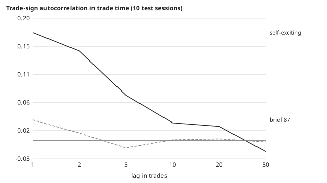
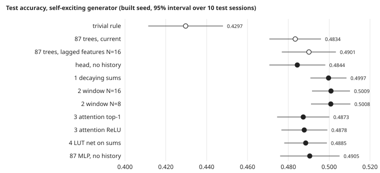
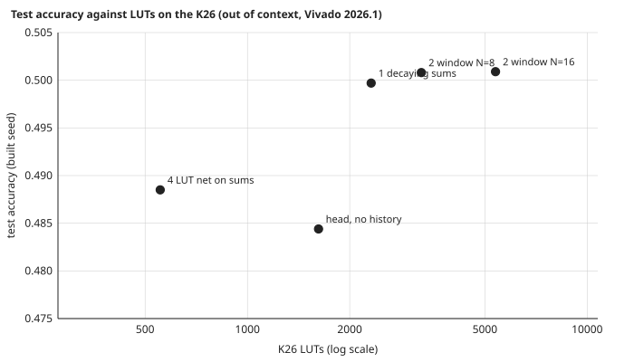

# What we found: does order-flow history help, and is attention worth it in the fabric? (brief 92)

An engineer's account. Every number below is from a committed file under `results/b92/`: `gen_stats.json`, `stage1_val.json`,
`stage1_test.json`, `rounds/stage2_val.json`, `stage2_frozen.json`, `stage2_accuracy.json`, `determinism.json`, `ooc/`, and the
`summary.json` built from them. The three tables are printed by `results/b92/tables.py`. The data are synthetic (two seeded generators,
3 classes, label = sign of the mid move 40 events ahead). The models are defined in [design.md](design.md); the rules that chose the
models and the decisions were committed before the test splits were scored ([preregistration.md](preregistration.md),
[preregistration_stage2.md](preregistration_stage2.md)).

## 1. The short answer

- **History helps, a little, and only where the generator makes it matter.** On the self-exciting generator the 87 boosted trees gain
  0.0067 test accuracy from the last 16 events' features (interval [0.0032, 0.0101]); the gate passed. A higher-capacity booster gains
  0.0168. The brief 87 generator also benefits (+0.0180), because its hidden value is persistent too.
- **The cheapest way to use history works as well as anything we tried.** Four exponentially decaying sums (trade sign, signed size,
  order-flow term, imbalance) at two shift-add rates raise the common head from 0.4844 to 0.4997 (paired +0.0153, interval [0.0038, 0.0268]).
  A learned fixed window of the last 8 or 16 events is level with it (+0.0011 and +0.0012 against the sums, intervals include zero).
- **Tiny attention does not earn its place.** Both softmax-free forms (hard top-1, ReLU-linear) ended 0.012 *below* the decaying sums
  (intervals [-0.0216, -0.0031] and [-0.0213, -0.0024]) and are not distinguishable from the head with no history. By the rule written
  down in advance, no attention block was built in Vivado: **the answer is the decaying sums.** This is a result for our recipe
  (section 5), not a proof that attention cannot help.
- **The cost is in the head, not in the history.** On the K26 the history-free head is 1,619 LUTs and 10.2 ns; the decaying-sum arm is
  2,313 LUTs and 24.8 ns (two clocks, closing at 12.4 ns); a window of 8 is 3,250 LUTs, of 16 is 5,372. Shift-add sums are nearly free; a window
  multiplies the head's first layer.
- **The cheap LUT head is not enough with history.** The 89 LUT network on the same sums costs 554 LUTs and 9.0 ns but its 0.4885 is 0.011 below the
  decaying-sum arm with the `log4` head (the gain over its own history-free version, +0.004, includes zero).

## 2. The generators (stage 0)

The 87 generator is unchanged. The variant ([design.md](design.md) section 2) adds self-exciting market-order arrivals (branching ratio 0.5,
16-event kernel), sign persistence, informed bursts of mean length 40 events that push the buy side and drift the hidden value, and a permanent
impact of each market order. Parameters were fixed from the stated targets, not tuned against any model.

| Statistic (10 test sessions) | 87 generator | self-exciting |
|---|---|---|
| trade-sign autocorrelation, lag 1 / 2 / 5 / 10 / 20 | 0.033 / 0.012 / -0.013 / 0.001 / 0.002 | 0.177 / 0.146 / 0.074 / 0.029 / 0.023 |
| autocorrelation of the market-order count in blocks of 20 events, block lag 1 / 2 / 3 | 0.010 / -0.009 / -0.015 | 0.316 / 0.151 / 0.084 |
| variance-to-mean of that count (Poisson = 1) | 0.905 | 1.506 |
| market-order share | 0.119 | 0.124 |
| events inside an informed burst | n/a | 0.139 |

Against the literature (cited in design.md): real order-flow signs are positively autocorrelated with a slowly decaying, power-law tail
(Lillo and Farmer; Bouchaud and co-authors), and event arrivals are clustered like a Hawkes process with a near-critical kernel (Bacry, Mastromatteo and
Muzy). Ours reproduces the sign of both effects (positive sign autocorrelation, clustering well above Poisson) but with an exponential
tail that is essentially gone by lag 20-50 and a branching ratio of 0.5. Lag-1 sign autocorrelation of 0.18 is lower than the strong values
reported for real flow. **It is a mechanism to test history against, not a model of a market.** FI-2010 was not used (no licence check was made).

## 3. Stage 1, the gate

| Generator | Arm | Test accuracy (trees) | Paired difference to current-only trees | Histogram boosting difference |
|---|---|---|---|---|
| b87 | current only | 0.4923 [0.4829, 0.5018] | | |
| b87 | lagfeat4 | 0.4975 [0.4885, 0.5064] | +0.0052 [+0.0034, +0.0069] |  |
| b87 | lagfeat8 | 0.5058 [0.4961, 0.5156] | +0.0135 [+0.0103, +0.0167] |  |
| b87 | lagfeat16 (gate candidate) | 0.5103 [0.5002, 0.5203] | +0.0180 [+0.0135, +0.0225] | +0.0205 [+0.0140, +0.0270] |
| b87 | lagprim4 | 0.4936 [0.4838, 0.5035] | +0.0013 [-0.0003, +0.0029] |  |
| b87 | lagprim8 | 0.4936 [0.4838, 0.5033] | +0.0012 [-0.0001, +0.0026] |  |
| b87 | lagprim16 | 0.4936 [0.4838, 0.5033] | +0.0012 [-0.0001, +0.0026] |  |
| hawkes | current only | 0.4834 [0.4707, 0.4960] | | |
| hawkes | lagfeat4 | 0.4857 [0.4730, 0.4984] | +0.0023 [+0.0005, +0.0040] |  |
| hawkes | lagfeat8 | 0.4901 [0.4773, 0.5029] | +0.0067 [+0.0037, +0.0096] |  |
| hawkes | lagfeat16 (gate candidate) | 0.4901 [0.4768, 0.5033] | +0.0067 [+0.0032, +0.0101] | +0.0168 [+0.0108, +0.0229] |
| hawkes | lagprim4 | 0.4841 [0.4712, 0.4969] | +0.0007 [-0.0013, +0.0026] |  |
| hawkes | lagprim8 | 0.4843 [0.4714, 0.4973] | +0.0009 [-0.0004, +0.0023] |  |
| hawkes | lagprim16 | 0.4844 [0.4714, 0.4973] | +0.0010 [-0.0005, +0.0024] |  |

The trees (10 rounds, depth 3) gain from lagged *features* and gain nothing from lagged raw event terms (+0.0010, interval includes zero):
the gain is in longer memory of sums such as the order-flow total (by the trees' split importance, mean of three seeds, the lagged order-flow total at lag 16 is the most important lagged column in both generators; the lagged columns together carry 7% to 9% of the importance), which the trees cannot
build from 16 separate terms. The gate candidate was chosen on validation (lagfeat16 on both generators). Gate: passed.

## 4. Stage 2, the arms (self-exciting data, one common head)

| Arm | Built seed | Test accuracy [95%] | 3-seed mean | vs head with no history | vs 1 decaying sums |
|---|---|---|---|---|---|
| head, no history | 2 | 0.4844 [0.4707, 0.4981] | 0.4821 | +0.0000 [+0.0000, +0.0000] | -0.0153 [-0.0268, -0.0038] |
| 1 decaying sums | 0 | 0.4997 [0.4908, 0.5085] | 0.4988 | +0.0153 [+0.0038, +0.0268] | +0.0000 [+0.0000, +0.0000] |
| 2 window N=16 | 1 | 0.5009 [0.4916, 0.5102] | 0.4985 | +0.0165 [+0.0081, +0.0249] | +0.0012 [-0.0050, +0.0073] |
| 2 window N=8 | 1 | 0.5008 [0.4911, 0.5104] | 0.4967 | +0.0164 [+0.0075, +0.0253] | +0.0011 [-0.0035, +0.0057] |
| 3 attention, top-1 | 1 | 0.4873 [0.4745, 0.5001] | 0.4867 | +0.0029 [-0.0031, +0.0090] | -0.0124 [-0.0216, -0.0031] |
| 3 attention, ReLU-linear | 1 | 0.4878 [0.4766, 0.4991] | 0.4880 | +0.0034 [-0.0045, +0.0114] | -0.0119 [-0.0213, -0.0024] |
| 4 LUT net on the sums | 1 | 0.4885 [0.4780, 0.4989] | 0.4879 | +0.0041 [-0.0020, +0.0102] | -0.0112 [-0.0182, -0.0041] |
| 89 LUT net, no history | 1 | 0.4845 [0.4715, 0.4974] | 0.4828 | +0.0001 [-0.0062, +0.0064] | -0.0152 [-0.0276, -0.0028] |
| 87 MLP, no history | 2 | 0.4905 [0.4760, 0.5051] | 0.4900 | +0.0062 [-0.0052, +0.0175] | -0.0091 [-0.0210, +0.0028] |
| reference: trivial_rule | | 0.4297 [0.4114, 0.4480] | | | |
| reference: trees_87_current | | 0.4834 [0.4707, 0.4960] | | | |
| reference: trees_lagfeat16 | | 0.4901 [0.4768, 0.5033] | | | |

- The rate pair for the sums was chosen on validation (shift 2 and 4, time constants about 4 and 16 events). The four pairs' mean validation accuracies were within 0.007 of each other.
- With one head, a network on raw window codes (a learned fixed window) matches the sums, but the trees did not benefit from the same raw terms:
  the choice of learner matters as much as the history representation.
- Attention reached about the head's accuracy (+0.003 against it, intervals include zero) and well below the sums.
- Intervals are over 10 sessions, nine degrees of freedom, and several comparisons were made without correction. Treat a lower bound near +0.004
  (sums against the head) as weak evidence of a small gain, and the window-against-head bound near +0.008 as somewhat stronger.

## 5. Why attention may have lost here (and what we did not try)

- Attention was trained on its own, with a throwaway float head, for 12 epochs, then frozen; the 91 head was trained afterwards on its four output
  columns, so the two never adapted to each other. The shifts that scale queries, keys, values and scores were set from the initial random weights and then
  fixed, so trained weights may saturate them. Four 4-bit columns carry little information compared with eight 8-bit sums.
- The decaying sums had a four-way rate search on validation; the window and attention arms had none.
- The data have one planted history mechanism (bursts plus sign memory), well summarised by exponential sums; content-dependent weighting has
  nothing special to find. A generator with several event types whose relevance depends on context would be a fairer test of attention.
- Not tried: end-to-end training of attention and head; softmax approximated by a power of two; larger N; more heads.

## 6. Stage 3, hardware

Out of context, post-route, Vivado 2026.1, one thread; K26 `xck26-sfvc784-2LV-c` and Artix-7 100T `xc7a100tcsg324-1`. Latency = clocks x
max(closed period, 2.0 ns), the brief 87 floor. Every arm: **one event accepted per clock (initiation interval 1)**, 0 DSP, 0 BRAM.

| Arm | Clocks | K26 closed ns | K26 latency ns | K26 LUT | K26 FF | A7 closed ns | A7 latency ns | A7 LUT | A7 FF | DSP / BRAM |
|---|---|---|---|---|---|---|---|---|---|---|
| head, no history | 1 | 10.2 | 10.2 | 1619 | 42 | 30.55 | 30.55 | 1214 | 42 | 0 / 0 |
| 1 decaying sums | 2 | 12.4 | 24.8 | 2313 | 216 | 32.05 | 64.1 | 2127 | 216 | 0 / 0 |
| 2 window N=16 | 2 | 13.4 | 26.8 | 5372 | 238 | 36.35 | 72.7 | 4482 | 238 | 0 / 0 |
| 2 window N=8 | 2 | 13.25 | 26.5 | 3250 | 166 | 35.15 | 70.3 | 2882 | 166 | 0 / 0 |
| 4 LUT net on the sums | 2 | 4.5 | 9.0 | 554 | 216 | 13.95 | 27.9 | 441 | 216 | 0 / 0 |

- Every arm's RTL equals its bit-exact twin on all 100,000 events of the ten test sessions (each run from the reset state, back to back and with gaps),
  on 20,000 random events (ten streams with resets) and on 9,000 extreme-input events, with one fixed latency per arm
  (`results/b92/determinism.json`; `tests/test_b92_rtl.py`). Verilator 5.020 `-Wall` is clean.
- **Accuracy per cost.** On the K26, in LUTs and in ns, the arms not dominated and above the head with no history are the LUT net on the sums (cheapest,
  0.4885), the decaying sums (0.4997) and the window of 8 (0.5008, the same accuracy within noise at 1.4 times the LUTs). The window of 16 costs
  1.7 times the LUTs of the window of 8 for no gain. 
- **Latency is not flattered by the window fill.** A fresh window or zero sums give a result at the same fixed latency; what changes is meaning: after a reset the first
  N outputs (16, or about 64 for the slowest sum) are computed on an empty history, and the training data never had that. The two clocks are real:
  the front end is registered before the head. Merging them would save a clock and cost period; not measured.
- The Artix-7 100T closes about 2.5 to 3 times slower than the K26 for every arm (head alone 30.55 ns, sums 32.05 ns), so the two-clock latency there is 64 to 73 ns; the window of 8 closed at 35.15 ns after missing at 34.5 ns by 0.05 ns (closure near the limit is not monotonic in the period).
- The attention RTL was generated and checked against its twin in simulation (both forms) but **never built in Vivado**, per the pre-registered rule. Its cost is unmeasured.
- The `log4` head closes at 10.2 ns or slower on the K26, so none of these arms fits a 125 MHz (8 ns) clock as a one-clock block; in the 58A path they would need the registered per-layer form of brief 91
  (4 clocks near 4 ns) with the front end in front.

## 7. Stage 4, where it would sit

The measured latencies are 9 to 27 ns on the K26; the 58A path from the last price byte to the first byte out is 8 clocks
(64 ns at 8 ns, speculative mode with pre-built headers; simulation, brief 58A), and its safe mode waits at least 19 clocks. The decaying sums belong in the
**per-tick path**: their state update is one clock of shifts and adders, they need no stored parameters beyond two shift counts per channel, and the
history they carry (time constants 4 and 16 events) is shorter than the decision latency's context. The part that does not belong in the tick path is learning them.
The **slow loop** (87 phase 2: the host trains, then writes weights, shifts and the rate pair through a descriptor with a model id and schema check, with a freshness gate
and a degrade rule when the descriptor is stale) is where the head weights and the choice of rates live; the fast/slow checklist of the reading notes asks for exactly that split.
The window of 8 or 16 would also sit in the tick path but costs 1.4 to 2.3 times the LUTs of the sums for no measured gain. Attention would, if it ever won, belong
in the slow loop: it needs 16 query-key products per event (about 64 small multipliers in our form) and at least three clocks, and nothing here shows it improves a decision;
this placement is by structure, because we did not build it. A reset of the state (a parameter change or a session start) needs a warm-up of 16 to 64 events before outputs are trusted;
the fabric should hold the decision (or use the history-free head) until then.

## 8. Dead ends and things to know

- The trees could not use raw lagged event terms; a net could. The gate was set on trees, as the brief said, and it passed; if the gate had been set on nets it would have passed more clearly.
- The 87 trivial rule and tree references are on the self-exciting data only for the comparison rows; the 87 and 89 hardware points of earlier briefs are on other data and are not mixed into the figures.
- A bug in the first test bench (the last event of each stream was never issued) was found by the twin comparison and fixed before any recorded run.
- A bug in `stage2.predict` for the LUT arm on the sums (it did not build the sums) was found at the first test scoring and fixed (the trained networks were built through the correct path); both the original failure and the fix are in the git history.
