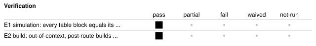

# b93_precompute: Deciding before the last byte, precomputing the ML decision on a serial feed

<!-- Generated from handover.yaml by flow/handover.py (brief 68). Edit handover.yaml, or the text between the prose markers, then run: python -m flow.handover write designs/b93_precompute -->

Measures how much of the brief 87 decision model can be done while a message is still arriving. The model's inputs turn out to be known three clocks before the price field, so computing the features early removes the one or three clocks the model added to the 58A path, at no LUT cost. A table of the model's class per interval of its deepest feature (partial evaluation) is built for the 87 trees and the 89 lg_small network and measured, and it saves nothing in clocks in this design.

Not in scope:

- real market data or a real exchange feed; the data are brief 87's seeded synthetic order flow and our own Bench Feed v1 format
- a board run or a full-design build of ML_PRE 1 to 3; every hardware number is an out-of-context, post-route Vivado 2026.1 block build
- a model that uses the message's own price; none exists in this programme, and every arm must equal the 87 integer model

Kind: showcase; written by hand. State: built. For an agent: [AGENT.md](AGENT.md).

<!-- prose:what -->
**Purpose:** find out how much of the decision model can be done before the last byte arrives, and what it costs.

**Start here:**

- [docs/what_we_found.md](docs/what_we_found.md): the stage-0 table, every arm's clocks and cost, the dead ends;
- [docs/design.md](docs/design.md): the decisions, the alternatives and the checked references;
- [docs/blocks.md](docs/blocks.md): ports, timing contract and parameters, with every behaviour a user could guess wrong;
- timing diagrams: [baseline](../../results/b93/timing_baseline.svg), [early features](../../results/b93/timing_early.svg), [table](../../results/b93/timing_table.svg).

**Headline.** The model never needed the price: its inputs are all known before the price field completes. Computing the
features at the book read, and committing state at the price field as before, removes the clock the model added and costs
no LUTs. The table arm (partial evaluation on the deepest feature) saves nothing in clocks here and costs about three
times the LUTs of its baseline; only the two-clock-fill network block closes faster than its baseline.
<!-- /prose:what -->

## Technical parameters

| Item | Value |
|---|---|
| Part | `xck26-sfvc784-2LV-c` |
| Board | Kria KR260 (K26 SOM); also xc7a100tcsg324-1 (Nexys A7) out of context |
| Top | `ooc_wrap (one block with input registers), out of context; the integration is trigger_core in simulation` |
| Tool | Vivado 2026.1 |
| Note | no board top; the new parameter ML_PRE (default 0) of trigger_core selects the early and table paths |

Clocks:

- `clk`: 166.7 MHz (from `results/b93/ooc/k26/ml_feat_pre.json`); the early feature unit's closed clock on the K26 out of context; the 58A core runs at 125 MHz (8 ns, a byte a clock) and every block's closed clock is in results/b93/ooc/<part>/<block>.json

Resets:

- `rst`, active high: synchronous; clears the valid pipeline and, in the feature unit and gate, the state; never the table or datapath of a table block

Interfaces:

- `table block ports` (clk, rst, e_v, e_f[37:0], l_v, l_x[7:0], out_v, out_cls[1:0]) ([datasheet](docs/blocks.md)): l_v must come FILL clocks after e_v and no later than FILL - 1 clocks after the next e_v; out_v is l_v delayed by exactly one clock
- `trigger_core parameters ML_ARM and ML_PRE` (ML_ARM and ML_PRE, integer parameters) ([datasheet](docs/blocks.md)): ML_PRE 0 is the 87 behaviour and the default; registers 0x02A-0x02C are unchanged

| Parameter | Value | Legal range | Note |
|---|---|---|---|
| `ML_PRE` | 0 (default), 1, 2 and 3 all built in simulation | 0 to 3; 2 and 3 need ML_ARM 1 or 4 | 1 early features; 2 and 3 early features and a table block with a fill of 1 or 2 clocks |

| Quantity | Value | Source |
|---|---|---|
| Resources | gbt_comb, K26 LUTs: 641 LUT; gbt_pe2, K26 LUTs: 1692 LUT; lgs_pe2, K26 LUTs: 867 LUT; ml_feat_pre, K26 flip-flops (wrapper included): 596 FF | M6, M8, M11, M13 |
| Timing | not measured | [Known gaps](#known-gaps-and-limits) |
| Power | not measured | [Known gaps](#known-gaps-and-limits) |
| Latency | trees baseline, clocks the gate adds, simulation: 1 clocks; trees with early features, clocks the gate adds: 0 clocks; last price byte to decision, baseline trees: 4 clocks; last price byte to decision, early features: 3 clocks; gbt_comb, K26 closed period: 4.3 ns; gbt_pe2 (table, fill 2), K26 closed period: 4.15 ns; lg_small_comb, K26 closed period: 4.45 ns; lgs_pe2 (table, fill 2), K26 closed period: 2.95 ns; ml_feat_pre (early feature unit), K26 closed period: 6 ns | M1, M2, M3, M4, M5, M7, M9, M10, M12 |
| Throughput | not measured | [Known gaps](#known-gaps-and-limits) |

<!-- prose:parameters -->
<!-- /prose:parameters -->

## How to build, run and reproduce

| Step | Command | Heavy slot | Time |
|---|---|---|---|
| table blocks against the 87 and 89 models, feature unit in lockstep, gate timing; needs Icarus Verilog 12, Verilator 5 (the lint test skips without it) | `B93_RECORD=results/b93 python3 -m pytest -q designs/b93_precompute/tests/test_b93_pe.py designs/b93_precompute/tests/test_b93_feat_pre.py` | no | about 3 min |
| the model behind trigger_core for one ML_ARM and ML_PRE; needs Icarus Verilog 12, cocotb 2.0.1; repeat for ML_ARM 1 and 4, ML_PRE 0 to 3 | `B93_ML_ARM=1 B93_ML_PRE=1 B93_RECORD=results/b93 python3 -m pytest -q designs/b93_precompute/tests/test_b93_integ_rtl.py` | no | about 1 min |
| out-of-context builds and clock search on both parts; needs Vivado 2026.1 and a heavy slot; repeat with --part xc7a100tcsg324-1 | `python3 -m designs.b93_precompute.ooc.ooc --part xck26-sfvc784-2LV-c --arms gbt_comb lg_small_comb gbt_pe gbt_pe2 lgs_pe lgs_pe2 ml_feat ml_feat_pre` | yes | about 180 min |

Tool: Vivado 2026.1. Build ID of the inputs at handover: none (no Vivado build of this directory). Knowledge-bank pin: `5c10d51`.

| File | What |
|---|---|
| [`designs/b93_precompute/model/gen_rtl.py`](model/gen_rtl.py) | generator of the table blocks |
| [`designs/b93_precompute/rtl/ml_feat_pre.sv`](rtl/ml_feat_pre.sv) | early feature unit |
| [`designs/b93_precompute/rtl/ml_gate_pre.sv`](rtl/ml_gate_pre.sv) | gate for an early class |
| [`designs/b58a_trigger/rtl/trigger_core.sv`](../b58a_trigger/rtl/trigger_core.sv) | ML_PRE and ML_ARM 4 added (defaults unchanged) |
| [`designs/b93_precompute/ooc/ooc.py`](ooc/ooc.py) | out-of-context clock search on both parts |

<!-- prose:build -->
<!-- /prose:build -->

## Verified

| ID | Activity | Result | What | Evidence | Conditions |
|---|---|---|---|---|---|
| E1 | simulation | pass | every table block equals its 87 or 89 model on the test split, 20,000 random vectors and every late value, with out_v exactly one clock after l_v; Verilator -Wall clean | [`designs/b93_precompute/tests/test_b93_pe.py`](tests/test_b93_pe.py) (run in CI) | - |
| E2 | build | pass | out-of-context, post-route builds of eight blocks on the K26 and the Artix-7 100T with a clock search; every recorded clock closed setup, hold and pulse width | [`results/b93/summary.json`](../../results/b93/summary.json) | - |

Gates at handover: `rtl_equals_twin` pass, `ooc_build_2026_1` pass, `board_run` not-run.

<!-- prose:verified -->
Every block equals its integer model on the test split, random vectors and every late value; the integration equals the twin for both models and every `ML_PRE`; the early unit runs in lockstep with the 87 unit. See [docs/what_we_found.md](docs/what_we_found.md) section 2.
<!-- /prose:verified -->

## Measured

Every value is read from the record by `python -m flow.handover fill`, not typed.

| ID | What | Value | Runs | Source | Conditions |
|---|---|---|---|---|---|
| M1 | trees baseline, clocks the gate adds, simulation | 1 clocks | 1 | [`results/b93/summary.json`](../../results/b93/summary.json) `integration.gbt_pre0.gate_added_clocks` | 58A trigger_core at the 8 ns core clock, Icarus simulation, speculative mode |
| M2 | trees with early features, clocks the gate adds | 0 clocks | 1 | [`results/b93/summary.json`](../../results/b93/summary.json) `integration.gbt_pre1.gate_added_clocks` | as M1 |
| M3 | last price byte to decision, baseline trees | 4 clocks | 1 | [`results/b93/summary.json`](../../results/b93/summary.json) `integration.gbt_pre0.tick_to_decision_clocks` | as M1 |
| M4 | last price byte to decision, early features | 3 clocks | 1 | [`results/b93/summary.json`](../../results/b93/summary.json) `integration.gbt_pre1.tick_to_decision_clocks` | as M1 |
| M5 | gbt_comb, K26 closed period | 4.3 ns | 1 | [`results/b93/summary.json`](../../results/b93/summary.json) `ooc.k26.gbt_comb.quoted_ns` | 1 clock, out of context, post-route, Vivado 2026.1, one thread |
| M6 | gbt_comb, K26 LUTs | 641 LUT | 1 | [`results/b93/summary.json`](../../results/b93/summary.json) `ooc.k26.gbt_comb.lut` | as M5 |
| M7 | gbt_pe2 (table, fill 2), K26 closed period | 4.15 ns | 1 | [`results/b93/summary.json`](../../results/b93/summary.json) `ooc.k26.gbt_pe2.quoted_ns` | as M5 |
| M8 | gbt_pe2, K26 LUTs | 1692 LUT | 1 | [`results/b93/summary.json`](../../results/b93/summary.json) `ooc.k26.gbt_pe2.lut` | as M5 |
| M9 | lg_small_comb, K26 closed period | 4.45 ns | 1 | [`results/b93/summary.json`](../../results/b93/summary.json) `ooc.k26.lg_small_comb.quoted_ns` | as M5 |
| M10 | lgs_pe2 (table, fill 2), K26 closed period | 2.95 ns | 1 | [`results/b93/summary.json`](../../results/b93/summary.json) `ooc.k26.lgs_pe2.quoted_ns` | as M5 |
| M11 | lgs_pe2, K26 LUTs | 867 LUT | 1 | [`results/b93/summary.json`](../../results/b93/summary.json) `ooc.k26.lgs_pe2.lut` | as M5 |
| M12 | ml_feat_pre (early feature unit), K26 closed period | 6 ns | 1 | [`results/b93/summary.json`](../../results/b93/summary.json) `ooc.k26.ml_feat_pre.quoted_ns` | as M5 |
| M13 | ml_feat_pre, K26 flip-flops (wrapper included) | 596 FF | 1 | [`results/b93/summary.json`](../../results/b93/summary.json) `ooc.k26.ml_feat_pre.ff` | as M5 |

<!-- prose:measured -->
Out-of-context, post-route numbers on both parts and the simulated clocks are in [docs/what_we_found.md](docs/what_we_found.md) sections 3 and 4 and in `results/b93/summary.json`.
<!-- /prose:measured -->

## Known gaps and limits

- **board_run**: Not run on a board and not built inside the 58A top; ML_PRE 1 to 3 are simulation only.
- **timing**: Out of context the clock has no buffer or jitter, so every latency is quoted at no faster than 2.0 ns; the bypass path of the gate is not in the block builds.
- **power**: Not measured; the out-of-context builds have no power report.
- **throughput**: Every block accepts one input a clock (the test streams half the vectors back to back); no separate throughput figure is recorded.
- **data**: One synthetic data set and one set of 87 features; none of them uses the message's own price, which is why the table arm gains nothing in clocks.
- **behaviour**: Guessable wrongly: state is committed at the price field, not at the early clock; a table block answers with another message's table if l_v breaks the timing contract and nothing detects it; the late feature is delayed by the fill in trigger_core, it is not really late.

<!-- prose:gaps -->
The late feature is not really late in this design, and no model here uses the message's own price; see the gaps above and section 7 of [docs/what_we_found.md](docs/what_we_found.md).
<!-- /prose:gaps -->

## Next steps

1. Build the KR260 top with ML_PRE 1 and ML_ARM 4, then a board run.
2. Train a model with the message's own price as an input (for example inside or outside the touch) and measure the table arm on it.
3. Pipeline the table fill inside the model, not only at the scores, to see whether the table block can beat its baseline clock for trees.

Open questions:

- Is one core clock worth the extra flip-flops of the early feature unit on the board, or is the rule table the longer path to shorten next?

<!-- prose:next -->
<!-- /prose:next -->

## History

| Date | Brief | PR | What |
|---|---|---|---|
| 2026-11-17 | 93 | - | stage 0, early feature unit, table blocks, integration for both models, out-of-context builds on both parts |

<!-- prose:history -->
<!-- /prose:history -->
