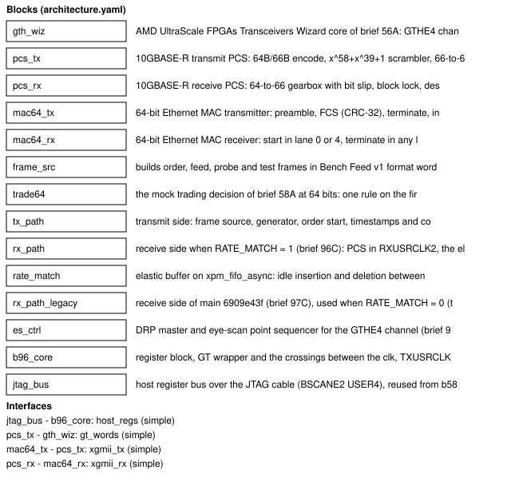
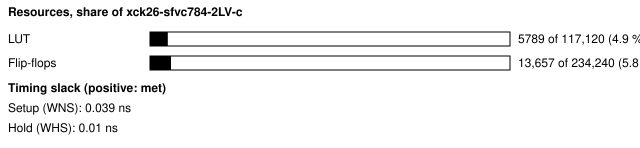
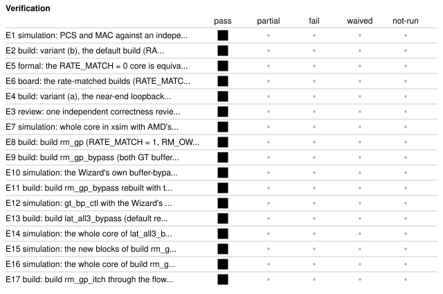

# b96_kr260_10g: A 10GBASE-R link on the KR260 SFP+ cage: our own PCS and 64-bit MAC with a mock trading path

<!-- Generated from handover.yaml by flow/handover.py (brief 68). Edit handover.yaml, or the text between the prose markers, then run: python -m flow.handover write designs/b96_kr260_10g -->

A Kria KR260 design that carries our own 10GBASE-R PCS (64B/66B, scrambler, gearbox, block lock) and a 64-bit Ethernet MAC on one GTH lane at 10.3125 Gb/s, with the mock trading path of brief 58A behind it (a one-rule 64-bit decision in the same message format), because the AMD 10G Ethernet core is refused on the free Basic licence. Verified against an independent Python reference in simulation (the GT is a behavioural stand-in) and built to a bitstream on Vivado 2026.1 Basic with every flow gate passing in two variants. Brief 96C added a rate-matching elastic buffer as a build option (default off, the board-proven 97C receive path); the base and its rate-matched variants have run on a KR260 optical loopback, not yet against a network card or a second reference clock.

Not in scope:

- an interoperability proof: a PCS talking to itself accepts its own symmetric mistakes, only a network card proves it
- the full 58A trading core (book, rule table, interlocks, ARP) at 64 bits: trade64 is a small stand-in with one rule
- the reconciliation sublayer link-fault state machine, the BER monitor, an ARP or ICMP responder

Kind: example; written by hand. State: built. For an agent: [AGENT.md](AGENT.md).

<!-- prose:what -->
<!-- /prose:what -->

## Technical parameters

| Item | Value |
|---|---|
| Part | `xck26-sfvc784-2LV-c` |
| Board | Kria KR260 |
| Top | `kr260_10g_top` |
| Tool | Vivado 2026.1 |
| Note | GTHE4_CHANNEL_X0Y6 of quad 224; SFP+ cage J24; reference MGTREFCLK0 (Y6/Y5); variant (a) is selftest/build.yaml |

Clocks:

- `clk_25`: 25 MHz (from `designs/b96_kr260_10g/design.xdc`); input C3, an open-source example figure, unconfirmed against the schematic; an MMCM makes the 100 MHz free-running clock
- `sfp_mgt_refclk`: 156.25 MHz (from `designs/b96_kr260_10g/design.xdc`); MGTREFCLK0 of quad 224; frequency and source unconfirmed (two third-party sources agree, no AMD document or schematic)

Resets:

- `reset helper`, active high: the register block is reset while the MMCM is unlocked; each path is held in reset while the GT Wizard reports its transmit or receive side not done

Interfaces:

- `Host register block` (32-bit register bus over JTAG (BSCANE2 USER4, jtag_bus)) ([datasheet](docs/register_map.md)): generated from regmap.py; unmapped reads return 0; counters read from a snapshot; reads have no side effects
- `SFP+ lane and control pins` (one GTH lane at 10.3125 Gb/s; tx_disable, mod_abs, rx_los, tx_fault, I2C) ([datasheet](docs/board_run_plan.md)): the laser is disabled at reset (tx_disable = 1; polarity unconfirmed until the first board run)

| Parameter | Value | Legal range | Note |
|---|---|---|---|
| `NEAR_END` | 0 (variant b), 1 (variant a) | 0 or 1 | 1 selects the near-end PMA loopback at reset |
| `TRADE` | 1 (variant b), 0 (variant a) | 0 or 1 | 1 enables the mock trading path at reset; it still needs ARM |
| `RATE_MATCH` | 0 (default), 1 (the 96C elastic buffer) | 0 or 1 | 0 is the receive path of main 6909e43f (brief 97C, board-proven); 1 puts rate_match between the receive PCS and the MAC (11 clocks slower on the board); the register map is the same, with the rate-match and frequency words reading 0 at 0 |
| `EYESCAN` | 0 (default), 1 (the eyescan build) | 0 or 1 | 1 adds brief 96D's DRP access, eye-scan point sequencer (es_ctrl) and TX drive registers (FEATURES bit 4); with 0 they read 0 and the GT's DRP and drive ports are tied to the old constants; es.xdc also powers up the GT's eye-scan circuit in the eyescan build |
| `RM_OWN` | 0 (default), 1 (the 96E own gray-pointer buffer) | 0 or 1 | RATE_MATCH = 1 only (FEATURES bit 5); 1 uses rate_match_gp.sv (about 5 clocks, 1.2 clocks of tick-to-trade over the 97C path in simulation) instead of the xpm_fifo_async buffer (5.3 clocks) |
| `RM_DIRECT` | 0 (default), 1 (build rm_gp_direct) | 0 or 1 | RM_OWN = 1 only; 1 sets rate_match_gp's ENT_SYNC to 0 (direct read of the entry flops, 1.2 clocks of tick-to-trade in simulation) which fails the report_cdc gate (38 CDC-1 Critical); kept as evidence |
| `GO_REG` | 1 (default), 0 in lat_all3 | 0 or 1 | RATE_MATCH = 0 only, the register stage of the go-pulse crossing (brief 97's all3 variant removes it) |
| `line rate` | 10.3125 Gb/s | fixed by 10GBASE-R | QPLL0 from the 156.25 MHz reference; the user clocks (161.133 MHz) carry 64 bits a word and the PCS takes one clock pause in 33 |

| Quantity | Value | Source |
|---|---|---|
| Resources | LUTs, variant (b): 6167 LUT; registers, variant (b): 14,183 FF | M1, M2 |
| Timing | worst setup slack, variant (b): 0.221 ns; worst hold slack, variant (b): 0.011 ns; worst setup slack, latency variant all3 with the rate matcher (RATE_MATCH = 1): 0.004 ns | M3, M4, M9 |
| Power | total on-chip power estimate, variant (b): 1.087 W | M5 |
| Latency | transmit latency, worst gearbox phase: 3 clocks; digital tick-to-trade, worst simulated case with the rate matcher (RATE_MATCH = 1): 13 clocks; digital tick-to-trade, simulation of the default build (RATE_MATCH = 0, the 97C path): 11 clocks; GT-port tick-to-trade in simulation with AMD's real macros, own gray-pointer buffer (RM_OWN = 1), mean over four phases at phase 1550 ps: 13 clocks | M7, M8, M10, M11 |
| Throughput | not measured | [Known gaps](#known-gaps-and-limits) |

<!-- prose:parameters -->
<!-- /prose:parameters -->

## How to build, run and reproduce

| Step | Command | Heavy slot | Time |
|---|---|---|---|
| simulate the PCS, MAC and core against the Python reference; needs Icarus Verilog and cocotb 2.0.1 | `python -m pytest -q designs/b96_kr260_10g/tests` | no | about 2 min |
| build variant (b) and run all gates; needs local Vivado 2026.1 (Basic tier) and a heavy slot (take_heavy_slot.sh), MEM_MAX=6G reaches the cap | `flow/run_vivado.sh designs/b96_kr260_10g base` | yes | about 22 min |
| build variant (a), the near-end loopback self-test; needs as above | `flow/run_vivado.sh designs/b96_kr260_10g/selftest base` | yes | about 22 min |

Tool: Vivado 2026.1. Build ID of the inputs at handover: `357b9db7` (`python flow/manifest.py show designs/b96_kr260_10g`: what a rebuild of today's sources and flow would carry; it changes when any build input or the flow changes, so it can differ from the build ID in an older evidence record). Knowledge-bank pin: `93d158c`.

| File | What |
|---|---|
| [`designs/b96_kr260_10g/rtl/es_ctrl.sv`](rtl/es_ctrl.sv) | DRP master and eye-scan point sequencer for the GTHE4 channel (EYESCAN = 1), brief 96D |
| [`designs/b96_kr260_10g/es.xdc`](es.xdc) | powers up the GT's eye-scan circuit (ES_EYE_SCAN_EN, ES_ERRDET_EN) in the eyescan build |
| [`designs/b96_kr260_10g/model/eyescan.py`](model/eyescan.py) | Python twin of the eye-scan point sequencer's DRP traffic |
| [`designs/b96_kr260_10g/tests/eyescan_cocotb.py`](tests/eyescan_cocotb.py) | cocotb bench of the sequencer against the twin and a DRP stand-in |
| [`designs/b96_kr260_10g/rtl/b96_pkg.sv`](rtl/b96_pkg.sv) | block codes, scrambler, CRC-32 functions |
| [`designs/b96_kr260_10g/rtl/pcs_tx.sv`](rtl/pcs_tx.sv) | transmit PCS (encode, scramble, gearbox) |
| [`designs/b96_kr260_10g/rtl/pcs_rx.sv`](rtl/pcs_rx.sv) | receive PCS (gearbox with slip, block lock, descramble, decode) |
| [`designs/b96_kr260_10g/rtl/mac64_tx.sv`](rtl/mac64_tx.sv) | 64-bit MAC transmitter |
| [`designs/b96_kr260_10g/rtl/mac64_rx.sv`](rtl/mac64_rx.sv) | 64-bit MAC receiver |
| [`designs/b96_kr260_10g/rtl/frame_src.sv`](rtl/frame_src.sv) | frame builder for orders, feed, probe and test frames |
| [`designs/b96_kr260_10g/rtl/trade64.sv`](rtl/trade64.sv) | the 64-bit mock trading decision |
| [`designs/b96_kr260_10g/rtl/tx_path.sv`](rtl/tx_path.sv) | transmit domain: sources, generator, timestamps |
| [`designs/b96_kr260_10g/rtl/rx_path.sv`](rtl/rx_path.sv) | receive domain: PCS, MAC, decision, counters |
| [`designs/b96_kr260_10g/rtl/b96_core.sv`](rtl/b96_core.sv) | registers, GT wrapper and clock-domain crossings |
| [`designs/b96_kr260_10g/rtl/kr260_10g_top.sv`](rtl/kr260_10g_top.sv) | board top (MMCM, SYSMON, pins) |
| [`designs/b96_kr260_10g/rtl/rx_path_legacy.sv`](rtl/rx_path_legacy.sv) | the 97C receive path (main 6909e43f), used when RATE_MATCH = 0 |
| [`designs/b96_kr260_10g/rtl/rate_match.sv`](rtl/rate_match.sv) | rate-matching elastic buffer (idle insert and delete between frames, xpm_fifo_async), brief 96C |
| [`designs/b96_kr260_10g/rtl/rate_match_gp.sv`](rtl/rate_match_gp.sv) | low-latency elastic buffer with our own gray-pointer crossing (RM_OWN = 1), brief 96E |
| [`designs/b96_kr260_10g/rate_match_gp.xdc`](rate_match_gp.xdc) | set_max_delay -datapath_only for the direct-read variant of rate_match_gp (build rm_gp_direct only) |
| [`designs/b96_kr260_10g/model/ratematch.py`](model/ratematch.py) | Python twin of the rate matcher, compared output for output with the RTL |
| [`designs/b96_kr260_10g/host/b96c_ppm.py`](host/b96c_ppm.py) | board driver for the ppm sweep (TX phase-interpolator offset, measured ppm, SYSMON conditions) |
| [`designs/b96_kr260_10g/rtl/hs_vec.sv`](rtl/hs_vec.sv) | coherent vector crossing |
| [`designs/b96_kr260_10g/model/pcs.py`](model/pcs.py) | bit-serial Python reference of the PCS (the twin) |
| [`designs/b96_kr260_10g/design.xdc`](design.xdc) | pins, clocks, slow-pin constraints |
| [`designs/b96_kr260_10g/docs/design.md`](docs/design.md) | design note: decisions and alternatives |
| [`designs/b96_kr260_10g/docs/board_run_plan.md`](docs/board_run_plan.md) | stage 3 plan for the board |
| [`designs/b96_kr260_10g/docs/what_we_found.md`](docs/what_we_found.md) | results and gaps |
| [`designs/b96_kr260_10g/regmap.py`](regmap.py) | register map as data |
| [`designs/b96_kr260_10g/docs/register_map.md`](docs/register_map.md) | interface datasheet |

<!-- prose:build -->
<!-- /prose:build -->

## Verified

| ID | Activity | Result | What | Evidence | Conditions |
|---|---|---|---|---|---|
| E1 | simulation | pass | PCS and MAC against an independent bit-serial Python model clock for clock; frames in lane 0 and lane 4, every length residue, any bit offset; the whole core with a stand-in for the GT: probe echo, trading loop, decisions, poisoned orders | [`designs/b96_kr260_10g/tests/test_b96_pcs_rtl.py`](tests/test_b96_pcs_rtl.py) (run in CI) | - |
| E2 | build | pass | variant (b), the default build (RATE_MATCH = 0, the 97C receive path; rebuilt for brief 96C addendum 2), synthesis, implementation and bitstream on the Basic tier; every flow gate and every GT gate passes (29 of 29) | [`results/b96c/builds/control/digest.json`](../../results/b96c/builds/control/digest.json) | - |
| E5 | formal | pass | the RATE_MATCH = 0 core is equivalent to main 6909e43f's core (eqy, slang front end, OSS CAD Suite; XPM crossings as wires, GT a black box, the 96C-only registers cut from the proof copy: see results/b96c/eqy_default/README.md); a planted change in the MAC error counter fails it | [`results/b96c/eqy_default/result_default.txt`](../../results/b96c/eqy_default/result_default.txt) | - |
| E6 | board | pass | the rate-matched builds (RATE_MATCH = 1, from f47986f4) on a KR260 optical loopback: safety accepted on all four variants (100 of 100 restarts locked, 500 of 500 orders sent = fired = order_ok per variant, every fault counter 0, SYSMON inside the DS925 windows); the TX phase-interpolator route gave no relative offset (0.0 ppm at every code; non-zero targets recorded unreachable), so rate matching under a real offset is not shown on hardware; the buffer costs 11 clocks of loop latency | [`results/b96c/hw/20261119_080724/control/stage3.json`](../../results/b96c/hw/20261119_080724/control/stage3.json) | KR260, SFP+ optical loopback, Vivado 2026.1 bitstreams of 2026-11-19, 100 restarts a variant, 20 s dwell at 0 ppm |
| E4 | build | pass | variant (a), the near-end loopback self-test, built before brief 96C and not rebuilt with the rate matcher: synthesis, implementation and bitstream; every flow gate and every GT gate passes | [`results/b96/build_a/gates.json`](../../results/b96/build_a/gates.json) | - |
| E3 | review | pass | one independent correctness review (Sonnet) and one fix round | [`results/b96/README.md`](../../results/b96/README.md) | - |
| E7 | simulation | pass | whole core in xsim with AMD's real XPM macros, four clock phases: tick-to-trade of the 97C path, of the xpm_fifo_async buffer and of the own gray-pointer buffer (RM_OWN = 1); the numbers and the accounting of the board's loop-latency increase are in design.md section 11 | [`results/b96e/core_lat_sim.json`](../../results/b96e/core_lat_sim.json) | - |
| E8 | build | pass | build rm_gp (RATE_MATCH = 1, RM_OWN = 1), all 29 gates, WNS +0.105 ns, WHS +0.011 ns, stamp 1a2fa1a8 recomputed from the tree; not loaded on a board | [`results/b96e/builds/rm_gp/digest.json`](../../results/b96e/builds/rm_gp/digest.json) | - |

Gates at handover: `build_2026_1` pass.

<!-- prose:verified -->
<!-- /prose:verified -->

## Measured

Every value is read from the record by `python -m flow.handover fill`, not typed.

| ID | What | Value | Runs | Source | Conditions |
|---|---|---|---|---|---|
| M1 | LUTs, variant (b) | 6167 LUT | 1 | [`results/b96c/builds/control/digest.json`](../../results/b96c/builds/control/digest.json) `utilization.lut` | routed, Vivado 2026.1 |
| M2 | registers, variant (b) | 14,183 FF | 1 | [`results/b96c/builds/control/digest.json`](../../results/b96c/builds/control/digest.json) `utilization.ff` | as M1 |
| M3 | worst setup slack, variant (b) | 0.221 ns | 1 | [`results/b96c/builds/control/digest.json`](../../results/b96c/builds/control/digest.json) `timing.wns_ns` | routed, user clocks 161.133 MHz and 100 MHz |
| M4 | worst hold slack, variant (b) | 0.011 ns | 1 | [`results/b96c/builds/control/digest.json`](../../results/b96c/builds/control/digest.json) `timing.whs_ns` | as M3 |
| M5 | total on-chip power estimate, variant (b) | 1.087 W | 1 | [`results/b96c/builds/control/digest.json`](../../results/b96c/builds/control/digest.json) `power.total_w` | report_power after routing, vectorless, confidence Medium |
| M6 | Vivado peak resident memory of the variant (b) build | 4439 MiB | 1 | [`results/b96c/builds/control/run.json`](../../results/b96c/builds/control/run.json) `vivado_peak_rss_mib` | 1 thread, MemoryMax=6G scope, one run, no cap hits |
| M7 | transmit latency, worst gearbox phase | 3 clocks | 1 | [`results/b96/latency_sim.json`](../../results/b96/latency_sim.json) `tx_clocks_max` | simulation, 161.13 MHz clock, MAC output register to the GT word with the last bit of the start block |
| M8 | digital tick-to-trade, worst simulated case with the rate matcher (RATE_MATCH = 1) | 13 clocks | 1 | [`results/b96c/core_sim.json`](../../results/b96c/core_sim.json) `tick_to_trade_digital_sim.gt_rxdata_price_word_to_gt_txdata_order_start_clocks.max` | simulation, same-phase clocks, the Icarus stand-in of the FIFO macro; GT, optics and clock-crossing phase not included; the board measured 11 clocks more than 97C, see E6 and design.md section 9 |
| M10 | digital tick-to-trade, simulation of the default build (RATE_MATCH = 0, the 97C path) | 11 clocks | 1 | [`results/b96c/core_sim_default.json`](../../results/b96c/core_sim_default.json) `tick_to_trade_digital_sim.gt_rxdata_price_word_to_gt_txdata_order_start_clocks` | simulation, same-phase clocks; as M8 |
| M9 | worst setup slack, latency variant all3 with the rate matcher (RATE_MATCH = 1) | 0.004 ns | 1 | [`results/b96c/builds/rm_all3/digest.json`](../../results/b96c/builds/rm_all3/digest.json) `timing.wns_ns` | as M3; the margin is thin |
| M11 | GT-port tick-to-trade in simulation with AMD's real macros, own gray-pointer buffer (RM_OWN = 1), mean over four phases at phase 1550 ps | 13 clocks | 1 | [`results/b96e/core_lat_sim.json`](../../results/b96e/core_lat_sim.json) `results.rate_match_1_rm_own_1.1550.tick_to_trade.mean` | xsim 2026.1, whole core, GT stand-in, phase 1550 ps between the clocks; the 97C path is 10.75 and the xpm_fifo_async buffer 16.0 at the same phase; the board has not measured this build |

<!-- prose:measured -->
<!-- /prose:measured -->

## Known gaps and limits

- **hardware**: The design has run on a KR260 optical loopback only (briefs 97 and 96C), never against a network card or a second reference clock, so rate matching (RATE_MATCH = 1) has not been seen under a real frequency offset; the TX phase-interpolator route gave none. The reference clock source and frequency, the 25 MHz input and the SFP+ control pin functions are unconfirmed against the schematic (third-party example).
- **interoperability**: The PCS and MAC are checked against a model written by the same author and against zlib and a recurrence; the standard text was not available, so only a network card proves the block formats and scrambler order.
- **simulation**: The transceiver is a behavioural stand-in because the free simulator refuses the real model; the whole-core bench uses same-phase clocks, so the receive-to-transmit crossing phase is not simulated.
- **trading path**: trade64 is a one-rule 64-bit stand-in, not the 58A core; orders that overlap are dropped; no cancel after send; the order fields cross as a quasi-static bus (CDC-6 warning).
- **protocol**: No link-fault state machine, BER monitor, ARP or ICMP responder; ordered sets are counted and shown as idles; receive does not check preamble, runts or jumbo frames; the transmit MAC does not pad.
- **throughput**: The line rate and the 10 Gb/s payload rate are by configuration and by the gearbox arithmetic; no throughput or error-rate measurement exists because nothing ran on a board.
- **build**: The 96C builds of the latency variant with the buffer (rm_all3) and its ppm twin hit the 6 GiB scope cap about 1000 times and used about 700 MiB of swap (the base build did not); the Vivado resident peak of the base build is 4439 MiB. all3 closes timing with 0.004 ns of setup slack, which is thin.

<!-- prose:gaps -->
<!-- /prose:gaps -->

## Next steps

1. Run docs/board_run_plan.md steps 1 to 4 on the KR260 (laser polarity first), then the NIC steps after the owner buys a card and cable.
2. Confirm the reference clock and the control pins against the carrier schematic.
3. Widen the 58A core to 64 bits, or add the missing 58A features to trade64.

Open questions:

- Does the PL load over JTAG with the PS idle on the KR260 (flow/program.py has no KR260 board entry yet)?

<!-- prose:next -->
<!-- /prose:next -->

## History

| Date | Brief | PR | What |
|---|---|---|---|
| 2026-11-19 | - | - | brief 96E: own gray-pointer elastic buffer (RM_OWN), +1.2 clocks of tick-to-trade over 97C in xsim against +5.3 for the macro buffer; the board's +11 accounted (1.25 left in D); build rm_gp with all 29 gates; board run and real-offset plan pending the owner |
| 2026-11-19 | - | - | brief 96D: on-chip RX eye scan (EYESCAN build option, es_ctrl, flow/eyescan); built with all 29 gates; simulated against a stand-in; not yet run on the board |
| 2026-11-19 | - | - | brief 96C addendum 2: RATE_MATCH build parameter, default 0 (the 97C path, shown equivalent by eqy and the 97C bench); the board measured the buffer at +11 clocks and no relative offset by the TX phase interpolator |
| 2026-11-19 | - | - | brief 96C: elastic-buffer rate matcher (xpm_fifo_async) in the base design and lat_all3, TX phase-interpolator ppm controls, four builds with all 29 gates, board session pending |
| 2026-11-17 | - | - | brief 96 stages 0 to 2: board facts, design note, PCS, MAC, trading path, host code, builds; one review round |

<!-- prose:history -->
<!-- /prose:history -->
