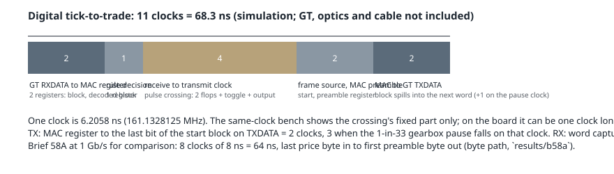

# What we found: a 10GBASE-R link written from scratch, in simulation and to a bitstream (brief 96, stages 0 to 2)

The KR260's SFP+ cage now has a design behind it: our own 10GBASE-R PCS and a 64-bit Ethernet MAC on the free Vivado Basic licence (the AMD 10G Ethernet
core is refused there), with the mock trading path of brief 58A on top. **It has not run on a board.** Everything below is simulation (against a
bit-serial Python reference) or a Vivado build; hardware numbers are the plan in [board_run_plan.md](board_run_plan.md). Every number comes from a file under
`results/b96/` (named at its use).

## Update, brief 96C (2026-11-19): rate matching added; the tables below are from before it

Brief 96C put an elastic buffer (`rtl/rate_match.sv`, AMD's `xpm_fifo_async`) between the receive PCS and the MAC, so the receive stream crosses into the core
clock as a stream and idle blocks are inserted or deleted between frames (design.md section 9). The headline figures and build table below were measured before it and
are kept as the record of brief 96. What changed, with the records:

| | Before 96C | With the rate matcher |
|---|---|---|
| Digital tick-to-trade, simulation, in-phase | 11 clocks | 12 to 13 clocks (`results/b96c/core_sim.json`, `tick_to_trade_digital_sim`; the old 4-clock go-pulse crossing is gone, the buffer adds 5 to 6; up to about 5 more at a positive ppm) |
| Base design (variant b) LUT / FF | 5,954 / 13,657 | 6,613 / 15,667 (`results/b96c/builds/control/digest.json`) |
| Base design WNS / WHS | +0.115 / +0.010 ns | +0.293 / +0.010 ns |
| Base design power / Tj | 1.068 W | 0.928 W / 46.9 C (vectorless estimate) |
| `lat_all3` (97's fastest accepted variant) on the new base | | 6,574 LUT, WNS **+0.004 ns**, 0.947 W (`builds/all3`) |
| ppm builds (TXPI ppm controls on): ppm_ctl / ppm_all3 | | WNS +0.135 / +0.033 ns, 1.102 / 0.930 W (`builds/ppm_ctl`, `builds/ppm_all3`) |

All four builds pass all 29 gates, methodology critical warnings 0 (`results/b96c/builds/gates.md`). The all3 builds hit the 6 GiB scope cap about 1000 times and used
about 700 MiB of swap. **No board run of the rate-matched design yet**; the ppm sweep, the measured offsets and the latency at the extremes are pending (the board script is `run_96c_stage3.sh`
in the planner's `_handoff/fpga_agent`; the sweep driver is `host/b96c_ppm.py`; design.md section 9 describes the buffer).

## Headline numbers (clocks of 6.2058 ns, 161.1328125 MHz; GT, optics and cable not included)

| Quantity | Result | Source |
|---|---|---|
| PCS + MAC, transmit: MAC output register to the GT word with the last bit of the start block | **2 clocks (12.4 ns); 3 (18.6 ns) when the 1-in-33 gearbox pause falls on that clock** (5 of 120 frames in the bench); first bit of the block 1 clock earlier | `results/b96/latency_sim.json` (`tx_mac_to_gt_last_bit_clocks_all_phases`) |
| PCS + MAC, receive: GT word that completes the start block, to the MAC's start strobe | **2 clocks (12.4 ns), the same at all 33 gearbox phases** | `latency_sim.json` (`rx_start_strobe_clocks_after_last_bit_captured`) |
| Receive: first data word in the MAC's register, after the capture of its block | 2 clocks, all 33 phases | `latency_sim.json` |
| Digital tick-to-trade: the GT word completing the price, to the GT word completing the order's start block | **11 clocks = 68.3 ns**, plus 0 or 1 for the transmit pause and up to 1 for the clock-crossing phase on the board: **11 to 13 clocks, 68 to 81 ns** | `results/b96/core_sim.json` (`tick_to_trade_digital_sim`) |
| of which: the receive-to-transmit crossing | 4 clocks (xpm_cdc_pulse, 2 flops) | `core_sim.json` |
| Block lock time at bit offset 0, from reset release | 66 clocks (64 blocks + 2 pipeline) | `latency_sim.json` |
| Block lock time over all 66 bit offsets (bit-exact model) | 67 to 275 clocks (0.4 to 1.7 us) | `results/b96/lock_time_model.json` |

The 11 clocks are assembled from five measured pieces (GT to MAC register 2, decision register 1, crossing 4, frame source and MAC preamble 2, MAC to GT 2); the
2 and 2 come from the PCS benches, the rest from the whole-core bench (`tick_to_trade_digital`), and the sum is asserted against the figure's drawing. The brief 58A path at
1 Gb/s took 8 clocks of 8 ns (64 ns) from the last price byte in to the first preamble byte out; the 10 Gb/s figure is for a different path (a one-rule 64-bit decision, not the 58A
core) and a different measurement point (GT words, not bytes), so the two are not a like-for-like comparison. The simulation clocks are in phase; a real link adds the GT's own
serialiser, CDR and RX buffer latency (not in simulation: the real GT model is refused by the free simulator, 54,716 instances against 50,000), the optics and the fibre.

## Build results before 96C (Vivado 2026.1, xck26-sfvc784-2LV-c, flow gates all pass)

| | Variant (b): SFP+ live, trading path | Variant (a): near-end PMA loopback self-test |
|---|---|---|
| LUTs / registers | 5,954 / 13,657 (5.1 % / 5.8 %) | 6,107 / 13,657 (5.2 % / 5.8 %) |
| Timing at 161.13 MHz (user clocks) | WNS +0.115 ns (txusr2), +0.235 ns (rxusr2); WHS +0.010 ns; all constraints met | WNS +0.293 ns (txusr2), +0.203 ns (rxusr2); WHS +0.011 ns; all constraints met |
| Power (report_power, vectorless, still air) | 1.068 W | 1.083 W |
| Vivado peak RSS / scope memory | 3,893 MiB RSS; scope cap (6 GiB) reached (3,879 hits), 2,358 MiB swap | 3,884 MiB RSS; scope cap reached (3,771 hits), 2,317 MiB swap |
| Wall time (2 threads) | 1,177 s | 1,252 s |
| Flow and GT gates | all pass | all pass |

Records: `results/b96/build_b/` and `results/b96/build_a/` (trimmed `gates.json`, `run.json`).

Timing closed at 161.13 MHz; the 32-bit/322 MHz fallback was not needed. It did not close the first time: the receive MAC's last-word CRC (variable byte count) was a
16-level path at WNS -0.165 ns; it is now one clock later, from registers (the data latency is unchanged). The transmit side's last-word CRC and frame end (a 15-level path, WNS -0.158 ns in variant (a), +0.039 ns in
variant (b)) is now built for each possible byte count at once and selected by a register: both variants close with at least +0.1 ns.

## What the review found (one Sonnet review, one fix round)

Fixed: the poison of an order's FCS now fails closed (an order leaves with a wrong FCS unless the verdict for **that** order is known good, tagged by order number; before, a late
verdict let it leave good); the verdict is also bad when the frame's length disagrees with its IPv4 length field; the receive MAC aborts a frame when block lock drops and resets its pending-end
state; `gen_len` is clamped to 66 to 1514 bytes; the lane-4-start tests now cover every length residue; the transmit latency is measured over all gearbox phases (it was 2 only because no frame
met the pause). Not fixed, stated as gaps below.

## Known gaps

- **No board run, and no interoperability proof.** A PCS talking to itself accepts its own symmetric mistakes (a wrong header bit order or scrambler convention). The block formats, polynomial and
  state-machine thresholds are from memory of IEEE 802.3 clause 49 (the standard is not on this machine); the independent checks are an LFSR-recurrence test, zlib for the CRC, and the model's own
  structure being different from the RTL's. A NIC is the real check.
- The GT is a behavioural stand-in; the real GTHE4 model is refused by the Basic simulator. Same-frequency clocks in the whole-core bench: the crossing's real phase uncertainty is not simulated.
- The reference clock (156.25 MHz) and the control-pin polarity are unconfirmed; the stage 3 plan tests them first.
- Not implemented: the reconciliation sublayer's link-fault state machine and the BER monitor; ordered sets are counted and shown as idles (block type 0x66, an ordered set followed by a
  lane-4 start, is among them, so a frame after it would be lost); no preamble/SFD check, runt or jumbo check on receive; no ARP or ICMP responder (stage 3 step 6 needs one); the transmit MAC does not pad.
- `trade64` is **not** the 58A core: one rule on the first message of a frame, no book, no sequence-gap or halt, no price band or position interlock, no cancel after send, no IPv4 checksum check (design.md section 2.5).
  Order fields cross by `xpm_cdc_array_single` as a quasi-static bus sampled five clocks after the order starts (Vivado reports CDC-6, three multi-bit warnings, for it); the `stale` counter shows a miss. Brief 97C: the receive side's order number and the transmit side's expected count restart together on every counter clear and every restart of either side (before it a counter clear left them out of step and every later order was stale, late and poisoned), and the receive side compares each returned order with the decision (`order_ok`, `order_bad`; register_map.md).
  Two orders overlapping: the second is dropped and counted.
- Memory: the build runs at the 6 GiB cap and swaps; a build with less memory pressure needs the hs_vec widths or the reports trimmed.

## Course impact

- Part 9 or a transceiver lesson: the gearbox arithmetic (66 bits into 64: one pause in 33), why the user clock is 161.13 MHz and not 156.25 MHz, block lock by header voting, and the self-synchronising
  scrambler's error multiplication (one line error becomes three data errors, at 0, 39 and 58 bits) are good worked examples with this design's bench as the exercise.
- The simulator-instance limit (56A) is the reason the GT is stood in; a lesson on testing around a part you cannot simulate would use `sim/gth_wiz_model96.sv`.

## How to explain this in an interview

1. "I wrote a 10GBASE-R PCS and a 64-bit MAC from the clause 49 block formats because the vendor core needed a licence I do not have; every register on the path is mine and counted: 2 clocks out, 2 clocks in, 11 clocks from price to order in simulation, with the gearbox pause and clock-crossing phase stated as the 11 to 13 range."
2. "It is checked against an independent bit-serial Python model, but a PCS that talks only to itself cannot prove interoperability, so the claim stops at simulation until a NIC and the real GT are in the loop, and I say so."
