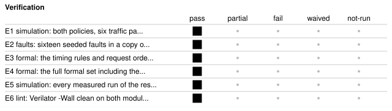

# m141_ddr2_sched: An application-optimised DDR2 command scheduler with two policies and formal timing proofs

<!-- Generated from handover.yaml by flow/handover.py (brief 68). Edit handover.yaml, or the text between the prose markers, then run: python -m flow.handover write designs/m141_ddr2_sched -->

A request queue in front of a DDR2 command bus for the Micron MT47H64M16 on the Nexys A7, with two policies chosen by a parameter, latency-first for few random reads and bandwidth-first for streams, an abstract command interface that maps to AMD's PHY-only interface or to the MIG native interface, and the JEDEC timing rules enforced by per-bank counters. The rules are proved on the command stream by SymbiYosys against an independent monitor, and the scheduler is measured against a behavioural DDR2 model written from the data sheet.

Not in scope:

- a data path, a PHY, a MIG core, DDR2 initialisation or calibration, ZQ, on-die termination, power-down or self-refresh; the scheduler issues commands and the data bursts follow them at fixed latencies
- any Vivado build or board run; both heavy slots were taken by other sessions during the work, and the build plan and the pre-registered board test are written but not run
- the four-wide command packing a controller clock slower than the memory clock needs; the scheduler decides one command per memory clock

Kind: showcase; written by hand. State: simulated. For an agent: [AGENT.md](AGENT.md).

<!-- prose:what -->
**Purpose:** answer "can we build memory controllers optimised for an application?" for the Nexys A7's DDR2, with a scheduler whose
timing rules are proved and whose two policies are measured, before any hardware time is spent.

**Start here:**

- [docs/memory_controller_plan.md](../../docs/memory_controller_plan.md): the study (the part's JEDEC rules, AMD MIG for the 7 series, LiteDRAM), the design space, the proofs, the results, the Vivado build plan with MIG and the pre-registered board test (both prepared, not run), and the library entry form;
- [docs/what_we_found.md](docs/what_we_found.md): the findings and dead ends;
- [docs/results.md](docs/results.md): every measured table, generated from `results/b141`;
- [docs/blocks.md](docs/blocks.md): ports, parameters, timing contract, and what a user could guess wrong.

**Headline.** The policy that wins depends on the traffic. On random reads the latency-first policy answers in 12 clocks (the median)
against 17 for open page, the difference being the precharge it has already done; on related reads open page wins; on a read stream
neither policy matters; on a copy stream bandwidth-first with bank interleaving is best. Postponing refresh moves the tail out of a
chosen window and into the reads after it. The rules (tRCD, tRP, tRAS, tRRD, tFAW, tWR, tWTR, tRTP, tRFC, the bus turnarounds, refresh
never starved) are proved on the command stream by k-induction with helper invariants, and 14 seeded bugs in the proofs and 16 in the
simulation are caught. What is not there: a data path, a PHY, a build, a board run.
<!-- /prose:what -->

## Technical parameters

| Item | Value |
|---|---|
| Part | `xc7a100tcsg324-1` |
| Board | Digilent Nexys A7-100T (one Micron MT47H64M16HR-25 DDR2 part, x16, single rank) |
| Top | `ddr2_sched` |
| Tool | Vivado 2026.1 |
| Note | simulation and formal only in phase 0; no build.yaml and no constraints; the memory clock the board allows is a period of 3077 ps (reference manual Table 3.1.1) |

Clocks:

- `clk`: 325 MHz (from `results/b141/sim_summary.json`); the memory clock period the Nexys A7 reference manual recommends for the MIG (3077 ps); the scheduler decides one command a clock, a figure no build supports yet

Resets:

- `rst`, active high: synchronous; clears the queue, every timer and the refresh state; applied once before en rises and never while the part is in use, because a reset in the middle would forget the open banks of a real part

Interfaces:

- `request` (req_v, req_rdy, req_wr, req_addr, req_tag) ([datasheet](docs/blocks.md)): a valid and ready handshake for one BL8 burst by burst address; req_rdy does not depend on req_v; tags must be unique among queued requests
- `command` (cmd_v, cmd_op, cmd_bank, cmd_row, cmd_col, cmd_tag) ([datasheet](docs/blocks.md)): one registered DDR2 command a clock (ACTIVATE, READ, WRITE, PRECHARGE, PRECHARGE ALL, REFRESH); the data burst follows a READ by the read latency and a WRITE by the write latency; there is no completion signal
- `control` (en, ref_defer) ([datasheet](docs/blocks.md)): en rises once when the PHY says the part is initialised and precharged; ref_defer postpones refresh within the allowance and never past it

| Parameter | Value | Legal range | Note |
|---|---|---|---|
| `POLICY` | 0 latency-first (default), 1 bandwidth-first | 0 or 1 | 0 reads first, writes in batches, eager precharge, refresh in idle time; 1 open page, first-ready first-come first-served, direction runs |
| `QD` | 8 (default) | 2 and up, verified in simulation to 33 | queue entries; a deeper queue lets the bandwidth policy batch longer |
| `MAP` | 0 (default), 1, 2 | 0 to 2 | address map, page-interleaved, bank-group interleaved, or every burst to the next bank |
| `AGE_LIM` | 1024 (default) | above the wait of a request in a full queue | an oldest request this old is served alone; set lower, the queue degrades toward first-come first-served (measured) |
| `REF_POST` | 4 (default) | 0 to 6 | refreshes that may be postponed; JEDEC's allowance is 8 and is not checked against the standard's text here |
| `timing parameters T_RCD to T_REFI, RL, WL, BL2` | MT47H64M16-25 at a clock period of 2500 ps by default; tests/m141_timing.py derives them for a period | whole clocks below 256 (counters are 8 bits), RL = WL + 1, tREFI at least four times the longest refresh sequence | elaboration errors name a violated range |

| Quantity | Value | Source |
|---|---|---|
| Resources | not measured | [Known gaps](#known-gaps-and-limits) |
| Timing | not measured | [Known gaps](#known-gaps-and-limits) |
| Power | not measured | [Known gaps](#known-gaps-and-limits) |
| Latency | median read latency, latency-first, light random reads: 12 clocks; 99.9th percentile read latency, latency-first, light random reads: 53 clocks; median read latency, bandwidth-first, light random reads: 17 clocks; longest wait of any request in a saturated mixed run, latency-first: 264 clocks; maximum read latency of reads accepted inside a refresh-deferral window, latency-first, postponement 4: 28 clocks; maximum read latency of reads accepted inside the same window with no postponement allowance: 73 clocks; maximum read latency of reads accepted outside the window with postponement 4 (the cost moved out of the window): 91 clocks | M1, M2, M3, M6, M7, M8, M9 |
| Throughput | data-bus utilisation, bandwidth-first, sequential reads, page-interleaved map: 0.9798 fraction; data-bus utilisation, bandwidth-first, copy stream (read stream plus write stream), every burst to the next bank: 0.8614 fraction | M4, M5 |

<!-- prose:parameters -->
<!-- /prose:parameters -->

## How to build, run and reproduce

| Step | Command | Heavy slot | Time |
|---|---|---|---|
| bench against the model, seeded faults, lint; needs Icarus Verilog 12; Verilator 5 for the lint test (it skips without it) | `python3 -m pytest -q designs/m141_ddr2_sched/tests/test_m141_clean_rtl.py designs/m141_ddr2_sched/tests/test_m141_faults_rtl.py designs/m141_ddr2_sched/tests/test_m141_lint_rtl.py` | no | about 12 min |
| the proofs, covers and mutants of the CI set; needs the OSS CAD Suite release 2026-11-12 (SymbiYosys, Yosys with the slang plugin, Boolector, ABC); FDA_OSS_CAD or ~/.local/opt/oss-cad-suite | `python3 -m pytest -q designs/m141_ddr2_sched/tests/test_m141_formal.py` | no | about 20 min |
| the measured simulation runs of results/b141; needs Icarus Verilog 12; single process, nice it on a shared machine | `python3 designs/m141_ddr2_sched/tests/m141_measure.py --json results/b141/sim_summary.json` | no | about 60 min |

Tool: Vivado 2026.1. Build ID of the inputs at handover: none (no Vivado build of this directory). Knowledge-bank pin: `5e2eab8`.

| File | What |
|---|---|
| [`designs/m141_ddr2_sched/rtl/ddr2_sched.sv`](rtl/ddr2_sched.sv) | the scheduler |
| [`designs/m141_ddr2_sched/rtl/ddr2_addrmap.sv`](rtl/ddr2_addrmap.sv) | burst address to row, bank and column |
| [`designs/m141_ddr2_sched/tb/tb_ddr2.sv`](tb/tb_ddr2.sv) | bench with the behavioural DDR2 timing model |
| [`designs/m141_ddr2_sched/verif/formal/ddr2_props.sv`](verif/formal/ddr2_props.sv) | timing rules, helper invariants, ordering, refresh and bounded-response properties |
| [`designs/m141_ddr2_sched/verif/formal/run_formal.py`](verif/formal/run_formal.py) | runner of the proofs, covers and mutants |
| [`designs/m141_ddr2_sched/tests/m141_measure.py`](tests/m141_measure.py) | runs the bench for a policy, map, pattern and timing profile and reduces the output to numbers |
| [`designs/m141_ddr2_sched/tests/m141_timing.py`](tests/m141_timing.py) | data sheet values and the conversion to clocks for each timing profile |

<!-- prose:build -->
<!-- /prose:build -->

## Verified

| ID | Activity | Result | What | Evidence | Conditions |
|---|---|---|---|---|---|
| E1 | simulation | pass | both policies, six traffic patterns, two timing profiles and three address maps against the behavioural DDR2 model with no violation, every request served once, order kept, refresh gap within the JEDEC limit and the longest wait within the bound | [`designs/m141_ddr2_sched/tests/test_m141_clean_rtl.py`](tests/test_m141_clean_rtl.py) (run in CI) | - |
| E2 | faults | pass | sixteen seeded faults in a copy of the RTL are each caught by the bench | [`designs/m141_ddr2_sched/tests/test_m141_faults_rtl.py`](tests/test_m141_faults_rtl.py) (run in CI) | - |
| E3 | formal | pass | the timing rules and request order proved by k-induction with helper invariants at the real data sheet constants and at small ones, the refresh debt bound proved, the covers reached and fourteen mutants caught by named assertions | [`designs/m141_ddr2_sched/tests/test_m141_formal.py`](tests/test_m141_formal.py) (run in CI) | - |
| E4 | formal | pass | the full formal set including the bounded-response check at the proved bound plus six clocks, run to completion with the verdict of every job recorded | [`results/b141/formal_full.json`](../../results/b141/formal_full.json) | - |
| E5 | simulation | pass | every measured run of the results folder finished with zero violations of the DDR2 model | [`results/b141/sim_summary.json`](../../results/b141/sim_summary.json) | - |
| E6 | lint | pass | Verilator -Wall clean on both modules | [`designs/m141_ddr2_sched/tests/test_m141_lint_rtl.py`](tests/test_m141_lint_rtl.py) (run in CI) | - |

Gates at handover: `sim_vs_model` pass, `formal_rules` pass, `board_run` not-run.

<!-- prose:verified -->
<!-- /prose:verified -->

## Measured

Every value is read from the record by `python -m flow.handover fill`, not typed.

| ID | What | Value | Runs | Source | Conditions |
|---|---|---|---|---|---|
| M1 | median read latency, latency-first, light random reads | 12 clocks | 1 | [`results/b141/sim_summary.json`](../../results/b141/sim_summary.json) `runs.lat_rand_read_p0.lat_clk.p50` | POLICY 0, random reads, mean gap between requests 40 clocks, nexys_650 profile (clock period 3077 ps, CL 5), Icarus simulation of the command bus, no PHY |
| M2 | 99.9th percentile read latency, latency-first, light random reads | 53 clocks | 1 | [`results/b141/sim_summary.json`](../../results/b141/sim_summary.json) `runs.lat_rand_read_p0.lat_clk.p999` | as M1 |
| M3 | median read latency, bandwidth-first, light random reads | 17 clocks | 1 | [`results/b141/sim_summary.json`](../../results/b141/sim_summary.json) `runs.lat_rand_read_p1.lat_clk.p50` | as M1 with POLICY 1 |
| M4 | data-bus utilisation, bandwidth-first, sequential reads, page-interleaved map | 0.9798 fraction | 1 | [`results/b141/sim_summary.json`](../../results/b141/sim_summary.json) `runs.bw_seq_read_map0_p1.util` | POLICY 1, sequential reads, MAP 0, queue of 8 entries, nexys_650 profile, Icarus simulation of the command bus |
| M5 | data-bus utilisation, bandwidth-first, copy stream (read stream plus write stream), every burst to the next bank | 0.8614 fraction | 1 | [`results/b141/sim_summary.json`](../../results/b141/sim_summary.json) `runs.bw_copy_map2_p1.util` | POLICY 1, alternating read and write streams, MAP 2, queue of 8 entries, nexys_650 profile, Icarus simulation |
| M6 | longest wait of any request in a saturated mixed run, latency-first | 264 clocks | 1 | [`results/b141/sim_summary.json`](../../results/b141/sim_summary.json) `runs.bw_rand_mix_sat_p0.wait_max` | POLICY 0, random reads and writes as fast as accepted, queue of 8 entries, nexys_650 profile |
| M7 | maximum read latency of reads accepted inside a refresh-deferral window, latency-first, postponement 4 | 28 clocks | 1 | [`results/b141/sim_summary.json`](../../results/b141/sim_summary.json) `runs.refresh_window_p0_post4.lat_clk_win.max` | POLICY 0, REF_POST 4, ref_defer high for 5000 of every 12000 clocks, random reads at light load, nexys_650 profile, Icarus simulation of the command bus |
| M8 | maximum read latency of reads accepted inside the same window with no postponement allowance | 73 clocks | 1 | [`results/b141/sim_summary.json`](../../results/b141/sim_summary.json) `runs.refresh_window_p0_post0.lat_clk_win.max` | as M7 with REF_POST 0 |
| M9 | maximum read latency of reads accepted outside the window with postponement 4 (the cost moved out of the window) | 91 clocks | 1 | [`results/b141/sim_summary.json`](../../results/b141/sim_summary.json) `runs.refresh_window_p0_post4.lat_clk_out.max` | as M7 |

<!-- prose:measured -->
<!-- /prose:measured -->

## Known gaps and limits

- **resources**: Not measured; no Vivado run was made because both heavy slots were taken by other sessions, so there is no LUT, flip-flop or block RAM figure for the scheduler.
- **timing**: Not measured; no out-of-context or full build exists, so the closed clock of the decision logic is unknown. The scheduler decides one command a clock and its combinational scan of the queue and the timer file is expected to close well below the memory clock.
- **power**: Not measured; no build and no board.
- **board_run**: Not run on a board and not built with MIG; the pre-registered board test and the build plan are in docs/memory_controller_plan.md sections 11 and 12.
- **model**: The DDR2 model and the formal monitor encode one reading of the Micron data sheet by the author of the scheduler; no vendor model was used, and JEDEC's refresh postponement allowance was not checked against the standard's text.
- **bounded_response**: The bounded-response property is a bounded model check from reset at small parameters, not a proof for all time; at real parameters the bound is measured in simulation only.
- **phy_interface**: The AMD PHY-only interface needs periodic reads, the temperature sample enable, FIFO flow control and up to four commands per controller clock; none is built, and the scheduler's one-command-a-clock decision is not what a controller clock four times slower needs.
- **behaviour**: Guessable wrongly: no data path and no completion signal; spacings are those of the registered output; a read waits for an older write to its address and is never forwarded the write's data; tags must be unique among queued requests and nothing checks it; a reset in the middle of operation is unsupported; an AGE_LIM below the wait of a request in a full queue makes the queue first-come first-served; tRC is implied by tRAS plus tRP at the data sheet values.

<!-- prose:gaps -->
<!-- /prose:gaps -->

## Next steps

1. Run an out-of-context Vivado build of ddr2_sched on the Artix-7 100T and the K26 for several queue depths, to put resources and a closed clock on the block, in a heavy slot.
2. Find out whether the generated MIG sources can drop the controller and keep the PHY, then build the first design with the PHY interface, periodic reads and the temperature enable.
3. Make the decision four-wide so one controller clock carries up to four commands, and re-run the proofs and the measurements on it.
4. Run the pre-registered board test once the build exists.

Open questions:

- Does the MIG controller leave a row open after a read? The first hypothesis of the board test (the eager-precharge gain) depends on it.
- Is a four-wide decision better built as four scheduler copies on interleaved banks or as one wider arbiter?

<!-- prose:next -->
<!-- /prose:next -->

## History

| Date | Brief | PR | What |
|---|---|---|---|
| 2026-11-21 | 141 | - | phase 0, the study and plan, scheduler RTL with two policies, behavioural DDR2 model and bench, formal proofs of the timing rules with helper invariants, request order, refresh debt and bounded response, measured policies, library entry form, build plan and pre-registered board test |

<!-- prose:history -->
<!-- /prose:history -->
