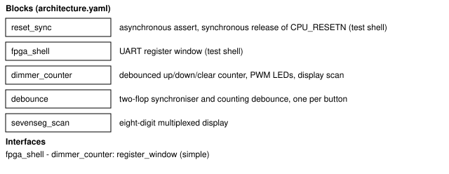
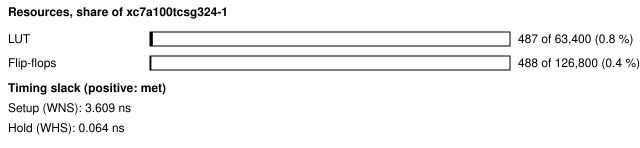
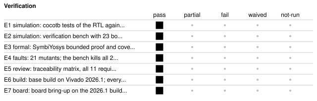

# t1_dimmer_counter: T1, LED dimmer and push-button counter

<!-- Generated from handover.yaml by flow/handover.py (brief 68). Edit handover.yaml, or the text between the prose markers, then run: python -m flow.handover write designs/t1_dimmer_counter -->

A 16-bit up/down/clear counter on the Nexys A7-100T. Debounced buttons step it, the LEDs show it under PWM brightness (register or switches), the 7-segment display shows count and brightness in hex, and every register is reachable over the USB-UART through the test shell. The hand-written reference design for task T1.

Not in scope:

- an agent run; the RTL, model and tests were written by hand
- a gamma-corrected or auto-repeating dimmer; brightness is linear in the duty and one press is one step
- a claim of compliance with any standard; the traceability record is DO-254-style evidence only

Kind: example; written by hand. State: board-verified. For an agent: [AGENT.md](AGENT.md).

<!-- prose:what -->
The natural-language spec is [spec.md](spec.md); [spec.yaml](spec.yaml) is its structured form with the assumptions made where the text was vague. For a tester who did not design it, [BRINGUP.md](BRINGUP.md) gives the automated bring-up and the manual button, display and brightness steps.
<!-- /prose:what -->

## Technical parameters

| Item | Value |
|---|---|
| Part | `xc7a100tcsg324-1` |
| Board | Nexys A7-100T |
| Top | `t1_dimmer_counter_top` |
| Tool | Vivado 2026.1 |
| Note | also builds an ILA variant for debugging; the base build is the design |

Clocks:

- `CLK100MHZ`: 100 MHz (from `designs/t1_dimmer_counter/design.xdc`); the only clock; no MMCM

Resets:

- `CPU_RESETN`, active low: the board's reset button, through the shell's reset synchroniser

Interfaces:

- `UART register window` (test shell, 8N1 UART at 115200 baud) ([datasheet](../../shell/PROTOCOL.md)): COUNT 0x00 RW, DUTY 0x01 RW (reset 0x40), CTRL 0x02 RW (reset 0x2; bit 0 DUTY_SRC, bit 1 DISPLAY_EN), INPUTS 0x03 RO, PRESSES 0x04 RO; offsets 0x05 to 0x7F read 0; design ID T1DC
- `buttons and switches` (BTNU, BTND, BTNC, SW[15:0] in; asynchronous, LVCMOS33 (SW[8] and SW[9] are LVCMOS18, bank 34)) ([datasheet](spec.yaml)): synchronised and debounced; a press is a 0 to 1 change; clear beats up beats down; a shell write to COUNT beats a press
- `LEDs and display` (LED[15:0], 7-segment CA to CG with AN[7:0], active low segments and anodes) ([datasheet](spec.yaml)): LEDs show COUNT gated by the PWM; digits 0 to 3 show COUNT, 6 and 7 the effective duty, 4 and 5 blank

| Parameter | Value | Legal range | Note |
|---|---|---|---|
| `DEBOUNCE_CYCLES` | 1,000,000 | tests shrink it; the board value is 10 ms at 100 MHz | clocks the synchronised input must differ from the debounced level before it changes |
| `PWM_PRESCALE` | 4 | positive integer | the 8-bit phase counter advances every PWM_PRESCALE clocks, so a PWM period is 256 times this many clocks |
| `REFRESH_BITS` | 17 | tests shrink it | each display digit is lit for 2^REFRESH_BITS clocks, 8 digits per scan |
| `CLKS_PER_BIT` | 868 | shell parameter | UART 115200 baud at 100 MHz |

| Quantity | Value | Source |
|---|---|---|
| Resources | LUTs, base build: 487 LUT; flip-flops, base build: 488 FF; BRAM tiles, base build: 0 tile; LUTs, ILA build: 1668 LUT | M1, M2, M3, M4 |
| Timing | worst setup slack, base build: 3.609 ns; worst hold slack, base build: 0.064 ns | M5, M6 |
| Power | total on-chip power estimate, base build: 0.15 W | M7 |
| Latency | not measured | [Known gaps](#known-gaps-and-limits) |
| Throughput | not measured | [Known gaps](#known-gaps-and-limits) |

<!-- prose:parameters -->
<!-- /prose:parameters -->

## How to build, run and reproduce

| Step | Command | Heavy slot | Time |
|---|---|---|---|
| simulate the RTL against the model; needs Icarus Verilog 12 and cocotb 2.0.1 | `python3 -m pytest -q shell/tests/test_shell_rtl.py designs/t1_dimmer_counter/tests/test_t1_rtl.py` | no | about 2 min |
| verification bench with bound checkers, three seeds; needs Verilator 5.048 (SIM=icarus also works) | `SIM=verilator T1_SEEDS=1,2,3 python3 -m pytest -q designs/t1_dimmer_counter/tests/test_t1_verif_rtl.py` | no | about 5 min |
| formal proofs of the debouncer and the display scanner; needs SymbiYosys and z3 | `flow/formal.sh designs/t1_dimmer_counter` | no | about 2 min |
| hand-written mutants must each fail the tests; needs the simulation tools above | `PYTHON=python3 designs/t1_dimmer_counter/tests/run_mutants.sh` | no | about 5 min |
| build the base and the ILA bitstreams; needs local Vivado 2026.1 and a heavy slot (take_heavy_slot.sh) | `flow/run_vivado.sh designs/t1_dimmer_counter both` | yes | about 10 min |
| board bring-up, UART tests and ILA captures against the model; needs the Nexys A7-100T on wall power, both builds present and the board lock | `python3 flow/bringup.py designs/t1_dimmer_counter` | no | about 3 min |

Tool: Vivado 2026.1. Build ID of the inputs at handover: `595c2767` (`python flow/manifest.py show designs/t1_dimmer_counter`: what a rebuild of today's sources and flow would carry; it changes when any build input or the flow changes, so it can differ from the build ID in an older evidence record). Knowledge-bank pin: `1fc7ed8`.

| File | What |
|---|---|
| [`designs/t1_dimmer_counter/spec.md`](spec.md) | the natural-language spec |
| [`designs/t1_dimmer_counter/spec.yaml`](spec.yaml) | structured spec with assumptions, register map and REQ-01 to REQ-11 |
| [`designs/t1_dimmer_counter/architecture.yaml`](architecture.yaml) | blocks, crossings, predicted resources |
| [`designs/t1_dimmer_counter/BRINGUP.md`](BRINGUP.md) | bring-up guide for a tester |
| [`designs/t1_dimmer_counter/rtl/t1_dimmer_counter_top.sv`](rtl/t1_dimmer_counter_top.sv) | board top (shell plus design) |
| [`designs/t1_dimmer_counter/rtl/dimmer_counter.sv`](rtl/dimmer_counter.sv) | counter, PWM, display scan, registers |
| [`designs/t1_dimmer_counter/rtl/debounce.sv`](rtl/debounce.sv) | synchroniser and debounce per button |
| [`designs/t1_dimmer_counter/rtl/sevenseg_scan.sv`](rtl/sevenseg_scan.sv) | display scanner |
| [`designs/t1_dimmer_counter/design.xdc`](design.xdc) | pins, clock, async-input false paths |
| [`designs/t1_dimmer_counter/build.yaml`](build.yaml) | build recipe for flow/run_vivado.sh |
| [`designs/t1_dimmer_counter/probes.yaml`](probes.yaml) | ILA probes |
| [`designs/t1_dimmer_counter/lint/waivers.yaml`](lint/waivers.yaml) | the one FDA-HDL waiver (XDCH-2) with its reason |
| [`designs/t1_dimmer_counter/model.py`](model.py) | golden model written from spec.yaml alone |
| [`designs/t1_dimmer_counter/hw_checks.py`](hw_checks.py) | ILA captures against the model |
| [`designs/t1_dimmer_counter/tests/test_t1_rtl.py`](tests/test_t1_rtl.py) | cocotb tests of the RTL against the model |
| [`designs/t1_dimmer_counter/tests/test_t1_verif_rtl.py`](tests/test_t1_verif_rtl.py) | verification bench with bound checkers and coverage |
| [`designs/t1_dimmer_counter/tests/test_t1_hw.py`](tests/test_t1_hw.py) | on-board UART tests |
| [`designs/t1_dimmer_counter/tests/run_mutants.sh`](tests/run_mutants.sh) | sed mutants the tests must fail |
| [`designs/t1_dimmer_counter/verif/testplan.yaml`](verif/testplan.yaml) | requirements traced to checks |
| [`designs/t1_dimmer_counter/verif/checkers/t1_bind.sv`](verif/checkers/t1_bind.sv) | bound assertion checkers |
| [`designs/t1_dimmer_counter/verif/formal/debounce.sby`](verif/formal/debounce.sby) | SymbiYosys proof of the debouncer (scan.sby does the display scanner) |

<!-- prose:build -->
The ILA build uses the IP route (one ILA IP, the probes packed into two ports) because `create_debug_core` is refused on the Basic licence tier; the post-route QoR assessment gate is absent on that tier, not passed. Resource, timing and power figures here are from Vivado 2026.1. Records made on the earlier Vivado release are not quoted.
<!-- /prose:build -->

## Verified

| ID | Activity | Result | What | Evidence | Conditions |
|---|---|---|---|---|---|
| E1 | simulation | pass | cocotb tests of the RTL against the golden model (registers, debounce, PWM on-time, display) | [`designs/t1_dimmer_counter/tests/test_t1_rtl.py`](tests/test_t1_rtl.py) (run in CI) | - |
| E2 | simulation | pass | verification bench with 23 bound assertions on seeds 1, 2 and 3 under Verilator 5.048 and under Icarus 12 | [`designs/t1_dimmer_counter/tests/test_t1_verif_rtl.py`](tests/test_t1_verif_rtl.py) (run in CI) | - |
| E3 | formal | pass | SymbiYosys bounded proof and cover of the debouncer and display scanner, rerun in CI by flow/formal.sh | [`results/04f/README.md`](../../results/04f/README.md) | - |
| E4 | faults | pass | 21 mutants; the bench kills all 21 in the final run, 19 of 21 in the first (see gap E4) | [`results/04f/mutation_t1.json`](../../results/04f/mutation_t1.json) | - |
| E5 | review | pass | traceability matrix, all 11 requirements evidenced and every coverage hole justified; FDA-HDL lint passes with one waiver | [`results/53_traceability/t1_dimmer_counter_trace.json`](../../results/53_traceability/t1_dimmer_counter_trace.json) | - |
| E6 | build | pass | base build on Vivado 2026.1; every gate passes through bitstream | [`results/f0a_2026_1/t1_dimmer_counter_base.json`](../../results/f0a_2026_1/t1_dimmer_counter_base.json) | - |
| E7 | board | pass (1 run) | board bring-up on the 2026.1 builds; power gate, 8 of 8 UART tests and 4 of 4 ILA captures agree with the model | [`results/f0b_2026_1/t1_dimmer_counter_bringup.json`](../../results/f0b_2026_1/t1_dimmer_counter_bringup.json) | wall power; power gate passed before programming (2.0 W and 85 C limits); XADC rails and die temperature were not read |

Gates at handover: `build_2026_1` pass, `board_bringup` pass.

<!-- prose:verified -->
<!-- /prose:verified -->

## Measured

Every value is read from the record by `python -m flow.handover fill`, not typed.

| ID | What | Value | Runs | Source | Conditions |
|---|---|---|---|---|---|
| M1 | LUTs, base build | 487 LUT | 1 | [`results/f0a_2026_1/t1_dimmer_counter_base.json`](../../results/f0a_2026_1/t1_dimmer_counter_base.json) `gates.utilization.lut` | routed base build, Vivado 2026.1, xc7a100tcsg324-1, including the test shell; the predicted range is 350 to 700 |
| M2 | flip-flops, base build | 488 FF | 1 | [`results/f0a_2026_1/t1_dimmer_counter_base.json`](../../results/f0a_2026_1/t1_dimmer_counter_base.json) `gates.utilization.ff` | as M1 |
| M3 | BRAM tiles, base build | 0 tile | 1 | [`results/f0a_2026_1/t1_dimmer_counter_base.json`](../../results/f0a_2026_1/t1_dimmer_counter_base.json) `gates.utilization.bram_tile` | as M1; DSP48E1 is 0 too |
| M4 | LUTs, ILA build | 1668 LUT | 1 | [`results/f0a_2026_1/t1_dimmer_counter_ila.json`](../../results/f0a_2026_1/t1_dimmer_counter_ila.json) `gates.utilization.lut` | routed ILA build, Vivado 2026.1; the debug core costs the difference from M1 |
| M5 | worst setup slack, base build | 3.609 ns | 1 | [`results/f0a_2026_1/t1_dimmer_counter_base.json`](../../results/f0a_2026_1/t1_dimmer_counter_base.json) `gates.timing.wns_ns` | routed, at the 100 MHz board clock; one build, not a trend |
| M6 | worst hold slack, base build | 0.064 ns | 1 | [`results/f0a_2026_1/t1_dimmer_counter_base.json`](../../results/f0a_2026_1/t1_dimmer_counter_base.json) `gates.timing.whs_ns` | routed, at the 100 MHz board clock |
| M7 | total on-chip power estimate, base build | 0.15 W | 1 | [`results/f0a_2026_1/t1_dimmer_counter_base.json`](../../results/f0a_2026_1/t1_dimmer_counter_base.json) `gates.power.total_w` | report_power after routing, vectorless (default toggle rates), confidence Low; not a board measurement |
| M8 | LED on-time per 1,024-sample capture at DUTY 0x40, measured on the board by the ILA | 256 clocks | 1 | [`results/f0b_2026_1/t1_dimmer_counter_bringup.json`](../../results/f0b_2026_1/t1_dimmer_counter_bringup.json) `steps.ila_captures.captures.pwm_40.led_on_clocks_measured[0]` | ILA build; the model predicts the same value, and DUTY 0x08 and 0xA0 also match |
| M9 | UART tests passed on the board | 8 tests | 1 | [`results/f0b_2026_1/t1_dimmer_counter_bringup.json`](../../results/f0b_2026_1/t1_dimmer_counter_bringup.json) `steps.uart_tests.tests` | tests/test_t1_hw.py on the base bitstream, 0 failures |

<!-- prose:measured -->
<!-- /prose:measured -->

## Known gaps and limits

- **latency**: Button to count is 2 + DEBOUNCE_CYCLES + 1 clocks by design (10.00 ms at the board parameters); no record times it on the board.
- **throughput**: Not applicable; a control design with no data path.
- **E4**: The 100 percent is after fixing the bench for two survivors. The unbiased first-run score was 19 of 21.
- **E7**: One passing bring-up run on 2026.1; the earlier release had three in a row.
- **manual checks**: Buttons, display glyphs and three brightness levels were checked by a person on the earlier release's bitstream (results/f0b/manual_checks.md), not on 2026.1.
- **operating conditions**: XADC rails and die temperature were not read, so the runs cannot be shown inside the recommended operating conditions.
- **behaviour**: No auto-repeat or gamma curve exists. Reads of undefined window addresses return 0 with no error.

<!-- prose:gaps -->
<!-- /prose:gaps -->

## Next steps

1. Repeat the manual button, display and brightness checks on the 2026.1 bitstream and record them.
2. Add a button-press ILA capture so a record times the button-to-count latency on the board.
3. Read the XADC rails and die temperature during bring-up.

Open questions:

- Should brightness follow a gamma curve so equal steps look equal (the spec default is linear)?
- Should holding a button auto-repeat (the spec default is no)?

<!-- prose:next -->
<!-- /prose:next -->

## History

| Date | Brief | PR | What |
|---|---|---|---|
| 2026-10-30 | 02 | - | first bring-up on the board with the earlier release's builds |
| 2026-11-01 | 04f | - | verification backbone applied; V3 reached, 21 mutants, formal proofs |
| 2026-11-11 | 48 | - | rebuilt and brought up on Vivado 2026.1; the first bring-up run failed at the ILA step and was fixed |
| 2026-11-12 | 53 | - | traceability matrix and HDL coding standard lint |
| 2026-11-13 | 68 | - | handover written to the documentation standard |

<!-- prose:history -->
<!-- /prose:history -->
