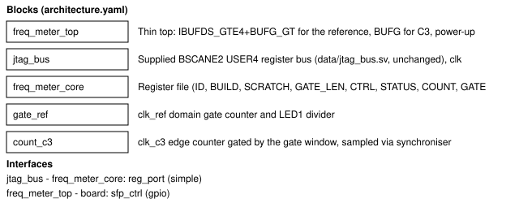

# p1_clkmeter: P1 clock frequency meter (25 MHz C3 clock against the 156.25 MHz SFP+ reference)

<!-- Generated from handover.yaml by flow/handover.py (brief 68). Edit handover.yaml, or the text between the prose markers, then run: python -m flow.handover write runs/20261125-064524-4d2a/p1_clkmeter -->

The design measures the 25 MHz C3 clock against the 156.25 MHz MGTREFCLK0 reference on the KR260. A host starts a gate of a programmed number of reference cycles through a JTAG register port (jtag_bus), the design counts C3 edges inside the gate, and it reports COUNT and GATE_ACTUAL so the host can compute the frequency. Two LEDs show the two clocks. The run reached verification level V2 of V3 and stopped at the constraints stage, where design.xdc:13 failed in Vivado. No synthesis, implementation or bitstream result exists, and the specification and architecture were approved automatically with no human review.

Not in scope:

- Not a transceiver design. No GT channel is instantiated, and the reference clock only goes through IBUFDS_GTE4 and BUFG_GT.
- Not a general frequency counter. It has one fixed input (the C3 clock) and one fixed ruler (the SFP+ reference).
- Not built, routed or tested on hardware in this run.

Kind: agent-run; produced by the agent (agent run `20261125-064524-4d2a`, [record](../summary.json)). State: simulated. For an agent: [AGENT.md](AGENT.md).

Run: model claude-sonnet-5-5 (deepagents harness), 8 loops, 217 turns, 9,312,752 tokens, 3491.5 s wall time, 5.28383 USD model cost (provider-reported), stopped because: stage 3 visited more than 4 times; last failing gate: post_synth:post_synth_methodology_no_critical, post_synth:post_synth_exceptions_clean (EXC-XDC-MSG design.xdc:13 set_property LOC IBUFDS_ (from the run record).

<!-- prose:what -->
<!-- /prose:what -->

## Technical parameters

| Item | Value |
|---|---|
| Part | `xck26-sfvc784-2LV-c` |
| Board | kr260 |
| Top | `freq_meter_top` |
| Tool | Vivado 2026.1 |

Clocks:

- `clk_c3_in`: 25 MHz (from `runs/20261125-064524-4d2a/p1_clkmeter/design.xdc`)
- `mgtrefclk0_p`: 156.25 MHz (from `runs/20261125-064524-4d2a/p1_clkmeter/design.xdc`)

Resets:

- `rst`, active high: Internal and synchronous to clk_c3. An 8-bit power-up shift register in freq_meter_top.sv holds it for 8 clk_c3 cycles, and there is no reset pin. It is passed through xpm_cdc_async_rst into clk_ref.

Interfaces:

- `clk_c3_in` (input clock, 25 MHz, pin C3, LVCMOS18): Buffered by BUFG. Drives jtag_bus, the register file, the edge counter and LED0.
- `mgtrefclk0_p / mgtrefclk0_n` (input differential clock, 156.25 MHz, SFP+ MGTREFCLK0): Goes through IBUFDS_GTE4 (ODIV2) and BUFG_GT to give clk_ref. design.xdc constrains only mgtrefclk0_p, with a 6.40 ns period.
- `led` (output, 2 bits, LVCMOS18): led[0] is on pin F8 and is driven from clk_c3. led[1] is on pin E8 and is driven from clk_ref. Both are 0 while CTRL.LED_EN is 0.
- `sfp_tx_disable` (output, 1 bit, pin Y10, LVCMOS33): Constant 1 (laser off).
- `h_we, h_re, h_addr, h_wdata, h_rdata` (spec-declared register-port names, top-level ports): In the spec these are internal. The RTL exposes them as top-level ports that are unused, except that h_rdata mirrors the internal jtag_bus read data. They have no pins in design.xdc, which gives them input and output delays only.

Registers (from spec.yaml; where the RTL differs, the gaps say so):

| Offset | Name | Access | Reset | Bits |
|---|---|---|---|---|
| 0 | `ID` | RO | 546373633 | [31:0] design ID |
| 4 | `BUILD` | RO | 0 | [31:0] USR_ACCESSE2 word |
| 8 | `SCRATCH` | RW | 0 | [31:0] read back what was written |
| 16 | `GATE_LEN` | RW | 156250000 | [31:0] gate length in clk_ref cycles |
| 20 | `CTRL` | RW | 0 | [0] START self-clearing, ignored while busy; [1] LED_EN |
| 24 | `STATUS` | RO | 0 | [0] BUSY; [1] DONE |
| 28 | `COUNT` | RO | 0 | [31:0] clk_c3 rising edges in last gate |
| 32 | `GATE_ACTUAL` | RO | 0 | [31:0] clk_ref cycles in last gate |
| 36 | `MEAS_DONE` | RO | 0 | [31:0] completed measurements |

| Parameter | Value | Legal range | Note |
|---|---|---|---|
| `DESIGN_ID` | 546,373,633 | any 32-bit value; 546373633 is 0x20910001 | Read back in the ID register. |
| `GATE_DEFAULT_CYCLES` | 156,250,000 | 1 up to the largest 32-bit value; values below GATE_MIN_CYCLES are clamped at START | Reset value of GATE_LEN. The spec gives 156,250,000 clk_ref cycles = 1 s. |
| `GATE_MIN_CYCLES` | 1000 | 1 up to the largest 32-bit value | Minimum gate, 1,000 clk_ref cycles = 6.4 us per the spec. A shorter GATE_LEN is clamped at START, while GATE_LEN reads back as written. Spec timing: 156,250,000 clk_ref cycles = 1 s |
| `LED_C3_HALF_PERIOD_CYCLES` | 12,500,000 | 1 or more | led[0] half period in clk_c3 cycles. The benches ran it at 24, so the spec's value was not simulated. |
| `LED_REF_HALF_PERIOD_CYCLES` | 78,125,000 | 1 or more | led[1] half period in clk_ref cycles. The benches ran it at 125, so the spec's value was not simulated. |
| `REG_WIDTH` | 32 | 32 only; the RTL hard-codes 32-bit registers and has no such parameter | Register width, taken from the spec. |
| `COUNT_WIDTH` | 32 | 32 only; the RTL hard-codes a 32-bit counter and has no such parameter | Width of the edge counter, taken from the spec. |

| Quantity | Value | Source |
|---|---|---|
| Resources | not measured | [Known gaps](#known-gaps-and-limits) |
| Timing | not measured | [Known gaps](#known-gaps-and-limits) |
| Power | not measured | [Known gaps](#known-gaps-and-limits) |
| Latency | not measured | [Known gaps](#known-gaps-and-limits) |
| Throughput | not measured | [Known gaps](#known-gaps-and-limits) |

<!-- prose:parameters -->
<!-- /prose:parameters -->

## How to build, run and reproduce

| Step | Command | Heavy slot | Time |
|---|---|---|---|
| what changed since this handover (stale records, changed files, tool and knowledge-bank pins) | `python -m flow.handover fresh runs/20261125-064524-4d2a/p1_clkmeter` | no | - |
| pick the work up again from the earliest stage the change or the staleness needs; needs a model (see docs/agent.md); Vivado for any stage from synthesis on | `python -m agent resume runs/20261125-064524-4d2a/p1_clkmeter "<change request>"` | yes | - |
| run the Verifier's simulation tests; needs Icarus Verilog and cocotb, or the simulation container | `python -m pytest -q runs/20261125-064524-4d2a/p1_clkmeter/tests/test_p1_clkmeter_rtl.py` | no | - |
| re-run the Verilator coverage simulation and the verification gates (line, toggle, functional and cover results); needs Verilator 5.036 or later and cocotb (the simulation container has them) | `SIM=verilator FDA_COVERAGE=1 FDA_SIM_RESULTS_DIR=runs/20261125-064524-4d2a/p1_clkmeter/build/verif/sim python -m pytest -q -x runs/20261125-064524-4d2a/p1_clkmeter/tests/test_p1_clkmeter_rtl.py && python3 flow/verif_gates.py runs/20261125-064524-4d2a/p1_clkmeter --runs runs/20261125-064524-4d2a/p1_clkmeter/build/verif/sim` | no | - |
| rebuild the bitstream with the flow; needs Vivado 2026.1 and a heavy slot; peak memory 3349 MiB (anonymous, the systemd scope) | `flow/run_vivado.sh runs/20261125-064524-4d2a/p1_clkmeter base` | yes | about 2.1 min |

Tool: Vivado 2026.1. Build ID of the inputs at handover: `769e8681` (`python flow/manifest.py show runs/20261125-064524-4d2a/p1_clkmeter`: what a rebuild of today's sources and flow would carry; it changes when any build input or the flow changes, so it can differ from the build ID in an older evidence record). Knowledge-bank pin: `5e2eab8`.

| File | What |
|---|---|
| [`runs/20261125-064524-4d2a/p1_clkmeter/spec.md`](spec.md) | the request the run started from |
| [`runs/20261125-064524-4d2a/p1_clkmeter/spec.yaml`](spec.yaml) | the specification the Clarifier wrote, approved automatically with no human review |
| [`runs/20261125-064524-4d2a/p1_clkmeter/ARCHITECTURE.md`](ARCHITECTURE.md) | the architecture note, accepted automatically before any RTL (no human review) |
| [`runs/20261125-064524-4d2a/p1_clkmeter/architecture.yaml`](architecture.yaml) | the machine-checked architecture: blocks, clocks, predicted resources |
| [`runs/20261125-064524-4d2a/p1_clkmeter/rtl/freq_meter_core.sv`](rtl/freq_meter_core.sv) | RTL written by the Designer |
| [`runs/20261125-064524-4d2a/p1_clkmeter/rtl/freq_meter_top.sv`](rtl/freq_meter_top.sv) | RTL written by the Designer |
| [`runs/20261125-064524-4d2a/p1_clkmeter/rtl/lint_waive.vlt`](rtl/lint_waive.vlt) | RTL written by the Designer |
| [`runs/20261125-064524-4d2a/p1_clkmeter/rtl/xilinx_sim_stubs.sv`](rtl/xilinx_sim_stubs.sv) | RTL written by the Designer |
| [`runs/20261125-064524-4d2a/p1_clkmeter/design.xdc`](design.xdc) | pin, I/O standard and timing constraints |
| [`runs/20261125-064524-4d2a/p1_clkmeter/build.yaml`](build.yaml) | the build description read by the flow |
| [`runs/20261125-064524-4d2a/p1_clkmeter/model.py`](model.py) | the Modeller's reference model of the visible behaviour |
| [`runs/20261125-064524-4d2a/p1_clkmeter/tests/bench_p1_clkmeter.py`](tests/bench_p1_clkmeter.py) | the Verifier's cocotb benches and pytest entries |
| [`runs/20261125-064524-4d2a/p1_clkmeter/tests/test_p1_clkmeter_rtl.py`](tests/test_p1_clkmeter_rtl.py) | the Verifier's cocotb benches and pytest entries |
| [`runs/20261125-064524-4d2a/p1_clkmeter/verif/testplan.yaml`](verif/testplan.yaml) | the test plan and mutant list read by the verification gates |
| [`runs/20261125-064524-4d2a/p1_clkmeter/verif/checkers/v_macros.svh`](verif/checkers/v_macros.svh) | bound assertion and cover checkers |
| [`runs/20261125-064524-4d2a/p1_clkmeter/build/review/03_constraints.html`](build/review/03_constraints.html) | the review page of stage constraints: its exit gates and their failures at the last visit |

<!-- prose:build -->
<!-- /prose:build -->

## Verified

| ID | Activity | Result | What | Evidence | Conditions |
|---|---|---|---|---|---|
| E1 | review | partial | the specification and the architecture were approved automatically, with no human review (review off; the interview oracle claude-sonnet-5-5 only answered the interview questions); the interview asked 6 questions, 0 answered and 6 defaulted | [`runs/20261125-064524-4d2a/summary.json`](../summary.json) | - |
| E2 | simulation | partial | verification (flow/verif_gates.py) against the Modeller's reference model reached V2 of V3; the run asked for V2; V2 means simulation: seeded runs, a constrained-random test, bound assertions and formal tasks; V3 (coverage (line, toggle, functional bins, cover properties), three seeds and the mutation score) did not pass: functional bins pct 0.0 (0/0) (needs 100); cover properties pct 0.0 (needs 100); line pct not measured (needs 90); toggle pct not measured (needs 75); mutation score pct not measured (needs 70); cdc structure clean missing (needs no unsafe crossing); cdc injection clean missing (needs pass); no board result (V-HW) is recorded | [`runs/20261125-064524-4d2a/p1_clkmeter/build/verif/verif_gates.json`](build/verif/verif_gates.json) | - |
| E3 | build | fail | Vivado base build; flow stages that ran: rtl, post_synth | [`runs/20261125-064524-4d2a/p1_clkmeter/build/base/gates.json`](build/base/gates.json) | - |

Gates at handover: `clarify` pass, `board-and-device-planning` pass, `rtl-design-creation` pass, `constraints` fail, `synthesis` not-run, `implementation` not-run, `timing-closure` not-run, `power-closure` not-run, `drc-closure` not-run, `configuration-and-debug` not-run.

<!-- prose:verified -->
<!-- /prose:verified -->

## Measured

Every value is read from the record by `python -m flow.handover fill`, not typed.

| ID | What | Value | Runs | Source | Conditions |
|---|---|---|---|---|---|
| M1 | simulation seeds run | 3 | 1 | [`runs/20261125-064524-4d2a/p1_clkmeter/build/verif/verif_gates.json`](build/verif/verif_gates.json) `stages.V3.checks.seeds_run.value` | Verilator coverage simulation of the RTL against the Modeller's model, every seed the bench ran |
| M2 | line coverage | not measured % | 1 | [`runs/20261125-064524-4d2a/p1_clkmeter/build/verif/verif_gates.json`](build/verif/verif_gates.json) `stages.V3.checks.line_pct.value` | Verilator coverage simulation of the RTL against the Modeller's model, every seed the bench ran |
| M3 | toggle coverage | not measured % | 1 | [`runs/20261125-064524-4d2a/p1_clkmeter/build/verif/verif_gates.json`](build/verif/verif_gates.json) `stages.V3.checks.toggle_pct.value` | Verilator coverage simulation of the RTL against the Modeller's model, every seed the bench ran |
| M4 | functional coverage bins hit | 0.0 (0/0) | 1 | [`runs/20261125-064524-4d2a/p1_clkmeter/build/verif/verif_gates.json`](build/verif/verif_gates.json) `stages.V3.checks.functional_bins_pct.value` | Verilator coverage simulation of the RTL against the Modeller's model, every seed the bench ran |
| M5 | cover properties hit | 0.0 % | 1 | [`runs/20261125-064524-4d2a/p1_clkmeter/build/verif/verif_gates.json`](build/verif/verif_gates.json) `stages.V3.checks.cover_properties_pct.value` | Verilator coverage simulation of the RTL against the Modeller's model, every seed the bench ran |
| M6 | model cost of the run, provider-reported | 5.28383 USD | 1 | [`runs/20261125-064524-4d2a/summary.json`](../summary.json) `cost_usd` | every role and the interview oracle, as the run summary records it |

<!-- prose:measured -->
<!-- /prose:measured -->

## Known gaps and limits

- **REQ-01**: REQ-01 has no passing evidence for every proof method: hardware (uart_tests) is pending: no bring-up result
- **REQ-02**: REQ-02 has no passing evidence for every proof method: hardware (uart_tests) is pending: no bring-up result
- **REQ-03**: REQ-03 has no passing evidence for every proof method: hardware (uart_tests) is pending: no bring-up result
- **REQ-08**: REQ-08 has no passing evidence for every proof method: hardware (uart_tests) is pending: no bring-up result
- **REQ-13**: REQ-13 has no passing evidence for every proof method: hardware (uart_tests) is pending: no bring-up result
- **REQ-14**: REQ-14 has no passing evidence for every proof method: hardware (uart_tests) is pending: no bring-up result
- **REQ-15**: REQ-15 has no passing evidence for every proof method: hardware (ila_captures) is pending: no bring-up result
- **REQ-16**: REQ-16 has no passing evidence for every proof method: hardware (ila_captures) is pending: no bring-up result
- **REQ-17**: REQ-17 has no passing evidence for every proof method: hardware (ila_captures) is pending: no bring-up result
- **REQ-19**: REQ-19 has no passing evidence for every proof method: hardware (uart_tests) is pending: no bring-up result
- **REQ-20**: REQ-20 has no passing evidence for every proof method: analysis (post_synth:post_synth_resources_in_range) is pending: no flow gates result
- **REQ-25**: REQ-25 has no passing evidence for every proof method: analysis (post_synth:post_synth_resources_in_range) is pending: no flow gates result
- **REQ-26**: REQ-26 has no passing evidence for every proof method: analysis (post_route:setup) is pending: no flow gates result
- **E1**: review evidence is partial: the specification and the architecture were approved automatically, with no human review (review off; the interview oracle claude-sonnet-5-5 only answered the interview questions); the interview asked 6 questions, 0 answered and 6 defaulted
- **E2**: simulation evidence is partial: verification reached V2 of V3 (the run asked for V2); the checks that did not pass or did not run are listed in the evidence row
- **E3**: build evidence is fail: Vivado base build; flow stages that ran: rtl, post_synth
- **constraints**: stage constraints did not pass its gates in this run; at its last visit: post_synth:post_synth_methodology_no_critical FAIL post_synth:post_synth_exceptions_clean (EXC-XDC-MSG design.xdc:13 set_property LOC IBUFDS_GTE4_X1Y6 [get_cells { u_ibufds_gt }] Command failed: 'IBUFDS_GTE4_X1Y6' is not a valid site name.) FAIL
- **synthesis**: stage synthesis was not run: the run stopped before this stage (stage 3 visited more than 4 times; last failing gate: post_synth:post_synth_methodology_no_critical, post_synth:post_synth_exceptions_clean (EXC-XDC-MSG design.xdc:13 set_property LOC IBUFDS_)
- **implementation**: stage implementation was not run: the run stopped before this stage (stage 3 visited more than 4 times; last failing gate: post_synth:post_synth_methodology_no_critical, post_synth:post_synth_exceptions_clean (EXC-XDC-MSG design.xdc:13 set_property LOC IBUFDS_)
- **timing-closure**: stage timing-closure was not run: the run stopped before this stage (stage 3 visited more than 4 times; last failing gate: post_synth:post_synth_methodology_no_critical, post_synth:post_synth_exceptions_clean (EXC-XDC-MSG design.xdc:13 set_property LOC IBUFDS_)
- **power-closure**: stage power-closure was not run: the run stopped before this stage (stage 3 visited more than 4 times; last failing gate: post_synth:post_synth_methodology_no_critical, post_synth:post_synth_exceptions_clean (EXC-XDC-MSG design.xdc:13 set_property LOC IBUFDS_)
- **drc-closure**: stage drc-closure was not run: the run stopped before this stage (stage 3 visited more than 4 times; last failing gate: post_synth:post_synth_methodology_no_critical, post_synth:post_synth_exceptions_clean (EXC-XDC-MSG design.xdc:13 set_property LOC IBUFDS_)
- **configuration-and-debug**: stage configuration-and-debug was not run: the run stopped before this stage (stage 3 visited more than 4 times; last failing gate: post_synth:post_synth_methodology_no_critical, post_synth:post_synth_exceptions_clean (EXC-XDC-MSG design.xdc:13 set_property LOC IBUFDS_)
- **formal**: formal checks were planned for REQ-06, REQ-10, REQ-11, REQ-27, REQ-19, REQ-21, REQ-29, REQ-22, REQ-23 and did not run; each was replaced by a simulation check (verif/testplan.yaml replan). Reason recorded: SymbiYosys is not installed here so START-while-BUSY is checked by directed simulation against the model.
- **simulated_parameters**: the benches simulate at values other than the spec's (scaled for simulation speed or otherwise): LED_C3_HALF_PERIOD_CYCLES is simulated at 24 (runs/20261125-064524-4d2a/p1_clkmeter/tests/test_p1_clkmeter_rtl.py:14) while spec.yaml gives 12500000; LED_REF_HALF_PERIOD_CYCLES is simulated at 125 (runs/20261125-064524-4d2a/p1_clkmeter/tests/test_p1_clkmeter_rtl.py:14) while spec.yaml gives 78125000. Behaviour that depends on the spec's value, such as a divider's timing against the clock, was not simulated at that value; it is stated here, not shown, unless another record covers it
- **resources**: resources not measured: no current Vivado build of this design has been recorded
- **timing**: timing not measured: no current Vivado build of this design has been recorded
- **power**: power not measured: no current Vivado build of this design has been recorded
- **latency**: latency not measured: the run measured no latency; the spec's latency promise is checked only by the benches
- **throughput**: throughput not measured: the run measured no throughput
- **xdc_site**: design.xdc:13 places u_ibufds_gt on IBUFDS_GTE4_X1Y6, and Vivado rejected it as not a valid site name. The file's own comment says REFCLK0 is site X1Y0, so the comment and the LOC disagree. This is the blocker for the constraints stage.
- **cover_vs_bins**: Functional bins are reported 0 of 0 and cover properties 0 percent. The cover and functional results are not usable as evidence yet, and the two must be compared before new stimulus is written.
- **read_latency**: The spec promises h_rdata within 2 clocks of h_re. The RTL (freq_meter_core.sv) registers h_rdata on the clock after h_re, which is 1 clk_c3 cycle. The benches check it, and no run measured it.
- **result_snapshot**: COUNT, GATE_ACTUAL and MEAS_DONE read through a snapshot (count_h, actual_h, meas_h) that is refreshed only when STATUS is read while BUSY is 0. A host must read STATUS before reading the results. A read of COUNT without a prior STATUS read can return the older values. The spec does not describe this.
- **ctrl_readback**: CTRL reads back only LED_EN in bit 1, and bit 0 always reads 0. Any write to CTRL sets LED_EN from h_wdata[1], so a START write with bit 1 clear turns the LEDs off.
- **start_clamp**: GATE_LEN below 1000 is clamped to 1000 at START (a default answer from the interview, implemented in freq_meter_core.sv). GATE_LEN writes while BUSY are stored but do not affect the running gate.
- **unmapped_access**: Unmapped addresses, including 0x00C, read 0. Writes to RO or unmapped addresses are ignored because the write decode matches only 0x008, 0x010 and 0x014.
- **reset_values**: After reset COUNT, GATE_ACTUAL, MEAS_DONE, STATUS, SCRATCH and CTRL read 0, and GATE_LEN reads 156250000. START does not clear COUNT or GATE_ACTUAL, and MEAS_DONE clears only at reset.
- **reset_style**: The spec says the reset is synchronous. The RTL uses a synchronous reset in clk_c3 and a CDC-synchronised reset in clk_ref, as the spec says. The power-up shift register relies on an initial value (8'hFF) rather than a pin.
- **top_ports**: Spec.yaml lists h_* as internal, but freq_meter_top.sv declares them as top-level ports, and design.xdc gives them no pin. Whether they should stay as ports is undecided.
- **xdc_cdc**: design.xdc has no clock-group exception between sys_clk_pin and clk_ref_pin, so the spec's asynchronous constraint (REQ-26) relies on the XPM scoped max delays. ARCHITECTURE.md says set_clock_groups -asynchronous is used. The XDC disagrees with it.

<!-- prose:gaps -->
<!-- /prose:gaps -->

## Next steps

1. Fix design.xdc:13 first. Determine the valid IBUFDS_GTE4 site for the SFP+ MGTREFCLK0 on the xck26 and correct the LOC, or remove it and let the placer choose it. Then re-run the constraints stage with python -m agent resume.
2. Compare the cover results with the functional coverage before any new stimulus; find out why the bins show 0 of 0.
3. Once the build passes, run synthesis, implementation and timing closure, then measure resources, timing and power.
4. Reach V3, which needs line, toggle and functional coverage, three seeds and the mutation score, plus CDC checks.
5. Run the hardware bring-up for the pending hardware requirements, and measure five 1 s readings for REQ-13 and REQ-14.
6. Add a bench that runs the LED dividers at the spec's half periods, or record why that is not needed.

Open questions:

- Which IBUFDS_GTE4 site is correct for the SFP+ MGTREFCLK0 on this board?
- Should the h_* names stay as unused top-level ports, or be removed from freq_meter_top?
- Should the result registers read live values instead of the STATUS-gated snapshot?

<!-- prose:next -->
<!-- /prose:next -->

## History

| Date | Brief | PR | What |
|---|---|---|---|
| 2026-11-25 | agent run | - | produced by the agent graph; stages that passed: clarify, board-and-device-planning, rtl-design-creation |

<!-- prose:history -->
<!-- /prose:history -->
