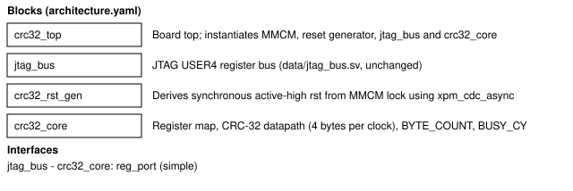

# p3_crc_engine: CRC-32 engine (Ethernet, 4 bytes per clock) with JTAG register access

<!-- Generated from handover.yaml by flow/handover.py (brief 68). Edit handover.yaml, or the text between the prose markers, then run: python -m flow.handover write runs/20261125-102852-3fd4/p3_crc_engine -->

The design computes a reflected CRC-32 (the zlib.crc32 variant) over bytes pushed through a JTAG-accessed register map (jtag_bus) on the KR260. A PUSH4 write consumes four bytes in one clock and a PUSH_N write consumes 1 to 3 tail bytes. The core also keeps byte and busy-cycle counters. The run stopped at the rtl-design-creation stage, whose lint gate failed on 5 consecutive visits. Nothing was synthesised, implemented or run on a board, and verification reached V2 of V3. The specification and architecture were approved automatically, with no human review.

Not in scope:

- Not a general CRC engine, the polynomial, init and final XOR are fixed to the Ethernet CRC-32 values in the RTL.
- Not a streaming or AXI data path, data enters only through the single JTAG register port, one write per clock.
- Not built, timed or tested on hardware, no Vivado build or board result exists.
- Uses no GT transceiver, sfp_tx_disable is a constant output.

Kind: agent-run; produced by the agent (agent run `20261125-102852-3fd4`, [record](../summary.json)). State: rtl. For an agent: [AGENT.md](AGENT.md).

Run: model claude-sonnet-5-5 (deepagents harness), 8 loops, 155 turns, 5,449,218 tokens, 1002 s wall time, 2.67122 USD model cost (provider-reported), stopped because: stage 2 visited more than 6 times; last failing gate: lint; owned by the rtl role; the same failure on 5 consecutive visits (from the run record).

<!-- prose:what -->
<!-- /prose:what -->

## Technical parameters

| Item | Value |
|---|---|
| Part | `xck26-sfvc784-2LV-c` |
| Board | kr260 |
| Top | `crc32_top` |
| Tool | Vivado 2026.1 |

Clocks:

- `clk_25`: 25 MHz (from `runs/20261125-102852-3fd4/p3_crc_engine/design.xdc`)

Resets:

- `rst`, active high: Internal and synchronous, not a board pin. crc32_rst_gen asserts it while the MMCM is unlocked and releases it through xpm_cdc_async_rst with 4 synchroniser stages.

Interfaces:

- `clk_25` (input, 25 MHz board clock on pin C3 (LVCMOS18)): Feeds the MMCM (x40 / 8) that makes the 125 MHz design clock. design.xdc defines the 40 ns period on this port.
- `led` (output, 2 bits, F8 and E8 (LVCMOS18)): led[0] is the MMCM lock, led[1] is bit 24 of a free-running heartbeat counter.
- `sfp_tx_disable` (output, 1 bit, Y10 (LVCMOS33)): Driven 1 at all times in crc32_top.sv.
- `h_we, h_re, h_addr, h_wdata, h_rdata` (register port, 1, 1, 12, 32 and 32 bits): The spec calls these internal, but crc32_top.sv exposes them as top-level outputs. They link jtag_bus and crc32_core, and h_rdata is driven by the core.

Registers (from spec.yaml; where the RTL differs, the gaps say so):

| Offset | Name | Access | Reset | Bits |
|---|---|---|---|---|
| 0 | `ID` | RO | 546504705 | 31:0 design ID |
| 4 | `BUILD` | RO | 0 | 31:0 USR_ACCESS word |
| 8 | `SCRATCH` | RW | 0 | 31:0 scratch |
| 16 | `CTRL` | RW | 0 | 0 INIT self-clearing; 31:1 reserved |
| 20 | `PUSH4` | WO | 0 | 31:0 four data bytes |
| 24 | `PUSH_N` | WO | 0 | 31:0 data, low TAIL_LEN bytes used |
| 28 | `TAIL_LEN` | RW | 0 | 1:0 N 0 to 3 |
| 32 | `CRC` | RO | 0 | 31:0 finalised CRC-32 |
| 36 | `BYTE_COUNT` | RO | 0 | 31:0 bytes pushed |
| 40 | `BUSY_CYCLES` | RO | 0 | 31:0 busy clocks |

| Parameter | Value | Legal range | Note |
|---|---|---|---|
| `DESIGN_ID` | 546,504,705 | any 32-bit value, spec value 0x20930001 | Value read from the ID register at offset 0. |
| `CRC_POLY` | 79,764,919 | fixed at 0x04C11DB7 | Not a parameter of crc32_core. The RTL hard-codes the bit-reflected form of this polynomial in the local constant RPOLY, so changing this value changes nothing. |
| `CRC_INIT` | 4,294,967,295 | any 32-bit value, spec value 0xFFFFFFFF | Initial CRC state, restored by INIT. |
| `CRC_XOROUT` | 4,294,967,295 | any 32-bit value, spec value 0xFFFFFFFF | Applied when the CRC register is read. |
| `DATA_BYTES_PER_CLK` | 4 | 4 only | Spec throughput is one PUSH4 per clock. It is not a parameter in the RTL. |
| `TAIL_LEN_MAX` | 3 | 3 only | TAIL_LEN stores 2 bits, so 3 is the maximum. |
| `READ_LATENCY_CYCLES` | 1 | 1 (the spec limit is 2) | Spec gives h_rdata valid 1 clock after h_re. The RTL registers h_rdata once, which matches, but jtag_bus latency was not measured. |
| `CLK_FREQ_CYCLES` | 1 | 1 only | Spec rounding of the 125 MHz design clock against the 25 MHz board clock. It is not used in the RTL. The spec's rate is 125 MHz; the benches did not time it. |

| Quantity | Value | Source |
|---|---|---|
| Resources | not measured | [Known gaps](#known-gaps-and-limits) |
| Timing | not measured | [Known gaps](#known-gaps-and-limits) |
| Power | not measured | [Known gaps](#known-gaps-and-limits) |
| Latency | not measured | [Known gaps](#known-gaps-and-limits) |
| Throughput | not measured | [Known gaps](#known-gaps-and-limits) |

<!-- prose:parameters -->
<!-- /prose:parameters -->

## How to build, run and reproduce

| Step | Command | Heavy slot | Time |
|---|---|---|---|
| what changed since this handover (stale records, changed files, tool and knowledge-bank pins) | `python -m flow.handover fresh runs/20261125-102852-3fd4/p3_crc_engine` | no | - |
| pick the work up again from the earliest stage the change or the staleness needs; needs a model (see docs/agent.md); Vivado for any stage from synthesis on | `python -m agent resume runs/20261125-102852-3fd4/p3_crc_engine "<change request>"` | yes | - |
| run the Verifier's simulation tests; needs Icarus Verilog and cocotb, or the simulation container | `python -m pytest -q runs/20261125-102852-3fd4/p3_crc_engine/tests/test_p3_crc_engine_rtl.py` | no | - |
| re-run the Verilator coverage simulation and the verification gates (line, toggle, functional and cover results); needs Verilator 5.036 or later and cocotb (the simulation container has them) | `SIM=verilator FDA_COVERAGE=1 FDA_SIM_RESULTS_DIR=runs/20261125-102852-3fd4/p3_crc_engine/build/verif/sim python -m pytest -q -x runs/20261125-102852-3fd4/p3_crc_engine/tests/test_p3_crc_engine_rtl.py && python3 flow/verif_gates.py runs/20261125-102852-3fd4/p3_crc_engine --runs runs/20261125-102852-3fd4/p3_crc_engine/build/verif/sim` | no | - |
| rebuild the bitstream with the flow; needs Vivado 2026.1 and a heavy slot | `flow/run_vivado.sh runs/20261125-102852-3fd4/p3_crc_engine base` | yes | - |

Tool: Vivado 2026.1. Build ID of the inputs at handover: `798b2b70` (`python flow/manifest.py show runs/20261125-102852-3fd4/p3_crc_engine`: what a rebuild of today's sources and flow would carry; it changes when any build input or the flow changes, so it can differ from the build ID in an older evidence record). Knowledge-bank pin: `5e2eab8`.

| File | What |
|---|---|
| [`runs/20261125-102852-3fd4/p3_crc_engine/spec.md`](spec.md) | the request the run started from |
| [`runs/20261125-102852-3fd4/p3_crc_engine/spec.yaml`](spec.yaml) | the specification the Clarifier wrote, approved automatically with no human review |
| [`runs/20261125-102852-3fd4/p3_crc_engine/ARCHITECTURE.md`](ARCHITECTURE.md) | the architecture note, accepted automatically before any RTL (no human review) |
| [`runs/20261125-102852-3fd4/p3_crc_engine/architecture.yaml`](architecture.yaml) | the machine-checked architecture: blocks, clocks, predicted resources |
| [`runs/20261125-102852-3fd4/p3_crc_engine/rtl/crc32_core.sv`](rtl/crc32_core.sv) | RTL written by the Designer |
| [`runs/20261125-102852-3fd4/p3_crc_engine/rtl/crc32_rst_gen.sv`](rtl/crc32_rst_gen.sv) | RTL written by the Designer |
| [`runs/20261125-102852-3fd4/p3_crc_engine/rtl/crc32_top.sv`](rtl/crc32_top.sv) | RTL written by the Designer |
| [`runs/20261125-102852-3fd4/p3_crc_engine/rtl/xilinx_sim_stubs.sv`](rtl/xilinx_sim_stubs.sv) | RTL written by the Designer |
| [`runs/20261125-102852-3fd4/p3_crc_engine/design.xdc`](design.xdc) | pin, I/O standard and timing constraints |
| [`runs/20261125-102852-3fd4/p3_crc_engine/build.yaml`](build.yaml) | the build description read by the flow |
| [`runs/20261125-102852-3fd4/p3_crc_engine/model.py`](model.py) | the Modeller's reference model of the visible behaviour |
| [`runs/20261125-102852-3fd4/p3_crc_engine/tests/crc_bench.py`](tests/crc_bench.py) | the Verifier's cocotb benches and pytest entries |
| [`runs/20261125-102852-3fd4/p3_crc_engine/tests/test_p3_crc_engine_rtl.py`](tests/test_p3_crc_engine_rtl.py) | the Verifier's cocotb benches and pytest entries |
| [`runs/20261125-102852-3fd4/p3_crc_engine/verif/testplan.yaml`](verif/testplan.yaml) | the test plan and mutant list read by the verification gates |
| [`runs/20261125-102852-3fd4/p3_crc_engine/verif/checkers/v_macros.svh`](verif/checkers/v_macros.svh) | bound assertion and cover checkers |
| [`runs/20261125-102852-3fd4/p3_crc_engine/build/review/02_rtl-design-creation.html`](build/review/02_rtl-design-creation.html) | the review page of stage rtl-design-creation: its exit gates and their failures at the last visit |

<!-- prose:build -->
<!-- /prose:build -->

## Verified

| ID | Activity | Result | What | Evidence | Conditions |
|---|---|---|---|---|---|
| E1 | review | partial | the specification and the architecture were approved automatically, with no human review (review off; the interview oracle claude-sonnet-5-5 only answered the interview questions); the interview asked 8 questions, 0 answered and 8 defaulted | [`runs/20261125-102852-3fd4/summary.json`](../summary.json) | - |
| E2 | simulation | partial | verification (flow/verif_gates.py) against the Modeller's reference model reached V2 of V3; the run asked for V2; V2 means simulation: seeded runs, a constrained-random test, bound assertions and formal tasks; V3 (coverage (line, toggle, functional bins, cover properties), three seeds and the mutation score) did not pass: functional bins pct 0.0 (0/0) (needs 100); cover properties pct 0.0 (needs 100); line pct not measured (needs 90); toggle pct not measured (needs 75); mutation score pct not measured (needs 70); cdc structure clean missing (needs no unsafe crossing); cdc injection clean missing (needs pass); no board result (V-HW) is recorded | [`runs/20261125-102852-3fd4/p3_crc_engine/build/verif/verif_gates.json`](build/verif/verif_gates.json) | - |

Gates at handover: `clarify` pass, `board-and-device-planning` pass, `rtl-design-creation` fail, `constraints` not-run, `synthesis` not-run, `implementation` not-run, `timing-closure` not-run, `power-closure` not-run, `drc-closure` not-run, `configuration-and-debug` not-run.

<!-- prose:verified -->
<!-- /prose:verified -->

## Measured

Every value is read from the record by `python -m flow.handover fill`, not typed.

| ID | What | Value | Runs | Source | Conditions |
|---|---|---|---|---|---|
| M1 | simulation seeds run | 3 | 1 | [`runs/20261125-102852-3fd4/p3_crc_engine/build/verif/verif_gates.json`](build/verif/verif_gates.json) `stages.V3.checks.seeds_run.value` | Verilator coverage simulation of the RTL against the Modeller's model, every seed the bench ran |
| M2 | line coverage | not measured % | 1 | [`runs/20261125-102852-3fd4/p3_crc_engine/build/verif/verif_gates.json`](build/verif/verif_gates.json) `stages.V3.checks.line_pct.value` | Verilator coverage simulation of the RTL against the Modeller's model, every seed the bench ran |
| M3 | toggle coverage | not measured % | 1 | [`runs/20261125-102852-3fd4/p3_crc_engine/build/verif/verif_gates.json`](build/verif/verif_gates.json) `stages.V3.checks.toggle_pct.value` | Verilator coverage simulation of the RTL against the Modeller's model, every seed the bench ran |
| M4 | functional coverage bins hit | 0.0 (0/0) | 1 | [`runs/20261125-102852-3fd4/p3_crc_engine/build/verif/verif_gates.json`](build/verif/verif_gates.json) `stages.V3.checks.functional_bins_pct.value` | Verilator coverage simulation of the RTL against the Modeller's model, every seed the bench ran |
| M5 | cover properties hit | 0.0 % | 1 | [`runs/20261125-102852-3fd4/p3_crc_engine/build/verif/verif_gates.json`](build/verif/verif_gates.json) `stages.V3.checks.cover_properties_pct.value` | Verilator coverage simulation of the RTL against the Modeller's model, every seed the bench ran |
| M6 | model cost of the run, provider-reported | 2.67122 USD | 1 | [`runs/20261125-102852-3fd4/summary.json`](../summary.json) `cost_usd` | every role and the interview oracle, as the run summary records it |

<!-- prose:measured -->
<!-- /prose:measured -->

## Known gaps and limits

- **REQ-01**: REQ-01 has no passing evidence for every proof method: hardware (uart_tests) is pending: no bring-up result
- **REQ-02**: REQ-02 has no passing evidence for every proof method: hardware (uart_tests) is pending: no bring-up result
- **REQ-07**: REQ-07 has no passing evidence for every proof method: hardware (uart_tests) is pending: no bring-up result
- **REQ-11**: REQ-11 has no passing evidence for every proof method: analysis (post_route:setup) is pending: no flow gates result
- **REQ-23**: REQ-23 has no passing evidence for every proof method: analysis (post_route:setup) is pending: no flow gates result
- **REQ-12**: REQ-12 has no passing evidence for every proof method: hardware (uart_tests) is pending: no bring-up result
- **REQ-13**: REQ-13 has no passing evidence for every proof method: hardware (uart_tests) is pending: no bring-up result
- **REQ-14**: REQ-14 has no passing evidence for every proof method: hardware (uart_tests) is pending: no bring-up result
- **REQ-24**: REQ-24 has no passing evidence for every proof method: hardware (uart_tests) is pending: no bring-up result
- **REQ-18**: REQ-18 has no passing evidence for every proof method: analysis (post_synth:post_synth_resources_in_range) is pending: no flow gates result
- **REQ-19**: REQ-19 has no passing evidence for every proof method: analysis (post_synth:post_synth_resources_in_range) is pending: no flow gates result
- **REQ-20**: REQ-20 has no passing evidence for every proof method: analysis (post_synth:post_synth_resources_in_range) is pending: no flow gates result
- **E1**: review evidence is partial: the specification and the architecture were approved automatically, with no human review (review off; the interview oracle claude-sonnet-5-5 only answered the interview questions); the interview asked 8 questions, 0 answered and 8 defaulted
- **E2**: simulation evidence is partial: verification reached V2 of V3 (the run asked for V2); the checks that did not pass or did not run are listed in the evidence row
- **rtl-design-creation**: stage rtl-design-creation did not pass its gates in this run; at its last visit: lint not passing FAIL rtl: did not run (no gates record) FAIL
- **constraints**: stage constraints was not run: the run stopped before this stage (stage 2 visited more than 6 times; last failing gate: lint; owned by the rtl role; the same failure on 5 consecutive visits)
- **synthesis**: stage synthesis was not run: the run stopped before this stage (stage 2 visited more than 6 times; last failing gate: lint; owned by the rtl role; the same failure on 5 consecutive visits)
- **implementation**: stage implementation was not run: the run stopped before this stage (stage 2 visited more than 6 times; last failing gate: lint; owned by the rtl role; the same failure on 5 consecutive visits)
- **timing-closure**: stage timing-closure was not run: the run stopped before this stage (stage 2 visited more than 6 times; last failing gate: lint; owned by the rtl role; the same failure on 5 consecutive visits)
- **power-closure**: stage power-closure was not run: the run stopped before this stage (stage 2 visited more than 6 times; last failing gate: lint; owned by the rtl role; the same failure on 5 consecutive visits)
- **drc-closure**: stage drc-closure was not run: the run stopped before this stage (stage 2 visited more than 6 times; last failing gate: lint; owned by the rtl role; the same failure on 5 consecutive visits)
- **configuration-and-debug**: stage configuration-and-debug was not run: the run stopped before this stage (stage 2 visited more than 6 times; last failing gate: lint; owned by the rtl role; the same failure on 5 consecutive visits)
- **formal**: formal checks were planned for REQ-09, REQ-21, REQ-22, REQ-15, REQ-25, REQ-16, REQ-26, REQ-18 and did not run; each was replaced by a simulation check (verif/testplan.yaml replan). Reason recorded: SymbiYosys is not installed here so INIT is checked by directed simulation against the model.
- **resources**: resources not measured: no current Vivado build of this design has been recorded
- **timing**: timing not measured: no current Vivado build of this design has been recorded
- **power**: power not measured: no current Vivado build of this design has been recorded
- **latency**: latency not measured: the run measured no latency; the spec's latency promise is checked only by the benches
- **throughput**: throughput not measured: the run measured no throughput
- **cover_vs_functional**: Functional bins and cover properties both read 0 of 0 in verif_gates.json, so no coverage was gathered. Line, toggle and mutation results are not measured.
- **crc_empty_read**: In crc32_core.sv the CRC register reads 0 whenever BYTE_COUNT is 0, not only for an empty message. After INIT, or after a PUSH_N with TAIL_LEN 0, it reads 0 instead of the finalised state. A 4 GiB wrap of BYTE_COUNT back to 0 would also read 0.
- **init_priority**: INIT wins over a push in the same clock (crc32_core.sv). Only one register write happens per clock, so the two cannot coincide on the register port.
- **unmapped_and_ro_access**: Reads of unmapped addresses return 0, including 0x00C, 0x014, 0x018 and above 0x028, so PUSH4 and PUSH_N read 0. Writes to RO registers do nothing. CTRL always reads 0.
- **tail_len_write**: TAIL_LEN stores only bits 1:0 of the write. A PUSH_N uses the value stored before that clock.
- **push_latency**: A write updates the CRC, counters, SCRATCH and TAIL_LEN on the next clock edge, 1 clock after h_we. A read loads h_rdata 1 clock after h_re and holds it until the next h_re, and reset clears it to 0. jtag_bus delay is not counted.
- **busy_cycles**: BUSY_CYCLES adds 1 per push with at least 1 byte, and PUSH_N with TAIL_LEN 0 adds nothing. Counters are 32 bits and wrap.
- **build_register**: In simulation the USR_ACCESSE2 stub gives BUILD = 0, so the BUILD value (REQ-13) can only be checked on hardware.
- **spec_vs_rtl_ports**: spec.yaml lists h_we, h_re, h_addr, h_wdata and h_rdata as internal, but crc32_top.sv declares them as top-level outputs. design.xdc has no pins for them. This disagreement is unresolved and may block implementation.
- **spec_vs_rtl_core_params**: crc32_core.sv takes only DESIGN_ID, CRC_INIT and CRC_XOROUT as parameters. CRC_POLY, DATA_BYTES_PER_CLK, TAIL_LEN_MAX, READ_LATENCY_CYCLES and CLK_FREQ_CYCLES are not RTL parameters.
- **jtag_bus_source**: The spec assumes jtag_bus.sv was not visible, so its port names follow the request. It is not among the listed files, and the lint failure may involve it.

<!-- prose:gaps -->
<!-- /prose:gaps -->

## Next steps

1. Fix the lint failure of rtl-design-creation first. Read the review page build/review/02_rtl-design-creation.html for the failing rule, and check the jtag_bus instance and the h_* ports in crc32_top.sv.
2. Decide whether h_we, h_re, h_addr, h_wdata and h_rdata stay as top-level outputs, and update crc32_top.sv, design.xdc or spec.yaml so they agree.
3. Decide whether CRC must read 0 only for an empty message, and change the BYTE_COUNT test in crc32_core.sv or the spec.
4. Compare the cover results with the functional coverage before any new stimulus, then re-run the Verilator coverage command and the verification gates.
5. Resume with python -m agent resume to reach constraints, synthesis and implementation, then measure resources, timing (WNS at or above 0 ns) and power.
6. Run the hardware tests for the REQ items that have a hardware proof method.

Open questions:

- Should the CRC register read 0 only for an empty message, as the spec says, or whenever BYTE_COUNT is 0, as the RTL does?
- Should the register-port signals be top-level ports, given that the spec calls them internal?

<!-- prose:next -->
<!-- /prose:next -->

## History

| Date | Brief | PR | What |
|---|---|---|---|
| 2026-11-25 | agent run | - | produced by the agent graph; stages that passed: clarify, board-and-device-planning |

<!-- prose:history -->
<!-- /prose:history -->
