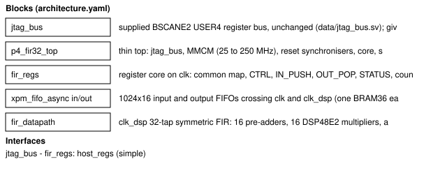

# p4_fir_dsp: p4_fir32, a 32-tap symmetric FIR filter with FIFOs and JTAG register access

<!-- Generated from handover.yaml by flow/handover.py (brief 68). Edit handover.yaml, or the text between the prose markers, then run: python -m flow.handover write runs/20261125-122959-66c4/p4_fir_dsp -->

The design is a 32-tap symmetric low-pass FIR filter (Q1.15 coefficients, 16 unique, pre-adder plus 16 DSP multipliers) for the KR260. It has 1024-sample input and output FIFOs and is controlled through a 32-bit register port fed by jtag_bus. The run stopped at rtl-design-creation after clarify and board-and-device-planning passed. Simulation produced no seeded results, verification reached V1 of V3, and no Vivado build was made. The specification and architecture were approved automatically, with no human review.

Not in scope:

- Not built or measured on hardware; no synthesis, implementation, timing, power or bitstream result exists from this run.
- Not an AXI4-Lite design; the host port is the simple h_* register port.
- Does not use any GT transceiver channel; sfp_tx_disable is a static output.
- jtag_bus.sv is not part of the simulation; it is used unchanged and contains Xilinx primitives.

Kind: agent-run; produced by the agent (agent run `20261125-122959-66c4`, [record](../summary.json)). State: spec. For an agent: [AGENT.md](AGENT.md).

Run: model claude-sonnet-5-5 (deepagents harness), 8 loops, 98 turns, 3,619,268 tokens, 1724.1 s wall time, 3.88835 USD model cost (provider-reported), stopped because: stage 2 visited more than 6 times; last failing gate: lint, simulate, design standards, verification V2; owned by the rtl/tests role; last failing assertion: V2 seeds_run: no seeded results: read runs/20261125-122959-66c4/p4_fir_dsp/build/verif/sim/seed*/results.xml and found none. The gate expects runs/20261125-122959-66c4/p4_fir_dsp/build/verif/sim/seed<N>/results.xml, one directory per seed. ; the same failure on 6 consecutive visits (from the run record).

<!-- prose:what -->
<!-- /prose:what -->

## Technical parameters

| Item | Value |
|---|---|
| Part | `xck26-sfvc784-2LV-c` |
| Board | kr260 |
| Top | `p4_fir32_top` |
| Tool | Vivado 2026.1 |

Clocks:

- `clk_25`: 25 MHz (from `runs/20261125-122959-66c4/p4_fir_dsp/design.xdc`)

Resets:

- `rst`, active high: Comes from jtag_bus, not a board pin. The spec says it is synchronised into clk_dsp and the datapath uses synchronous reset; that was not checked against the RTL here. CLEAR also resets FIFOs, history and counters.

Interfaces:

- `clk` (input clock, 25 MHz board clock on pin C3): The spec calls this port clk; design.xdc constrains a port named clk_25 with a 40 ns period (see gap).
- `led` (output, 2 bits): design.xdc puts led[0] on F8 and led[1] on E8, LVCMOS18. Per spec, led[0] is BUSY and led[1] is MMCM lock.
- `sfp_tx_disable` (output, 1 bit): design.xdc puts it on Y10, LVCMOS33. Spec requires it to be 1 at all times.
- `h_we, h_re, h_addr, h_wdata, h_rdata` (internal register port to jtag_bus (1, 1, 12, 32, 32 bits)): Not board pins. h_addr is a byte address and the port runs on the 25 MHz clock.

Registers (from spec.yaml; where the RTL differs, the gaps say so):

| Offset | Name | Access | Reset | Bits |
|---|---|---|---|---|
| 0 | `ID` | RO | 546570241 | 31:0 design ID |
| 4 | `BUILD` | RO | 0 | 31:0 USR_ACCESSE2 word |
| 8 | `SCRATCH` | RW | 0 | 31:0 scratch |
| 16 | `CTRL` | RW | 0 | 0 CLEAR self-clearing, 1 RUN self-clearing |
| 20 | `IN_PUSH` | WO | 0 | 15:0 sample to push |
| 24 | `OUT_POP` | RO | 0 | 31 valid, 15:0 oldest output, read pops |
| 28 | `STATUS` | RO | 0 | 0 BUSY, 15:4 input FIFO count, 31:20 output FIFO count |
| 32 | `SAT_COUNT` | RO | 0 | 31:0 saturated outputs since CLEAR |
| 36 | `SAMPLES_DONE` | RO | 0 | 31:0 samples processed since CLEAR |

| Parameter | Value | Legal range | Note |
|---|---|---|---|
| `NUM_TAPS` | 32 | 32 only; the pre-adder structure assumes 2 x UNIQUE_COEFFS | Symmetric taps, h[k] = h[31-k], read from data/coeffs.hex. |
| `UNIQUE_COEFFS` | 16 | NUM_TAPS / 2 | Equals the number of multipliers and DSP48E2 slices expected (16). |
| `DATA_WIDTH` | 16 | 16 only; the register fields are fixed at 16 bits | Signed sample width. |
| `COEFF_WIDTH` | 16 | 16 only (signed Q1.15) | Coefficient width. |
| `FIFO_DEPTH` | 1024 | 1024; the STATUS count fields are 12 bits wide | Applies to both FIFOs. The spec expects one BRAM36 each. |
| `ACC_WIDTH` | 38 | at least 37 bits | The spec gives a worst case of 2^35 magnitude plus margin. |
| `SHIFT` | 15 | 15 for Q1.15 | Arithmetic right shift after rounding. |
| `ROUND_CONST` | 16,384 | 2^(SHIFT-1) | This is 0x4000, added before the shift. |
| `DESIGN_ID` | 546,570,241 | any 32-bit value | Reads back as 0x20940001 in ID. |
| `MMCM_MULT` | 10 | must keep the MMCM VCO in range | 25 MHz x 10 gives clk_dsp = 250 MHz, which the spec requires to close timing; not yet measured. |
| `MMCM_DIV` | 1 | 1 or more, keeping clk_dsp at 250 MHz or faster | Divider with MMCM_MULT. |

| Quantity | Value | Source |
|---|---|---|
| Resources | not measured | [Known gaps](#known-gaps-and-limits) |
| Timing | not measured | [Known gaps](#known-gaps-and-limits) |
| Power | not measured | [Known gaps](#known-gaps-and-limits) |
| Latency | not measured | [Known gaps](#known-gaps-and-limits) |
| Throughput | not measured | [Known gaps](#known-gaps-and-limits) |

<!-- prose:parameters -->
<!-- /prose:parameters -->

## How to build, run and reproduce

| Step | Command | Heavy slot | Time |
|---|---|---|---|
| what changed since this handover (stale records, changed files, tool and knowledge-bank pins) | `python -m flow.handover fresh runs/20261125-122959-66c4/p4_fir_dsp` | no | - |
| pick the work up again from the earliest stage the change or the staleness needs; needs a model (see docs/agent.md); Vivado for any stage from synthesis on | `python -m agent resume runs/20261125-122959-66c4/p4_fir_dsp "<change request>"` | yes | - |
| run the Verifier's simulation tests; needs Icarus Verilog and cocotb, or the simulation container | `python -m pytest -q runs/20261125-122959-66c4/p4_fir_dsp/tests/test_p4_fir_dsp_rtl.py` | no | - |
| re-run the Verilator coverage simulation and the verification gates (line, toggle, functional and cover results); needs Verilator 5.036 or later and cocotb (the simulation container has them) | `SIM=verilator FDA_COVERAGE=1 FDA_SIM_RESULTS_DIR=runs/20261125-122959-66c4/p4_fir_dsp/build/verif/sim python -m pytest -q -x runs/20261125-122959-66c4/p4_fir_dsp/tests/test_p4_fir_dsp_rtl.py && python3 flow/verif_gates.py runs/20261125-122959-66c4/p4_fir_dsp --runs runs/20261125-122959-66c4/p4_fir_dsp/build/verif/sim` | no | - |
| rebuild the bitstream with the flow; needs Vivado 2026.1 and a heavy slot | `flow/run_vivado.sh runs/20261125-122959-66c4/p4_fir_dsp base` | yes | - |

Tool: Vivado 2026.1. Build ID of the inputs at handover: none (no Vivado build of this directory). Knowledge-bank pin: `5e2eab8`.

| File | What |
|---|---|
| [`runs/20261125-122959-66c4/p4_fir_dsp/spec.md`](spec.md) | the request the run started from |
| [`runs/20261125-122959-66c4/p4_fir_dsp/spec.yaml`](spec.yaml) | the specification the Clarifier wrote, approved automatically with no human review |
| [`runs/20261125-122959-66c4/p4_fir_dsp/ARCHITECTURE.md`](ARCHITECTURE.md) | the architecture note, accepted automatically before any RTL (no human review) |
| [`runs/20261125-122959-66c4/p4_fir_dsp/architecture.yaml`](architecture.yaml) | the machine-checked architecture: blocks, clocks, predicted resources |
| [`runs/20261125-122959-66c4/p4_fir_dsp/design.xdc`](design.xdc) | pin, I/O standard and timing constraints |
| [`runs/20261125-122959-66c4/p4_fir_dsp/model.py`](model.py) | the Modeller's reference model of the visible behaviour |
| [`runs/20261125-122959-66c4/p4_fir_dsp/tests/p4_fir_bench.py`](tests/p4_fir_bench.py) | the Verifier's cocotb benches and pytest entries |
| [`runs/20261125-122959-66c4/p4_fir_dsp/tests/test_p4_fir_dsp_rtl.py`](tests/test_p4_fir_dsp_rtl.py) | the Verifier's cocotb benches and pytest entries |
| [`runs/20261125-122959-66c4/p4_fir_dsp/verif/testplan.yaml`](verif/testplan.yaml) | the test plan and mutant list read by the verification gates |
| [`runs/20261125-122959-66c4/p4_fir_dsp/verif/checkers/v_macros.svh`](verif/checkers/v_macros.svh) | bound assertion and cover checkers |
| [`runs/20261125-122959-66c4/p4_fir_dsp/build/review/02_rtl-design-creation.html`](build/review/02_rtl-design-creation.html) | the review page of stage rtl-design-creation: its exit gates and their failures at the last visit |

<!-- prose:build -->
<!-- /prose:build -->

## Verified

| ID | Activity | Result | What | Evidence | Conditions |
|---|---|---|---|---|---|
| E1 | review | partial | the specification and the architecture were approved automatically, with no human review (review off; the interview oracle claude-sonnet-5-5 only answered the interview questions); the interview asked 9 questions, 0 answered and 9 defaulted | [`runs/20261125-122959-66c4/summary.json`](../summary.json) | - |
| E2 | simulation | partial | verification (flow/verif_gates.py) against the Modeller's reference model reached V1 of V3; the run asked for V2; V1 means every spec item is traced to a check and the benches use the blind model; V2 (simulation: seeded runs, a constrained-random test, bound assertions and formal tasks) did not pass: seeds run no seeded results: read runs/20261125-122959-66c4/p4_fir_dsp/build/verif/sim/seed*/results.xml and found none. The gate expects runs/20261125-122959-66c4/p4_fir_dsp/build/verif/sim/seed<N>/results.xml, one directory per seed. The flow's simulation step writes it when the bench runs through flow.cocotb_run.run(name, toplevel, sources, test_module, test_dir, parameters=..., seed=N) in tests/test_*_rtl.py: call run() once per seed (for example seed=1, 2, 3; a seed left out counts as seed 1) with the module(s) listed in bench.modules; the flow runs it and checks again. A bench that runs the simulator some other way leaves nothing there. (needs >=1 seed); constrained random test ran not evaluated (no seeded results) (needs True); assertions bound zero failures not evaluated (no seeded results) (needs bound in the run; no failure); V3 (coverage (line, toggle, functional bins, cover properties), three seeds and the mutation score) did not pass: seeds run no seeded results: read runs/20261125-122959-66c4/p4_fir_dsp/build/verif/sim/seed*/results.xml and found none. The gate expects runs/20261125-122959-66c4/p4_fir_dsp/build/verif/sim/seed<N>/results.xml, one directory per seed. The flow's simulation step writes it when the bench runs through flow.cocotb_run.run(name, toplevel, sources, test_module, test_dir, parameters=..., seed=N) in tests/test_*_rtl.py: call run() once per seed (for example seed=1, 2, 3; a seed left out counts as seed 1) with the module(s) listed in bench.modules; the flow runs it and checks again. A bench that runs the simulator some other way leaves nothing there. (needs >=3); functional bins pct not evaluated (no seeded results) (needs 100); cover properties pct not evaluated (no seeded results) (needs 100); line pct not evaluated (no seeded results) (needs 90); toggle pct not evaluated (no seeded results) (needs 75); mutation score pct not measured (needs 80); cdc structure clean missing (needs no unsafe crossing); cdc injection clean missing (needs pass); no board result (V-HW) is recorded | [`runs/20261125-122959-66c4/p4_fir_dsp/build/verif/verif_gates.json`](build/verif/verif_gates.json) | - |

Gates at handover: `clarify` pass, `board-and-device-planning` pass, `rtl-design-creation` fail, `constraints` not-run, `synthesis` not-run, `implementation` not-run, `timing-closure` not-run, `power-closure` not-run, `drc-closure` not-run, `configuration-and-debug` not-run.

<!-- prose:verified -->
<!-- /prose:verified -->

## Measured

Every value is read from the record by `python -m flow.handover fill`, not typed.

| ID | What | Value | Runs | Source | Conditions |
|---|---|---|---|---|---|
| M1 | model cost of the run, provider-reported | 3.88835 USD | 1 | [`runs/20261125-122959-66c4/summary.json`](../summary.json) `cost_usd` | every role and the interview oracle, as the run summary records it |

<!-- prose:measured -->
<!-- /prose:measured -->

## Known gaps and limits

- **REQ-01**: REQ-01 has no passing evidence for every proof method: simulation (p4_fir_bench.test_smoke_reset_id_scratch) is pending: no simulation results; hardware (uart_tests) is pending: no bring-up result
- **REQ-02**: REQ-02 has no passing evidence for every proof method: hardware (uart_tests) is pending: no bring-up result
- **REQ-03**: REQ-03 has no passing evidence for every proof method: simulation (p4_fir_bench.test_smoke_reset_id_scratch) is pending: no simulation results; hardware (uart_tests) is pending: no bring-up result
- **REQ-04**: REQ-04 has no passing evidence for every proof method: simulation (p4_fir_bench.test_unmapped) is pending: no simulation results
- **REQ-05**: REQ-05 has no passing evidence for every proof method: simulation (p4_fir_bench.test_unmapped) is pending: no simulation results
- **REQ-06**: REQ-06 has no passing evidence for every proof method: simulation (p4_fir_bench.test_read_latency_hold) is pending: no simulation results; formal (p4_fir_bench.test_read_latency_hold) is pending: re-planned from formal to simulation (SymbiYosys is not installed here, so the read latency is checked in simulation.): no simulation results
- **REQ-07**: REQ-07 has no passing evidence for every proof method: simulation (p4_fir_bench.test_random_register_traffic) is pending: no simulation results; hardware (uart_tests) is pending: no bring-up result
- **REQ-08**: REQ-08 has no passing evidence for every proof method: simulation (p4_fir_bench.test_impulse) is pending: no simulation results
- **REQ-09**: REQ-09 has no passing evidence for every proof method: simulation (p4_fir_bench.test_step) is pending: no simulation results
- **REQ-10**: REQ-10 has no passing evidence for every proof method: simulation (p4_fir_bench.test_random_chunks_10x1000) is pending: no simulation results; hardware (uart_tests) is pending: no bring-up result
- **REQ-11**: REQ-11 has no passing evidence for every proof method: simulation (p4_fir_bench.test_impulse) is pending: no simulation results
- **REQ-12**: REQ-12 has no passing evidence for every proof method: simulation (p4_fir_bench.test_clear) is pending: no simulation results
- **REQ-13**: REQ-13 has no passing evidence for every proof method: simulation (p4_fir_bench.test_busy_and_throughput) is pending: no simulation results
- **REQ-14**: REQ-14 has no passing evidence for every proof method: analysis (post_route:setup) is pending: no flow gates result
- **REQ-15**: REQ-15 has no passing evidence for every proof method: analysis (post_synth:post_synth_resources_in_range) is pending: no flow gates result
- **REQ-16**: REQ-16 has no passing evidence for every proof method: analysis (post_synth:post_synth_resources_in_range) is pending: no flow gates result
- **REQ-17**: REQ-17 has no passing evidence for every proof method: analysis (post_route:setup) is pending: no flow gates result
- **REQ-18**: REQ-18 has no passing evidence for every proof method: simulation (p4_fir_bench.test_input_fifo_full) is pending: no simulation results; formal (p4_fir_bench.test_input_fifo_full) is pending: re-planned from formal to simulation (SymbiYosys is not installed here, so the 1024 depth is checked by filling the FIFO in simulation.): no simulation results
- **REQ-19**: REQ-19 has no passing evidence for every proof method: simulation (p4_fir_bench.test_input_fifo_full) is pending: no simulation results; formal (p4_fir_bench.test_input_fifo_full) is pending: re-planned from formal to simulation (SymbiYosys is not installed here, so the full-FIFO push is checked in simulation.): no simulation results
- **REQ-20**: REQ-20 has no passing evidence for every proof method: simulation (p4_fir_bench.test_output_fifo_full_stall) is pending: no simulation results
- **REQ-21**: REQ-21 has no passing evidence for every proof method: simulation (p4_fir_bench.test_pop_empty_and_valid) is pending: no simulation results; formal (p4_fir_bench.test_pop_empty_and_valid) is pending: re-planned from formal to simulation (SymbiYosys is not installed here, so OUT_POP behaviour is checked in simulation.): no simulation results
- **REQ-22**: REQ-22 has no passing evidence for every proof method: simulation (p4_fir_bench.test_pop_empty_and_valid) is pending: no simulation results
- **REQ-23**: REQ-23 has no passing evidence for every proof method: simulation (p4_fir_bench.test_random_chunks_10x1000) is pending: no simulation results; hardware (uart_tests) is pending: no bring-up result
- **REQ-24**: REQ-24 has no passing evidence for every proof method: simulation (p4_fir_bench.test_busy_and_throughput) is pending: no simulation results
- **REQ-25**: REQ-25 has no passing evidence for every proof method: simulation (p4_fir_bench.test_input_fifo_full) is pending: no simulation results
- **REQ-26**: REQ-26 has no passing evidence for every proof method: simulation (p4_fir_bench.test_output_fifo_full_stall) is pending: no simulation results
- **REQ-27**: REQ-27 has no passing evidence for every proof method: simulation (p4_fir_bench.test_clear) is pending: no simulation results
- **REQ-28**: REQ-28 has no passing evidence for every proof method: simulation (p4_fir_bench.test_clear) is pending: no simulation results
- **REQ-29**: REQ-29 has no passing evidence for every proof method: simulation (p4_fir_bench.test_clear) is pending: no simulation results
- **REQ-30**: REQ-30 has no passing evidence for every proof method: simulation (p4_fir_bench.test_write_latency_ctrl_selfclear) is pending: no simulation results
- **REQ-31**: REQ-31 has no passing evidence for every proof method: simulation (p4_fir_bench.test_saturation) is pending: no simulation results; hardware (uart_tests) is pending: no bring-up result
- **REQ-32**: REQ-32 has no passing evidence for every proof method: simulation (p4_fir_bench.test_saturation) is pending: no simulation results
- **REQ-33**: REQ-33 has no passing evidence for every proof method: analysis (post_route:setup) is pending: no flow gates result
- **REQ-34**: REQ-34 has no passing evidence for every proof method: simulation (p4_fir_bench.test_sfp_tx_disable) is pending: no simulation results; formal (p4_fir_bench.test_sfp_tx_disable) is pending: re-planned from formal to simulation (SymbiYosys is not installed here, so the constant-1 output is checked in simulation under random traffic and reset.): no simulation results; hardware (uart_tests) is pending: no bring-up result
- **REQ-35**: REQ-35 has no passing evidence for every proof method: analysis (post_synth:post_synth_resources_in_range) is pending: no flow gates result
- **REQ-36**: REQ-36 has no passing evidence for every proof method: analysis (post_synth:post_synth_resources_in_range) is pending: no flow gates result
- **REQ-37**: REQ-37 has no passing evidence for every proof method: simulation (p4_fir_bench.test_smoke_reset_id_scratch) is pending: no simulation results; hardware (uart_tests) is pending: no bring-up result
- **REQ-38**: REQ-38 has no passing evidence for every proof method: simulation (p4_fir_bench.test_read_latency_hold) is pending: no simulation results; formal (p4_fir_bench.test_read_latency_hold) is pending: re-planned from formal to simulation (SymbiYosys is not installed here, so h_rdata hold is checked in simulation.): no simulation results
- **REQ-39**: REQ-39 has no passing evidence for every proof method: simulation (p4_fir_bench.test_write_latency_ctrl_selfclear) is pending: no simulation results
- **E1**: review evidence is partial: the specification and the architecture were approved automatically, with no human review (review off; the interview oracle claude-sonnet-5-5 only answered the interview questions); the interview asked 9 questions, 0 answered and 9 defaulted
- **E2**: simulation evidence is partial: verification reached V1 of V3 (the run asked for V2); the checks that did not pass or did not run are listed in the evidence row
- **rtl-design-creation**: stage rtl-design-creation did not pass its gates in this run; at its last visit: lint not passing FAIL simulate not passing FAIL standards STD-LATCH-01: not checked (no build.yaml top or sources to check) FAIL standards STD-LOOP-01: not checked (no build.yaml top or sources to check) FAIL standards STD-CDC-01: architecture.yaml:1: crossings[0]: inline_in fir_regs is not a module of this design or the shell FAIL standards STD-CDC-01: architecture.yaml:1: crossings[1]: inline_in ...
- **constraints**: stage constraints was not run: the run stopped before this stage (stage 2 visited more than 6 times; last failing gate: lint, simulate, design standards, verification V2; owned by the rtl/tests role; last failing assertion: V2 seeds_run: no seeded results: read runs/20261125-122959-66c4/p4_fir_dsp/build/verif/sim/seed*/results.xml and found none. The gate expects runs/20261125-122959-66c4/p4_fir_dsp/build/verif/sim/seed<N>/results.xml, one directory per seed. ; the same failure on 6 consecutive visits)
- **synthesis**: stage synthesis was not run: the run stopped before this stage (stage 2 visited more than 6 times; last failing gate: lint, simulate, design standards, verification V2; owned by the rtl/tests role; last failing assertion: V2 seeds_run: no seeded results: read runs/20261125-122959-66c4/p4_fir_dsp/build/verif/sim/seed*/results.xml and found none. The gate expects runs/20261125-122959-66c4/p4_fir_dsp/build/verif/sim/seed<N>/results.xml, one directory per seed. ; the same failure on 6 consecutive visits)
- **implementation**: stage implementation was not run: the run stopped before this stage (stage 2 visited more than 6 times; last failing gate: lint, simulate, design standards, verification V2; owned by the rtl/tests role; last failing assertion: V2 seeds_run: no seeded results: read runs/20261125-122959-66c4/p4_fir_dsp/build/verif/sim/seed*/results.xml and found none. The gate expects runs/20261125-122959-66c4/p4_fir_dsp/build/verif/sim/seed<N>/results.xml, one directory per seed. ; the same failure on 6 consecutive visits)
- **timing-closure**: stage timing-closure was not run: the run stopped before this stage (stage 2 visited more than 6 times; last failing gate: lint, simulate, design standards, verification V2; owned by the rtl/tests role; last failing assertion: V2 seeds_run: no seeded results: read runs/20261125-122959-66c4/p4_fir_dsp/build/verif/sim/seed*/results.xml and found none. The gate expects runs/20261125-122959-66c4/p4_fir_dsp/build/verif/sim/seed<N>/results.xml, one directory per seed. ; the same failure on 6 consecutive visits)
- **power-closure**: stage power-closure was not run: the run stopped before this stage (stage 2 visited more than 6 times; last failing gate: lint, simulate, design standards, verification V2; owned by the rtl/tests role; last failing assertion: V2 seeds_run: no seeded results: read runs/20261125-122959-66c4/p4_fir_dsp/build/verif/sim/seed*/results.xml and found none. The gate expects runs/20261125-122959-66c4/p4_fir_dsp/build/verif/sim/seed<N>/results.xml, one directory per seed. ; the same failure on 6 consecutive visits)
- **drc-closure**: stage drc-closure was not run: the run stopped before this stage (stage 2 visited more than 6 times; last failing gate: lint, simulate, design standards, verification V2; owned by the rtl/tests role; last failing assertion: V2 seeds_run: no seeded results: read runs/20261125-122959-66c4/p4_fir_dsp/build/verif/sim/seed*/results.xml and found none. The gate expects runs/20261125-122959-66c4/p4_fir_dsp/build/verif/sim/seed<N>/results.xml, one directory per seed. ; the same failure on 6 consecutive visits)
- **configuration-and-debug**: stage configuration-and-debug was not run: the run stopped before this stage (stage 2 visited more than 6 times; last failing gate: lint, simulate, design standards, verification V2; owned by the rtl/tests role; last failing assertion: V2 seeds_run: no seeded results: read runs/20261125-122959-66c4/p4_fir_dsp/build/verif/sim/seed*/results.xml and found none. The gate expects runs/20261125-122959-66c4/p4_fir_dsp/build/verif/sim/seed<N>/results.xml, one directory per seed. ; the same failure on 6 consecutive visits)
- **formal**: formal checks were planned for REQ-06, REQ-18, REQ-19, REQ-21, REQ-34, REQ-38 and did not run; each was replaced by a simulation check (verif/testplan.yaml replan). Reason recorded: SymbiYosys is not installed here, so the read latency is checked in simulation.
- **resources**: resources not measured: no current Vivado build of this design has been recorded
- **timing**: timing not measured: no current Vivado build of this design has been recorded
- **power**: power not measured: no current Vivado build of this design has been recorded
- **latency**: latency not measured: the run measured no latency; the spec's latency promise is checked only by the benches
- **throughput**: throughput not measured: the run measured no throughput
- **clock_port_name**: spec.yaml names the clock port clk, but design.xdc constrains a port named clk_25 (pin C3, 40 ns period, LVCMOS18). The XDC is what was built; the spec disagrees. The spec's clk_dsp (250 MHz from the MMCM) has no constraint in design.xdc and is not listed as a clock in this handover.
- **spec_vs_rtl_unchecked**: The RTL sources were not shown to the Designer for this handover, so reset style, reset values, unmapped accesses and the read and write latencies are given as the spec states them. They are not confirmed from the RTL; the benches that would check them produced no results.
- **defaulted_behaviour**: All 9 interview answers were defaulted, not given by a person. Behaviours a user could guess wrong: CLEAR wins over RUN when both are written together; RUN while BUSY is ignored; CTRL reads 0 because both bits self-clear; a read of OUT_POP on an empty FIFO returns 0 with no side effect; IN_PUSH while full is ignored; IN_PUSH during a run may or may not be processed in that run; the datapath stalls when the output FIFO is full so no result is lost; SAT_COUNT and SAMPLES_DONE are 32 bits and wrap at 2^32; unmapped addresses read 0 and ignore writes.
- **latency_promise**: The spec promises h_rdata within 2 clk cycles of h_re, writes effective 1 clk cycle after h_we, and a filter pipeline of about 6 to 8 clk_dsp cycles. None of these was counted from the RTL here.
- **architecture_crossings**: The standards gate reports architecture.yaml crossings that name inline_in fir_regs, which is not a module of the design or the shell. The CDC description in architecture.yaml needs to match the real module names.

<!-- prose:gaps -->
<!-- /prose:gaps -->

## Next steps

1. Fix the earliest failing stage, rtl-design-creation: first make the benches run through flow.cocotb_run.run(...) once per seed (seed 1, 2, 3) so that seeded results.xml files exist under build/verif/sim, then clear the lint, simulate and STD-CDC-01 failures listed on the review page.
2. Correct the crossings in architecture.yaml so inline_in names a real module, and rerun the design standards check.
3. Re-run the Verilator coverage command and flow/verif_gates.py. If cover properties are unhit while functional bins are hit, compare the cover results with the functional coverage before adding any new stimulus.
4. Reconcile the clock port name between spec.yaml (clk) and design.xdc (clk_25), and add a clk_dsp constraint.
5. Once verification passes, resume with python -m agent resume to run constraints, synthesis and implementation, then record resources, timing at 250 MHz and power.

Open questions:

- Should the spec or the XDC change to settle the clock port name (clk or clk_25)?
- Should the formal checks be restored if SymbiYosys becomes available, or stay as simulation checks?

<!-- prose:next -->
<!-- /prose:next -->

## History

| Date | Brief | PR | What |
|---|---|---|---|
| 2026-11-25 | agent run | - | produced by the agent graph; stages that passed: clarify, board-and-device-planning |

<!-- prose:history -->
<!-- /prose:history -->
