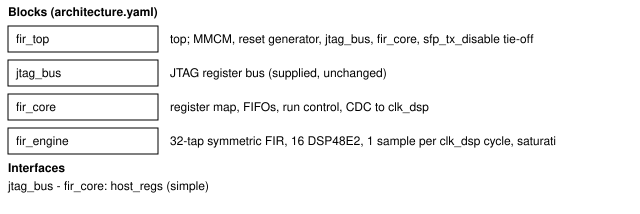

# p4_fir_dsp: 32-tap symmetric FIR low-pass filter with FIFOs and a JTAG register bus (KR260)

<!-- Generated from handover.yaml by flow/handover.py (brief 68). Edit handover.yaml, or the text between the prose markers, then run: python -m flow.handover write runs/20261125-130418-8166/p4_fir_dsp -->

The design is a 32-tap symmetric FIR filter. It adds mirrored taps before 16 multiplications, takes input samples through an input FIFO and returns saturated 16-bit results through an output FIFO. A host drives it over a simple register port behind a JTAG bridge. The run stopped in rtl-design-creation, after the clarify and board-and-device-planning stages passed. Verification reached V1 of V3, no Vivado build was made, and nothing was measured on hardware.

Not in scope:

- Not a general FIR core. Coefficients come from data/coeffs.hex at build time and cannot be changed at run time.
- Not an AXI4-Lite design. The host port is the h_we/h_re register port and no interface profile is declared.
- Not a transceiver design. No GT channel is used and sfp_tx_disable is a constant output.
- Not built, routed or run on a board. No bitstream was produced in this run.

Kind: agent-run; produced by the agent (agent run `20261125-130418-8166`, [record](../summary.json)). State: spec. For an agent: [AGENT.md](AGENT.md).

Run: model claude-sonnet-5-5 (deepagents harness), 7 loops, 107 turns, 3,813,241 tokens, 1555.5 s wall time, 3.46926 USD model cost (provider-reported), stopped because: stage 2 visited more than 6 times; last failing gate: lint, simulate, design standards, verification V2; owned by the rtl/tests role; last failing assertion: V2 seeds_run: no seeded results: read runs/20261125-130418-8166/p4_fir_dsp/build/verif/sim/seed*/results.xml and found none. The gate expects runs/20261125-130418-8166/p4_fir_dsp/build/verif/sim/seed<N>/results.xml, one directory per seed. ; the same failure on 6 consecutive visits (from the run record).

<!-- prose:what -->
<!-- /prose:what -->

## Technical parameters

| Item | Value |
|---|---|
| Part | `xck26-sfvc784-2LV-c` |
| Board | kr260 |
| Top | `fir_top` |
| Tool | Vivado 2026.1 |

Clocks:

- `clk_25`: 25 MHz (from `runs/20261125-130418-8166/p4_fir_dsp/design.xdc`)

Resets:

- `rst`, active high: Per spec.yaml it is synchronous in each clock domain, held by a power-up counter in the clk_bus domain and released only after MMCM lock. The RTL was not shown in this review, so the reset style actually built is unchecked.

Interfaces:

- `clk_25` (input clock, 25 MHz, pin C3, LVCMOS18): Board clock. It feeds the MMCM and is also the register bus clock (design.xdc, period 40.00 ns).
- `led` (2-bit output, F8 and E8, LVCMOS18): The spec proposes led[0] = BUSY and led[1] = MMCM locked. This is a default and not confirmed by hardware. design.xdc maps led[0] to F8 and led[1] to E8.
- `sfp_tx_disable` (1-bit output, Y10, LVCMOS33): Constant 1, which turns the laser off.

Registers (from spec.yaml; where the RTL differs, the gaps say so):

| Offset | Name | Access | Reset | Bits |
|---|---|---|---|---|
| 0 | `ID` | RO | 546570241 | 31:0 design ID |
| 4 | `BUILD` | RO | 0 | 31:0 USR_ACCESSE2 word |
| 8 | `SCRATCH` | RW | 0 | 31:0 read back what was written |
| 16 | `CTRL` | RW | 0 | 0 CLEAR self-clearing, 1 RUN self-clearing |
| 20 | `IN_PUSH` | WO | 0 | 15:0 sample pushed |
| 24 | `OUT_POP` | RO | 0 | 31 valid, 15:0 oldest output, read pops |
| 28 | `STATUS` | RO | 0 | 0 BUSY, 15:4 input FIFO count, 31:20 output FIFO count |
| 32 | `SAT_COUNT` | RO | 0 | 31:0 saturated outputs since CLEAR |
| 36 | `SAMPLES_DONE` | RO | 0 | 31:0 samples processed since CLEAR |

| Parameter | Value | Legal range | Note |
|---|---|---|---|
| `NUM_TAPS` | 32 | 32 only; the symmetric pre-add structure assumes it | Number of filter taps. The coefficients are symmetric, h[k]=h[31-k]. |
| `UNIQUE_COEFFS` | 16 | NUM_TAPS/2 | Number of multipliers after pre-adding. It is 16 DSP48E2 slices in the architecture. |
| `DATA_WIDTH` | 16 | 16 only | Signed sample width. The pre-adder output is 17 bits. |
| `COEFF_WIDTH` | 16 | 16 only | Signed Q1.15 coefficients. |
| `FIFO_DEPTH` | 1024 | 1024 as specified | Depth of each FIFO. STATUS count fields are 12 bits wide. |
| `SHIFT` | 15 | 15 only | Right shift after rounding, matching the Q1.15 coefficients. |
| `ROUND_CONST` | 16,384 | 2^(SHIFT-1) | Rounding constant 0x4000 added before the shift. |
| `ID_VALUE` | 546,570,241 | any 32-bit value | Read from the ID register. It equals 0x20940001. |
| `SFP_TX_DISABLE_VALUE` | 1 | 1 (laser off) as specified | Level driven on sfp_tx_disable. |

| Quantity | Value | Source |
|---|---|---|
| Resources | not measured | [Known gaps](#known-gaps-and-limits) |
| Timing | not measured | [Known gaps](#known-gaps-and-limits) |
| Power | not measured | [Known gaps](#known-gaps-and-limits) |
| Latency | not measured | [Known gaps](#known-gaps-and-limits) |
| Throughput | not measured | [Known gaps](#known-gaps-and-limits) |

<!-- prose:parameters -->
<!-- /prose:parameters -->

## How to build, run and reproduce

| Step | Command | Heavy slot | Time |
|---|---|---|---|
| what changed since this handover (stale records, changed files, tool and knowledge-bank pins) | `python -m flow.handover fresh runs/20261125-130418-8166/p4_fir_dsp` | no | - |
| pick the work up again from the earliest stage the change or the staleness needs; needs a model (see docs/agent.md); Vivado for any stage from synthesis on | `python -m agent resume runs/20261125-130418-8166/p4_fir_dsp "<change request>"` | yes | - |
| run the Verifier's simulation tests; needs Icarus Verilog and cocotb, or the simulation container | `python -m pytest -q runs/20261125-130418-8166/p4_fir_dsp/tests/test_p4_fir_dsp_rtl.py` | no | - |
| re-run the Verilator coverage simulation and the verification gates (line, toggle, functional and cover results); needs Verilator 5.036 or later and cocotb (the simulation container has them) | `SIM=verilator FDA_COVERAGE=1 FDA_SIM_RESULTS_DIR=runs/20261125-130418-8166/p4_fir_dsp/build/verif/sim python -m pytest -q -x runs/20261125-130418-8166/p4_fir_dsp/tests/test_p4_fir_dsp_rtl.py && python3 flow/verif_gates.py runs/20261125-130418-8166/p4_fir_dsp --runs runs/20261125-130418-8166/p4_fir_dsp/build/verif/sim` | no | - |
| rebuild the bitstream with the flow; needs Vivado 2026.1 and a heavy slot | `flow/run_vivado.sh runs/20261125-130418-8166/p4_fir_dsp base` | yes | - |

Tool: Vivado 2026.1. Build ID of the inputs at handover: none (no Vivado build of this directory). Knowledge-bank pin: `5e2eab8`.

| File | What |
|---|---|
| [`runs/20261125-130418-8166/p4_fir_dsp/spec.md`](spec.md) | the request the run started from |
| [`runs/20261125-130418-8166/p4_fir_dsp/spec.yaml`](spec.yaml) | the specification the Clarifier wrote, approved automatically with no human review |
| [`runs/20261125-130418-8166/p4_fir_dsp/ARCHITECTURE.md`](ARCHITECTURE.md) | the architecture note, accepted automatically before any RTL (no human review) |
| [`runs/20261125-130418-8166/p4_fir_dsp/architecture.yaml`](architecture.yaml) | the machine-checked architecture: blocks, clocks, predicted resources |
| [`runs/20261125-130418-8166/p4_fir_dsp/design.xdc`](design.xdc) | pin, I/O standard and timing constraints |
| [`runs/20261125-130418-8166/p4_fir_dsp/model.py`](model.py) | the Modeller's reference model of the visible behaviour |
| [`runs/20261125-130418-8166/p4_fir_dsp/tests/fir_bench.py`](tests/fir_bench.py) | the Verifier's cocotb benches and pytest entries |
| [`runs/20261125-130418-8166/p4_fir_dsp/tests/test_p4_fir_dsp_rtl.py`](tests/test_p4_fir_dsp_rtl.py) | the Verifier's cocotb benches and pytest entries |
| [`runs/20261125-130418-8166/p4_fir_dsp/verif/testplan.yaml`](verif/testplan.yaml) | the test plan and mutant list read by the verification gates |
| [`runs/20261125-130418-8166/p4_fir_dsp/verif/checkers/v_macros.svh`](verif/checkers/v_macros.svh) | bound assertion and cover checkers |
| [`runs/20261125-130418-8166/p4_fir_dsp/build/review/02_rtl-design-creation.html`](build/review/02_rtl-design-creation.html) | the review page of stage rtl-design-creation: its exit gates and their failures at the last visit |

<!-- prose:build -->
<!-- /prose:build -->

## Verified

| ID | Activity | Result | What | Evidence | Conditions |
|---|---|---|---|---|---|
| E1 | review | partial | the specification and the architecture were approved automatically, with no human review (review off; the interview oracle claude-sonnet-5-5 only answered the interview questions); the interview asked 7 questions, 0 answered and 7 defaulted | [`runs/20261125-130418-8166/summary.json`](../summary.json) | - |
| E2 | simulation | partial | verification (flow/verif_gates.py) against the Modeller's reference model reached V1 of V3; the run asked for V2; V1 means every spec item is traced to a check and the benches use the blind model; V2 (simulation: seeded runs, a constrained-random test, bound assertions and formal tasks) did not pass: seeds run no seeded results: read runs/20261125-130418-8166/p4_fir_dsp/build/verif/sim/seed*/results.xml and found none. The gate expects runs/20261125-130418-8166/p4_fir_dsp/build/verif/sim/seed<N>/results.xml, one directory per seed. The flow's simulation step writes it when the bench runs through flow.cocotb_run.run(name, toplevel, sources, test_module, test_dir, parameters=..., seed=N) in tests/test_*_rtl.py: call run() once per seed (for example seed=1, 2, 3; a seed left out counts as seed 1) with the module(s) listed in bench.modules; the flow runs it and checks again. A bench that runs the simulator some other way leaves nothing there. (needs >=1 seed); constrained random test ran not evaluated (no seeded results) (needs True); assertions bound zero failures not evaluated (no seeded results) (needs bound in the run; no failure); V3 (coverage (line, toggle, functional bins, cover properties), three seeds and the mutation score) did not pass: seeds run no seeded results: read runs/20261125-130418-8166/p4_fir_dsp/build/verif/sim/seed*/results.xml and found none. The gate expects runs/20261125-130418-8166/p4_fir_dsp/build/verif/sim/seed<N>/results.xml, one directory per seed. The flow's simulation step writes it when the bench runs through flow.cocotb_run.run(name, toplevel, sources, test_module, test_dir, parameters=..., seed=N) in tests/test_*_rtl.py: call run() once per seed (for example seed=1, 2, 3; a seed left out counts as seed 1) with the module(s) listed in bench.modules; the flow runs it and checks again. A bench that runs the simulator some other way leaves nothing there. (needs >=3); functional bins pct not evaluated (no seeded results) (needs 100); cover properties pct not evaluated (no seeded results) (needs 100); line pct not evaluated (no seeded results) (needs 90); toggle pct not evaluated (no seeded results) (needs 75); mutation score pct not measured (needs 80); cdc structure clean missing (needs no unsafe crossing); cdc injection clean missing (needs pass); no board result (V-HW) is recorded | [`runs/20261125-130418-8166/p4_fir_dsp/build/verif/verif_gates.json`](build/verif/verif_gates.json) | - |

Gates at handover: `clarify` pass, `board-and-device-planning` pass, `rtl-design-creation` fail, `constraints` not-run, `synthesis` not-run, `implementation` not-run, `timing-closure` not-run, `power-closure` not-run, `drc-closure` not-run, `configuration-and-debug` not-run.

<!-- prose:verified -->
<!-- /prose:verified -->

## Measured

Every value is read from the record by `python -m flow.handover fill`, not typed.

| ID | What | Value | Runs | Source | Conditions |
|---|---|---|---|---|---|
| M1 | model cost of the run, provider-reported | 3.46926 USD | 1 | [`runs/20261125-130418-8166/summary.json`](../summary.json) `cost_usd` | every role and the interview oracle, as the run summary records it |

<!-- prose:measured -->
<!-- /prose:measured -->

## Known gaps and limits

- **REQ-01**: REQ-01 has no passing evidence for every proof method: simulation (fir_bench.test_reset_and_id) is pending: no simulation results; hardware (uart_tests) is pending: no bring-up result
- **REQ-02**: REQ-02 has no passing evidence for every proof method: hardware (uart_tests) is pending: no bring-up result
- **REQ-03**: REQ-03 has no passing evidence for every proof method: simulation (fir_bench.test_reset_and_id) is pending: no simulation results; hardware (uart_tests) is pending: no bring-up result
- **REQ-37**: REQ-37 has no passing evidence for every proof method: simulation (fir_bench.test_scratch_unmapped) is pending: no simulation results; hardware (uart_tests) is pending: no bring-up result
- **REQ-04**: REQ-04 has no passing evidence for every proof method: simulation (fir_bench.test_reset_and_id) is pending: no simulation results
- **REQ-38**: REQ-38 has no passing evidence for every proof method: simulation (fir_bench.test_scratch_unmapped) is pending: no simulation results
- **REQ-05**: REQ-05 has no passing evidence for every proof method: simulation (fir_bench.test_rdata_hold) is pending: no simulation results; formal (fir_bench.test_rdata_hold) is pending: re-planned from formal to simulation (SymbiYosys is not installed here so the read latency claim is checked by simulation.): no simulation results
- **REQ-39**: REQ-39 has no passing evidence for every proof method: simulation (fir_bench.test_rdata_hold) is pending: no simulation results; formal (fir_bench.test_rdata_hold) is pending: re-planned from formal to simulation (SymbiYosys is not installed here so the hold claim is checked by simulation.): no simulation results
- **REQ-06**: REQ-06 has no passing evidence for every proof method: simulation (fir_bench.test_random_chunks) is pending: no simulation results; hardware (uart_tests) is pending: no bring-up result
- **REQ-07**: REQ-07 has no passing evidence for every proof method: simulation (fir_bench.test_impulse_unit) is pending: no simulation results
- **REQ-08**: REQ-08 has no passing evidence for every proof method: simulation (fir_bench.test_impulse) is pending: no simulation results
- **REQ-09**: REQ-09 has no passing evidence for every proof method: simulation (fir_bench.test_impulse) is pending: no simulation results; hardware (uart_tests) is pending: no bring-up result
- **REQ-10**: REQ-10 has no passing evidence for every proof method: simulation (fir_bench.test_step) is pending: no simulation results; hardware (uart_tests) is pending: no bring-up result
- **REQ-11**: REQ-11 has no passing evidence for every proof method: simulation (fir_bench.test_random_chunks) is pending: no simulation results; hardware (uart_tests) is pending: no bring-up result
- **REQ-12**: REQ-12 has no passing evidence for every proof method: analysis (post_synth:post_synth_resources_in_range) is pending: no flow gates result
- **REQ-13**: REQ-13 has no passing evidence for every proof method: analysis (post_synth:post_synth_resources_in_range) is pending: no flow gates result
- **REQ-14**: REQ-14 has no passing evidence for every proof method: simulation (fir_bench.test_busy_and_throughput) is pending: no simulation results
- **REQ-15**: REQ-15 has no passing evidence for every proof method: analysis (post_route:setup) is pending: no flow gates result
- **REQ-16**: REQ-16 has no passing evidence for every proof method: analysis (post_synth:post_synth_resources_in_range) is pending: no flow gates result
- **REQ-44**: REQ-44 has no passing evidence for every proof method: analysis (post_route:setup) is pending: no flow gates result
- **REQ-17**: REQ-17 has no passing evidence for every proof method: simulation (fir_bench.test_fifo_capacity) is pending: no simulation results
- **REQ-40**: REQ-40 has no passing evidence for every proof method: simulation (fir_bench.test_fifo_capacity) is pending: no simulation results
- **REQ-18**: REQ-18 has no passing evidence for every proof method: simulation (fir_bench.test_fifo_capacity) is pending: no simulation results
- **REQ-19**: REQ-19 has no passing evidence for every proof method: simulation (fir_bench.test_chunked_equals_single) is pending: no simulation results; hardware (uart_tests) is pending: no bring-up result
- **REQ-20**: REQ-20 has no passing evidence for every proof method: simulation (fir_bench.test_control_clear_history) is pending: no simulation results
- **REQ-21**: REQ-21 has no passing evidence for every proof method: simulation (fir_bench.test_chunked_equals_single) is pending: no simulation results
- **REQ-22**: REQ-22 has no passing evidence for every proof method: simulation (fir_bench.test_chunked_equals_single) is pending: no simulation results; formal (fir_bench.test_chunked_equals_single) is pending: re-planned from formal to simulation (SymbiYosys is not installed here so the OUT_POP format is checked by simulation.): no simulation results
- **REQ-41**: REQ-41 has no passing evidence for every proof method: simulation (fir_bench.test_chunked_equals_single) is pending: no simulation results; formal (fir_bench.test_chunked_equals_single) is pending: re-planned from formal to simulation (SymbiYosys is not installed here so pop removing the oldest is checked by simulation.): no simulation results
- **REQ-23**: REQ-23 has no passing evidence for every proof method: simulation (fir_bench.test_chunked_equals_single) is pending: no simulation results
- **REQ-24**: REQ-24 has no passing evidence for every proof method: simulation (fir_bench.test_busy_and_throughput) is pending: no simulation results
- **REQ-25**: REQ-25 has no passing evidence for every proof method: simulation (fir_bench.test_fifo_capacity) is pending: no simulation results
- **REQ-26**: REQ-26 has no passing evidence for every proof method: simulation (fir_bench.test_fifo_capacity) is pending: no simulation results
- **REQ-27**: REQ-27 has no passing evidence for every proof method: simulation (fir_bench.test_control_clear_history) is pending: no simulation results
- **REQ-28**: REQ-28 has no passing evidence for every proof method: simulation (fir_bench.test_control_clear_history) is pending: no simulation results
- **REQ-29**: REQ-29 has no passing evidence for every proof method: simulation (fir_bench.test_control_clear_history) is pending: no simulation results
- **REQ-42**: REQ-42 has no passing evidence for every proof method: simulation (fir_bench.test_control_clear_history) is pending: no simulation results
- **REQ-30**: REQ-30 has no passing evidence for every proof method: simulation (fir_bench.test_control_clear_history) is pending: no simulation results
- **REQ-43**: REQ-43 has no passing evidence for every proof method: simulation (fir_bench.test_control_clear_history) is pending: no simulation results
- **REQ-31**: REQ-31 has no passing evidence for every proof method: simulation (fir_bench.test_saturation) is pending: no simulation results; hardware (uart_tests) is pending: no bring-up result
- **REQ-32**: REQ-32 has no passing evidence for every proof method: simulation (fir_bench.test_random_chunks) is pending: no simulation results; hardware (uart_tests) is pending: no bring-up result
- **REQ-33**: REQ-33 has no passing evidence for every proof method: formal (fir_bench.test_led_sfp) is pending: re-planned from formal to simulation (SymbiYosys is not installed here so the constant output is checked by simulation.): no simulation results; analysis (post_synth:post_synth_resources_in_range) is pending: no flow gates result
- **REQ-34**: REQ-34 has no passing evidence for every proof method: analysis (post_synth:post_synth_resources_in_range) is pending: no flow gates result
- **REQ-35**: REQ-35 has no passing evidence for every proof method: analysis (post_synth:post_synth_resources_in_range) is pending: no flow gates result
- **REQ-36**: REQ-36 has no passing evidence for every proof method: analysis (post_route:setup) is pending: no flow gates result
- **E1**: review evidence is partial: the specification and the architecture were approved automatically, with no human review (review off; the interview oracle claude-sonnet-5-5 only answered the interview questions); the interview asked 7 questions, 0 answered and 7 defaulted
- **E2**: simulation evidence is partial: verification reached V1 of V3 (the run asked for V2); the checks that did not pass or did not run are listed in the evidence row
- **rtl-design-creation**: stage rtl-design-creation did not pass its gates in this run; at its last visit: lint not passing FAIL simulate not passing FAIL standards STD-LATCH-01: not checked (no build.yaml top or sources to check) FAIL standards STD-LOOP-01: not checked (no build.yaml top or sources to check) FAIL standards STD-CDC-01: architecture.yaml:1: crossings[0]: inline_in fir_core is not a module of this design or the shell FAIL standards STD-CDC-01: architecture.yaml:1: crossings[1]: inline_in ...
- **constraints**: stage constraints was not run: the run stopped before this stage (stage 2 visited more than 6 times; last failing gate: lint, simulate, design standards, verification V2; owned by the rtl/tests role; last failing assertion: V2 seeds_run: no seeded results: read runs/20261125-130418-8166/p4_fir_dsp/build/verif/sim/seed*/results.xml and found none. The gate expects runs/20261125-130418-8166/p4_fir_dsp/build/verif/sim/seed<N>/results.xml, one directory per seed. ; the same failure on 6 consecutive visits)
- **synthesis**: stage synthesis was not run: the run stopped before this stage (stage 2 visited more than 6 times; last failing gate: lint, simulate, design standards, verification V2; owned by the rtl/tests role; last failing assertion: V2 seeds_run: no seeded results: read runs/20261125-130418-8166/p4_fir_dsp/build/verif/sim/seed*/results.xml and found none. The gate expects runs/20261125-130418-8166/p4_fir_dsp/build/verif/sim/seed<N>/results.xml, one directory per seed. ; the same failure on 6 consecutive visits)
- **implementation**: stage implementation was not run: the run stopped before this stage (stage 2 visited more than 6 times; last failing gate: lint, simulate, design standards, verification V2; owned by the rtl/tests role; last failing assertion: V2 seeds_run: no seeded results: read runs/20261125-130418-8166/p4_fir_dsp/build/verif/sim/seed*/results.xml and found none. The gate expects runs/20261125-130418-8166/p4_fir_dsp/build/verif/sim/seed<N>/results.xml, one directory per seed. ; the same failure on 6 consecutive visits)
- **timing-closure**: stage timing-closure was not run: the run stopped before this stage (stage 2 visited more than 6 times; last failing gate: lint, simulate, design standards, verification V2; owned by the rtl/tests role; last failing assertion: V2 seeds_run: no seeded results: read runs/20261125-130418-8166/p4_fir_dsp/build/verif/sim/seed*/results.xml and found none. The gate expects runs/20261125-130418-8166/p4_fir_dsp/build/verif/sim/seed<N>/results.xml, one directory per seed. ; the same failure on 6 consecutive visits)
- **power-closure**: stage power-closure was not run: the run stopped before this stage (stage 2 visited more than 6 times; last failing gate: lint, simulate, design standards, verification V2; owned by the rtl/tests role; last failing assertion: V2 seeds_run: no seeded results: read runs/20261125-130418-8166/p4_fir_dsp/build/verif/sim/seed*/results.xml and found none. The gate expects runs/20261125-130418-8166/p4_fir_dsp/build/verif/sim/seed<N>/results.xml, one directory per seed. ; the same failure on 6 consecutive visits)
- **drc-closure**: stage drc-closure was not run: the run stopped before this stage (stage 2 visited more than 6 times; last failing gate: lint, simulate, design standards, verification V2; owned by the rtl/tests role; last failing assertion: V2 seeds_run: no seeded results: read runs/20261125-130418-8166/p4_fir_dsp/build/verif/sim/seed*/results.xml and found none. The gate expects runs/20261125-130418-8166/p4_fir_dsp/build/verif/sim/seed<N>/results.xml, one directory per seed. ; the same failure on 6 consecutive visits)
- **configuration-and-debug**: stage configuration-and-debug was not run: the run stopped before this stage (stage 2 visited more than 6 times; last failing gate: lint, simulate, design standards, verification V2; owned by the rtl/tests role; last failing assertion: V2 seeds_run: no seeded results: read runs/20261125-130418-8166/p4_fir_dsp/build/verif/sim/seed*/results.xml and found none. The gate expects runs/20261125-130418-8166/p4_fir_dsp/build/verif/sim/seed<N>/results.xml, one directory per seed. ; the same failure on 6 consecutive visits)
- **formal**: formal checks were planned for REQ-05, REQ-39, REQ-22, REQ-41, REQ-33 and did not run; each was replaced by a simulation check (verif/testplan.yaml replan). Reason recorded: SymbiYosys is not installed here so the read latency claim is checked by simulation.
- **resources**: resources not measured: no current Vivado build of this design has been recorded
- **timing**: timing not measured: no current Vivado build of this design has been recorded
- **power**: power not measured: no current Vivado build of this design has been recorded
- **latency**: latency not measured: the run measured no latency; the spec's latency promise is checked only by the benches
- **throughput**: throughput not measured: the run measured no throughput
- **busy_behaviour**: By interview defaults in spec.yaml, IN_PUSH and CLEAR are ignored while BUSY is 1, and a RUN during BUSY is ignored. OUT_POP works normally during BUSY. These come from the spec, not from checked RTL.
- **clear_run_priority**: By default in spec.yaml, if CLEAR and RUN are written in the same write, CLEAR wins and RUN is dropped. RUN on an empty input FIFO does nothing and BUSY stays 0.
- **run_partial**: By default in spec.yaml, RUN processes only min(input count, output free space) samples and leaves the rest in the input FIFO. It drops no outputs.
- **unmapped_registers**: Per spec.yaml, unmapped and reserved offsets read 0 and ignore writes. Writes to read-only registers are presumed ignored but the spec does not say so.
- **counter_width**: SAT_COUNT and SAMPLES_DONE are 32-bit counters that wrap at 2^32 (spec default). The STATUS FIFO count fields are 12 bits and a full FIFO reads 1,024.
- **latency_count**: The spec expects a filter pipeline of about 8 clk_dsp cycles and leaves it to the design. The count was not taken from the RTL in this review, so the real figure is unknown. Bus read latency is specified as at most 2 clk_bus cycles and was not simulated.
- **architecture_crossings**: The standards gate reports that architecture.yaml names inline_in fir_core, which is not a module of this design or the shell. This is a mismatch between architecture.yaml and the RTL and must be fixed before the CDC checks can run.
- **assumptions**: The run assumed the bus runs on clk_25 directly, BUILD (USR_ACCESSE2) is not simulated, jtag_bus.sv is used unchanged and excluded from simulation, and the coefficients are loaded by $readmemh of data/coeffs.hex.
- **pin_voltage**: design.xdc puts sfp_tx_disable on Y10 at LVCMOS33 and the other pins at LVCMOS18. design.xdc defines only the clk_25 clock (40.00 ns). The 250 MHz clk_dsp period is not constrained there and depends on the MMCM being derived.

<!-- prose:gaps -->
<!-- /prose:gaps -->

## Next steps

1. Fix the verification stage first: make the benches call flow.cocotb_run.run() once per seed (seeds 1, 2, 3) so that seeded results exist under build/verif/sim, then re-run the verification gates.
2. Fix lint, simulate and the design-standards failures in rtl-design-creation, including the architecture.yaml inline_in fir_core crossing entries.
3. Compare the cover results with the functional coverage once seeded results exist, before adding any new stimulus.
4. When the flow reaches the build again, run synthesis, implementation and timing closure, and check the 250 MHz clk_dsp target and the 16 DSP48E2 count against the reports.
5. Run the hardware bring-up for the requirements that list hardware proof (ID, BUILD, SCRATCH, impulse, step, random chunks).

Open questions:

- Should the design stay with the defaults the interview produced (BUSY blocking, CLEAR priority, LED meaning), since no human answered the interview?
- What is the real filter pipeline latency in clk_dsp cycles, to be counted from the RTL once it passes lint?

<!-- prose:next -->
<!-- /prose:next -->

## History

| Date | Brief | PR | What |
|---|---|---|---|
| 2026-11-25 | agent run | - | produced by the agent graph; stages that passed: clarify, board-and-device-planning |

<!-- prose:history -->
<!-- /prose:history -->
