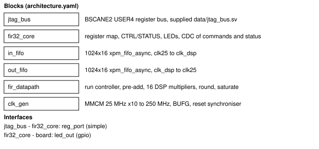

# p4_fir_dsp: 32-tap symmetric FIR low-pass filter with FIFOs and JTAG register bus (KR260)

<!-- Generated from handover.yaml by flow/handover.py (brief 68). Edit handover.yaml, or the text between the prose markers, then run: python -m flow.handover write runs/20261125-133549-a1e9/p4_fir_dsp -->

The design is a 32-tap symmetric FIR filter on the KR260. It is meant to use 16 DSP multipliers at 250 MHz from an MMCM, two 1024-sample FIFOs, and a register bus on the 25 MHz clock reached over JTAG. The host pushes samples, writes RUN, and pops saturated 16-bit outputs. The run stopped in stage rtl-design-creation after six visits with the same failure. Verification reached V1 of V3, and no Vivado build, timing, power or board result exists.

Not in scope:

- Not built or measured on hardware. Synthesis, implementation, timing, power and bring-up were not run.
- Not a general FIR. The coefficients are fixed, symmetric, and loaded from data/coeffs.hex at build time.
- Not a transceiver design. sfp_tx_disable is meant to be held at 1 and no GT channel is used.

Kind: agent-run; produced by the agent (agent run `20261125-133549-a1e9`, [record](../summary.json)). State: spec. For an agent: [AGENT.md](AGENT.md).

Run: model claude-sonnet-5-5 (deepagents harness), 8 loops, 89 turns, 2,782,739 tokens, 1343.9 s wall time, 3.10723 USD model cost (provider-reported), stopped because: stage 2 visited more than 6 times; last failing gate: lint, simulate, design standards, verification V2; owned by the rtl/tests role; last failing assertion: V2 seeds_run: no seeded results: read runs/20261125-133549-a1e9/p4_fir_dsp/build/verif/sim/seed*/results.xml and found none. The gate expects runs/20261125-133549-a1e9/p4_fir_dsp/build/verif/sim/seed<N>/results.xml, one directory per seed. ; the same failure on 6 consecutive visits (from the run record).

<!-- prose:what -->
<!-- /prose:what -->

## Technical parameters

| Item | Value |
|---|---|
| Part | `xck26-sfvc784-2LV-c` |
| Board | kr260 |
| Top | `fir32_top` |
| Tool | Vivado 2026.1 |

Clocks:

- `clk_25`: 25 MHz (from `runs/20261125-133549-a1e9/p4_fir_dsp/design.xdc`)

Resets:

- `rst`, active high: Per spec.yaml it is synchronous and held for a few clocks at start by jtag_bus.sv. A copy is synchronised into clk_dsp, and MMCM lock also holds the datapath in reset. This was not confirmed in a passing build.

Interfaces:

- `clk_25` (input clock, pin C3, LVCMOS18, 25 MHz): design.xdc names the port clk_25 and constrains it with a 40 ns period. spec.yaml and ARCHITECTURE.md call it clk25, so the spec disagrees with the XDC on the name.
- `led` (output, 2 bits (F8 and E8, LVCMOS18)): Per the spec's assumption led[0] shows BUSY and led[1] shows MMCM lock or heartbeat. The function was defaulted, not specified.
- `sfp_tx_disable` (output, 1 bit (Y10, LVCMOS33)): Meant to be constant 1, laser off.
- `h_we, h_re, h_addr, h_wdata, h_rdata` (internal register port (1, 1, 12, 32 and 32 bits)): This is the jtag_bus register port in the clk25 domain, not a top-level pin group.

Registers (from spec.yaml; where the RTL differs, the gaps say so):

| Offset | Name | Access | Reset | Bits |
|---|---|---|---|---|
| 0 | `ID` | RO | 546570241 | 31:0 design ID |
| 4 | `BUILD` | RO | 0 | 31:0 USR_ACCESS word |
| 8 | `SCRATCH` | RW | 0 | 31:0 scratch |
| 16 | `CTRL` | RW | 0 | 0 CLEAR self-clearing; 1 RUN self-clearing |
| 20 | `IN_PUSH` | WO | 0 | 15:0 sample |
| 24 | `OUT_POP` | RO | 0 | 31 valid; 15:0 oldest output; read pops |
| 28 | `STATUS` | RO | 0 | 0 BUSY; 15:4 input FIFO count; 31:20 output FIFO count |
| 32 | `SAT_COUNT` | RO | 0 | 31:0 saturated outputs since CLEAR |
| 36 | `SAMPLES_DONE` | RO | 0 | 31:0 samples processed since CLEAR |

| Parameter | Value | Legal range | Note |
|---|---|---|---|
| `NUM_TAPS` | 32 | 32 only; the pre-add pairing assumes an even tap count | Symmetric, h[k] = h[31-k]. |
| `UNIQUE_COEFFS` | 16 | NUM_TAPS/2 | One DSP multiplier per unique coefficient. |
| `DATA_WIDTH` | 16 | 16 only | Signed samples. The pre-add result is 17 bits. |
| `COEFF_WIDTH` | 16 | 16 only | Signed Q1.15. |
| `ACC_WIDTH` | 37 | at least the width of the exact sum | Holds the exact sum before rounding. |
| `FIFO_DEPTH` | 1024 | 1024 per the spec | The STATUS count fields are 12 bits wide, so counts up to 1024 fit. |
| `ROUND_CONST` | 16,384 | 2^(SHIFT-1) | Equals 0x4000, added before the arithmetic shift. |
| `SHIFT` | 15 | 15 for Q1.15 | Arithmetic right shift before saturation. |
| `DESIGN_ID` | 546,570,241 | any 32-bit value | Equals 0x20940001, read at ID. |
| `MMCM_MULT` | 10 | set by the MMCM VCO range | 25 MHz x 10 gives the 250 MHz clk_dsp, which is a 4 ns period and one sample per clock. |
| `MMCM_DIV` | 1 | set by the MMCM VCO range | Divider for the datapath clock. |

| Quantity | Value | Source |
|---|---|---|
| Resources | not measured | [Known gaps](#known-gaps-and-limits) |
| Timing | not measured | [Known gaps](#known-gaps-and-limits) |
| Power | not measured | [Known gaps](#known-gaps-and-limits) |
| Latency | not measured | [Known gaps](#known-gaps-and-limits) |
| Throughput | not measured | [Known gaps](#known-gaps-and-limits) |

<!-- prose:parameters -->
<!-- /prose:parameters -->

## How to build, run and reproduce

| Step | Command | Heavy slot | Time |
|---|---|---|---|
| what changed since this handover (stale records, changed files, tool and knowledge-bank pins) | `python -m flow.handover fresh runs/20261125-133549-a1e9/p4_fir_dsp` | no | - |
| pick the work up again from the earliest stage the change or the staleness needs; needs a model (see docs/agent.md); Vivado for any stage from synthesis on | `python -m agent resume runs/20261125-133549-a1e9/p4_fir_dsp "<change request>"` | yes | - |
| run the Verifier's simulation tests; needs Icarus Verilog and cocotb, or the simulation container | `python -m pytest -q runs/20261125-133549-a1e9/p4_fir_dsp/tests/test_p4_fir_dsp_rtl.py` | no | - |
| re-run the Verilator coverage simulation and the verification gates (line, toggle, functional and cover results); needs Verilator 5.036 or later and cocotb (the simulation container has them) | `SIM=verilator FDA_COVERAGE=1 FDA_SIM_RESULTS_DIR=runs/20261125-133549-a1e9/p4_fir_dsp/build/verif/sim python -m pytest -q -x runs/20261125-133549-a1e9/p4_fir_dsp/tests/test_p4_fir_dsp_rtl.py && python3 flow/verif_gates.py runs/20261125-133549-a1e9/p4_fir_dsp --runs runs/20261125-133549-a1e9/p4_fir_dsp/build/verif/sim` | no | - |
| rebuild the bitstream with the flow; needs Vivado 2026.1 and a heavy slot | `flow/run_vivado.sh runs/20261125-133549-a1e9/p4_fir_dsp base` | yes | - |

Tool: Vivado 2026.1. Build ID of the inputs at handover: none (no Vivado build of this directory). Knowledge-bank pin: `5e2eab8`.

| File | What |
|---|---|
| [`runs/20261125-133549-a1e9/p4_fir_dsp/spec.md`](spec.md) | the request the run started from |
| [`runs/20261125-133549-a1e9/p4_fir_dsp/spec.yaml`](spec.yaml) | the specification the Clarifier wrote, approved automatically with no human review |
| [`runs/20261125-133549-a1e9/p4_fir_dsp/ARCHITECTURE.md`](ARCHITECTURE.md) | the architecture note, accepted automatically before any RTL (no human review) |
| [`runs/20261125-133549-a1e9/p4_fir_dsp/architecture.yaml`](architecture.yaml) | the machine-checked architecture: blocks, clocks, predicted resources |
| [`runs/20261125-133549-a1e9/p4_fir_dsp/design.xdc`](design.xdc) | pin, I/O standard and timing constraints |
| [`runs/20261125-133549-a1e9/p4_fir_dsp/model.py`](model.py) | the Modeller's reference model of the visible behaviour |
| [`runs/20261125-133549-a1e9/p4_fir_dsp/tests/fir_bench.py`](tests/fir_bench.py) | the Verifier's cocotb benches and pytest entries |
| [`runs/20261125-133549-a1e9/p4_fir_dsp/tests/test_p4_fir_dsp_rtl.py`](tests/test_p4_fir_dsp_rtl.py) | the Verifier's cocotb benches and pytest entries |
| [`runs/20261125-133549-a1e9/p4_fir_dsp/verif/testplan.yaml`](verif/testplan.yaml) | the test plan and mutant list read by the verification gates |
| [`runs/20261125-133549-a1e9/p4_fir_dsp/verif/checkers/v_macros.svh`](verif/checkers/v_macros.svh) | bound assertion and cover checkers |
| [`runs/20261125-133549-a1e9/p4_fir_dsp/build/review/02_rtl-design-creation.html`](build/review/02_rtl-design-creation.html) | the review page of stage rtl-design-creation: its exit gates and their failures at the last visit |

<!-- prose:build -->
<!-- /prose:build -->

## Verified

| ID | Activity | Result | What | Evidence | Conditions |
|---|---|---|---|---|---|
| E1 | review | partial | the specification and the architecture were approved automatically, with no human review (review off; the interview oracle claude-sonnet-5-5 only answered the interview questions); the interview asked 8 questions, 0 answered and 8 defaulted | [`runs/20261125-133549-a1e9/summary.json`](../summary.json) | - |
| E2 | simulation | partial | verification (flow/verif_gates.py) against the Modeller's reference model reached V1 of V3; the run asked for V2; V1 means every spec item is traced to a check and the benches use the blind model; V2 (simulation: seeded runs, a constrained-random test, bound assertions and formal tasks) did not pass: seeds run no seeded results: read runs/20261125-133549-a1e9/p4_fir_dsp/build/verif/sim/seed*/results.xml and found none. The gate expects runs/20261125-133549-a1e9/p4_fir_dsp/build/verif/sim/seed<N>/results.xml, one directory per seed. The flow's simulation step writes it when the bench runs through flow.cocotb_run.run(name, toplevel, sources, test_module, test_dir, parameters=..., seed=N) in tests/test_*_rtl.py: call run() once per seed (for example seed=1, 2, 3; a seed left out counts as seed 1) with the module(s) listed in bench.modules; the flow runs it and checks again. A bench that runs the simulator some other way leaves nothing there. (needs >=1 seed); constrained random test ran not evaluated (no seeded results) (needs True); assertions bound zero failures not evaluated (no seeded results) (needs bound in the run; no failure); V3 (coverage (line, toggle, functional bins, cover properties), three seeds and the mutation score) did not pass: seeds run no seeded results: read runs/20261125-133549-a1e9/p4_fir_dsp/build/verif/sim/seed*/results.xml and found none. The gate expects runs/20261125-133549-a1e9/p4_fir_dsp/build/verif/sim/seed<N>/results.xml, one directory per seed. The flow's simulation step writes it when the bench runs through flow.cocotb_run.run(name, toplevel, sources, test_module, test_dir, parameters=..., seed=N) in tests/test_*_rtl.py: call run() once per seed (for example seed=1, 2, 3; a seed left out counts as seed 1) with the module(s) listed in bench.modules; the flow runs it and checks again. A bench that runs the simulator some other way leaves nothing there. (needs >=3); functional bins pct not evaluated (no seeded results) (needs 100); cover properties pct not evaluated (no seeded results) (needs 100); line pct not evaluated (no seeded results) (needs 90); toggle pct not evaluated (no seeded results) (needs 75); mutation score pct not measured (needs 80); cdc structure clean missing (needs no unsafe crossing); cdc injection clean missing (needs pass); no board result (V-HW) is recorded | [`runs/20261125-133549-a1e9/p4_fir_dsp/build/verif/verif_gates.json`](build/verif/verif_gates.json) | - |

Gates at handover: `clarify` pass, `board-and-device-planning` pass, `rtl-design-creation` fail, `constraints` not-run, `synthesis` not-run, `implementation` not-run, `timing-closure` not-run, `power-closure` not-run, `drc-closure` not-run, `configuration-and-debug` not-run.

<!-- prose:verified -->
<!-- /prose:verified -->

## Measured

Every value is read from the record by `python -m flow.handover fill`, not typed.

| ID | What | Value | Runs | Source | Conditions |
|---|---|---|---|---|---|
| M1 | model cost of the run, provider-reported | 3.10723 USD | 1 | [`runs/20261125-133549-a1e9/summary.json`](../summary.json) `cost_usd` | every role and the interview oracle, as the run summary records it |

<!-- prose:measured -->
<!-- /prose:measured -->

## Known gaps and limits

- **REQ-01**: REQ-01 has no passing evidence for every proof method: simulation (fir_bench.test_regs_smoke) is pending: no simulation results; hardware (uart_tests) is pending: no bring-up result
- **REQ-02**: REQ-02 has no passing evidence for every proof method: hardware (uart_tests) is pending: no bring-up result
- **REQ-03**: REQ-03 has no passing evidence for every proof method: simulation (fir_bench.test_regs_smoke) is pending: no simulation results; hardware (uart_tests) is pending: no bring-up result
- **REQ-30**: REQ-30 has no passing evidence for every proof method: simulation (fir_bench.test_regs_smoke) is pending: no simulation results
- **REQ-04**: REQ-04 has no passing evidence for every proof method: simulation (fir_bench.test_regs_smoke) is pending: no simulation results
- **REQ-31**: REQ-31 has no passing evidence for every proof method: simulation (fir_bench.test_regs_smoke) is pending: no simulation results
- **REQ-05**: REQ-05 has no passing evidence for every proof method: simulation (fir_bench.test_regs_smoke) is pending: no simulation results
- **REQ-32**: REQ-32 has no passing evidence for every proof method: simulation (fir_bench.test_regs_smoke) is pending: no simulation results
- **REQ-06**: REQ-06 has no passing evidence for every proof method: simulation (fir_bench.test_impulse) is pending: no simulation results; hardware (uart_tests) is pending: no bring-up result
- **REQ-07**: REQ-07 has no passing evidence for every proof method: simulation (fir_bench.test_step) is pending: no simulation results; hardware (uart_tests) is pending: no bring-up result
- **REQ-08**: REQ-08 has no passing evidence for every proof method: simulation (fir_bench.test_random_chunks) is pending: no simulation results; hardware (uart_tests) is pending: no bring-up result
- **REQ-09**: REQ-09 has no passing evidence for every proof method: simulation (fir_bench.test_history_clear) is pending: no simulation results
- **REQ-10**: REQ-10 has no passing evidence for every proof method: simulation (fir_bench.test_history_clear) is pending: no simulation results
- **REQ-11**: REQ-11 has no passing evidence for every proof method: analysis (post_synth:post_synth_resources_in_range) is pending: no flow gates result
- **REQ-12**: REQ-12 has no passing evidence for every proof method: simulation (fir_bench.test_busy_rate) is pending: no simulation results
- **REQ-13**: REQ-13 has no passing evidence for every proof method: analysis (post_route:setup) is pending: no flow gates result
- **REQ-14**: REQ-14 has no passing evidence for every proof method: analysis (post_synth:post_synth_resources_in_range) is pending: no flow gates result
- **REQ-39**: REQ-39 has no passing evidence for every proof method: analysis (post_route:setup) is pending: no flow gates result
- **REQ-15**: REQ-15 has no passing evidence for every proof method: simulation (fir_bench.test_impulse) is pending: no simulation results
- **REQ-16**: REQ-16 has no passing evidence for every proof method: simulation (fir_bench.test_fifo_full_empty) is pending: no simulation results; formal (fir_bench.test_fifo_full_empty) is pending: re-planned from formal to simulation (SymbiYosys is not installed, so the full-FIFO ignore rule is checked by a directed simulation test against the model.): no simulation results
- **REQ-17**: REQ-17 has no passing evidence for every proof method: simulation (fir_bench.test_impulse) is pending: no simulation results
- **REQ-34**: REQ-34 has no passing evidence for every proof method: simulation (fir_bench.test_impulse) is pending: no simulation results
- **REQ-18**: REQ-18 has no passing evidence for every proof method: simulation (fir_bench.test_fifo_full_empty) is pending: no simulation results
- **REQ-19**: REQ-19 has no passing evidence for every proof method: simulation (fir_bench.test_busy_rate) is pending: no simulation results
- **REQ-20**: REQ-20 has no passing evidence for every proof method: simulation (fir_bench.test_fifo_full_empty) is pending: no simulation results
- **REQ-21**: REQ-21 has no passing evidence for every proof method: simulation (fir_bench.test_fifo_full_empty) is pending: no simulation results
- **REQ-22**: REQ-22 has no passing evidence for every proof method: simulation (fir_bench.test_saturation) is pending: no simulation results
- **REQ-23**: REQ-23 has no passing evidence for every proof method: simulation (fir_bench.test_saturation) is pending: no simulation results
- **REQ-24**: REQ-24 has no passing evidence for every proof method: simulation (fir_bench.test_history_clear) is pending: no simulation results
- **REQ-35**: REQ-35 has no passing evidence for every proof method: simulation (fir_bench.test_history_clear) is pending: no simulation results
- **REQ-36**: REQ-36 has no passing evidence for every proof method: simulation (fir_bench.test_history_clear) is pending: no simulation results
- **REQ-37**: REQ-37 has no passing evidence for every proof method: simulation (fir_bench.test_history_clear) is pending: no simulation results
- **REQ-38**: REQ-38 has no passing evidence for every proof method: simulation (fir_bench.test_history_clear) is pending: no simulation results
- **REQ-25**: REQ-25 has no passing evidence for every proof method: simulation (fir_bench.test_busy_rate) is pending: no simulation results
- **REQ-33**: REQ-33 has no passing evidence for every proof method: simulation (fir_bench.test_impulse) is pending: no simulation results
- **REQ-26**: REQ-26 has no passing evidence for every proof method: simulation (fir_bench.test_regs_smoke) is pending: no simulation results; analysis (post_synth:post_synth_resources_in_range) is pending: no flow gates result
- **REQ-27**: REQ-27 has no passing evidence for every proof method: analysis (post_synth:post_synth_resources_in_range) is pending: no flow gates result
- **REQ-28**: REQ-28 has no passing evidence for every proof method: analysis (post_synth:post_synth_resources_in_range) is pending: no flow gates result
- **REQ-29**: REQ-29 has no passing evidence for every proof method: analysis (post_route:setup) is pending: no flow gates result
- **E1**: review evidence is partial: the specification and the architecture were approved automatically, with no human review (review off; the interview oracle claude-sonnet-5-5 only answered the interview questions); the interview asked 8 questions, 0 answered and 8 defaulted
- **E2**: simulation evidence is partial: verification reached V1 of V3 (the run asked for V2); the checks that did not pass or did not run are listed in the evidence row
- **rtl-design-creation**: stage rtl-design-creation did not pass its gates in this run; at its last visit: lint not passing FAIL simulate not passing FAIL standards STD-LATCH-01: not checked (no build.yaml top or sources to check) FAIL standards STD-LOOP-01: not checked (no build.yaml top or sources to check) FAIL standards STD-CDC-01: architecture.yaml:1: crossings[0]: inline_in fir32_core is not a module of this design or the shell FAIL standards STD-CDC-01: architecture.yaml:1: crossings[1]: inline_ ...
- **constraints**: stage constraints was not run: the run stopped before this stage (stage 2 visited more than 6 times; last failing gate: lint, simulate, design standards, verification V2; owned by the rtl/tests role; last failing assertion: V2 seeds_run: no seeded results: read runs/20261125-133549-a1e9/p4_fir_dsp/build/verif/sim/seed*/results.xml and found none. The gate expects runs/20261125-133549-a1e9/p4_fir_dsp/build/verif/sim/seed<N>/results.xml, one directory per seed. ; the same failure on 6 consecutive visits)
- **synthesis**: stage synthesis was not run: the run stopped before this stage (stage 2 visited more than 6 times; last failing gate: lint, simulate, design standards, verification V2; owned by the rtl/tests role; last failing assertion: V2 seeds_run: no seeded results: read runs/20261125-133549-a1e9/p4_fir_dsp/build/verif/sim/seed*/results.xml and found none. The gate expects runs/20261125-133549-a1e9/p4_fir_dsp/build/verif/sim/seed<N>/results.xml, one directory per seed. ; the same failure on 6 consecutive visits)
- **implementation**: stage implementation was not run: the run stopped before this stage (stage 2 visited more than 6 times; last failing gate: lint, simulate, design standards, verification V2; owned by the rtl/tests role; last failing assertion: V2 seeds_run: no seeded results: read runs/20261125-133549-a1e9/p4_fir_dsp/build/verif/sim/seed*/results.xml and found none. The gate expects runs/20261125-133549-a1e9/p4_fir_dsp/build/verif/sim/seed<N>/results.xml, one directory per seed. ; the same failure on 6 consecutive visits)
- **timing-closure**: stage timing-closure was not run: the run stopped before this stage (stage 2 visited more than 6 times; last failing gate: lint, simulate, design standards, verification V2; owned by the rtl/tests role; last failing assertion: V2 seeds_run: no seeded results: read runs/20261125-133549-a1e9/p4_fir_dsp/build/verif/sim/seed*/results.xml and found none. The gate expects runs/20261125-133549-a1e9/p4_fir_dsp/build/verif/sim/seed<N>/results.xml, one directory per seed. ; the same failure on 6 consecutive visits)
- **power-closure**: stage power-closure was not run: the run stopped before this stage (stage 2 visited more than 6 times; last failing gate: lint, simulate, design standards, verification V2; owned by the rtl/tests role; last failing assertion: V2 seeds_run: no seeded results: read runs/20261125-133549-a1e9/p4_fir_dsp/build/verif/sim/seed*/results.xml and found none. The gate expects runs/20261125-133549-a1e9/p4_fir_dsp/build/verif/sim/seed<N>/results.xml, one directory per seed. ; the same failure on 6 consecutive visits)
- **drc-closure**: stage drc-closure was not run: the run stopped before this stage (stage 2 visited more than 6 times; last failing gate: lint, simulate, design standards, verification V2; owned by the rtl/tests role; last failing assertion: V2 seeds_run: no seeded results: read runs/20261125-133549-a1e9/p4_fir_dsp/build/verif/sim/seed*/results.xml and found none. The gate expects runs/20261125-133549-a1e9/p4_fir_dsp/build/verif/sim/seed<N>/results.xml, one directory per seed. ; the same failure on 6 consecutive visits)
- **configuration-and-debug**: stage configuration-and-debug was not run: the run stopped before this stage (stage 2 visited more than 6 times; last failing gate: lint, simulate, design standards, verification V2; owned by the rtl/tests role; last failing assertion: V2 seeds_run: no seeded results: read runs/20261125-133549-a1e9/p4_fir_dsp/build/verif/sim/seed*/results.xml and found none. The gate expects runs/20261125-133549-a1e9/p4_fir_dsp/build/verif/sim/seed<N>/results.xml, one directory per seed. ; the same failure on 6 consecutive visits)
- **formal**: formal checks were planned for REQ-16 and did not run; each was replaced by a simulation check (verif/testplan.yaml replan). Reason recorded: SymbiYosys is not installed, so the full-FIFO ignore rule is checked by a directed simulation test against the model.
- **resources**: resources not measured: no current Vivado build of this design has been recorded
- **timing**: timing not measured: no current Vivado build of this design has been recorded
- **power**: power not measured: no current Vivado build of this design has been recorded
- **latency**: latency not measured: the run measured no latency; the spec's latency promise is checked only by the benches
- **throughput**: throughput not measured: the run measured no throughput
- **clock_port_name**: design.xdc constrains a port named clk_25 with a 40 ns period (25 MHz) on C3. spec.yaml and ARCHITECTURE.md name it clk25. The XDC is what was built, so the top level must expose clk_25.
- **xdc_clocks**: design.xdc has no constraint for the 250 MHz clk_dsp. Whether the MMCM output is auto-derived was not checked, since no build ran.
- **spec_sources_unread**: spec.yaml records that data/jtag_bus.sv and coeffs.hex were not readable when the spec was written, so the bus interface came from spec.md text only. The 12-bit h_addr and the register timing are therefore unconfirmed against that file.
- **defaulted_behaviour**: All 8 interview answers were defaulted, not answered by a person. Decided by default: pushes during BUSY are accepted but processed at the next RUN; RUN while BUSY is ignored; RUN with an empty input FIFO completes at once with no output; RUN processes only as many samples as fit in the output FIFO; CLEAR wins over a RUN in the same write and aborts a run; SAT_COUNT and SAMPLES_DONE wrap at 32 bits; OUT_POP bits 30:16 are 0.
- **unmapped_access**: Per spec.yaml, unmapped addresses read 0 and ignore writes. Writes to the read-only registers are presumably ignored too, but the spec does not say so and no RTL was reviewed.
- **read_side_effect**: An OUT_POP read removes the oldest output as a side effect. An empty FIFO returns 0, so a valid sample with value 0 is told apart only by bit 31.
- **latency_count**: The spec promises h_rdata within 2 clk25 cycles of h_re, a write effect 1 clk25 cycle after h_we, and a filter pipeline of a few clk_dsp cycles. None was counted from the RTL here, because no passing simulation or build exists to count from.

<!-- prose:gaps -->
<!-- /prose:gaps -->

## Next steps

1. Fix stage rtl-design-creation first. Make the bench call flow.cocotb_run.run() once per seed (seed=1, 2, 3) so that a results.xml exists for each seed under build/verif/sim, then re-run the verification gates. Then clear the lint, simulate and STD-CDC-01 failures: the inline_in names in architecture.yaml crossings must match real modules.
2. Once seeded results exist, compare the cover results with the functional coverage before adding any new stimulus.
3. Re-run V2 and V3 until the line, toggle, functional, cover, mutation and CDC checks pass.
4. Resume the flow with python -m agent resume to reach constraints, synthesis and implementation. Check the clk_dsp constraint and the clk_25 port name against the spec, and re-count the latencies from the RTL.
5. Run hardware bring-up for the requirements that list hardware proof (ID, BUILD, SCRATCH, impulse, step, random chunks).

Open questions:

- Should the top-level port be named clk25 as in the spec or clk_25 as in design.xdc?
- Are the defaulted behaviours (RUN while BUSY, output FIFO overflow limit, CLEAR priority over RUN) the intended ones?
- Do the offsets in spec.md stay final?

<!-- prose:next -->
<!-- /prose:next -->

## History

| Date | Brief | PR | What |
|---|---|---|---|
| 2026-11-25 | agent run | - | produced by the agent graph; stages that passed: clarify, board-and-device-planning |

<!-- prose:history -->
<!-- /prose:history -->
