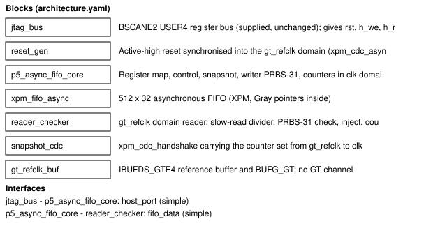

# p5_async_fifo: P5 asynchronous FIFO soak (25 MHz writer, 156.25 MHz reader, PRBS-31 checked)

<!-- Generated from handover.yaml by flow/handover.py (brief 68). Edit handover.yaml, or the text between the prose markers, then run: python -m flow.handover write runs/20261125-140334-22f2/p5_async_fifo -->

The design writes 32-bit PRBS-31 words into a 512-word asynchronous FIFO from the 25 MHz board clock. A reader on the 156.25 MHz SFP+ MGTREFCLK0 clock (no GT channel) checks them against its own PRBS copy and counts errors, overflows, underflows and fill. A host reads the counters through the jtag_bus register port, with a snapshot register for coherent reads. The run stopped at rtl-design-creation, which failed its gates. Only clarify and board-and-device-planning passed. No simulation results, no Vivado build and no board result exist.

Not in scope:

- Not a transceiver design; no GT channel is used and sfp_tx_disable is held at 1.
- Not a general FIFO IP; it is a soak and check fixture for one fixed width and depth.
- Not verified, built or run on hardware yet; no timing, resource or power figure exists.

Kind: agent-run; produced by the agent (agent run `20261125-140334-22f2`, [record](../summary.json)). State: spec. For an agent: [AGENT.md](AGENT.md).

Run: model claude-sonnet-5-5 (deepagents harness), 8 loops, 98 turns, 3,259,874 tokens, 1681.1 s wall time, 3.69016 USD model cost (provider-reported), stopped because: stage 2 visited more than 6 times; last failing gate: lint, simulate, design standards, verification V2; owned by the rtl/tests role; last failing assertion: V2 seeds_run: no seeded results: read runs/20261125-140334-22f2/p5_async_fifo/build/verif/sim/seed*/results.xml and found none. The gate expects runs/20261125-140334-22f2/p5_async_fifo/build/verif/sim/seed<N>/results.xml, one directory per ; the same failure on 6 consecutive visits (from the run record).

<!-- prose:what -->
<!-- /prose:what -->

## Technical parameters

| Item | Value |
|---|---|
| Part | `xck26-sfvc784-2LV-c` |
| Board | kr260 |
| Top | `p5_async_fifo_soak` |
| Tool | Vivado 2026.1 |

Clocks:

- `clk_25`: 25 MHz (from `runs/20261125-140334-22f2/p5_async_fifo/design.xdc`)

Resets:

- `rst`, active high: Comes from jtag_bus in the clk domain and is synchronised into the gt_refclk domain with async assert and sync release (spec.yaml, ARCHITECTURE.md). The RTL was not shown here, so this is the spec's description.

Interfaces:

- `clk_25` (input, 25 MHz clock, pin C3, LVCMOS18): design.xdc names this port clk_25 while spec.yaml names it clk; see the port_names gap.
- `gt_refclk_p / gt_refclk_n` (input, differential 156.25 MHz reference clock pair): design.xdc has no pins or clock for these ports; ARCHITECTURE.md lists this as an open point.
- `led[1:0]` (output, 2 bits, pins F8 (led[0]) and E8 (led[1]), LVCMOS18): led[0] shows RUN and led[1] shows a nonzero error count (spec assumption).
- `sfp_tx_disable` (output, 1 bit, pin Y10, LVCMOS33): Constant 1.
- `jtag_bus register port (rst, h_we, h_re, h_addr[11:0], h_wdata[31:0], h_rdata[31:0])` (internal): Not top-level pins. jtag_bus.sv is used unchanged and is not simulated; tests drive the port directly.

Registers (from spec.yaml; where the RTL differs, the gaps say so):

| Offset | Name | Access | Reset | Bits |
|---|---|---|---|---|
| 0 | `ID` | RO | 546635777 | 31:0 design ID |
| 4 | `BUILD` | RO | 0 | 31:0 USR_ACCESS word |
| 8 | `SCRATCH` | RW | 0 | 31:0 scratch |
| 16 | `CTRL` | RW | 0 | 0 RUN; 1 SLOW_READ; 2 CLEAR self-clearing only while RUN=0; 3 INJECT self-clearing; 31:4 reserved read 0 |
| 20 | `WORDS_W` | RO | 0 | 31:0 words written (snapshot) |
| 24 | `WORDS_R` | RO | 0 | 31:0 words read and checked (snapshot) |
| 28 | `DATA_ERRS` | RO | 0 | 31:0 mismatching words (snapshot) |
| 32 | `OVERFLOWS` | RO | 0 | 31:0 writes while full (snapshot) |
| 36 | `UNDERFLOWS` | RO | 0 | 31:0 reads while empty (snapshot) |
| 40 | `STALL_W` | RO | 0 | 31:0 writer clocks held off (snapshot) |
| 44 | `OCC_MAX` | RO | 0 | 31:0 highest fill in words (snapshot) |
| 48 | `SNAPSHOT` | WO | 0 | any write latches 0x014 to 0x02C; reads 0 |

| Parameter | Value | Legal range | Note |
|---|---|---|---|
| `FIFO_DEPTH_WORDS` | 512 | 512 is the only value the spec covers; other values are untested | FIFO depth in words; the spec expects one RAMB36 (512 x 32) or 16 LUTRAM. |
| `DATA_WIDTH` | 32 | 32 only; the PRBS-31 writer emits 32 new bits per word | Word width in bits. |
| `PRBS_SEED` | 2,147,483,647 | nonzero 31-bit value | Seed 0x7FFFFFFF for both PRBS-31 copies (x^31 + x^28 + 1). |
| `SLOW_READ_DIV_CYCLES` | 8 | 1 or more | With SLOW_READ set the reader takes at most one word per 8 gt_refclk cycles (156.25 MHz). |
| `DESIGN_ID` | 546,635,777 | any 32-bit value | Read back at ID, 0x20950001. |
| `ADDR_BITS` | 12 | 12 for the jtag_bus byte address | Width of h_addr. |

| Quantity | Value | Source |
|---|---|---|
| Resources | not measured | [Known gaps](#known-gaps-and-limits) |
| Timing | not measured | [Known gaps](#known-gaps-and-limits) |
| Power | not measured | [Known gaps](#known-gaps-and-limits) |
| Latency | not measured | [Known gaps](#known-gaps-and-limits) |
| Throughput | not measured | [Known gaps](#known-gaps-and-limits) |

<!-- prose:parameters -->
<!-- /prose:parameters -->

## How to build, run and reproduce

| Step | Command | Heavy slot | Time |
|---|---|---|---|
| what changed since this handover (stale records, changed files, tool and knowledge-bank pins) | `python -m flow.handover fresh runs/20261125-140334-22f2/p5_async_fifo` | no | - |
| pick the work up again from the earliest stage the change or the staleness needs; needs a model (see docs/agent.md); Vivado for any stage from synthesis on | `python -m agent resume runs/20261125-140334-22f2/p5_async_fifo "<change request>"` | yes | - |
| run the Verifier's simulation tests; needs Icarus Verilog and cocotb, or the simulation container | `python -m pytest -q runs/20261125-140334-22f2/p5_async_fifo/tests/test_p5_async_fifo_rtl.py` | no | - |
| re-run the Verilator coverage simulation and the verification gates (line, toggle, functional and cover results); needs Verilator 5.036 or later and cocotb (the simulation container has them) | `SIM=verilator FDA_COVERAGE=1 FDA_SIM_RESULTS_DIR=runs/20261125-140334-22f2/p5_async_fifo/build/verif/sim python -m pytest -q -x runs/20261125-140334-22f2/p5_async_fifo/tests/test_p5_async_fifo_rtl.py && python3 flow/verif_gates.py runs/20261125-140334-22f2/p5_async_fifo --runs runs/20261125-140334-22f2/p5_async_fifo/build/verif/sim` | no | - |
| rebuild the bitstream with the flow; needs Vivado 2026.1 and a heavy slot | `flow/run_vivado.sh runs/20261125-140334-22f2/p5_async_fifo base` | yes | - |

Tool: Vivado 2026.1. Build ID of the inputs at handover: none (no Vivado build of this directory). Knowledge-bank pin: `5e2eab8`.

| File | What |
|---|---|
| [`runs/20261125-140334-22f2/p5_async_fifo/spec.md`](spec.md) | the request the run started from |
| [`runs/20261125-140334-22f2/p5_async_fifo/spec.yaml`](spec.yaml) | the specification the Clarifier wrote, approved automatically with no human review |
| [`runs/20261125-140334-22f2/p5_async_fifo/ARCHITECTURE.md`](ARCHITECTURE.md) | the architecture note, accepted automatically before any RTL (no human review) |
| [`runs/20261125-140334-22f2/p5_async_fifo/architecture.yaml`](architecture.yaml) | the machine-checked architecture: blocks, clocks, predicted resources |
| [`runs/20261125-140334-22f2/p5_async_fifo/design.xdc`](design.xdc) | pin, I/O standard and timing constraints |
| [`runs/20261125-140334-22f2/p5_async_fifo/model.py`](model.py) | the Modeller's reference model of the visible behaviour |
| [`runs/20261125-140334-22f2/p5_async_fifo/tests/p5_async_fifo_bench.py`](tests/p5_async_fifo_bench.py) | the Verifier's cocotb benches and pytest entries |
| [`runs/20261125-140334-22f2/p5_async_fifo/tests/test_p5_async_fifo_rtl.py`](tests/test_p5_async_fifo_rtl.py) | the Verifier's cocotb benches and pytest entries |
| [`runs/20261125-140334-22f2/p5_async_fifo/verif/testplan.yaml`](verif/testplan.yaml) | the test plan and mutant list read by the verification gates |
| [`runs/20261125-140334-22f2/p5_async_fifo/verif/checkers/v_macros.svh`](verif/checkers/v_macros.svh) | bound assertion and cover checkers |
| [`runs/20261125-140334-22f2/p5_async_fifo/build/review/02_rtl-design-creation.html`](build/review/02_rtl-design-creation.html) | the review page of stage rtl-design-creation: its exit gates and their failures at the last visit |

<!-- prose:build -->
<!-- /prose:build -->

## Verified

| ID | Activity | Result | What | Evidence | Conditions |
|---|---|---|---|---|---|
| E1 | review | partial | the specification and the architecture were approved automatically, with no human review (review off; the interview oracle claude-sonnet-5-5 only answered the interview questions); the interview asked 8 questions, 0 answered and 8 defaulted | [`runs/20261125-140334-22f2/summary.json`](../summary.json) | - |
| E2 | simulation | partial | verification (flow/verif_gates.py) against the Modeller's reference model reached V1 of V3; the run asked for V2; V1 means every spec item is traced to a check and the benches use the blind model; V2 (simulation: seeded runs, a constrained-random test, bound assertions and formal tasks) did not pass: seeds run no seeded results: read runs/20261125-140334-22f2/p5_async_fifo/build/verif/sim/seed*/results.xml and found none. The gate expects runs/20261125-140334-22f2/p5_async_fifo/build/verif/sim/seed<N>/results.xml, one directory per seed. The flow's simulation step writes it when the bench runs through flow.cocotb_run.run(name, toplevel, sources, test_module, test_dir, parameters=..., seed=N) in tests/test_*_rtl.py: call run() once per seed (for example seed=1, 2, 3; a seed left out counts as seed 1) with the module(s) listed in bench.modules; the flow runs it and checks again. A bench that runs the simulator some other way leaves nothing there. (needs >=1 seed); constrained random test ran not evaluated (no seeded results) (needs True); assertions bound zero failures not evaluated (no seeded results) (needs bound in the run; no failure); V3 (coverage (line, toggle, functional bins, cover properties), three seeds and the mutation score) did not pass: seeds run no seeded results: read runs/20261125-140334-22f2/p5_async_fifo/build/verif/sim/seed*/results.xml and found none. The gate expects runs/20261125-140334-22f2/p5_async_fifo/build/verif/sim/seed<N>/results.xml, one directory per seed. The flow's simulation step writes it when the bench runs through flow.cocotb_run.run(name, toplevel, sources, test_module, test_dir, parameters=..., seed=N) in tests/test_*_rtl.py: call run() once per seed (for example seed=1, 2, 3; a seed left out counts as seed 1) with the module(s) listed in bench.modules; the flow runs it and checks again. A bench that runs the simulator some other way leaves nothing there. (needs >=3); functional bins pct not evaluated (no seeded results) (needs 100); cover properties pct not evaluated (no seeded results) (needs 100); line pct not evaluated (no seeded results) (needs 90); toggle pct not evaluated (no seeded results) (needs 75); mutation score pct not measured (needs 70); cdc structure clean missing (needs no unsafe crossing); cdc injection clean missing (needs pass); no board result (V-HW) is recorded | [`runs/20261125-140334-22f2/p5_async_fifo/build/verif/verif_gates.json`](build/verif/verif_gates.json) | - |

Gates at handover: `clarify` pass, `board-and-device-planning` pass, `rtl-design-creation` fail, `constraints` not-run, `synthesis` not-run, `implementation` not-run, `timing-closure` not-run, `power-closure` not-run, `drc-closure` not-run, `configuration-and-debug` not-run.

<!-- prose:verified -->
<!-- /prose:verified -->

## Measured

Every value is read from the record by `python -m flow.handover fill`, not typed.

| ID | What | Value | Runs | Source | Conditions |
|---|---|---|---|---|---|
| M1 | model cost of the run, provider-reported | 3.69016 USD | 1 | [`runs/20261125-140334-22f2/summary.json`](../summary.json) `cost_usd` | every role and the interview oracle, as the run summary records it |

<!-- prose:measured -->
<!-- /prose:measured -->

## Known gaps and limits

- **REQ-01**: REQ-01 has no passing evidence for every proof method: simulation (p5_async_fifo_bench.test_reset_and_id) is pending: no simulation results; hardware (uart_tests) is pending: no bring-up result
- **REQ-02**: REQ-02 has no passing evidence for every proof method: hardware (uart_tests) is pending: no bring-up result
- **REQ-03**: REQ-03 has no passing evidence for every proof method: simulation (p5_async_fifo_bench.test_scratch) is pending: no simulation results; hardware (uart_tests) is pending: no bring-up result
- **REQ-27**: REQ-27 has no passing evidence for every proof method: simulation (p5_async_fifo_bench.test_reset_and_id) is pending: no simulation results; hardware (uart_tests) is pending: no bring-up result
- **REQ-04**: REQ-04 has no passing evidence for every proof method: simulation (p5_async_fifo_bench.test_unmapped) is pending: no simulation results
- **REQ-28**: REQ-28 has no passing evidence for every proof method: simulation (p5_async_fifo_bench.test_unmapped) is pending: no simulation results
- **REQ-05**: REQ-05 has no passing evidence for every proof method: simulation (p5_async_fifo_bench.test_read_latency_hold) is pending: no simulation results; formal (p5_async_fifo_bench.test_read_latency_hold) is pending: re-planned from formal to simulation (SymbiYosys is not installed so the formal job cannot run; the directed read-latency test replaces it.): no simulation results
- **REQ-29**: REQ-29 has no passing evidence for every proof method: simulation (p5_async_fifo_bench.test_read_latency_hold) is pending: no simulation results; formal (p5_async_fifo_bench.test_read_latency_hold) is pending: re-planned from formal to simulation (SymbiYosys is not installed so the formal job cannot run; the hold check in simulation replaces it.): no simulation results
- **REQ-06**: REQ-06 has no passing evidence for every proof method: simulation (p5_async_fifo_bench.test_slow_read_fill) is pending: no simulation results; analysis (post_synth:post_synth_resources_in_range) is pending: no flow gates result
- **REQ-07**: REQ-07 has no passing evidence for every proof method: simulation (p5_async_fifo_bench.test_run_basic) is pending: no simulation results
- **REQ-08**: REQ-08 has no passing evidence for every proof method: simulation (p5_async_fifo_bench.test_run_basic) is pending: no simulation results
- **REQ-09**: REQ-09 has no passing evidence for every proof method: hardware (uart_tests) is pending: no bring-up result
- **REQ-10**: REQ-10 has no passing evidence for every proof method: simulation (p5_async_fifo_bench.test_slow_read_fill) is pending: no simulation results; formal (p5_async_fifo_bench.test_slow_read_fill) is pending: re-planned from formal to simulation (SymbiYosys is not installed; the full-FIFO simulation checks OVERFLOWS stays 0.): no simulation results; hardware (uart_tests) is pending: no bring-up result
- **REQ-11**: REQ-11 has no passing evidence for every proof method: simulation (p5_async_fifo_bench.test_slow_read_fill) is pending: no simulation results; formal (p5_async_fifo_bench.test_slow_read_fill) is pending: re-planned from formal to simulation (SymbiYosys is not installed; simulation checks UNDERFLOWS stays 0.): no simulation results; hardware (uart_tests) is pending: no bring-up result
- **REQ-12**: REQ-12 has no passing evidence for every proof method: simulation (p5_async_fifo_bench.test_slow_read_fill) is pending: no simulation results
- **REQ-13**: REQ-13 has no passing evidence for every proof method: simulation (p5_async_fifo_bench.test_slow_read_fill) is pending: no simulation results; hardware (uart_tests) is pending: no bring-up result
- **REQ-35**: REQ-35 has no passing evidence for every proof method: simulation (p5_async_fifo_bench.test_slow_read_fill) is pending: no simulation results; hardware (uart_tests) is pending: no bring-up result
- **REQ-14**: REQ-14 has no passing evidence for every proof method: simulation (p5_async_fifo_bench.test_inject) is pending: no simulation results; hardware (uart_tests) is pending: no bring-up result
- **REQ-30**: REQ-30 has no passing evidence for every proof method: simulation (p5_async_fifo_bench.test_inject) is pending: no simulation results; hardware (uart_tests) is pending: no bring-up result
- **REQ-15**: REQ-15 has no passing evidence for every proof method: simulation (p5_async_fifo_bench.test_inject) is pending: no simulation results
- **REQ-16**: REQ-16 has no passing evidence for every proof method: simulation (p5_async_fifo_bench.test_clear) is pending: no simulation results
- **REQ-34**: REQ-34 has no passing evidence for every proof method: simulation (p5_async_fifo_bench.test_clear) is pending: no simulation results
- **REQ-17**: REQ-17 has no passing evidence for every proof method: simulation (p5_async_fifo_bench.test_clear) is pending: no simulation results
- **REQ-18**: REQ-18 has no passing evidence for every proof method: simulation (p5_async_fifo_bench.test_snapshot_coherent) is pending: no simulation results; formal (p5_async_fifo_bench.test_snapshot_coherent) is pending: re-planned from formal to simulation (SymbiYosys is not installed; the snapshot-hold test replaces it.): no simulation results
- **REQ-19**: REQ-19 has no passing evidence for every proof method: simulation (p5_async_fifo_bench.test_snapshot_coherent) is pending: no simulation results
- **REQ-20**: REQ-20 has no passing evidence for every proof method: simulation (p5_async_fifo_bench.test_run_basic) is pending: no simulation results; formal (p5_async_fifo_bench.test_run_basic) is pending: re-planned from formal to simulation (SymbiYosys is not installed; simulation checks OCC_MAX.): no simulation results
- **REQ-31**: REQ-31 has no passing evidence for every proof method: simulation (p5_async_fifo_bench.test_slow_read_fill) is pending: no simulation results; formal (p5_async_fifo_bench.test_slow_read_fill) is pending: re-planned from formal to simulation (SymbiYosys is not installed; simulation checks OCC_MAX is at most 512.): no simulation results
- **REQ-21**: REQ-21 has no passing evidence for every proof method: hardware (uart_tests) is pending: no bring-up result
- **REQ-32**: REQ-32 has no passing evidence for every proof method: hardware (uart_tests) is pending: no bring-up result
- **REQ-22**: REQ-22 has no passing evidence for every proof method: simulation (p5_async_fifo_bench.test_reset_and_id) is pending: no simulation results; hardware (uart_tests) is pending: no bring-up result
- **REQ-23**: REQ-23 has no passing evidence for every proof method: analysis (post_synth:post_synth_resources_in_range) is pending: no flow gates result
- **REQ-24**: REQ-24 has no passing evidence for every proof method: analysis (post_route:setup) is pending: no flow gates result
- **REQ-33**: REQ-33 has no passing evidence for every proof method: analysis (post_route:setup) is pending: no flow gates result
- **REQ-25**: REQ-25 has no passing evidence for every proof method: analysis (post_route:setup) is pending: no flow gates result
- **REQ-26**: REQ-26 has no passing evidence for every proof method: analysis (post_synth:post_synth_resources_in_range) is pending: no flow gates result
- **E1**: review evidence is partial: the specification and the architecture were approved automatically, with no human review (review off; the interview oracle claude-sonnet-5-5 only answered the interview questions); the interview asked 8 questions, 0 answered and 8 defaulted
- **E2**: simulation evidence is partial: verification reached V1 of V3 (the run asked for V2); the checks that did not pass or did not run are listed in the evidence row
- **rtl-design-creation**: stage rtl-design-creation did not pass its gates in this run; at its last visit: lint not passing FAIL simulate not passing FAIL standards STD-LATCH-01: not checked (no build.yaml top or sources to check) FAIL standards STD-LOOP-01: not checked (no build.yaml top or sources to check) FAIL standards STD-CDC-01: architecture.yaml:1: crossings[0]: inline_in reset_gen is not a module of this design or the shell FAIL standards STD-CDC-01: architecture.yaml:1: crossings[1]: inline_i ...
- **constraints**: stage constraints was not run: the run stopped before this stage (stage 2 visited more than 6 times; last failing gate: lint, simulate, design standards, verification V2; owned by the rtl/tests role; last failing assertion: V2 seeds_run: no seeded results: read runs/20261125-140334-22f2/p5_async_fifo/build/verif/sim/seed*/results.xml and found none. The gate expects runs/20261125-140334-22f2/p5_async_fifo/build/verif/sim/seed<N>/results.xml, one directory per ; the same failure on 6 consecutive visits)
- **synthesis**: stage synthesis was not run: the run stopped before this stage (stage 2 visited more than 6 times; last failing gate: lint, simulate, design standards, verification V2; owned by the rtl/tests role; last failing assertion: V2 seeds_run: no seeded results: read runs/20261125-140334-22f2/p5_async_fifo/build/verif/sim/seed*/results.xml and found none. The gate expects runs/20261125-140334-22f2/p5_async_fifo/build/verif/sim/seed<N>/results.xml, one directory per ; the same failure on 6 consecutive visits)
- **implementation**: stage implementation was not run: the run stopped before this stage (stage 2 visited more than 6 times; last failing gate: lint, simulate, design standards, verification V2; owned by the rtl/tests role; last failing assertion: V2 seeds_run: no seeded results: read runs/20261125-140334-22f2/p5_async_fifo/build/verif/sim/seed*/results.xml and found none. The gate expects runs/20261125-140334-22f2/p5_async_fifo/build/verif/sim/seed<N>/results.xml, one directory per ; the same failure on 6 consecutive visits)
- **timing-closure**: stage timing-closure was not run: the run stopped before this stage (stage 2 visited more than 6 times; last failing gate: lint, simulate, design standards, verification V2; owned by the rtl/tests role; last failing assertion: V2 seeds_run: no seeded results: read runs/20261125-140334-22f2/p5_async_fifo/build/verif/sim/seed*/results.xml and found none. The gate expects runs/20261125-140334-22f2/p5_async_fifo/build/verif/sim/seed<N>/results.xml, one directory per ; the same failure on 6 consecutive visits)
- **power-closure**: stage power-closure was not run: the run stopped before this stage (stage 2 visited more than 6 times; last failing gate: lint, simulate, design standards, verification V2; owned by the rtl/tests role; last failing assertion: V2 seeds_run: no seeded results: read runs/20261125-140334-22f2/p5_async_fifo/build/verif/sim/seed*/results.xml and found none. The gate expects runs/20261125-140334-22f2/p5_async_fifo/build/verif/sim/seed<N>/results.xml, one directory per ; the same failure on 6 consecutive visits)
- **drc-closure**: stage drc-closure was not run: the run stopped before this stage (stage 2 visited more than 6 times; last failing gate: lint, simulate, design standards, verification V2; owned by the rtl/tests role; last failing assertion: V2 seeds_run: no seeded results: read runs/20261125-140334-22f2/p5_async_fifo/build/verif/sim/seed*/results.xml and found none. The gate expects runs/20261125-140334-22f2/p5_async_fifo/build/verif/sim/seed<N>/results.xml, one directory per ; the same failure on 6 consecutive visits)
- **configuration-and-debug**: stage configuration-and-debug was not run: the run stopped before this stage (stage 2 visited more than 6 times; last failing gate: lint, simulate, design standards, verification V2; owned by the rtl/tests role; last failing assertion: V2 seeds_run: no seeded results: read runs/20261125-140334-22f2/p5_async_fifo/build/verif/sim/seed*/results.xml and found none. The gate expects runs/20261125-140334-22f2/p5_async_fifo/build/verif/sim/seed<N>/results.xml, one directory per ; the same failure on 6 consecutive visits)
- **formal**: formal checks were planned for REQ-05, REQ-29, REQ-10, REQ-11, REQ-18, REQ-20, REQ-31 and did not run; each was replaced by a simulation check (verif/testplan.yaml replan). Reason recorded: SymbiYosys is not installed so the formal job cannot run; the directed read-latency test replaces it.
- **resources**: resources not measured: no current Vivado build of this design has been recorded
- **timing**: timing not measured: no current Vivado build of this design has been recorded
- **power**: power not measured: no current Vivado build of this design has been recorded
- **latency**: latency not measured: the run measured no latency; the spec's latency promise is checked only by the benches
- **throughput**: throughput not measured: the run measured no throughput
- **port_names**: design.xdc names the clock port clk_25 (pin C3, create_clock period 40.00 ns), while spec.yaml and its port list name it clk. design.xdc is what was built; the top-level RTL port name was not shown to the Designer and must be checked against it.
- **gt_refclk_constraints**: design.xdc has no pins, I/O standard or create_clock for gt_refclk_p/gt_refclk_n (6.4 ns in the spec), and no set_clock_groups or set_max_delay -datapath_only lines. The spec requires all of them (REQ-24, REQ-33); ARCHITECTURE.md calls the MGTREFCLK0 pin an open point. The file ends at sfp_tx_disable.
- **sfp_tx_disable_io**: design.xdc puts sfp_tx_disable on pin Y10 with LVCMOS33, while the LEDs and clock use LVCMOS18; this is the board file's choice and was not checked against the board.
- **architecture_cdc**: The standards gate reports architecture.yaml crossings that name inline modules (reset_gen and others) which are not modules of the design or shell. The crossing list in architecture.yaml needs correcting before STD-CDC-01 can pass.
- **defaults**: All 8 interview answers were defaults, not human answers. They include reset values of 0 for the counters and snapshot registers, INJECT flipping bit 0 of the next word and staying pending while RUN is 0, STALL_W counting only while RUN is 1, and counters holding their values when RUN falls while the reader drains the FIFO.
- **unmapped_access**: Per spec.yaml, unmapped addresses read 0 and ignore writes. Writes to the RO registers and reads of SNAPSHOT (0) are likewise expected to change nothing; the RTL was not shown to confirm this.
- **control_priority**: CLEAR is honoured only while RUN is 0 and is ignored while RUN is 1 (REQ-17). CLEAR and INJECT self-clear. SNAPSHOT latches via a clk-to-gt_refclk handshake, so the reader counters are coherent but not instantaneous.
- **latency_count**: The spec promises h_rdata within 2 clk cycles of h_re and a write effect 1 clk cycle after h_we. The RTL was not shown to the Designer, so these were not counted from it and only the benches would check them, and they have not run.

<!-- prose:gaps -->
<!-- /prose:gaps -->

## Next steps

1. Fix the earliest failure first, in rtl-design-creation. Make the bench run through flow.cocotb_run.run once per seed (seed=1, 2, 3) so the per-seed results.xml files exist under build/verif/sim, and fix the lint, simulate and standards failures, including the architecture.yaml crossings.
2. Before any new stimulus, once results exist, compare the cover results with the functional coverage.
3. Add the gt_refclk create_clock, pin constraints, set_clock_groups -asynchronous and set_max_delay -datapath_only to design.xdc, and settle the clk versus clk_25 port name.
4. Decide how to prove the planned formal items, either by installing SymbiYosys or by accepting the simulation replacements.
5. When the flow reaches the build, run synthesis through bitstream, then record resources, timing and power. Then run the hardware bring-up for the register, 10 minute soak and rate requirements.

Open questions:

- Which pins and I/O standard carry the MGTREFCLK0 pair on the KR260? The board constraint tool lists no resource for it.
- Should the human reviewers accept the defaulted behaviours (INJECT bit 0, pending while RUN is 0, counters held when RUN falls)?

<!-- prose:next -->
<!-- /prose:next -->

## History

| Date | Brief | PR | What |
|---|---|---|---|
| 2026-11-25 | agent run | - | produced by the agent graph; stages that passed: clarify, board-and-device-planning |

<!-- prose:history -->
<!-- /prose:history -->
