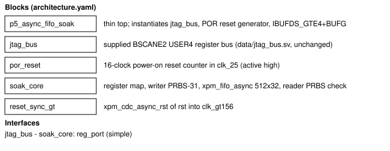

# p5_async_fifo: Asynchronous FIFO soak with PRBS-31 checking across two unrelated clocks

<!-- Generated from handover.yaml by flow/handover.py (brief 68). Edit handover.yaml, or the text between the prose markers, then run: python -m flow.handover write runs/20261125-143655-7b11/p5_async_fifo -->

The design writes PRBS-31 words from a 25 MHz writer into a 512 x 32 asynchronous FIFO and pops them in a 156.25 MHz reader that checks each word against its own PRBS copy. Counters for words, errors, overflow, underflow, stalls and peak fill are read through a snapshot register on the jtag_bus register port. The run stopped at rtl-design-creation, which failed its gates (lint, simulation, design standards and verification V2). Only V1 was reached, and no Vivado build exists.

Not in scope:

- Not a transceiver design, no GT channel is used; only the reference clock buffer is taken from the SFP+ clock pin pair.
- Not a verified or built design; no bitstream, timing, resource or power result exists.
- Not a throughput or latency measurement tool; none was measured.

Kind: agent-run; produced by the agent (agent run `20261125-143655-7b11`, [record](../summary.json)). State: spec. For an agent: [AGENT.md](AGENT.md).

Run: model claude-sonnet-5-5 (deepagents harness), 9 loops, 104 turns, 3,414,979 tokens, 1865.1 s wall time, 4.03923 USD model cost (provider-reported), stopped because: stage 2 visited more than 6 times; last failing gate: lint, simulate, design standards, verification V2; owned by the rtl/tests role; last failing assertion: V2 seeds_run: no seeded results: read runs/20261125-143655-7b11/p5_async_fifo/build/verif/sim/seed*/results.xml and found none. The gate expects runs/20261125-143655-7b11/p5_async_fifo/build/verif/sim/seed<N>/results.xml, one directory per ; the same failure on 6 consecutive visits (from the run record).

<!-- prose:what -->
<!-- /prose:what -->

## Technical parameters

| Item | Value |
|---|---|
| Part | `xck26-sfvc784-2LV-c` |
| Board | kr260 |
| Top | `p5_async_fifo_soak` |
| Tool | Vivado 2026.1 |

Clocks:

- `clk_25`: 25 MHz (from `runs/20261125-143655-7b11/p5_async_fifo/design.xdc`)

Resets:

- `rst`, active high: Internal power-on counter in clk_25 held for 16 clocks (POR_CYCLES); it is synchronised into clk_gt156 with async assert and sync release (spec.yaml, ARCHITECTURE.md). The RTL itself was not shown to the Designer for this handover, so this is taken from the spec.

Interfaces:

- `clk_c3` (input, 25 MHz clock, 1 bit): Writer and register-port clock. design.xdc names the port clk_25 on pin C3 (LVCMOS18), while spec.yaml names it clk_c3.
- `gt_refclk0_p / gt_refclk0_n` (input, differential clock pair, 156.25 MHz): SFP+ MGTREFCLK0 through IBUFDS_GTE4 and BUFG_GT, reader clock. design.xdc has no pin or clock constraint for these ports.
- `led` (output, 2 bits): led[0] shows RUN and led[1] a sticky error flag (an assumption of the run). Pins F8 and E8, LVCMOS18, from design.xdc.
- `sfp_tx_disable` (output, 1 bit): Constant 1, laser off. Pin Y10, LVCMOS33, from design.xdc.

Registers (from spec.yaml; where the RTL differs, the gaps say so):

| Offset | Name | Access | Reset | Bits |
|---|---|---|---|---|
| 0 | `ID` | RO | 546635777 | [31:0] design ID |
| 4 | `BUILD` | RO | 0 | [31:0] USR_ACCESSE2 word |
| 8 | `SCRATCH` | RW | 0 | [31:0] read-back |
| 16 | `CTRL` | RW | 0 | [0] RUN, [1] SLOW_READ, [2] CLEAR self-clearing (only while RUN 0), [3] INJECT self-clearing |
| 20 | `WORDS_W` | RO | 0 | [31:0] words written (snapshot) |
| 24 | `WORDS_R` | RO | 0 | [31:0] words read and checked (snapshot) |
| 28 | `DATA_ERRS` | RO | 0 | [31:0] mismatching words (snapshot) |
| 32 | `OVERFLOWS` | RO | 0 | [31:0] snapshot |
| 36 | `UNDERFLOWS` | RO | 0 | [31:0] snapshot |
| 40 | `STALL_W` | RO | 0 | [31:0] writer clocks held off (snapshot) |
| 44 | `OCC_MAX` | RO | 0 | [31:0] highest fill in words (snapshot) |
| 48 | `SNAPSHOT` | WO | 0 | any write latches 0x014 to 0x02C; reads 0 |

| Parameter | Value | Legal range | Note |
|---|---|---|---|
| `FIFO_DEPTH` | 512 | positive power of two; 512 is the specified value | FIFO depth in words; one BRAM36 is expected. Only the spec value is documented; the benches' parameter values are not recorded here. |
| `DATA_WIDTH` | 32 | 32 only (PRBS step is 32 bits per word) | Word width of the FIFO and PRBS. |
| `PRBS_SEED` | 2,147,483,647 | non-zero 31-bit value | Seed 0x7FFFFFFF for both the writer and the reader PRBS-31 copies. |
| `DESIGN_ID` | 546,635,777 | any 32-bit value | Read back at register 0x000 as 0x20950001. |
| `SLOW_READ_DIV_CYCLES` | 8 | 1 or more | With SLOW_READ 1 the reader pops at most one word per 8 clk_gt156 clocks (6.4 ns period). |
| `POR_CYCLES` | 16 | 1 or more | Length of the power-on reset in clk_25 clocks (40 ns period). |
| `SYNC_STAGES` | 2 | 2 or more | Synchroniser stages on the Gray-coded FIFO pointers. |
| `SNAP_SYNC_STAGES` | 2 | 2 or more | Synchroniser stages on the snapshot handshake from the reader domain. |

| Quantity | Value | Source |
|---|---|---|
| Resources | not measured | [Known gaps](#known-gaps-and-limits) |
| Timing | not measured | [Known gaps](#known-gaps-and-limits) |
| Power | not measured | [Known gaps](#known-gaps-and-limits) |
| Latency | not measured | [Known gaps](#known-gaps-and-limits) |
| Throughput | not measured | [Known gaps](#known-gaps-and-limits) |

<!-- prose:parameters -->
<!-- /prose:parameters -->

## How to build, run and reproduce

| Step | Command | Heavy slot | Time |
|---|---|---|---|
| what changed since this handover (stale records, changed files, tool and knowledge-bank pins) | `python -m flow.handover fresh runs/20261125-143655-7b11/p5_async_fifo` | no | - |
| pick the work up again from the earliest stage the change or the staleness needs; needs a model (see docs/agent.md); Vivado for any stage from synthesis on | `python -m agent resume runs/20261125-143655-7b11/p5_async_fifo "<change request>"` | yes | - |
| run the Verifier's simulation tests; needs Icarus Verilog and cocotb, or the simulation container | `python -m pytest -q runs/20261125-143655-7b11/p5_async_fifo/tests/test_p5_async_fifo_rtl.py` | no | - |
| re-run the Verilator coverage simulation and the verification gates (line, toggle, functional and cover results); needs Verilator 5.036 or later and cocotb (the simulation container has them) | `SIM=verilator FDA_COVERAGE=1 FDA_SIM_RESULTS_DIR=runs/20261125-143655-7b11/p5_async_fifo/build/verif/sim python -m pytest -q -x runs/20261125-143655-7b11/p5_async_fifo/tests/test_p5_async_fifo_rtl.py && python3 flow/verif_gates.py runs/20261125-143655-7b11/p5_async_fifo --runs runs/20261125-143655-7b11/p5_async_fifo/build/verif/sim` | no | - |
| rebuild the bitstream with the flow; needs Vivado 2026.1 and a heavy slot | `flow/run_vivado.sh runs/20261125-143655-7b11/p5_async_fifo base` | yes | - |

Tool: Vivado 2026.1. Build ID of the inputs at handover: none (no Vivado build of this directory). Knowledge-bank pin: `5e2eab8`.

| File | What |
|---|---|
| [`runs/20261125-143655-7b11/p5_async_fifo/spec.md`](spec.md) | the request the run started from |
| [`runs/20261125-143655-7b11/p5_async_fifo/spec.yaml`](spec.yaml) | the specification the Clarifier wrote, approved automatically with no human review |
| [`runs/20261125-143655-7b11/p5_async_fifo/ARCHITECTURE.md`](ARCHITECTURE.md) | the architecture note, accepted automatically before any RTL (no human review) |
| [`runs/20261125-143655-7b11/p5_async_fifo/architecture.yaml`](architecture.yaml) | the machine-checked architecture: blocks, clocks, predicted resources |
| [`runs/20261125-143655-7b11/p5_async_fifo/design.xdc`](design.xdc) | pin, I/O standard and timing constraints |
| [`runs/20261125-143655-7b11/p5_async_fifo/model.py`](model.py) | the Modeller's reference model of the visible behaviour |
| [`runs/20261125-143655-7b11/p5_async_fifo/tests/p5_bench.py`](tests/p5_bench.py) | the Verifier's cocotb benches and pytest entries |
| [`runs/20261125-143655-7b11/p5_async_fifo/tests/test_p5_async_fifo_rtl.py`](tests/test_p5_async_fifo_rtl.py) | the Verifier's cocotb benches and pytest entries |
| [`runs/20261125-143655-7b11/p5_async_fifo/verif/testplan.yaml`](verif/testplan.yaml) | the test plan and mutant list read by the verification gates |
| [`runs/20261125-143655-7b11/p5_async_fifo/verif/checkers/v_macros.svh`](verif/checkers/v_macros.svh) | bound assertion and cover checkers |
| [`runs/20261125-143655-7b11/p5_async_fifo/build/review/02_rtl-design-creation.html`](build/review/02_rtl-design-creation.html) | the review page of stage rtl-design-creation: its exit gates and their failures at the last visit |

<!-- prose:build -->
<!-- /prose:build -->

## Verified

| ID | Activity | Result | What | Evidence | Conditions |
|---|---|---|---|---|---|
| E1 | review | partial | the specification and the architecture were approved automatically, with no human review (review off; the interview oracle claude-sonnet-5-5 only answered the interview questions); the interview asked 8 questions, 0 answered and 8 defaulted | [`runs/20261125-143655-7b11/summary.json`](../summary.json) | - |
| E2 | simulation | partial | verification (flow/verif_gates.py) against the Modeller's reference model reached V1 of V3; the run asked for V2; V1 means every spec item is traced to a check and the benches use the blind model; V2 (simulation: seeded runs, a constrained-random test, bound assertions and formal tasks) did not pass: seeds run no seeded results: read runs/20261125-143655-7b11/p5_async_fifo/build/verif/sim/seed*/results.xml and found none. The gate expects runs/20261125-143655-7b11/p5_async_fifo/build/verif/sim/seed<N>/results.xml, one directory per seed. The flow's simulation step writes it when the bench runs through flow.cocotb_run.run(name, toplevel, sources, test_module, test_dir, parameters=..., seed=N) in tests/test_*_rtl.py: call run() once per seed (for example seed=1, 2, 3; a seed left out counts as seed 1) with the module(s) listed in bench.modules; the flow runs it and checks again. A bench that runs the simulator some other way leaves nothing there. (needs >=1 seed); constrained random test ran not evaluated (no seeded results) (needs True); assertions bound zero failures not evaluated (no seeded results) (needs bound in the run; no failure); V3 (coverage (line, toggle, functional bins, cover properties), three seeds and the mutation score) did not pass: seeds run no seeded results: read runs/20261125-143655-7b11/p5_async_fifo/build/verif/sim/seed*/results.xml and found none. The gate expects runs/20261125-143655-7b11/p5_async_fifo/build/verif/sim/seed<N>/results.xml, one directory per seed. The flow's simulation step writes it when the bench runs through flow.cocotb_run.run(name, toplevel, sources, test_module, test_dir, parameters=..., seed=N) in tests/test_*_rtl.py: call run() once per seed (for example seed=1, 2, 3; a seed left out counts as seed 1) with the module(s) listed in bench.modules; the flow runs it and checks again. A bench that runs the simulator some other way leaves nothing there. (needs >=3); functional bins pct not evaluated (no seeded results) (needs 100); cover properties pct not evaluated (no seeded results) (needs 100); line pct not evaluated (no seeded results) (needs 90); toggle pct not evaluated (no seeded results) (needs 75); mutation score pct not measured (needs 70); cdc structure clean missing (needs no unsafe crossing); cdc injection clean missing (needs pass); no board result (V-HW) is recorded | [`runs/20261125-143655-7b11/p5_async_fifo/build/verif/verif_gates.json`](build/verif/verif_gates.json) | - |

Gates at handover: `clarify` pass, `board-and-device-planning` pass, `rtl-design-creation` fail, `constraints` not-run, `synthesis` not-run, `implementation` not-run, `timing-closure` not-run, `power-closure` not-run, `drc-closure` not-run, `configuration-and-debug` not-run.

<!-- prose:verified -->
<!-- /prose:verified -->

## Measured

Every value is read from the record by `python -m flow.handover fill`, not typed.

| ID | What | Value | Runs | Source | Conditions |
|---|---|---|---|---|---|
| M1 | model cost of the run, provider-reported | 4.03923 USD | 1 | [`runs/20261125-143655-7b11/summary.json`](../summary.json) `cost_usd` | every role and the interview oracle, as the run summary records it |

<!-- prose:measured -->
<!-- /prose:measured -->

## Known gaps and limits

- **REQ-01**: REQ-01 has no passing evidence for every proof method: simulation (p5_bench.test_register_basics) is pending: no simulation results; hardware (uart_tests:id) is pending: no bring-up result
- **REQ-02**: REQ-02 has no passing evidence for every proof method: hardware (uart_tests:build) is pending: no bring-up result
- **REQ-03**: REQ-03 has no passing evidence for every proof method: simulation (p5_bench.test_register_basics) is pending: no simulation results; hardware (uart_tests:scratch) is pending: no bring-up result
- **REQ-04**: REQ-04 has no passing evidence for every proof method: simulation (p5_bench.test_register_basics) is pending: no simulation results
- **REQ-29**: REQ-29 has no passing evidence for every proof method: simulation (p5_bench.test_register_basics) is pending: no simulation results
- **REQ-30**: REQ-30 has no passing evidence for every proof method: simulation (p5_bench.test_register_basics) is pending: no simulation results; hardware (uart_tests:scratch) is pending: no bring-up result
- **REQ-05**: REQ-05 has no passing evidence for every proof method: simulation (p5_bench.test_register_basics) is pending: no simulation results
- **REQ-31**: REQ-31 has no passing evidence for every proof method: simulation (p5_bench.test_register_basics) is pending: no simulation results
- **REQ-06**: REQ-06 has no passing evidence for every proof method: simulation (p5_bench.test_prbs_run) is pending: no simulation results
- **REQ-07**: REQ-07 has no passing evidence for every proof method: simulation (p5_bench.test_prbs_run) is pending: no simulation results; hardware (uart_tests:run) is pending: no bring-up result
- **REQ-08**: REQ-08 has no passing evidence for every proof method: simulation (p5_bench.test_slow_read_stall) is pending: no simulation results; analysis (post_synth:post_synth_resources_in_range) is pending: no flow gates result
- **REQ-09**: REQ-09 has no passing evidence for every proof method: simulation (p5_bench.test_prbs_run) is pending: no simulation results
- **REQ-10**: REQ-10 has no passing evidence for every proof method: hardware (uart_tests:soak) is pending: no bring-up result
- **REQ-11**: REQ-11 has no passing evidence for every proof method: formal (p5_bench.test_slow_read_stall) is pending: re-planned from formal to simulation (SymbiYosys is not installed here so the overflow check is re-planned to simulation with a full FIFO stall.): no simulation results; hardware (uart_tests:soak) is pending: no bring-up result
- **REQ-12**: REQ-12 has no passing evidence for every proof method: formal (p5_bench.test_prbs_run) is pending: re-planned from formal to simulation (SymbiYosys is not installed here so the underflow check is re-planned to simulation.): no simulation results; hardware (uart_tests:soak) is pending: no bring-up result
- **REQ-13**: REQ-13 has no passing evidence for every proof method: simulation (p5_bench.test_slow_read_stall) is pending: no simulation results
- **REQ-14**: REQ-14 has no passing evidence for every proof method: simulation (p5_bench.test_slow_read_stall) is pending: no simulation results; hardware (uart_tests:slow_read) is pending: no bring-up result
- **REQ-15**: REQ-15 has no passing evidence for every proof method: simulation (p5_bench.test_inject) is pending: no simulation results; hardware (uart_tests:inject) is pending: no bring-up result
- **REQ-16**: REQ-16 has no passing evidence for every proof method: simulation (p5_bench.test_inject) is pending: no simulation results
- **REQ-17**: REQ-17 has no passing evidence for every proof method: simulation (p5_bench.test_clear) is pending: no simulation results
- **REQ-34**: REQ-34 has no passing evidence for every proof method: simulation (p5_bench.test_clear) is pending: no simulation results
- **REQ-35**: REQ-35 has no passing evidence for every proof method: simulation (p5_bench.test_clear) is pending: no simulation results
- **REQ-18**: REQ-18 has no passing evidence for every proof method: simulation (p5_bench.test_clear) is pending: no simulation results
- **REQ-19**: REQ-19 has no passing evidence for every proof method: simulation (p5_bench.test_clear) is pending: no simulation results; hardware (uart_tests:snapshot) is pending: no bring-up result
- **REQ-20**: REQ-20 has no passing evidence for every proof method: simulation (p5_bench.test_clear) is pending: no simulation results
- **REQ-21**: REQ-21 has no passing evidence for every proof method: simulation (p5_bench.test_counter_width) is pending: no simulation results; formal (p5_bench.test_counter_width) is pending: re-planned from formal to simulation (SymbiYosys is not installed here so counter width is re-planned to simulation.): no simulation results
- **REQ-22**: REQ-22 has no passing evidence for every proof method: simulation (p5_bench.test_slow_read_stall) is pending: no simulation results; formal (p5_bench.test_slow_read_stall) is pending: re-planned from formal to simulation (SymbiYosys is not installed here so the OCC_MAX bound is re-planned to simulation.): no simulation results
- **REQ-23**: REQ-23 has no passing evidence for every proof method: hardware (uart_tests:run) is pending: no bring-up result
- **REQ-24**: REQ-24 has no passing evidence for every proof method: simulation (p5_bench.test_register_basics) is pending: no simulation results; analysis (post_synth:post_synth_resources_in_range) is pending: no flow gates result
- **REQ-25**: REQ-25 has no passing evidence for every proof method: analysis (post_synth:post_synth_resources_in_range) is pending: no flow gates result
- **REQ-32**: REQ-32 has no passing evidence for every proof method: analysis (post_synth:post_synth_resources_in_range) is pending: no flow gates result
- **REQ-26**: REQ-26 has no passing evidence for every proof method: analysis (post_route:setup) is pending: no flow gates result
- **REQ-33**: REQ-33 has no passing evidence for every proof method: analysis (post_route:setup) is pending: no flow gates result
- **REQ-27**: REQ-27 has no passing evidence for every proof method: analysis (post_route:setup) is pending: no flow gates result
- **REQ-28**: REQ-28 has no passing evidence for every proof method: analysis (post_synth:post_synth_resources_in_range) is pending: no flow gates result
- **E1**: review evidence is partial: the specification and the architecture were approved automatically, with no human review (review off; the interview oracle claude-sonnet-5-5 only answered the interview questions); the interview asked 8 questions, 0 answered and 8 defaulted
- **E2**: simulation evidence is partial: verification reached V1 of V3 (the run asked for V2); the checks that did not pass or did not run are listed in the evidence row
- **rtl-design-creation**: stage rtl-design-creation did not pass its gates in this run; at its last visit: lint not passing FAIL simulate not passing FAIL standards STD-LATCH-01: not checked (no build.yaml top or sources to check) FAIL standards STD-LOOP-01: not checked (no build.yaml top or sources to check) FAIL standards STD-CDC-01: architecture.yaml:1: crossings[0]: inline_in p5_async_fifo_soak is not a module of this design or the shell FAIL standards STD-CDC-01: architecture.yaml:1: crossings[1]: ...
- **constraints**: stage constraints was not run: the run stopped before this stage (stage 2 visited more than 6 times; last failing gate: lint, simulate, design standards, verification V2; owned by the rtl/tests role; last failing assertion: V2 seeds_run: no seeded results: read runs/20261125-143655-7b11/p5_async_fifo/build/verif/sim/seed*/results.xml and found none. The gate expects runs/20261125-143655-7b11/p5_async_fifo/build/verif/sim/seed<N>/results.xml, one directory per ; the same failure on 6 consecutive visits)
- **synthesis**: stage synthesis was not run: the run stopped before this stage (stage 2 visited more than 6 times; last failing gate: lint, simulate, design standards, verification V2; owned by the rtl/tests role; last failing assertion: V2 seeds_run: no seeded results: read runs/20261125-143655-7b11/p5_async_fifo/build/verif/sim/seed*/results.xml and found none. The gate expects runs/20261125-143655-7b11/p5_async_fifo/build/verif/sim/seed<N>/results.xml, one directory per ; the same failure on 6 consecutive visits)
- **implementation**: stage implementation was not run: the run stopped before this stage (stage 2 visited more than 6 times; last failing gate: lint, simulate, design standards, verification V2; owned by the rtl/tests role; last failing assertion: V2 seeds_run: no seeded results: read runs/20261125-143655-7b11/p5_async_fifo/build/verif/sim/seed*/results.xml and found none. The gate expects runs/20261125-143655-7b11/p5_async_fifo/build/verif/sim/seed<N>/results.xml, one directory per ; the same failure on 6 consecutive visits)
- **timing-closure**: stage timing-closure was not run: the run stopped before this stage (stage 2 visited more than 6 times; last failing gate: lint, simulate, design standards, verification V2; owned by the rtl/tests role; last failing assertion: V2 seeds_run: no seeded results: read runs/20261125-143655-7b11/p5_async_fifo/build/verif/sim/seed*/results.xml and found none. The gate expects runs/20261125-143655-7b11/p5_async_fifo/build/verif/sim/seed<N>/results.xml, one directory per ; the same failure on 6 consecutive visits)
- **power-closure**: stage power-closure was not run: the run stopped before this stage (stage 2 visited more than 6 times; last failing gate: lint, simulate, design standards, verification V2; owned by the rtl/tests role; last failing assertion: V2 seeds_run: no seeded results: read runs/20261125-143655-7b11/p5_async_fifo/build/verif/sim/seed*/results.xml and found none. The gate expects runs/20261125-143655-7b11/p5_async_fifo/build/verif/sim/seed<N>/results.xml, one directory per ; the same failure on 6 consecutive visits)
- **drc-closure**: stage drc-closure was not run: the run stopped before this stage (stage 2 visited more than 6 times; last failing gate: lint, simulate, design standards, verification V2; owned by the rtl/tests role; last failing assertion: V2 seeds_run: no seeded results: read runs/20261125-143655-7b11/p5_async_fifo/build/verif/sim/seed*/results.xml and found none. The gate expects runs/20261125-143655-7b11/p5_async_fifo/build/verif/sim/seed<N>/results.xml, one directory per ; the same failure on 6 consecutive visits)
- **configuration-and-debug**: stage configuration-and-debug was not run: the run stopped before this stage (stage 2 visited more than 6 times; last failing gate: lint, simulate, design standards, verification V2; owned by the rtl/tests role; last failing assertion: V2 seeds_run: no seeded results: read runs/20261125-143655-7b11/p5_async_fifo/build/verif/sim/seed*/results.xml and found none. The gate expects runs/20261125-143655-7b11/p5_async_fifo/build/verif/sim/seed<N>/results.xml, one directory per ; the same failure on 6 consecutive visits)
- **formal**: formal checks were planned for REQ-11, REQ-12, REQ-21, REQ-22 and did not run; each was replaced by a simulation check (verif/testplan.yaml replan). Reason recorded: SymbiYosys is not installed here so the overflow check is re-planned to simulation with a full FIFO stall.
- **resources**: resources not measured: no current Vivado build of this design has been recorded
- **timing**: timing not measured: no current Vivado build of this design has been recorded
- **power**: power not measured: no current Vivado build of this design has been recorded
- **latency**: latency not measured: the run measured no latency; the spec's latency promise is checked only by the benches
- **throughput**: throughput not measured: the run measured no throughput
- **xdc_vs_spec**: design.xdc constrains only clk_25 (pin C3, 40 ns), led, and sfp_tx_disable. It has no constraint for gt_refclk0_p/n, no clk_gt156 clock and no clock-group or max-delay between the clocks, although spec.yaml and ARCHITECTURE.md promise them (REQ-26). The XDC names the 25 MHz port clk_25, while the spec names it clk_c3. The XDC is what was built.
- **architecture_inconsistency**: The gate failure STD-CDC-01 reports that architecture.yaml names inline_in p5_async_fifo_soak, which is not a module of the design or shell. The crossing description needs correcting before the design gates can pass.
- **reset_values**: Every register resets to the value in the register table; BUILD reads 0 in simulation because USR_ACCESSE2 is not simulated. Unmapped addresses read 0 and ignore writes (spec.yaml, not checked against RTL, as no simulation ran).
- **control_priorities**: Per the interview defaults, which no review confirmed, CLEAR written while RUN is 1 is ignored and does not stay set. INJECT written while RUN is 0 stays pending and flips bit 0 of the first word received after RUN. RUN to 0 stops both sides and CLEAR flushes the FIFO.
- **snapshot_semantics**: Registers 0x014 to 0x02C return the snapshot values, not live counters, so a SNAPSHOT write is needed before each read. The reader-side counters arrive through a request/acknowledge handshake, so they are stable only a few clk_25 clocks after the write. A read inside that window may give the older values.
- **latency_count**: The spec promises h_rdata within 2 clk_25 clocks of h_re and a write effect 1 clock after h_we. These were not counted from the RTL and were not simulated, so they are unconfirmed.
- **occ_max_side**: OCC_MAX is the write-side fill (write pointer minus the synchronised read pointer), a conservative estimate that can differ from the read-side fill by a few words. This was an assumption of the run.

<!-- prose:gaps -->
<!-- /prose:gaps -->

## Next steps

1. Fix the rtl-design-creation failures first. Make the bench run through flow.cocotb_run.run once per seed (1, 2, 3) so the per-seed results.xml files appear under build/verif/sim, correct the lint and simulate failures, and correct the architecture.yaml crossing that names p5_async_fifo_soak.
2. Re-run the simulation and the verification gates. When cover properties and functional bins are both reported, compare the cover results with the functional coverage before adding any new stimulus.
3. Add the missing constraints to design.xdc (the gt_refclk0 clock at 156.25 MHz and the asynchronous clock groups or max-delay between clk_25 and clk_gt156) and reconcile the port name clk_25 with the spec's clk_c3.
4. Install a formal tool or accept the simulation replans for REQ-11, REQ-12, REQ-21 and REQ-22, and record that decision.
5. With the gates passing, resume with python -m agent resume to run constraints, synthesis and implementation, then measure resources, timing and power.
6. Plan the hardware bring-up tests (id, build, scratch, run, soak, slow_read, inject, snapshot) and run them once a bitstream exists.

Open questions:

- Should led[0] and led[1] show RUN and the sticky error flag, as assumed by the run? The request does not define them.
- Should INJECT written while RUN is 0 stay pending, as defaulted, or be ignored?

<!-- prose:next -->
<!-- /prose:next -->

## History

| Date | Brief | PR | What |
|---|---|---|---|
| 2026-11-25 | agent run | - | produced by the agent graph; stages that passed: clarify, board-and-device-planning |

<!-- prose:history -->
<!-- /prose:history -->
