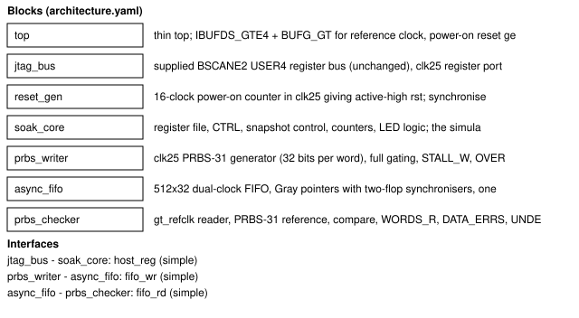

# p5_async_fifo: Asynchronous FIFO soak with PRBS-31 check (25 MHz writer, 156.25 MHz reader)

<!-- Generated from handover.yaml by flow/handover.py (brief 68). Edit handover.yaml, or the text between the prose markers, then run: python -m flow.handover write runs/20261125-151313-ce44/p5_async_fifo -->

The design is meant to push a 32-bit PRBS-31 stream through a 512-word asynchronous FIFO from a 25 MHz writer domain to a 156.25 MHz reader domain, check it word by word, and expose counters through a JTAG-driven register port. The run stopped at rtl-design-creation, with the specification and architecture written and no verified RTL. Verification reached V1 of V3. Constraints, synthesis, implementation and later stages were not run, and no Vivado build is recorded.

Not in scope:

- Not a transceiver design. No GT channel is used, only the reference clock buffer, and sfp_tx_disable is held at 1 (laser off).
- Not a verified or built design. No bitstream, timing, power or board result exists.
- Not a general-purpose FIFO IP. It is a soak and test fixture with fixed width and depth.

Kind: agent-run; produced by the agent (agent run `20261125-151313-ce44`, [record](../summary.json)). State: spec. For an agent: [AGENT.md](AGENT.md).

Run: model claude-sonnet-5-5 (deepagents harness), 8 loops, 93 turns, 3,261,583 tokens, 1372.7 s wall time, 3.43991 USD model cost (provider-reported), stopped because: stage 2 visited more than 6 times; last failing gate: lint, simulate, design standards, verification V2; owned by the rtl/tests role; last failing assertion: V2 seeds_run: no seeded results: read runs/20261125-151313-ce44/p5_async_fifo/build/verif/sim/seed*/results.xml and found none. The gate expects runs/20261125-151313-ce44/p5_async_fifo/build/verif/sim/seed<N>/results.xml, one directory per ; the same failure on 6 consecutive visits (from the run record).

<!-- prose:what -->
<!-- /prose:what -->

## Technical parameters

| Item | Value |
|---|---|
| Part | `xck26-sfvc784-2LV-c` |
| Board | kr260 |
| Top | `top` |
| Tool | Vivado 2026.1 |

Clocks:

- `clk_25`: 25 MHz (from `runs/20261125-151313-ce44/p5_async_fifo/design.xdc`)

Resets:

- `rst`, active high: Per spec.yaml it comes from a power-on counter in clk25 held for 16 clocks and is synchronised into the gt_refclk domain. No verified RTL was recorded, so this is the specified behaviour; ARCHITECTURE.md says other resets are synchronous.

Interfaces:

- `clk_25` (input, 25 MHz clock, pin C3, LVCMOS18): design.xdc names the port clk_25 and defines the 40.00 ns clock on it; spec.yaml calls it clk25. Gap recorded.
- `gt_refclk_p / gt_refclk_n` (input, differential 156.25 MHz reference clock (SFP+ MGTREFCLK0)): Goes through IBUFDS_GTE4 and BUFG_GT. design.xdc has no pin or clock constraint for these ports.
- `led` (output, 2 bits, pins F8 (led[0]) and E8 (led[1]), LVCMOS18): led[0] shows RUN; led[1] is a sticky error flag (any of DATA_ERRS, OVERFLOWS, UNDERFLOWS non-zero) until CLEAR.
- `sfp_tx_disable` (output, 1 bit, pin Y10, LVCMOS33): Constant 1 per the spec.

Registers (from spec.yaml; where the RTL differs, the gaps say so):

| Offset | Name | Access | Reset | Bits |
|---|---|---|---|---|
| 0 | `ID` | RO | 546635777 | [31:0] design ID |
| 4 | `BUILD` | RO | 0 | [31:0] USR_ACCESSE2 word |
| 8 | `SCRATCH` | RW | 0 | [31:0] scratch |
| 16 | `CTRL` | RW | 0 | [0] RUN, [1] SLOW_READ, [2] CLEAR self-clearing only while RUN=0, [3] INJECT self-clearing, [31:4] reserved read 0 |
| 20 | `WORDS_W` | RO | 0 | [31:0] words written (snapshot) |
| 24 | `WORDS_R` | RO | 0 | [31:0] words read and checked (snapshot) |
| 28 | `DATA_ERRS` | RO | 0 | [31:0] mismatching words (snapshot) |
| 32 | `OVERFLOWS` | RO | 0 | [31:0] writes while full (snapshot) |
| 36 | `UNDERFLOWS` | RO | 0 | [31:0] reads while empty (snapshot) |
| 40 | `STALL_W` | RO | 0 | [31:0] writer clocks held off by full (snapshot) |
| 44 | `OCC_MAX` | RO | 0 | [9:0] highest fill in words (snapshot) |
| 48 | `SNAPSHOT` | WO | 0 | any write latches 0x014 to 0x02C, reads 0 |

| Parameter | Value | Legal range | Note |
|---|---|---|---|
| `FIFO_DEPTH` | 512 | 512 as specified; a power of two matching ADDR_WIDTH | Words in the FIFO. The spec's value was not simulated; no bench result exists. |
| `DATA_WIDTH` | 32 | 32 as specified | Bits per word. PRBS-31 produces 32 new bits per word. |
| `PRBS_SEED` | 2,147,483,647 | non-zero 31-bit value; 0x7FFFFFFF as specified | Seed for both writer and reader PRBS-31 copies. |
| `DESIGN_ID` | 546,635,777 | any 32-bit value | Read back at register 0x000 as 0x20950001. |
| `SLOW_READ_DIV_CYCLES` | 8 | 1 or more | With SLOW_READ set the reader pops at most one word per 8 gt_refclk cycles. Normal mode drains faster than the 25 Mwords/s writer (rate ratio 6.25 to 1). |
| `ADDR_WIDTH` | 9 | log2 of FIFO_DEPTH | Pointer width for the 512-word FIFO. |
| `RESET_CYCLES` | 16 | 1 or more | Length in clk25 cycles of the power-on reset. |

| Quantity | Value | Source |
|---|---|---|
| Resources | not measured | [Known gaps](#known-gaps-and-limits) |
| Timing | not measured | [Known gaps](#known-gaps-and-limits) |
| Power | not measured | [Known gaps](#known-gaps-and-limits) |
| Latency | not measured | [Known gaps](#known-gaps-and-limits) |
| Throughput | not measured | [Known gaps](#known-gaps-and-limits) |

<!-- prose:parameters -->
<!-- /prose:parameters -->

## How to build, run and reproduce

| Step | Command | Heavy slot | Time |
|---|---|---|---|
| what changed since this handover (stale records, changed files, tool and knowledge-bank pins) | `python -m flow.handover fresh runs/20261125-151313-ce44/p5_async_fifo` | no | - |
| pick the work up again from the earliest stage the change or the staleness needs; needs a model (see docs/agent.md); Vivado for any stage from synthesis on | `python -m agent resume runs/20261125-151313-ce44/p5_async_fifo "<change request>"` | yes | - |
| run the Verifier's simulation tests; needs Icarus Verilog and cocotb, or the simulation container | `python -m pytest -q runs/20261125-151313-ce44/p5_async_fifo/tests/test_p5_async_fifo_rtl.py` | no | - |
| re-run the Verilator coverage simulation and the verification gates (line, toggle, functional and cover results); needs Verilator 5.036 or later and cocotb (the simulation container has them) | `SIM=verilator FDA_COVERAGE=1 FDA_SIM_RESULTS_DIR=runs/20261125-151313-ce44/p5_async_fifo/build/verif/sim python -m pytest -q -x runs/20261125-151313-ce44/p5_async_fifo/tests/test_p5_async_fifo_rtl.py && python3 flow/verif_gates.py runs/20261125-151313-ce44/p5_async_fifo --runs runs/20261125-151313-ce44/p5_async_fifo/build/verif/sim` | no | - |
| rebuild the bitstream with the flow; needs Vivado 2026.1 and a heavy slot | `flow/run_vivado.sh runs/20261125-151313-ce44/p5_async_fifo base` | yes | - |

Tool: Vivado 2026.1. Build ID of the inputs at handover: none (no Vivado build of this directory). Knowledge-bank pin: `5e2eab8`.

| File | What |
|---|---|
| [`runs/20261125-151313-ce44/p5_async_fifo/spec.md`](spec.md) | the request the run started from |
| [`runs/20261125-151313-ce44/p5_async_fifo/spec.yaml`](spec.yaml) | the specification the Clarifier wrote, approved automatically with no human review |
| [`runs/20261125-151313-ce44/p5_async_fifo/ARCHITECTURE.md`](ARCHITECTURE.md) | the architecture note, accepted automatically before any RTL (no human review) |
| [`runs/20261125-151313-ce44/p5_async_fifo/architecture.yaml`](architecture.yaml) | the machine-checked architecture: blocks, clocks, predicted resources |
| [`runs/20261125-151313-ce44/p5_async_fifo/design.xdc`](design.xdc) | pin, I/O standard and timing constraints |
| [`runs/20261125-151313-ce44/p5_async_fifo/model.py`](model.py) | the Modeller's reference model of the visible behaviour |
| [`runs/20261125-151313-ce44/p5_async_fifo/tests/p5_async_fifo_bench.py`](tests/p5_async_fifo_bench.py) | the Verifier's cocotb benches and pytest entries |
| [`runs/20261125-151313-ce44/p5_async_fifo/tests/test_p5_async_fifo_rtl.py`](tests/test_p5_async_fifo_rtl.py) | the Verifier's cocotb benches and pytest entries |
| [`runs/20261125-151313-ce44/p5_async_fifo/verif/testplan.yaml`](verif/testplan.yaml) | the test plan and mutant list read by the verification gates |
| [`runs/20261125-151313-ce44/p5_async_fifo/verif/checkers/v_macros.svh`](verif/checkers/v_macros.svh) | bound assertion and cover checkers |
| [`runs/20261125-151313-ce44/p5_async_fifo/build/review/02_rtl-design-creation.html`](build/review/02_rtl-design-creation.html) | the review page of stage rtl-design-creation: its exit gates and their failures at the last visit |

<!-- prose:build -->
<!-- /prose:build -->

## Verified

| ID | Activity | Result | What | Evidence | Conditions |
|---|---|---|---|---|---|
| E1 | review | partial | the specification and the architecture were approved automatically, with no human review (review off; the interview oracle claude-sonnet-5-5 only answered the interview questions); the interview asked 11 questions, 0 answered and 11 defaulted | [`runs/20261125-151313-ce44/summary.json`](../summary.json) | - |
| E2 | simulation | partial | verification (flow/verif_gates.py) against the Modeller's reference model reached V1 of V3; the run asked for V2; V1 means every spec item is traced to a check and the benches use the blind model; V2 (simulation: seeded runs, a constrained-random test, bound assertions and formal tasks) did not pass: seeds run no seeded results: read runs/20261125-151313-ce44/p5_async_fifo/build/verif/sim/seed*/results.xml and found none. The gate expects runs/20261125-151313-ce44/p5_async_fifo/build/verif/sim/seed<N>/results.xml, one directory per seed. The flow's simulation step writes it when the bench runs through flow.cocotb_run.run(name, toplevel, sources, test_module, test_dir, parameters=..., seed=N) in tests/test_*_rtl.py: call run() once per seed (for example seed=1, 2, 3; a seed left out counts as seed 1) with the module(s) listed in bench.modules; the flow runs it and checks again. A bench that runs the simulator some other way leaves nothing there. (needs >=1 seed); constrained random test ran not evaluated (no seeded results) (needs True); assertions bound zero failures not evaluated (no seeded results) (needs bound in the run; no failure); V3 (coverage (line, toggle, functional bins, cover properties), three seeds and the mutation score) did not pass: seeds run no seeded results: read runs/20261125-151313-ce44/p5_async_fifo/build/verif/sim/seed*/results.xml and found none. The gate expects runs/20261125-151313-ce44/p5_async_fifo/build/verif/sim/seed<N>/results.xml, one directory per seed. The flow's simulation step writes it when the bench runs through flow.cocotb_run.run(name, toplevel, sources, test_module, test_dir, parameters=..., seed=N) in tests/test_*_rtl.py: call run() once per seed (for example seed=1, 2, 3; a seed left out counts as seed 1) with the module(s) listed in bench.modules; the flow runs it and checks again. A bench that runs the simulator some other way leaves nothing there. (needs >=3); functional bins pct not evaluated (no seeded results) (needs 100); cover properties pct not evaluated (no seeded results) (needs 100); line pct not evaluated (no seeded results) (needs 90); toggle pct not evaluated (no seeded results) (needs 75); mutation score pct not measured (needs 70); cdc structure clean missing (needs no unsafe crossing); cdc injection clean missing (needs pass); no board result (V-HW) is recorded | [`runs/20261125-151313-ce44/p5_async_fifo/build/verif/verif_gates.json`](build/verif/verif_gates.json) | - |

Gates at handover: `clarify` pass, `board-and-device-planning` pass, `rtl-design-creation` fail, `constraints` not-run, `synthesis` not-run, `implementation` not-run, `timing-closure` not-run, `power-closure` not-run, `drc-closure` not-run, `configuration-and-debug` not-run.

<!-- prose:verified -->
<!-- /prose:verified -->

## Measured

Every value is read from the record by `python -m flow.handover fill`, not typed.

| ID | What | Value | Runs | Source | Conditions |
|---|---|---|---|---|---|
| M1 | model cost of the run, provider-reported | 3.43991 USD | 1 | [`runs/20261125-151313-ce44/summary.json`](../summary.json) `cost_usd` | every role and the interview oracle, as the run summary records it |

<!-- prose:measured -->
<!-- /prose:measured -->

## Known gaps and limits

- **REQ-01**: REQ-01 has no passing evidence for every proof method: simulation (p5_async_fifo_bench.test_reset_and_regs) is pending: no simulation results; hardware (uart_tests) is pending: no bring-up result
- **REQ-02**: REQ-02 has no passing evidence for every proof method: hardware (uart_tests) is pending: no bring-up result
- **REQ-03**: REQ-03 has no passing evidence for every proof method: simulation (p5_async_fifo_bench.test_reset_and_regs) is pending: no simulation results; hardware (uart_tests) is pending: no bring-up result
- **REQ-32**: REQ-32 has no passing evidence for every proof method: simulation (p5_async_fifo_bench.test_reset_and_regs) is pending: no simulation results; hardware (uart_tests) is pending: no bring-up result
- **REQ-04**: REQ-04 has no passing evidence for every proof method: simulation (p5_async_fifo_bench.test_reset_and_regs) is pending: no simulation results
- **REQ-33**: REQ-33 has no passing evidence for every proof method: simulation (p5_async_fifo_bench.test_reset_and_regs) is pending: no simulation results
- **REQ-05**: REQ-05 has no passing evidence for every proof method: simulation (p5_async_fifo_bench.test_reset_and_regs) is pending: no simulation results
- **REQ-34**: REQ-34 has no passing evidence for every proof method: simulation (p5_async_fifo_bench.test_reset_and_regs) is pending: no simulation results
- **REQ-06**: REQ-06 has no passing evidence for every proof method: simulation (p5_async_fifo_bench.test_run_clean) is pending: no simulation results; hardware (uart_tests) is pending: no bring-up result
- **REQ-07**: REQ-07 has no passing evidence for every proof method: simulation (p5_async_fifo_bench.test_run_clean) is pending: no simulation results
- **REQ-08**: REQ-08 has no passing evidence for every proof method: simulation (p5_async_fifo_bench.test_clear) is pending: no simulation results
- **REQ-09**: REQ-09 has no passing evidence for every proof method: simulation (p5_async_fifo_bench.test_run_clean) is pending: no simulation results
- **REQ-10**: REQ-10 has no passing evidence for every proof method: simulation (p5_async_fifo_bench.test_inject) is pending: no simulation results
- **REQ-11**: REQ-11 has no passing evidence for every proof method: hardware (uart_tests) is pending: no bring-up result
- **REQ-12**: REQ-12 has no passing evidence for every proof method: formal (p5_async_fifo_bench.test_run_clean) is pending: re-planned from formal to simulation (SymbiYosys is not installed, so the overflow-free claim is checked by simulation with the hardware soak as long-run evidence.): no simulation results; hardware (uart_tests) is pending: no bring-up result
- **REQ-13**: REQ-13 has no passing evidence for every proof method: formal (p5_async_fifo_bench.test_run_clean) is pending: re-planned from formal to simulation (SymbiYosys is not installed, so the underflow-free claim is checked by simulation with the hardware soak as long-run evidence.): no simulation results; hardware (uart_tests) is pending: no bring-up result
- **REQ-14**: REQ-14 has no passing evidence for every proof method: simulation (p5_async_fifo_bench.test_slow_read) is pending: no simulation results; analysis (post_synth:post_synth_resources_in_range) is pending: no flow gates result
- **REQ-15**: REQ-15 has no passing evidence for every proof method: simulation (p5_async_fifo_bench.test_slow_read) is pending: no simulation results
- **REQ-16**: REQ-16 has no passing evidence for every proof method: simulation (p5_async_fifo_bench.test_slow_read) is pending: no simulation results
- **REQ-17**: REQ-17 has no passing evidence for every proof method: simulation (p5_async_fifo_bench.test_slow_read) is pending: no simulation results
- **REQ-18**: REQ-18 has no passing evidence for every proof method: simulation (p5_async_fifo_bench.test_slow_read) is pending: no simulation results; hardware (uart_tests) is pending: no bring-up result
- **REQ-19**: REQ-19 has no passing evidence for every proof method: simulation (p5_async_fifo_bench.test_inject) is pending: no simulation results; hardware (uart_tests) is pending: no bring-up result
- **REQ-20**: REQ-20 has no passing evidence for every proof method: simulation (p5_async_fifo_bench.test_inject) is pending: no simulation results
- **REQ-21**: REQ-21 has no passing evidence for every proof method: simulation (p5_async_fifo_bench.test_snapshot) is pending: no simulation results
- **REQ-22**: REQ-22 has no passing evidence for every proof method: simulation (p5_async_fifo_bench.test_snapshot) is pending: no simulation results
- **REQ-23**: REQ-23 has no passing evidence for every proof method: simulation (p5_async_fifo_bench.test_snapshot) is pending: no simulation results
- **REQ-35**: REQ-35 has no passing evidence for every proof method: simulation (p5_async_fifo_bench.test_snapshot) is pending: no simulation results
- **REQ-24**: REQ-24 has no passing evidence for every proof method: simulation (p5_async_fifo_bench.test_clear) is pending: no simulation results
- **REQ-36**: REQ-36 has no passing evidence for every proof method: simulation (p5_async_fifo_bench.test_clear) is pending: no simulation results
- **REQ-37**: REQ-37 has no passing evidence for every proof method: simulation (p5_async_fifo_bench.test_clear) is pending: no simulation results
- **REQ-25**: REQ-25 has no passing evidence for every proof method: simulation (p5_async_fifo_bench.test_reset_and_regs) is pending: no simulation results
- **REQ-26**: REQ-26 has no passing evidence for every proof method: formal (p5_async_fifo_bench.test_led_pins) is pending: re-planned from formal to simulation (SymbiYosys is not installed, so the constant-1 tx_disable is checked in simulation and on hardware.): no simulation results; hardware (uart_tests) is pending: no bring-up result
- **REQ-27**: REQ-27 has no passing evidence for every proof method: analysis (post_synth:post_synth_resources_in_range) is pending: no flow gates result
- **REQ-28**: REQ-28 has no passing evidence for every proof method: analysis (post_route:setup) is pending: no flow gates result
- **REQ-38**: REQ-38 has no passing evidence for every proof method: analysis (post_route:setup) is pending: no flow gates result
- **REQ-29**: REQ-29 has no passing evidence for every proof method: analysis (post_route:setup) is pending: no flow gates result
- **REQ-39**: REQ-39 has no passing evidence for every proof method: analysis (post_route:setup) is pending: no flow gates result
- **REQ-30**: REQ-30 has no passing evidence for every proof method: hardware (ila_captures) is pending: no bring-up result
- **REQ-31**: REQ-31 has no passing evidence for every proof method: analysis (post_synth:post_synth_resources_in_range) is pending: no flow gates result
- **E1**: review evidence is partial: the specification and the architecture were approved automatically, with no human review (review off; the interview oracle claude-sonnet-5-5 only answered the interview questions); the interview asked 11 questions, 0 answered and 11 defaulted
- **E2**: simulation evidence is partial: verification reached V1 of V3 (the run asked for V2); the checks that did not pass or did not run are listed in the evidence row
- **rtl-design-creation**: stage rtl-design-creation did not pass its gates in this run; at its last visit: lint not passing FAIL simulate not passing FAIL standards STD-LATCH-01: not checked (no build.yaml top or sources to check) FAIL standards STD-LOOP-01: not checked (no build.yaml top or sources to check) FAIL standards STD-CDC-01: architecture.yaml:1: crossings[0]: inline_in top is not a module of this design or the shell FAIL standards STD-CDC-01: architecture.yaml:1: crossings[1]: inline_in asyn ...
- **constraints**: stage constraints was not run: the run stopped before this stage (stage 2 visited more than 6 times; last failing gate: lint, simulate, design standards, verification V2; owned by the rtl/tests role; last failing assertion: V2 seeds_run: no seeded results: read runs/20261125-151313-ce44/p5_async_fifo/build/verif/sim/seed*/results.xml and found none. The gate expects runs/20261125-151313-ce44/p5_async_fifo/build/verif/sim/seed<N>/results.xml, one directory per ; the same failure on 6 consecutive visits)
- **synthesis**: stage synthesis was not run: the run stopped before this stage (stage 2 visited more than 6 times; last failing gate: lint, simulate, design standards, verification V2; owned by the rtl/tests role; last failing assertion: V2 seeds_run: no seeded results: read runs/20261125-151313-ce44/p5_async_fifo/build/verif/sim/seed*/results.xml and found none. The gate expects runs/20261125-151313-ce44/p5_async_fifo/build/verif/sim/seed<N>/results.xml, one directory per ; the same failure on 6 consecutive visits)
- **implementation**: stage implementation was not run: the run stopped before this stage (stage 2 visited more than 6 times; last failing gate: lint, simulate, design standards, verification V2; owned by the rtl/tests role; last failing assertion: V2 seeds_run: no seeded results: read runs/20261125-151313-ce44/p5_async_fifo/build/verif/sim/seed*/results.xml and found none. The gate expects runs/20261125-151313-ce44/p5_async_fifo/build/verif/sim/seed<N>/results.xml, one directory per ; the same failure on 6 consecutive visits)
- **timing-closure**: stage timing-closure was not run: the run stopped before this stage (stage 2 visited more than 6 times; last failing gate: lint, simulate, design standards, verification V2; owned by the rtl/tests role; last failing assertion: V2 seeds_run: no seeded results: read runs/20261125-151313-ce44/p5_async_fifo/build/verif/sim/seed*/results.xml and found none. The gate expects runs/20261125-151313-ce44/p5_async_fifo/build/verif/sim/seed<N>/results.xml, one directory per ; the same failure on 6 consecutive visits)
- **power-closure**: stage power-closure was not run: the run stopped before this stage (stage 2 visited more than 6 times; last failing gate: lint, simulate, design standards, verification V2; owned by the rtl/tests role; last failing assertion: V2 seeds_run: no seeded results: read runs/20261125-151313-ce44/p5_async_fifo/build/verif/sim/seed*/results.xml and found none. The gate expects runs/20261125-151313-ce44/p5_async_fifo/build/verif/sim/seed<N>/results.xml, one directory per ; the same failure on 6 consecutive visits)
- **drc-closure**: stage drc-closure was not run: the run stopped before this stage (stage 2 visited more than 6 times; last failing gate: lint, simulate, design standards, verification V2; owned by the rtl/tests role; last failing assertion: V2 seeds_run: no seeded results: read runs/20261125-151313-ce44/p5_async_fifo/build/verif/sim/seed*/results.xml and found none. The gate expects runs/20261125-151313-ce44/p5_async_fifo/build/verif/sim/seed<N>/results.xml, one directory per ; the same failure on 6 consecutive visits)
- **configuration-and-debug**: stage configuration-and-debug was not run: the run stopped before this stage (stage 2 visited more than 6 times; last failing gate: lint, simulate, design standards, verification V2; owned by the rtl/tests role; last failing assertion: V2 seeds_run: no seeded results: read runs/20261125-151313-ce44/p5_async_fifo/build/verif/sim/seed*/results.xml and found none. The gate expects runs/20261125-151313-ce44/p5_async_fifo/build/verif/sim/seed<N>/results.xml, one directory per ; the same failure on 6 consecutive visits)
- **formal**: formal checks were planned for REQ-12, REQ-13, REQ-26 and did not run; each was replaced by a simulation check (verif/testplan.yaml replan). Reason recorded: SymbiYosys is not installed, so the overflow-free claim is checked by simulation with the hardware soak as long-run evidence.
- **resources**: resources not measured: no current Vivado build of this design has been recorded
- **timing**: timing not measured: no current Vivado build of this design has been recorded
- **power**: power not measured: no current Vivado build of this design has been recorded
- **latency**: latency not measured: the run measured no latency; the spec's latency promise is checked only by the benches
- **throughput**: throughput not measured: the run measured no throughput
- **clock_port_name**: design.xdc names the clock port clk_25 and creates the 40.00 ns clock sys_clk_pin on it; spec.yaml and ARCHITECTURE.md call it clk25. The RTL top must use the XDC name.
- **xdc_incomplete**: design.xdc has no constraint for gt_refclk_p/gt_refclk_n (no pin, no 6.4 ns clock) and none of the asynchronous clock groups, set_max_delay -datapath_only or set_bus_skew that the spec requires (REQ-28, REQ-38). The constraints stage was not run.
- **sfp_tx_disable_standard**: design.xdc puts sfp_tx_disable on pin Y10 with LVCMOS33, while the LEDs and clock use LVCMOS18. Check this against the board file.
- **architecture_check**: architecture.yaml fails STD-CDC-01 (inline_in names modules that are not in the design or shell). No RTL was recorded for this run, so its sources are not described here.
- **reset_values**: Spec: all counters, CTRL, SCRATCH and the snapshot shadow registers reset to 0; unmapped addresses read 0 and ignore writes; CTRL bits 31:4 read 0; CLEAR and INJECT read back 0. None is confirmed by a passing simulation.
- **clear_while_run**: Spec: CLEAR is accepted only while RUN is 0 and the CLEAR bit is ignored while RUN is 1. INJECT is ignored while RUN is 0 and flips bit 0 of the next received word (defaulted interview answer).
- **snapshot_coherence**: Spec: SNAPSHOT cannot sample the two clocks at one true instant, so reader-domain counters cross by handshake and writer and reader counters may differ by up to 512 words in flight. The spec proposes completion within 16 clk25 cycles; this was not counted from RTL.
- **latency_count**: Spec promises h_rdata within 2 clk25 cycles of h_re, a write effect 1 clk25 cycle after h_we, and a 2-flop Gray synchroniser. None was counted from RTL or measured.
- **assumption_register_clock**: The run assumed the register port and jtag_bus run on clk25, and that jtag_bus.sv is used unchanged and not simulated (tests drive h_we and h_re directly).
- **approval**: The specification and architecture were approved automatically with no human review; all 11 interview answers were defaults.

<!-- prose:gaps -->
<!-- /prose:gaps -->

## Next steps

1. Fix the earliest failing stage, rtl-design-creation: make lint, simulation and the design standards pass, starting with the architecture.yaml STD-CDC-01 errors.
2. Make the bench run through flow.cocotb_run.run() once per seed (for example seeds 1, 2, 3) so the per-seed results.xml files exist, then re-run the verification gates to reach V2 and V3.
3. Rename the clock port to one name across spec.yaml, the RTL and design.xdc, and add the gt_refclk clock and the asynchronous-group and crossing constraints.
4. Resume with python -m agent resume once the stage passes, so constraints, synthesis and implementation run; then measure resources, timing and power.

Open questions:

- Is sfp_tx_disable on pin Y10 at LVCMOS33 correct for the KR260?

<!-- prose:next -->
<!-- /prose:next -->

## History

| Date | Brief | PR | What |
|---|---|---|---|
| 2026-11-25 | agent run | - | produced by the agent graph; stages that passed: clarify, board-and-device-planning |

<!-- prose:history -->
<!-- /prose:history -->
