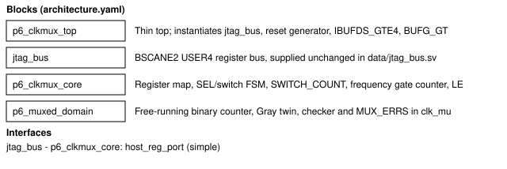
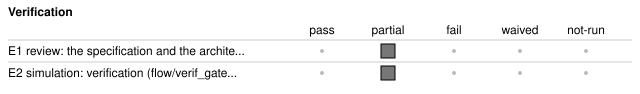

# p6_glitchfree_mux: P6 glitch-free clock multiplexer (25 MHz C3 clock and divided GT refclk)

<!-- Generated from handover.yaml by flow/handover.py (brief 68). Edit handover.yaml, or the text between the prose markers, then run: python -m flow.handover write runs/20261125-154117-dad9/p6_glitchfree_mux -->

The design switches a muxed clock domain between the 25 MHz C3 clock and the SFP+ GT reference clock divided by B_DIV, using a BUFGCTRL. A register map on the JTAG bus controls SEL, reports switching state, checks a binary counter against a Gray twin in the muxed domain, and measures the muxed clock frequency with a gate counted in clk cycles. The run stopped at rtl-design-creation, which did not pass its gates. Verification reached V1 of V3, no seeded simulation results exist, and nothing was synthesised or built. The specification and architecture were approved automatically, with no human review.

Not in scope:

- Not a bitstream-ready design; no synthesis, implementation or board result exists.
- No GT transceiver channel is used; only the reference clock buffer IBUFDS_GTE4 is.
- B_DIV is a build-time constant, not a run-time setting.

Kind: agent-run; produced by the agent (agent run `20261125-154117-dad9`, [record](../summary.json)). State: spec. For an agent: [AGENT.md](AGENT.md).

Run: model claude-sonnet-5-5 (deepagents harness), 9 loops, 108 turns, 3,776,649 tokens, 1788.1 s wall time, 3.93891 USD model cost (provider-reported), stopped because: stage 2 visited more than 6 times; last failing gate: lint, simulate, design standards, verification V2; owned by the rtl/tests role; last failing assertion: V2 seeds_run: no seeded results: read runs/20261125-154117-dad9/p6_glitchfree_mux/build/verif/sim/seed*/results.xml and found none. The gate expects runs/20261125-154117-dad9/p6_glitchfree_mux/build/verif/sim/seed<N>/results.xml, one direct; the same failure on 6 consecutive visits (from the run record).

<!-- prose:what -->
<!-- /prose:what -->

## Technical parameters

| Item | Value |
|---|---|
| Part | `xck26-sfvc784-2LV-c` |
| Board | kr260 |
| Top | `p6_clkmux_top` |
| Tool | Vivado 2026.1 |

Clocks:

- `clk_25`: 25 MHz (from `runs/20261125-154117-dad9/p6_glitchfree_mux/design.xdc`)

Resets:

- `rst`, active high: Per spec.yaml, synchronous and held a few clocks at start by jtag_bus; it is synchronised into clk_mux with RESET_SYNC_STAGES stages. design.xdc has no reset pin, and the RTL source was not among the files shown for this handover, so the reset style is the spec's, not read from the RTL.

Interfaces:

- `clk_25` (input clock, 1 bit, pin C3 LVCMOS18): Register bus, gate and clock A. design.xdc names the port clk_25 and creates a 40 ns clock; spec.yaml names it clk.
- `gt_refclk_p / gt_refclk_n` (differential input clock, SFP+ MGTREFCLK0): Drives IBUFDS_GTE4 and then BUFG_GT. design.xdc has no pin or clock constraint for these ports.
- `led` (output, 2 bits, pins F8 (led[0]) and E8 (led[1]) LVCMOS18): led[0] shows ACTIVE_SEL, led[1] shows SWITCHING (spec.yaml).
- `sfp_tx_disable` (output, 1 bit, pin Y10 LVCMOS33): Constant 1.

Registers (from spec.yaml; where the RTL differs, the gaps say so):

| Offset | Name | Access | Reset | Bits |
|---|---|---|---|---|
| 0 | `ID` | RO | 546701313 | 31:0 design ID |
| 4 | `BUILD` | RO | 0 | 31:0 USR_ACCESS word |
| 8 | `SCRATCH` | RW | 0 | 31:0 data |
| 16 | `SEL` | RW | 0 | 0 SEL (0 = A, 1 = B) |
| 20 | `STATUS` | RO | 0 | 0 SWITCHING, 1 ACTIVE_SEL |
| 24 | `B_DIV` | RO | 2 | 3:0 divide of GT refclk (1 to 8) |
| 28 | `GATE_LEN` | RW | 25000000 | 31:0 gate length in clk cycles |
| 32 | `FREQ_CTRL` | RW | 0 | 0 START (self-clearing) |
| 36 | `FREQ_STATUS` | RO | 0 | 0 BUSY, 1 DONE |
| 40 | `FREQ_COUNT` | RO | 0 | 31:0 edges in last gate |
| 44 | `MUX_ERRS` | RO | 0 | 31:0 error count |
| 48 | `MUX_COUNT` | RO | 0 | 31:0 counter low 32 bits at last SNAPSHOT |
| 52 | `SWITCH_COUNT` | RO | 0 | 31:0 completed switches |
| 56 | `SNAPSHOT` | WO | 0 | any write latches MUX_COUNT |

| Parameter | Value | Legal range | Note |
|---|---|---|---|
| `DESIGN_ID` | 546,701,313 | any 32-bit value; the spec fixes 546701313 (0x20960001) | Value returned by the ID register. |
| `B_DIV_VALUE` | 2 | 1 to 8 (BUFG_GT divide range) | Divides the 156.25 MHz GT refclk to give clk_b at 78.125 MHz; read back through B_DIV. |
| `GATE_LEN_DEFAULT` | 25,000,000 | 32-bit unsigned; 0 is treated as 1 cycle (spec default) | Reset value of GATE_LEN, 1 s at 25 MHz. The benches simulated 200, so the spec's value was not simulated. Spec timing: clk cycles |
| `MUX_COUNTER_WIDTH` | 32 | 32 (MUX_COUNT exposes only the low 32 bits) | Width of the binary counter and Gray twin in the muxed domain. |
| `RESET_SYNC_STAGES` | 3 | 2 or more (XPM reset synchroniser) | Stages of the reset synchroniser into clk_mux. |

| Quantity | Value | Source |
|---|---|---|
| Resources | not measured | [Known gaps](#known-gaps-and-limits) |
| Timing | not measured | [Known gaps](#known-gaps-and-limits) |
| Power | not measured | [Known gaps](#known-gaps-and-limits) |
| Latency | not measured | [Known gaps](#known-gaps-and-limits) |
| Throughput | not measured | [Known gaps](#known-gaps-and-limits) |

<!-- prose:parameters -->
<!-- /prose:parameters -->

## How to build, run and reproduce

| Step | Command | Heavy slot | Time |
|---|---|---|---|
| what changed since this handover (stale records, changed files, tool and knowledge-bank pins) | `python -m flow.handover fresh runs/20261125-154117-dad9/p6_glitchfree_mux` | no | - |
| pick the work up again from the earliest stage the change or the staleness needs; needs a model (see docs/agent.md); Vivado for any stage from synthesis on | `python -m agent resume runs/20261125-154117-dad9/p6_glitchfree_mux "<change request>"` | yes | - |
| run the Verifier's simulation tests; needs Icarus Verilog and cocotb, or the simulation container | `python -m pytest -q runs/20261125-154117-dad9/p6_glitchfree_mux/tests/test_p6_glitchfree_mux_rtl.py` | no | - |
| re-run the Verilator coverage simulation and the verification gates (line, toggle, functional and cover results); needs Verilator 5.036 or later and cocotb (the simulation container has them) | `SIM=verilator FDA_COVERAGE=1 FDA_SIM_RESULTS_DIR=runs/20261125-154117-dad9/p6_glitchfree_mux/build/verif/sim python -m pytest -q -x runs/20261125-154117-dad9/p6_glitchfree_mux/tests/test_p6_glitchfree_mux_rtl.py && python3 flow/verif_gates.py runs/20261125-154117-dad9/p6_glitchfree_mux --runs runs/20261125-154117-dad9/p6_glitchfree_mux/build/verif/sim` | no | - |
| rebuild the bitstream with the flow; needs Vivado 2026.1 and a heavy slot | `flow/run_vivado.sh runs/20261125-154117-dad9/p6_glitchfree_mux base` | yes | - |

Tool: Vivado 2026.1. Build ID of the inputs at handover: none (no Vivado build of this directory). Knowledge-bank pin: `5e2eab8`.

| File | What |
|---|---|
| [`runs/20261125-154117-dad9/p6_glitchfree_mux/spec.md`](spec.md) | the request the run started from |
| [`runs/20261125-154117-dad9/p6_glitchfree_mux/spec.yaml`](spec.yaml) | the specification the Clarifier wrote, approved automatically with no human review |
| [`runs/20261125-154117-dad9/p6_glitchfree_mux/ARCHITECTURE.md`](ARCHITECTURE.md) | the architecture note, accepted automatically before any RTL (no human review) |
| [`runs/20261125-154117-dad9/p6_glitchfree_mux/architecture.yaml`](architecture.yaml) | the machine-checked architecture: blocks, clocks, predicted resources |
| [`runs/20261125-154117-dad9/p6_glitchfree_mux/design.xdc`](design.xdc) | pin, I/O standard and timing constraints |
| [`runs/20261125-154117-dad9/p6_glitchfree_mux/model.py`](model.py) | the Modeller's reference model of the visible behaviour |
| [`runs/20261125-154117-dad9/p6_glitchfree_mux/tests/p6_bench.py`](tests/p6_bench.py) | the Verifier's cocotb benches and pytest entries |
| [`runs/20261125-154117-dad9/p6_glitchfree_mux/tests/test_p6_glitchfree_mux_rtl.py`](tests/test_p6_glitchfree_mux_rtl.py) | the Verifier's cocotb benches and pytest entries |
| [`runs/20261125-154117-dad9/p6_glitchfree_mux/verif/testplan.yaml`](verif/testplan.yaml) | the test plan and mutant list read by the verification gates |
| [`runs/20261125-154117-dad9/p6_glitchfree_mux/verif/checkers/v_macros.svh`](verif/checkers/v_macros.svh) | bound assertion and cover checkers |
| [`runs/20261125-154117-dad9/p6_glitchfree_mux/build/review/02_rtl-design-creation.html`](build/review/02_rtl-design-creation.html) | the review page of stage rtl-design-creation: its exit gates and their failures at the last visit |

<!-- prose:build -->
<!-- /prose:build -->

## Verified

| ID | Activity | Result | What | Evidence | Conditions |
|---|---|---|---|---|---|
| E1 | review | partial | the specification and the architecture were approved automatically, with no human review (review off; the interview oracle claude-sonnet-5-5 only answered the interview questions); the interview asked 8 questions, 0 answered and 8 defaulted | [`runs/20261125-154117-dad9/summary.json`](../summary.json) | - |
| E2 | simulation | partial | verification (flow/verif_gates.py) against the Modeller's reference model reached V1 of V3; the run asked for V2; V1 means every spec item is traced to a check and the benches use the blind model; V2 (simulation: seeded runs, a constrained-random test, bound assertions and formal tasks) did not pass: seeds run no seeded results: read runs/20261125-154117-dad9/p6_glitchfree_mux/build/verif/sim/seed*/results.xml and found none. The gate expects runs/20261125-154117-dad9/p6_glitchfree_mux/build/verif/sim/seed<N>/results.xml, one directory per seed. The flow's simulation step writes it when the bench runs through flow.cocotb_run.run(name, toplevel, sources, test_module, test_dir, parameters=..., seed=N) in tests/test_*_rtl.py: call run() once per seed (for example seed=1, 2, 3; a seed left out counts as seed 1) with the module(s) listed in bench.modules; the flow runs it and checks again. A bench that runs the simulator some other way leaves nothing there. (needs >=1 seed); constrained random test ran not evaluated (no seeded results) (needs True); assertions bound zero failures not evaluated (no seeded results) (needs bound in the run; no failure); V3 (coverage (line, toggle, functional bins, cover properties), three seeds and the mutation score) did not pass: seeds run no seeded results: read runs/20261125-154117-dad9/p6_glitchfree_mux/build/verif/sim/seed*/results.xml and found none. The gate expects runs/20261125-154117-dad9/p6_glitchfree_mux/build/verif/sim/seed<N>/results.xml, one directory per seed. The flow's simulation step writes it when the bench runs through flow.cocotb_run.run(name, toplevel, sources, test_module, test_dir, parameters=..., seed=N) in tests/test_*_rtl.py: call run() once per seed (for example seed=1, 2, 3; a seed left out counts as seed 1) with the module(s) listed in bench.modules; the flow runs it and checks again. A bench that runs the simulator some other way leaves nothing there. (needs >=3); functional bins pct not evaluated (no seeded results) (needs 100); cover properties pct not evaluated (no seeded results) (needs 100); line pct not evaluated (no seeded results) (needs 90); toggle pct not evaluated (no seeded results) (needs 75); mutation score pct not measured (needs 80); cdc structure clean missing (needs no unsafe crossing); cdc injection clean missing (needs pass); no board result (V-HW) is recorded | [`runs/20261125-154117-dad9/p6_glitchfree_mux/build/verif/verif_gates.json`](build/verif/verif_gates.json) | - |

Gates at handover: `clarify` pass, `board-and-device-planning` pass, `rtl-design-creation` fail, `constraints` not-run, `synthesis` not-run, `implementation` not-run, `timing-closure` not-run, `power-closure` not-run, `drc-closure` not-run, `configuration-and-debug` not-run.

<!-- prose:verified -->
<!-- /prose:verified -->

## Measured

Every value is read from the record by `python -m flow.handover fill`, not typed.

| ID | What | Value | Runs | Source | Conditions |
|---|---|---|---|---|---|
| M1 | model cost of the run, provider-reported | 3.93891 USD | 1 | [`runs/20261125-154117-dad9/summary.json`](../summary.json) `cost_usd` | every role and the interview oracle, as the run summary records it |

<!-- prose:measured -->
<!-- /prose:measured -->

## Known gaps and limits

- **REQ-01**: REQ-01 has no passing evidence for every proof method: simulation (p6_bench.test_reset_values) is pending: no simulation results; hardware (ila_captures) is pending: no bring-up result
- **REQ-02**: REQ-02 has no passing evidence for every proof method: hardware (ila_captures) is pending: no bring-up result
- **REQ-03**: REQ-03 has no passing evidence for every proof method: simulation (p6_bench.test_scratch_and_unmapped) is pending: no simulation results; hardware (ila_captures) is pending: no bring-up result
- **REQ-25**: REQ-25 has no passing evidence for every proof method: simulation (p6_bench.test_reset_values) is pending: no simulation results
- **REQ-04**: REQ-04 has no passing evidence for every proof method: simulation (p6_bench.test_scratch_and_unmapped) is pending: no simulation results
- **REQ-26**: REQ-26 has no passing evidence for every proof method: simulation (p6_bench.test_scratch_and_unmapped) is pending: no simulation results
- **REQ-05**: REQ-05 has no passing evidence for every proof method: simulation (p6_bench.test_read_latency_and_hold) is pending: no simulation results; simulation (p6_bench.test_read_latency_and_hold) is pending: no simulation results; formal (p6_bench.test_read_latency_and_hold) is pending: re-planned from formal to simulation (SymbiYosys is not installed here, so the read-latency check is made by simulation against the model.): no simulation results
- **REQ-27**: REQ-27 has no passing evidence for every proof method: simulation (p6_bench.test_read_latency_and_hold) is pending: no simulation results; simulation (p6_bench.test_read_latency_and_hold) is pending: no simulation results; formal (p6_bench.test_read_latency_and_hold) is pending: re-planned from formal to simulation (SymbiYosys is not installed here, so the hold check is made by simulation.): no simulation results
- **REQ-06**: REQ-06 has no passing evidence for every proof method: simulation (p6_bench.test_reset_values) is pending: no simulation results
- **REQ-07**: REQ-07 has no passing evidence for every proof method: simulation (p6_bench.test_switching) is pending: no simulation results; hardware (ila_captures) is pending: no bring-up result
- **REQ-08**: REQ-08 has no passing evidence for every proof method: simulation (p6_bench.test_switching) is pending: no simulation results; hardware (ila_captures) is pending: no bring-up result
- **REQ-09**: REQ-09 has no passing evidence for every proof method: analysis (post_route:setup) is pending: no flow gates result; hardware (ila_captures) is pending: no bring-up result
- **REQ-10**: REQ-10 has no passing evidence for every proof method: simulation (p6_bench.test_reset_values) is pending: no simulation results; hardware (ila_captures) is pending: no bring-up result
- **REQ-11**: REQ-11 has no passing evidence for every proof method: hardware (ila_captures) is pending: no bring-up result
- **REQ-12**: REQ-12 has no passing evidence for every proof method: simulation (p6_bench.test_snapshot_and_errors) is pending: no simulation results
- **REQ-13**: REQ-13 has no passing evidence for every proof method: simulation (p6_bench.test_snapshot_and_errors) is pending: no simulation results; simulation (p6_bench.test_snapshot_and_errors) is pending: no simulation results; formal (p6_bench.test_snapshot_and_errors) is pending: re-planned from formal to simulation (SymbiYosys is not installed here, so the counter-increment check is made by simulation.): no simulation results
- **REQ-14**: REQ-14 has no passing evidence for every proof method: simulation (p6_bench.test_switching) is pending: no simulation results; hardware (ila_captures) is pending: no bring-up result
- **REQ-15**: REQ-15 has no passing evidence for every proof method: simulation (p6_bench.test_switching) is pending: no simulation results
- **REQ-16**: REQ-16 has no passing evidence for every proof method: simulation (p6_bench.test_snapshot_and_errors) is pending: no simulation results; hardware (ila_captures) is pending: no bring-up result
- **REQ-17**: REQ-17 has no passing evidence for every proof method: simulation (p6_bench.test_reset_values) is pending: no simulation results
- **REQ-18**: REQ-18 has no passing evidence for every proof method: simulation (p6_bench.test_frequency_gate) is pending: no simulation results
- **REQ-28**: REQ-28 has no passing evidence for every proof method: simulation (p6_bench.test_frequency_gate) is pending: no simulation results
- **REQ-19**: REQ-19 has no passing evidence for every proof method: simulation (p6_bench.test_frequency_gate) is pending: no simulation results; hardware (ila_captures) is pending: no bring-up result
- **REQ-29**: REQ-29 has no passing evidence for every proof method: simulation (p6_bench.test_frequency_gate) is pending: no simulation results; hardware (ila_captures) is pending: no bring-up result
- **REQ-20**: REQ-20 has no passing evidence for every proof method: simulation (p6_bench.test_frequency_gate) is pending: no simulation results; hardware (ila_captures) is pending: no bring-up result
- **REQ-21**: REQ-21 has no passing evidence for every proof method: simulation (p6_bench.test_switching) is pending: no simulation results; simulation (p6_bench.test_switching) is pending: no simulation results; formal (p6_bench.test_switching) is pending: re-planned from formal to simulation (SymbiYosys is not installed here, so the constant output is checked by simulation.): no simulation results; hardware (ila_captures) is pending: no bring-up result
- **REQ-22**: REQ-22 has no passing evidence for every proof method: analysis (post_synth:post_synth_resources_in_range) is pending: no flow gates result
- **REQ-23**: REQ-23 has no passing evidence for every proof method: analysis (post_route:setup) is pending: no flow gates result
- **REQ-24**: REQ-24 has no passing evidence for every proof method: analysis (post_synth:post_synth_resources_in_range) is pending: no flow gates result
- **E1**: review evidence is partial: the specification and the architecture were approved automatically, with no human review (review off; the interview oracle claude-sonnet-5-5 only answered the interview questions); the interview asked 8 questions, 0 answered and 8 defaulted
- **E2**: simulation evidence is partial: verification reached V1 of V3 (the run asked for V2); the checks that did not pass or did not run are listed in the evidence row
- **rtl-design-creation**: stage rtl-design-creation did not pass its gates in this run; at its last visit: lint not passing FAIL simulate not passing FAIL standards STD-LATCH-01: not checked (no build.yaml top or sources to check) FAIL standards STD-LOOP-01: not checked (no build.yaml top or sources to check) FAIL standards STD-CDC-01: architecture.yaml:1: crossings[0]: inline_in p6_clkmux_top is not a module of this design or the shell FAIL standards STD-CDC-01: architecture.yaml:1: crossings[1]: inli ...
- **constraints**: stage constraints was not run: the run stopped before this stage (stage 2 visited more than 6 times; last failing gate: lint, simulate, design standards, verification V2; owned by the rtl/tests role; last failing assertion: V2 seeds_run: no seeded results: read runs/20261125-154117-dad9/p6_glitchfree_mux/build/verif/sim/seed*/results.xml and found none. The gate expects runs/20261125-154117-dad9/p6_glitchfree_mux/build/verif/sim/seed<N>/results.xml, one direct; the same failure on 6 consecutive visits)
- **synthesis**: stage synthesis was not run: the run stopped before this stage (stage 2 visited more than 6 times; last failing gate: lint, simulate, design standards, verification V2; owned by the rtl/tests role; last failing assertion: V2 seeds_run: no seeded results: read runs/20261125-154117-dad9/p6_glitchfree_mux/build/verif/sim/seed*/results.xml and found none. The gate expects runs/20261125-154117-dad9/p6_glitchfree_mux/build/verif/sim/seed<N>/results.xml, one direct; the same failure on 6 consecutive visits)
- **implementation**: stage implementation was not run: the run stopped before this stage (stage 2 visited more than 6 times; last failing gate: lint, simulate, design standards, verification V2; owned by the rtl/tests role; last failing assertion: V2 seeds_run: no seeded results: read runs/20261125-154117-dad9/p6_glitchfree_mux/build/verif/sim/seed*/results.xml and found none. The gate expects runs/20261125-154117-dad9/p6_glitchfree_mux/build/verif/sim/seed<N>/results.xml, one direct; the same failure on 6 consecutive visits)
- **timing-closure**: stage timing-closure was not run: the run stopped before this stage (stage 2 visited more than 6 times; last failing gate: lint, simulate, design standards, verification V2; owned by the rtl/tests role; last failing assertion: V2 seeds_run: no seeded results: read runs/20261125-154117-dad9/p6_glitchfree_mux/build/verif/sim/seed*/results.xml and found none. The gate expects runs/20261125-154117-dad9/p6_glitchfree_mux/build/verif/sim/seed<N>/results.xml, one direct; the same failure on 6 consecutive visits)
- **power-closure**: stage power-closure was not run: the run stopped before this stage (stage 2 visited more than 6 times; last failing gate: lint, simulate, design standards, verification V2; owned by the rtl/tests role; last failing assertion: V2 seeds_run: no seeded results: read runs/20261125-154117-dad9/p6_glitchfree_mux/build/verif/sim/seed*/results.xml and found none. The gate expects runs/20261125-154117-dad9/p6_glitchfree_mux/build/verif/sim/seed<N>/results.xml, one direct; the same failure on 6 consecutive visits)
- **drc-closure**: stage drc-closure was not run: the run stopped before this stage (stage 2 visited more than 6 times; last failing gate: lint, simulate, design standards, verification V2; owned by the rtl/tests role; last failing assertion: V2 seeds_run: no seeded results: read runs/20261125-154117-dad9/p6_glitchfree_mux/build/verif/sim/seed*/results.xml and found none. The gate expects runs/20261125-154117-dad9/p6_glitchfree_mux/build/verif/sim/seed<N>/results.xml, one direct; the same failure on 6 consecutive visits)
- **configuration-and-debug**: stage configuration-and-debug was not run: the run stopped before this stage (stage 2 visited more than 6 times; last failing gate: lint, simulate, design standards, verification V2; owned by the rtl/tests role; last failing assertion: V2 seeds_run: no seeded results: read runs/20261125-154117-dad9/p6_glitchfree_mux/build/verif/sim/seed*/results.xml and found none. The gate expects runs/20261125-154117-dad9/p6_glitchfree_mux/build/verif/sim/seed<N>/results.xml, one direct; the same failure on 6 consecutive visits)
- **formal**: formal checks were planned for REQ-05, REQ-27, REQ-13, REQ-21 and did not run; each was replaced by a simulation check (verif/testplan.yaml replan). Reason recorded: SymbiYosys is not installed here, so the read-latency check is made by simulation against the model.
- **simulated_parameters**: the benches simulate at values other than the spec's (scaled for simulation speed or otherwise): GATE_LEN_DEFAULT is simulated at 200 (runs/20261125-154117-dad9/p6_glitchfree_mux/tests/test_p6_glitchfree_mux_rtl.py:29) while spec.yaml gives 25000000. Behaviour that depends on the spec's value, such as a divider's timing against the clock, was not simulated at that value; it is stated here, not shown, unless another record covers it
- **resources**: resources not measured: no current Vivado build of this design has been recorded
- **timing**: timing not measured: no current Vivado build of this design has been recorded
- **power**: power not measured: no current Vivado build of this design has been recorded
- **latency**: latency not measured: the run measured no latency; the spec's latency promise is checked only by the benches
- **throughput**: throughput not measured: the run measured no throughput
- **clock_port_name**: design.xdc names the clock port clk_25 and creates a 40 ns clock on it, while spec.yaml and ARCHITECTURE.md call the port clk. The XDC is what was built. The RTL top port name was not shown and must match clk_25.
- **xdc_missing_constraints**: design.xdc has no pins or constraints for gt_refclk_p/n and no asynchronous clock-group between clk_mux and clk, although REQ-23 and ARCHITECTURE.md require the asynchronous constraint. It also has no clock for the 156.25 MHz refclk.
- **unmapped_and_reserved_accesses**: Per spec.yaml, unmapped addresses (the hole between SCRATCH and SEL, and everything above SNAPSHOT) read 0 and ignore writes; writes to RO registers are not specified to have any effect. This is the spec's behaviour and was not shown by simulation.
- **defaulted_behaviours**: All eight interview answers were defaults, not user decisions. START written while BUSY is ignored. GATE_LEN 0 acts as 1 cycle. A switch during a gate does not abort it or flag FREQ_COUNT. MUX_ERRS saturates at 0xFFFFFFFF and clears only on reset. A SEL write during SWITCHING makes the last value win. None of these was checked against the RTL.
- **read_and_write_latency**: The spec promises a write effective 1 clk after h_we and h_rdata valid within 2 clk of h_re, held. This was not counted from the RTL here, and no passing simulation backs it.
- **architecture_cdc_check**: The STD-CDC-01 failures cite architecture.yaml crossings whose inline_in names p6_clkmux_top, which the checker says is not a module of the design or the shell. This may be an architecture.yaml error rather than an RTL one.

<!-- prose:gaps -->
<!-- /prose:gaps -->

## Next steps

1. Fix the earliest failure first, in rtl-design-creation. Make the bench run through flow.cocotb_run.run() once per seed (1, 2, 3) so a results.xml is written per seed under build/verif/sim, and clear the lint, simulate and design-standards failures listed on the stage review page.
2. Correct the architecture.yaml crossings (inline_in names) so STD-CDC-01 can check the design, and ensure build.yaml names the top and sources.
3. Once simulation results exist, compare the cover results with the functional coverage before adding any stimulus, then raise coverage and the mutation score toward V3.
4. Add the missing gt_refclk constraints and the asynchronous clock groups to design.xdc, and reconcile the clk and clk_25 port name.
5. Resume the flow with python -m agent resume to run constraints through configuration-and-debug, then measure resources, timing and power, and plan the board bring-up (ila_captures).

Open questions:

- Should the simulation benches also run at GATE_LEN_DEFAULT 25000000, or is the scaled value of 200 enough?
- Is the reset port rst present in the RTL top, given that design.xdc declares no reset pin?

<!-- prose:next -->
<!-- /prose:next -->

## History

| Date | Brief | PR | What |
|---|---|---|---|
| 2026-11-25 | agent run | - | produced by the agent graph; stages that passed: clarify, board-and-device-planning |

<!-- prose:history -->
<!-- /prose:history -->
