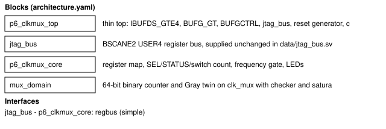

# p6_glitchfree_mux: Glitch-free clock multiplexer with self-checking muxed domain (KR260)

<!-- Generated from handover.yaml by flow/handover.py (brief 68). Edit handover.yaml, or the text between the prose markers, then run: python -m flow.handover write runs/20261125-161633-50bb/p6_glitchfree_mux -->

The design is meant to switch a muxed clock domain between the 25 MHz board clock and the SFP+ GT reference clock (156.25 MHz, divided by B_DIV) through a BUFGCTRL. A 64-bit binary counter and a Gray twin in the muxed domain check each other, a gated counter measures the muxed clock frequency, and a register block is reached through jtag_bus. The run stopped at the RTL stage, which never passed its gates. Only the clarify and board-and-device-planning stages passed, and no Vivado build exists. The specification and architecture were approved automatically, with no human review.

Not in scope:

- Not a verified or built design. No simulation results, bitstream, timing, power or board result exist.
- Does not use any GT transceiver channel; only the reference clock buffer is used.
- Not a general clock-domain-crossing library; it covers one mux and one muxed domain.

Kind: agent-run; produced by the agent (agent run `20261125-161633-50bb`, [record](../summary.json)). State: spec. For an agent: [AGENT.md](AGENT.md).

Run: model claude-sonnet-5-5 (deepagents harness), 8 loops, 86 turns, 2,727,219 tokens, 1701.1 s wall time, 3.46932 USD model cost (provider-reported), stopped because: stage 2 visited more than 6 times; last failing gate: lint, simulate, design standards, verification V2; owned by the rtl/tests role; last failing assertion: V2 seeds_run: no seeded results: read runs/20261125-161633-50bb/p6_glitchfree_mux/build/verif/sim/seed*/results.xml and found none. The gate expects runs/20261125-161633-50bb/p6_glitchfree_mux/build/verif/sim/seed<N>/results.xml, one direct; the same failure on 6 consecutive visits (from the run record).

<!-- prose:what -->
<!-- /prose:what -->

## Technical parameters

| Item | Value |
|---|---|
| Part | `xck26-sfvc784-2LV-c` |
| Board | kr260 |
| Top | `p6_clkmux_top` |
| Tool | Vivado 2026.1 |

Clocks:

- `clk_25`: 25 MHz (from `runs/20261125-161633-50bb/p6_glitchfree_mux/design.xdc`)

Resets:

- `rst`, active high: Per spec.yaml: comes from jtag_bus, synchronous to clk_a, and is re-synchronised into the clk_mux domain. The RTL was not available to confirm this; design.xdc has no reset pin.

Interfaces:

- `clk_c3` (input clock, 25 MHz): spec.yaml name. design.xdc names this port clk_25 (pin C3, LVCMOS18, 40 ns period); see the port_names gap.
- `mgtrefclk0_p / mgtrefclk0_n` (differential GT reference clock input, 156.25 MHz): Listed in spec.yaml and ARCHITECTURE.md, but design.xdc has no constraint for them.
- `led` (output, 2 bits): led[0] shows ACTIVE_SEL and led[1] shows SWITCHING (spec.yaml). Pins F8 and E8, LVCMOS18 in design.xdc.
- `sfp_tx_disable` (output, 1 bit, constant 1): Pin Y10, LVCMOS33 in design.xdc.
- `h_we, h_re, h_addr, h_wdata, h_rdata` (internal register port to jtag_bus (1, 1, 12, 32, 32 bits)): Not top-level pins; tests drive them directly. jtag_bus.sv is meant to be instantiated unchanged.

Registers (from spec.yaml; where the RTL differs, the gaps say so):

| Offset | Name | Access | Reset | Bits |
|---|---|---|---|---|
| 0 | `ID` | RO | 546701313 | [31:0] design id |
| 4 | `BUILD` | RO | 0 | [31:0] USR_ACCESS word |
| 8 | `SCRATCH` | RW | 0 | [31:0] scratch |
| 16 | `SEL` | RW | 0 | [0] 0=clock A 1=clock B |
| 20 | `STATUS` | RO | 0 | [0] SWITCHING, [1] ACTIVE_SEL |
| 24 | `B_DIV` | RO | 1 | [3:0] divide 1 to 8 |
| 28 | `GATE_LEN` | RW | 25000000 | [31:0] gate length in clk_a cycles |
| 32 | `FREQ_CTRL` | RW | 0 | [0] START self-clearing |
| 36 | `FREQ_STATUS` | RO | 0 | [0] BUSY, [1] DONE |
| 40 | `FREQ_COUNT` | RO | 0 | [31:0] edges in last gate |
| 44 | `MUX_ERRS` | RO | 0 | [31:0] error count |
| 48 | `MUX_COUNT` | RO | 0 | [31:0] counter low 32 bits at last SNAPSHOT |
| 52 | `SWITCH_COUNT` | RO | 0 | [31:0] switches carried out |
| 56 | `SNAPSHOT` | WO | 0 | [31:0] any write latches MUX_COUNT; reads 0 |

| Parameter | Value | Legal range | Note |
|---|---|---|---|
| `ID_VALUE` | 546,701,313 | fixed at 546701313 (0x20960001) | Value read back from the ID register. |
| `B_DIV` | 1 | 1 to 8 | Divide of the GT reference clock, so clk_b is 156.25 MHz divided by B_DIV (spec timing). It is a build-time constant read from the B_DIV register. |
| `GATE_LEN_DEFAULT` | 25,000,000 | 1 to 4294967295 (32-bit register) | Reset value of GATE_LEN in clk_a cycles, which is 1 s at 25 MHz (spec timing). The benches simulate it at 200, so the spec's value was not simulated. Spec timing: GATE_LEN clk_a cycles, default 25,000,000 = 1 s at 25 MHz |
| `SYNC_STAGES` | 2 | 2 or more | Synchroniser depth for the clock-domain crossings. |

| Quantity | Value | Source |
|---|---|---|
| Resources | not measured | [Known gaps](#known-gaps-and-limits) |
| Timing | not measured | [Known gaps](#known-gaps-and-limits) |
| Power | not measured | [Known gaps](#known-gaps-and-limits) |
| Latency | not measured | [Known gaps](#known-gaps-and-limits) |
| Throughput | not measured | [Known gaps](#known-gaps-and-limits) |

<!-- prose:parameters -->
<!-- /prose:parameters -->

## How to build, run and reproduce

| Step | Command | Heavy slot | Time |
|---|---|---|---|
| what changed since this handover (stale records, changed files, tool and knowledge-bank pins) | `python -m flow.handover fresh runs/20261125-161633-50bb/p6_glitchfree_mux` | no | - |
| pick the work up again from the earliest stage the change or the staleness needs; needs a model (see docs/agent.md); Vivado for any stage from synthesis on | `python -m agent resume runs/20261125-161633-50bb/p6_glitchfree_mux "<change request>"` | yes | - |
| run the Verifier's simulation tests; needs Icarus Verilog and cocotb, or the simulation container | `python -m pytest -q runs/20261125-161633-50bb/p6_glitchfree_mux/tests/test_p6_glitchfree_mux_rtl.py` | no | - |
| re-run the Verilator coverage simulation and the verification gates (line, toggle, functional and cover results); needs Verilator 5.036 or later and cocotb (the simulation container has them) | `SIM=verilator FDA_COVERAGE=1 FDA_SIM_RESULTS_DIR=runs/20261125-161633-50bb/p6_glitchfree_mux/build/verif/sim python -m pytest -q -x runs/20261125-161633-50bb/p6_glitchfree_mux/tests/test_p6_glitchfree_mux_rtl.py && python3 flow/verif_gates.py runs/20261125-161633-50bb/p6_glitchfree_mux --runs runs/20261125-161633-50bb/p6_glitchfree_mux/build/verif/sim` | no | - |
| rebuild the bitstream with the flow; needs Vivado 2026.1 and a heavy slot | `flow/run_vivado.sh runs/20261125-161633-50bb/p6_glitchfree_mux base` | yes | - |

Tool: Vivado 2026.1. Build ID of the inputs at handover: none (no Vivado build of this directory). Knowledge-bank pin: `5e2eab8`.

| File | What |
|---|---|
| [`runs/20261125-161633-50bb/p6_glitchfree_mux/spec.md`](spec.md) | the request the run started from |
| [`runs/20261125-161633-50bb/p6_glitchfree_mux/spec.yaml`](spec.yaml) | the specification the Clarifier wrote, approved automatically with no human review |
| [`runs/20261125-161633-50bb/p6_glitchfree_mux/ARCHITECTURE.md`](ARCHITECTURE.md) | the architecture note, accepted automatically before any RTL (no human review) |
| [`runs/20261125-161633-50bb/p6_glitchfree_mux/architecture.yaml`](architecture.yaml) | the machine-checked architecture: blocks, clocks, predicted resources |
| [`runs/20261125-161633-50bb/p6_glitchfree_mux/design.xdc`](design.xdc) | pin, I/O standard and timing constraints |
| [`runs/20261125-161633-50bb/p6_glitchfree_mux/model.py`](model.py) | the Modeller's reference model of the visible behaviour |
| [`runs/20261125-161633-50bb/p6_glitchfree_mux/tests/test_p6_glitchfree_mux_bench.py`](tests/test_p6_glitchfree_mux_bench.py) | the Verifier's cocotb benches and pytest entries |
| [`runs/20261125-161633-50bb/p6_glitchfree_mux/tests/test_p6_glitchfree_mux_rtl.py`](tests/test_p6_glitchfree_mux_rtl.py) | the Verifier's cocotb benches and pytest entries |
| [`runs/20261125-161633-50bb/p6_glitchfree_mux/verif/testplan.yaml`](verif/testplan.yaml) | the test plan and mutant list read by the verification gates |
| [`runs/20261125-161633-50bb/p6_glitchfree_mux/verif/checkers/v_macros.svh`](verif/checkers/v_macros.svh) | bound assertion and cover checkers |
| [`runs/20261125-161633-50bb/p6_glitchfree_mux/build/review/02_rtl-design-creation.html`](build/review/02_rtl-design-creation.html) | the review page of stage rtl-design-creation: its exit gates and their failures at the last visit |

<!-- prose:build -->
<!-- /prose:build -->

## Verified

| ID | Activity | Result | What | Evidence | Conditions |
|---|---|---|---|---|---|
| E1 | review | partial | the specification and the architecture were approved automatically, with no human review (review off; the interview oracle claude-sonnet-5-5 only answered the interview questions); the interview asked 4 questions, 0 answered and 4 defaulted | [`runs/20261125-161633-50bb/summary.json`](../summary.json) | - |
| E2 | simulation | partial | verification (flow/verif_gates.py) against the Modeller's reference model reached V1 of V3; the run asked for V2; V1 means every spec item is traced to a check and the benches use the blind model; V2 (simulation: seeded runs, a constrained-random test, bound assertions and formal tasks) did not pass: seeds run no seeded results: read runs/20261125-161633-50bb/p6_glitchfree_mux/build/verif/sim/seed*/results.xml and found none. The gate expects runs/20261125-161633-50bb/p6_glitchfree_mux/build/verif/sim/seed<N>/results.xml, one directory per seed. The flow's simulation step writes it when the bench runs through flow.cocotb_run.run(name, toplevel, sources, test_module, test_dir, parameters=..., seed=N) in tests/test_*_rtl.py: call run() once per seed (for example seed=1, 2, 3; a seed left out counts as seed 1) with the module(s) listed in bench.modules; the flow runs it and checks again. A bench that runs the simulator some other way leaves nothing there. (needs >=1 seed); constrained random test ran not evaluated (no seeded results) (needs True); assertions bound zero failures not evaluated (no seeded results) (needs bound in the run; no failure); V3 (coverage (line, toggle, functional bins, cover properties), three seeds and the mutation score) did not pass: seeds run no seeded results: read runs/20261125-161633-50bb/p6_glitchfree_mux/build/verif/sim/seed*/results.xml and found none. The gate expects runs/20261125-161633-50bb/p6_glitchfree_mux/build/verif/sim/seed<N>/results.xml, one directory per seed. The flow's simulation step writes it when the bench runs through flow.cocotb_run.run(name, toplevel, sources, test_module, test_dir, parameters=..., seed=N) in tests/test_*_rtl.py: call run() once per seed (for example seed=1, 2, 3; a seed left out counts as seed 1) with the module(s) listed in bench.modules; the flow runs it and checks again. A bench that runs the simulator some other way leaves nothing there. (needs >=3); functional bins pct not evaluated (no seeded results) (needs 100); cover properties pct not evaluated (no seeded results) (needs 100); line pct not evaluated (no seeded results) (needs 90); toggle pct not evaluated (no seeded results) (needs 75); mutation score pct not measured (needs 70); cdc structure clean missing (needs no unsafe crossing); cdc injection clean missing (needs pass); no board result (V-HW) is recorded | [`runs/20261125-161633-50bb/p6_glitchfree_mux/build/verif/verif_gates.json`](build/verif/verif_gates.json) | - |

Gates at handover: `clarify` pass, `board-and-device-planning` pass, `rtl-design-creation` fail, `constraints` not-run, `synthesis` not-run, `implementation` not-run, `timing-closure` not-run, `power-closure` not-run, `drc-closure` not-run, `configuration-and-debug` not-run.

<!-- prose:verified -->
<!-- /prose:verified -->

## Measured

Every value is read from the record by `python -m flow.handover fill`, not typed.

| ID | What | Value | Runs | Source | Conditions |
|---|---|---|---|---|---|
| M1 | model cost of the run, provider-reported | 3.46932 USD | 1 | [`runs/20261125-161633-50bb/summary.json`](../summary.json) `cost_usd` | every role and the interview oracle, as the run summary records it |

<!-- prose:measured -->
<!-- /prose:measured -->

## Known gaps and limits

- **REQ-01**: REQ-01 has no passing evidence for every proof method: simulation (test_p6_glitchfree_mux_bench.test_reset_values) is pending: no simulation results; hardware (uart_tests) is pending: no bring-up result
- **REQ-02**: REQ-02 has no passing evidence for every proof method: hardware (uart_tests) is pending: no bring-up result
- **REQ-03**: REQ-03 has no passing evidence for every proof method: simulation (test_p6_glitchfree_mux_bench.test_scratch_unmapped) is pending: no simulation results; hardware (uart_tests) is pending: no bring-up result
- **REQ-04**: REQ-04 has no passing evidence for every proof method: simulation (test_p6_glitchfree_mux_bench.test_scratch_unmapped) is pending: no simulation results
- **REQ-24**: REQ-24 has no passing evidence for every proof method: simulation (test_p6_glitchfree_mux_bench.test_reset_values) is pending: no simulation results
- **REQ-25**: REQ-25 has no passing evidence for every proof method: simulation (test_p6_glitchfree_mux_bench.test_scratch_unmapped) is pending: no simulation results
- **REQ-05**: REQ-05 has no passing evidence for every proof method: simulation (test_p6_glitchfree_mux_bench.test_scratch_unmapped) is pending: no simulation results; formal (test_p6_glitchfree_mux_bench.test_scratch_unmapped) is pending: re-planned from formal to simulation (SymbiYosys is not installed so the formal job was re-planned to the cocotb read-latency check.): no simulation results
- **REQ-06**: REQ-06 has no passing evidence for every proof method: simulation (test_p6_glitchfree_mux_bench.test_reset_values) is pending: no simulation results
- **REQ-07**: REQ-07 has no passing evidence for every proof method: simulation (test_p6_glitchfree_mux_bench.test_switch_directed) is pending: no simulation results; hardware (uart_tests) is pending: no bring-up result
- **REQ-08**: REQ-08 has no passing evidence for every proof method: simulation (test_p6_glitchfree_mux_bench.test_switch_directed) is pending: no simulation results
- **REQ-09**: REQ-09 has no passing evidence for every proof method: simulation (test_p6_glitchfree_mux_bench.test_reset_values) is pending: no simulation results; hardware (uart_tests) is pending: no bring-up result
- **REQ-10**: REQ-10 has no passing evidence for every proof method: simulation (test_p6_glitchfree_mux_bench.test_random_switches) is pending: no simulation results; hardware (uart_tests) is pending: no bring-up result
- **REQ-11**: REQ-11 has no passing evidence for every proof method: simulation (test_p6_glitchfree_mux_bench.test_snapshot) is pending: no simulation results; formal (test_p6_glitchfree_mux_bench.test_random_switches) is pending: re-planned from formal to simulation (SymbiYosys is not installed so the formal job was re-planned to the MUX_ERRS equals 0 check over 1000 switches.): no simulation results
- **REQ-12**: REQ-12 has no passing evidence for every proof method: simulation (test_p6_glitchfree_mux_bench.test_random_switches) is pending: no simulation results; hardware (uart_tests) is pending: no bring-up result
- **REQ-13**: REQ-13 has no passing evidence for every proof method: simulation (test_p6_glitchfree_mux_bench.test_switch_directed) is pending: no simulation results
- **REQ-14**: REQ-14 has no passing evidence for every proof method: simulation (test_p6_glitchfree_mux_bench.test_reset_values) is pending: no simulation results
- **REQ-15**: REQ-15 has no passing evidence for every proof method: simulation (test_p6_glitchfree_mux_bench.test_freq_measure) is pending: no simulation results
- **REQ-16**: REQ-16 has no passing evidence for every proof method: simulation (test_p6_glitchfree_mux_bench.test_freq_measure) is pending: no simulation results; hardware (uart_tests) is pending: no bring-up result
- **REQ-17**: REQ-17 has no passing evidence for every proof method: hardware (uart_tests) is pending: no bring-up result
- **REQ-18**: REQ-18 has no passing evidence for every proof method: hardware (uart_tests) is pending: no bring-up result
- **REQ-19**: REQ-19 has no passing evidence for every proof method: simulation (test_p6_glitchfree_mux_bench.test_snapshot) is pending: no simulation results
- **REQ-20**: REQ-20 has no passing evidence for every proof method: simulation (test_p6_glitchfree_mux_bench.test_reset_values) is pending: no simulation results; analysis (post_synth:post_synth_resources_in_range) is pending: no flow gates result
- **REQ-21**: REQ-21 has no passing evidence for every proof method: analysis (post_synth:post_synth_resources_in_range) is pending: no flow gates result
- **REQ-22**: REQ-22 has no passing evidence for every proof method: analysis (post_route:setup) is pending: no flow gates result
- **REQ-23**: REQ-23 has no passing evidence for every proof method: analysis (post_synth:post_synth_resources_in_range) is pending: no flow gates result
- **E1**: review evidence is partial: the specification and the architecture were approved automatically, with no human review (review off; the interview oracle claude-sonnet-5-5 only answered the interview questions); the interview asked 4 questions, 0 answered and 4 defaulted
- **E2**: simulation evidence is partial: verification reached V1 of V3 (the run asked for V2); the checks that did not pass or did not run are listed in the evidence row
- **rtl-design-creation**: stage rtl-design-creation did not pass its gates in this run; at its last visit: lint not passing FAIL simulate not passing FAIL standards STD-LATCH-01: not checked (no build.yaml top or sources to check) FAIL standards STD-LOOP-01: not checked (no build.yaml top or sources to check) FAIL standards STD-CDC-01: architecture.yaml:1: crossings[0]: inline_in p6_clkmux_top is not a module of this design or the shell FAIL standards STD-CDC-01: architecture.yaml:1: crossings[1]: inli ...
- **constraints**: stage constraints was not run: the run stopped before this stage (stage 2 visited more than 6 times; last failing gate: lint, simulate, design standards, verification V2; owned by the rtl/tests role; last failing assertion: V2 seeds_run: no seeded results: read runs/20261125-161633-50bb/p6_glitchfree_mux/build/verif/sim/seed*/results.xml and found none. The gate expects runs/20261125-161633-50bb/p6_glitchfree_mux/build/verif/sim/seed<N>/results.xml, one direct; the same failure on 6 consecutive visits)
- **synthesis**: stage synthesis was not run: the run stopped before this stage (stage 2 visited more than 6 times; last failing gate: lint, simulate, design standards, verification V2; owned by the rtl/tests role; last failing assertion: V2 seeds_run: no seeded results: read runs/20261125-161633-50bb/p6_glitchfree_mux/build/verif/sim/seed*/results.xml and found none. The gate expects runs/20261125-161633-50bb/p6_glitchfree_mux/build/verif/sim/seed<N>/results.xml, one direct; the same failure on 6 consecutive visits)
- **implementation**: stage implementation was not run: the run stopped before this stage (stage 2 visited more than 6 times; last failing gate: lint, simulate, design standards, verification V2; owned by the rtl/tests role; last failing assertion: V2 seeds_run: no seeded results: read runs/20261125-161633-50bb/p6_glitchfree_mux/build/verif/sim/seed*/results.xml and found none. The gate expects runs/20261125-161633-50bb/p6_glitchfree_mux/build/verif/sim/seed<N>/results.xml, one direct; the same failure on 6 consecutive visits)
- **timing-closure**: stage timing-closure was not run: the run stopped before this stage (stage 2 visited more than 6 times; last failing gate: lint, simulate, design standards, verification V2; owned by the rtl/tests role; last failing assertion: V2 seeds_run: no seeded results: read runs/20261125-161633-50bb/p6_glitchfree_mux/build/verif/sim/seed*/results.xml and found none. The gate expects runs/20261125-161633-50bb/p6_glitchfree_mux/build/verif/sim/seed<N>/results.xml, one direct; the same failure on 6 consecutive visits)
- **power-closure**: stage power-closure was not run: the run stopped before this stage (stage 2 visited more than 6 times; last failing gate: lint, simulate, design standards, verification V2; owned by the rtl/tests role; last failing assertion: V2 seeds_run: no seeded results: read runs/20261125-161633-50bb/p6_glitchfree_mux/build/verif/sim/seed*/results.xml and found none. The gate expects runs/20261125-161633-50bb/p6_glitchfree_mux/build/verif/sim/seed<N>/results.xml, one direct; the same failure on 6 consecutive visits)
- **drc-closure**: stage drc-closure was not run: the run stopped before this stage (stage 2 visited more than 6 times; last failing gate: lint, simulate, design standards, verification V2; owned by the rtl/tests role; last failing assertion: V2 seeds_run: no seeded results: read runs/20261125-161633-50bb/p6_glitchfree_mux/build/verif/sim/seed*/results.xml and found none. The gate expects runs/20261125-161633-50bb/p6_glitchfree_mux/build/verif/sim/seed<N>/results.xml, one direct; the same failure on 6 consecutive visits)
- **configuration-and-debug**: stage configuration-and-debug was not run: the run stopped before this stage (stage 2 visited more than 6 times; last failing gate: lint, simulate, design standards, verification V2; owned by the rtl/tests role; last failing assertion: V2 seeds_run: no seeded results: read runs/20261125-161633-50bb/p6_glitchfree_mux/build/verif/sim/seed*/results.xml and found none. The gate expects runs/20261125-161633-50bb/p6_glitchfree_mux/build/verif/sim/seed<N>/results.xml, one direct; the same failure on 6 consecutive visits)
- **formal**: formal checks were planned for REQ-05, REQ-11 and did not run; each was replaced by a simulation check (verif/testplan.yaml replan). Reason recorded: SymbiYosys is not installed so the formal job was re-planned to the cocotb read-latency check.
- **simulated_parameters**: the benches simulate at values other than the spec's (scaled for simulation speed or otherwise): GATE_LEN_DEFAULT is simulated at 200 (runs/20261125-161633-50bb/p6_glitchfree_mux/tests/test_p6_glitchfree_mux_rtl.py:14) while spec.yaml gives 25000000. Behaviour that depends on the spec's value, such as a divider's timing against the clock, was not simulated at that value; it is stated here, not shown, unless another record covers it
- **resources**: resources not measured: no current Vivado build of this design has been recorded
- **timing**: timing not measured: no current Vivado build of this design has been recorded
- **power**: power not measured: no current Vivado build of this design has been recorded
- **latency**: latency not measured: the run measured no latency; the spec's latency promise is checked only by the benches
- **throughput**: throughput not measured: the run measured no throughput
- **port_names**: spec.yaml names the clock port clk_c3, but design.xdc (the file built against) constrains clk_25 on pin C3. design.xdc has no constraints for mgtrefclk0_p, mgtrefclk0_n, or a clock for the 156.25 MHz reference, so clk_b_ref is unconstrained there. The spec disagrees with design.xdc.
- **rtl_not_reviewed**: The RTL sources were not among the files shown for this handover. Reset style, unmapped-access behaviour and the 2-clock read latency are taken from spec.yaml and are not confirmed against the RTL. The run never reached a passing RTL stage.
- **sel_during_switching**: Per the interview default, a SEL write during SWITCHING is applied immediately and SWITCH_COUNT counts only completed changes of ACTIVE_SEL. A write of the current SEL value does not count. This was a defaulted answer, not simulated.
- **register_access_rules**: Per spec.yaml (not simulated): unmapped addresses read 0 and ignore writes; writes to RO registers are ignored with no error response; SNAPSHOT reads 0; START while BUSY is ignored; MUX_ERRS saturates at 0xFFFFFFFF; a write takes effect one clk_a cycle after h_we.
- **freq_tolerance**: FREQ_COUNT is expected within plus or minus 2 of the ideal count because the gate is asynchronous to the muxed clock (defaulted interview answer). Not measured.
- **cover_vs_bins**: No cover or functional-bin results exist, so the two cannot be compared yet.

<!-- prose:gaps -->
<!-- /prose:gaps -->

## Next steps

1. Fix the verification gate first: make tests/test_p6_glitchfree_mux_rtl.py run each bench through flow.cocotb_run.run(..., seed=N) for seeds 1, 2 and 3 so a results.xml is written per seed under build/verif/sim, then re-run the Verilator command above.
2. Clear the lint, simulate and design-standards failures listed in the rtl-design-creation gap, including the STD-CDC-01 errors in architecture.yaml (crossing inline_in names p6_clkmux_top, which is not a module of the design or the shell).
3. When coverage results exist, compare the cover results with the functional coverage before adding any new stimulus, then work toward V3 (line, toggle, mutation score, CDC checks).
4. Reconcile the clock port name (clk_25 against clk_c3) and add the missing mgtrefclk0 pin and clock constraints to design.xdc.
5. Resume the flow with python -m agent resume once verification passes, so constraints, synthesis, implementation and the later stages run and measure resources, timing and power.

Open questions:

- Should the clk_b_ref reference clock be constrained in design.xdc (period and pins), and which port name is final: clk_25 or clk_c3?

<!-- prose:next -->
<!-- /prose:next -->

## History

| Date | Brief | PR | What |
|---|---|---|---|
| 2026-11-25 | agent run | - | produced by the agent graph; stages that passed: clarify, board-and-device-planning |

<!-- prose:history -->
<!-- /prose:history -->
