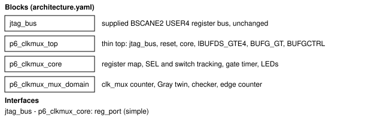

# p6_glitchfree_mux: P6 glitch-free clock multiplexer on the KR260

<!-- Generated from handover.yaml by flow/handover.py (brief 68). Edit handover.yaml, or the text between the prose markers, then run: python -m flow.handover write runs/20261125-165016-2a4e/p6_glitchfree_mux -->

The design selects between the 25 MHz board clock (clock A) and the SFP+ MGTREFCLK0 reference clock divided by B_DIV (clock B) through a BUFGCTRL-style glitch-free mux. In the muxed domain it runs a binary counter with a Gray-coded twin and a checker that counts errors in MUX_ERRS. It also provides a gated edge counter for frequency measurement and a snapshot latch, all read and written through a jtag_bus register port in the 25 MHz domain. The run stopped at the rtl-design-creation stage. Verification reached V1 of V3, no seeded simulation results exist, and no synthesis, implementation or board result was recorded.

Not in scope:

- Not a transceiver design; no GT channel is used and sfp_tx_disable is held at 1.
- Not a runtime-configurable divider; B_DIV is read-only and fixed at build time.
- Not verified, built or run on hardware in this run; no Vivado build was made.

Kind: agent-run; produced by the agent (agent run `20261125-165016-2a4e`, [record](../summary.json)). State: spec. For an agent: [AGENT.md](AGENT.md).

Run: model claude-sonnet-5-5 (deepagents harness), 8 loops, 99 turns, 3,164,738 tokens, 1747.4 s wall time, 3.68745 USD model cost (provider-reported), stopped because: stage 2 visited more than 6 times; last failing gate: lint, simulate, design standards, verification V2; owned by the rtl/tests role; last failing assertion: V2 seeds_run: no seeded results: read runs/20261125-165016-2a4e/p6_glitchfree_mux/build/verif/sim/seed*/results.xml and found none. The gate expects runs/20261125-165016-2a4e/p6_glitchfree_mux/build/verif/sim/seed<N>/results.xml, one direct; the same failure on 6 consecutive visits (from the run record).

<!-- prose:what -->
<!-- /prose:what -->

## Technical parameters

| Item | Value |
|---|---|
| Part | `xck26-sfvc784-2LV-c` |
| Board | kr260 |
| Top | `p6_clkmux_top` |
| Tool | Vivado 2026.1 |

Clocks:

- `clk_25`: 25 MHz (from `runs/20261125-165016-2a4e/p6_glitchfree_mux/design.xdc`)

Resets:

- `rst`, active high: Synchronous in clk_c3, held by jtag_bus for a few clocks at start. It is released into the clk_mux domain through a 2-flop synchroniser (spec.yaml; ARCHITECTURE.md names xpm_cdc_async_rst). The RTL was not shown, so this was not checked against it.

Interfaces:

- `clk_c3` (input clock, 25 MHz, C3 pin): design.xdc names the port clk_25 (pin C3, LVCMOS18, period 40.00 ns), while spec.yaml names it clk_c3; the XDC is what was built.
- `gt_refclk_p / gt_refclk_n` (differential input clock, SFP+ MGTREFCLK0, 156.25 MHz): design.xdc has no pin or clock constraint for these ports, so the constraints are incomplete in the built file.
- `led` (output, 2 bits): led[0] shows ACTIVE_SEL and led[1] shows SWITCHING (spec.yaml). design.xdc drives led[0] on F8 and led[1] on E8, LVCMOS18.
- `sfp_tx_disable` (output, 1 bit): Constant 1 (spec.yaml). design.xdc places it on Y10, LVCMOS33.

Registers (from spec.yaml; where the RTL differs, the gaps say so):

| Offset | Name | Access | Reset | Bits |
|---|---|---|---|---|
| 0 | `ID` | RO | 546701313 | 31:0 design ID |
| 4 | `BUILD` | RO | 0 | 31:0 USR_ACCESS word |
| 8 | `SCRATCH` | RW | 0 | 31:0 data |
| 16 | `SEL` | RW | 0 | 0 clock select (0=A, 1=B) |
| 20 | `STATUS` | RO | 0 | 0 SWITCHING, 1 ACTIVE_SEL |
| 24 | `B_DIV` | RO | 1 | 3:0 divide 1 to 8 |
| 28 | `GATE_LEN` | RW | 25000000 | 31:0 C3 cycles |
| 32 | `FREQ_CTRL` | RW | 0 | 0 START self-clearing |
| 36 | `FREQ_STATUS` | RO | 0 | 0 BUSY, 1 DONE |
| 40 | `FREQ_COUNT` | RO | 0 | 31:0 edges in last gate |
| 44 | `MUX_ERRS` | RO | 0 | 31:0 error count |
| 48 | `MUX_COUNT` | RO | 0 | 31:0 counter at last SNAPSHOT |
| 52 | `SWITCH_COUNT` | RO | 0 | 31:0 switches done |
| 56 | `SNAPSHOT` | WO | 0 | write latches MUX_COUNT, reads 0 |

| Parameter | Value | Legal range | Note |
|---|---|---|---|
| `DESIGN_ID` | 546,701,313 | fixed at 546701313 (0x20960001) | Value read back from the ID register at offset 0. |
| `B_DIV_VALUE` | 1 | 1 to 8 | Divide applied to the 156.25 MHz GT reference clock by BUFG_GT; 1 means undivided. Read back through B_DIV. |
| `GATE_LEN_DEFAULT` | 25,000,000 | 32-bit value; the spec treats 0 as a gate of 1 cycle | Reset value of GATE_LEN, in clk_c3 cycles (25,000,000 is 1 s at 25 MHz). The benches simulate at 200, so the spec's value was not simulated. Spec timing: GATE_LEN clk_c3 cycles (25,000,000 = 1 s at 25 MHz) |
| `SWITCH_TIMEOUT_CYCLES` | 4096 | positive integer | ACTIVE_SEL must follow SEL within this many clk_c3 cycles (spec.yaml timing). |
| `MUX_COUNT_WIDTH` | 32 | 32 (the registers and the spec are 32 bits) | Width of the muxed-domain counter and its Gray twin. |

| Quantity | Value | Source |
|---|---|---|
| Resources | not measured | [Known gaps](#known-gaps-and-limits) |
| Timing | not measured | [Known gaps](#known-gaps-and-limits) |
| Power | not measured | [Known gaps](#known-gaps-and-limits) |
| Latency | not measured | [Known gaps](#known-gaps-and-limits) |
| Throughput | not measured | [Known gaps](#known-gaps-and-limits) |

<!-- prose:parameters -->
<!-- /prose:parameters -->

## How to build, run and reproduce

| Step | Command | Heavy slot | Time |
|---|---|---|---|
| what changed since this handover (stale records, changed files, tool and knowledge-bank pins) | `python -m flow.handover fresh runs/20261125-165016-2a4e/p6_glitchfree_mux` | no | - |
| pick the work up again from the earliest stage the change or the staleness needs; needs a model (see docs/agent.md); Vivado for any stage from synthesis on | `python -m agent resume runs/20261125-165016-2a4e/p6_glitchfree_mux "<change request>"` | yes | - |
| run the Verifier's simulation tests; needs Icarus Verilog and cocotb, or the simulation container | `python -m pytest -q runs/20261125-165016-2a4e/p6_glitchfree_mux/tests/test_p6_glitchfree_mux_rtl.py` | no | - |
| re-run the Verilator coverage simulation and the verification gates (line, toggle, functional and cover results); needs Verilator 5.036 or later and cocotb (the simulation container has them) | `SIM=verilator FDA_COVERAGE=1 FDA_SIM_RESULTS_DIR=runs/20261125-165016-2a4e/p6_glitchfree_mux/build/verif/sim python -m pytest -q -x runs/20261125-165016-2a4e/p6_glitchfree_mux/tests/test_p6_glitchfree_mux_rtl.py && python3 flow/verif_gates.py runs/20261125-165016-2a4e/p6_glitchfree_mux --runs runs/20261125-165016-2a4e/p6_glitchfree_mux/build/verif/sim` | no | - |
| rebuild the bitstream with the flow; needs Vivado 2026.1 and a heavy slot | `flow/run_vivado.sh runs/20261125-165016-2a4e/p6_glitchfree_mux base` | yes | - |

Tool: Vivado 2026.1. Build ID of the inputs at handover: none (no Vivado build of this directory). Knowledge-bank pin: `5e2eab8`.

| File | What |
|---|---|
| [`runs/20261125-165016-2a4e/p6_glitchfree_mux/spec.md`](spec.md) | the request the run started from |
| [`runs/20261125-165016-2a4e/p6_glitchfree_mux/spec.yaml`](spec.yaml) | the specification the Clarifier wrote, approved automatically with no human review |
| [`runs/20261125-165016-2a4e/p6_glitchfree_mux/ARCHITECTURE.md`](ARCHITECTURE.md) | the architecture note, accepted automatically before any RTL (no human review) |
| [`runs/20261125-165016-2a4e/p6_glitchfree_mux/architecture.yaml`](architecture.yaml) | the machine-checked architecture: blocks, clocks, predicted resources |
| [`runs/20261125-165016-2a4e/p6_glitchfree_mux/design.xdc`](design.xdc) | pin, I/O standard and timing constraints |
| [`runs/20261125-165016-2a4e/p6_glitchfree_mux/model.py`](model.py) | the Modeller's reference model of the visible behaviour |
| [`runs/20261125-165016-2a4e/p6_glitchfree_mux/tests/test_p6_glitchfree_mux_bench.py`](tests/test_p6_glitchfree_mux_bench.py) | the Verifier's cocotb benches and pytest entries |
| [`runs/20261125-165016-2a4e/p6_glitchfree_mux/tests/test_p6_glitchfree_mux_rtl.py`](tests/test_p6_glitchfree_mux_rtl.py) | the Verifier's cocotb benches and pytest entries |
| [`runs/20261125-165016-2a4e/p6_glitchfree_mux/verif/testplan.yaml`](verif/testplan.yaml) | the test plan and mutant list read by the verification gates |
| [`runs/20261125-165016-2a4e/p6_glitchfree_mux/verif/checkers/v_macros.svh`](verif/checkers/v_macros.svh) | bound assertion and cover checkers |
| [`runs/20261125-165016-2a4e/p6_glitchfree_mux/build/review/02_rtl-design-creation.html`](build/review/02_rtl-design-creation.html) | the review page of stage rtl-design-creation: its exit gates and their failures at the last visit |

<!-- prose:build -->
<!-- /prose:build -->

## Verified

| ID | Activity | Result | What | Evidence | Conditions |
|---|---|---|---|---|---|
| E1 | review | partial | the specification and the architecture were approved automatically, with no human review (review off; the interview oracle claude-sonnet-5-5 only answered the interview questions); the interview asked 7 questions, 0 answered and 7 defaulted | [`runs/20261125-165016-2a4e/summary.json`](../summary.json) | - |
| E2 | simulation | partial | verification (flow/verif_gates.py) against the Modeller's reference model reached V1 of V3; the run asked for V2; V1 means every spec item is traced to a check and the benches use the blind model; V2 (simulation: seeded runs, a constrained-random test, bound assertions and formal tasks) did not pass: seeds run no seeded results: read runs/20261125-165016-2a4e/p6_glitchfree_mux/build/verif/sim/seed*/results.xml and found none. The gate expects runs/20261125-165016-2a4e/p6_glitchfree_mux/build/verif/sim/seed<N>/results.xml, one directory per seed. The flow's simulation step writes it when the bench runs through flow.cocotb_run.run(name, toplevel, sources, test_module, test_dir, parameters=..., seed=N) in tests/test_*_rtl.py: call run() once per seed (for example seed=1, 2, 3; a seed left out counts as seed 1) with the module(s) listed in bench.modules; the flow runs it and checks again. A bench that runs the simulator some other way leaves nothing there. (needs >=1 seed); constrained random test ran not evaluated (no seeded results) (needs True); assertions bound zero failures not evaluated (no seeded results) (needs bound in the run; no failure); V3 (coverage (line, toggle, functional bins, cover properties), three seeds and the mutation score) did not pass: seeds run no seeded results: read runs/20261125-165016-2a4e/p6_glitchfree_mux/build/verif/sim/seed*/results.xml and found none. The gate expects runs/20261125-165016-2a4e/p6_glitchfree_mux/build/verif/sim/seed<N>/results.xml, one directory per seed. The flow's simulation step writes it when the bench runs through flow.cocotb_run.run(name, toplevel, sources, test_module, test_dir, parameters=..., seed=N) in tests/test_*_rtl.py: call run() once per seed (for example seed=1, 2, 3; a seed left out counts as seed 1) with the module(s) listed in bench.modules; the flow runs it and checks again. A bench that runs the simulator some other way leaves nothing there. (needs >=3); functional bins pct not evaluated (no seeded results) (needs 100); cover properties pct not evaluated (no seeded results) (needs 100); line pct not evaluated (no seeded results) (needs 90); toggle pct not evaluated (no seeded results) (needs 75); mutation score pct not measured (needs 70); cdc structure clean missing (needs no unsafe crossing); cdc injection clean missing (needs pass); no board result (V-HW) is recorded | [`runs/20261125-165016-2a4e/p6_glitchfree_mux/build/verif/verif_gates.json`](build/verif/verif_gates.json) | - |

Gates at handover: `clarify` pass, `board-and-device-planning` pass, `rtl-design-creation` fail, `constraints` not-run, `synthesis` not-run, `implementation` not-run, `timing-closure` not-run, `power-closure` not-run, `drc-closure` not-run, `configuration-and-debug` not-run.

<!-- prose:verified -->
<!-- /prose:verified -->

## Measured

Every value is read from the record by `python -m flow.handover fill`, not typed.

| ID | What | Value | Runs | Source | Conditions |
|---|---|---|---|---|---|
| M1 | model cost of the run, provider-reported | 3.68745 USD | 1 | [`runs/20261125-165016-2a4e/summary.json`](../summary.json) `cost_usd` | every role and the interview oracle, as the run summary records it |

<!-- prose:measured -->
<!-- /prose:measured -->

## Known gaps and limits

- **REQ-01**: REQ-01 has no passing evidence for every proof method: simulation (test_p6_glitchfree_mux_bench.test_reset_and_regs) is pending: no simulation results; hardware (uart_tests) is pending: no bring-up result
- **REQ-02**: REQ-02 has no passing evidence for every proof method: hardware (uart_tests) is pending: no bring-up result
- **REQ-03**: REQ-03 has no passing evidence for every proof method: simulation (test_p6_glitchfree_mux_bench.test_reset_and_regs) is pending: no simulation results
- **REQ-25**: REQ-25 has no passing evidence for every proof method: simulation (test_p6_glitchfree_mux_bench.test_reset_and_regs) is pending: no simulation results
- **REQ-04**: REQ-04 has no passing evidence for every proof method: simulation (test_p6_glitchfree_mux_bench.test_unmapped_and_read_hold) is pending: no simulation results
- **REQ-26**: REQ-26 has no passing evidence for every proof method: simulation (test_p6_glitchfree_mux_bench.test_unmapped_and_read_hold) is pending: no simulation results
- **REQ-05**: REQ-05 has no passing evidence for every proof method: simulation (test_p6_glitchfree_mux_bench.test_unmapped_and_read_hold) is pending: no simulation results; formal (test_p6_glitchfree_mux_bench.test_unmapped_and_read_hold) is pending: re-planned from formal to simulation (SymbiYosys is not installed so the read-latency property is checked in simulation.): no simulation results
- **REQ-27**: REQ-27 has no passing evidence for every proof method: simulation (test_p6_glitchfree_mux_bench.test_unmapped_and_read_hold) is pending: no simulation results; formal (test_p6_glitchfree_mux_bench.test_unmapped_and_read_hold) is pending: re-planned from formal to simulation (SymbiYosys is not installed so the read-hold property is checked in simulation.): no simulation results
- **REQ-06**: REQ-06 has no passing evidence for every proof method: simulation (test_p6_glitchfree_mux_bench.test_reset_and_regs) is pending: no simulation results; hardware (uart_tests) is pending: no bring-up result
- **REQ-28**: REQ-28 has no passing evidence for every proof method: simulation (test_p6_glitchfree_mux_bench.test_switching) is pending: no simulation results; hardware (ila_captures) is pending: no bring-up result
- **REQ-07**: REQ-07 has no passing evidence for every proof method: simulation (test_p6_glitchfree_mux_bench.test_switching) is pending: no simulation results; hardware (ila_captures) is pending: no bring-up result
- **REQ-08**: REQ-08 has no passing evidence for every proof method: simulation (test_p6_glitchfree_mux_bench.test_switching) is pending: no simulation results
- **REQ-09**: REQ-09 has no passing evidence for every proof method: simulation (test_p6_glitchfree_mux_bench.test_reset_and_regs) is pending: no simulation results; hardware (uart_tests) is pending: no bring-up result
- **REQ-10**: REQ-10 has no passing evidence for every proof method: simulation (test_p6_glitchfree_mux_bench.test_random_switches) is pending: no simulation results; analysis (post_route:setup) is pending: no flow gates result
- **REQ-11**: REQ-11 has no passing evidence for every proof method: simulation (test_p6_glitchfree_mux_bench.test_random_switches) is pending: no simulation results; hardware (ila_captures) is pending: no bring-up result
- **REQ-12**: REQ-12 has no passing evidence for every proof method: simulation (test_p6_glitchfree_mux_bench.test_switching) is pending: no simulation results
- **REQ-13**: REQ-13 has no passing evidence for every proof method: simulation (test_p6_glitchfree_mux_bench.test_switching) is pending: no simulation results; formal (test_p6_glitchfree_mux_bench.test_switching) is pending: re-planned from formal to simulation (SymbiYosys is not installed so the counter-step check is observed through MUX_ERRS in simulation.): no simulation results
- **REQ-14**: REQ-14 has no passing evidence for every proof method: simulation (test_p6_glitchfree_mux_bench.test_random_switches) is pending: no simulation results; hardware (ila_captures) is pending: no bring-up result
- **REQ-15**: REQ-15 has no passing evidence for every proof method: simulation (test_p6_glitchfree_mux_bench.test_switching) is pending: no simulation results
- **REQ-16**: REQ-16 has no passing evidence for every proof method: simulation (test_p6_glitchfree_mux_bench.test_reset_and_regs) is pending: no simulation results
- **REQ-29**: REQ-29 has no passing evidence for every proof method: simulation (test_p6_glitchfree_mux_bench.test_reset_and_regs) is pending: no simulation results
- **REQ-17**: REQ-17 has no passing evidence for every proof method: simulation (test_p6_glitchfree_mux_bench.test_frequency_and_snapshot) is pending: no simulation results
- **REQ-18**: REQ-18 has no passing evidence for every proof method: simulation (test_p6_glitchfree_mux_bench.test_frequency_and_snapshot) is pending: no simulation results; hardware (ila_captures) is pending: no bring-up result
- **REQ-19**: REQ-19 has no passing evidence for every proof method: simulation (test_p6_glitchfree_mux_bench.test_frequency_and_snapshot) is pending: no simulation results
- **REQ-20**: REQ-20 has no passing evidence for every proof method: simulation (test_p6_glitchfree_mux_bench.test_frequency_and_snapshot) is pending: no simulation results
- **REQ-21**: REQ-21 has no passing evidence for every proof method: simulation (test_p6_glitchfree_mux_bench.test_outputs) is pending: no simulation results; formal (test_p6_glitchfree_mux_bench.test_outputs) is pending: re-planned from formal to simulation (SymbiYosys is not installed so the constant-output property is checked in simulation.): no simulation results; analysis (post_synth:post_synth_resources_in_range) is pending: no flow gates result
- **REQ-22**: REQ-22 has no passing evidence for every proof method: analysis (post_synth:post_synth_resources_in_range) is pending: no flow gates result
- **REQ-23**: REQ-23 has no passing evidence for every proof method: analysis (post_route:setup) is pending: no flow gates result
- **REQ-24**: REQ-24 has no passing evidence for every proof method: analysis (post_synth:post_synth_resources_in_range) is pending: no flow gates result
- **E1**: review evidence is partial: the specification and the architecture were approved automatically, with no human review (review off; the interview oracle claude-sonnet-5-5 only answered the interview questions); the interview asked 7 questions, 0 answered and 7 defaulted
- **E2**: simulation evidence is partial: verification reached V1 of V3 (the run asked for V2); the checks that did not pass or did not run are listed in the evidence row
- **rtl-design-creation**: stage rtl-design-creation did not pass its gates in this run; at its last visit: lint not passing FAIL simulate not passing FAIL standards STD-LATCH-01: not checked (no build.yaml top or sources to check) FAIL standards STD-LOOP-01: not checked (no build.yaml top or sources to check) FAIL standards STD-CDC-01: architecture.yaml:1: crossings[0]: inline_in p6_clkmux_core is not a module of this design or the shell FAIL standards STD-CDC-01: architecture.yaml:1: crossings[1]: inl ...
- **constraints**: stage constraints was not run: the run stopped before this stage (stage 2 visited more than 6 times; last failing gate: lint, simulate, design standards, verification V2; owned by the rtl/tests role; last failing assertion: V2 seeds_run: no seeded results: read runs/20261125-165016-2a4e/p6_glitchfree_mux/build/verif/sim/seed*/results.xml and found none. The gate expects runs/20261125-165016-2a4e/p6_glitchfree_mux/build/verif/sim/seed<N>/results.xml, one direct; the same failure on 6 consecutive visits)
- **synthesis**: stage synthesis was not run: the run stopped before this stage (stage 2 visited more than 6 times; last failing gate: lint, simulate, design standards, verification V2; owned by the rtl/tests role; last failing assertion: V2 seeds_run: no seeded results: read runs/20261125-165016-2a4e/p6_glitchfree_mux/build/verif/sim/seed*/results.xml and found none. The gate expects runs/20261125-165016-2a4e/p6_glitchfree_mux/build/verif/sim/seed<N>/results.xml, one direct; the same failure on 6 consecutive visits)
- **implementation**: stage implementation was not run: the run stopped before this stage (stage 2 visited more than 6 times; last failing gate: lint, simulate, design standards, verification V2; owned by the rtl/tests role; last failing assertion: V2 seeds_run: no seeded results: read runs/20261125-165016-2a4e/p6_glitchfree_mux/build/verif/sim/seed*/results.xml and found none. The gate expects runs/20261125-165016-2a4e/p6_glitchfree_mux/build/verif/sim/seed<N>/results.xml, one direct; the same failure on 6 consecutive visits)
- **timing-closure**: stage timing-closure was not run: the run stopped before this stage (stage 2 visited more than 6 times; last failing gate: lint, simulate, design standards, verification V2; owned by the rtl/tests role; last failing assertion: V2 seeds_run: no seeded results: read runs/20261125-165016-2a4e/p6_glitchfree_mux/build/verif/sim/seed*/results.xml and found none. The gate expects runs/20261125-165016-2a4e/p6_glitchfree_mux/build/verif/sim/seed<N>/results.xml, one direct; the same failure on 6 consecutive visits)
- **power-closure**: stage power-closure was not run: the run stopped before this stage (stage 2 visited more than 6 times; last failing gate: lint, simulate, design standards, verification V2; owned by the rtl/tests role; last failing assertion: V2 seeds_run: no seeded results: read runs/20261125-165016-2a4e/p6_glitchfree_mux/build/verif/sim/seed*/results.xml and found none. The gate expects runs/20261125-165016-2a4e/p6_glitchfree_mux/build/verif/sim/seed<N>/results.xml, one direct; the same failure on 6 consecutive visits)
- **drc-closure**: stage drc-closure was not run: the run stopped before this stage (stage 2 visited more than 6 times; last failing gate: lint, simulate, design standards, verification V2; owned by the rtl/tests role; last failing assertion: V2 seeds_run: no seeded results: read runs/20261125-165016-2a4e/p6_glitchfree_mux/build/verif/sim/seed*/results.xml and found none. The gate expects runs/20261125-165016-2a4e/p6_glitchfree_mux/build/verif/sim/seed<N>/results.xml, one direct; the same failure on 6 consecutive visits)
- **configuration-and-debug**: stage configuration-and-debug was not run: the run stopped before this stage (stage 2 visited more than 6 times; last failing gate: lint, simulate, design standards, verification V2; owned by the rtl/tests role; last failing assertion: V2 seeds_run: no seeded results: read runs/20261125-165016-2a4e/p6_glitchfree_mux/build/verif/sim/seed*/results.xml and found none. The gate expects runs/20261125-165016-2a4e/p6_glitchfree_mux/build/verif/sim/seed<N>/results.xml, one direct; the same failure on 6 consecutive visits)
- **formal**: formal checks were planned for REQ-05, REQ-27, REQ-13, REQ-21 and did not run; each was replaced by a simulation check (verif/testplan.yaml replan). Reason recorded: SymbiYosys is not installed so the read-latency property is checked in simulation.
- **simulated_parameters**: the benches simulate at values other than the spec's (scaled for simulation speed or otherwise): GATE_LEN_DEFAULT is simulated at 200 (runs/20261125-165016-2a4e/p6_glitchfree_mux/tests/test_p6_glitchfree_mux_rtl.py:15) while spec.yaml gives 25000000. Behaviour that depends on the spec's value, such as a divider's timing against the clock, was not simulated at that value; it is stated here, not shown, unless another record covers it
- **resources**: resources not measured: no current Vivado build of this design has been recorded
- **timing**: timing not measured: no current Vivado build of this design has been recorded
- **power**: power not measured: no current Vivado build of this design has been recorded
- **latency**: latency not measured: the run measured no latency; the spec's latency promise is checked only by the benches
- **throughput**: throughput not measured: the run measured no throughput
- **reset_values**: Per spec.yaml, every register resets to the value in the register table (SCRATCH, SEL, FREQ_CTRL and the counters to 0, GATE_LEN to 25000000, B_DIV to 1), and SWITCH_COUNT and MUX_ERRS clear only on rst.
- **unmapped_access**: Per spec.yaml, unmapped addresses read 0 and ignore writes, and SNAPSHOT reads 0. The RTL was not shown, so this was not checked against it.
- **sel_write_while_switching**: Per the defaulted interview answer, a SEL write during SWITCHING is accepted and the mux follows the latest value once the current change ends. Not confirmed in the RTL.
- **gate_len_zero**: Per the defaulted interview answer, GATE_LEN of 0 is treated as a gate of 1 cycle. START while BUSY is ignored, and a switch during a gate is counted without error.
- **spec_vs_xdc**: spec.yaml names the clock port clk_c3 but design.xdc constrains clk_25, and design.xdc has no constraint for gt_refclk_p/n or any clock-group declaration between the asynchronous clocks, which ARCHITECTURE.md relies on.
- **approval**: The specification and architecture were approved automatically with no human review; the interview oracle answered only the interview questions, and all 7 answers were defaults.
- **stages_not_run**: Stages constraints, synthesis, implementation, timing-closure, power-closure, drc-closure and configuration-and-debug were not run; the run stopped after stage 2 was visited more than 6 times.
- **measurements**: Resources, timing, power and throughput were not measured; no current Vivado build exists.

<!-- prose:gaps -->
<!-- /prose:gaps -->

## Next steps

1. Fix the earliest failure, verification: make tests/test_p6_glitchfree_mux_rtl.py call flow.cocotb_run.run() once per seed (for example seed=1, 2, 3) so one results.xml per seed is written under build/verif/sim, then re-run the verification gates.
2. Fix the lint, simulate and design-standards failures at rtl-design-creation, including the architecture.yaml crossings that name p6_clkmux_core, which is not a module of the design.
3. Add a gt_refclk_p/n pin and clock constraint and an asynchronous clock-group declaration to design.xdc, and align the clock port name with the spec.
4. After simulation passes, run python -m agent resume for the later stages and measure resources, timing and power from a real Vivado build.

Open questions:

- Which SFP+ MGTREFCLK0 pins should gt_refclk_p/n use, given they are not in the board resource list?

<!-- prose:next -->
<!-- /prose:next -->

## History

| Date | Brief | PR | What |
|---|---|---|---|
| 2026-11-25 | agent run | - | produced by the agent graph; stages that passed: clarify, board-and-device-planning |

<!-- prose:history -->
<!-- /prose:history -->
