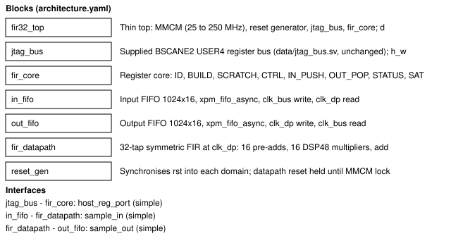
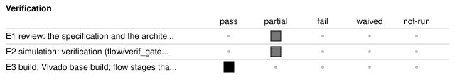

# p4_fir_dsp: 32-tap symmetric FIR filter with FIFOs and JTAG register access on the KR260

<!-- Generated from handover.yaml by flow/handover.py (brief 68). Edit handover.yaml, or the text between the prose markers, then run: python -m flow.handover write runs/20261125-174731-a2e5/p4_fir_dsp -->

A 32-tap symmetric low-pass FIR filter with 16-bit samples, built for the K26 on the KR260. A host pushes samples through a JTAG register bus into a 1024-sample input FIFO, writes RUN, and pops the saturated, rounded 16-bit results from an output FIFO. The datapath runs at 250 MHz from an MMCM on the 25 MHz board clock and uses 16 DSP multipliers through coefficient symmetry. The run reached simulation level V2 of V3 against the Modeller's model. It stopped at synthesis, whose gates failed. Nothing was implemented or measured on a board.

Not in scope:

- Not an AXI design. The register port is the supplied jtag_bus simple port.
- Not a runtime-programmable filter. The 16 unique coefficients are fixed in rtl/fir_datapath.sv.
- Not timing-closed, power-checked or run on hardware. No Vivado resource, timing or power figure is recorded.
- Uses no GT transceiver. sfp_tx_disable is a plain output held at 1.

Kind: agent-run; produced by the agent (agent run `20261125-174731-a2e5`, [record](../summary.json)). State: simulated. For an agent: [AGENT.md](AGENT.md).

Run: model claude-sonnet-5-5 (deepagents harness), 7 loops, 245 turns, 10,232,224 tokens, 5773.6 s wall time, 7.22547 USD model cost (provider-reported), stopped because: stage 3 visited more than 4 times; last failing gate: none recorded (from the run record).

<!-- prose:what -->
<!-- /prose:what -->

## Technical parameters

| Item | Value |
|---|---|
| Part | `xck26-sfvc784-2LV-c` |
| Board | kr260 |
| Top | `fir32_top` |
| Tool | Vivado 2026.1 |

Clocks:

- `clk_25`: 25 MHz (from `runs/20261125-174731-a2e5/p4_fir_dsp/design.xdc`)

Resets:

- `rst`, active high: rtl/reset_gen.sv makes it, not jtag_bus as the spec says. A power-on counter holds rst_bus for 15 clk_25 cycles, and rst_dp is released synchronously by xpm_cdc_async_rst while the MMCM is unlocked or rst_bus is high. The reset is synchronous inside each domain. Register reset values are in the register table.

Interfaces:

- `clk_25` (input clock, pin C3 LVCMOS18, 40 ns period in design.xdc): Board clock. It is the bus clock and the MMCM input.
- `led` (output [1:0], F8 and E8 LVCMOS18): led[0] is BUSY delayed by three clk_bus cycles and led[1] is output FIFO not empty. This is an assumption of the run, since the request gave no LED function.
- `sfp_tx_disable` (output, Y10 LVCMOS33): Constant 1 (fir32_core.sv).

Registers (from spec.yaml; where the RTL differs, the gaps say so):

| Offset | Name | Access | Reset | Bits |
|---|---|---|---|---|
| 0 | `ID` | RO | 546570241 | 31:0 design ID |
| 4 | `BUILD` | RO | 0 | 31:0 USR_ACCESS word |
| 8 | `SCRATCH` | RW | 0 | 31:0 scratch |
| 16 | `CTRL` | RW | 0 | 0 CLEAR self-clearing; 1 RUN self-clearing; others 0 |
| 20 | `IN_PUSH` | WO | 0 | 15:0 sample pushed |
| 24 | `OUT_POP` | RO | 0 | 31 valid; 15:0 oldest output; read pops |
| 28 | `STATUS` | RO | 0 | 0 BUSY; 15:4 input count; 31:20 output count; rest 0 |
| 32 | `SAT_COUNT` | RO | 0 | 31:0 saturated outputs |
| 36 | `SAMPLES_DONE` | RO | 0 | 31:0 samples processed |

| Parameter | Value | Legal range | Note |
|---|---|---|---|
| `NUM_TAPS` | 32 | 32 only | Not an RTL parameter. The structure (32-deep history, 16 pre-adders, 16 multipliers) is fixed in fir_datapath.sv. |
| `DATA_WIDTH` | 16 | 16 only | Fixed in the RTL. Input samples are zero-extended in the pre-add, so they are treated as unsigned words. |
| `COEFF_WIDTH` | 16 | 16 only | Signed Q1.15. The 16 unique values are literals in fir_datapath.sv, not read from data/coeffs.hex. |
| `ACC_WIDTH` | 40 | 40 only | The 32-tap sum needs at most 37 bits per the spec, so the sum is exact. |
| `FIFO_DEPTH` | 1024 | 1024 only | Each XPM FIFO is built 2048 deep, and fir_core.sv and fir_datapath.sv limit occupancy to 1024. |
| `ROUND_CONST` | 16,384 | 16384 only | The value 0x4000 is added before the shift, as a literal in fir_datapath.sv. |
| `SHIFT` | 15 | 15 only | Arithmetic shift, then saturation to 16 bits. The spec gives 1 sample per clk_dp cycle at 250 MHz or faster, and this is not measured. |
| `DESIGN_ID` | 546,570,241 | any 32-bit value | Equals 0x20940001. It is a localparam in fir32_core.sv and returned by the ID register. |

| Quantity | Value | Source |
|---|---|---|
| Resources | not measured | [Known gaps](#known-gaps-and-limits) |
| Timing | not measured | [Known gaps](#known-gaps-and-limits) |
| Power | not measured | [Known gaps](#known-gaps-and-limits) |
| Latency | not measured | [Known gaps](#known-gaps-and-limits) |
| Throughput | not measured | [Known gaps](#known-gaps-and-limits) |

<!-- prose:parameters -->
<!-- /prose:parameters -->

## How to build, run and reproduce

| Step | Command | Heavy slot | Time |
|---|---|---|---|
| what changed since this handover (stale records, changed files, tool and knowledge-bank pins) | `python -m flow.handover fresh runs/20261125-174731-a2e5/p4_fir_dsp` | no | - |
| pick the work up again from the earliest stage the change or the staleness needs; needs a model (see docs/agent.md); Vivado for any stage from synthesis on | `python -m agent resume runs/20261125-174731-a2e5/p4_fir_dsp "<change request>"` | yes | - |
| run the Verifier's simulation tests; needs Icarus Verilog and cocotb, or the simulation container | `python -m pytest -q runs/20261125-174731-a2e5/p4_fir_dsp/tests/test_p4_fir_dsp_rtl.py` | no | - |
| re-run the Verilator coverage simulation and the verification gates (line, toggle, functional and cover results); needs Verilator 5.036 or later and cocotb (the simulation container has them) | `SIM=verilator FDA_COVERAGE=1 FDA_SIM_RESULTS_DIR=runs/20261125-174731-a2e5/p4_fir_dsp/build/verif/sim python -m pytest -q -x runs/20261125-174731-a2e5/p4_fir_dsp/tests/test_p4_fir_dsp_rtl.py && python3 flow/verif_gates.py runs/20261125-174731-a2e5/p4_fir_dsp --runs runs/20261125-174731-a2e5/p4_fir_dsp/build/verif/sim` | no | - |
| rebuild the bitstream with the flow; needs Vivado 2026.1 and a heavy slot; peak memory 3412 MiB (anonymous, the systemd scope) | `flow/run_vivado.sh runs/20261125-174731-a2e5/p4_fir_dsp base` | yes | about 2.2 min |

Tool: Vivado 2026.1. Build ID of the inputs at handover: `68b24bea` (`python flow/manifest.py show runs/20261125-174731-a2e5/p4_fir_dsp`: what a rebuild of today's sources and flow would carry; it changes when any build input or the flow changes, so it can differ from the build ID in an older evidence record). Knowledge-bank pin: `6185830`.

| File | What |
|---|---|
| [`runs/20261125-174731-a2e5/p4_fir_dsp/spec.md`](spec.md) | the request the run started from |
| [`runs/20261125-174731-a2e5/p4_fir_dsp/spec.yaml`](spec.yaml) | the specification the Clarifier wrote, approved automatically with no human review |
| [`runs/20261125-174731-a2e5/p4_fir_dsp/ARCHITECTURE.md`](ARCHITECTURE.md) | the architecture note, accepted automatically before any RTL (no human review) |
| [`runs/20261125-174731-a2e5/p4_fir_dsp/architecture.yaml`](architecture.yaml) | the machine-checked architecture: blocks, clocks, predicted resources |
| [`runs/20261125-174731-a2e5/p4_fir_dsp/rtl/fir32_core.sv`](rtl/fir32_core.sv) | RTL written by the Designer |
| [`runs/20261125-174731-a2e5/p4_fir_dsp/rtl/fir32_core_wrap.sv`](rtl/fir32_core_wrap.sv) | RTL written by the Designer |
| [`runs/20261125-174731-a2e5/p4_fir_dsp/rtl/fir32_top.sv`](rtl/fir32_top.sv) | RTL written by the Designer |
| [`runs/20261125-174731-a2e5/p4_fir_dsp/rtl/fir_datapath.sv`](rtl/fir_datapath.sv) | RTL written by the Designer |
| [`runs/20261125-174731-a2e5/p4_fir_dsp/rtl/in_fifo.sv`](rtl/in_fifo.sv) | RTL written by the Designer |
| [`runs/20261125-174731-a2e5/p4_fir_dsp/rtl/lint_waivers.sv`](rtl/lint_waivers.sv) | RTL written by the Designer |
| [`runs/20261125-174731-a2e5/p4_fir_dsp/rtl/out_fifo.sv`](rtl/out_fifo.sv) | RTL written by the Designer |
| [`runs/20261125-174731-a2e5/p4_fir_dsp/rtl/reset_gen.sv`](rtl/reset_gen.sv) | RTL written by the Designer |
| [`runs/20261125-174731-a2e5/p4_fir_dsp/rtl/xilinx_sim_stubs.sv`](rtl/xilinx_sim_stubs.sv) | RTL written by the Designer |
| [`runs/20261125-174731-a2e5/p4_fir_dsp/design.xdc`](design.xdc) | pin, I/O standard and timing constraints |
| [`runs/20261125-174731-a2e5/p4_fir_dsp/build.yaml`](build.yaml) | the build description read by the flow |
| [`runs/20261125-174731-a2e5/p4_fir_dsp/model.py`](model.py) | the Modeller's reference model of the visible behaviour |
| [`runs/20261125-174731-a2e5/p4_fir_dsp/tests/fir_bench.py`](tests/fir_bench.py) | the Verifier's cocotb benches and pytest entries |
| [`runs/20261125-174731-a2e5/p4_fir_dsp/tests/test_p4_fir_dsp_rtl.py`](tests/test_p4_fir_dsp_rtl.py) | the Verifier's cocotb benches and pytest entries |
| [`runs/20261125-174731-a2e5/p4_fir_dsp/verif/mutants.yaml`](verif/mutants.yaml) | the test plan and mutant list read by the verification gates |
| [`runs/20261125-174731-a2e5/p4_fir_dsp/verif/testplan.yaml`](verif/testplan.yaml) | the test plan and mutant list read by the verification gates |
| [`runs/20261125-174731-a2e5/p4_fir_dsp/verif/checkers/v_macros.svh`](verif/checkers/v_macros.svh) | bound assertion and cover checkers |
| [`runs/20261125-174731-a2e5/p4_fir_dsp/build/review/04_synthesis.html`](build/review/04_synthesis.html) | the review page of stage synthesis: its exit gates and their failures at the last visit |

<!-- prose:build -->
<!-- /prose:build -->

## Verified

| ID | Activity | Result | What | Evidence | Conditions |
|---|---|---|---|---|---|
| E1 | review | partial | the specification and the architecture were approved automatically, with no human review (review off; the interview oracle claude-sonnet-5-5 only answered the interview questions); the interview asked 6 questions, 0 answered and 6 defaulted | [`runs/20261125-174731-a2e5/summary.json`](../summary.json) | - |
| E2 | simulation | partial | verification (flow/verif_gates.py) against the Modeller's reference model reached V2 of V3; the run asked for V2; V2 means simulation: seeded runs, a constrained-random test, bound assertions and formal tasks; V3 (coverage (line, toggle, functional bins, cover properties), three seeds and the mutation score) did not pass: functional bins pct 0.0 (0/0) (needs 100); cover properties pct 0.0 (needs 100); line pct not measured (needs 90); toggle pct not measured (needs 75); mutation score pct not measured (needs 80); cdc structure clean missing (needs no unsafe crossing); cdc injection clean missing (needs pass); no board result (V-HW) is recorded | [`runs/20261125-174731-a2e5/p4_fir_dsp/build/verif/verif_gates.json`](build/verif/verif_gates.json) | - |
| E3 | build | pass | Vivado base build; flow stages that ran: rtl | [`runs/20261125-174731-a2e5/p4_fir_dsp/build/base/gates.json`](build/base/gates.json) | - |

Gates at handover: `clarify` pass, `board-and-device-planning` pass, `rtl-design-creation` pass, `constraints` pass, `synthesis` fail, `implementation` not-run, `timing-closure` not-run, `power-closure` not-run, `drc-closure` not-run, `configuration-and-debug` not-run.

<!-- prose:verified -->
<!-- /prose:verified -->

## Measured

Every value is read from the record by `python -m flow.handover fill`, not typed.

| ID | What | Value | Runs | Source | Conditions |
|---|---|---|---|---|---|
| M1 | simulation seeds run | 3 | 1 | [`runs/20261125-174731-a2e5/p4_fir_dsp/build/verif/verif_gates.json`](build/verif/verif_gates.json) `stages.V3.checks.seeds_run.value` | Verilator coverage simulation of the RTL against the Modeller's model, every seed the bench ran |
| M2 | line coverage | not measured % | 1 | [`runs/20261125-174731-a2e5/p4_fir_dsp/build/verif/verif_gates.json`](build/verif/verif_gates.json) `stages.V3.checks.line_pct.value` | Verilator coverage simulation of the RTL against the Modeller's model, every seed the bench ran |
| M3 | toggle coverage | not measured % | 1 | [`runs/20261125-174731-a2e5/p4_fir_dsp/build/verif/verif_gates.json`](build/verif/verif_gates.json) `stages.V3.checks.toggle_pct.value` | Verilator coverage simulation of the RTL against the Modeller's model, every seed the bench ran |
| M4 | functional coverage bins hit | 0.0 (0/0) | 1 | [`runs/20261125-174731-a2e5/p4_fir_dsp/build/verif/verif_gates.json`](build/verif/verif_gates.json) `stages.V3.checks.functional_bins_pct.value` | Verilator coverage simulation of the RTL against the Modeller's model, every seed the bench ran |
| M5 | cover properties hit | 0.0 % | 1 | [`runs/20261125-174731-a2e5/p4_fir_dsp/build/verif/verif_gates.json`](build/verif/verif_gates.json) `stages.V3.checks.cover_properties_pct.value` | Verilator coverage simulation of the RTL against the Modeller's model, every seed the bench ran |
| M6 | model cost of the run, provider-reported | 7.22547 USD | 1 | [`runs/20261125-174731-a2e5/summary.json`](../summary.json) `cost_usd` | every role and the interview oracle, as the run summary records it |

<!-- prose:measured -->
<!-- /prose:measured -->

## Known gaps and limits

- **REQ-01**: REQ-01 has no passing evidence for every proof method: hardware (uart_tests) is pending: no bring-up result
- **REQ-02**: REQ-02 has no passing evidence for every proof method: hardware (uart_tests) is pending: no bring-up result
- **REQ-03**: REQ-03 has no passing evidence for every proof method: hardware (uart_tests) is pending: no bring-up result
- **REQ-30**: REQ-30 has no passing evidence for every proof method: hardware (uart_tests) is pending: no bring-up result
- **REQ-07**: REQ-07 has no passing evidence for every proof method: hardware (uart_tests) is pending: no bring-up result
- **REQ-08**: REQ-08 has no passing evidence for every proof method: hardware (uart_tests) is pending: no bring-up result
- **REQ-09**: REQ-09 has no passing evidence for every proof method: hardware (uart_tests) is pending: no bring-up result
- **REQ-11**: REQ-11 has no passing evidence for every proof method: analysis (post_synth:post_synth_resources_in_range) is not run (the stage that makes this evidence did not run): gate post_synth:post_synth_resources_in_range = None
- **REQ-13**: REQ-13 has no passing evidence for every proof method: analysis (post_route:setup) is not run (the stage that makes this evidence did not run): gate post_route:setup = None
- **REQ-18**: REQ-18 has no passing evidence for every proof method: hardware (uart_tests) is pending: no bring-up result
- **REQ-25**: REQ-25 has no passing evidence for every proof method: hardware (uart_tests) is pending: no bring-up result
- **REQ-26**: REQ-26 has no passing evidence for every proof method: analysis (post_synth:post_synth_resources_in_range) is not run (the stage that makes this evidence did not run): gate post_synth:post_synth_resources_in_range = None
- **REQ-27**: REQ-27 has no passing evidence for every proof method: analysis (post_synth:post_synth_resources_in_range) is not run (the stage that makes this evidence did not run): gate post_synth:post_synth_resources_in_range = None
- **REQ-28**: REQ-28 has no passing evidence for every proof method: analysis (post_synth:post_synth_resources_in_range) is not run (the stage that makes this evidence did not run): gate post_synth:post_synth_resources_in_range = None
- **REQ-35**: REQ-35 has no passing evidence for every proof method: analysis (post_route:setup) is not run (the stage that makes this evidence did not run): gate post_route:setup = None
- **REQ-29**: REQ-29 has no passing evidence for every proof method: analysis (post_route:setup) is not run (the stage that makes this evidence did not run): gate post_route:setup = None
- **E1**: review evidence is partial: the specification and the architecture were approved automatically, with no human review (review off; the interview oracle claude-sonnet-5-5 only answered the interview questions); the interview asked 6 questions, 0 answered and 6 defaulted
- **E2**: simulation evidence is partial: verification reached V2 of V3 (the run asked for V2); the checks that did not pass or did not run are listed in the evidence row
- **synthesis**: stage synthesis did not pass its gates in this run; at its last visit: post_synth:post_synth_cdc_no_critical FAIL post_synth:post_synth_resources_in_range FAIL resources: bram_tile used 0 outside the predicted [2.0, 4.0] by more than 2x (below; allowed [1.0, 8.0]) FAIL
- **implementation**: stage implementation was not run: the run stopped before this stage (stage 3 visited more than 4 times; last failing gate: none recorded)
- **timing-closure**: stage timing-closure was not run: the run stopped before this stage (stage 3 visited more than 4 times; last failing gate: none recorded)
- **power-closure**: stage power-closure was not run: the run stopped before this stage (stage 3 visited more than 4 times; last failing gate: none recorded)
- **drc-closure**: stage drc-closure was not run: the run stopped before this stage (stage 3 visited more than 4 times; last failing gate: none recorded)
- **configuration-and-debug**: stage configuration-and-debug was not run: the run stopped before this stage (stage 3 visited more than 4 times; last failing gate: none recorded)
- **formal**: formal checks were planned for REQ-06, REQ-31, REQ-14, REQ-32, REQ-16, REQ-34, REQ-25 and did not run; each was replaced by a simulation check (verif/testplan.yaml replan). Reason recorded: SymbiYosys is not installed so the property is checked by a directed simulation test.
- **resources**: resources not measured: no current Vivado build of this design has been recorded
- **timing**: timing not measured: no current Vivado build of this design has been recorded
- **power**: power not measured: no current Vivado build of this design has been recorded
- **latency**: latency not measured: the run measured no latency; the spec's latency promise is checked only by the benches
- **throughput**: throughput not measured: the run measured no throughput
- **fir_latency**: The spec asks for a pipeline depth of about 8 to 12 clk_dp cycles. Counting from fir_datapath.sv, LAT is 9 cycles from accept (the input FIFO read) to out_wr_en. The first result is readable after the output FIFO crossing, which adds further clocks that the RTL does not bound.
- **bus_read_latency**: In fir32_core.sv h_rdata is a register loaded on the clock after h_re, so one bus cycle in the core. The spec allows 2. The delay inside jtag_bus.sv was not counted. h_rdata holds its value until the next h_re.
- **unmapped_access**: Decoded read addresses are 0x000, 0x004, 0x008, 0x018, 0x01C, 0x020 and 0x024. Any other address reads 0, including CTRL (0x010) and IN_PUSH (0x014). Writes are decoded only for SCRATCH, CTRL and IN_PUSH, and all other writes, including writes to RO registers, are ignored.
- **ctrl_priority**: A CTRL write with bit 0 set does CLEAR and ignores bit 1, so writing 3 does not RUN. CLEAR also holds the input FIFO in reset for 16 clk_bus cycles and the output FIFO for 64 clk_dp cycles, and a RUN issued in that window is dropped. IN_PUSH writes are ignored while the input FIFO is in reset.
- **run_edge_cases**: RUN is ignored while busy or when the input FIFO is empty. It takes min(input count, output free space) samples, taken from the FIFO levels as they stand at the RUN. CLEAR during a run aborts it. BUSY stays high for 64 clk_dp cycles after the last result, and led[0] lags BUSY by three more clk_bus cycles.
- **reset_values**: SCRATCH, h_rdata and the counters reset to 0. Counters and history are cleared by reset and by CLEAR. The histories of the two pending-push counters that guard the input FIFO level are cleared by reset only.
- **status_counts**: STATUS counts cross clock domains and may lag. The input count is the write-side count and the output count is the read-side count. The input push limit adds the pushes of the last 4 clocks to the count so that 1024 is not exceeded. Pushing to a full FIFO is dropped by this check.
- **spec_vs_rtl**: The spec says the reset comes from jtag_bus, coefficients come from data/coeffs.hex, and the parameters are adjustable. In the RTL (reset_gen.sv, fir_datapath.sv, fir32_core.sv) the reset is a power-on counter plus MMCM lock, the coefficients are literals and the parameters are fixed. The RTL is what was built.
- **unsigned_samples**: fir_datapath.sv zero-extends samples in the pre-add, so they are treated as unsigned 16-bit words. The comment says this matches the reference model, but the spec does not say whether samples are signed. Check against model.py and the request.
- **bram_zero**: The architecture predicts 2 to 4 BRAM36 for the two FIFOs, but the synthesis gate reports 0 BRAM tiles used. The cause is not recorded. The XPM FIFOs in in_fifo.sv and out_fifo.sv request block memory.
- **build_sim_value**: BUILD reads 0 in simulation because the stub USR_ACCESSE2 returns 0. The real word is only seen on hardware.
- **extra_clocks**: design.xdc declares jtag_tck (100 ns) and usr_cclk (10 ns) clocks and puts them in asynchronous groups with sys_clk_pin. The spec lists neither. LEDs and sfp_tx_disable are false-pathed.

<!-- prose:gaps -->
<!-- /prose:gaps -->

## Next steps

1. Open build/review/04_synthesis.html and fix the synthesis gate failures first. These are the CDC critical warnings and the BRAM count of 0 against the predicted 2 to 4. Then re-run synthesis, since the run stopped after more than 4 visits to this stage.
2. Get the V3 verification checks to run. Line, toggle and mutation score are not measured, and the functional bins report 0 of 0 and the cover properties 0 percent, so first compare the cover results with the functional coverage. Then re-run the verification gates with the command listed.
3. Decide the sample sign convention (unsigned in the RTL) against the request and model.py, and fix whichever is wrong.
4. Re-run python -m agent resume once the flow reaches the build again, to take resource, timing and power numbers. Publish none until then.
5. Run the hardware bring-up for the REQs that name it, and a human review of the spec and architecture.

Open questions:

- Should the input samples be signed? The RTL treats them as unsigned and the spec is silent.
- Why does synthesis report 0 BRAM tiles for the two FIFOs?

<!-- prose:next -->
<!-- /prose:next -->

## History

| Date | Brief | PR | What |
|---|---|---|---|
| 2026-11-25 | agent run | - | produced by the agent graph; stages that passed: clarify, board-and-device-planning, rtl-design-creation, constraints |

<!-- prose:history -->
<!-- /prose:history -->
