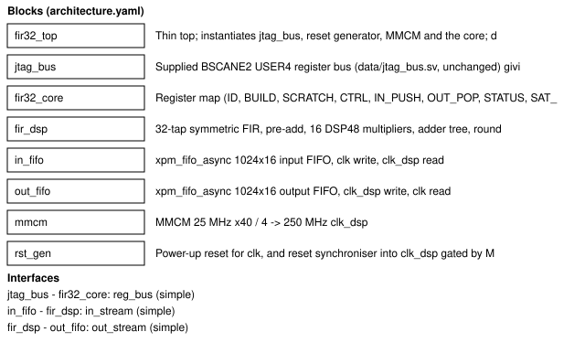

# p4_fir_dsp: 32-tap symmetric FIR filter with FIFOs and JTAG register access (specified, RTL not written)

<!-- Generated from handover.yaml by flow/handover.py (brief 68). Edit handover.yaml, or the text between the prose markers, then run: python -m flow.handover write runs/20261126-015902-dd64/p4_fir_dsp -->

The design is specified as a 32-tap symmetric low-pass FIR filter on the KR260 (xck26). Samples are pushed through a register bus behind jtag_bus into an input FIFO, a RUN command streams them through a 16-DSP datapath at 250 MHz from an MMCM, and results are popped from an output FIFO. The run stopped after the clarify and board-and-device-planning stages passed; no RTL was written, so nothing was simulated, synthesised or measured.

Not in scope:

- Not a runtime-loadable coefficient filter; coefficients are fixed, symmetric, and come from data/coeffs.hex.
- Not an AXI4-Lite peripheral and does not use a GT transceiver channel; the SFP+ transmitter is only held disabled.
- Not built or verified; there is no RTL, bitstream, or timing, power or resource result.

Kind: agent-run; produced by the agent (agent run `20261126-015902-dd64`, [record](../summary.json)). State: spec. For an agent: [AGENT.md](AGENT.md).

Run: model claude-sonnet-5-5 (deepagents harness), 2 loops, 50 turns, 1,622,442 tokens, 763.9 s wall time, 2.10816 USD model cost (provider-reported), stopped because: reply too long: no file written; the rtl role's last 2 replies were cut off at the output limit (max_tokens), and no file was written in between (from the run record).

<!-- prose:what -->
<!-- /prose:what -->

## Technical parameters

| Item | Value |
|---|---|
| Part | `xck26-sfvc784-2LV-c` |
| Board | kr260 |
| Top | `fir32_top` |
| Tool | Vivado 2026.1 |

Clocks:

- `clk_25`: 25 MHz (from `runs/20261126-015902-dd64/p4_fir_dsp/design.xdc`)

Resets:

- `rst`, active high: Per spec.yaml it is driven by jtag_bus, synchronous to clk, and synchronised into clk_dsp with MMCM lock gating the datapath reset. No RTL exists to confirm this.

Interfaces:

- `clk25` (input, 1 bit, 25 MHz board clock): spec.yaml names it clk25 but design.xdc constrains and places a port named clk_25 on pin C3 with a 40 ns period.
- `led` (output, 2 bits): design.xdc places led[0] on F8 and led[1] on E8, LVCMOS18. Per spec, led[0] shows BUSY and led[1] a heartbeat.
- `sfp_tx_disable` (output, 1 bit): design.xdc places it on Y10, LVCMOS33. Per spec it is constant 1 and no GT channel is used.

Registers (from spec.yaml; where the RTL differs, the gaps say so):

| Offset | Name | Access | Reset | Bits |
|---|---|---|---|---|
| 0 | `ID` | RO | 546570241 | 31:0 design ID |
| 4 | `BUILD` | RO | 0 | 31:0 USR_ACCESS word |
| 8 | `SCRATCH` | RW | 0 | 31:0 read back what was written |
| 16 | `CTRL` | RW | 0 | 0 CLEAR self-clearing; 1 RUN self-clearing |
| 20 | `IN_PUSH` | WO | 0 | 15:0 sample |
| 24 | `OUT_POP` | RO | 0 | 31 valid; 15:0 oldest output; read pops |
| 28 | `STATUS` | RO | 0 | 0 BUSY; 15:4 input FIFO count; 31:20 output FIFO count |
| 32 | `SAT_COUNT` | RO | 0 | 31:0 saturated outputs since CLEAR |
| 36 | `SAMPLES_DONE` | RO | 0 | 31:0 samples processed since CLEAR |

| Parameter | Value | Legal range | Note |
|---|---|---|---|
| `TAPS` | 32 | fixed at 32 by the symmetric structure | Number of filter taps; the datapath is specified for exactly 32. |
| `UNIQUE_COEFFS` | 16 | TAPS/2 | One DSP multiplier per unique coefficient. |
| `DATA_WIDTH` | 16 | 16 (signed) | Sample width; the pre-add makes it 17 bits. |
| `COEFF_WIDTH` | 16 | 16 (signed Q1.15) | Coefficient width. |
| `FIFO_DEPTH` | 1024 | 1024 as specified; the 12-bit STATUS count fields bound any larger depth | Depth of each of the input and output FIFOs; the 12-bit STATUS count fields are sized for it. Only 1024 was specified, and nothing was simulated. |
| `SHIFT` | 15 | 15 (Q1.15 coefficients); changing it also changes ROUND_CONST | Arithmetic right shift after rounding. |
| `ROUND_CONST` | 16,384 | 16384 (0x4000, half of 2^SHIFT) | Rounding constant added before the shift. |
| `ID_VALUE` | 546,570,241 | 546570241 (0x20940001) | Value read from the ID register. |
| `READ_LATENCY_CYCLES` | 2 | 2 or fewer clk cycles | Spec gives h_rdata valid within 2 clk cycles of h_re; no RTL exists to count it. |

| Quantity | Value | Source |
|---|---|---|
| Resources | not measured | [Known gaps](#known-gaps-and-limits) |
| Timing | not measured | [Known gaps](#known-gaps-and-limits) |
| Power | not measured | [Known gaps](#known-gaps-and-limits) |
| Latency | not measured | [Known gaps](#known-gaps-and-limits) |
| Throughput | not measured | [Known gaps](#known-gaps-and-limits) |

<!-- prose:parameters -->
<!-- /prose:parameters -->

## How to build, run and reproduce

| Step | Command | Heavy slot | Time |
|---|---|---|---|
| what changed since this handover (stale records, changed files, tool and knowledge-bank pins) | `python -m flow.handover fresh runs/20261126-015902-dd64/p4_fir_dsp` | no | - |
| pick the work up again from the earliest stage the change or the staleness needs; needs a model (see docs/agent.md); Vivado for any stage from synthesis on | `python -m agent resume runs/20261126-015902-dd64/p4_fir_dsp "<change request>"` | yes | - |
| run the Verifier's simulation tests; needs Icarus Verilog and cocotb, or the simulation container | `python -m pytest -q runs/20261126-015902-dd64/p4_fir_dsp/tests/test_p4_fir_dsp_rtl.py` | no | - |
| rebuild the bitstream with the flow; needs Vivado 2026.1 and a heavy slot | `flow/run_vivado.sh runs/20261126-015902-dd64/p4_fir_dsp base` | yes | - |

Tool: Vivado 2026.1. Build ID of the inputs at handover: none (no Vivado build of this directory). Knowledge-bank pin: `6185830`.

| File | What |
|---|---|
| [`runs/20261126-015902-dd64/p4_fir_dsp/spec.md`](spec.md) | the request the run started from |
| [`runs/20261126-015902-dd64/p4_fir_dsp/spec.yaml`](spec.yaml) | the specification the Clarifier wrote, approved automatically with no human review |
| [`runs/20261126-015902-dd64/p4_fir_dsp/ARCHITECTURE.md`](ARCHITECTURE.md) | the architecture note, accepted automatically before any RTL (no human review) |
| [`runs/20261126-015902-dd64/p4_fir_dsp/architecture.yaml`](architecture.yaml) | the machine-checked architecture: blocks, clocks, predicted resources |
| [`runs/20261126-015902-dd64/p4_fir_dsp/design.xdc`](design.xdc) | pin, I/O standard and timing constraints |
| [`runs/20261126-015902-dd64/p4_fir_dsp/model.py`](model.py) | the Modeller's reference model of the visible behaviour |
| [`runs/20261126-015902-dd64/p4_fir_dsp/tests/bench_p4_fir_dsp.py`](tests/bench_p4_fir_dsp.py) | the Verifier's cocotb benches and pytest entries |
| [`runs/20261126-015902-dd64/p4_fir_dsp/tests/test_p4_fir_dsp_rtl.py`](tests/test_p4_fir_dsp_rtl.py) | the Verifier's cocotb benches and pytest entries |
| [`runs/20261126-015902-dd64/p4_fir_dsp/verif/testplan.yaml`](verif/testplan.yaml) | the test plan and mutant list read by the verification gates |
| [`runs/20261126-015902-dd64/p4_fir_dsp/verif/checkers/v_macros.svh`](verif/checkers/v_macros.svh) | bound assertion and cover checkers |

<!-- prose:build -->
<!-- /prose:build -->

## Verified

| ID | Activity | Result | What | Evidence | Conditions |
|---|---|---|---|---|---|
| E1 | review | partial | the specification and the architecture were approved automatically, with no human review (review off; the interview oracle claude-sonnet-5-5 only answered the interview questions); the interview asked 7 questions, 0 answered and 7 defaulted | [`runs/20261126-015902-dd64/summary.json`](../summary.json) | - |

Gates at handover: `clarify` pass, `board-and-device-planning` pass, `rtl-design-creation` not-run, `constraints` not-run, `synthesis` not-run, `implementation` not-run, `timing-closure` not-run, `power-closure` not-run, `drc-closure` not-run, `configuration-and-debug` not-run.

<!-- prose:verified -->
<!-- /prose:verified -->

## Measured

Every value is read from the record by `python -m flow.handover fill`, not typed.

| ID | What | Value | Runs | Source | Conditions |
|---|---|---|---|---|---|
| M1 | model cost of the run, provider-reported | 2.10816 USD | 1 | [`runs/20261126-015902-dd64/summary.json`](../summary.json) `cost_usd` | every role and the interview oracle, as the run summary records it |

<!-- prose:measured -->
<!-- /prose:measured -->

## Known gaps and limits

- **E1**: review evidence is partial: the specification and the architecture were approved automatically, with no human review (review off; the interview oracle claude-sonnet-5-5 only answered the interview questions); the interview asked 7 questions, 0 answered and 7 defaulted
- **rtl-design-creation**: stage rtl-design-creation was not run: the run stopped before this stage (reply too long: no file written; the rtl role's last 2 replies were cut off at the output limit (max_tokens), and no file was written in between)
- **constraints**: stage constraints was not run: the run stopped before this stage (reply too long: no file written; the rtl role's last 2 replies were cut off at the output limit (max_tokens), and no file was written in between)
- **synthesis**: stage synthesis was not run: the run stopped before this stage (reply too long: no file written; the rtl role's last 2 replies were cut off at the output limit (max_tokens), and no file was written in between)
- **implementation**: stage implementation was not run: the run stopped before this stage (reply too long: no file written; the rtl role's last 2 replies were cut off at the output limit (max_tokens), and no file was written in between)
- **timing-closure**: stage timing-closure was not run: the run stopped before this stage (reply too long: no file written; the rtl role's last 2 replies were cut off at the output limit (max_tokens), and no file was written in between)
- **power-closure**: stage power-closure was not run: the run stopped before this stage (reply too long: no file written; the rtl role's last 2 replies were cut off at the output limit (max_tokens), and no file was written in between)
- **drc-closure**: stage drc-closure was not run: the run stopped before this stage (reply too long: no file written; the rtl role's last 2 replies were cut off at the output limit (max_tokens), and no file was written in between)
- **configuration-and-debug**: stage configuration-and-debug was not run: the run stopped before this stage (reply too long: no file written; the rtl role's last 2 replies were cut off at the output limit (max_tokens), and no file was written in between)
- **formal**: formal checks were planned for REQ-06, REQ-32, REQ-13, REQ-33, REQ-25 and did not run; each was replaced by a simulation check (verif/testplan.yaml replan). Reason recorded: SymbiYosys is not installed here, so the read-latency property is checked in simulation.
- **resources**: resources not measured: no current Vivado build of this design has been recorded
- **timing**: timing not measured: no current Vivado build of this design has been recorded
- **power**: power not measured: no current Vivado build of this design has been recorded
- **latency**: latency not measured: the run measured no latency; the spec's latency promise is checked only by the benches
- **throughput**: throughput not measured: the run measured no throughput
- **clock_name**: spec.yaml and ARCHITECTURE.md name the board clock clk25, but design.xdc constrains a port named clk_25 (period 40.00 ns). The XDC is what was built; the top-level port name must match it or the constraint will not bind.
- **rtl-absent**: No RTL exists, so the reset style, reset values, read latency and filter pipeline depth are spec intent only. Spec leaves the filter pipeline depth to the implementation.
- **busy-and-full-behaviour**: Defaulted answers, not built. RUN while BUSY is ignored. IN_PUSH while BUSY is accepted if the FIFO is not full and is held for the next RUN. CLEAR during BUSY aborts the run. A result arriving at a full output FIFO is dropped, though SAMPLES_DONE still counts it.
- **register-access**: Per spec, unmapped addresses (including 0x00C and the gaps between the mapped registers) read 0 and ignore writes. OUT_POP on an empty FIFO reads 0, and a valid read pops as a side effect. IN_PUSH on a full FIFO is ignored. CTRL bits read back 0 the clock after the write.
- **snapshot**: Each register read is a single-register snapshot; STATUS counts, SAT_COUNT and SAMPLES_DONE are not read atomically together.
- **build_sim**: BUILD reads USR_ACCESSE2, which does not exist in simulation; the behavioural model returns 0 or a testbench-set word.
- **unread_sources**: spec.yaml records that data/jtag_bus.sv and data/coeffs.hex were not readable when the spec was written, so their contents come only from the description in spec.md.
- **led1_proposal**: The led[1] heartbeat is a proposal in the spec, not a requirement.

<!-- prose:gaps -->
<!-- /prose:gaps -->

## Next steps

1. Re-run the rtl-design-creation stage (python -m agent resume) with the RTL split into several smaller files, so that no reply is cut off at the output limit.
2. Once RTL exists, run the Verifier's simulation tests and compare the cover results with the functional coverage before adding any stimulus.
3. Resolve the clk25 versus clk_25 naming between the spec and design.xdc, then run synthesis and implementation and check 250 MHz timing, the 16 DSP count and the read latency against the spec.
4. Replace the planned formal checks with simulation checks or install SymbiYosys, and confirm the readable jtag_bus.sv and coeffs.hex contents against the spec.

Open questions:

- Should the clock port be named clk25 as in the spec or clk_25 as in design.xdc?

<!-- prose:next -->
<!-- /prose:next -->

## History

| Date | Brief | PR | What |
|---|---|---|---|
| 2026-11-26 | agent run | - | produced by the agent graph; stages that passed: clarify, board-and-device-planning |

<!-- prose:history -->
<!-- /prose:history -->
