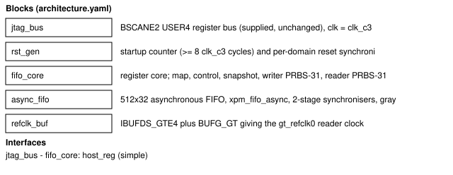
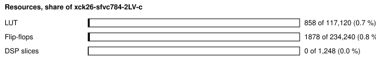

# p5_async_fifo: Asynchronous FIFO soak, 25 MHz writer to 156.25 MHz reader (KR260)

<!-- Generated from handover.yaml by flow/handover.py (brief 68). Edit handover.yaml, or the text between the prose markers, then run: python -m flow.handover write runs/20261125-193550-9069/p5_async_fifo -->

The design streams a PRBS-31 sequence from a writer on the 25 MHz board clock through a 512-word asynchronous FIFO to a checker on the 156.25 MHz SFP+ reference clock. A JTAG register port starts and stops the run, injects a one-word error, and reads latched counters (words written and read, data errors, overflows, underflows, writer stalls, peak fill). The run reached simulation level V2 of V3 and stopped at the constraints stage after repeated failures, so no bitstream result, timing, or hardware result is available. The specification and architecture were approved automatically, with no human review.

Not in scope:

- Not a transceiver design. Only the reference clock buffer is used, no GT channel is instantiated, and sfp_tx_disable is held at 1.
- Not hardware-proven. No bring-up result exists, and no timing or power figure is published for this run.
- Not a general-purpose FIFO IP. DATA_WIDTH is effectively fixed at 32, and the stored word is a 31-bit PRBS state with bit 31 always 0.

Kind: agent-run; produced by the agent (agent run `20261125-193550-9069`, [record](../summary.json)). State: simulated. For an agent: [AGENT.md](AGENT.md).

Run: model claude-sonnet-5-5 (deepagents harness), 10 loops, 250 turns, 11,072,830 tokens, 3367.6 s wall time, 7.13618 USD model cost (provider-reported), stopped because: stage 3 visited more than 4 times; last failing gate: post_synth:post_synth_no_unconstrained_endpoints (register pins with no clock (1): u_usr/C, post_synth:post_synth_methodology_no_critical (from the run record).

<!-- prose:what -->
<!-- /prose:what -->

## Technical parameters

| Item | Value |
|---|---|
| Part | `xck26-sfvc784-2LV-c` |
| Board | kr260 |
| Top | `p5_async_fifo_soak` |
| Tool | Vivado 2026.1 |

Clocks:

- `clk_c3`: 25 MHz (from `runs/20261125-193550-9069/p5_async_fifo/design.xdc`)
- `gt_refclk0_p`: 156.25 MHz (from `runs/20261125-193550-9069/p5_async_fifo/design.xdc`)

Resets:

- `rst`, active high: There is no reset port. rst_gen.sv (clk_c3 domain) holds an internal synchronous reset for about 16 clk_c3 cycles after configuration (spec asks for at least 8) from a power-up-initialised counter. The reader domain gets it through xpm_cdc_async_rst (rst_sync.sv, 4 sync flops).

Interfaces:

- `clk_c3` (input clock, pin C3, LVCMOS18, period 40 ns (design.xdc)): Writer domain, jtag_bus register port and reset generator.
- `gt_refclk0_p` (differential clock input, 156.25 MHz, period 6.4 ns (design.xdc)): Goes through IBUFDS_GTE4 and BUFG_GT (taken from the ODIV2 output) to the reader clock. design.xdc sets no PACKAGE_PIN for this pair.
- `gt_refclk0_n` (differential clock input (complement of gt_refclk0_p)): No pin constraint in design.xdc, same as gt_refclk0_p.
- `sfp_tx_disable` (output, pin Y10, LVCMOS33): Constant 1 in fifo_core (laser off).
- `led` (output [1:0], pins F8 (led[0]) and E8 (led[1]), LVCMOS18): led[0] is RUN. led[1] is the reader error flag (data mismatch or underflow) or the writer overflow flag.

Registers (from spec.yaml; where the RTL differs, the gaps say so):

| Offset | Name | Access | Reset | Bits |
|---|---|---|---|---|
| 0 | `ID` | RO | 546635777 | [31:0] design ID |
| 4 | `BUILD` | RO | 0 | [31:0] USR_ACCESSE2 word |
| 8 | `SCRATCH` | RW | 0 | [31:0] scratch |
| 16 | `CTRL` | RW | 0 | [0] RUN, [1] SLOW_READ, [2] CLEAR self-clearing only while RUN=0, [3] INJECT self-clearing |
| 20 | `WORDS_W` | RO | 0 | [31:0] words written (snapshot) |
| 24 | `WORDS_R` | RO | 0 | [31:0] words read and checked (snapshot) |
| 28 | `DATA_ERRS` | RO | 0 | [31:0] mismatching words (snapshot) |
| 32 | `OVERFLOWS` | RO | 0 | [31:0] writes while full (snapshot) |
| 36 | `UNDERFLOWS` | RO | 0 | [31:0] reads while empty (snapshot) |
| 40 | `STALL_W` | RO | 0 | [31:0] writer clocks held off by full (snapshot) |
| 44 | `OCC_MAX` | RO | 0 | [31:0] highest fill seen in words (snapshot) |
| 48 | `SNAPSHOT` | WO | 0 | any write latches 0x014 to 0x02C; reads 0 |

| Parameter | Value | Legal range | Note |
|---|---|---|---|
| `DEPTH` | 512 | power of two; must equal 2 to the power ADDR_WIDTH | FIFO depth in words. The FIFO is an xpm_fifo_async in distributed memory (LUTRAM), not block RAM, although the spec expected one RAMB36 or LUTRAM. |
| `DATA_WIDTH` | 32 | only 32 works; the core writes {1 zero bit, 31-bit PRBS state} | FIFO word width. Spec rate: one word per clk_c3 cycle, 25 Mwords/s, 800 Mbit/s when not full; not measured in this run. |
| `ADDR_WIDTH` | 9 | log2(DEPTH) | Sets the width of the fill count (ADDR_WIDTH + 1 bits) used for OCC_MAX. |
| `PRBS_SEED` | 2,147,483,647 | non-zero, 31 bits | Seed 0x7FFFFFFF for both PRBS-31 copies; an all-zero seed would lock the sequence. |
| `DESIGN_ID` | 546,635,777 | any 32-bit value | Read back at ID (0x000) as 0x20950001. |
| `SLOW_READ_DIV_CLOCKS` | 8 | 1 to 16 (the reader cool-down counter is 4 bits) | With SLOW_READ set the reader pops at most one word per 8 gt_refclk0 cycles (a pop, then 7 idle cycles). |
| `SYNC_STAGES` | 2 | 2 to 8 (XPM limits) | Synchroniser depth for the FIFO macro, the control crossings and the snapshot handshake. The reset synchroniser is fixed at 4 stages. |

| Quantity | Value | Source |
|---|---|---|
| Resources | slice LUTs used: 858; flip-flops used: 1878; block RAM tiles used: 0; DSP slices used: 0 | M8, M9, M10, M11 |
| Timing | worst setup slack after routing: 0.136 ns; worst hold slack after routing: 0.014 ns | M6, M7 |
| Power | total on-chip power, vectorless estimate: 0.368 W | M12 |
| Latency | not measured | [Known gaps](#known-gaps-and-limits) |
| Throughput | not measured | [Known gaps](#known-gaps-and-limits) |

<!-- prose:parameters -->
<!-- /prose:parameters -->

## How to build, run and reproduce

| Step | Command | Heavy slot | Time |
|---|---|---|---|
| what changed since this handover (stale records, changed files, tool and knowledge-bank pins) | `python -m flow.handover fresh runs/20261125-193550-9069/p5_async_fifo` | no | - |
| pick the work up again from the earliest stage the change or the staleness needs; needs a model (see docs/agent.md); Vivado for any stage from synthesis on | `python -m agent resume runs/20261125-193550-9069/p5_async_fifo "<change request>"` | yes | - |
| run the Verifier's simulation tests; needs Icarus Verilog and cocotb, or the simulation container | `python -m pytest -q runs/20261125-193550-9069/p5_async_fifo/tests/test_p5_async_fifo_rtl.py` | no | - |
| re-run the Verilator coverage simulation and the verification gates (line, toggle, functional and cover results); needs Verilator 5.036 or later and cocotb (the simulation container has them) | `SIM=verilator FDA_COVERAGE=1 FDA_SIM_RESULTS_DIR=runs/20261125-193550-9069/p5_async_fifo/build/verif/sim python -m pytest -q -x runs/20261125-193550-9069/p5_async_fifo/tests/test_p5_async_fifo_rtl.py && python3 flow/verif_gates.py runs/20261125-193550-9069/p5_async_fifo --runs runs/20261125-193550-9069/p5_async_fifo/build/verif/sim` | no | - |
| rebuild the bitstream with the flow; needs Vivado 2026.1 and a heavy slot; peak memory 3412 MiB (anonymous, the systemd scope) | `flow/run_vivado.sh runs/20261125-193550-9069/p5_async_fifo base` | yes | about 4.5 min |

Tool: Vivado 2026.1. Build ID of the inputs at handover: `039891b3` (`python flow/manifest.py show runs/20261125-193550-9069/p5_async_fifo`: what a rebuild of today's sources and flow would carry; it changes when any build input or the flow changes, so it can differ from the build ID in an older evidence record). Knowledge-bank pin: `6185830`.

| File | What |
|---|---|
| [`runs/20261125-193550-9069/p5_async_fifo/spec.md`](spec.md) | the request the run started from |
| [`runs/20261125-193550-9069/p5_async_fifo/spec.yaml`](spec.yaml) | the specification the Clarifier wrote, approved automatically with no human review |
| [`runs/20261125-193550-9069/p5_async_fifo/ARCHITECTURE.md`](ARCHITECTURE.md) | the architecture note, accepted automatically before any RTL (no human review) |
| [`runs/20261125-193550-9069/p5_async_fifo/architecture.yaml`](architecture.yaml) | the machine-checked architecture: blocks, clocks, predicted resources |
| [`runs/20261125-193550-9069/p5_async_fifo/rtl/async_fifo.sv`](rtl/async_fifo.sv) | RTL written by the Designer |
| [`runs/20261125-193550-9069/p5_async_fifo/rtl/p5_async_fifo_soak.sv`](rtl/p5_async_fifo_soak.sv) | RTL written by the Designer |
| [`runs/20261125-193550-9069/p5_async_fifo/rtl/p5_async_fifo_soak_core.sv`](rtl/p5_async_fifo_soak_core.sv) | RTL written by the Designer |
| [`runs/20261125-193550-9069/p5_async_fifo/rtl/refclk_buf.sv`](rtl/refclk_buf.sv) | RTL written by the Designer |
| [`runs/20261125-193550-9069/p5_async_fifo/rtl/rst_gen.sv`](rtl/rst_gen.sv) | RTL written by the Designer |
| [`runs/20261125-193550-9069/p5_async_fifo/rtl/rst_sync.sv`](rtl/rst_sync.sv) | RTL written by the Designer |
| [`runs/20261125-193550-9069/p5_async_fifo/rtl/xilinx_sim_stubs.sv`](rtl/xilinx_sim_stubs.sv) | RTL written by the Designer |
| [`runs/20261125-193550-9069/p5_async_fifo/rtl/zz_lint_waive.sv`](rtl/zz_lint_waive.sv) | RTL written by the Designer |
| [`runs/20261125-193550-9069/p5_async_fifo/design.xdc`](design.xdc) | pin, I/O standard and timing constraints |
| [`runs/20261125-193550-9069/p5_async_fifo/build.yaml`](build.yaml) | the build description read by the flow |
| [`runs/20261125-193550-9069/p5_async_fifo/model.py`](model.py) | the Modeller's reference model of the visible behaviour |
| [`runs/20261125-193550-9069/p5_async_fifo/tests/bench_p5_async_fifo.py`](tests/bench_p5_async_fifo.py) | the Verifier's cocotb benches and pytest entries |
| [`runs/20261125-193550-9069/p5_async_fifo/tests/test_p5_async_fifo_rtl.py`](tests/test_p5_async_fifo_rtl.py) | the Verifier's cocotb benches and pytest entries |
| [`runs/20261125-193550-9069/p5_async_fifo/verif/testplan.yaml`](verif/testplan.yaml) | the test plan and mutant list read by the verification gates |
| [`runs/20261125-193550-9069/p5_async_fifo/verif/checkers/v_macros.svh`](verif/checkers/v_macros.svh) | bound assertion and cover checkers |
| [`runs/20261125-193550-9069/p5_async_fifo/build/review/03_constraints.html`](build/review/03_constraints.html) | the review page of stage constraints: its exit gates and their failures at the last visit |

<!-- prose:build -->
<!-- /prose:build -->

## Verified

| ID | Activity | Result | What | Evidence | Conditions |
|---|---|---|---|---|---|
| E1 | review | partial | the specification and the architecture were approved automatically, with no human review (review off; the interview oracle claude-sonnet-5-5 only answered the interview questions); the interview asked 7 questions, 0 answered and 7 defaulted | [`runs/20261125-193550-9069/summary.json`](../summary.json) | - |
| E2 | simulation | partial | verification (flow/verif_gates.py) against the Modeller's reference model reached V2 of V3; the run asked for V2; V2 means simulation: seeded runs, a constrained-random test, bound assertions and formal tasks; V3 (coverage (line, toggle, functional bins, cover properties), three seeds and the mutation score) did not pass: functional bins pct 0.0 (0/0) (needs 100); cover properties pct 0.0 (needs 100); line pct not measured (needs 90); toggle pct not measured (needs 75); mutation score pct not measured (needs 80); cdc structure clean missing (needs no unsafe crossing); cdc injection clean missing (needs pass); no board result (V-HW) is recorded | [`runs/20261125-193550-9069/p5_async_fifo/build/verif/verif_gates.json`](build/verif/verif_gates.json) | - |
| E3 | build | fail | Vivado base build; flow stages that ran: rtl, post_synth, post_place, post_route, bitstream | [`runs/20261125-193550-9069/p5_async_fifo/build/base/gates.json`](build/base/gates.json) | - |

Gates at handover: `clarify` pass, `board-and-device-planning` pass, `rtl-design-creation` pass, `constraints` fail, `synthesis` not-run, `implementation` not-run, `timing-closure` not-run, `power-closure` not-run, `drc-closure` not-run, `configuration-and-debug` not-run.

<!-- prose:verified -->
<!-- /prose:verified -->

## Measured

Every value is read from the record by `python -m flow.handover fill`, not typed.

| ID | What | Value | Runs | Source | Conditions |
|---|---|---|---|---|---|
| M1 | simulation seeds run | 3 | 1 | [`runs/20261125-193550-9069/p5_async_fifo/build/verif/verif_gates.json`](build/verif/verif_gates.json) `stages.V3.checks.seeds_run.value` | Verilator coverage simulation of the RTL against the Modeller's model, every seed the bench ran |
| M2 | line coverage | not measured % | 1 | [`runs/20261125-193550-9069/p5_async_fifo/build/verif/verif_gates.json`](build/verif/verif_gates.json) `stages.V3.checks.line_pct.value` | Verilator coverage simulation of the RTL against the Modeller's model, every seed the bench ran |
| M3 | toggle coverage | not measured % | 1 | [`runs/20261125-193550-9069/p5_async_fifo/build/verif/verif_gates.json`](build/verif/verif_gates.json) `stages.V3.checks.toggle_pct.value` | Verilator coverage simulation of the RTL against the Modeller's model, every seed the bench ran |
| M4 | functional coverage bins hit | 0.0 (0/0) | 1 | [`runs/20261125-193550-9069/p5_async_fifo/build/verif/verif_gates.json`](build/verif/verif_gates.json) `stages.V3.checks.functional_bins_pct.value` | Verilator coverage simulation of the RTL against the Modeller's model, every seed the bench ran |
| M5 | cover properties hit | 0.0 % | 1 | [`runs/20261125-193550-9069/p5_async_fifo/build/verif/verif_gates.json`](build/verif/verif_gates.json) `stages.V3.checks.cover_properties_pct.value` | Verilator coverage simulation of the RTL against the Modeller's model, every seed the bench ran |
| M6 | worst setup slack after routing | 0.136 ns | 1 | [`runs/20261125-193550-9069/p5_async_fifo/build/base/gates.json`](build/base/gates.json) `timing.wns_ns` | post-route, the constrained clock of design.xdc |
| M7 | worst hold slack after routing | 0.014 ns | 1 | [`runs/20261125-193550-9069/p5_async_fifo/build/base/gates.json`](build/base/gates.json) `timing.whs_ns` | post-route |
| M8 | slice LUTs used | 858 | 1 | [`runs/20261125-193550-9069/p5_async_fifo/build/base/gates.json`](build/base/gates.json) `utilization.lut` | post-route utilization |
| M9 | flip-flops used | 1878 | 1 | [`runs/20261125-193550-9069/p5_async_fifo/build/base/gates.json`](build/base/gates.json) `utilization.ff` | post-route utilization |
| M10 | block RAM tiles used | 0 | 1 | [`runs/20261125-193550-9069/p5_async_fifo/build/base/gates.json`](build/base/gates.json) `utilization.bram_tile` | post-route utilization |
| M11 | DSP slices used | 0 | 1 | [`runs/20261125-193550-9069/p5_async_fifo/build/base/gates.json`](build/base/gates.json) `utilization.dsp` | post-route utilization |
| M12 | total on-chip power, vectorless estimate | 0.368 W | 1 | [`runs/20261125-193550-9069/p5_async_fifo/build/base/gates.json`](build/base/gates.json) `power.total_w` | report_power, vectorless (no switching activity file), default environment |
| M13 | model cost of the run, provider-reported | 7.13618 USD | 1 | [`runs/20261125-193550-9069/summary.json`](../summary.json) `cost_usd` | every role and the interview oracle, as the run summary records it |

<!-- prose:measured -->
<!-- /prose:measured -->

## Known gaps and limits

- **REQ-01**: REQ-01 has no passing evidence for every proof method: hardware (uart_tests) is pending: no bring-up result
- **REQ-02**: REQ-02 has no passing evidence for every proof method: hardware (uart_tests) is pending: no bring-up result
- **REQ-03**: REQ-03 has no passing evidence for every proof method: hardware (uart_tests) is pending: no bring-up result
- **REQ-08**: REQ-08 has no passing evidence for every proof method: analysis (post_synth:post_synth_resources_in_range) is pending: no flow gates result
- **REQ-10**: REQ-10 has no passing evidence for every proof method: hardware (uart_tests) is pending: no bring-up result
- **REQ-12**: REQ-12 has no passing evidence for every proof method: hardware (uart_tests) is pending: no bring-up result
- **REQ-13**: REQ-13 has no passing evidence for every proof method: hardware (uart_tests) is pending: no bring-up result
- **REQ-15**: REQ-15 has no passing evidence for every proof method: hardware (uart_tests) is pending: no bring-up result
- **REQ-16**: REQ-16 has no passing evidence for every proof method: hardware (uart_tests) is pending: no bring-up result
- **REQ-21**: REQ-21 has no passing evidence for every proof method: hardware (uart_tests) is pending: no bring-up result
- **REQ-22**: REQ-22 has no passing evidence for every proof method: hardware (uart_tests) is pending: no bring-up result
- **REQ-23**: REQ-23 has no passing evidence for every proof method: hardware (uart_tests) is pending: no bring-up result
- **REQ-24**: REQ-24 has no passing evidence for every proof method: hardware (uart_tests) is pending: no bring-up result
- **REQ-29**: REQ-29 has no passing evidence for every proof method: formal (post_synth:post_synth_resources_in_range) is pending: re-planned from formal to analysis (SymbiYosys is not installed; the gray-pointer property is re-planned to the synthesis analysis gate and reviewed in the CDC report.): no flow gates result
- **REQ-30**: REQ-30 has no passing evidence for every proof method: analysis (post_route:setup) is pending: no flow gates result
- **REQ-31**: REQ-31 has no passing evidence for every proof method: analysis (post_route:setup) is pending: no flow gates result
- **REQ-32**: REQ-32 has no passing evidence for every proof method: analysis (post_route:setup) is pending: no flow gates result
- **REQ-33**: REQ-33 has no passing evidence for every proof method: analysis (post_synth:post_synth_resources_in_range) is pending: no flow gates result; hardware (uart_tests) is pending: no bring-up result
- **REQ-34**: REQ-34 has no passing evidence for every proof method: analysis (post_synth:post_synth_resources_in_range) is pending: no flow gates result
- **REQ-35**: REQ-35 has no passing evidence for every proof method: analysis (post_synth:post_synth_resources_in_range) is pending: no flow gates result
- **REQ-36**: REQ-36 has no passing evidence for every proof method: hardware (uart_tests) is pending: no bring-up result
- **E1**: review evidence is partial: the specification and the architecture were approved automatically, with no human review (review off; the interview oracle claude-sonnet-5-5 only answered the interview questions); the interview asked 7 questions, 0 answered and 7 defaulted
- **E2**: simulation evidence is partial: verification reached V2 of V3 (the run asked for V2); the checks that did not pass or did not run are listed in the evidence row
- **E3**: build evidence is fail: Vivado base build; flow stages that ran: rtl, post_synth, post_place, post_route, bitstream
- **constraints**: stage constraints did not pass its gates in this run; at its last visit: post_synth:post_synth_no_unconstrained_endpoints (register pins with no clock (1): u_usr/CCLK; output ports with no output delay (2): led[0], led[1]) FAIL post_synth:post_synth_methodology_no_critical FAIL Warnings (recorded, not gates) stage warning value note post_route CDCM-MTBF-LOW score None (min None): post_route CDCM-MTBF-LOW score None (min None): post_route CDCM-MTBF-LOW score None (min N ...
- **synthesis**: stage synthesis was not run: the run stopped before this stage (stage 3 visited more than 4 times; last failing gate: post_synth:post_synth_no_unconstrained_endpoints (register pins with no clock (1): u_usr/C, post_synth:post_synth_methodology_no_critical)
- **implementation**: stage implementation was not run: the run stopped before this stage (stage 3 visited more than 4 times; last failing gate: post_synth:post_synth_no_unconstrained_endpoints (register pins with no clock (1): u_usr/C, post_synth:post_synth_methodology_no_critical)
- **timing-closure**: stage timing-closure was not run: the run stopped before this stage (stage 3 visited more than 4 times; last failing gate: post_synth:post_synth_no_unconstrained_endpoints (register pins with no clock (1): u_usr/C, post_synth:post_synth_methodology_no_critical)
- **power-closure**: stage power-closure was not run: the run stopped before this stage (stage 3 visited more than 4 times; last failing gate: post_synth:post_synth_no_unconstrained_endpoints (register pins with no clock (1): u_usr/C, post_synth:post_synth_methodology_no_critical)
- **drc-closure**: stage drc-closure was not run: the run stopped before this stage (stage 3 visited more than 4 times; last failing gate: post_synth:post_synth_no_unconstrained_endpoints (register pins with no clock (1): u_usr/C, post_synth:post_synth_methodology_no_critical)
- **configuration-and-debug**: stage configuration-and-debug was not run: the run stopped before this stage (stage 3 visited more than 4 times; last failing gate: post_synth:post_synth_no_unconstrained_endpoints (register pins with no clock (1): u_usr/C, post_synth:post_synth_methodology_no_critical)
- **formal**: formal checks were planned for REQ-21, REQ-22, REQ-28, REQ-29 and did not run; each was replaced by a simulation check (verif/testplan.yaml replan). Reason recorded: SymbiYosys is not installed so the formal job is replaced by randomised simulation checking OVERFLOWS stays 0.
- **latency**: latency not measured: the run measured no latency; the spec's latency promise is checked only by the benches
- **throughput**: throughput not measured: the run measured no throughput
- **xdc_async_groups**: The spec promises asynchronous clock groups between clk_c3 and gt_refclk0 and set_max_delay -datapath_only on CDC paths. design.xdc has neither; it only creates the clocks sys_clk_pin, gt_refclk0 and jtag_tck and a false path to led[*] and sfp_tx_disable. The spec disagrees with what was built, and REQ-30 and REQ-31 are not met by the constraints file.
- **xdc_refclk_pins**: design.xdc gives gt_refclk0_p and gt_refclk0_n a create_clock but no PACKAGE_PIN or IOSTANDARD; the placement of these pins was not set by the file.
- **xdc_output_timing**: design.xdc cuts led[*] and sfp_tx_disable with set_false_path instead of an output delay. The constraints-stage gate still reported led[0] and led[1] as having no output delay.
- **usr_accesse2_clock**: The CFGCLK pin of USR_ACCESSE2 (u_usr) is left unconnected in p5_async_fifo_soak.sv and has no clock, which is the unconstrained register pin the constraints gate reports.
- **word_width**: The spec says 32 new PRBS bits per word. The RTL (p5_async_fifo_soak_core.sv) advances the 31-bit state 32 steps per word and stores {1 zero bit, 31-bit state}, so bit 31 of every FIFO word is always 0. The first word is the state after 32 steps from the seed, not the seed itself. The reader checks the same way.
- **reset_style**: Spec says each domain gets its own synchronised reset release through xpm_cdc_async_rst. In rst_gen.sv only the clk_gt domain uses it (via rst_sync.sv); rst_c3 is the counter-driven register directly. The hold is about 16 clk_c3 cycles, not the spec minimum of 8.
- **reset_values**: Every register, counter, the visible snapshot copies and h_rdata reset to 0 in the clk_c3 domain; the reader counters and PRBS copy reset in the clk_gt domain. RUN, SLOW, INJECT and CLEAR reset to 0.
- **unmapped_access**: Reads of any address not in the register map (the gaps between mapped offsets and everything above SNAPSHOT) and a read of SNAPSHOT return 0. Writes to unmapped addresses and to read-only registers change nothing (fifo_core, case default).
- **ctrl_write_semantics**: Every write to CTRL (0x010) overwrites RUN and SLOW from bits 0 and 1 of the written value. CLEAR is accepted only when the written bit 0 is 0 (it tests the value being written, not the current RUN), so a CLEAR written together with RUN=1 is ignored and never stays set. A CTRL read returns RUN in bit 0, SLOW in bit 1, 0 in bit 2 and, in bit 3, whether an INJECT is still pending (armed, no word flipped yet). INJECT flips bit 0 of the next received word, once.
- **clear_scope**: CLEAR resets the writer, the reader counters, both PRBS copies and the FIFO (pointers, with the FIFO reset held for a few clk_c3 cycles and the reader held for a number of its own cycles), but not the visible snapshot registers 0x014 to 0x02C: they keep the last snapshot until the next SNAPSHOT write.
- **snapshot_behaviour**: A SNAPSHOT write latches the four writer-side counters at once and requests the reader-side counters by toggle; all seven visible registers then update together when the handshake returns. A request that arrives while a previous handover is in flight or a CLEAR is pending is held and served later, not lost. The latency in clk_c3 cycles was not counted from the RTL or measured; the spec default is under 16 cycles.
- **register_latency**: A write takes effect the clock after h_we. h_rdata is registered, so it shows the addressed register one clk_c3 cycle after h_re and holds it until the next h_re (within the spec limit of 2 cycles). Counted from fifo_core in p5_async_fifo_soak_core.sv.
- **occ_max_basis**: OCC_MAX is measured in the writer domain from the FIFO write count (capped at DEPTH), so it may overstate the true fill by the synchroniser delay; it is not updated during a FIFO reset.
- **slow_read_stall**: With SLOW_READ set the reader pops once per 8 clk_gt cycles; a pop is also blocked by FIFO empty, FIFO reset busy and the post-CLEAR hold. STALL_W counts clk_c3 cycles with RUN=1 and the FIFO full outside a FIFO reset. The writer never writes while full, so OVERFLOWS should stay 0 by construction.
- **sim_stubs**: Simulation uses the behavioural stand-ins in rtl/xilinx_sim_stubs.sv for xpm_fifo_async, the CDC macros, IBUFDS_GTE4, BUFG_GT and USR_ACCESSE2. BUILD reads 0 in simulation, and the real macro behaviour (reset busy timing, full and empty flags) was not simulated.
- **led_meaning**: led[0]=RUN and led[1]=reader error or writer overflow seen is an assumption from the Clarifier (the request did not define LED use), not a given requirement. The reader error flag is cleared by CLEAR.
- **hardware_proof**: The requirement rows that name hardware (uart_tests) refer to a bring-up that never ran; no board was used.

<!-- prose:gaps -->
<!-- /prose:gaps -->

## Next steps

1. Fix the constraints stage first, before any rebuild: clock or waive the unconstrained CFGCLK register pin of USR_ACCESSE2, resolve the missing output-delay finding on led[0] and led[1], clear the critical methodology warnings, and add the asynchronous clock groups and set_max_delay -datapath_only lines that the spec requires (see the xdc_async_groups gap). Then run python -m agent resume.
2. Decide the word format: keep the zero-extended 31-bit state or make the stored word carry 32 new PRBS bits as the spec states, then update model.py and the benches to match.
3. Set PACKAGE_PIN for gt_refclk0_p and gt_refclk0_n in design.xdc if the board file defines them, and check that the BUFG_GT output clock really runs at the constrained 156.25 MHz.
4. After the constraints gates pass, rebuild through synthesis, implementation, timing, power and DRC closure, then read the CDC report for the gray-pointer property that replaced formal REQ-29.
5. Compare the cover results with the functional coverage (functional bins were 0 of 0) before adding any new stimulus; then bring V3 (line, toggle, mutation, CDC injection) to a pass.
6. Run the hardware bring-up (SNAPSHOT, INJECT, 10 minute soak, 25 Mwords/s rate check) once a bitstream exists.

Open questions:

- Is ODIV2 of IBUFDS_GTE4 at the full 156.25 MHz when it feeds BUFG_GT with DIV 0, so that the clock named gt_refclk0 matches the real reader clock?
- Should the stored FIFO word carry 32 PRBS bits (as the spec says) rather than a 31-bit state with a zero top bit?
- How should the unused CFGCLK pin of USR_ACCESSE2 be handled: clocked, or waived in the constraints?

<!-- prose:next -->
<!-- /prose:next -->

## History

| Date | Brief | PR | What |
|---|---|---|---|
| 2026-11-25 | agent run | - | produced by the agent graph; stages that passed: clarify, board-and-device-planning, rtl-design-creation |

<!-- prose:history -->
<!-- /prose:history -->
