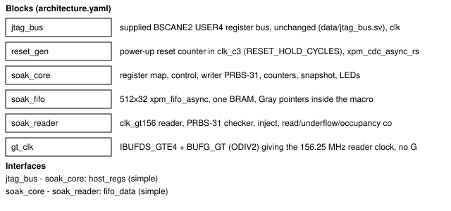
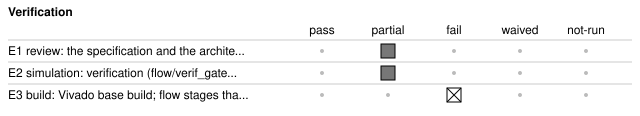

# p5_async_fifo: P5 asynchronous FIFO soak (25 MHz writer, 156.25 MHz reader)

<!-- Generated from handover.yaml by flow/handover.py (brief 68). Edit handover.yaml, or the text between the prose markers, then run: python -m flow.handover write runs/20261125-233045-dfe1/p5_async_fifo -->

The design writes PRBS-31 words from a 25 MHz writer domain (clk_c3) into an asynchronous 32-bit FIFO and reads and checks them in a 156.25 MHz reader domain (clk_gt156, from the SFP+ MGTREFCLK0 buffer, no GT channel). Counters for words, errors, overflow, underflow, stalls and peak fill are read over the jtag_bus register port. The run reached V2 of V3 in verification and stopped at the constraints stage, where the Vivado post-synthesis exception check failed on an invalid site name; no bitstream, timing, power or hardware result exists.

Not in scope:

- Not a transceiver design. No GT channel is used, only the reference clock buffer, and SFP+ TX is held disabled.
- Not a throughput or latency measurement. Neither was measured in this run.
- Not hardware-verified. No board result is recorded.

Kind: agent-run; produced by the agent (agent run `20261125-233045-dfe1`, [record](../summary.json)). State: simulated. For an agent: [AGENT.md](AGENT.md).

Run: model claude-sonnet-5-5 (deepagents harness), 11 loops, 300 turns, 13,569,382 tokens, 6165.3 s wall time, 9.24096 USD model cost (provider-reported), stopped because: budget: run turns limit 300 reached (300) (from the run record).

<!-- prose:what -->
<!-- /prose:what -->

## Technical parameters

| Item | Value |
|---|---|
| Part | `xck26-sfvc784-2LV-c` |
| Board | kr260 |
| Top | `p5_async_fifo_soak` |
| Tool | Vivado 2026.1 |

Clocks:

- `clk_c3`: 25 MHz (from `runs/20261125-233045-dfe1/p5_async_fifo/design.xdc`)
- `gt_refclk_p`: 156.25 MHz (from `runs/20261125-233045-dfe1/p5_async_fifo/design.xdc`)

Resets:

- `rst`, active high: Internal power-up generator in clk_c3 (rtl/p5_async_fifo_soak.sv), held for RESET_HOLD_CYCLES clocks, no pin. It reaches clk_gt156 through xpm_cdc_async_rst.

Interfaces:

- `clk_c3` (input clock, 25 MHz, pin C3 (LVCMOS18)): Writer clock and register-bus clock.
- `gt_refclk_p / gt_refclk_n` (differential input clock, SFP+ MGTREFCLK0, 156.25 MHz): Enters an IBUFDS_GTE4; its ODIV2 output drives a BUFG_GT that clocks the reader.
- `led[1:0]` (output, pins F8 and E8 (LVCMOS18)): led[0] is RUN; led[1] is set when a snapshotted DATA_ERRS, OVERFLOWS or UNDERFLOWS is non-zero.
- `sfp_tx_disable` (output, pin Y10 (LVCMOS33)): Constant 1.
- `h_we / h_re / h_addr / h_wdata / h_rdata` (internal register port (no pins), clk_c3): In the top these ports are declared but the live port is wired internally to jtag_bus; h_we, h_re, h_addr and h_wdata are unused there.

Registers (from spec.yaml; where the RTL differs, the gaps say so):

| Offset | Name | Access | Reset | Bits |
|---|---|---|---|---|
| 0 | `ID` | RO | 546635777 | [31:0] design ID |
| 4 | `BUILD` | RO | 0 | [31:0] USR_ACCESS word |
| 8 | `SCRATCH` | RW | 0 | [31:0] scratch |
| 16 | `CTRL` | RW | 0 | [0] RUN, [1] SLOW_READ, [2] CLEAR self-clearing only while RUN=0, [3] INJECT self-clearing |
| 20 | `WORDS_W` | RO | 0 | [31:0] words written (snapshot) |
| 24 | `WORDS_R` | RO | 0 | [31:0] words read and checked (snapshot) |
| 28 | `DATA_ERRS` | RO | 0 | [31:0] mismatching words (snapshot) |
| 32 | `OVERFLOWS` | RO | 0 | [31:0] writes while full (snapshot) |
| 36 | `UNDERFLOWS` | RO | 0 | [31:0] reads while empty (snapshot) |
| 40 | `STALL_W` | RO | 0 | [31:0] writer clocks held off (snapshot) |
| 44 | `OCC_MAX` | RO | 0 | [31:0] highest fill in words (snapshot) |
| 48 | `SNAPSHOT` | WO | 0 | any write latches 0x014 to 0x02C; reads 0 |

| Parameter | Value | Legal range | Note |
|---|---|---|---|
| `FIFO_DEPTH_WORDS` | 512 | 512 only as built | soak_core.sv instantiates soak_fifo with DEPTH 512, while soak_fifo.sv comments say 1024 words; see the fifo_depth gap. Not a top-level parameter. |
| `DATA_WIDTH` | 32 | 32 only | Fixed in the RTL, not a top-level parameter. |
| `PRBS_SEED` | 2,147,483,647 | non-zero 31-bit value | Seed 0x7FFFFFFF for both writer and reader sequences. Default of soak_core. |
| `DESIGN_ID` | 546,635,777 | any 32-bit value | Read from register ID (0x20950001). Default of soak_core. |
| `SLOW_READ_PERIOD_CYCLES` | 8 | 2 to 16 (the slow counter is 4 bits) | One read per 8 clk_gt156 clocks when SLOW_READ is 1, as the spec's timing section says. Passed to the reader as SLOW_PERIOD. Spec timing: one read per 8 clk_gt156 clocks when SLOW_READ is 1 |
| `COUNTER_WIDTH` | 32 | 32 only | Counters are fixed at 32 bits in the RTL and wrap; not a parameter. |
| `RESET_HOLD_CYCLES` | 8 | 0 to 31 (5-bit hold counter) | Power-up reset length in clk_c3 clocks. |

| Quantity | Value | Source |
|---|---|---|
| Resources | not measured | [Known gaps](#known-gaps-and-limits) |
| Timing | not measured | [Known gaps](#known-gaps-and-limits) |
| Power | not measured | [Known gaps](#known-gaps-and-limits) |
| Latency | not measured | [Known gaps](#known-gaps-and-limits) |
| Throughput | not measured | [Known gaps](#known-gaps-and-limits) |

<!-- prose:parameters -->
<!-- /prose:parameters -->

## How to build, run and reproduce

| Step | Command | Heavy slot | Time |
|---|---|---|---|
| what changed since this handover (stale records, changed files, tool and knowledge-bank pins) | `python -m flow.handover fresh runs/20261125-233045-dfe1/p5_async_fifo` | no | - |
| pick the work up again from the earliest stage the change or the staleness needs; needs a model (see docs/agent.md); Vivado for any stage from synthesis on | `python -m agent resume runs/20261125-233045-dfe1/p5_async_fifo "<change request>"` | yes | - |
| run the Verifier's simulation tests; needs Icarus Verilog and cocotb, or the simulation container | `python -m pytest -q runs/20261125-233045-dfe1/p5_async_fifo/tests/test_p5_async_fifo_rtl.py` | no | - |
| re-run the Verilator coverage simulation and the verification gates (line, toggle, functional and cover results); needs Verilator 5.036 or later and cocotb (the simulation container has them) | `SIM=verilator FDA_COVERAGE=1 FDA_SIM_RESULTS_DIR=runs/20261125-233045-dfe1/p5_async_fifo/build/verif/sim python -m pytest -q -x runs/20261125-233045-dfe1/p5_async_fifo/tests/test_p5_async_fifo_rtl.py && python3 flow/verif_gates.py runs/20261125-233045-dfe1/p5_async_fifo --runs runs/20261125-233045-dfe1/p5_async_fifo/build/verif/sim` | no | - |
| rebuild the bitstream with the flow; needs Vivado 2026.1 and a heavy slot; peak memory 3357 MiB (anonymous, the systemd scope) | `flow/run_vivado.sh runs/20261125-233045-dfe1/p5_async_fifo base` | yes | about 2.3 min |

Tool: Vivado 2026.1. Build ID of the inputs at handover: `6e2a48db` (`python flow/manifest.py show runs/20261125-233045-dfe1/p5_async_fifo`: what a rebuild of today's sources and flow would carry; it changes when any build input or the flow changes, so it can differ from the build ID in an older evidence record). Knowledge-bank pin: `6185830`.

| File | What |
|---|---|
| [`runs/20261125-233045-dfe1/p5_async_fifo/spec.md`](spec.md) | the request the run started from |
| [`runs/20261125-233045-dfe1/p5_async_fifo/spec.yaml`](spec.yaml) | the specification the Clarifier wrote, approved automatically with no human review |
| [`runs/20261125-233045-dfe1/p5_async_fifo/ARCHITECTURE.md`](ARCHITECTURE.md) | the architecture note, accepted automatically before any RTL (no human review) |
| [`runs/20261125-233045-dfe1/p5_async_fifo/architecture.yaml`](architecture.yaml) | the machine-checked architecture: blocks, clocks, predicted resources |
| [`runs/20261125-233045-dfe1/p5_async_fifo/rtl/p5_async_fifo_soak.sv`](rtl/p5_async_fifo_soak.sv) | RTL written by the Designer |
| [`runs/20261125-233045-dfe1/p5_async_fifo/rtl/prbs31_word.sv`](rtl/prbs31_word.sv) | RTL written by the Designer |
| [`runs/20261125-233045-dfe1/p5_async_fifo/rtl/soak_core.sv`](rtl/soak_core.sv) | RTL written by the Designer |
| [`runs/20261125-233045-dfe1/p5_async_fifo/rtl/soak_fifo.sv`](rtl/soak_fifo.sv) | RTL written by the Designer |
| [`runs/20261125-233045-dfe1/p5_async_fifo/rtl/soak_reader.sv`](rtl/soak_reader.sv) | RTL written by the Designer |
| [`runs/20261125-233045-dfe1/p5_async_fifo/rtl/xilinx_sim_stubs.sv`](rtl/xilinx_sim_stubs.sv) | RTL written by the Designer |
| [`runs/20261125-233045-dfe1/p5_async_fifo/rtl/zz_lint_waive.sv`](rtl/zz_lint_waive.sv) | RTL written by the Designer |
| [`runs/20261125-233045-dfe1/p5_async_fifo/design.xdc`](design.xdc) | pin, I/O standard and timing constraints |
| [`runs/20261125-233045-dfe1/p5_async_fifo/build.yaml`](build.yaml) | the build description read by the flow |
| [`runs/20261125-233045-dfe1/p5_async_fifo/model.py`](model.py) | the Modeller's reference model of the visible behaviour |
| [`runs/20261125-233045-dfe1/p5_async_fifo/tests/bench_p5_async_fifo.py`](tests/bench_p5_async_fifo.py) | the Verifier's cocotb benches and pytest entries |
| [`runs/20261125-233045-dfe1/p5_async_fifo/tests/test_p5_async_fifo_rtl.py`](tests/test_p5_async_fifo_rtl.py) | the Verifier's cocotb benches and pytest entries |
| [`runs/20261125-233045-dfe1/p5_async_fifo/verif/testplan.yaml`](verif/testplan.yaml) | the test plan and mutant list read by the verification gates |
| [`runs/20261125-233045-dfe1/p5_async_fifo/verif/checkers/v_macros.svh`](verif/checkers/v_macros.svh) | bound assertion and cover checkers |
| [`runs/20261125-233045-dfe1/p5_async_fifo/build/review/03_constraints.html`](build/review/03_constraints.html) | the review page of stage constraints: its exit gates and their failures at the last visit |

<!-- prose:build -->
<!-- /prose:build -->

## Verified

| ID | Activity | Result | What | Evidence | Conditions |
|---|---|---|---|---|---|
| E1 | review | partial | the specification and the architecture were approved automatically, with no human review (review off; the interview oracle claude-sonnet-5-5 only answered the interview questions); the interview asked 8 questions, 0 answered and 8 defaulted | [`runs/20261125-233045-dfe1/summary.json`](../summary.json) | - |
| E2 | simulation | partial | verification (flow/verif_gates.py) against the Modeller's reference model reached V2 of V3; the run asked for V2; V2 means simulation: seeded runs, a constrained-random test, bound assertions and formal tasks; V3 (coverage (line, toggle, functional bins, cover properties), three seeds and the mutation score) did not pass: functional bins pct 0.0 (0/0) (needs 100); cover properties pct 0.0 (needs 100); line pct not measured (needs 90); toggle pct not measured (needs 75); mutation score pct not measured (needs 70); cdc structure clean missing (needs no unsafe crossing); cdc injection clean missing (needs pass); no board result (V-HW) is recorded | [`runs/20261125-233045-dfe1/p5_async_fifo/build/verif/verif_gates.json`](build/verif/verif_gates.json) | - |
| E3 | build | fail | Vivado base build; flow stages that ran: rtl, post_synth | [`runs/20261125-233045-dfe1/p5_async_fifo/build/base/gates.json`](build/base/gates.json) | - |

Gates at handover: `clarify` pass, `board-and-device-planning` pass, `rtl-design-creation` pass, `constraints` fail, `synthesis` not-run, `implementation` not-run, `timing-closure` not-run, `power-closure` not-run, `drc-closure` not-run, `configuration-and-debug` not-run.

<!-- prose:verified -->
<!-- /prose:verified -->

## Measured

Every value is read from the record by `python -m flow.handover fill`, not typed.

| ID | What | Value | Runs | Source | Conditions |
|---|---|---|---|---|---|
| M1 | simulation seeds run | 3 | 1 | [`runs/20261125-233045-dfe1/p5_async_fifo/build/verif/verif_gates.json`](build/verif/verif_gates.json) `stages.V3.checks.seeds_run.value` | Verilator coverage simulation of the RTL against the Modeller's model, every seed the bench ran |
| M2 | line coverage | not measured % | 1 | [`runs/20261125-233045-dfe1/p5_async_fifo/build/verif/verif_gates.json`](build/verif/verif_gates.json) `stages.V3.checks.line_pct.value` | Verilator coverage simulation of the RTL against the Modeller's model, every seed the bench ran |
| M3 | toggle coverage | not measured % | 1 | [`runs/20261125-233045-dfe1/p5_async_fifo/build/verif/verif_gates.json`](build/verif/verif_gates.json) `stages.V3.checks.toggle_pct.value` | Verilator coverage simulation of the RTL against the Modeller's model, every seed the bench ran |
| M4 | functional coverage bins hit | 0.0 (0/0) | 1 | [`runs/20261125-233045-dfe1/p5_async_fifo/build/verif/verif_gates.json`](build/verif/verif_gates.json) `stages.V3.checks.functional_bins_pct.value` | Verilator coverage simulation of the RTL against the Modeller's model, every seed the bench ran |
| M5 | cover properties hit | 0.0 % | 1 | [`runs/20261125-233045-dfe1/p5_async_fifo/build/verif/verif_gates.json`](build/verif/verif_gates.json) `stages.V3.checks.cover_properties_pct.value` | Verilator coverage simulation of the RTL against the Modeller's model, every seed the bench ran |
| M6 | model cost of the run, provider-reported | 9.24096 USD | 1 | [`runs/20261125-233045-dfe1/summary.json`](../summary.json) `cost_usd` | every role and the interview oracle, as the run summary records it |

<!-- prose:measured -->
<!-- /prose:measured -->

## Known gaps and limits

- **REQ-01**: REQ-01 has no passing evidence for every proof method: hardware (uart_tests) is pending: no bring-up result
- **REQ-02**: REQ-02 has no passing evidence for every proof method: hardware (uart_tests) is pending: no bring-up result
- **REQ-03**: REQ-03 has no passing evidence for every proof method: hardware (uart_tests) is pending: no bring-up result
- **REQ-08**: REQ-08 has no passing evidence for every proof method: analysis (post_synth:post_synth_resources_in_range) is pending: no flow gates result
- **REQ-11**: REQ-11 has no passing evidence for every proof method: hardware (uart_tests) is pending: no bring-up result
- **REQ-36**: REQ-36 has no passing evidence for every proof method: hardware (uart_tests) is pending: no bring-up result
- **REQ-12**: REQ-12 has no passing evidence for every proof method: hardware (uart_tests) is pending: no bring-up result
- **REQ-35**: REQ-35 has no passing evidence for every proof method: hardware (uart_tests) is pending: no bring-up result
- **REQ-16**: REQ-16 has no passing evidence for every proof method: hardware (uart_tests) is pending: no bring-up result
- **REQ-18**: REQ-18 has no passing evidence for every proof method: hardware (uart_tests) is pending: no bring-up result
- **REQ-19**: REQ-19 has no passing evidence for every proof method: hardware (uart_tests) is pending: no bring-up result
- **REQ-20**: REQ-20 has no passing evidence for every proof method: hardware (uart_tests) is pending: no bring-up result
- **REQ-21**: REQ-21 has no passing evidence for every proof method: hardware (ila_captures) is pending: no bring-up result
- **REQ-23**: REQ-23 has no passing evidence for every proof method: analysis (post_synth:post_synth_resources_in_range) is pending: no flow gates result; hardware (uart_tests) is pending: no bring-up result
- **REQ-24**: REQ-24 has no passing evidence for every proof method: analysis (post_synth:post_synth_resources_in_range) is pending: no flow gates result
- **REQ-25**: REQ-25 has no passing evidence for every proof method: analysis (post_route:setup) is pending: no flow gates result
- **REQ-34**: REQ-34 has no passing evidence for every proof method: analysis (post_route:setup) is pending: no flow gates result
- **REQ-26**: REQ-26 has no passing evidence for every proof method: analysis (post_route:setup) is pending: no flow gates result
- **REQ-37**: REQ-37 has no passing evidence for every proof method: analysis (post_route:setup) is pending: no flow gates result
- **REQ-27**: REQ-27 has no passing evidence for every proof method: analysis (post_route:setup) is pending: no flow gates result
- **REQ-28**: REQ-28 has no passing evidence for every proof method: analysis (post_route:setup) is pending: no flow gates result
- **E1**: review evidence is partial: the specification and the architecture were approved automatically, with no human review (review off; the interview oracle claude-sonnet-5-5 only answered the interview questions); the interview asked 8 questions, 0 answered and 8 defaulted
- **E2**: simulation evidence is partial: verification reached V2 of V3 (the run asked for V2); the checks that did not pass or did not run are listed in the evidence row
- **E3**: build evidence is fail: Vivado base build; flow stages that ran: rtl, post_synth
- **constraints**: stage constraints did not pass its gates in this run; at its last visit: post_synth:post_synth_methodology_no_critical FAIL post_synth:post_synth_exceptions_clean (EXC-XDC-MSG design.xdc:21 set_property LOC IBUFDS_GTE4_X0Y1 [get_cells { u_ibufds_gt }] Command failed: 'IBUFDS_GTE4_X0Y1' is not a valid site name.) FAIL
- **synthesis**: stage synthesis was not run: the run stopped before this stage (budget: run turns limit 300 reached (300))
- **implementation**: stage implementation was not run: the run stopped before this stage (budget: run turns limit 300 reached (300))
- **timing-closure**: stage timing-closure was not run: the run stopped before this stage (budget: run turns limit 300 reached (300))
- **power-closure**: stage power-closure was not run: the run stopped before this stage (budget: run turns limit 300 reached (300))
- **drc-closure**: stage drc-closure was not run: the run stopped before this stage (budget: run turns limit 300 reached (300))
- **configuration-and-debug**: stage configuration-and-debug was not run: the run stopped before this stage (budget: run turns limit 300 reached (300))
- **formal**: formal checks were planned for REQ-18, REQ-19, REQ-27 and did not run; each was replaced by a simulation check (verif/testplan.yaml replan). Reason recorded: SymbiYosys is not installed, so the no-overflow property is shown in simulation with the FIFO driven full, and by the hardware soak.
- **resources**: resources not measured: no current Vivado build of this design has been recorded
- **timing**: timing not measured: no current Vivado build of this design has been recorded
- **power**: power not measured: no current Vivado build of this design has been recorded
- **latency**: latency not measured: the run measured no latency; the spec's latency promise is checked only by the benches
- **throughput**: throughput not measured: the run measured no throughput
- **fifo_depth**: soak_fifo.sv instantiates xpm_fifo_async with depth 512 passed in, but its file comment says 1024 x 32 in one RAMB36 and the macro uses FIFO_MEMORY_TYPE distributed, while the spec and ARCHITECTURE.md say one BRAM. The 512-word claim (REQ-08) is not confirmed by a Vivado build.
- **xdc_site**: design.xdc as built has LOC IBUFDS_GTE4_X0Y0 at line 21 (its comment names X0Y0), but the failing check quotes X0Y1 as an invalid site name. The XDC and the check disagree; re-run to confirm which site Vivado accepts.
- **spec_vs_rtl_registers**: The RTL read mux (soak_core.sv) returns 0 for unmapped addresses, including 0x030 SNAPSHOT, and writes to unmapped addresses change nothing. CTRL reads back only RUN and SLOW_READ; CLEAR and INJECT always read 0.
- **clear_priority**: CLEAR is honoured only if written while RUN is 0 (clr_req = write to CTRL with bit 2, and not run). The same write can set RUN, but the test uses the old RUN value. CLEAR also holds the FIFO in reset for 8 clk_c3 clocks, and the writer is blocked meanwhile.
- **counters_run_gated**: Stall, overflow and OCC_MAX counting is gated by RUN and by the FIFO not being in reset. The reader counts words read independently of RUN.
- **snapshot_latency**: A write to 0x030 does not latch at once. The request is delayed about 50 clocks (64 for the first snapshot after reset) and aligned to an 8-clock grid, then crosses through a handshake, so the snapshot registers update tens of clocks after the write. Reading too soon returns the previous snapshot. The spec does not state this delay.
- **read_latency**: h_rdata is registered in soak_core.sv, so it updates one clk_c3 clock after h_re, inside the spec's 2-clock promise, and holds until the next h_re. The jtag_bus latency was not counted here.
- **build_stamp**: In simulation USR_ACCESSE2 is a stub returning 0, so BUILD is 0 in the benches; only hardware shows the real word.
- **sim_stubs**: The benches use behavioural models of the Xilinx primitives and XPM macros (rtl/xilinx_sim_stubs.sv); their timing is not the real macros' timing.

<!-- prose:gaps -->
<!-- /prose:gaps -->

## Next steps

1. Compare the cover results with the functional coverage (functional bins 0 of 0 and cover properties 0 percent are recorded) before any new stimulus, then run the coverage, CDC and mutation checks that did not run to reach V3.
2. Resolve the IBUFDS_GTE4 LOC in design.xdc (the failing check names X0Y1 as an invalid site while the file shows X0Y0) and re-run the base build with flow/run_vivado.sh.
3. Resolve the FIFO memory type and depth mismatch in soak_fifo.sv against the spec's one-BRAM expectation.
4. Continue through synthesis, implementation, timing, power and DRC closure, then bring up on the KR260 for the hardware proofs.

Open questions:

- Should the snapshot delay of about 50 to 64 clocks be kept, or should the snapshot latch sooner?
- Is distributed memory acceptable for the FIFO, or must it use one block RAM as the spec says?

<!-- prose:next -->
<!-- /prose:next -->

## History

| Date | Brief | PR | What |
|---|---|---|---|
| 2026-11-25 | agent run | - | produced by the agent graph; stages that passed: clarify, board-and-device-planning, rtl-design-creation |

<!-- prose:history -->
<!-- /prose:history -->
