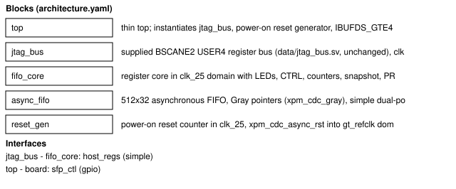
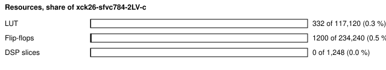

# p5_async_fifo: Asynchronous FIFO soak, 25 MHz writer and 156.25 MHz reader on the KR260

<!-- Generated from handover.yaml by flow/handover.py (brief 68). Edit handover.yaml, or the text between the prose markers, then run: python -m flow.handover write runs/20261126-021747-15f3/p5_async_fifo -->

The design writes a 32-bit PRBS-31 stream at the clk_25 rate into a 512-word asynchronous FIFO. A reader in the gt_refclk domain (SFP+ MGTREFCLK0, 156.25 MHz) checks every word against its own PRBS copy and counts errors and underflows. A host reads and writes the registers over jtag_bus, with counters latched by SNAPSHOT. The run stopped at the constraints stage, whose exit gate failed on an ignored output-delay exception in design.xdc, and verification reached V2 of V3. A Vivado base build is recorded as failed and there is no board result.

Not in scope:

- Not a transceiver design: no GT channel is used, only the reference clock buffer, and sfp_tx_disable is held at 1.
- Not hardware-proven: no board result exists, and the build gates did not pass.
- Not a general FIFO IP: depth, width and PRBS polynomial are fixed by the parameters and the RTL.

Kind: agent-run; produced by the agent (agent run `20261126-021747-15f3`, [record](../summary.json)). State: simulated. For an agent: [AGENT.md](AGENT.md).

Run: model claude-sonnet-5-5 (deepagents harness), 9 loops, 277 turns, 11,823,092 tokens, 5887.3 s wall time, 7.31545 USD model cost (provider-reported), stopped because: stage 3 visited more than 4 times; last failing gate: post_synth:post_synth_exceptions_clean (EXC-IGNORED design.xdc:33 set_output_delay -clock  (from the run record).

<!-- prose:what -->
<!-- /prose:what -->

## Technical parameters

| Item | Value |
|---|---|
| Part | `xck26-sfvc784-2LV-c` |
| Board | kr260 |
| Top | `top` |
| Tool | Vivado 2026.1 |

Clocks:

- `clk_25`: 25 MHz (from `runs/20261126-021747-15f3/p5_async_fifo/design.xdc`)

Resets:

- `rst`, active high: Internal power-on reset in top.sv, held for 8 clk_25 cycles after configuration. It resets the clk_25 logic synchronously and enters the gt_refclk domain through xpm_cdc_async_rst with 4 flops (reset_gen.sv).

Interfaces:

- `clk_25` (input clock, C3, LVCMOS18, 25 MHz): Writer domain, register port and jtag_bus clock.
- `gt_refclk_p / gt_refclk_n` (differential input clock, Y6 / Y5): SFP+ MGTREFCLK0 through IBUFDS_GTE4 and BUFG_GT; reader domain at 156.25 MHz (6.4 ns in design.xdc).
- `led[1:0]` (output, F8 and E8, LVCMOS18): led[0] is RUN. led[1] is set when DATA_ERRS or UNDERFLOWS is non-zero (synchronised) or the writer-side OVERFLOWS count is non-zero.
- `sfp_tx_disable` (output, Y10, LVCMOS33): Constant 1 (laser off).

Registers (from spec.yaml; where the RTL differs, the gaps say so):

| Offset | Name | Access | Reset | Bits |
|---|---|---|---|---|
| 0 | `ID` | RO | 546635777 | [31:0] design ID |
| 4 | `BUILD` | RO | 0 | [31:0] USR_ACCESS word |
| 8 | `SCRATCH` | RW | 0 | [31:0] read back value |
| 16 | `CTRL` | RW | 0 | [0] RUN, [1] SLOW_READ, [2] CLEAR self-clearing only while RUN=0, [3] INJECT self-clearing |
| 20 | `WORDS_W` | RO | 0 | [31:0] words written (snapshot) |
| 24 | `WORDS_R` | RO | 0 | [31:0] words read and checked (snapshot) |
| 28 | `DATA_ERRS` | RO | 0 | [31:0] mismatched words (snapshot) |
| 32 | `OVERFLOWS` | RO | 0 | [31:0] (snapshot) |
| 36 | `UNDERFLOWS` | RO | 0 | [31:0] (snapshot) |
| 40 | `STALL_W` | RO | 0 | [31:0] writer clocks held off (snapshot) |
| 44 | `OCC_MAX` | RO | 0 | [31:0] highest fill in words (snapshot) |
| 48 | `SNAPSHOT` | WO | 0 | [31:0] any write latches 0x014 to 0x02C; reads 0 |

| Parameter | Value | Legal range | Note |
|---|---|---|---|
| `DESIGN_ID` | 546,635,777 | any 32-bit value | Read back at ID (0x000) as 0x20950001. |
| `FIFO_DEPTH_WORDS` | 512 | 512 only | Not a real RTL parameter; async_fifo.sv hard-codes 512 words and 10-bit pointers. |
| `DATA_WIDTH` | 32 | 32 only | Hard-coded in the RTL; one PRBS word per write. |
| `PRBS_SEED` | 2,147,483,647 | nonzero 31-bit value | Seed 0x7FFFFFFF for the writer and the reader copy; used at reset and on CLEAR. |
| `SLOW_READ_DIV_CYCLES` | 8 | 1 to 8 (the slow counter is 3 bits) | With SLOW_READ set the reader takes one word per 8 gt_refclk cycles, the spec's 19.53 Mwords/s. Which value the benches ran is not recorded in the draft, so the spec's value is not shown to have been simulated. |
| `PTR_WIDTH` | 9 | 9 only | Address width of the 512-word RAM; the RTL pointers are 10 bits including a wrap bit. |
| `COUNTER_WIDTH` | 32 | 32 only | All counters are 32 bits and wrap. |

| Quantity | Value | Source |
|---|---|---|
| Resources | slice LUTs used: 332; flip-flops used: 1200; block RAM tiles used: 0.5; DSP slices used: 0 | M8, M9, M10, M11 |
| Timing | worst setup slack after routing: 2.624 ns; worst hold slack after routing: 0.012 ns | M6, M7 |
| Power | total on-chip power, vectorless estimate: 0.365 W | M12 |
| Latency | not measured | [Known gaps](#known-gaps-and-limits) |
| Throughput | not measured | [Known gaps](#known-gaps-and-limits) |

<!-- prose:parameters -->
<!-- /prose:parameters -->

## How to build, run and reproduce

| Step | Command | Heavy slot | Time |
|---|---|---|---|
| what changed since this handover (stale records, changed files, tool and knowledge-bank pins) | `python -m flow.handover fresh runs/20261126-021747-15f3/p5_async_fifo` | no | - |
| pick the work up again from the earliest stage the change or the staleness needs; needs a model (see docs/agent.md); Vivado for any stage from synthesis on | `python -m agent resume runs/20261126-021747-15f3/p5_async_fifo "<change request>"` | yes | - |
| run the Verifier's simulation tests; needs Icarus Verilog and cocotb, or the simulation container | `python -m pytest -q runs/20261126-021747-15f3/p5_async_fifo/tests/test_p5_async_fifo_rtl.py` | no | - |
| re-run the Verilator coverage simulation and the verification gates (line, toggle, functional and cover results); needs Verilator 5.036 or later and cocotb (the simulation container has them) | `SIM=verilator FDA_COVERAGE=1 FDA_SIM_RESULTS_DIR=runs/20261126-021747-15f3/p5_async_fifo/build/verif/sim python -m pytest -q -x runs/20261126-021747-15f3/p5_async_fifo/tests/test_p5_async_fifo_rtl.py && python3 flow/verif_gates.py runs/20261126-021747-15f3/p5_async_fifo --runs runs/20261126-021747-15f3/p5_async_fifo/build/verif/sim` | no | - |
| rebuild the bitstream with the flow; needs Vivado 2026.1 and a heavy slot; peak memory 3380 MiB (anonymous, the systemd scope) | `flow/run_vivado.sh runs/20261126-021747-15f3/p5_async_fifo base` | yes | about 5.4 min |

Tool: Vivado 2026.1. Build ID of the inputs at handover: `69527cd9` (`python flow/manifest.py show runs/20261126-021747-15f3/p5_async_fifo`: what a rebuild of today's sources and flow would carry; it changes when any build input or the flow changes, so it can differ from the build ID in an older evidence record). Knowledge-bank pin: `6185830`.

| File | What |
|---|---|
| [`runs/20261126-021747-15f3/p5_async_fifo/spec.md`](spec.md) | the request the run started from |
| [`runs/20261126-021747-15f3/p5_async_fifo/spec.yaml`](spec.yaml) | the specification the Clarifier wrote, approved automatically with no human review |
| [`runs/20261126-021747-15f3/p5_async_fifo/ARCHITECTURE.md`](ARCHITECTURE.md) | the architecture note, accepted automatically before any RTL (no human review) |
| [`runs/20261126-021747-15f3/p5_async_fifo/architecture.yaml`](architecture.yaml) | the machine-checked architecture: blocks, clocks, predicted resources |
| [`runs/20261126-021747-15f3/p5_async_fifo/rtl/async_fifo.sv`](rtl/async_fifo.sv) | RTL written by the Designer |
| [`runs/20261126-021747-15f3/p5_async_fifo/rtl/p5_async_fifo_core.sv`](rtl/p5_async_fifo_core.sv) | RTL written by the Designer |
| [`runs/20261126-021747-15f3/p5_async_fifo/rtl/p5_async_fifo_wrap.sv`](rtl/p5_async_fifo_wrap.sv) | RTL written by the Designer |
| [`runs/20261126-021747-15f3/p5_async_fifo/rtl/prbs31_word.sv`](rtl/prbs31_word.sv) | RTL written by the Designer |
| [`runs/20261126-021747-15f3/p5_async_fifo/rtl/reset_gen.sv`](rtl/reset_gen.sv) | RTL written by the Designer |
| [`runs/20261126-021747-15f3/p5_async_fifo/rtl/top.sv`](rtl/top.sv) | RTL written by the Designer |
| [`runs/20261126-021747-15f3/p5_async_fifo/rtl/xilinx_sim_stubs.sv`](rtl/xilinx_sim_stubs.sv) | RTL written by the Designer |
| [`runs/20261126-021747-15f3/p5_async_fifo/design.xdc`](design.xdc) | pin, I/O standard and timing constraints |
| [`runs/20261126-021747-15f3/p5_async_fifo/build.yaml`](build.yaml) | the build description read by the flow |
| [`runs/20261126-021747-15f3/p5_async_fifo/model.py`](model.py) | the Modeller's reference model of the visible behaviour |
| [`runs/20261126-021747-15f3/p5_async_fifo/tests/bench_p5_async_fifo.py`](tests/bench_p5_async_fifo.py) | the Verifier's cocotb benches and pytest entries |
| [`runs/20261126-021747-15f3/p5_async_fifo/tests/test_p5_async_fifo_rtl.py`](tests/test_p5_async_fifo_rtl.py) | the Verifier's cocotb benches and pytest entries |
| [`runs/20261126-021747-15f3/p5_async_fifo/verif/testplan.yaml`](verif/testplan.yaml) | the test plan and mutant list read by the verification gates |
| [`runs/20261126-021747-15f3/p5_async_fifo/verif/checkers/v_macros.svh`](verif/checkers/v_macros.svh) | bound assertion and cover checkers |
| [`runs/20261126-021747-15f3/p5_async_fifo/build/review/03_constraints.html`](build/review/03_constraints.html) | the review page of stage constraints: its exit gates and their failures at the last visit |

<!-- prose:build -->
<!-- /prose:build -->

## Verified

| ID | Activity | Result | What | Evidence | Conditions |
|---|---|---|---|---|---|
| E1 | review | partial | the specification and the architecture were approved automatically, with no human review (review off; the interview oracle claude-sonnet-5-5 only answered the interview questions); the interview asked 7 questions, 0 answered and 7 defaulted | [`runs/20261126-021747-15f3/summary.json`](../summary.json) | - |
| E2 | simulation | partial | verification (flow/verif_gates.py) against the Modeller's reference model reached V2 of V3; the run asked for V2; V2 means simulation: seeded runs, a constrained-random test, bound assertions and formal tasks; V3 (coverage (line, toggle, functional bins, cover properties), three seeds and the mutation score) did not pass: functional bins pct 0.0 (0/0) (needs 100); cover properties pct 0.0 (needs 100); line pct not measured (needs 90); toggle pct not measured (needs 75); mutation score pct not measured (needs 70); cdc structure clean missing (needs no unsafe crossing); cdc injection clean missing (needs pass); no board result (V-HW) is recorded | [`runs/20261126-021747-15f3/p5_async_fifo/build/verif/verif_gates.json`](build/verif/verif_gates.json) | - |
| E3 | build | fail | Vivado base build; flow stages that ran: rtl, post_synth, post_place, post_route, bitstream | [`runs/20261126-021747-15f3/p5_async_fifo/build/base/gates.json`](build/base/gates.json) | - |

Gates at handover: `clarify` pass, `board-and-device-planning` pass, `rtl-design-creation` pass, `constraints` fail, `synthesis` not-run, `implementation` not-run, `timing-closure` not-run, `power-closure` not-run, `drc-closure` not-run, `configuration-and-debug` not-run.

<!-- prose:verified -->
<!-- /prose:verified -->

## Measured

Every value is read from the record by `python -m flow.handover fill`, not typed.

| ID | What | Value | Runs | Source | Conditions |
|---|---|---|---|---|---|
| M1 | simulation seeds run | 3 | 1 | [`runs/20261126-021747-15f3/p5_async_fifo/build/verif/verif_gates.json`](build/verif/verif_gates.json) `stages.V3.checks.seeds_run.value` | Verilator coverage simulation of the RTL against the Modeller's model, every seed the bench ran |
| M2 | line coverage | not measured % | 1 | [`runs/20261126-021747-15f3/p5_async_fifo/build/verif/verif_gates.json`](build/verif/verif_gates.json) `stages.V3.checks.line_pct.value` | Verilator coverage simulation of the RTL against the Modeller's model, every seed the bench ran |
| M3 | toggle coverage | not measured % | 1 | [`runs/20261126-021747-15f3/p5_async_fifo/build/verif/verif_gates.json`](build/verif/verif_gates.json) `stages.V3.checks.toggle_pct.value` | Verilator coverage simulation of the RTL against the Modeller's model, every seed the bench ran |
| M4 | functional coverage bins hit | 0.0 (0/0) | 1 | [`runs/20261126-021747-15f3/p5_async_fifo/build/verif/verif_gates.json`](build/verif/verif_gates.json) `stages.V3.checks.functional_bins_pct.value` | Verilator coverage simulation of the RTL against the Modeller's model, every seed the bench ran |
| M5 | cover properties hit | 0.0 % | 1 | [`runs/20261126-021747-15f3/p5_async_fifo/build/verif/verif_gates.json`](build/verif/verif_gates.json) `stages.V3.checks.cover_properties_pct.value` | Verilator coverage simulation of the RTL against the Modeller's model, every seed the bench ran |
| M6 | worst setup slack after routing | 2.624 ns | 1 | [`runs/20261126-021747-15f3/p5_async_fifo/build/base/gates.json`](build/base/gates.json) `timing.wns_ns` | post-route, the constrained clock of design.xdc |
| M7 | worst hold slack after routing | 0.012 ns | 1 | [`runs/20261126-021747-15f3/p5_async_fifo/build/base/gates.json`](build/base/gates.json) `timing.whs_ns` | post-route |
| M8 | slice LUTs used | 332 | 1 | [`runs/20261126-021747-15f3/p5_async_fifo/build/base/gates.json`](build/base/gates.json) `utilization.lut` | post-route utilization |
| M9 | flip-flops used | 1200 | 1 | [`runs/20261126-021747-15f3/p5_async_fifo/build/base/gates.json`](build/base/gates.json) `utilization.ff` | post-route utilization |
| M10 | block RAM tiles used | 0.5 | 1 | [`runs/20261126-021747-15f3/p5_async_fifo/build/base/gates.json`](build/base/gates.json) `utilization.bram_tile` | post-route utilization |
| M11 | DSP slices used | 0 | 1 | [`runs/20261126-021747-15f3/p5_async_fifo/build/base/gates.json`](build/base/gates.json) `utilization.dsp` | post-route utilization |
| M12 | total on-chip power, vectorless estimate | 0.365 W | 1 | [`runs/20261126-021747-15f3/p5_async_fifo/build/base/gates.json`](build/base/gates.json) `power.total_w` | report_power, vectorless (no switching activity file), default environment |
| M13 | model cost of the run, provider-reported | 7.31545 USD | 1 | [`runs/20261126-021747-15f3/summary.json`](../summary.json) `cost_usd` | every role and the interview oracle, as the run summary records it |

<!-- prose:measured -->
<!-- /prose:measured -->

## Known gaps and limits

- **REQ-01**: REQ-01 has no passing evidence for every proof method: hardware (uart_tests) is pending: no bring-up result
- **REQ-02**: REQ-02 has no passing evidence for every proof method: hardware (uart_tests) is pending: no bring-up result
- **REQ-03**: REQ-03 has no passing evidence for every proof method: hardware (uart_tests) is pending: no bring-up result
- **REQ-07**: REQ-07 has no passing evidence for every proof method: analysis (post_synth:post_synth_resources_in_range) is pending: no flow gates result
- **REQ-09**: REQ-09 has no passing evidence for every proof method: hardware (ila_captures) is pending: no bring-up result
- **REQ-11**: REQ-11 has no passing evidence for every proof method: hardware (uart_tests) is pending: no bring-up result
- **REQ-12**: REQ-12 has no passing evidence for every proof method: hardware (uart_tests) is pending: no bring-up result
- **REQ-13**: REQ-13 has no passing evidence for every proof method: hardware (uart_tests) is pending: no bring-up result
- **REQ-17**: REQ-17 has no passing evidence for every proof method: hardware (uart_tests) is pending: no bring-up result
- **REQ-18**: REQ-18 has no passing evidence for every proof method: hardware (uart_tests) is pending: no bring-up result
- **REQ-20**: REQ-20 has no passing evidence for every proof method: hardware (uart_tests) is pending: no bring-up result
- **REQ-25**: REQ-25 has no passing evidence for every proof method: hardware (uart_tests) is pending: no bring-up result
- **REQ-26**: REQ-26 has no passing evidence for every proof method: analysis (post_synth:post_synth_resources_in_range) is pending: no flow gates result
- **REQ-27**: REQ-27 has no passing evidence for every proof method: analysis (post_synth:post_synth_resources_in_range) is pending: no flow gates result
- **REQ-28**: REQ-28 has no passing evidence for every proof method: analysis (post_route:setup) is pending: no flow gates result
- **REQ-29**: REQ-29 has no passing evidence for every proof method: analysis (post_route:setup) is pending: no flow gates result
- **REQ-30**: REQ-30 has no passing evidence for every proof method: analysis (post_synth:post_synth_resources_in_range) is pending: no flow gates result
- **REQ-31**: REQ-31 has no passing evidence for every proof method: formal (post_route:setup) is pending: re-planned from formal to analysis (SymbiYosys is not installed so the Gray pointer crossing is reviewed by analysis.): no flow gates result; analysis (post_route:setup) is pending: no flow gates result
- **REQ-34**: REQ-34 has no passing evidence for every proof method: hardware (uart_tests) is pending: no bring-up result
- **REQ-36**: REQ-36 has no passing evidence for every proof method: analysis (post_route:setup) is pending: no flow gates result
- **E1**: review evidence is partial: the specification and the architecture were approved automatically, with no human review (review off; the interview oracle claude-sonnet-5-5 only answered the interview questions); the interview asked 7 questions, 0 answered and 7 defaulted
- **E2**: simulation evidence is partial: verification reached V2 of V3 (the run asked for V2); the checks that did not pass or did not run are listed in the evidence row
- **E3**: build evidence is fail: Vivado base build; flow stages that ran: rtl, post_synth, post_place, post_route, bitstream
- **constraints**: stage constraints did not pass its gates in this run; at its last visit: post_synth:post_synth_exceptions_clean (EXC-IGNORED design.xdc:33 set_output_delay -clock [get_clocks sys_clk_pin] -max 2.0 $STATUS_OUT Position=8 From=[get_clocks gt_refclk] Through=* To=[get_clocks sys_clk_pin] Setup=max_dpo=6.4 Hold=- Status=Totally overridden path by FP 11 - DPO 12 - DPO 16) FAIL Warnings (recorded, not gates) stage warning value note post_route async_clock_groups_review score ...
- **synthesis**: stage synthesis was not run: the run stopped before this stage (stage 3 visited more than 4 times; last failing gate: post_synth:post_synth_exceptions_clean (EXC-IGNORED design.xdc:33 set_output_delay -clock )
- **implementation**: stage implementation was not run: the run stopped before this stage (stage 3 visited more than 4 times; last failing gate: post_synth:post_synth_exceptions_clean (EXC-IGNORED design.xdc:33 set_output_delay -clock )
- **timing-closure**: stage timing-closure was not run: the run stopped before this stage (stage 3 visited more than 4 times; last failing gate: post_synth:post_synth_exceptions_clean (EXC-IGNORED design.xdc:33 set_output_delay -clock )
- **power-closure**: stage power-closure was not run: the run stopped before this stage (stage 3 visited more than 4 times; last failing gate: post_synth:post_synth_exceptions_clean (EXC-IGNORED design.xdc:33 set_output_delay -clock )
- **drc-closure**: stage drc-closure was not run: the run stopped before this stage (stage 3 visited more than 4 times; last failing gate: post_synth:post_synth_exceptions_clean (EXC-IGNORED design.xdc:33 set_output_delay -clock )
- **configuration-and-debug**: stage configuration-and-debug was not run: the run stopped before this stage (stage 3 visited more than 4 times; last failing gate: post_synth:post_synth_exceptions_clean (EXC-IGNORED design.xdc:33 set_output_delay -clock )
- **formal**: formal checks were planned for REQ-06, REQ-12, REQ-13, REQ-21, REQ-31, REQ-35 and did not run; each was replaced by a simulation check (verif/testplan.yaml replan). Reason recorded: SymbiYosys is not installed so the read-response timing is checked by simulation.
- **latency**: latency not measured: the run measured no latency; the spec's latency promise is checked only by the benches
- **throughput**: throughput not measured: the run measured no throughput
- **cover_vs_functional**: The draft shows functional bins at 0 of 0 and cover properties at 0 percent; the two coverage results must be compared before any new stimulus.
- **unmapped_access**: In p5_async_fifo_core.sv unmapped read addresses return 0 and writes to them change nothing. CTRL (0x010) reads back only RUN and SLOW; CLEAR and INJECT always read 0. SNAPSHOT (0x030) and other addresses read 0.
- **read_latency**: h_rdata is registered on h_re in p5_async_fifo_core.sv, so it is valid 1 clk_25 cycle after h_re and holds until the next h_re. This is within the spec's promise of 2 cycles. It is not measured by the flow.
- **ctrl_write_priority**: Every write to CTRL replaces RUN and SLOW from bits 0 and 1. CLEAR (bit 2) acts only if the same write has RUN=0 and the current RUN is 0; a write that sets RUN and CLEAR together is ignored for CLEAR. CLEAR also holds the writer off for 6 further clk_25 cycles and the reader for 8 gt_refclk cycles. After reset the reader waits 8 cycles. INJECT toggles a flag that flips bit 0 of the next word read.
- **clear_semantics**: CLEAR zeroes the writer-side counters at once and the reader counters through a CDC event. The snapshot registers are not cleared by CLEAR; only reset clears them.
- **run_fall**: Clearing RUN stops the writer at once. The reader keeps draining and checking the remaining words, because its enable does not depend on RUN. This matches the defaulted interview answer. The spec text says the reader acts while RUN is 1, so the RTL differs.
- **snapshot_latency**: SNAPSHOT is a toggle event crossing clk_25 to gt_refclk, then a 96-bit handshake back. Snapshot values arrive several clk_25 cycles after the write and the RTL gives no fixed bound. The read-side counters (WORDS_R, DATA_ERRS, UNDERFLOWS) come from the reader and the writer counters are sampled at arrival, so the seven values are not captured at one instant. This differs from the spec's single-instant claim.
- **occ_max**: OCC_MAX is computed in the writer domain from the synchronised read pointer, so it is a conservative upper estimate (fill after the current write). It is not updated during the CLEAR hold.
- **led_spec**: led[1] in the RTL covers DATA_ERRS, UNDERFLOWS (via the reader flag) and OVERFLOWS, as the defaulted interview answer says. Overflow cannot occur because the writer is gated by full, so OVERFLOWS stays 0 unless the gating changes.
- **spec_overflow**: OVERFLOWS counts w_en && w_full in async_fifo.sv, but the core drives w_en with do_w (already gated by not full), so the FIFO-level overflow never fires. Writes held off by a full FIFO are counted in STALL_W instead. The spec says OVERFLOWS counts writes attempted while full.
- **spec_stall_xdc**: design.xdc:33 area: output delays on led and sfp_tx_disable (lines near the end) are overridden by the set_max_delay from sys_clk_pin to gt_refclk, which the exception gate reports as ignored. The spec asked for no output delay; the XDC adds one only to make the outputs constrained.
- **sim_stubs**: Simulation uses behavioural stand-ins for the XPM and GT primitives (xilinx_sim_stubs.sv). USR_ACCESSE2 reads 0 in simulation, so BUILD is only checkable on hardware.
- **assumption_decisions**: The spec and architecture were approved automatically, and all 7 interview answers were defaults. Behaviours such as the INJECT bit and the LED meaning come from those defaults.

<!-- prose:gaps -->
<!-- /prose:gaps -->

## Next steps

1. Fix the constraints-stage failure first: the set_output_delay lines on led and sfp_tx_disable (design.xdc:33) are reported as ignored, overridden by the sys_clk_pin to gt_refclk max delay. Remove or narrow that exception, then run python -m agent resume with a change request.
2. Compare the cover results with the functional coverage before any new stimulus; functional bins show 0 of 0 and cover properties 0 percent, so the checkers and the bins may not be wired to the benches.
3. Re-run the Verilator coverage simulation and the verification gates, then close V3 (line, toggle, mutation score, CDC structure and injection checks).
4. When the flow reaches the build again, re-run the Vivado base build and read timing, resources and power from the new gates.json; publish no number from the recorded build.
5. Decide how OVERFLOWS and the snapshot instant should behave (see the gaps spec_overflow and snapshot_latency), then change the spec or the RTL.
6. Bring the design up on the KR260 and collect the hardware results that the requirements list as pending.

Open questions:

- Should OVERFLOWS count writes attempted while full, as the spec says, or stay at the FIFO-level count that the RTL cannot raise?
- Is a single-instant snapshot required across the two clocks, or is a coherent handshake copy acceptable?
- Which value of SLOW_READ_DIV_CYCLES did the benches run, and was the spec's value of 8 simulated?

<!-- prose:next -->
<!-- /prose:next -->

## History

| Date | Brief | PR | What |
|---|---|---|---|
| 2026-11-26 | agent run | - | produced by the agent graph; stages that passed: clarify, board-and-device-planning, rtl-design-creation |

<!-- prose:history -->
<!-- /prose:history -->
